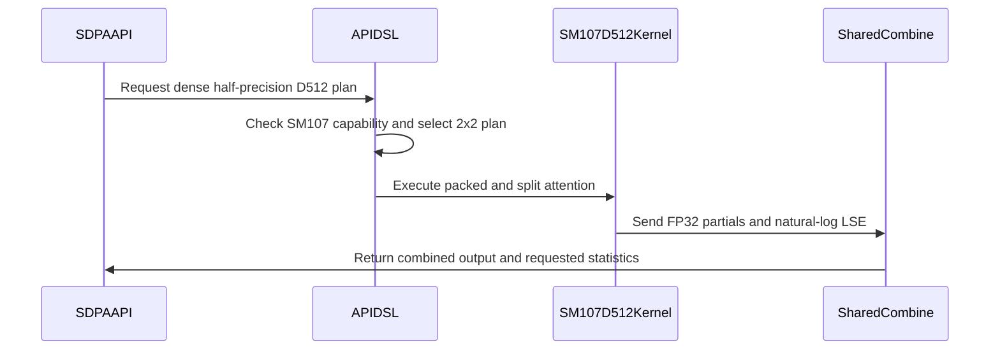

# sdpa fwd: enable native SM107 D512 packed and split plans

[Upstream PR](https://github.com/NVIDIA/cudnn-frontend/pull/1863) · state: closed · merged: True

## Original PR description

Dense D512 FP16/BF16 attention on SM107 previously declined PackGQA and split-KV through the public graph and standalone APIs. Enable both on the native 2x2 kernel, including G128: each tile packs gcd(G, 64) heads and addresses the corresponding KV head correctly when a group spans several tiles.

Split plans write FP32 output partials and natural-log LSE. The shared combine folds the attention sink once and applies the requested Stats log base. Graph eligibility, standalone support checks and template validation share the same dense half-precision domain. Native packed/split plans explicitly select the 2x2 body, while the existing unpacked comparison switch retains its behavior. Heuristics proposal and ranking code are unchanged.

The support tracker and tests cover graph/standalone execution, G64/G128 and partial groups, packed/unpacked and split/unsplit plans, sink, optional Stats in both log bases, KV tails, independent FP64 references, fresh bindings and two retained CUDA Graphs. The common graph contract still rejects bottom-right causal Q > KV; standalone coverage exercises its keyless rows. Paged/THD D512 and quantized eligibility are unchanged.

Validation records remain private. Public repository checks and the focused SDPA CI are requested. This PR makes no performance claim.

<!-- This is an auto-generated comment: release notes by coderabbit.ai -->
<!-- coderabbit-ai-generated:v1 -->

## Summary by CodeRabbit

* **New Features**
  * Added dense, half-precision D512 attention support on SM107, including packed grouped-query attention and split-KV execution.
  * Packed attention supports smaller head tiles within a group, including groups of 128.
  * Split-KV supports FP32 partial results, sink handling, and log-statistics conversion.
  * Scalar key/value tails are supported.
  * Paged inputs, THD layouts, and quantized inputs remain unsupported for this path.
<!-- end of auto-generated comment: release notes by coderabbit.ai -->

## Review and discussion

### reviews

- github-advanced-security[bot] · COMMENTED · 2026-10-26T05:10:25Z · [source](https://github.com/NVIDIA/cudnn-frontend/pull/1863#pullrequestreview-5647649604)

(No body; status only.)

- YangXu1990uiuc · COMMENTED · 2026-10-26T05:28:19Z · [source](https://github.com/NVIDIA/cudnn-frontend/pull/1863#pullrequestreview-5647765322)

(No body; status only.)

- YangXu1990uiuc · COMMENTED · 2026-10-26T05:30:00Z · [source](https://github.com/NVIDIA/cudnn-frontend/pull/1863#pullrequestreview-5647774317)

**Codex bot review · model: `gpt-6-astra`**

Reviewed `e0f03ef3b59e` against base `63a1e59e6f2a`.

Native validation found no correctness blocker in the new dense D512 packed/split paths. One P2 remains: expanding the capability row also changes automatic plan selection, even though the heuristics source is untouched. Please keep the new split capability explicit until its automatic-selection domain is qualified, or add an appropriately bounded selection rule. This review is COMMENT-only because it is posted from the author's account.

**[P2] Separate D512 split eligibility from automatic selection** ([source](https://github.com/NVIDIA/cudnn-frontend/blob/e0f03ef3b59e3e7b3beb0a355e67ab63cc8012ae/python/cudnn/sdpa/fwd/engines.py#L2374))

Adding (512,512) to split_d_shapes removes _split_points' early return and admits D512 into the generic prefill split model. This is observable through create_execution_plans([heur_mode.A]), not just explicit knob requests: for BF16 B=1, Hq/Hkv=8/2, Sq=17 or 129, Skv=1024, D=512, BSHD physical layout, Stats enabled and no mask/sink, the first graph plan changes from the unsplit SM107 plan to split=4 even without the FROST preference environment variable. PackGQA remains separately suppressed by its selection guard. Please similarly gate automatic D512 splitting until qualified, or narrow and qualify this new default domain. Preserve explicit packed/split support. A selection-policy probe should accompany the capability change; the explicit-plan numerical matrix does not detect this behavior change.

Evidence: Public graph enumeration on native SM107, with the old capability sets reconstructed on the same source versus the new sets, confirms this change for Sq=17/129 in normal and FROST-preferred modes. A 144-shape metadata grid finds 33 changed recommendation lists. The runtime controls and measurement details are retained privately. Attribution: Independent review finding caused by this capability expansion; the generic heuristic itself is unchanged.

Validation: 60/60 selected checks passed on native SM107 using this exact Python source and public CuTe DSL 4.8.0: 44 config/contract checks and the 16-case new execution module. Of those 16, the graph Q>KV case verifies its expected rejection; the other 15 execute kernels. The execution matrix covers graph and standalone APIs, FP16/BF16, G64/G128 and partial G6, packed/unpacked, split/unsplit, sink, optional Stats in natural/log2 units, KV tails, masking, fresh bindings and two retained CUDA Graphs against an independent CPU FP64 reference. Additional four-shape split/unsplit controls passed the FP64 O/LSE reference. Eight eager repeats and eight captured replays per arm, with poisoned outputs/workspace, were bitwise identical within each fixed plan. This is bounded repeatability evidence, not a cross-plan or cross-platform determinism guarantee. Audited packed head mapping, persistent per-batch handoff, split partial units, sink-once combine, keyless-row stores and the 2x2 barrier participant counts. No synchronization mismatch was found in that audit. Reused the author's active CI pipeline 76671448 rather than launching another run. Labels are appropriate; Frontend 1.32.0 milestone and project membership are now set.

Limitations: CI remains in progress. Its current SM107 selector does not include test_sdpa_d512_pack_split_sm107.py or test_sdpa_fwd_dsl_sm107.py, so a green result there would not establish coverage of this new D512 matrix. Please add the new module to the native lane; its two L0 G128 split cases are currently covered by the independent run above, not by that selector. The native extension was reused after verifying that C++/header/build inputs match its donor revision; the reviewed Python/kernel source is this head. No new sanitizer run or complete cross-platform regression was performed. Paged, THD and quantized D512 remain outside the added capability domain.

Comment only: GitHub does not allow reviewing one's own PR with approval/request-changes.

<!-- codex-fe-review:v2:1863:e0f03ef3b59e3e7b3beb0a355e67ab63cc8012ae:complete:no-blocker -->

- Anerudhan · APPROVED · 2026-10-26T05:43:55Z · [source](https://github.com/NVIDIA/cudnn-frontend/pull/1863#pullrequestreview-5647849590)

**Codex bot review · model: `gpt-6-astra`**

Reviewed `e0f03ef3b59e` against base `88b59a3cb524`.

Independent native SM107 checks found no approval-blocking correctness defect in dense D512 packing and splitting. The existing automatic-selection concern is confirmed: the public graph API changes its first plan from unsplit to split=4 for the checked short-query cases, and bounded timing supports keeping that new default domain gated. CI also exposes a stale capability assertion that needs updating.

- **[P2] Still open:** [Separate D512 split eligibility from automatic selection](https://github.com/NVIDIA/cudnn-frontend/pull/1863#pullrequestreview-5647774317).

**[P2] Update the existing partial-packing capability assertion** ([source](https://github.com/NVIDIA/cudnn-frontend/blob/e0f03ef3b59e3e7b3beb0a355e67ab63cc8012ae/python/cudnn/sdpa/fwd/engines.py#L2370))

Setting the SM107 row's pack_gqa_partial_d_shapes breaks test_pack_gqa_partial_d_shapes_in_lockstep_with_the_adapter. That test still asserts that every row except SM100 has this field unset, and its comment states the same obsolete rule. Update the assertion and comment to cover native SM107 D512 while retaining the SM100 adapter equality and the unchanged rows' guards. Pipeline 76671448 already fails this test on SM100.

Evidence: The exact CI integration matches all eight changed files and the graph-analyzer test. test_sdpa_graph_analyzer.py:1071 sees frozenset({(512,512)}) for sdpa_fwd_prefill_sm107 and fails all(v is None...). This failure is distinct from the inherited d64 scheduler assertion tracked by #1860. Attribution: Independent source and CI analysis.

Validation: Rechecked against base 88b59a3c after #1860 merged. The base delta only fixes the inherited d64 test assertion; runtime files are unchanged, so the native evidence remains applicable. The running integration predates that test fix. All 60 selected checks passed on native SM107 with DSL 4.8.0: 44 configuration/contract checks and the 16-case execution matrix. One graph case checks the expected Q>KV rejection; the other 15 execute kernels. The reviewed Python source was loaded, and native C++/header/build inputs match the reused extension's donor. The matrix covers graph and standalone APIs, FP16/BF16, G64/G128/G6, packed/unpacked, split/unsplit, sink, optional natural/log2 Stats, KV tails, independent CPU FP64 references, changed bindings and two retained captures. Additional analytic G128 and G6 probes used sink logits -1000/3, causal keyless rows, windows, split counts 8/3, log2 Stats and padded output storage; G6 also used pre-folded scale. Their grids had 1088/108 clusters versus capacity for 54 resident clusters, exercising reassignment. Both matched the analytic O/LSE reference, preserved padding, and produced eight bitwise-identical poison-and-replay results each. Independent public graph enumeration confirms the reported unsplit-to-split=4 default change for Sq17/129 without FROST preference. Both arms pass the CPU FP64 reference. Repeated interleaved captured timing supports the existing P2 selection concern; measurements remain scoped to those two workloads. Audited initial and persistent packed KV-head mapping, split-major workspace indexing, sink-once reduction, natural-log partial Stats, empty-split output stores and barrier participation. Precheck returned no candidates. Reused pipeline 76671448 and checked its changed files plus consumed heuristics and graph-analyzer test. SM100 has 17781 passes, 6618 skips and two failures: the new stale capability assertion and the inherited #1860 scheduler assertion. Other lanes remain pending. The new L0 execution cases skip on SM100, and the exact SM107 CI selector excludes both changed test modules. Add the new execution module to that native selector; a green lane would otherwise omit this feature.

Limitations: No new sanitizer run or complete cross-platform regression. Paged, THD and quantized D512 are outside the added support domain. Timing covers two within-head split/unsplit controls on one idle SM107 device, not application throughput or a full default-selection qualification. Repeatability evidence is within each fixed tested plan, not across plans or architectures.

Approved: no P0 or high-risk P1 found. Remaining findings stay with the owner; merge timing stays with the owner.

<!-- codex-fe-review:v2:1863:e0f03ef3b59e3e7b3beb0a355e67ab63cc8012ae:complete:no-blocker -->

- YangXu1990uiuc · COMMENTED · 2026-10-26T06:15:45Z · [source](https://github.com/NVIDIA/cudnn-frontend/pull/1863#pullrequestreview-5648059877)

**Codex bot review · model: `gpt-6-astra`**

Reviewed `b90baa42d438` against base `88b59a3cb524`.

The stale capability assertion is fixed: the exact-head CPU test passes, explicitly recognizing SM107 D512 while retaining the SM100 adapter equality and all other rows' guards. Runtime source is unchanged from e0f03ef3, so the earlier native correctness/rebinding/replay evidence remains applicable. The automatic split-selection P2 is still open and, as the author notes, has been handed to the heuristics owner. No new approval-blocking issue found; existing independent approval is preserved and this author's-account review is COMMENT-only.

- **[P2] Still open:** [Separate D512 split eligibility from automatic selection](https://github.com/NVIDIA/cudnn-frontend/pull/1863#pullrequestreview-5647774317).

Validation: Fresh exact-source CPU run: test_pack_gqa_partial_d_shapes_in_lockstep_with_the_adapter passes (1/1), with CUDA hidden and --noconftest. Its previously failing assertion now includes the intentional SM107 D512 capability and preserves the unchanged-row checks. The only change since e0f03ef3 is this six-line test update. Reused the previous 60-check native SM107 validation, FP64 reference checks, rebinding/retained captures and bounded repeatability evidence; none is counted as a new GPU run. Reused author-triggered pipeline 76680881 for b90baa4. The integration tree's updated graph-analyzer test has SHA256 714cc0c919f7c886daaf52671b2548fb01beb90ac674bbebc6e015049f0f5efa, identical to this head. The old pipeline was canceled by that request; no duplicate run was started.

Limitations: Pipeline 76680881 is still running. Its actual SM107 selector still excludes test_sdpa_d512_pack_split_sm107.py and test_sdpa_fwd_dsl_sm107.py; the separately described CI-config update is not in this integration snapshot. The earlier independent native run supplies that coverage, not this pending lane. No additional GPU, performance or sanitizer execution was needed for the test-only delta. Paged, THD and quantized D512 remain outside the added domain.

Comment only: GitHub does not allow reviewing one's own PR with approval/request-changes.

<!-- codex-fe-review:v2:1863:b90baa42d4388735f3440cba3656f1d40e605dc4:complete:no-blocker -->

- Anerudhan · COMMENTED · 2026-10-26T06:18:39Z · [source](https://github.com/NVIDIA/cudnn-frontend/pull/1863#pullrequestreview-5648078943)

**Codex bot review · model: `gpt-6-astra`**

Reviewed `b90baa42d438` against base `88b59a3cb524`.

The stale partial-packing capability assertion is fixed. The test now admits native SM107 D512 while preserving the SM100 adapter equality and the other architecture guards; its comment matches the contract. The focused test passes. Runtime code is unchanged, so the previous native correctness and replay evidence still applies. The existing nonblocking automatic split-selection concern remains with the heuristics follow-up.

- **[P2] Still open:** [Separate D512 split eligibility from automatic selection](https://github.com/NVIDIA/cudnn-frontend/pull/1863#pullrequestreview-5647774317).

Validation: Compared the complete delta from reviewed e0f03ef3: only the capability assertion and its comment changed. The exact changed test passed (1 passed, no skips). Retained prior independent native SM107 evidence: 60 tests passed, plus supported packed/split edge cases, poisoned output padding, and 16 bitwise retained-capture replays. No kernel rerun was needed for this test-only follow-up. Pipeline 76680881 is running; all nine PR-changed files match its integration tree. The current integration still excludes the new D512 module from its SM107 path selector; the announced CI-config change is not present in this run.

Limitations: Replacement CI is pending. The existing automatic-selection timing result remains limited to its measured short-query cases.

Comment only: this PR already has an active approval; preserving existing approvals.

<!-- codex-fe-review:v2:1863:b90baa42d4388735f3440cba3656f1d40e605dc4:complete:no-blocker -->

### issue_comments

- coderabbitai[bot] · comment · 2026-10-26T04:52:53Z · [source](https://github.com/NVIDIA/cudnn-frontend/pull/1863#issuecomment-6408523273)

<!-- coderabbit-ai-generated:v1 -->

<!-- This is an auto-generated comment: summarize by coderabbit.ai -->
<!-- review_stack_entry_start -->

<a href="https://app.coderabbit.ai/change-stack/NVIDIA/cudnn-frontend/pull/1863?scope=ghh_OusAJGA4HG8ljoOV0wJvVx8NmnZIjc2DdjmxOu0xZWA&amp;cs_source=review_comment"><picture><source media="(prefers-color-scheme: dark)" srcset="https://storage.googleapis.com/coderabbit_public_assets/review-stack-in-coderabbit-ui-dark.svg?v=3"><source media="(prefers-color-scheme: light)" srcset="https://storage.googleapis.com/coderabbit_public_assets/review-stack-in-coderabbit-ui.svg?v=3"></picture></a>

<!-- review_stack_entry_end -->
<!-- recent_review_start -->

No actionable comments were generated in the recent review.

<strong><picture></picture> Recent review info</strong>

<dl>
<dd>

<strong><picture><source media="(prefers-color-scheme: dark)" srcset="https://storage.googleapis.com/coderabbit_public_assets/review-comment-icons-v1/cog-dark.svg"></picture> Run configuration</strong>

<dl>
<dd>

- **Source mode**: Auto
- **Repository**: [NVIDIA/cudnn-frontend](<https://github.com/NVIDIA/cudnn-frontend>)
- **Branch**: [develop](<https://github.com/NVIDIA/cudnn-frontend/tree/develop>)
- **File**: [.coderabbit.yaml](<https://github.com/NVIDIA/cudnn-frontend/blob/63a1e59e6f2a5d4860afbd4707cc433796ac9571/.coderabbit.yaml>)
- **Commit**: [63a1e59](<https://github.com/NVIDIA/cudnn-frontend/commit/63a1e59e6f2a5d4860afbd4707cc433796ac9571>)
- **Layers**: Repository YAML
- **Review profile**: CHILL
- **Plan**: Enterprise
- **Run ID**: `45ed5118-a35a-4004-ab1c-1c76c05ce1b2`

</dd>
</dl>

<strong><picture><source media="(prefers-color-scheme: dark)" srcset="https://storage.googleapis.com/coderabbit_public_assets/review-comment-icons-v1/git-commit-horizontal-dark.svg"></picture> Commits</strong>

<dl>
<dd>

Reviewing files that changed from the base of the PR and between e0f03ef3b59e3e7b3beb0a355e67ab63cc8012ae and b90baa42d4388735f3440cba3656f1d40e605dc4.

</dd>
</dl>

<strong><picture><source media="(prefers-color-scheme: dark)" srcset="https://storage.googleapis.com/coderabbit_public_assets/review-comment-icons-v1/file-plus-corner-dark.svg"></picture> Files selected for processing: 1</strong>

<dl>
<dd>

* `test/python/sdpa/frost/test_sdpa_graph_analyzer.py`

</dd>
</dl>

**Included review availability:** This review used your included allowance. Your plan provides up to 12 included reviews per hour; 7 remain after this review.

</dd>
</dl>

<!-- recent_review_end -->
<!-- walkthrough_start -->

<strong>Walkthrough</strong>

<dl>
<dd>

The change enables PackGQA and split-KV for eligible SM107 dense half-precision D512 plans. It updates plan routing and kernel handling, and adds configuration, numerical, and graph-replay tests.

**Changes: SM107 D512 packed and split attention**

|Layer / File(s)|Summary|
|:---|:---|
|**D512 plan eligibility and routing**   `python/cudnn/sdpa/fwd/config_sm100.py`, `python/cudnn/sdpa/fwd/config_sm107.py`, `python/cudnn/sdpa/fwd/engines.py`, `python/cudnn/sdpa/fwd/api_dsl.py`, `python/cudnn/sdpa/frost/SUPPORT_MATRIX_TRACKER.md`|Configuration checks, engine capabilities, and DSL plan selection admit eligible SM107 dense D512 packed and split plans. The 2x2 configuration supports partial PackGQA groups.|
|**Packed-head and split-KV kernel behavior**   `python/cudnn/sdpa/fwd/kernels/sm107/prefill_d512_f16_2x2.py`, `python/cudnn/sdpa/frost/SUPPORT_MATRIX_TRACKER.md`|The kernel accepts partial GQA packing and derives KV heads from packed query-head indices. Sink folding and log2 statistics conversion are limited to unsplit execution. The tracker describes the supported cases and split partial behavior.|
|**Configuration and execution coverage**   `test/python/sdpa/frost/test_sdpa_fwd_dsl_sm107.py`, `test/python/sdpa/frost/test_sdpa_d512_pack_split_sm107.py`, `test/python/sdpa/frost/test_sdpa_graph_analyzer.py`|Tests cover packed and unpacked plans, split counts, supported and rejected inputs, numerical outputs and statistics, engine capabilities, and CUDA graph replay.|

<!-- change_assessment_start -->
<strong>Priority: <picture></picture> Normal</strong>

**Estimated code review effort:** 3 (Moderate) | ~25 minutes

<!-- change_assessment_commit:"b90baa42d4388735f3440cba3656f1d40e605dc4" -->
**Change:** Feature
<!-- change_assessment_end -->

### Sequence Diagram(s)

**Possibly related PRs**
- [NVIDIA/cudnn-frontend#1830](https://github.com/NVIDIA/cudnn-frontend/pull/1830): Adds native SM107 D128 half-precision PackGQA, which is related to this PR’s D512 admission and routing.
- [NVIDIA/cudnn-frontend#1836](https://github.com/NVIDIA/cudnn-frontend/pull/1836): Adds native SM107 dense partial PackGQA for D128, related to the D512 partial-PackGQA behavior here.
- [NVIDIA/cudnn-frontend#1858](https://github.com/NVIDIA/cudnn-frontend/pull/1858): Enables SM107 half dense sink handling with split-KV, related to sink folding and split partial handling in this PR.

**Suggested labels:** `mod-cutedsl`, `mod-frost`

**Suggested reviewers:** `vedaanta`

</dd>
</dl>

<!-- walkthrough_end -->

<strong>Merge Risk:</strong> <strong><picture></picture> Minimal</strong> · up to <code>b90ba</code>

<dl>
<dd>

<!-- final_review_risk_start -->
<!-- final_review_risk_label
**Merge Risk:** **⚪ Minimal** · up to `b90ba`
-->
<!-- final_review_risk_coverage:{"sourceCommitId":"b90baa42d4388735f3440cba3656f1d40e605dc4","coveredCommitId":"b90baa42d4388735f3440cba3656f1d40e605dc4","kind":"reviewed"} -->

This change updates the capability test for the newly supported SM107 D512 route; no actionable merge blocker is evident in the reviewed change.
<!-- final_review_risk_end -->

</dd>
</dl>

<!-- pre_merge_checks_walkthrough_start -->

<strong>Pre-merge checks: <picture></picture> 4 · <picture></picture> 1</strong>

<dl>
<dd>

<strong><picture></picture> Failed checks: 1 warning</strong>

|     Check name     |                                              Status                                              | Explanation                                                                                                                                                                                 | Resolution                                                                         |
| :---------------- | :----------------------------------------------------------------------------------------------: | :------------------------------------------------------------------------------------------------------------------------------------------------------------------------------------------ | :--------------------------------------------------------------------------------- |
| Docstring Coverage |  | Docstring coverage is 64.29% which is insufficient. The required threshold is 80.00%. Docstring coverage is scoped to functions touched by this diff. Analyzed 28 functions across 8 files. | Write docstrings for the functions missing them to satisfy the coverage threshold. |

<strong><picture></picture> Passed checks: 4 passed</strong>

<dl>
<dd>

|         Check name         |                                             Status                                             | Explanation                                                                                                                                                                                               |
| :------------------------ | :--------------------------------------------------------------------------------------------: | :-------------------------------------------------------------------------------------------------------------------------------------------------------------------------------------------------------- |
|         Title check        |  | The title clearly and concisely describes the main change: enabling native SM107 D512 packed and split plans.                                                                                             |
|      Description check     |  | The description is detailed and covers the change, rationale, compatibility boundaries, and test scope. It does not reproduce the template headings, checklist status, related issue entry, or exact tes… |
|     Linked Issues check    |  | Check skipped because no linked issues were found for this pull request.                                                                                                                                  |
| Out of Scope Changes check |  | Check skipped because no linked issues were found for this pull request.                                                                                                                                  |

<strong>Full details: Description check</strong>

<dl>
<dd>

**Explanation**

The description is detailed and covers the change, rationale, compatibility boundaries, and test scope. It does not reproduce the template headings, checklist status, related issue entry, or exact test commands and results, but the required technical information is mostly present.

</dd>
</dl>

</dd>
</dl>

</dd>
</dl>

<!-- pre_merge_checks_walkthrough_end -->
<!-- finishing_touch_checkbox_start -->

<strong>Finishing Touches</strong>

<dl>
<dd>

<strong>🧪 Generate unit tests (beta)</strong>

<dl>
<dd>

- [ ] <!-- {"checkboxId": "f47ac10b-58cc-4372-a567-0e02b2c3d479", "radioGroupId": "utg-output-choice-group-unknown_comment_id"} --> Create a new PR

</dd>
</dl>

</dd>
</dl>

<!-- finishing_touch_checkbox_end -->

<!-- autopilot:start -->
- [ ] <!-- {"checkboxId":"2708ad07-9f24-4260-9c11-7dc76a49f2e3"} --> <strong title="Keep fixing CodeRabbit findings and required CI, and resolving merge conflicts">Autofix</strong> · Keep fixing CodeRabbit findings and required CI, and resolving merge conflicts
<!-- autopilot:end -->
<!-- tips_start -->

Comment `@coderabbitai help` to get the list of available commands.

<!-- tips_end -->

- YangXu1990uiuc · comment · 2026-10-26T04:53:07Z · [source](https://github.com/NVIDIA/cudnn-frontend/pull/1863#issuecomment-6408525882)

@cudnn-ci-bot run python/sdpa/frost

- cudnn-ci-bot · comment · 2026-10-26T04:53:56Z · [source](https://github.com/NVIDIA/cudnn-frontend/pull/1863#issuecomment-6408535029)

🏁 Pipeline finished

SHA: `9e46949`
Targets: `python/sdpa/frost`
Branch: [cudnn-gh/pr-1863-9e46949](https://nv/cudnn-gitlab-ci/-/tree/cudnn-gh/pr-1863-9e46949)
Pipeline: [76670267](https://nv/cudnn-gitlab-ci/-/pipelines/76670267)
Last updated: 2026-10-26 05:07 UTC

**16 passed, 9 canceled, 3 skipped, 11 manual**

### <code>manual</code>

- <code>manual:python_samples</code> - Manual
- <code>manual:python</code> - Manual
- <code>manual:python/sdpa/frost</code> - ✅ Passed
- <code>manual:python/linear_attention/frost</code> - Manual
- <code>manual:python/gemm/frost</code> - Manual
- <code>manual:python/*/frost</code> - Manual
- <code>manual:python/gemm/cutedsl</code> - Manual
- <code>manual:python/*/cutedsl</code> - Manual
- <code>manual:python/*/jax</code> - Manual
- <code>manual:pycudnn</code> - Manual
- <code>manual:multi_gpu</code> - Manual
- <code>manual:backend</code> - Manual

### <code>analysis</code>

- <code>analysis:cudnn_clang_disable_exception</code> - ✅ Passed
- <code>analysis:cudnn_v9_no_half_conversion</code> - ✅ Passed
- <code>analysis:cudnn_clang</code> - ✅ Passed
- <code>analysis:check-relative-includes</code> - ✅ Passed
- <code>analysis:check-CUDNN_FRONTEND_SKIP_JSON_LIB</code> - ✅ Passed
- <code>analysis:guardwords_scan</code> - ✅ Passed
- <code>analysis:jax-import-guard</code> - ✅ Passed
- <code>analysis:pytest-gpu</code> - ✅ Passed
- <code>san:build</code> - ✅ Passed

### <code>build</code>

- <code>analysis:api_index</code> - ✅ Passed
- <code>build:dev:linux:amd64</code> - ✅ Passed
- <code>build:rel:linux:amd64</code> - ✅ Passed
- <code>build:dev:linux:arm64</code> - ✅ Passed
- <code>build:rel:linux:arm64</code> - ✅ Passed
- <code>build:rel:win:amd64</code> - ✅ Passed

### <code>frost_tests</code>

- <code>python/sdpa/frost:cutlass-rel:sm80</code> - Canceled
- <code>python/sdpa/frost:cutlass-rel:sm100</code> - Canceled
- <code>python/sdpa/frost:cutlass-rel:sm120</code> - Canceled
- <code>python/linear_attention/frost:cutlass-rel:sm100</code> - Skipped
- <code>python/gemm/frost:cutlass-rel:sm100</code> - Skipped
- <code>python/*/frost:cutlass-rel:sm100</code> - Skipped
- <code>python/sdpa/frost:cutlass-rel:sm103</code> - Canceled
- <code>python/sdpa/frost:cutlass-4.8:sm107</code> - Canceled

### <code>sanitizer_tests</code>

- <code>san:cpp_test:sm80</code> - Canceled
- <code>san:cpp_test:sm90</code> - Canceled
- <code>san:cpp_test:sm100</code> - Canceled

### <code>triage</code>

- <code>triage:ai</code> - Canceled

- YangXu1990uiuc · comment · 2026-10-26T05:04:34Z · [source](https://github.com/NVIDIA/cudnn-frontend/pull/1863#issuecomment-6408658030)

@cudnn-ci-bot run python/sdpa/frost

- cudnn-ci-bot · comment · 2026-10-26T05:04:37Z · [source](https://github.com/NVIDIA/cudnn-frontend/pull/1863#issuecomment-6408658675)

🏁 Pipeline finished

SHA: `e0f03ef`
Targets: `python/sdpa/frost`
Branch: [cudnn-gh/pr-1863-e0f03ef](https://nv/cudnn-gitlab-ci/-/tree/cudnn-gh/pr-1863-e0f03ef)
Pipeline: [76671448](https://nv/cudnn-gitlab-ci/-/pipelines/76671448)
Cancelled this PR's older pipelines: 76670267
Last updated: 2026-10-26 06:04 UTC

**20 passed, 3 failed, 2 canceled, 3 skipped, 11 manual**

### <code>manual</code>

- <code>manual:python_samples</code> - Manual
- <code>manual:python</code> - Manual
- <code>manual:python/sdpa/frost</code> - ✅ Passed
- <code>manual:python/linear_attention/frost</code> - Manual
- <code>manual:python/gemm/frost</code> - Manual
- <code>manual:python/*/frost</code> - Manual
- <code>manual:python/gemm/cutedsl</code> - Manual
- <code>manual:python/*/cutedsl</code> - Manual
- <code>manual:python/*/jax</code> - Manual
- <code>manual:pycudnn</code> - Manual
- <code>manual:multi_gpu</code> - Manual
- <code>manual:backend</code> - Manual

### <code>analysis</code>

- <code>analysis:cudnn_clang_disable_exception</code> - ✅ Passed
- <code>analysis:cudnn_v9_no_half_conversion</code> - ✅ Passed
- <code>analysis:cudnn_clang</code> - ✅ Passed
- <code>analysis:check-relative-includes</code> - ✅ Passed
- <code>analysis:check-CUDNN_FRONTEND_SKIP_JSON_LIB</code> - ✅ Passed
- <code>analysis:guardwords_scan</code> - ✅ Passed
- <code>analysis:jax-import-guard</code> - ✅ Passed
- <code>analysis:pytest-gpu</code> - ✅ Passed
- <code>san:build</code> - ✅ Passed

### <code>build</code>

- <code>analysis:api_index</code> - ✅ Passed
- <code>build:dev:linux:amd64</code> - ✅ Passed
- <code>build:rel:linux:amd64</code> - ✅ Passed
- <code>build:dev:linux:arm64</code> - ✅ Passed
- <code>build:rel:linux:arm64</code> - ✅ Passed
- <code>build:rel:win:amd64</code> - ✅ Passed

### <code>frost_tests</code>

- <code>python/sdpa/frost:cutlass-rel:sm80</code> - ❌ **New Failure!** (nightly passed)
- <code>python/sdpa/frost:cutlass-rel:sm100</code> - ❌ **New Failure!** (nightly passed)
- <code>python/sdpa/frost:cutlass-rel:sm120</code> - Canceled
- <code>python/linear_attention/frost:cutlass-rel:sm100</code> - Skipped
- <code>python/gemm/frost:cutlass-rel:sm100</code> - Skipped
- <code>python/*/frost:cutlass-rel:sm100</code> - Skipped
- <code>python/sdpa/frost:cutlass-rel:sm103</code> - ❌ **New Failure!** (nightly passed)
- <code>python/sdpa/frost:cutlass-4.8:sm107</code> - ✅ Passed

### <code>sanitizer_tests</code>

- <code>san:cpp_test:sm80</code> - ✅ Passed
- <code>san:cpp_test:sm90</code> - ✅ Passed
- <code>san:cpp_test:sm100</code> - ✅ Passed

### <code>triage</code>

- <code>triage:ai</code> - Canceled

- YangXu1990uiuc · comment · 2026-10-26T05:54:35Z · [source](https://github.com/NVIDIA/cudnn-frontend/pull/1863#issuecomment-6409265512)

CI follow-up for `e0f03ef3`: pipeline **76671448** is still running, but SM100 and SM103 have finished with the same two failures.

One needs an update in this PR: `test_pack_gqa_partial_d_shapes_in_lockstep_with_the_adapter` still asserts that every row except SM100 half has `pack_gqa_partial_d_shapes is None`. The new SM107 D512 declaration intentionally violates that old expectation. Please update the assertion to recognize the new shared D512 domain while retaining the checks on other rows; the tested file is identical to this head. This is a **P2 test-contract update**, not a reproduced numerical failure.

The other failure is `test_sm107_shared_d128_scheduler_follows_the_measured_tables[swa_decode_natural]`, addressed by the now-merged #1860. This pipeline's integration tree predates that test correction.

SM107 has passed its selected tests. As noted in the review, its selector excludes the new D512 module, which was covered by the independent native run. SM80/SM120 are still pending completion; no duplicate CI was started.

Codex bot review — model `gpt-6-astra`.

<!-- codex-fe-ci:v1:1863:e0f03ef3b59e3e7b3beb0a355e67ab63cc8012ae:pipeline-76671448-partial-pack-fixture -->

- YangXu1990uiuc · comment · 2026-10-26T05:57:27Z · [source](https://github.com/NVIDIA/cudnn-frontend/pull/1863#issuecomment-6409301345)

The stale capability assertion is corrected in b90baa42d: the test now explicitly expects native SM107 D512 partial packing, retains equality with the SM100 adapter flavors, and guards every other row. The focused CPU contract and scoped pre-commit checks pass. Runtime source is unchanged from the reviewed commit.

The automatic split-selection concern is handed to the heuristics owner under our existing ownership split. A separate CI-config change adds the native half contract and D512 execution modules through the existing optional-path selector; the actual selector has been checked with the new files present and absent.

- YangXu1990uiuc · comment · 2026-10-26T05:57:29Z · [source](https://github.com/NVIDIA/cudnn-frontend/pull/1863#issuecomment-6409301949)

@cudnn-ci-bot run python/sdpa/frost

- cudnn-ci-bot · comment · 2026-10-26T06:02:00Z · [source](https://github.com/NVIDIA/cudnn-frontend/pull/1863#issuecomment-6409359136)

🏁 Pipeline finished

SHA: `b90baa4`
Targets: `python/sdpa/frost`
Branch: [cudnn-gh/pr-1863-b90baa4](https://nv/cudnn-gitlab-ci/-/tree/cudnn-gh/pr-1863-b90baa4)
Pipeline: [76680881](https://nv/cudnn-gitlab-ci/-/pipelines/76680881)
Cancelled this PR's older pipelines: 76671448
Last updated: 2026-10-26 07:03 UTC

**25 passed, 3 skipped, 11 manual**

### <code>manual</code>

- <code>manual:python_samples</code> - Manual
- <code>manual:python</code> - Manual
- <code>manual:python/sdpa/frost</code> - ✅ Passed
- <code>manual:python/linear_attention/frost</code> - Manual
- <code>manual:python/gemm/frost</code> - Manual
- <code>manual:python/*/frost</code> - Manual
- <code>manual:python/gemm/cutedsl</code> - Manual
- <code>manual:python/*/cutedsl</code> - Manual
- <code>manual:python/*/jax</code> - Manual
- <code>manual:pycudnn</code> - Manual
- <code>manual:multi_gpu</code> - Manual
- <code>manual:backend</code> - Manual

### <code>analysis</code>

- <code>analysis:cudnn_clang_disable_exception</code> - ✅ Passed
- <code>analysis:cudnn_v9_no_half_conversion</code> - ✅ Passed
- <code>analysis:cudnn_clang</code> - ✅ Passed
- <code>analysis:check-relative-includes</code> - ✅ Passed
- <code>analysis:check-CUDNN_FRONTEND_SKIP_JSON_LIB</code> - ✅ Passed
- <code>analysis:guardwords_scan</code> - ✅ Passed
- <code>analysis:jax-import-guard</code> - ✅ Passed
- <code>analysis:pytest-gpu</code> - ✅ Passed
- <code>san:build</code> - ✅ Passed

### <code>build</code>

- <code>analysis:api_index</code> - ✅ Passed
- <code>build:dev:linux:amd64</code> - ✅ Passed
- <code>build:rel:linux:amd64</code> - ✅ Passed
- <code>build:dev:linux:arm64</code> - ✅ Passed
- <code>build:rel:linux:arm64</code> - ✅ Passed
- <code>build:rel:win:amd64</code> - ✅ Passed

### <code>frost_tests</code>

- <code>python/sdpa/frost:cutlass-rel:sm80</code> - ✅ Passed
- <code>python/sdpa/frost:cutlass-rel:sm100</code> - ✅ Passed
- <code>python/sdpa/frost:cutlass-rel:sm120</code> - ✅ Passed
- <code>python/linear_attention/frost:cutlass-rel:sm100</code> - Skipped
- <code>python/gemm/frost:cutlass-rel:sm100</code> - Skipped
- <code>python/*/frost:cutlass-rel:sm100</code> - Skipped
- <code>python/sdpa/frost:cutlass-rel:sm103</code> - ✅ Passed
- <code>python/sdpa/frost:cutlass-4.8:sm107</code> - ✅ Passed

### <code>sanitizer_tests</code>

- <code>san:cpp_test:sm80</code> - ✅ Passed
- <code>san:cpp_test:sm90</code> - ✅ Passed
- <code>san:cpp_test:sm100</code> - ✅ Passed

### <code>triage</code>

- <code>triage:ai</code> - ✅ Passed

### inline_comments

- github-advanced-security[bot] · comment · 2026-10-26T05:10:25Z · [source](https://github.com/NVIDIA/cudnn-frontend/pull/1863#discussion_r4374126686)

File: `test/python/sdpa/frost/test_sdpa_fwd_dsl_sm107.py` · line 489

## CodeQL / Module is imported with 'import' and 'import from'

Module 'cudnn' is imported with both 'import' and 'import from'.

[Show more details](https://github.com/NVIDIA/cudnn-frontend/security/code-scanning/4084)

- YangXu1990uiuc · comment · 2026-10-26T05:28:19Z · [source](https://github.com/NVIDIA/cudnn-frontend/pull/1863#discussion_r4374214784)

File: `test/python/sdpa/frost/test_sdpa_fwd_dsl_sm107.py` · line 489

The `from cudnn import _pybind_module` statement is inside `_THD_GATE_BIND_PROBE`, a source string executed in a separate interpreter. This test uses a function-local `import cudnn`; it does not mix those two imports in one interpreter scope. Keeping the import local also preserves the test module's existing import behavior.

## Changed files and fixed code

- `python/cudnn/sdpa/frost/SUPPORT_MATRIX_TRACKER.md` · modified · additions 6 / deletions 2
  - [head](https://github.com/YangXu1990uiuc/cudnn-frontend/blob/b90baa42d4388735f3440cba3656f1d40e605dc4/python/cudnn/sdpa/frost/SUPPORT_MATRIX_TRACKER.md)
  - [base](https://github.com/NVIDIA/cudnn-frontend/blob/63a1e59e6f2a5d4860afbd4707cc433796ac9571/python/cudnn/sdpa/frost/SUPPORT_MATRIX_TRACKER.md)
- `python/cudnn/sdpa/fwd/api_dsl.py` · modified · additions 26 / deletions 14
  - [head](https://github.com/YangXu1990uiuc/cudnn-frontend/blob/b90baa42d4388735f3440cba3656f1d40e605dc4/python/cudnn/sdpa/fwd/api_dsl.py)
  - [base](https://github.com/NVIDIA/cudnn-frontend/blob/63a1e59e6f2a5d4860afbd4707cc433796ac9571/python/cudnn/sdpa/fwd/api_dsl.py)
- `python/cudnn/sdpa/fwd/config_sm100.py` · modified · additions 7 / deletions 5
  - [head](https://github.com/YangXu1990uiuc/cudnn-frontend/blob/b90baa42d4388735f3440cba3656f1d40e605dc4/python/cudnn/sdpa/fwd/config_sm100.py)
  - [base](https://github.com/NVIDIA/cudnn-frontend/blob/63a1e59e6f2a5d4860afbd4707cc433796ac9571/python/cudnn/sdpa/fwd/config_sm100.py)
- `python/cudnn/sdpa/fwd/config_sm107.py` · modified · additions 10 / deletions 5
  - [head](https://github.com/YangXu1990uiuc/cudnn-frontend/blob/b90baa42d4388735f3440cba3656f1d40e605dc4/python/cudnn/sdpa/fwd/config_sm107.py)
  - [base](https://github.com/NVIDIA/cudnn-frontend/blob/63a1e59e6f2a5d4860afbd4707cc433796ac9571/python/cudnn/sdpa/fwd/config_sm107.py)
- `python/cudnn/sdpa/fwd/engines.py` · modified · additions 16 / deletions 4
  - [head](https://github.com/YangXu1990uiuc/cudnn-frontend/blob/b90baa42d4388735f3440cba3656f1d40e605dc4/python/cudnn/sdpa/fwd/engines.py)
  - [base](https://github.com/NVIDIA/cudnn-frontend/blob/63a1e59e6f2a5d4860afbd4707cc433796ac9571/python/cudnn/sdpa/fwd/engines.py)
- `python/cudnn/sdpa/fwd/kernels/sm107/prefill_d512_f16_2x2.py` · modified · additions 9 / deletions 8
  - [head](https://github.com/YangXu1990uiuc/cudnn-frontend/blob/b90baa42d4388735f3440cba3656f1d40e605dc4/python/cudnn/sdpa/fwd/kernels/sm107/prefill_d512_f16_2x2.py)
  - [base](https://github.com/NVIDIA/cudnn-frontend/blob/63a1e59e6f2a5d4860afbd4707cc433796ac9571/python/cudnn/sdpa/fwd/kernels/sm107/prefill_d512_f16_2x2.py)
- `test/python/sdpa/frost/test_sdpa_d512_pack_split_sm107.py` · added · additions 212 / deletions 0
  - [head](https://github.com/YangXu1990uiuc/cudnn-frontend/blob/b90baa42d4388735f3440cba3656f1d40e605dc4/test/python/sdpa/frost/test_sdpa_d512_pack_split_sm107.py)
  - [base](https://github.com/NVIDIA/cudnn-frontend/blob/63a1e59e6f2a5d4860afbd4707cc433796ac9571/test/python/sdpa/frost/test_sdpa_d512_pack_split_sm107.py)
- `test/python/sdpa/frost/test_sdpa_fwd_dsl_sm107.py` · modified · additions 63 / deletions 3
  - [head](https://github.com/YangXu1990uiuc/cudnn-frontend/blob/b90baa42d4388735f3440cba3656f1d40e605dc4/test/python/sdpa/frost/test_sdpa_fwd_dsl_sm107.py)
  - [base](https://github.com/NVIDIA/cudnn-frontend/blob/63a1e59e6f2a5d4860afbd4707cc433796ac9571/test/python/sdpa/frost/test_sdpa_fwd_dsl_sm107.py)
- `test/python/sdpa/frost/test_sdpa_graph_analyzer.py` · modified · additions 4 / deletions 2
  - [head](https://github.com/YangXu1990uiuc/cudnn-frontend/blob/b90baa42d4388735f3440cba3656f1d40e605dc4/test/python/sdpa/frost/test_sdpa_graph_analyzer.py)
  - [base](https://github.com/NVIDIA/cudnn-frontend/blob/63a1e59e6f2a5d4860afbd4707cc433796ac9571/test/python/sdpa/frost/test_sdpa_graph_analyzer.py)

## Evidence and interpretation boundary

[Original JSON, discussions and patches](../../../../../../evidence/prs/NVIDIA--cudnn-frontend/1863-97aae139f1cee5bc75099694790e2119d37cfdd4831f3d5bb0e57911651fefa2.json) · SHA-256 `97aae139f1cee5bc75099694790e2119d37cfdd4831f3d5bb0e57911651fefa2`.

Diff complete: True. Missing/binary/truncated patches require pinned source inspection. This is a source page, not an independently verified optimization case. Open, merged and released are different states; recheck the deployed dependency.
