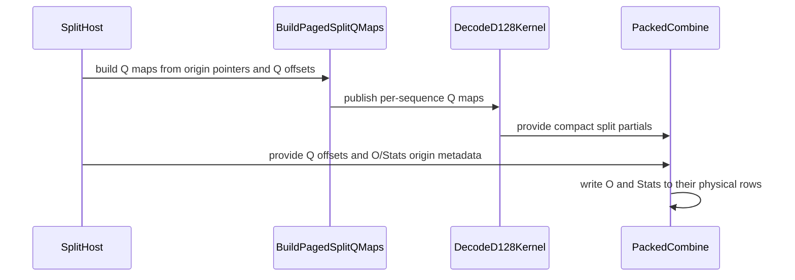

# fix(sdpa): preserve physical origins in paged THD attention

[Upstream PR](https://github.com/NVIDIA/cudnn-frontend/pull/1866) · state: closed · merged: True

## Original PR description

Paged THD attention must use the caller's independent Q, O and Stats offsets even when valid query lengths leave gaps between sequences. Previously these plans reconstructed compact token origins, so padded query slots could produce incorrect outputs. This follows #1861 and extends its physical-origin contract to paged K/V.

The unsplit D128/D256 paths keep K/V page-table addressing and use sequence-local Q/O maps. D128 CGA1 split plans also read sequence-local Q maps, retain compact partial-result buffers, and place the combined O and Stats at their independent physical origins. Current pointers and output strides are rebound on every invocation; retained captures read changed offsets. Native admission checks reserve enough map storage before the partials and require a matching extension. Paged D256 packing is admitted only for its existing CGA2 unsplit body. Candidate ranking is unchanged.

Regression coverage includes default FROST plans and explicit CGA1/CGA2, split counts 2/3/5/8, packed/unpacked heads, mixed pool layouts, FP16/BF16, both Stats layouts, separate offsets and page tables, stride overrides, keyless/all-empty rows, and retained CUDA Graph replay. The legacy paged comparison now constructs an independent standalone API instead of mutating private prepared-plan state. Host tests check independent invocation frames and reject overlapping origin/partial workspace regions.

Validation: focused native binding/host contracts, actual kernel cross-compilation, native extension build, and scoped pre-commit checks. GPU qualification details are maintained separately.

<!-- This is an auto-generated comment: release notes by coderabbit.ai -->
<!-- coderabbit-ai-generated:v1 -->

## Summary by CodeRabbit

* **New Features**
  * Added support for paged attention with independent physical query, output, and statistics origins, including eligible split D128 plans.
  * Enabled paged half-precision D256 GQA packing on SM100, SM103, and SM107 without splitting.
  * Improved placement of outputs and statistics for split attention plans.
* **Bug Fixes**
  * Corrected handling of paged key/value data so page-table addressing remains in effect when physical origins are used.
<!-- end of auto-generated comment: release notes by coderabbit.ai -->

## Review and discussion

### reviews

- github-advanced-security[bot] · COMMENTED · 2026-10-26T06:26:26Z · [source](https://github.com/NVIDIA/cudnn-frontend/pull/1866#pullrequestreview-5648128938)

(No body; status only.)

- Anerudhan · APPROVED · 2026-10-26T07:03:27Z · [source](https://github.com/NVIDIA/cudnn-frontend/pull/1866#pullrequestreview-5648484998)

**Codex bot review · model: `gpt-6-astra`**

Reviewed `27af1bb370d8` against base `726ef3b0f532`.

The paged physical-origin implementation passes independent native validation. Q maps, compact split partials, final O/Stats placement, and rebinding agree with the stated contract. The develop merge retains the tested D128/D256 paths. No approval-blocking issue found.

Validation: Built a matching native extension and ran 410 passing tests with 12 skips on the preceding head: 319 native binder checks, all 15 new paged-origin cases, 68 prepared paged graph/standalone checks, and eight capability checks. The develop merge does not change those paged kernels or native binding inputs; this evidence remains applicable. Reran independent BF16 probes on this exact head: 17 batches, Hq24/Hkv4 (partial GQA), mixed K/V pool layouts, empty sequences between live sequences, and different non-self-inverse Q/O/Stats origin permutations. D128 split=3 with head-major log2 Stats and D256 unsplit with token-major Stats passed numerical and padding checks. Exact-head probes used more live work than resident clusters, changed token/head strides, retained two captures per case, and passed four bitwise poison/replay iterations per capture (16 total), followed by all-empty-query replay. The same D128 split probe passed Compute Sanitizer memcheck before the develop merge, with zero device errors. Its relevant kernel/binding code is unchanged. API-error reporting and leak checking were disabled; this is device-access evidence. Inspected workspace map/origin reservation against partial buffers, setup launch ordering, tensor-map release/acquire, unchanged attention barrier protocols, and warp-uniform combiner bounds and prefix lookup (checklist A03/C01/C14/C15/D13/D14). Reused pipeline 76687702; all 17 current PR files match its integration tree. CI is running.

Limitations: Native GPU checks used SM100 and CuTe DSL 4.8.0. No new SM103/SM107 hardware run or performance measurement; the shared GPU was unsuitable for timing claims. The broader test matrix and memcheck were reused after reviewing the develop merge. Exact-head confirmation was limited to the two independent paged-origin probes.

Approved: no P0 or high-risk P1 found. Remaining findings stay with the owner; merge timing stays with the owner.

<!-- codex-fe-review:v2:1866:27af1bb370d878ee122f79f597046605aba90fdd:complete:no-blocker -->

### issue_comments

- coderabbitai[bot] · comment · 2026-10-26T06:24:25Z · [source](https://github.com/NVIDIA/cudnn-frontend/pull/1866#issuecomment-6409667561)

<!-- coderabbit-ai-generated:v1 -->

<!-- This is an auto-generated comment: summarize by coderabbit.ai -->
<!-- review_stack_entry_start -->

<a href="https://app.coderabbit.ai/change-stack/NVIDIA/cudnn-frontend/pull/1866?scope=ghh_OusAJGA4HG8ljoOV0wJvVx8NmnZIjc2DdjmxOu0xZWA&amp;cs_source=review_comment"><picture><source media="(prefers-color-scheme: dark)" srcset="https://storage.googleapis.com/coderabbit_public_assets/review-stack-in-coderabbit-ui-dark.svg?v=3"><source media="(prefers-color-scheme: light)" srcset="https://storage.googleapis.com/coderabbit_public_assets/review-stack-in-coderabbit-ui.svg?v=3"></picture></a>

<!-- review_stack_entry_end -->
<!-- recent_review_start -->

No actionable comments were generated in the recent review.

<strong><picture></picture> Recent review info</strong>

<dl>
<dd>

<strong><picture><source media="(prefers-color-scheme: dark)" srcset="https://storage.googleapis.com/coderabbit_public_assets/review-comment-icons-v1/cog-dark.svg"></picture> Run configuration</strong>

<dl>
<dd>

- **Source mode**: Auto
- **Repository**: [NVIDIA/cudnn-frontend](<https://github.com/NVIDIA/cudnn-frontend>)
- **Branch**: [develop](<https://github.com/NVIDIA/cudnn-frontend/tree/develop>)
- **File**: [.coderabbit.yaml](<https://github.com/NVIDIA/cudnn-frontend/blob/726ef3b0f5329b48722338e0affaa8954b565f1b/.coderabbit.yaml>)
- **Commit**: [726ef3b](<https://github.com/NVIDIA/cudnn-frontend/commit/726ef3b0f5329b48722338e0affaa8954b565f1b>)
- **Layers**: Repository YAML
- **Review profile**: CHILL
- **Plan**: Enterprise
- **Run ID**: `2d97ce2b-bce2-4a81-90e3-5dbb5a32687d`

</dd>
</dl>

<strong><picture><source media="(prefers-color-scheme: dark)" srcset="https://storage.googleapis.com/coderabbit_public_assets/review-comment-icons-v1/git-commit-horizontal-dark.svg"></picture> Commits</strong>

<dl>
<dd>

Reviewing files that changed from the base of the PR and between 4c8c292a78c565e24fbc97d97ecf338bdaaea79c and 27af1bb370d878ee122f79f597046605aba90fdd.

</dd>
</dl>

<strong><picture><source media="(prefers-color-scheme: dark)" srcset="https://storage.googleapis.com/coderabbit_public_assets/review-comment-icons-v1/file-plus-corner-dark.svg"></picture> Files selected for processing: 13</strong>

<dl>
<dd>

* `python/cudnn/sdpa/frost/SUPPORT_MATRIX_TRACKER.md`
* `python/cudnn/sdpa/fwd/api_dsl.py`
* `python/cudnn/sdpa/fwd/config_sm100.py`
* `python/cudnn/sdpa/fwd/engines.py`
* `python/cudnn/sdpa/fwd/kernels/sm100/prefill_d128_f16.py`
* `python/cudnn/sdpa/fwd/kernels/sm100/prefill_d256_f16.py`
* `python/cudnn/sdpa/fwd/kernels/thd_origins.py`
* `python/cudnn/sdpa/fwd/prepared.py`
* `python/cudnn/sdpa/fwd/thd_origins.py`
* `python/pygraph/sdpa_thd_binding.cpp`
* `test/python/sdpa/frost/test_sdpa_fwd_dsl_sm107.py`
* `test/python/sdpa/frost/test_sdpa_native_thd_binding.py`
* `test/python/sdpa/frost/test_sdpa_prepared_thd.py`

</dd>
</dl>

**Included review availability:** This review used your included allowance. Your plan provides up to 12 included reviews per hour; 7 remain after this review.

</dd>
</dl>

<!-- recent_review_end -->
<!-- walkthrough_start -->

<strong>Walkthrough</strong>

<dl>
<dd>

The change extends physical THD origins to selected paged and split execution paths, adds origin-aware Q mapping and O/Stats placement, and expands paged half-precision D256 PackGQA support to SM100 and SM103.

**Changes: THD Physical Origins**

|Layer / File(s)|Summary|
|:---|:---|
|**Origin eligibility and binding**   `python/cudnn/sdpa/fwd/thd_origins.py`, `python/cudnn/sdpa/fwd/prepared.py`, `python/pygraph/sdpa_thd_binding.cpp`, `python/cudnn/sdpa/fwd/engines.py`, `test/python/sdpa/frost/test_sdpa_prepared_thd.py`|Graph and native binding now validate selected paged and split origin configurations. The native binder advertises paged-origin capabilities. The prepared-plan test exercises standalone execution and replay.|
|**Paged origins in prefill kernels**   `python/cudnn/sdpa/fwd/kernels/thd_origins.py`, `python/cudnn/sdpa/fwd/kernels/sm100/prefill_d128_f16.py`, `python/cudnn/sdpa/fwd/kernels/sm100/prefill_d256_f16.py`, `python/cudnn/sdpa/fwd/engines.py`, `test/python/sdpa/frost/test_sdpa_fwd_paged_thd_origins.py`, `python/cudnn/sdpa/frost/SUPPORT_MATRIX_TRACKER.md`|Paged prefill uses physical Q/O/Stats origins while K/V uses page-table addressing. Tests check output regions, rebinding, and CUDA graph replay.|
|**Paged split Q maps and output placement**   `python/cudnn/sdpa/fwd/kernels/thd_origins.py`, `python/cudnn/sdpa/fwd/kernels/sm100/decode_d128_f16.py`, `python/cudnn/sdpa/fwd/kernels/_thd_split_host.py`, `python/cudnn/sdpa/fwd/kernels/sm100/split_combine.py`, `python/pygraph/sdpa_thd_binding.cpp`, `test/python/sdpa/frost/test_sdpa_native_thd_binding.py`, `python/cudnn/sdpa/frost/SUPPORT_MATRIX_TRACKER.md`|The split D128 path builds Q maps from physical origins and passes origin metadata through launch and combine. The combine kernel places O and Stats independently. Binding tests cover changed pointers and workspace overlap.|

**Paged D256 PackGQA**

|Layer / File(s)|Summary|
|:---|:---|
|**Paged D256 PackGQA capability**   `python/cudnn/sdpa/fwd/config_sm100.py`, `python/cudnn/sdpa/fwd/engines.py`, `python/cudnn/sdpa/fwd/api_dsl.py`, `test/python/sdpa/frost/test_sdpa_fwd_dsl_sm107.py`, `python/cudnn/sdpa/frost/SUPPORT_MATRIX_TRACKER.md`|The paged half-precision D256 PackGQA predicate now includes SM100 and SM103. Tests check the supported request and reject paging, dtype, CGA, and split-KV configurations outside the predicate.|

<!-- change_assessment_start -->
<strong>Priority: <picture></picture> Normal</strong>

**Estimated code review effort:** 4 (Complex) | ~45 minutes

<!-- change_assessment_commit:"27af1bb370d878ee122f79f597046605aba90fdd" -->
**Change:** Bug fix
<!-- change_assessment_end -->

### Sequence Diagram(s)

**Suggested reviewers:** `romananders90`

</dd>
</dl>

<!-- walkthrough_end -->

<strong>Merge Risk:</strong> <strong><picture></picture> Minimal</strong> · up to <code>27af1</code>

<dl>
<dd>

<!-- final_review_risk_start -->
<!-- final_review_risk_label
**Merge Risk:** **⚪ Minimal** · up to `27af1`
-->
<!-- final_review_risk_coverage:{"sourceCommitId":"27af1bb370d878ee122f79f597046605aba90fdd","coveredCommitId":"27af1bb370d878ee122f79f597046605aba90fdd","kind":"reviewed"} -->

No actionable issue identified in the reviewed changes prevents merging after normal checks.
<!-- final_review_risk_end -->

</dd>
</dl>

<!-- pre_merge_checks_walkthrough_start -->

<strong>Pre-merge checks: <picture></picture> 4 · <picture></picture> 1</strong>

<dl>
<dd>

<strong><picture></picture> Failed checks: 1 inconclusive</strong>

|     Check name     |                                                   Status                                                   | Explanation                                                                                                                                                                                               | Resolution                                                                         |
| :---------------- | :--------------------------------------------------------------------------------------------------------: | :-------------------------------------------------------------------------------------------------------------------------------------------------------------------------------------------------------- | :--------------------------------------------------------------------------------- |
| Docstring Coverage |  | Docstring coverage is 58.00% which is insufficient. The required threshold is 80.00%. Docstring coverage is scoped to functions touched by this diff. Analyzed 50 functions across 20 files. (2 skipped:… | Write docstrings for the functions missing them to satisfy the coverage threshold. |

<strong><picture></picture> Passed checks: 4 passed</strong>

<dl>
<dd>

|         Check name         |                                             Status                                             | Explanation                                                                                                                                                                                               |
| :------------------------ | :--------------------------------------------------------------------------------------------: | :-------------------------------------------------------------------------------------------------------------------------------------------------------------------------------------------------------- |
|         Title check        |  | The title clearly summarizes the main change: preserving physical origins in paged THD attention.                                                                                                         |
|      Description check     |  | The description explains the problem, implementation, compatibility impact, regression coverage, and validation. It does not reproduce every template heading or provide exact test commands and results… |
|     Linked Issues check    |  | Check skipped because no linked issues were found for this pull request.                                                                                                                                  |
| Out of Scope Changes check |  | Check skipped because no linked issues were found for this pull request.                                                                                                                                  |

<strong>Full details: Description check</strong>

<dl>
<dd>

**Explanation**

The description explains the problem, implementation, compatibility impact, regression coverage, and validation. It does not reproduce every template heading or provide exact test commands and results, but it is substantially complete and directly related to the changes.

</dd>
</dl>

</dd>
</dl>

<strong>Full details: Docstring Coverage</strong>

<dl>
<dd>

**Explanation**

Docstring coverage is 58.00% which is insufficient. The required threshold is 80.00%. Docstring coverage is scoped to functions touched by this diff. Analyzed 50 functions across 20 files. (2 skipped: 1 unsupported, 1 too large.)

**Resolution**

Write docstrings for the functions missing them to satisfy the coverage threshold.

</dd>
</dl>

</dd>
</dl>

<!-- pre_merge_checks_walkthrough_end -->
<!-- finishing_touch_checkbox_start -->

<strong>Finishing Touches: 💡 1</strong>

<dl>
<dd>

<!-- finishing_touch_suggestion:fix_ci -->

<strong>🛠️ Fix failing CI checks: 💡</strong>

<dl>
<dd>

- [ ] <!-- {"checkboxId": "9f0d24fb-b419-4f01-baf0-8b26b6424f34", "radioGroupId": "fix-ci-output-choice-group-unknown_comment_id"} --> Commit to this branch
- [ ] <!-- {"checkboxId": "6d21cfe8-ec3f-40e2-9222-b8318b64d3b0", "radioGroupId": "fix-ci-output-choice-group-unknown_comment_id"} --> Create a new PR

</dd>
</dl>

<strong>🧪 Generate unit tests (beta)</strong>

<dl>
<dd>

- [ ] <!-- {"checkboxId": "f47ac10b-58cc-4372-a567-0e02b2c3d479", "radioGroupId": "utg-output-choice-group-unknown_comment_id"} --> Create a new PR

</dd>
</dl>

</dd>
</dl>

<!-- finishing_touch_checkbox_end -->

<!-- autopilot:start -->
- [ ] <!-- {"checkboxId":"2708ad07-9f24-4260-9c11-7dc76a49f2e3"} --> <strong title="Keep fixing CodeRabbit findings and required CI, and resolving merge conflicts">Autofix</strong> · Keep fixing CodeRabbit findings and required CI, and resolving merge conflicts
<!-- autopilot:end -->
<!-- tips_start -->

Comment `@coderabbitai help` to get the list of available commands.

<!-- tips_end -->

- YangXu1990uiuc · comment · 2026-10-26T06:24:58Z · [source](https://github.com/NVIDIA/cudnn-frontend/pull/1866#issuecomment-6409675363)

@cudnn-ci-bot run python/sdpa/frost

- cudnn-ci-bot · comment · 2026-10-26T06:25:01Z · [source](https://github.com/NVIDIA/cudnn-frontend/pull/1866#issuecomment-6409676070)

🏁 Pipeline finished

SHA: `4c8c292`
Targets: `python/sdpa/frost`
Branch: [cudnn-gh/pr-1866-4c8c292](https://nv/cudnn-gitlab-ci/-/tree/cudnn-gh/pr-1866-4c8c292)
Pipeline: [76684654](https://nv/cudnn-gitlab-ci/-/pipelines/76684654)
Last updated: 2026-10-26 06:50 UTC

**18 passed, 7 canceled, 3 skipped, 11 manual**

### <code>manual</code>

- <code>manual:python_samples</code> - Manual
- <code>manual:python</code> - Manual
- <code>manual:python/sdpa/frost</code> - ✅ Passed
- <code>manual:python/linear_attention/frost</code> - Manual
- <code>manual:python/gemm/frost</code> - Manual
- <code>manual:python/*/frost</code> - Manual
- <code>manual:python/gemm/cutedsl</code> - Manual
- <code>manual:python/*/cutedsl</code> - Manual
- <code>manual:python/*/jax</code> - Manual
- <code>manual:pycudnn</code> - Manual
- <code>manual:multi_gpu</code> - Manual
- <code>manual:backend</code> - Manual

### <code>analysis</code>

- <code>analysis:cudnn_clang_disable_exception</code> - ✅ Passed
- <code>analysis:cudnn_v9_no_half_conversion</code> - ✅ Passed
- <code>analysis:cudnn_clang</code> - ✅ Passed
- <code>analysis:check-relative-includes</code> - ✅ Passed
- <code>analysis:check-CUDNN_FRONTEND_SKIP_JSON_LIB</code> - ✅ Passed
- <code>analysis:guardwords_scan</code> - ✅ Passed
- <code>analysis:jax-import-guard</code> - ✅ Passed
- <code>analysis:pytest-gpu</code> - ✅ Passed
- <code>san:build</code> - ✅ Passed

### <code>build</code>

- <code>analysis:api_index</code> - ✅ Passed
- <code>build:dev:linux:amd64</code> - ✅ Passed
- <code>build:rel:linux:amd64</code> - ✅ Passed
- <code>build:dev:linux:arm64</code> - ✅ Passed
- <code>build:rel:linux:arm64</code> - ✅ Passed
- <code>build:rel:win:amd64</code> - ✅ Passed

### <code>frost_tests</code>

- <code>python/sdpa/frost:cutlass-rel:sm80</code> - Canceled
- <code>python/sdpa/frost:cutlass-rel:sm100</code> - Canceled
- <code>python/sdpa/frost:cutlass-rel:sm120</code> - Canceled
- <code>python/linear_attention/frost:cutlass-rel:sm100</code> - Skipped
- <code>python/gemm/frost:cutlass-rel:sm100</code> - Skipped
- <code>python/*/frost:cutlass-rel:sm100</code> - Skipped
- <code>python/sdpa/frost:cutlass-rel:sm103</code> - Canceled
- <code>python/sdpa/frost:cutlass-4.8:sm107</code> - Canceled

### <code>sanitizer_tests</code>

- <code>san:cpp_test:sm80</code> - Canceled
- <code>san:cpp_test:sm90</code> - ✅ Passed
- <code>san:cpp_test:sm100</code> - ✅ Passed

### <code>triage</code>

- <code>triage:ai</code> - Canceled

- YangXu1990uiuc · comment · 2026-10-26T06:45:54Z · [source](https://github.com/NVIDIA/cudnn-frontend/pull/1866#issuecomment-6409978924)

@cudnn-ci-bot run python/sdpa/frost

- cudnn-ci-bot · comment · 2026-10-26T06:45:57Z · [source](https://github.com/NVIDIA/cudnn-frontend/pull/1866#issuecomment-6409979706)

🏁 Pipeline finished

SHA: `27af1bb`
Targets: `python/sdpa/frost`
Branch: [cudnn-gh/pr-1866-27af1bb](https://nv/cudnn-gitlab-ci/-/tree/cudnn-gh/pr-1866-27af1bb)
Pipeline: [76687702](https://nv/cudnn-gitlab-ci/-/pipelines/76687702)
Cancelled this PR's older pipelines: 76684654
Last updated: 2026-10-26 07:54 UTC

**20 passed, 5 failed, 3 skipped, 11 manual**

### <code>manual</code>

- <code>manual:python_samples</code> - Manual
- <code>manual:python</code> - Manual
- <code>manual:python/sdpa/frost</code> - ✅ Passed
- <code>manual:python/linear_attention/frost</code> - Manual
- <code>manual:python/gemm/frost</code> - Manual
- <code>manual:python/*/frost</code> - Manual
- <code>manual:python/gemm/cutedsl</code> - Manual
- <code>manual:python/*/cutedsl</code> - Manual
- <code>manual:python/*/jax</code> - Manual
- <code>manual:pycudnn</code> - Manual
- <code>manual:multi_gpu</code> - Manual
- <code>manual:backend</code> - Manual

### <code>analysis</code>

- <code>analysis:cudnn_clang_disable_exception</code> - ✅ Passed
- <code>analysis:cudnn_v9_no_half_conversion</code> - ✅ Passed
- <code>analysis:cudnn_clang</code> - ✅ Passed
- <code>analysis:check-relative-includes</code> - ✅ Passed
- <code>analysis:check-CUDNN_FRONTEND_SKIP_JSON_LIB</code> - ✅ Passed
- <code>analysis:guardwords_scan</code> - ✅ Passed
- <code>analysis:jax-import-guard</code> - ✅ Passed
- <code>analysis:pytest-gpu</code> - ✅ Passed
- <code>san:build</code> - ✅ Passed

### <code>build</code>

- <code>analysis:api_index</code> - ✅ Passed
- <code>build:dev:linux:amd64</code> - ✅ Passed
- <code>build:rel:linux:amd64</code> - ✅ Passed
- <code>build:dev:linux:arm64</code> - ✅ Passed
- <code>build:rel:linux:arm64</code> - ✅ Passed
- <code>build:rel:win:amd64</code> - ✅ Passed

### <code>frost_tests</code>

- <code>python/sdpa/frost:cutlass-rel:sm80</code> - ❌ **New Failure!** (nightly passed)
- <code>python/sdpa/frost:cutlass-rel:sm100</code> - ❌ **New Failure!** (nightly passed)
- <code>python/sdpa/frost:cutlass-rel:sm120</code> - ❌ **New Failure!** (nightly passed)
- <code>python/linear_attention/frost:cutlass-rel:sm100</code> - Skipped
- <code>python/gemm/frost:cutlass-rel:sm100</code> - Skipped
- <code>python/*/frost:cutlass-rel:sm100</code> - Skipped
- <code>python/sdpa/frost:cutlass-rel:sm103</code> - ❌ **New Failure!** (nightly passed)
- <code>python/sdpa/frost:cutlass-4.8:sm107</code> - ❌ **New Failure!** (nightly passed)

### <code>sanitizer_tests</code>

- <code>san:cpp_test:sm80</code> - ✅ Passed
- <code>san:cpp_test:sm90</code> - ✅ Passed
- <code>san:cpp_test:sm100</code> - ✅ Passed

### <code>triage</code>

- <code>triage:ai</code> - ✅ Passed

- Anerudhan · comment · 2026-10-26T07:32:27Z · [source](https://github.com/NVIDIA/cudnn-frontend/pull/1866#issuecomment-6410666702)

Post-merge CI follow-up for `27af1bb370d8`: **[P2] existing host and standalone tests need a follow-up fix.** Pipeline 76687702 has failures on SM80/SM100/SM103/SM107; SM120 is still running. I reproduced one case from each failure group locally on SM100. The affected code is unchanged in merge commit `c6d8d84af4e5`.

- `test_sdpa_native_dense_binding._fixture()` calls `ast.unparse(arg.annotation)` unconditionally. The new untyped `thd_origin_ptrs` argument makes it fail with `AttributeError`. This accounts for 681 failures on each of SM80/SM100/SM103 and 88 on SM107. Handle missing annotations when building the fixture's argument order.
- Direct packed-combine callers still pass the old argument list. `_host_ptr_packed` now expects 14 runtime arguments, so the existing split-combine tests and fresh-process artifact check raise `TypeError`. Preserve the old callable defaults or update all internal callers and their reload checks together.
- Existing paged THD tests extract the graph's API object and execute it standalone. The newly origin-aware binder expects five extra roles, while `execute_native_thd_tensors()` supplies the compact role tuple. The standalone step raises `ValueError: ... wrong number of role indices`. Keep this test route consistent with the graph-origin contract, or construct a separate standalone plan when that is the intended API contract.

These paths were outside my initial focused validation. The new paged-origin numerical checks passed, but they do not clear these existing-suite regressions. This needs a follow-up fix after merge; I have not changed the reviewed code.

Codex bot review — model `gpt-6-astra`.

<!-- codex-fe-post-merge:v1:1866:27af1bb370d878ee122f79f597046605aba90fdd:paged-origin-ci-callers -->

### inline_comments

- github-advanced-security[bot] · comment · 2026-10-26T06:26:26Z · [source](https://github.com/NVIDIA/cudnn-frontend/pull/1866#discussion_r4374493375)

File: `python/pygraph/sdpa_thd_binding.cpp` · line 356

## CodeQL / Function declared in block

Functions should be declared at file scope, not inside blocks.

[Show more details](https://github.com/NVIDIA/cudnn-frontend/security/code-scanning/4082)

## Changed files and fixed code

- `python/cudnn/sdpa/frost/SUPPORT_MATRIX_TRACKER.md` · modified · additions 14 / deletions 3
  - [head](https://github.com/YangXu1990uiuc/cudnn-frontend/blob/27af1bb370d878ee122f79f597046605aba90fdd/python/cudnn/sdpa/frost/SUPPORT_MATRIX_TRACKER.md)
  - [base](https://github.com/NVIDIA/cudnn-frontend/blob/726ef3b0f5329b48722338e0affaa8954b565f1b/python/cudnn/sdpa/frost/SUPPORT_MATRIX_TRACKER.md)
- `python/cudnn/sdpa/fwd/api_dsl.py` · modified · additions 2 / deletions 1
  - [head](https://github.com/YangXu1990uiuc/cudnn-frontend/blob/27af1bb370d878ee122f79f597046605aba90fdd/python/cudnn/sdpa/fwd/api_dsl.py)
  - [base](https://github.com/NVIDIA/cudnn-frontend/blob/726ef3b0f5329b48722338e0affaa8954b565f1b/python/cudnn/sdpa/fwd/api_dsl.py)
- `python/cudnn/sdpa/fwd/config_sm100.py` · modified · additions 2 / deletions 2
  - [head](https://github.com/YangXu1990uiuc/cudnn-frontend/blob/27af1bb370d878ee122f79f597046605aba90fdd/python/cudnn/sdpa/fwd/config_sm100.py)
  - [base](https://github.com/NVIDIA/cudnn-frontend/blob/726ef3b0f5329b48722338e0affaa8954b565f1b/python/cudnn/sdpa/fwd/config_sm100.py)
- `python/cudnn/sdpa/fwd/engines.py` · modified · additions 13 / deletions 5
  - [head](https://github.com/YangXu1990uiuc/cudnn-frontend/blob/27af1bb370d878ee122f79f597046605aba90fdd/python/cudnn/sdpa/fwd/engines.py)
  - [base](https://github.com/NVIDIA/cudnn-frontend/blob/726ef3b0f5329b48722338e0affaa8954b565f1b/python/cudnn/sdpa/fwd/engines.py)
- `python/cudnn/sdpa/fwd/kernels/_thd_split_host.py` · modified · additions 19 / deletions 2
  - [head](https://github.com/YangXu1990uiuc/cudnn-frontend/blob/27af1bb370d878ee122f79f597046605aba90fdd/python/cudnn/sdpa/fwd/kernels/_thd_split_host.py)
  - [base](https://github.com/NVIDIA/cudnn-frontend/blob/726ef3b0f5329b48722338e0affaa8954b565f1b/python/cudnn/sdpa/fwd/kernels/_thd_split_host.py)
- `python/cudnn/sdpa/fwd/kernels/sm100/decode_d128_f16.py` · modified · additions 37 / deletions 3
  - [head](https://github.com/YangXu1990uiuc/cudnn-frontend/blob/27af1bb370d878ee122f79f597046605aba90fdd/python/cudnn/sdpa/fwd/kernels/sm100/decode_d128_f16.py)
  - [base](https://github.com/NVIDIA/cudnn-frontend/blob/726ef3b0f5329b48722338e0affaa8954b565f1b/python/cudnn/sdpa/fwd/kernels/sm100/decode_d128_f16.py)
- `python/cudnn/sdpa/fwd/kernels/sm100/prefill_d128_f16.py` · modified · additions 10 / deletions 7
  - [head](https://github.com/YangXu1990uiuc/cudnn-frontend/blob/27af1bb370d878ee122f79f597046605aba90fdd/python/cudnn/sdpa/fwd/kernels/sm100/prefill_d128_f16.py)
  - [base](https://github.com/NVIDIA/cudnn-frontend/blob/726ef3b0f5329b48722338e0affaa8954b565f1b/python/cudnn/sdpa/fwd/kernels/sm100/prefill_d128_f16.py)
- `python/cudnn/sdpa/fwd/kernels/sm100/prefill_d256_f16.py` · modified · additions 10 / deletions 7
  - [head](https://github.com/YangXu1990uiuc/cudnn-frontend/blob/27af1bb370d878ee122f79f597046605aba90fdd/python/cudnn/sdpa/fwd/kernels/sm100/prefill_d256_f16.py)
  - [base](https://github.com/NVIDIA/cudnn-frontend/blob/726ef3b0f5329b48722338e0affaa8954b565f1b/python/cudnn/sdpa/fwd/kernels/sm100/prefill_d256_f16.py)
- `python/cudnn/sdpa/fwd/kernels/sm100/split_combine.py` · modified · additions 40 / deletions 5
  - [head](https://github.com/YangXu1990uiuc/cudnn-frontend/blob/27af1bb370d878ee122f79f597046605aba90fdd/python/cudnn/sdpa/fwd/kernels/sm100/split_combine.py)
  - [base](https://github.com/NVIDIA/cudnn-frontend/blob/726ef3b0f5329b48722338e0affaa8954b565f1b/python/cudnn/sdpa/fwd/kernels/sm100/split_combine.py)
- `python/cudnn/sdpa/fwd/kernels/thd_origins.py` · modified · additions 53 / deletions 17
  - [head](https://github.com/YangXu1990uiuc/cudnn-frontend/blob/27af1bb370d878ee122f79f597046605aba90fdd/python/cudnn/sdpa/fwd/kernels/thd_origins.py)
  - [base](https://github.com/NVIDIA/cudnn-frontend/blob/726ef3b0f5329b48722338e0affaa8954b565f1b/python/cudnn/sdpa/fwd/kernels/thd_origins.py)
- `python/cudnn/sdpa/fwd/prepared.py` · modified · additions 8 / deletions 0
  - [head](https://github.com/YangXu1990uiuc/cudnn-frontend/blob/27af1bb370d878ee122f79f597046605aba90fdd/python/cudnn/sdpa/fwd/prepared.py)
  - [base](https://github.com/NVIDIA/cudnn-frontend/blob/726ef3b0f5329b48722338e0affaa8954b565f1b/python/cudnn/sdpa/fwd/prepared.py)
- `python/cudnn/sdpa/fwd/thd_origins.py` · modified · additions 2 / deletions 0
  - [head](https://github.com/YangXu1990uiuc/cudnn-frontend/blob/27af1bb370d878ee122f79f597046605aba90fdd/python/cudnn/sdpa/fwd/thd_origins.py)
  - [base](https://github.com/NVIDIA/cudnn-frontend/blob/726ef3b0f5329b48722338e0affaa8954b565f1b/python/cudnn/sdpa/fwd/thd_origins.py)
- `python/pygraph/sdpa_thd_binding.cpp` · modified · additions 16 / deletions 2
  - [head](https://github.com/YangXu1990uiuc/cudnn-frontend/blob/27af1bb370d878ee122f79f597046605aba90fdd/python/pygraph/sdpa_thd_binding.cpp)
  - [base](https://github.com/NVIDIA/cudnn-frontend/blob/726ef3b0f5329b48722338e0affaa8954b565f1b/python/pygraph/sdpa_thd_binding.cpp)
- `test/python/sdpa/frost/test_sdpa_fwd_dsl_sm107.py` · modified · additions 8 / deletions 2
  - [head](https://github.com/YangXu1990uiuc/cudnn-frontend/blob/27af1bb370d878ee122f79f597046605aba90fdd/test/python/sdpa/frost/test_sdpa_fwd_dsl_sm107.py)
  - [base](https://github.com/NVIDIA/cudnn-frontend/blob/726ef3b0f5329b48722338e0affaa8954b565f1b/test/python/sdpa/frost/test_sdpa_fwd_dsl_sm107.py)
- `test/python/sdpa/frost/test_sdpa_fwd_paged_thd_origins.py` · added · additions 227 / deletions 0
  - [head](https://github.com/YangXu1990uiuc/cudnn-frontend/blob/27af1bb370d878ee122f79f597046605aba90fdd/test/python/sdpa/frost/test_sdpa_fwd_paged_thd_origins.py)
  - [base](https://github.com/NVIDIA/cudnn-frontend/blob/726ef3b0f5329b48722338e0affaa8954b565f1b/test/python/sdpa/frost/test_sdpa_fwd_paged_thd_origins.py)
- `test/python/sdpa/frost/test_sdpa_native_thd_binding.py` · modified · additions 36 / deletions 0
  - [head](https://github.com/YangXu1990uiuc/cudnn-frontend/blob/27af1bb370d878ee122f79f597046605aba90fdd/test/python/sdpa/frost/test_sdpa_native_thd_binding.py)
  - [base](https://github.com/NVIDIA/cudnn-frontend/blob/726ef3b0f5329b48722338e0affaa8954b565f1b/test/python/sdpa/frost/test_sdpa_native_thd_binding.py)
- `test/python/sdpa/frost/test_sdpa_prepared_thd.py` · modified · additions 57 / deletions 6
  - [head](https://github.com/YangXu1990uiuc/cudnn-frontend/blob/27af1bb370d878ee122f79f597046605aba90fdd/test/python/sdpa/frost/test_sdpa_prepared_thd.py)
  - [base](https://github.com/NVIDIA/cudnn-frontend/blob/726ef3b0f5329b48722338e0affaa8954b565f1b/test/python/sdpa/frost/test_sdpa_prepared_thd.py)

## Evidence and interpretation boundary

[Original JSON, discussions and patches](../../../../../../evidence/prs/NVIDIA--cudnn-frontend/1866-7ddc6e28dbc5b4f5e01003825043b237221d972fda55e6edb6d85c05d0b53be3.json) · SHA-256 `7ddc6e28dbc5b4f5e01003825043b237221d972fda55e6edb6d85c05d0b53be3`.

Diff complete: True. Missing/binary/truncated patches require pinned source inspection. This is a source page, not an independently verified optimization case. Open, merged and released are different states; recheck the deployed dependency.
