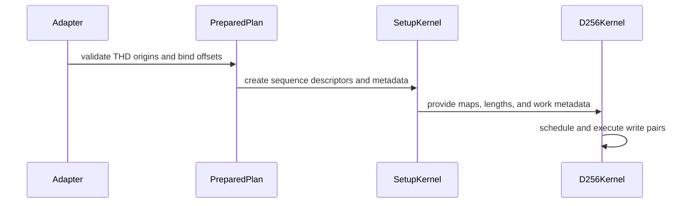

# sdpa bwd: support SM100 D256 THD with independent physical origins

[Upstream PR](https://github.com/NVIDIA/cudnn-frontend/pull/1872) · state: closed · merged: True

## Original PR description

SM100/SM103 D256 backward currently declines THD graphs, including context-parallel attention with unequal query and KV lengths. This adds the packed BF16/FP16 chain to the existing 2x2 engine and enables it through the normal graph and standalone APIs.

The chain reads independent runtime origins for Q/K/V/O/dO/dQ/dK/dV/Stats, supports both packed Stats layouts and INT32/INT64 offsets with multipliers, and keeps intermediate workspace coordinates compact. Per-sequence maps address physical gaps directly. The scheduler covers both 128-row halves of each 256-row stage-3 write pair, including masked tails; dead work preserves synchronization without storing outputs. Existing compact host call signatures remain intact.

The capability row and support matrix are updated together. Added tests pin this engine for unmasked, top-left causal, bottom-right causal and sliding-window MHA/GQA; they check reference gradients, untouched physical padding, independent offsets, empty sequences, buffer rebinding and retained CUDA Graph replay. The existing dense controls and configuration tests remain in place. No proposal or placement policy changes.

Validation commands:

```bash
cd test/python
pytest sdpa/frost/test_sdpa_bwd_thd_d256_sm100.py sdpa/frost/test_sdpa_bwd_config_d256_2x2.py
```

Changed-file formatting and license hooks pass. Larger-workload measurements are tracked separately from this support contract.


<!-- This is an auto-generated comment: release notes by coderabbit.ai -->
<!-- coderabbit-ai-generated:v1 -->

## Summary by CodeRabbit

* **New Features**
  * Added support for packed variable-length inputs in D256 backward attention on supported SM100 configurations, including causal, bottom-right causal, and sliding-window modes.
  * Inputs and outputs can use independently positioned ragged sequences, with token-major or head-major statistics.
  * Graph execution supports changing sequence lengths and ragged offsets between replays. Standalone execution also accepts packed inputs with ragged offsets.
* **Bug Fixes**
  * Improved handling of empty sequences and padded rows so they produce correct zero outputs without altering surrounding data.
<!-- end of auto-generated comment: release notes by coderabbit.ai -->

## Review and discussion

### reviews

- github-advanced-security[bot] · COMMENTED · 2026-10-26T09:12:24Z · [source](https://github.com/NVIDIA/cudnn-frontend/pull/1872#pullrequestreview-5649689988)

(No body; status only.)

- Anerudhan · COMMENTED · 2026-10-26T09:16:01Z · [source](https://github.com/NVIDIA/cudnn-frontend/pull/1872#pullrequestreview-5649730485)

**Codex bot review · model: `gpt-6-astra`**

Reviewed `16f49c636690` against base `7089f1182761`.

One high-risk P1 blocks approval: otherwise identical plans with different ragged-offset integer types share a compiled artifact and can silently produce invalid gradients. Please fix the cache identity before merging. The focused feature/configuration suite passed; the failure appeared when changing a declared offset type between plans.

**[P1 · blocks approval] Include ragged-offset dtypes in the compiled cache key** ([source](https://github.com/NVIDIA/cudnn-frontend/blob/16f49c6366904d4e68552e0fb04e4ca4d24bf6b1/python/cudnn/sdpa/bwd/prepared_sm107.py#L458))

The key includes each origin's row, multiplier and stride, but omits api._thd_origin_dtypes. Those types select Int32 versus Int64 pointers in compile_host_f16_thd. compile_cached returns an existing artifact solely by key/symbol/options/device, so a second supported plan can read its offsets with the first plan's integer width. On SM100, a BF16 MHA plan passed; rebuilding the same geometry with only Q offsets changed from INT32 to INT64 returned the identical compiled object and produced non-finite dQ/dK/dV for sequences 1 and 2. The INT64 plan passed in a fresh process/cache. Include the complete offset-type tuple in the key and test both type transitions, including persisted artifact reload. This is high risk because valid independent plans can silently compute incorrect gradients.

Evidence: Independent native SM100 probe: B=3, Hq=Hkv=2, D=256, Q lengths (257,93,128), KV lengths (383,129,267), independent physical origins. First plan passed the FP64 reference; Q-offset INT64 variant had the same key/object and one memo hit, then non-finite gradients. Fresh-cache INT64 control passed. Source: prepared_sm107.py compile_plan_thd; prepared_host.py compile_host_f16_thd; compiled_cache.py compile_cached. Checklist D14. Attribution: Introduced by the new independent-origin specialization.

Validation: 103 tests passed on native SM100: the new packed D256 backward tests and the 2x2 configuration suite. Coverage includes graph and standalone execution, BF16/FP16, MHA/GQA, causal/window masks, both Stats layouts, changed metadata, empty sequences, padding canaries and retained graph replay. Independent offset-type transition probe reproduced the cache collision; a fresh-cache INT64 control passed. Reviewed all changed files, per-port maps, compact workspace addressing, stage-3 write-pair scheduling, masked/dead work and barrier participation. Precheck found no deterministic candidates. Reused the author's current-head python/sdpa/frost pipeline 76710371; results remain pending.

Limitations: No independent SM103 or SM107 GPU execution. No performance conclusion from the shared GPU. The new scheduler was exercised by the submitted focused tests; an additional independent multiwave stress case was not run.

I am withholding approval for the high-risk P1 findings above and leaving a COMMENT. Please address them before merging.

<!-- codex-fe-review:v2:1872:16f49c6366904d4e68552e0fb04e4ca4d24bf6b1:complete:blocking-p1 -->

- Anerudhan · APPROVED · 2026-10-26T09:56:16Z · [source](https://github.com/NVIDIA/cudnn-frontend/pull/1872#pullrequestreview-5650162258)

**Codex bot review · model: `gpt-6-astra`**

Reviewed `b21d20c44388` against base `7089f1182761`.

The offset-type cache P1 is resolved. The key now includes the full per-port integer-type tuple. My original failing transition now creates distinct compiled objects and both plans pass the FP64 reference. The four new transition/reload/replay tests also pass. One nonblocking test-integration issue remains below; please update that assertion so CI can finish green.

**[P2] Update the block-scale guard census for the host wrapper** ([source](https://github.com/NVIDIA/cudnn-frontend/blob/b21d20c44388d3e033c4ae3cf9feba592e07ffd4/test/python/sdpa/frost/test_sdpa_bwd_stage3_block_scale_sm107.py#L336))

Moving the implementation into _host_chain leaves this existing AST test expecting its block-scale guards inside _host. It now fails with actual owners {'_bprop_matmul_bh_sm100_kernel', '_host_chain'}. This was the SM80 failure in pipeline 76710371 and still reproduces on this updated head. Update the expected owner to _host_chain while retaining the guard and machinery checks. This is test drift from the wrapper refactor, not evidence of a block-scale kernel failure.

Evidence: Exact test_block_scale_default_folds_out_of_the_template failed locally on both reviewed heads; the first pipeline's SM80 JUnit report has the same assertion. Current focused run: four cache transition tests passed, this AST test failed. Attribution: Introduced by this PR's _host to _host_chain refactor; missed by the first focused review suite.

Validation: Four native SM100 regression cases passed: INT32 to INT64 and INT64 to INT32 for Q and Stats offsets, distinct disk artifacts, reload with compilation forbidden, numerical checks and CUDA Graph replay. Re-ran the independent original reproducer: the two plans now have different keys and compiled objects; both pass the FP64 reference. The old head returned the same object and non-finite gradients. Reviewed the complete incremental diff and reused the earlier 103 passing feature/configuration tests for unchanged kernel behavior. Reused current-head pipeline 76716495. Its integration tree matches all 15 changed files; results are pending.

Limitations: The block-scale host assertion remains red. No new SM103/SM107 native validation or performance measurement.

Approved: no P0 or high-risk P1 found. Remaining findings stay with the owner; merge timing stays with the owner.

<!-- codex-fe-review:v2:1872:b21d20c44388d3e033c4ae3cf9feba592e07ffd4:complete:no-blocker -->

### issue_comments

- coderabbitai[bot] · comment · 2026-10-26T08:56:48Z · [source](https://github.com/NVIDIA/cudnn-frontend/pull/1872#issuecomment-6412079284)

<!-- coderabbit-ai-generated:v1 -->

<!-- This is an auto-generated comment: summarize by coderabbit.ai -->
<!-- review_stack_entry_start -->

<a href="https://app.coderabbit.ai/change-stack/NVIDIA/cudnn-frontend/pull/1872?scope=ghh_OusAJGA4HG8ljoOV0wJvVx8NmnZIjc2DdjmxOu0xZWA&amp;cs_source=review_comment"><picture><source media="(prefers-color-scheme: dark)" srcset="https://storage.googleapis.com/coderabbit_public_assets/review-stack-in-coderabbit-ui-dark.svg?v=3"><source media="(prefers-color-scheme: light)" srcset="https://storage.googleapis.com/coderabbit_public_assets/review-stack-in-coderabbit-ui.svg?v=3"></picture></a>

<!-- review_stack_entry_end -->
<!-- This is an auto-generated comment: failure by coderabbit.ai -->

> [!CAUTION]
> ## Review failed
> 
> The pull request is closed.

<!-- end of auto-generated comment: failure by coderabbit.ai -->

<!-- recent_review_start -->

No actionable comments were generated in the recent review.

<details>
<summary><strong><picture></picture> Recent review info</strong></summary>
<dl>
<dd>

<!-- review_info_content -->
<details>
<summary><strong><picture><source media="(prefers-color-scheme: dark)" srcset="https://storage.googleapis.com/coderabbit_public_assets/review-comment-icons-v1/cog-dark.svg"></picture> Run configuration</strong></summary>
<dl>
<dd>

- **Source mode**: Auto
- **Repository**: [NVIDIA/cudnn-frontend](<https://github.com/NVIDIA/cudnn-frontend>)
- **Branch**: [develop](<https://github.com/NVIDIA/cudnn-frontend/tree/develop>)
- **File**: [.coderabbit.yaml](<https://github.com/NVIDIA/cudnn-frontend/blob/7089f1182761119730bfe008360b2de35a576ffb/.coderabbit.yaml>)
- **Commit**: [7089f11](<https://github.com/NVIDIA/cudnn-frontend/commit/7089f1182761119730bfe008360b2de35a576ffb>)
- **Layers**: Repository YAML
- **Review profile**: CHILL
- **Plan**: Enterprise
- **Run ID**: `a77d39b7-9afd-42a4-b5c7-d5217d277247`

</dd>
</dl>
</details>

<details>
<summary><strong><picture><source media="(prefers-color-scheme: dark)" srcset="https://storage.googleapis.com/coderabbit_public_assets/review-comment-icons-v1/git-commit-horizontal-dark.svg"></picture> Commits</strong></summary>
<dl>
<dd>

Reviewing files that changed from the base of the PR and between 16f49c6366904d4e68552e0fb04e4ca4d24bf6b1 and b21d20c44388d3e033c4ae3cf9feba592e07ffd4.

</dd>
</dl>
</details>

<details>
<summary><strong><picture><source media="(prefers-color-scheme: dark)" srcset="https://storage.googleapis.com/coderabbit_public_assets/review-comment-icons-v1/file-plus-corner-dark.svg"></picture> Files selected for processing: 5</strong></summary>
<dl>
<dd>

* `python/cudnn/sdpa/AGENTS.md`
* `python/cudnn/sdpa/bwd/kernels/bprop_d256_2x2_f16.py`
* `python/cudnn/sdpa/bwd/kernels/bprop_matmul_blackwell.py`
* `python/cudnn/sdpa/bwd/prepared_sm107.py`
* `test/python/sdpa/frost/test_sdpa_bwd_thd_d256_sm100.py`

</dd>
</dl>
</details>

<details>
<summary><strong><picture><source media="(prefers-color-scheme: dark)" srcset="https://storage.googleapis.com/coderabbit_public_assets/review-comment-icons-v1/file-no-changes-dark.svg"></picture> Files with no reviewable changes: 2</strong></summary>
<dl>
<dd>

* python/cudnn/sdpa/bwd/kernels/bprop_matmul_blackwell.py
* python/cudnn/sdpa/bwd/kernels/bprop_d256_2x2_f16.py

</dd>
</dl>
</details>

<details>
<summary><strong><picture><source media="(prefers-color-scheme: dark)" srcset="https://storage.googleapis.com/coderabbit_public_assets/review-comment-icons-v1/file-similar-dark.svg"></picture> Files skipped from review as they are similar to previous changes: 1</strong></summary>
<dl>
<dd>

* python/cudnn/sdpa/AGENTS.md

</dd>
</dl>
</details>

**Included review availability:** This review used your included allowance. Your plan provides up to 12 included reviews per hour; 10 remain after this review.

</dd>
</dl>
</details>


<!-- recent_review_end -->
<!-- walkthrough_start -->

<details>
<summary><strong>Walkthrough</strong></summary>
<dl>
<dd>

SM100 D256 backward now supports packed THD inputs with independent per-port origins. The change adds origin-aware planning and execution, 256-row scheduling, sequence-local descriptors, compact workspace handling, and regression coverage for masks, empty sequences, poisoned gaps, rebinding, and replay.

**Changes: D256 packed THD backward**

|Layer / File(s)|Summary|
|:---|:---|
|**Configuration and capability wiring** <br> `python/cudnn/sdpa/bwd/config_d256_2x2.py`, `python/cudnn/sdpa/bwd/api_dsl_*.py`, `python/cudnn/sdpa/bwd/engines.py`, `test/python/sdpa/frost/test_sdpa_bwd_config_d256_2x2.py`, `test/python/sdpa/frost/test_sdpa_bwd_d256_sm100.py`, `python/cudnn/sdpa/frost/SUPPORT_MATRIX_TRACKER.md`|SM100 D256 THD is enabled. Configuration validates THD masks, workspace rows, and scheduling. The 2x2 work bound accounts for 256-row write pairs and both compute blocks.|
|**Origin-aware preparation and host plumbing** <br> `python/cudnn/sdpa/bwd/prepared_sm107.py`, `python/cudnn/sdpa/bwd/api_dsl_sm107.py`, `python/cudnn/sdpa/bwd/kernels/{thd_helpers.py,bprop_chain_common.py,bprop_matmul_blackwell.py}`, `python/cudnn/sdpa/bwd/kernels/sm107/prepared_host.py`, `python/cudnn/sdpa/AGENTS.md`|Prepared execution validates origin declarations and includes origin metadata and offset dtypes in planning and cache keys. Host paths forward offsets through setup, delta computation, GEMM, and reduction.|
|**THD scheduling and D256 kernel path** <br> `python/cudnn/sdpa/bwd/kernels/bprop_d256_2x2_f16.py`|The kernel decodes sequence-local metadata, selects physical-origin descriptors, schedules write pairs, and handles empty and dead work. It masks padded query columns and suppresses invalid stores.|
|**Execution regression coverage** <br> `test/python/sdpa/frost/test_sdpa_bwd_config_d256_2x2.py`, `test/python/sdpa/frost/test_sdpa_bwd_d256_sm100.py`, `test/python/sdpa/frost/test_sdpa_bwd_thd_d256_sm100.py`, `test/python/sdpa/frost/test_sdpa_bwd_stage3_block_scale_sm107.py`|Tests cover capability support, work bounds, independent origins, statistics layouts, masks, empty sequences, poisoned gaps, replay, rebinding, input immutability, and artifact reloads.|

<!-- change_assessment_start -->
<strong>Priority: <picture></picture> Not assessed</strong>

**Estimated code review effort:** 4 (Complex) | ~60 minutes

<!-- change_assessment_commit:"10decd873b43c9d82d34352a8d27df559bffc03a" -->
**Change:** Feature
<!-- change_assessment_end -->

### Sequence Diagram(s)



**Possibly related issues**

- [NVIDIA/cudnn-frontend#380](https://github.com/NVIDIA/cudnn-frontend/issues/380) — The issue describes missing D256 backward support; this change adds packed FP16/BF16 D256 THD backward support for SM100.
- [NVIDIA/cudnn-frontend#737](https://github.com/NVIDIA/cudnn-frontend/issues/737) — This change adds runtime per-port origins for D256 backward THD. The issue also covers forward and other engines, which this change does not modify.

**Suggested reviewers:** `romananders90`, `yihuawei`

</dd>
</dl>
</details>

<!-- walkthrough_end -->
<details>
<summary><strong>Merge Risk:</strong> <strong><picture></picture> Minimal</strong> · up to <code>10dec</code></summary>
<dl>
<dd>

<!-- final_review_risk_start -->
<!-- final_review_risk_label
**Merge Risk:** **⚪ Minimal** · up to `10dec`
-->
<!-- final_review_risk_coverage:{"sourceCommitId":"10decd873b43c9d82d34352a8d27df559bffc03a","coveredCommitId":"10decd873b43c9d82d34352a8d27df559bffc03a","kind":"reviewed"} -->

No actionable merge-blocking risk remains in the reviewed changes.
<!-- final_review_risk_end -->

</dd>
</dl>
</details>
<!-- pre_merge_checks_walkthrough_start -->

<details>
<summary><strong>Pre-merge checks: <sup><picture></picture></sup> 4 · <sup><picture></picture></sup> 1</strong></summary>
<dl>
<dd>

<strong><sup><picture></picture></sup> Failed checks: 1 warning</strong>

|     Check name     |                                              Status                                              | Explanation                                                                                                                                                                                               | Resolution                                                                         |
| :---------------- | :----------------------------------------------------------------------------------------------: | :-------------------------------------------------------------------------------------------------------------------------------------------------------------------------------------------------------- | :--------------------------------------------------------------------------------- |
| Docstring Coverage |  | Docstring coverage is 65.17% which is insufficient. The required threshold is 80.00%. Docstring coverage is scoped to functions touched by this diff. Analyzed 89 functions across 13 files. (1 skipped:… | Write docstrings for the functions missing them to satisfy the coverage threshold. |

<details>
<summary><strong><sup><picture></picture></sup> Passed checks: 4 passed</strong></summary>
<dl>
<dd>

|         Check name         |                                             Status                                             | Explanation                                                                                                                                                                                               |
| :------------------------ | :--------------------------------------------------------------------------------------------: | :-------------------------------------------------------------------------------------------------------------------------------------------------------------------------------------------------------- |
|         Title check        |  | The title clearly summarizes the main change: SM100 D256 THD support with independent physical origins.                                                                                                   |
|      Description check     |  | The description is detailed, on-topic, and covers the change summary, motivation, API behavior, compatibility considerations, testing command, and reported validation results. It does not use every te… |
|     Linked Issues check    |  | Check skipped because no linked issues were found for this pull request.                                                                                                                                  |
| Out of Scope Changes check |  | Check skipped because no linked issues were found for this pull request.                                                                                                                                  |

<details>
<summary><strong>Full details: Description check</strong></summary>
<dl>
<dd>

**Explanation**

The description is detailed, on-topic, and covers the change summary, motivation, API behavior, compatibility considerations, testing command, and reported validation results. It does not use every template heading or include the submission checklist, affected-area selection, or related-issues statement, but these omissions do not prevent understanding the change.

</dd>
</dl>
</details>

</dd>
</dl>
</details>

<details>
<summary><strong>Full details: Docstring Coverage</strong></summary>
<dl>
<dd>

**Explanation**

Docstring coverage is 65.17% which is insufficient. The required threshold is 80.00%. Docstring coverage is scoped to functions touched by this diff. Analyzed 89 functions across 13 files. (1 skipped: 1 unsupported.)

**Resolution**

Write docstrings for the functions missing them to satisfy the coverage threshold.

</dd>
</dl>
</details>

</dd>
</dl>
</details>

<!-- pre_merge_checks_walkthrough_end -->
<!-- finishing_touch_checkbox_start -->

<details>
<summary><strong>Finishing Touches</strong></summary>
<dl>
<dd>

<details open>
<summary><strong>🧪 Generate unit tests (beta)</strong></summary>
<dl>
<dd>

- [ ] <!-- {"checkboxId": "f47ac10b-58cc-4372-a567-0e02b2c3d479", "radioGroupId": "utg-output-choice-group-unknown_comment_id"} --> Create a new PR

</dd>
</dl>
</details>

</dd>
</dl>
</details>

<!-- finishing_touch_checkbox_end -->

<!-- autopilot:start -->
- [ ] <!-- {"checkboxId":"2708ad07-9f24-4260-9c11-7dc76a49f2e3"} --> <strong title="Keep fixing CodeRabbit findings and required CI, and resolving merge conflicts">Autofix</strong> · Keep fixing CodeRabbit findings and required CI, and resolving merge conflicts
<!-- autopilot:end -->
<!-- tips_start -->


<sub>Comment `@coderabbitai help` to get the list of available commands.</sub>

<!-- tips_end -->

- YangXu1990uiuc · comment · 2026-10-26T09:03:51Z · [source](https://github.com/NVIDIA/cudnn-frontend/pull/1872#issuecomment-6412201974)

@cudnn-ci-bot run python/sdpa/frost

- cudnn-ci-bot · comment · 2026-10-26T09:03:55Z · [source](https://github.com/NVIDIA/cudnn-frontend/pull/1872#issuecomment-6412202866)

🏁 Pipeline finished

SHA: `16f49c6`
Targets: `python/sdpa/frost`
Branch: [cudnn-gh/pr-1872-16f49c6](https://nv/cudnn-gitlab-ci/-/tree/cudnn-gh/pr-1872-16f49c6)
Pipeline: [76710371](https://nv/cudnn-gitlab-ci/-/pipelines/76710371)
Last updated: 2026-10-26 09:42 UTC

**19 passed, 1 failed, 5 canceled, 3 skipped, 11 manual**

### <code>manual</code>

- <code>manual:python_samples</code> - Manual
- <code>manual:python</code> - Manual
- <code>manual:python/sdpa/frost</code> - ✅ Passed
- <code>manual:python/linear_attention/frost</code> - Manual
- <code>manual:python/gemm/frost</code> - Manual
- <code>manual:python/*/frost</code> - Manual
- <code>manual:python/gemm/cutedsl</code> - Manual
- <code>manual:python/*/cutedsl</code> - Manual
- <code>manual:python/*/jax</code> - Manual
- <code>manual:pycudnn</code> - Manual
- <code>manual:multi_gpu</code> - Manual
- <code>manual:backend</code> - Manual

### <code>analysis</code>

- <code>analysis:cudnn_clang_disable_exception</code> - ✅ Passed
- <code>analysis:cudnn_v9_no_half_conversion</code> - ✅ Passed
- <code>analysis:cudnn_clang</code> - ✅ Passed
- <code>analysis:check-relative-includes</code> - ✅ Passed
- <code>analysis:check-CUDNN_FRONTEND_SKIP_JSON_LIB</code> - ✅ Passed
- <code>analysis:guardwords_scan</code> - ✅ Passed
- <code>analysis:jax-import-guard</code> - ✅ Passed
- <code>analysis:pytest-gpu</code> - ✅ Passed
- <code>san:build</code> - ✅ Passed

### <code>build</code>

- <code>analysis:api_index</code> - ✅ Passed
- <code>build:dev:linux:amd64</code> - ✅ Passed
- <code>build:rel:linux:amd64</code> - ✅ Passed
- <code>build:dev:linux:arm64</code> - ✅ Passed
- <code>build:rel:linux:arm64</code> - ✅ Passed
- <code>build:rel:win:amd64</code> - ✅ Passed

### <code>frost_tests</code>

- <code>python/sdpa/frost:cutlass-rel:sm80</code> - ❌ **New Failure!** (nightly passed)
- <code>python/sdpa/frost:cutlass-rel:sm100</code> - Canceled
- <code>python/sdpa/frost:cutlass-rel:sm120</code> - Canceled
- <code>python/linear_attention/frost:cutlass-rel:sm100</code> - Skipped
- <code>python/gemm/frost:cutlass-rel:sm100</code> - Skipped
- <code>python/*/frost:cutlass-rel:sm100</code> - Skipped
- <code>python/sdpa/frost:cutlass-rel:sm103</code> - Canceled
- <code>python/sdpa/frost:cutlass-4.8:sm107</code> - Canceled

### <code>sanitizer_tests</code>

- <code>san:cpp_test:sm80</code> - ✅ Passed
- <code>san:cpp_test:sm90</code> - ✅ Passed
- <code>san:cpp_test:sm100</code> - ✅ Passed

### <code>triage</code>

- <code>triage:ai</code> - Canceled

- YangXu1990uiuc · comment · 2026-10-26T09:34:05Z · [source](https://github.com/NVIDIA/cudnn-frontend/pull/1872#issuecomment-6412761407)

Addressed the cache-identity P1 in `b21d20c44388d3e033c4ae3cf9feba592e07ffd4`: the prepared THD key now includes the complete per-port origin integer-type tuple alongside the origin rows, multipliers and strides.

`test_origin_integer_types_separate_compiled_artifacts` covers INT32→INT64 and INT64→INT32 for Q and Stats. It checks artifact identity before launching a potentially colliding host, requires distinct persisted entries, clears in-process memoization, reloads both declarations with compilation forbidden, and checks numerical output after CUDA Graph replay.

The unused imports/map-slot binding are removed. Stage-3 origin launches now call the existing full host entry directly, removing the unused alias while preserving the compact host signature. The SDPA guide records the cache-identity detector. Please re-review the updated head.


- YangXu1990uiuc · comment · 2026-10-26T09:35:59Z · [source](https://github.com/NVIDIA/cudnn-frontend/pull/1872#issuecomment-6412796131)

@cudnn-ci-bot run python/sdpa/frost

- cudnn-ci-bot · comment · 2026-10-26T09:36:04Z · [source](https://github.com/NVIDIA/cudnn-frontend/pull/1872#issuecomment-6412797632)

🏁 Pipeline finished

SHA: `b21d20c`
Targets: `python/sdpa/frost`
Branch: [cudnn-gh/pr-1872-b21d20c](https://nv/cudnn-gitlab-ci/-/tree/cudnn-gh/pr-1872-b21d20c)
Pipeline: [76716495](https://nv/cudnn-gitlab-ci/-/pipelines/76716495)
Cancelled this PR's older pipelines: 76710371
Last updated: 2026-10-26 10:09 UTC

**19 passed, 1 failed, 5 canceled, 3 skipped, 11 manual**

### <code>manual</code>

- <code>manual:python_samples</code> - Manual
- <code>manual:python</code> - Manual
- <code>manual:python/sdpa/frost</code> - ✅ Passed
- <code>manual:python/linear_attention/frost</code> - Manual
- <code>manual:python/gemm/frost</code> - Manual
- <code>manual:python/*/frost</code> - Manual
- <code>manual:python/gemm/cutedsl</code> - Manual
- <code>manual:python/*/cutedsl</code> - Manual
- <code>manual:python/*/jax</code> - Manual
- <code>manual:pycudnn</code> - Manual
- <code>manual:multi_gpu</code> - Manual
- <code>manual:backend</code> - Manual

### <code>analysis</code>

- <code>analysis:cudnn_clang_disable_exception</code> - ✅ Passed
- <code>analysis:cudnn_v9_no_half_conversion</code> - ✅ Passed
- <code>analysis:cudnn_clang</code> - ✅ Passed
- <code>analysis:check-relative-includes</code> - ✅ Passed
- <code>analysis:check-CUDNN_FRONTEND_SKIP_JSON_LIB</code> - ✅ Passed
- <code>analysis:guardwords_scan</code> - ✅ Passed
- <code>analysis:jax-import-guard</code> - ✅ Passed
- <code>analysis:pytest-gpu</code> - ✅ Passed
- <code>san:build</code> - ✅ Passed

### <code>build</code>

- <code>analysis:api_index</code> - ✅ Passed
- <code>build:dev:linux:amd64</code> - ✅ Passed
- <code>build:rel:linux:amd64</code> - ✅ Passed
- <code>build:dev:linux:arm64</code> - ✅ Passed
- <code>build:rel:linux:arm64</code> - ✅ Passed
- <code>build:rel:win:amd64</code> - ✅ Passed

### <code>frost_tests</code>

- <code>python/sdpa/frost:cutlass-rel:sm80</code> - ❌ **New Failure!** (nightly passed)
- <code>python/sdpa/frost:cutlass-rel:sm100</code> - Canceled
- <code>python/sdpa/frost:cutlass-rel:sm120</code> - Canceled
- <code>python/linear_attention/frost:cutlass-rel:sm100</code> - Skipped
- <code>python/gemm/frost:cutlass-rel:sm100</code> - Skipped
- <code>python/*/frost:cutlass-rel:sm100</code> - Skipped
- <code>python/sdpa/frost:cutlass-rel:sm103</code> - Canceled
- <code>python/sdpa/frost:cutlass-4.8:sm107</code> - Canceled

### <code>sanitizer_tests</code>

- <code>san:cpp_test:sm80</code> - ✅ Passed
- <code>san:cpp_test:sm90</code> - ✅ Passed
- <code>san:cpp_test:sm100</code> - ✅ Passed

### <code>triage</code>

- <code>triage:ai</code> - Canceled

- YangXu1990uiuc · comment · 2026-10-26T10:04:34Z · [source](https://github.com/NVIDIA/cudnn-frontend/pull/1872#issuecomment-6413338491)

Addressed the remaining test-integration finding in `10decd873b43c9d82d34352a8d27df559bffc03a`. The guard census and descriptor-launch checks now name `_host_chain`. The compact `_host` signature remains checked, with an additional assertion that it forwards every operand unchanged. The kernel ABI check preserves the SF operand positions and verifies the appended per-sequence-input flag defaults to `False`.

The original assertion failed before the repair; the updated full AST test passes, as do changed-file hooks. This commit changes only that test; the reviewed production implementation is unchanged.


- YangXu1990uiuc · comment · 2026-10-26T10:05:56Z · [source](https://github.com/NVIDIA/cudnn-frontend/pull/1872#issuecomment-6413364024)

@cudnn-ci-bot run python/sdpa/frost

- cudnn-ci-bot · comment · 2026-10-26T10:06:00Z · [source](https://github.com/NVIDIA/cudnn-frontend/pull/1872#issuecomment-6413365358)

🏁 Pipeline finished

SHA: `10decd8`
Targets: `python/sdpa/frost`
Branch: [cudnn-gh/pr-1872-10decd8](https://nv/cudnn-gitlab-ci/-/tree/cudnn-gh/pr-1872-10decd8)
Pipeline: [76723122](https://nv/cudnn-gitlab-ci/-/pipelines/76723122)
Cancelled this PR's older pipelines: 76716495
Last updated: 2026-10-26 11:04 UTC

**25 passed, 3 skipped, 11 manual**

### <code>manual</code>

- <code>manual:python_samples</code> - Manual
- <code>manual:python</code> - Manual
- <code>manual:python/sdpa/frost</code> - ✅ Passed
- <code>manual:python/linear_attention/frost</code> - Manual
- <code>manual:python/gemm/frost</code> - Manual
- <code>manual:python/*/frost</code> - Manual
- <code>manual:python/gemm/cutedsl</code> - Manual
- <code>manual:python/*/cutedsl</code> - Manual
- <code>manual:python/*/jax</code> - Manual
- <code>manual:pycudnn</code> - Manual
- <code>manual:multi_gpu</code> - Manual
- <code>manual:backend</code> - Manual

### <code>analysis</code>

- <code>analysis:cudnn_clang_disable_exception</code> - ✅ Passed
- <code>analysis:cudnn_v9_no_half_conversion</code> - ✅ Passed
- <code>analysis:cudnn_clang</code> - ✅ Passed
- <code>analysis:check-relative-includes</code> - ✅ Passed
- <code>analysis:check-CUDNN_FRONTEND_SKIP_JSON_LIB</code> - ✅ Passed
- <code>analysis:guardwords_scan</code> - ✅ Passed
- <code>analysis:jax-import-guard</code> - ✅ Passed
- <code>analysis:pytest-gpu</code> - ✅ Passed
- <code>san:build</code> - ✅ Passed

### <code>build</code>

- <code>analysis:api_index</code> - ✅ Passed
- <code>build:dev:linux:amd64</code> - ✅ Passed
- <code>build:rel:linux:amd64</code> - ✅ Passed
- <code>build:dev:linux:arm64</code> - ✅ Passed
- <code>build:rel:linux:arm64</code> - ✅ Passed
- <code>build:rel:win:amd64</code> - ✅ Passed

### <code>frost_tests</code>

- <code>python/sdpa/frost:cutlass-rel:sm80</code> - ✅ Passed
- <code>python/sdpa/frost:cutlass-rel:sm100</code> - ✅ Passed
- <code>python/sdpa/frost:cutlass-rel:sm120</code> - ✅ Passed
- <code>python/linear_attention/frost:cutlass-rel:sm100</code> - Skipped
- <code>python/gemm/frost:cutlass-rel:sm100</code> - Skipped
- <code>python/*/frost:cutlass-rel:sm100</code> - Skipped
- <code>python/sdpa/frost:cutlass-rel:sm103</code> - ✅ Passed
- <code>python/sdpa/frost:cutlass-4.8:sm107</code> - ✅ Passed

### <code>sanitizer_tests</code>

- <code>san:cpp_test:sm80</code> - ✅ Passed
- <code>san:cpp_test:sm90</code> - ✅ Passed
- <code>san:cpp_test:sm100</code> - ✅ Passed

### <code>triage</code>

- <code>triage:ai</code> - ✅ Passed

### inline_comments

- github-advanced-security[bot] · comment · 2026-10-26T09:12:23Z · [source](https://github.com/NVIDIA/cudnn-frontend/pull/1872#discussion_r4375590886)

File: `python/cudnn/sdpa/bwd/kernels/bprop_d256_2x2_f16.py` · line 179

## CodeQL / Unused import

Import of 'TENSOR_MAP_ALIGN' is not used.

[Show more details](https://github.com/NVIDIA/cudnn-frontend/security/code-scanning/4098)

- github-advanced-security[bot] · comment · 2026-10-26T09:12:23Z · [source](https://github.com/NVIDIA/cudnn-frontend/pull/1872#discussion_r4375590911)

File: `python/cudnn/sdpa/bwd/kernels/bprop_d256_2x2_f16.py` · line None

## CodeQL / Unused global variable

The global variable 'THD_MAP_SLOTS' is not used.

[Show more details](https://github.com/NVIDIA/cudnn-frontend/security/code-scanning/4096)

- github-advanced-security[bot] · comment · 2026-10-26T09:12:24Z · [source](https://github.com/NVIDIA/cudnn-frontend/pull/1872#discussion_r4375590930)

File: `python/cudnn/sdpa/bwd/kernels/bprop_matmul_blackwell.py` · line None

## CodeQL / Unused global variable

The global variable '_host_origins' is not used.

[Show more details](https://github.com/NVIDIA/cudnn-frontend/security/code-scanning/4097)

- github-advanced-security[bot] · comment · 2026-10-26T09:12:24Z · [source](https://github.com/NVIDIA/cudnn-frontend/pull/1872#discussion_r4375590949)

File: `python/cudnn/sdpa/bwd/prepared_sm107.py` · line None

## CodeQL / Unused import

Import of 'Q_PORTS' is not used.

[Show more details](https://github.com/NVIDIA/cudnn-frontend/security/code-scanning/4099)

## Changed files and fixed code

- `python/cudnn/sdpa/AGENTS.md` · modified · additions 17 / deletions 0
  - [head](https://github.com/YangXu1990uiuc/cudnn-frontend/blob/10decd873b43c9d82d34352a8d27df559bffc03a/python/cudnn/sdpa/AGENTS.md)
  - [base](https://github.com/NVIDIA/cudnn-frontend/blob/7089f1182761119730bfe008360b2de35a576ffb/python/cudnn/sdpa/AGENTS.md)
- `python/cudnn/sdpa/bwd/api_dsl_sm100_d256.py` · modified · additions 2 / deletions 1
  - [head](https://github.com/YangXu1990uiuc/cudnn-frontend/blob/10decd873b43c9d82d34352a8d27df559bffc03a/python/cudnn/sdpa/bwd/api_dsl_sm100_d256.py)
  - [base](https://github.com/NVIDIA/cudnn-frontend/blob/7089f1182761119730bfe008360b2de35a576ffb/python/cudnn/sdpa/bwd/api_dsl_sm100_d256.py)
- `python/cudnn/sdpa/bwd/api_dsl_sm107.py` · modified · additions 21 / deletions 4
  - [head](https://github.com/YangXu1990uiuc/cudnn-frontend/blob/10decd873b43c9d82d34352a8d27df559bffc03a/python/cudnn/sdpa/bwd/api_dsl_sm107.py)
  - [base](https://github.com/NVIDIA/cudnn-frontend/blob/7089f1182761119730bfe008360b2de35a576ffb/python/cudnn/sdpa/bwd/api_dsl_sm107.py)
- `python/cudnn/sdpa/bwd/config_d256_2x2.py` · modified · additions 23 / deletions 5
  - [head](https://github.com/YangXu1990uiuc/cudnn-frontend/blob/10decd873b43c9d82d34352a8d27df559bffc03a/python/cudnn/sdpa/bwd/config_d256_2x2.py)
  - [base](https://github.com/NVIDIA/cudnn-frontend/blob/7089f1182761119730bfe008360b2de35a576ffb/python/cudnn/sdpa/bwd/config_d256_2x2.py)
- `python/cudnn/sdpa/bwd/engines.py` · modified · additions 5 / deletions 1
  - [head](https://github.com/YangXu1990uiuc/cudnn-frontend/blob/10decd873b43c9d82d34352a8d27df559bffc03a/python/cudnn/sdpa/bwd/engines.py)
  - [base](https://github.com/NVIDIA/cudnn-frontend/blob/7089f1182761119730bfe008360b2de35a576ffb/python/cudnn/sdpa/bwd/engines.py)
- `python/cudnn/sdpa/bwd/kernels/bprop_chain_common.py` · modified · additions 52 / deletions 2
  - [head](https://github.com/YangXu1990uiuc/cudnn-frontend/blob/10decd873b43c9d82d34352a8d27df559bffc03a/python/cudnn/sdpa/bwd/kernels/bprop_chain_common.py)
  - [base](https://github.com/NVIDIA/cudnn-frontend/blob/7089f1182761119730bfe008360b2de35a576ffb/python/cudnn/sdpa/bwd/kernels/bprop_chain_common.py)
- `python/cudnn/sdpa/bwd/kernels/bprop_d256_2x2_f16.py` · modified · additions 738 / deletions 87
  - [head](https://github.com/YangXu1990uiuc/cudnn-frontend/blob/10decd873b43c9d82d34352a8d27df559bffc03a/python/cudnn/sdpa/bwd/kernels/bprop_d256_2x2_f16.py)
  - [base](https://github.com/NVIDIA/cudnn-frontend/blob/7089f1182761119730bfe008360b2de35a576ffb/python/cudnn/sdpa/bwd/kernels/bprop_d256_2x2_f16.py)
- `python/cudnn/sdpa/bwd/kernels/bprop_matmul_blackwell.py` · modified · additions 79 / deletions 7
  - [head](https://github.com/YangXu1990uiuc/cudnn-frontend/blob/10decd873b43c9d82d34352a8d27df559bffc03a/python/cudnn/sdpa/bwd/kernels/bprop_matmul_blackwell.py)
  - [base](https://github.com/NVIDIA/cudnn-frontend/blob/7089f1182761119730bfe008360b2de35a576ffb/python/cudnn/sdpa/bwd/kernels/bprop_matmul_blackwell.py)
- `python/cudnn/sdpa/bwd/kernels/sm107/prepared_host.py` · modified · additions 248 / deletions 12
  - [head](https://github.com/YangXu1990uiuc/cudnn-frontend/blob/10decd873b43c9d82d34352a8d27df559bffc03a/python/cudnn/sdpa/bwd/kernels/sm107/prepared_host.py)
  - [base](https://github.com/NVIDIA/cudnn-frontend/blob/7089f1182761119730bfe008360b2de35a576ffb/python/cudnn/sdpa/bwd/kernels/sm107/prepared_host.py)
- `python/cudnn/sdpa/bwd/kernels/thd_helpers.py` · modified · additions 14 / deletions 3
  - [head](https://github.com/YangXu1990uiuc/cudnn-frontend/blob/10decd873b43c9d82d34352a8d27df559bffc03a/python/cudnn/sdpa/bwd/kernels/thd_helpers.py)
  - [base](https://github.com/NVIDIA/cudnn-frontend/blob/7089f1182761119730bfe008360b2de35a576ffb/python/cudnn/sdpa/bwd/kernels/thd_helpers.py)
- `python/cudnn/sdpa/bwd/prepared_sm107.py` · modified · additions 126 / deletions 9
  - [head](https://github.com/YangXu1990uiuc/cudnn-frontend/blob/10decd873b43c9d82d34352a8d27df559bffc03a/python/cudnn/sdpa/bwd/prepared_sm107.py)
  - [base](https://github.com/NVIDIA/cudnn-frontend/blob/7089f1182761119730bfe008360b2de35a576ffb/python/cudnn/sdpa/bwd/prepared_sm107.py)
- `python/cudnn/sdpa/frost/SUPPORT_MATRIX_TRACKER.md` · modified · additions 16 / deletions 6
  - [head](https://github.com/YangXu1990uiuc/cudnn-frontend/blob/10decd873b43c9d82d34352a8d27df559bffc03a/python/cudnn/sdpa/frost/SUPPORT_MATRIX_TRACKER.md)
  - [base](https://github.com/NVIDIA/cudnn-frontend/blob/7089f1182761119730bfe008360b2de35a576ffb/python/cudnn/sdpa/frost/SUPPORT_MATRIX_TRACKER.md)
- `test/python/sdpa/frost/test_sdpa_bwd_config_d256_2x2.py` · modified · additions 37 / deletions 1
  - [head](https://github.com/YangXu1990uiuc/cudnn-frontend/blob/10decd873b43c9d82d34352a8d27df559bffc03a/test/python/sdpa/frost/test_sdpa_bwd_config_d256_2x2.py)
  - [base](https://github.com/NVIDIA/cudnn-frontend/blob/7089f1182761119730bfe008360b2de35a576ffb/test/python/sdpa/frost/test_sdpa_bwd_config_d256_2x2.py)
- `test/python/sdpa/frost/test_sdpa_bwd_d256_sm100.py` · modified · additions 9 / deletions 7
  - [head](https://github.com/YangXu1990uiuc/cudnn-frontend/blob/10decd873b43c9d82d34352a8d27df559bffc03a/test/python/sdpa/frost/test_sdpa_bwd_d256_sm100.py)
  - [base](https://github.com/NVIDIA/cudnn-frontend/blob/7089f1182761119730bfe008360b2de35a576ffb/test/python/sdpa/frost/test_sdpa_bwd_d256_sm100.py)
- `test/python/sdpa/frost/test_sdpa_bwd_stage3_block_scale_sm107.py` · modified · additions 15 / deletions 7
  - [head](https://github.com/YangXu1990uiuc/cudnn-frontend/blob/10decd873b43c9d82d34352a8d27df559bffc03a/test/python/sdpa/frost/test_sdpa_bwd_stage3_block_scale_sm107.py)
  - [base](https://github.com/NVIDIA/cudnn-frontend/blob/7089f1182761119730bfe008360b2de35a576ffb/test/python/sdpa/frost/test_sdpa_bwd_stage3_block_scale_sm107.py)
- `test/python/sdpa/frost/test_sdpa_bwd_thd_d256_sm100.py` · added · additions 370 / deletions 0
  - [head](https://github.com/YangXu1990uiuc/cudnn-frontend/blob/10decd873b43c9d82d34352a8d27df559bffc03a/test/python/sdpa/frost/test_sdpa_bwd_thd_d256_sm100.py)
  - [base](https://github.com/NVIDIA/cudnn-frontend/blob/7089f1182761119730bfe008360b2de35a576ffb/test/python/sdpa/frost/test_sdpa_bwd_thd_d256_sm100.py)

## Evidence and interpretation boundary

[Original JSON, discussions and patches](../../../../../../evidence/prs/NVIDIA--cudnn-frontend/1872-65e52204344e5bd349bb4089133e387ab7044a58e1c6aae7e8ffe5bdb547f641.json) · SHA-256 `65e52204344e5bd349bb4089133e387ab7044a58e1c6aae7e8ffe5bdb547f641`.

Diff complete: True. Missing/binary/truncated patches require pinned source inspection. This is a source page, not an independently verified optimization case. Open, merged and released are different states; recheck the deployed dependency.
