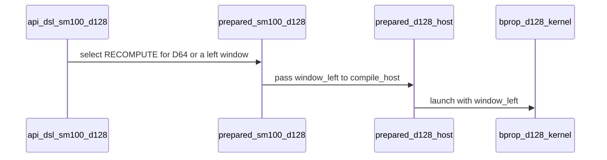

# feat: native D64 and sliding-window dense SM100 backward

[Upstream PR](https://github.com/NVIDIA/cudnn-frontend/pull/1879) · state: closed · merged: True

## Original PR description

Dense MHA backward currently declines D64 and left sliding windows on pre-Rubin Blackwell. Extend `sdpa_bwd_sm100_d128` to serve native D64 and D128 BF16/FP16 through its fixed-order recompute kernel, with zero workspace and the same graph/standalone prepared execution contract.

The D64 configuration uses 64-wide operands, MMA and gradient stores. Score/dS tiles retain their 128-column geometry and both compute groups retain every barrier arrival. The specialized pointer host selects the actual head width and keeps the window in the compiled-host key. A left window bounds both Q-owner and KV-owner reduction loops and masks boundary tiles; single-key rows contribute zero score gradients. Declaration bounds prevent Int32 window/tile overflow.

Grouped/THD support retains its existing D128, no-window contract. The support matrix and API documentation describe the native geometry and graph-bound/standalone-radius convention. No heuristic changes.

Target validation of the final native implementation:

- All 20 new BF16/FP16 GPU cases pass full FP64 gradient comparisons, fresh bindings, bitwise repeated capture replay and changed-input replay. Coverage includes D64 unmasked/causal, D64/D128 windows, rectangular/tail lengths and single-key boundaries; equal geometry with different windows checks specialization reuse.
- The actual host-specialization/compile-key check and all 93 existing dense D128/declaration-bound checks pass. D128 controls retain their existing geometry.
- Four D64/D128 window cases each pass memcheck and synccheck with zero errors.
- Scoped pre-commit and `git diff --check` pass. Final source hashes match the completed GPU qualification.

This adds native small-head/window support. Broader performance tuning remains follow-up work.

<!-- This is an auto-generated comment: release notes by coderabbit.ai -->

<!-- coderabbit-ai-generated:v1 -->

## Summary by CodeRabbit

* **New Features**
  * Dense attention backward now supports 64- and 128-dimensional heads, including left sliding-window attention.
  * The supported cases include rectangular sequence lengths and causal attention with a left window.
* **Compatibility**
  * Deterministic requests, 64-dimensional heads, and left-window cases use the recompute path. Other supported 128-dimensional cases may use the three-kernel path when no window is requested.
* **Documentation**
  * Updated guidance describes supported head dimensions, sliding-window behavior, and implementation paths.

<!-- end of auto-generated comment: release notes by coderabbit.ai -->

## Review and discussion

### reviews

- Anerudhan · APPROVED · 2026-10-26T15:44:31Z · [source](https://github.com/NVIDIA/cudnn-frontend/pull/1879#pullrequestreview-5654800985)

**Codex bot review · model: `gpt-6-astra`**

Reviewed `9f9e21de6d93` against base `d56a1c66c9a9`.

Reviewed the native D64 geometry, sliding-window bounds, shared-memory lifetime, barrier participation, and width/window host specialization. No actionable findings.

Validation: All 114 focused SM100 tests passed, including the 20 new numerical/rebinding cases, host-specialization check, and existing D128/declaration controls. Independent multi-wave D64/BF16 and D128/FP16 cases matched FP64 and graph/standalone outputs bitwise, including negative scale. Three eager repeats and three captured replays per case were bitwise stable. Independent standalone empty-row and single-key cases passed FP64, finiteness and repeated execution under memcheck. No device memory access errors were reported.

Limitations: Memcheck reported seven driver symbol lookup errors; the same errors reproduced with only Torch allocation and device discovery. This was not a clean sanitizer result. No independent synccheck, SM103, or performance qualification was run. CI pipeline 76779511 remains in progress; its changed runtime and test files match this head.

Approved: no P0 or high-risk P1 found. Remaining findings stay with the owner; merge timing stays with the owner.

<!-- codex-fe-review:v2:1879:9f9e21de6d93c3b1bbd4963214d7fa4f45695508:complete:no-blocker -->

### issue_comments

- coderabbitai[bot] · comment · 2026-10-26T14:51:16Z · [source](https://github.com/NVIDIA/cudnn-frontend/pull/1879#issuecomment-6419066885)

<!-- coderabbit-ai-generated:v1 -->

<!-- This is an auto-generated comment: summarize by coderabbit.ai -->
<!-- review_stack_entry_start -->

<a href="https://app.coderabbit.ai/change-stack/NVIDIA/cudnn-frontend/pull/1879?scope=ghh_OusAJGA4HG8ljoOV0wJvVx8NmnZIjc2DdjmxOu0xZWA&amp;cs_source=review_comment"><picture><source media="(prefers-color-scheme: dark)" srcset="https://storage.googleapis.com/coderabbit_public_assets/review-stack-in-coderabbit-ui-dark.svg?v=3"><source media="(prefers-color-scheme: light)" srcset="https://storage.googleapis.com/coderabbit_public_assets/review-stack-in-coderabbit-ui.svg?v=3"></picture></a>

<!-- review_stack_entry_end -->
<!-- recent_review_start -->

No actionable comments were generated in the recent review.

<strong><picture></picture> Recent review info</strong>

<dl>
<dd>

<!-- review_info_content -->

<strong><picture><source media="(prefers-color-scheme: dark)" srcset="https://storage.googleapis.com/coderabbit_public_assets/review-comment-icons-v1/cog-dark.svg"></picture> Run configuration</strong>

<dl>
<dd>

- **Source mode**: Auto
- **Repository**: [NVIDIA/cudnn-frontend](<https://github.com/NVIDIA/cudnn-frontend>)
- **Branch**: [develop](<https://github.com/NVIDIA/cudnn-frontend/tree/develop>)
- **File**: [.coderabbit.yaml](<https://github.com/NVIDIA/cudnn-frontend/blob/4cd4e613807f5e95dedb6dedd6839ca3a61d006f/.coderabbit.yaml>)
- **Commit**: [4cd4e61](<https://github.com/NVIDIA/cudnn-frontend/commit/4cd4e613807f5e95dedb6dedd6839ca3a61d006f>)
- **Layers**: Repository YAML
- **Review profile**: CHILL
- **Plan**: Enterprise
- **Run ID**: `a970512e-8b97-45c9-a074-cd27f19f718c`

</dd>
</dl>

<strong><picture><source media="(prefers-color-scheme: dark)" srcset="https://storage.googleapis.com/coderabbit_public_assets/review-comment-icons-v1/git-commit-horizontal-dark.svg"></picture> Commits</strong>

<dl>
<dd>

Reviewing files that changed from the base of the PR and between c84e7f56b9d8ed30d2b85cc0a15ea4cf517b125a and 9f9e21de6d93c3b1bbd4963214d7fa4f45695508.

</dd>
</dl>

<strong><picture><source media="(prefers-color-scheme: dark)" srcset="https://storage.googleapis.com/coderabbit_public_assets/review-comment-icons-v1/file-plus-corner-dark.svg"></picture> Files selected for processing: 6</strong>

<dl>
<dd>

* `docs/fe-oss-apis/attention/sdpa_bwd_sm100_d128.md`
* `python/cudnn/sdpa/bwd/config_sm100_d128.py`
* `python/cudnn/sdpa/bwd/kernels/sm100/bprop_d128_f16.py`
* `python/cudnn/sdpa/bwd/kernels/sm100/prepared_d128_host.py`
* `python/cudnn/sdpa/frost/SUPPORT_MATRIX_TRACKER.md`
* `test/python/sdpa/frost/test_sdpa_bwd_small_swa_sm100.py`

</dd>
</dl>

<strong><picture><source media="(prefers-color-scheme: dark)" srcset="https://storage.googleapis.com/coderabbit_public_assets/review-comment-icons-v1/file-similar-dark.svg"></picture> Files skipped from review as they are similar to previous changes: 1</strong>

<dl>
<dd>

* python/cudnn/sdpa/frost/SUPPORT_MATRIX_TRACKER.md

</dd>
</dl>

**Included review availability:** This review used your included allowance. Your plan provides up to 12 included reviews per hour; 7 remain after this review.

</dd>
</dl>

<!-- recent_review_end -->
<!-- walkthrough_start -->

<strong>Walkthrough</strong>

<dl>
<dd>

Dense SM100 backward support expands to head dimensions 64 and 128 and adds left sliding windows for dense MHA. The change updates request validation, recompute kernel execution, prepared compilation, tests, and support documentation.

**Changes: Dense backward support**

|Layer / File(s)|Summary|
|:---|:---|
|**Request declaration and validation**   `python/cudnn/sdpa/bwd/api_dsl_sm100_d128.py`, `python/cudnn/sdpa/bwd/d128_contract.py`, `python/cudnn/sdpa/bwd/engines.py`|Dense declarations now accept equal Q/KV head dimensions of 64 or 128 and nonnegative left-window radii. Bound validation includes the window radius. D64, deterministic requests, and windowed requests select `RECOMPUTE`.|
|**D64 and window-aware kernel execution**   `python/cudnn/sdpa/bwd/config_sm100_d128.py`, `python/cudnn/sdpa/bwd/kernels/sm100/bprop_d128_f16.py`|The kernel selects D64 or D128 configuration and applies window bounds to Q- and KV-owned traversal and probability and dS masks.|
|**Prepared compilation and validation**   `python/cudnn/sdpa/bwd/kernels/sm100/prepared_d128_host.py`, `python/cudnn/sdpa/bwd/prepared_sm100_d128.py`, `test/python/sdpa/frost/test_sdpa_bwd_d128_dense_bounds.py`, `test/python/sdpa/frost/test_sdpa_bwd_d128_sm100.py`, `test/python/sdpa/frost/test_sdpa_bwd_small_swa_sm100.py`|Prepared compilation forwards the window size and includes it and `HEAD_DIM` in the cache key. Tests cover dimension and window bounds, dense request acceptance and declines, host specialization, and CUDA graph replay.|
|**Support documentation**   `docs/fe-oss-apis/attention/sdpa_bwd_sm100_d128.md`, `python/cudnn/sdpa/frost/SUPPORT_MATRIX_TRACKER.md`|The documentation and support tracker describe D64 and left-window support, recompute behavior, and the D128 three-kernel selection conditions.|

<!-- change_assessment_start -->
<strong>Priority: <picture></picture> Normal</strong>

**Estimated code review effort:** 3 (Moderate) | ~25 minutes

<!-- change_assessment_commit:"9f9e21de6d93c3b1bbd4963214d7fa4f45695508" -->

<!-- change_assessment_end -->

### Sequence Diagram(s)

**Possibly related issues**

- NVIDIA/cudnn-frontend#380: The issue tracks missing native D64 backward support in the shared SM100/SM103 engine family. This PR adds dense D64 support; it does not establish SM103 hardware validation.

**Possibly related PRs**

- [NVIDIA/cudnn-frontend#1875](https://github.com/NVIDIA/cudnn-frontend/pull/1875): It adds deterministic dense D128 backward through `RECOMPUTE`; this PR extends that path to D64 and left-window requests.

**Suggested reviewers:** `romananders90`

</dd>
</dl>

<!-- walkthrough_end -->

<strong>Merge Risk:</strong> <strong><picture></picture> Minimal</strong> · up to <code>9f9e2</code>

<dl>
<dd>

<!-- final_review_risk_start -->
<!-- final_review_risk_label
**Merge Risk:** **⚪ Minimal** · up to `9f9e2`
-->
<!-- final_review_risk_coverage:{"sourceCommitId":"9f9e21de6d93c3b1bbd4963214d7fa4f45695508","coveredCommitId":"9f9e21de6d93c3b1bbd4963214d7fa4f45695508","kind":"reviewed"} -->

No actionable merge-blocking risk is established; the change is mergeable after normal checks.
<!-- final_review_risk_end -->

</dd>
</dl>

<!-- pre_merge_checks_walkthrough_start -->

<strong>Pre-merge checks: <picture></picture> 4 · <picture></picture> 1</strong>

<dl>
<dd>

<strong><picture></picture> Failed checks: 1 warning</strong>

|     Check name     |                                              Status                                              | Explanation                                                                                                                                                                                               | Resolution                                                                         |
| :---------------- | :----------------------------------------------------------------------------------------------: | :-------------------------------------------------------------------------------------------------------------------------------------------------------------------------------------------------------- | :--------------------------------------------------------------------------------- |
| Docstring Coverage |  | Docstring coverage is 17.14% which is insufficient. The required threshold is 80.00%. Docstring coverage is scoped to functions touched by this diff. Analyzed 35 functions across 10 files. (2 skipped:… | Write docstrings for the functions missing them to satisfy the coverage threshold. |

<strong><picture></picture> Passed checks: 4 passed</strong>

<dl>
<dd>

|         Check name         |                                             Status                                             | Explanation                                                                                                                                                                                               |
| :------------------------ | :--------------------------------------------------------------------------------------------: | :-------------------------------------------------------------------------------------------------------------------------------------------------------------------------------------------------------- |
|         Title check        |  | The title clearly and concisely identifies the main changes: native D64 support and sliding-window support for dense SM100 backward.                                                                      |
|      Description check     |  | The description is mostly complete. It explains the problem, implementation, compatibility boundaries, validation scope, and test results. It does not use the template headings or explicitly confirm t… |
|     Linked Issues check    |  | Check skipped because no linked issues were found for this pull request.                                                                                                                                  |
| Out of Scope Changes check |  | Check skipped because no linked issues were found for this pull request.                                                                                                                                  |

<strong>Full details: Description check</strong>

<dl>
<dd>

**Explanation**

The description is mostly complete. It explains the problem, implementation, compatibility boundaries, validation scope, and test results. It does not use the template headings or explicitly confirm the license, pre-commit, AGENTS.md, labels, or related issues, but these omissions do not prevent understanding the change.

</dd>
</dl>

</dd>
</dl>

<strong>Full details: Docstring Coverage</strong>

<dl>
<dd>

**Explanation**

Docstring coverage is 17.14% which is insufficient. The required threshold is 80.00%. Docstring coverage is scoped to functions touched by this diff. Analyzed 35 functions across 10 files. (2 skipped: 2 unsupported.)

**Resolution**

Write docstrings for the functions missing them to satisfy the coverage threshold.

</dd>
</dl>

</dd>
</dl>

<!-- pre_merge_checks_walkthrough_end -->
<!-- finishing_touch_checkbox_start -->

<strong>Finishing Touches</strong>

<dl>
<dd>

<strong>🧪 Generate unit tests (beta)</strong>

<dl>
<dd>

- [ ] <!-- {"checkboxId": "f47ac10b-58cc-4372-a567-0e02b2c3d479", "radioGroupId": "utg-output-choice-group-unknown_comment_id"} --> Create a new PR

</dd>
</dl>

</dd>
</dl>

<!-- finishing_touch_checkbox_end -->

<!-- autopilot:start -->
- [ ] <!-- {"checkboxId":"2708ad07-9f24-4260-9c11-7dc76a49f2e3"} --> <strong title="Keep fixing CodeRabbit findings and required CI, and resolving merge conflicts">Autofix</strong> · Keep fixing CodeRabbit findings and required CI, and resolving merge conflicts
<!-- autopilot:end -->
<!-- tips_start -->

Comment `@coderabbitai help` to get the list of available commands.

<!-- tips_end -->

- YangXu1990uiuc · comment · 2026-10-26T14:52:34Z · [source](https://github.com/NVIDIA/cudnn-frontend/pull/1879#issuecomment-6419097518)

@cudnn-ci-bot run python/sdpa/frost

- cudnn-ci-bot · comment · 2026-10-26T14:52:37Z · [source](https://github.com/NVIDIA/cudnn-frontend/pull/1879#issuecomment-6419099113)

🏁 Pipeline finished

SHA: `c84e7f5`
Targets: `python/sdpa/frost`
Branch: [cudnn-gh/pr-1879-c84e7f5](https://nv/cudnn-gitlab-ci/-/tree/cudnn-gh/pr-1879-c84e7f5)
Pipeline: [76772401](https://nv/cudnn-gitlab-ci/-/pipelines/76772401)
Last updated: 2026-10-26 15:32 UTC

**19 passed, 6 canceled, 3 skipped, 11 manual**

### <code>manual</code>

- <code>manual:python_samples</code> - Manual
- <code>manual:python</code> - Manual
- <code>manual:python/sdpa/frost</code> - ✅ Passed
- <code>manual:python/linear_attention/frost</code> - Manual
- <code>manual:python/gemm/frost</code> - Manual
- <code>manual:python/*/frost</code> - Manual
- <code>manual:python/gemm/cutedsl</code> - Manual
- <code>manual:python/*/cutedsl</code> - Manual
- <code>manual:python/*/jax</code> - Manual
- <code>manual:pycudnn</code> - Manual
- <code>manual:multi_gpu</code> - Manual
- <code>manual:backend</code> - Manual

### <code>analysis</code>

- <code>analysis:cudnn_clang_disable_exception</code> - ✅ Passed
- <code>analysis:cudnn_v9_no_half_conversion</code> - ✅ Passed
- <code>analysis:cudnn_clang</code> - ✅ Passed
- <code>analysis:check-relative-includes</code> - ✅ Passed
- <code>analysis:check-CUDNN_FRONTEND_SKIP_JSON_LIB</code> - ✅ Passed
- <code>analysis:guardwords_scan</code> - ✅ Passed
- <code>analysis:jax-import-guard</code> - ✅ Passed
- <code>analysis:pytest-gpu</code> - ✅ Passed
- <code>san:build</code> - ✅ Passed

### <code>build</code>

- <code>analysis:api_index</code> - ✅ Passed
- <code>build:dev:linux:amd64</code> - ✅ Passed
- <code>build:rel:linux:amd64</code> - ✅ Passed
- <code>build:dev:linux:arm64</code> - ✅ Passed
- <code>build:rel:linux:arm64</code> - ✅ Passed
- <code>build:rel:win:amd64</code> - ✅ Passed

### <code>frost_tests</code>

- <code>python/sdpa/frost:cutlass-rel:sm80</code> - Canceled
- <code>python/sdpa/frost:cutlass-rel:sm100</code> - Canceled
- <code>python/sdpa/frost:cutlass-rel:sm120</code> - Canceled
- <code>python/linear_attention/frost:cutlass-rel:sm100</code> - Skipped
- <code>python/gemm/frost:cutlass-rel:sm100</code> - Skipped
- <code>python/*/frost:cutlass-rel:sm100</code> - Skipped
- <code>python/sdpa/frost:cutlass-rel:sm103</code> - Canceled
- <code>python/sdpa/frost:cutlass-4.8:sm107</code> - Canceled

### <code>sanitizer_tests</code>

- <code>san:cpp_test:sm80</code> - ✅ Passed
- <code>san:cpp_test:sm90</code> - ✅ Passed
- <code>san:cpp_test:sm100</code> - ✅ Passed

### <code>triage</code>

- <code>triage:ai</code> - Canceled

- YangXu1990uiuc · comment · 2026-10-26T15:25:25Z · [source](https://github.com/NVIDIA/cudnn-frontend/pull/1879#issuecomment-6419881372)

The current head `9f9e21de6` adds the qualified native D64 configuration to the support change: operands/MMA/gradient stores now use width64 while score/dS retain N128 and both compute groups keep all barrier arrivals. The pointer host specializes by head width and retains the window in its compile key. This is a normal fast-forward; the PR title and description now cover the final implementation.

Final target validation passes all 20 new GPU scenarios, the actual host/compile-key check, all 93 existing D128/declaration checks, and four window cases under both memcheck and synccheck with zero errors. The committed source matches the qualified hashes; scoped hooks pass. The public API, zero-workspace contract and grouped/THD exclusions are unchanged from the support change. Please review this current head.

- YangXu1990uiuc · comment · 2026-10-26T15:25:59Z · [source](https://github.com/NVIDIA/cudnn-frontend/pull/1879#issuecomment-6419893887)

@cudnn-ci-bot run python/sdpa/frost

- cudnn-ci-bot · comment · 2026-10-26T15:26:03Z · [source](https://github.com/NVIDIA/cudnn-frontend/pull/1879#issuecomment-6419895490)

🏁 Pipeline finished

SHA: `9f9e21d`
Targets: `python/sdpa/frost`
Branch: [cudnn-gh/pr-1879-9f9e21d](https://nv/cudnn-gitlab-ci/-/tree/cudnn-gh/pr-1879-9f9e21d)
Pipeline: [76779511](https://nv/cudnn-gitlab-ci/-/pipelines/76779511)
Cancelled this PR's older pipelines: 76772401
Last updated: 2026-10-26 16:27 UTC

**25 passed, 3 skipped, 11 manual**

### <code>manual</code>

- <code>manual:python_samples</code> - Manual
- <code>manual:python</code> - Manual
- <code>manual:python/sdpa/frost</code> - ✅ Passed
- <code>manual:python/linear_attention/frost</code> - Manual
- <code>manual:python/gemm/frost</code> - Manual
- <code>manual:python/*/frost</code> - Manual
- <code>manual:python/gemm/cutedsl</code> - Manual
- <code>manual:python/*/cutedsl</code> - Manual
- <code>manual:python/*/jax</code> - Manual
- <code>manual:pycudnn</code> - Manual
- <code>manual:multi_gpu</code> - Manual
- <code>manual:backend</code> - Manual

### <code>analysis</code>

- <code>analysis:cudnn_clang_disable_exception</code> - ✅ Passed
- <code>analysis:cudnn_v9_no_half_conversion</code> - ✅ Passed
- <code>analysis:cudnn_clang</code> - ✅ Passed
- <code>analysis:check-relative-includes</code> - ✅ Passed
- <code>analysis:check-CUDNN_FRONTEND_SKIP_JSON_LIB</code> - ✅ Passed
- <code>analysis:guardwords_scan</code> - ✅ Passed
- <code>analysis:jax-import-guard</code> - ✅ Passed
- <code>analysis:pytest-gpu</code> - ✅ Passed
- <code>san:build</code> - ✅ Passed

### <code>build</code>

- <code>analysis:api_index</code> - ✅ Passed
- <code>build:dev:linux:amd64</code> - ✅ Passed
- <code>build:rel:linux:amd64</code> - ✅ Passed
- <code>build:dev:linux:arm64</code> - ✅ Passed
- <code>build:rel:linux:arm64</code> - ✅ Passed
- <code>build:rel:win:amd64</code> - ✅ Passed

### <code>frost_tests</code>

- <code>python/sdpa/frost:cutlass-rel:sm80</code> - ✅ Passed
- <code>python/sdpa/frost:cutlass-rel:sm100</code> - ✅ Passed
- <code>python/sdpa/frost:cutlass-rel:sm120</code> - ✅ Passed
- <code>python/linear_attention/frost:cutlass-rel:sm100</code> - Skipped
- <code>python/gemm/frost:cutlass-rel:sm100</code> - Skipped
- <code>python/*/frost:cutlass-rel:sm100</code> - Skipped
- <code>python/sdpa/frost:cutlass-rel:sm103</code> - ✅ Passed
- <code>python/sdpa/frost:cutlass-4.8:sm107</code> - ✅ Passed

### <code>sanitizer_tests</code>

- <code>san:cpp_test:sm80</code> - ✅ Passed
- <code>san:cpp_test:sm90</code> - ✅ Passed
- <code>san:cpp_test:sm100</code> - ✅ Passed

### <code>triage</code>

- <code>triage:ai</code> - ✅ Passed

### inline_comments

## Changed files and fixed code

- `docs/fe-oss-apis/attention/sdpa_bwd_sm100_d128.md` · modified · additions 18 / deletions 6
  - [head](https://github.com/YangXu1990uiuc/cudnn-frontend/blob/9f9e21de6d93c3b1bbd4963214d7fa4f45695508/docs/fe-oss-apis/attention/sdpa_bwd_sm100_d128.md)
  - [base](https://github.com/NVIDIA/cudnn-frontend/blob/4cd4e613807f5e95dedb6dedd6839ca3a61d006f/docs/fe-oss-apis/attention/sdpa_bwd_sm100_d128.md)
- `python/cudnn/sdpa/bwd/api_dsl_sm100_d128.py` · modified · additions 16 / deletions 8
  - [head](https://github.com/YangXu1990uiuc/cudnn-frontend/blob/9f9e21de6d93c3b1bbd4963214d7fa4f45695508/python/cudnn/sdpa/bwd/api_dsl_sm100_d128.py)
  - [base](https://github.com/NVIDIA/cudnn-frontend/blob/4cd4e613807f5e95dedb6dedd6839ca3a61d006f/python/cudnn/sdpa/bwd/api_dsl_sm100_d128.py)
- `python/cudnn/sdpa/bwd/config_sm100_d128.py` · modified · additions 27 / deletions 3
  - [head](https://github.com/YangXu1990uiuc/cudnn-frontend/blob/9f9e21de6d93c3b1bbd4963214d7fa4f45695508/python/cudnn/sdpa/bwd/config_sm100_d128.py)
  - [base](https://github.com/NVIDIA/cudnn-frontend/blob/4cd4e613807f5e95dedb6dedd6839ca3a61d006f/python/cudnn/sdpa/bwd/config_sm100_d128.py)
- `python/cudnn/sdpa/bwd/d128_contract.py` · modified · additions 3 / deletions 1
  - [head](https://github.com/YangXu1990uiuc/cudnn-frontend/blob/9f9e21de6d93c3b1bbd4963214d7fa4f45695508/python/cudnn/sdpa/bwd/d128_contract.py)
  - [base](https://github.com/NVIDIA/cudnn-frontend/blob/4cd4e613807f5e95dedb6dedd6839ca3a61d006f/python/cudnn/sdpa/bwd/d128_contract.py)
- `python/cudnn/sdpa/bwd/engines.py` · modified · additions 5 / deletions 2
  - [head](https://github.com/YangXu1990uiuc/cudnn-frontend/blob/9f9e21de6d93c3b1bbd4963214d7fa4f45695508/python/cudnn/sdpa/bwd/engines.py)
  - [base](https://github.com/NVIDIA/cudnn-frontend/blob/4cd4e613807f5e95dedb6dedd6839ca3a61d006f/python/cudnn/sdpa/bwd/engines.py)
- `python/cudnn/sdpa/bwd/kernels/sm100/bprop_d128_f16.py` · modified · additions 200 / deletions 60
  - [head](https://github.com/YangXu1990uiuc/cudnn-frontend/blob/9f9e21de6d93c3b1bbd4963214d7fa4f45695508/python/cudnn/sdpa/bwd/kernels/sm100/bprop_d128_f16.py)
  - [base](https://github.com/NVIDIA/cudnn-frontend/blob/4cd4e613807f5e95dedb6dedd6839ca3a61d006f/python/cudnn/sdpa/bwd/kernels/sm100/bprop_d128_f16.py)
- `python/cudnn/sdpa/bwd/kernels/sm100/prepared_d128_host.py` · modified · additions 24 / deletions 4
  - [head](https://github.com/YangXu1990uiuc/cudnn-frontend/blob/9f9e21de6d93c3b1bbd4963214d7fa4f45695508/python/cudnn/sdpa/bwd/kernels/sm100/prepared_d128_host.py)
  - [base](https://github.com/NVIDIA/cudnn-frontend/blob/4cd4e613807f5e95dedb6dedd6839ca3a61d006f/python/cudnn/sdpa/bwd/kernels/sm100/prepared_d128_host.py)
- `python/cudnn/sdpa/bwd/prepared_sm100_d128.py` · modified · additions 1 / deletions 1
  - [head](https://github.com/YangXu1990uiuc/cudnn-frontend/blob/9f9e21de6d93c3b1bbd4963214d7fa4f45695508/python/cudnn/sdpa/bwd/prepared_sm100_d128.py)
  - [base](https://github.com/NVIDIA/cudnn-frontend/blob/4cd4e613807f5e95dedb6dedd6839ca3a61d006f/python/cudnn/sdpa/bwd/prepared_sm100_d128.py)
- `python/cudnn/sdpa/frost/SUPPORT_MATRIX_TRACKER.md` · modified · additions 12 / deletions 4
  - [head](https://github.com/YangXu1990uiuc/cudnn-frontend/blob/9f9e21de6d93c3b1bbd4963214d7fa4f45695508/python/cudnn/sdpa/frost/SUPPORT_MATRIX_TRACKER.md)
  - [base](https://github.com/NVIDIA/cudnn-frontend/blob/4cd4e613807f5e95dedb6dedd6839ca3a61d006f/python/cudnn/sdpa/frost/SUPPORT_MATRIX_TRACKER.md)
- `test/python/sdpa/frost/test_sdpa_bwd_d128_dense_bounds.py` · modified · additions 37 / deletions 6
  - [head](https://github.com/YangXu1990uiuc/cudnn-frontend/blob/9f9e21de6d93c3b1bbd4963214d7fa4f45695508/test/python/sdpa/frost/test_sdpa_bwd_d128_dense_bounds.py)
  - [base](https://github.com/NVIDIA/cudnn-frontend/blob/4cd4e613807f5e95dedb6dedd6839ca3a61d006f/test/python/sdpa/frost/test_sdpa_bwd_d128_dense_bounds.py)
- `test/python/sdpa/frost/test_sdpa_bwd_d128_sm100.py` · modified · additions 28 / deletions 10
  - [head](https://github.com/YangXu1990uiuc/cudnn-frontend/blob/9f9e21de6d93c3b1bbd4963214d7fa4f45695508/test/python/sdpa/frost/test_sdpa_bwd_d128_sm100.py)
  - [base](https://github.com/NVIDIA/cudnn-frontend/blob/4cd4e613807f5e95dedb6dedd6839ca3a61d006f/test/python/sdpa/frost/test_sdpa_bwd_d128_sm100.py)
- `test/python/sdpa/frost/test_sdpa_bwd_small_swa_sm100.py` · added · additions 108 / deletions 0
  - [head](https://github.com/YangXu1990uiuc/cudnn-frontend/blob/9f9e21de6d93c3b1bbd4963214d7fa4f45695508/test/python/sdpa/frost/test_sdpa_bwd_small_swa_sm100.py)
  - [base](https://github.com/NVIDIA/cudnn-frontend/blob/4cd4e613807f5e95dedb6dedd6839ca3a61d006f/test/python/sdpa/frost/test_sdpa_bwd_small_swa_sm100.py)

## Evidence and interpretation boundary

[Original JSON, discussions and patches](../../../../../../evidence/prs/NVIDIA--cudnn-frontend/1879-fa732aa8fe48b5fbe2b43020c33a2015f9812f119cc498bad191733c1c2c3a66.json) · SHA-256 `fa732aa8fe48b5fbe2b43020c33a2015f9812f119cc498bad191733c1c2c3a66`.

Diff complete: True. Missing/binary/truncated patches require pinned source inspection. This is a source page, not an independently verified optimization case. Open, merged and released are different states; recheck the deployed dependency.
