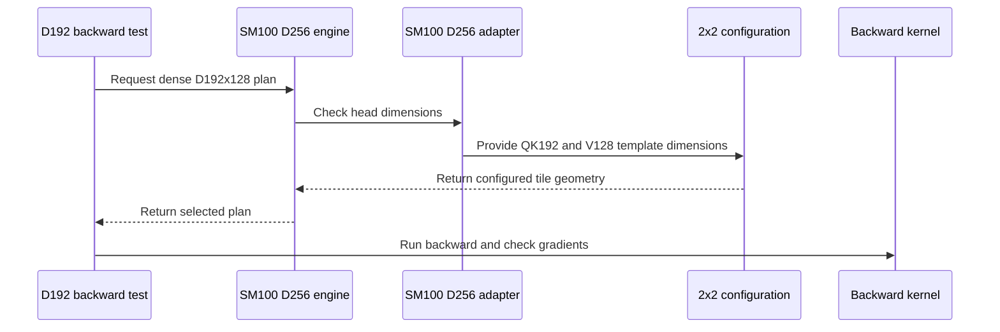

# sdpa: add native dense D192x128 half backward on SM100

[Upstream PR](https://github.com/NVIDIA/cudnn-frontend/pull/1883) · state: closed · merged: True

## Original PR description

SM100/SM103 backward currently declines dense attention with Q/K width 192 and V/O width 128. Extend `sdpa_bwd_sm100_d256` to serve that geometry natively for BF16/FP16, MHA/GQA/MQA, causal alignment and left windows.

The main kernel uses QK192 and V128 contraction widths, narrower shared-memory/TMEM layouts and matching dV output ownership. Tensor maps address the original operands directly. Delta reduction, sequence scratch and grouped-gradient folds distinguish QK and V widths. Existing D256 template records and geometry remain valid; the public API and launch sequence are unchanged. Admission and the support matrix cover only existing D256 and dense D192x128; packed, deterministic and quantized D192x128 remain outside this change.

Validation: 14 GPU scenarios check every gradient against FP64, poisoned CUDA Graph replay with changed inputs, fresh bindings and the actual compiled native geometry. Ten admission/configuration rejection cases, 78 existing D256 controls and 84 shared-configuration controls pass. Native SM100/SM103 compilation has no local-memory spills; six applicable existing SASS/profile checks pass (five architecture-gated checks skip on the test GPU). Both dtype variants of the grouped tail case pass memcheck and synccheck with zero errors. Three larger same-input native/envelope comparisons pass full-gradient and replay validation. Scoped pre-commit hooks pass.

<!-- This is an auto-generated comment: release notes by coderabbit.ai -->

<!-- coderabbit-ai-generated:v1 -->

## Summary by CodeRabbit

* **New Features**
  * Added support on compatible SM100 hardware for dense backward attention with 192-dimensional queries and keys and 128-dimensional values.
  * Support includes fp16 and bf16, causal and windowed masking, grouped-query and multi-query layouts, and chunked processing.
* **Compatibility**
  * Packed (THD) layouts with 192-dimensional queries and keys and 128-dimensional values remain unsupported.
  * Existing 256-dimensional support is unchanged.

<!-- end of auto-generated comment: release notes by coderabbit.ai -->

## Review and discussion

### reviews

- github-advanced-security[bot] · COMMENTED · 2026-10-26T16:11:24Z · [source](https://github.com/NVIDIA/cudnn-frontend/pull/1883#pullrequestreview-5655198853)

(No body; status only.)

- Anerudhan · APPROVED · 2026-10-26T16:33:55Z · [source](https://github.com/NVIDIA/cudnn-frontend/pull/1883#pullrequestreview-5655518894)

**Codex bot review · model: `gpt-6-astra`**

Reviewed `4273753124e9` against base `fe8c58129334`.

Reviewed dense D192×128 admission, tensor-map widths, scratch sizing, delta reduction and grouped-gradient folds. No actionable findings. The final update only removes an unused test import.

Validation: Six admission cases passed on the final head. The test module imported successfully. Before the import-only update, the D192/D256 suites completed with 275 passed and 13 skipped on SM100. All new admission and numerical/rebinding cases passed; runtime code is identical on the final head. Three independent GQA-ratio-3 cases passed FP64 checks, covering negative scale, a zero-scale window and 128 empty query rows. Graph and standalone outputs matched bitwise where both APIs admit the shape. Three poisoned eager repeats and three captured replays per case were bitwise stable. These checks used the unchanged runtime before the final import cleanup.

Limitations: Pipeline 76784780 is still running on the preceding head. Its runtime files match; it does not validate the final test-import cleanup. No duplicate GPU pipeline was requested for that cleanup. No independent SM103/SM107, sanitizer or performance qualification was run. Repeatability checks cover the stated cases; the deterministic-algorithm capability remains unchanged.

Approved: no P0 or high-risk P1 found. Remaining findings stay with the owner; merge timing stays with the owner.

<!-- codex-fe-review:v2:1883:4273753124e99170b144a5e81d1bc18824226eba:complete:no-blocker -->

- Anerudhan · COMMENTED · 2026-10-26T17:04:27Z · [source](https://github.com/NVIDIA/cudnn-frontend/pull/1883#pullrequestreview-5655970343)

**Codex bot review · model: `gpt-6-astra`**

Reviewed `07bba3835a91` against base `fc472d3d6cdb`.

Reviewed the native D192×128 increment since my earlier envelope review: independent contraction widths, shared-memory/TMEM sizing, dV ownership and template cache identity. The inactive dV writer group retains all required barrier arrivals. No actionable findings.

Validation: SM100 focused D192/D256 suites: 279 passed, 13 skipped. All 24 D192 cases passed. The skips were SM107 disassembly checks unsupported by the local decoder. Shared configuration suites: 125 passed. Three independent GQA-ratio-3 cases passed full FP64 gradient checks, including negative scale, a zero-scale window and 128 empty query rows. Graph/standalone outputs matched where both APIs admit the shape; each case passed three poisoned eager repeats and three captured replays bitwise. A larger same-input native/envelope control verified actual compiled geometries, full gradients and poisoned graph replay; both routes produced bitwise-equal outputs in that case. Both grouped-tail dtype cases passed synccheck with zero errors. Under memcheck both numerical cases passed, but seven CUDA API query errors also appeared in a prior no-attention control, so this is not a clean memcheck qualification. All nine changed files match the integration revision of current-head pipeline 76794475.

Limitations: CI remains in progress. No independent native SM103/SM107 qualification was run. The bounded repeatability checks do not expand the deterministic-algorithm contract.

Comment only: this PR already has an active approval; preserving existing approvals.

<!-- codex-fe-review:v2:1883:07bba3835a91b07b60eeb3b7d0333fcbe8e04d84:complete:no-blocker -->

### issue_comments

- coderabbitai[bot] · comment · 2026-10-26T15:55:04Z · [source](https://github.com/NVIDIA/cudnn-frontend/pull/1883#issuecomment-6420572004)

<!-- coderabbit-ai-generated:v1 -->

<!-- This is an auto-generated comment: summarize by coderabbit.ai -->
<!-- review_stack_entry_start -->

<a href="https://app.coderabbit.ai/change-stack/NVIDIA/cudnn-frontend/pull/1883?scope=ghh_OusAJGA4HG8ljoOV0wJvVx8NmnZIjc2DdjmxOu0xZWA&amp;cs_source=review_comment"><picture><source media="(prefers-color-scheme: dark)" srcset="https://storage.googleapis.com/coderabbit_public_assets/review-stack-in-coderabbit-ui-dark.svg?v=3"><source media="(prefers-color-scheme: light)" srcset="https://storage.googleapis.com/coderabbit_public_assets/review-stack-in-coderabbit-ui.svg?v=3"></picture></a>

<!-- review_stack_entry_end -->
<!-- recent_review_start -->

No actionable comments were generated in the recent review.

<strong><picture></picture> Recent review info</strong>

<dl>
<dd>

<!-- review_info_content -->

<strong><picture><source media="(prefers-color-scheme: dark)" srcset="https://storage.googleapis.com/coderabbit_public_assets/review-comment-icons-v1/cog-dark.svg"></picture> Run configuration</strong>

<dl>
<dd>

- **Source mode**: Auto
- **Repository**: [NVIDIA/cudnn-frontend](<https://github.com/NVIDIA/cudnn-frontend>)
- **Branch**: [develop](<https://github.com/NVIDIA/cudnn-frontend/tree/develop>)
- **File**: [.coderabbit.yaml](<https://github.com/NVIDIA/cudnn-frontend/blob/fe8c58129334407df488c59d53c16dfeeaf84cf6/.coderabbit.yaml>)
- **Commit**: [fe8c581](<https://github.com/NVIDIA/cudnn-frontend/commit/fe8c58129334407df488c59d53c16dfeeaf84cf6>)
- **Layers**: Repository YAML
- **Review profile**: CHILL
- **Plan**: Enterprise
- **Run ID**: `c266a61c-8d6a-4b8e-aa43-fe6c707a29a2`

</dd>
</dl>

<strong><picture><source media="(prefers-color-scheme: dark)" srcset="https://storage.googleapis.com/coderabbit_public_assets/review-comment-icons-v1/git-commit-horizontal-dark.svg"></picture> Commits</strong>

<dl>
<dd>

Reviewing files that changed from the base of the PR and between 4273753124e99170b144a5e81d1bc18824226eba and 07bba3835a91b07b60eeb3b7d0333fcbe8e04d84.

</dd>
</dl>

<strong><picture><source media="(prefers-color-scheme: dark)" srcset="https://storage.googleapis.com/coderabbit_public_assets/review-comment-icons-v1/file-plus-corner-dark.svg"></picture> Files selected for processing: 6</strong>

<dl>
<dd>

* `python/cudnn/sdpa/bwd/api_dsl_sm100_d256.py`
* `python/cudnn/sdpa/bwd/config_d256_2x2.py`
* `python/cudnn/sdpa/bwd/engines.py`
* `python/cudnn/sdpa/bwd/kernels/bprop_d256_2x2_f16.py`
* `python/cudnn/sdpa/frost/SUPPORT_MATRIX_TRACKER.md`
* `test/python/sdpa/frost/test_sdpa_bwd_d192_sm100.py`

</dd>
</dl>

<strong><picture><source media="(prefers-color-scheme: dark)" srcset="https://storage.googleapis.com/coderabbit_public_assets/review-comment-icons-v1/file-similar-dark.svg"></picture> Files skipped from review as they are similar to previous changes: 1</strong>

<dl>
<dd>

* python/cudnn/sdpa/bwd/engines.py

</dd>
</dl>

**Included review availability:** This review used your included allowance. Your plan provides up to 12 included reviews per hour; 10 remain after this review.

</dd>
</dl>

<!-- recent_review_end -->
<!-- walkthrough_start -->

<strong>Walkthrough</strong>

<dl>
<dd>

The SM100 D256 backward engine now admits dense D192x128 graphs while retaining D256 support and rejecting packed D192x128. Configuration, scratch sizing, and execution paths use separate QK and value widths. Tests cover execution and admission.

**Changes: Dense D192x128 backward**

|Layer / File(s)|Summary|
|:---|:---|
|**Shape admission and configuration contract**   `python/cudnn/sdpa/bwd/engines.py`, `python/cudnn/sdpa/bwd/api_dsl_sm100_d256.py`, `python/cudnn/sdpa/bwd/config_d256_2x2.py`|The engine and adapter admit dense `(192, 128)` alongside `(256, 256)`. The configuration accepts `(192, 128)` only for SM100 without THD varlen.|
|**Separate QK and value dimensions**   `python/cudnn/sdpa/bwd/config_d256_2x2.py`, `python/cudnn/sdpa/bwd/kernels/bprop_d256_2x2_f16.py`, `python/cudnn/sdpa/bwd/api_dsl_sm100_d256.py`, `python/cudnn/sdpa/bwd/api_dsl_sm107.py`, `python/cudnn/sdpa/bwd/kernels/sm107/prepared_host.py`|The configuration, scratch sizing, and kernel operations use separate QK and value widths. SM107 host-side dot-product and reduction calls use V’s width, while the SM107 adapter retains its exact-256 restriction.|
|**Execution coverage and support tracking**   `test/python/sdpa/frost/test_sdpa_bwd_d192_sm100.py`, `test/python/sdpa/frost/test_sdpa_bwd_d256_sm100.py`, `python/cudnn/sdpa/frost/SUPPORT_MATRIX_TRACKER.md`|Tests cover D192x128 execution, graph replay, rebinding, and admission. The tracker records dense support and packed-shape rejection.|

<!-- change_assessment_start -->
<strong>Priority: <picture></picture> Normal</strong>

**Estimated code review effort:** 3 (Moderate) | ~25 minutes

<!-- change_assessment_commit:"07bba3835a91b07b60eeb3b7d0333fcbe8e04d84" -->
**Change:** Feature
<!-- change_assessment_end -->

### Sequence Diagram(s)

**Possibly related issues**
- [NVIDIA/cudnn-frontend#380](https://github.com/NVIDIA/cudnn-frontend/issues/380): The issue identifies D192xD128 backward as an SM103 support-matrix gap, and this change adds dense D192x128 support for the shared SM100/SM103 engine family.

**Possibly related PRs**
- [NVIDIA/cudnn-frontend#1872](https://github.com/NVIDIA/cudnn-frontend/pull/1872): Both PRs change the 2x2 kernel’s dV output and barrier behavior, and modify the same configuration and THD gating paths.
- [NVIDIA/cudnn-frontend#1629](https://github.com/NVIDIA/cudnn-frontend/pull/1629): Both PRs change the chunk-local dK/dV partial workspace and fold path.

**Suggested labels:** `cat-feature`, `mod-cutedsl`, `mod-frost`

**Suggested reviewers:** `yihuawei`, `vedaanta`, `anerudhan`

</dd>
</dl>

<!-- walkthrough_end -->

<strong>Merge Risk:</strong> <strong><picture></picture> Minimal</strong> · up to <code>07bba</code>

<dl>
<dd>

<!-- final_review_risk_start -->
<!-- final_review_risk_label
**Merge Risk:** **⚪ Minimal** · up to `07bba`
-->
<!-- final_review_risk_coverage:{"sourceCommitId":"07bba3835a91b07b60eeb3b7d0333fcbe8e04d84","coveredCommitId":"07bba3835a91b07b60eeb3b7d0333fcbe8e04d84","kind":"reviewed"} -->

No identified issue blocks merging the dense D192x128 backward support after normal checks.
<!-- final_review_risk_end -->

</dd>
</dl>

<!-- pre_merge_checks_walkthrough_start -->

<strong>Pre-merge checks: <picture></picture> 3 · <picture></picture> 2</strong>

<dl>
<dd>

<strong><picture></picture> Failed checks: 2 warnings</strong>

|     Check name     |                                              Status                                              | Explanation                                                                                                                                                                                               | Resolution                                                                                                                                                                                                                                        |
| :---------------- | :----------------------------------------------------------------------------------------------: | :-------------------------------------------------------------------------------------------------------------------------------------------------------------------------------------------------------- | :------------------------------------------------------------------------------------------------------------------------------------------------------------------------------------------------------------------------------------------------ |
|  Description check |  | The description gives a detailed summary, rationale, compatibility scope, and validation results. However, it does not use the required template headings or provide the required checklist responses, a… | Update the description to follow the repository template. Add the Before submitting checklist with each item marked, identify the affected area, add Summary, Why, Related issues, API and compatibility impact, and Testing sections, and state… |
| Docstring Coverage |  | Docstring coverage is 33.33% which is insufficient. The required threshold is 80.00%. Docstring coverage is scoped to functions touched by this diff. Analyzed 33 functions across 8 files. (1 skipped: … | Write docstrings for the functions missing them to satisfy the coverage threshold.                                                                                                                                                                |

<strong><picture></picture> Passed checks: 3 passed</strong>

<dl>
<dd>

|         Check name         |                                             Status                                             | Explanation                                                                                                                        |
| :------------------------ | :--------------------------------------------------------------------------------------------: | :--------------------------------------------------------------------------------------------------------------------------------- |
|         Title check        |  | The title clearly and concisely identifies the main change: adding native dense D192x128 half-precision backward support on SM100. |
|     Linked Issues check    |  | Check skipped because no linked issues were found for this pull request.                                                           |
| Out of Scope Changes check |  | Check skipped because no linked issues were found for this pull request.                                                           |

</dd>
</dl>

<strong>Full details: Description check</strong>

<dl>
<dd>

**Explanation**

The description gives a detailed summary, rationale, compatibility scope, and validation results. However, it does not use the required template headings or provide the required checklist responses, affected area, related issues, and explicit API and compatibility impact sections.

**Resolution**

Update the description to follow the repository template. Add the Before submitting checklist with each item marked, identify the affected area, add Summary, Why, Related issues, API and compatibility impact, and Testing sections, and state when an item is not applicable.

</dd>
</dl>

<strong>Full details: Docstring Coverage</strong>

<dl>
<dd>

**Explanation**

Docstring coverage is 33.33% which is insufficient. The required threshold is 80.00%. Docstring coverage is scoped to functions touched by this diff. Analyzed 33 functions across 8 files. (1 skipped: 1 unsupported.)

**Resolution**

Write docstrings for the functions missing them to satisfy the coverage threshold.

</dd>
</dl>

</dd>
</dl>

<!-- pre_merge_checks_walkthrough_end -->
<!-- finishing_touch_checkbox_start -->

<strong>Finishing Touches</strong>

<dl>
<dd>

<strong>🧪 Generate unit tests (beta)</strong>

<dl>
<dd>

- [ ] <!-- {"checkboxId": "f47ac10b-58cc-4372-a567-0e02b2c3d479", "radioGroupId": "utg-output-choice-group-unknown_comment_id"} --> Create a new PR

</dd>
</dl>

</dd>
</dl>

<!-- finishing_touch_checkbox_end -->

<!-- autopilot:start -->
- [ ] <!-- {"checkboxId":"2708ad07-9f24-4260-9c11-7dc76a49f2e3"} --> <strong title="Keep fixing CodeRabbit findings and required CI, and resolving merge conflicts">Autofix</strong> · Keep fixing CodeRabbit findings and required CI, and resolving merge conflicts
<!-- autopilot:end -->
<!-- tips_start -->

Comment `@coderabbitai help` to get the list of available commands.

<!-- tips_end -->

- YangXu1990uiuc · comment · 2026-10-26T15:55:49Z · [source](https://github.com/NVIDIA/cudnn-frontend/pull/1883#issuecomment-6420589586)

@cudnn-ci-bot run python/sdpa/frost

- cudnn-ci-bot · comment · 2026-10-26T15:55:54Z · [source](https://github.com/NVIDIA/cudnn-frontend/pull/1883#issuecomment-6420591364)

🏁 Pipeline finished

SHA: `8d3dacf`
Targets: `python/sdpa/frost`
Branch: [cudnn-gh/pr-1883-8d3dacf](https://nv/cudnn-gitlab-ci/-/tree/cudnn-gh/pr-1883-8d3dacf)
Pipeline: [76784780](https://nv/cudnn-gitlab-ci/-/pipelines/76784780)
Last updated: 2026-10-26 16:44 UTC

**23 passed, 2 canceled, 3 skipped, 11 manual**

### <code>manual</code>

- <code>manual:python_samples</code> - Manual
- <code>manual:python</code> - Manual
- <code>manual:python/sdpa/frost</code> - ✅ Passed
- <code>manual:python/linear_attention/frost</code> - Manual
- <code>manual:python/gemm/frost</code> - Manual
- <code>manual:python/*/frost</code> - Manual
- <code>manual:python/gemm/cutedsl</code> - Manual
- <code>manual:python/*/cutedsl</code> - Manual
- <code>manual:python/*/jax</code> - Manual
- <code>manual:pycudnn</code> - Manual
- <code>manual:multi_gpu</code> - Manual
- <code>manual:backend</code> - Manual

### <code>analysis</code>

- <code>analysis:cudnn_clang_disable_exception</code> - ✅ Passed
- <code>analysis:cudnn_v9_no_half_conversion</code> - ✅ Passed
- <code>analysis:cudnn_clang</code> - ✅ Passed
- <code>analysis:check-relative-includes</code> - ✅ Passed
- <code>analysis:check-CUDNN_FRONTEND_SKIP_JSON_LIB</code> - ✅ Passed
- <code>analysis:guardwords_scan</code> - ✅ Passed
- <code>analysis:jax-import-guard</code> - ✅ Passed
- <code>analysis:pytest-gpu</code> - ✅ Passed
- <code>san:build</code> - ✅ Passed

### <code>build</code>

- <code>analysis:api_index</code> - ✅ Passed
- <code>build:dev:linux:amd64</code> - ✅ Passed
- <code>build:rel:linux:amd64</code> - ✅ Passed
- <code>build:dev:linux:arm64</code> - ✅ Passed
- <code>build:rel:linux:arm64</code> - ✅ Passed
- <code>build:rel:win:amd64</code> - ✅ Passed

### <code>frost_tests</code>

- <code>python/sdpa/frost:cutlass-rel:sm80</code> - ✅ Passed
- <code>python/sdpa/frost:cutlass-rel:sm100</code> - ✅ Passed
- <code>python/sdpa/frost:cutlass-rel:sm120</code> - Canceled
- <code>python/linear_attention/frost:cutlass-rel:sm100</code> - Skipped
- <code>python/gemm/frost:cutlass-rel:sm100</code> - Skipped
- <code>python/*/frost:cutlass-rel:sm100</code> - Skipped
- <code>python/sdpa/frost:cutlass-rel:sm103</code> - ✅ Passed
- <code>python/sdpa/frost:cutlass-4.8:sm107</code> - ✅ Passed

### <code>sanitizer_tests</code>

- <code>san:cpp_test:sm80</code> - ✅ Passed
- <code>san:cpp_test:sm90</code> - ✅ Passed
- <code>san:cpp_test:sm100</code> - ✅ Passed

### <code>triage</code>

- <code>triage:ai</code> - Canceled

- YangXu1990uiuc · comment · 2026-10-26T16:01:17Z · [source](https://github.com/NVIDIA/cudnn-frontend/pull/1883#issuecomment-6420717048)

The published head `8d3dacf4c` is based on merged #1879. The final-parent composition check also passes: eight rectangular admission/tail-replay cases and three existing D256 controls. The original 98 focused checks and both sanitizer results remain valid; the intervening implementation edits were scope documentation only. Repository GPU CI has been requested.

- YangXu1990uiuc · comment · 2026-10-26T16:37:25Z · [source](https://github.com/NVIDIA/cudnn-frontend/pull/1883#issuecomment-6421541720)

Head `07bba3835a91b07b60eeb3b7d0333fcbe8e04d84` adds the qualified native QK192/V128 specialization to this PR. The earlier approval covers the envelope implementation; please review the new six-file increment before landing.

The new implementation separates score and dP contraction widths, narrows shared-memory/TMEM layouts and adjusts dV output ownership while preserving all barrier arrivals. Existing D256 records and geometry are preserved. The PR description now reflects the final implementation.

Author validation passes: 24 new numerical/admission/configuration checks, 78 existing D256 controls, 84 shared-configuration controls, native SM100/SM103 compilation without local-memory spills, and six applicable existing SASS/profile controls. Five architecture-gated controls skip on the test GPU. Both grouped-tail dtype cases pass memcheck and synccheck with zero errors. Three larger same-input native/envelope controls pass full-gradient and replay checks. Scoped hooks pass.

@cudnn-ci-bot run python/sdpa/frost

- YangXu1990uiuc · comment · 2026-10-26T16:41:38Z · [source](https://github.com/NVIDIA/cudnn-frontend/pull/1883#issuecomment-6421641027)

@cudnn-ci-bot run python/sdpa/frost

- cudnn-ci-bot · comment · 2026-10-26T16:41:42Z · [source](https://github.com/NVIDIA/cudnn-frontend/pull/1883#issuecomment-6421642611)

🏁 Pipeline finished

SHA: `07bba38`
Targets: `python/sdpa/frost`
Branch: [cudnn-gh/pr-1883-07bba38](https://nv/cudnn-gitlab-ci/-/tree/cudnn-gh/pr-1883-07bba38)
Pipeline: [76794475](https://nv/cudnn-gitlab-ci/-/pipelines/76794475)
Cancelled this PR's older pipelines: 76784780
Last updated: 2026-10-26 17:41 UTC

**25 passed, 3 skipped, 11 manual**

### <code>manual</code>

- <code>manual:python_samples</code> - Manual
- <code>manual:python</code> - Manual
- <code>manual:python/sdpa/frost</code> - ✅ Passed
- <code>manual:python/linear_attention/frost</code> - Manual
- <code>manual:python/gemm/frost</code> - Manual
- <code>manual:python/*/frost</code> - Manual
- <code>manual:python/gemm/cutedsl</code> - Manual
- <code>manual:python/*/cutedsl</code> - Manual
- <code>manual:python/*/jax</code> - Manual
- <code>manual:pycudnn</code> - Manual
- <code>manual:multi_gpu</code> - Manual
- <code>manual:backend</code> - Manual

### <code>analysis</code>

- <code>analysis:cudnn_clang_disable_exception</code> - ✅ Passed
- <code>analysis:cudnn_v9_no_half_conversion</code> - ✅ Passed
- <code>analysis:cudnn_clang</code> - ✅ Passed
- <code>analysis:check-relative-includes</code> - ✅ Passed
- <code>analysis:check-CUDNN_FRONTEND_SKIP_JSON_LIB</code> - ✅ Passed
- <code>analysis:guardwords_scan</code> - ✅ Passed
- <code>analysis:jax-import-guard</code> - ✅ Passed
- <code>analysis:pytest-gpu</code> - ✅ Passed
- <code>san:build</code> - ✅ Passed

### <code>build</code>

- <code>analysis:api_index</code> - ✅ Passed
- <code>build:dev:linux:amd64</code> - ✅ Passed
- <code>build:rel:linux:amd64</code> - ✅ Passed
- <code>build:dev:linux:arm64</code> - ✅ Passed
- <code>build:rel:linux:arm64</code> - ✅ Passed
- <code>build:rel:win:amd64</code> - ✅ Passed

### <code>frost_tests</code>

- <code>python/sdpa/frost:cutlass-rel:sm80</code> - ✅ Passed
- <code>python/sdpa/frost:cutlass-rel:sm100</code> - ✅ Passed
- <code>python/sdpa/frost:cutlass-rel:sm120</code> - ✅ Passed
- <code>python/linear_attention/frost:cutlass-rel:sm100</code> - Skipped
- <code>python/gemm/frost:cutlass-rel:sm100</code> - Skipped
- <code>python/*/frost:cutlass-rel:sm100</code> - Skipped
- <code>python/sdpa/frost:cutlass-rel:sm103</code> - ✅ Passed
- <code>python/sdpa/frost:cutlass-4.8:sm107</code> - ✅ Passed

### <code>sanitizer_tests</code>

- <code>san:cpp_test:sm80</code> - ✅ Passed
- <code>san:cpp_test:sm90</code> - ✅ Passed
- <code>san:cpp_test:sm100</code> - ✅ Passed

### <code>triage</code>

- <code>triage:ai</code> - ✅ Passed

### inline_comments

- github-advanced-security[bot] · comment · 2026-10-26T16:11:24Z · [source](https://github.com/NVIDIA/cudnn-frontend/pull/1883#discussion_r4379577308)

File: `test/python/sdpa/frost/test_sdpa_bwd_d192_sm100.py` · line None

## CodeQL / Unused import

Import of 'cudnn' is not used.

[Show more details](https://github.com/NVIDIA/cudnn-frontend/security/code-scanning/4107)

## Changed files and fixed code

- `python/cudnn/sdpa/bwd/api_dsl_sm100_d256.py` · modified · additions 23 / deletions 3
  - [head](https://github.com/YangXu1990uiuc/cudnn-frontend/blob/07bba3835a91b07b60eeb3b7d0333fcbe8e04d84/python/cudnn/sdpa/bwd/api_dsl_sm100_d256.py)
  - [base](https://github.com/NVIDIA/cudnn-frontend/blob/fe8c58129334407df488c59d53c16dfeeaf84cf6/python/cudnn/sdpa/bwd/api_dsl_sm100_d256.py)
- `python/cudnn/sdpa/bwd/api_dsl_sm107.py` · modified · additions 15 / deletions 9
  - [head](https://github.com/YangXu1990uiuc/cudnn-frontend/blob/07bba3835a91b07b60eeb3b7d0333fcbe8e04d84/python/cudnn/sdpa/bwd/api_dsl_sm107.py)
  - [base](https://github.com/NVIDIA/cudnn-frontend/blob/fe8c58129334407df488c59d53c16dfeeaf84cf6/python/cudnn/sdpa/bwd/api_dsl_sm107.py)
- `python/cudnn/sdpa/bwd/config_d256_2x2.py` · modified · additions 27 / deletions 10
  - [head](https://github.com/YangXu1990uiuc/cudnn-frontend/blob/07bba3835a91b07b60eeb3b7d0333fcbe8e04d84/python/cudnn/sdpa/bwd/config_d256_2x2.py)
  - [base](https://github.com/NVIDIA/cudnn-frontend/blob/fe8c58129334407df488c59d53c16dfeeaf84cf6/python/cudnn/sdpa/bwd/config_d256_2x2.py)
- `python/cudnn/sdpa/bwd/engines.py` · modified · additions 14 / deletions 2
  - [head](https://github.com/YangXu1990uiuc/cudnn-frontend/blob/07bba3835a91b07b60eeb3b7d0333fcbe8e04d84/python/cudnn/sdpa/bwd/engines.py)
  - [base](https://github.com/NVIDIA/cudnn-frontend/blob/fe8c58129334407df488c59d53c16dfeeaf84cf6/python/cudnn/sdpa/bwd/engines.py)
- `python/cudnn/sdpa/bwd/kernels/bprop_d256_2x2_f16.py` · modified · additions 27 / deletions 11
  - [head](https://github.com/YangXu1990uiuc/cudnn-frontend/blob/07bba3835a91b07b60eeb3b7d0333fcbe8e04d84/python/cudnn/sdpa/bwd/kernels/bprop_d256_2x2_f16.py)
  - [base](https://github.com/NVIDIA/cudnn-frontend/blob/fe8c58129334407df488c59d53c16dfeeaf84cf6/python/cudnn/sdpa/bwd/kernels/bprop_d256_2x2_f16.py)
- `python/cudnn/sdpa/bwd/kernels/sm107/prepared_host.py` · modified · additions 4 / deletions 3
  - [head](https://github.com/YangXu1990uiuc/cudnn-frontend/blob/07bba3835a91b07b60eeb3b7d0333fcbe8e04d84/python/cudnn/sdpa/bwd/kernels/sm107/prepared_host.py)
  - [base](https://github.com/NVIDIA/cudnn-frontend/blob/fe8c58129334407df488c59d53c16dfeeaf84cf6/python/cudnn/sdpa/bwd/kernels/sm107/prepared_host.py)
- `python/cudnn/sdpa/frost/SUPPORT_MATRIX_TRACKER.md` · modified · additions 8 / deletions 1
  - [head](https://github.com/YangXu1990uiuc/cudnn-frontend/blob/07bba3835a91b07b60eeb3b7d0333fcbe8e04d84/python/cudnn/sdpa/frost/SUPPORT_MATRIX_TRACKER.md)
  - [base](https://github.com/NVIDIA/cudnn-frontend/blob/fe8c58129334407df488c59d53c16dfeeaf84cf6/python/cudnn/sdpa/frost/SUPPORT_MATRIX_TRACKER.md)
- `test/python/sdpa/frost/test_sdpa_bwd_d192_sm100.py` · added · additions 130 / deletions 0
  - [head](https://github.com/YangXu1990uiuc/cudnn-frontend/blob/07bba3835a91b07b60eeb3b7d0333fcbe8e04d84/test/python/sdpa/frost/test_sdpa_bwd_d192_sm100.py)
  - [base](https://github.com/NVIDIA/cudnn-frontend/blob/fe8c58129334407df488c59d53c16dfeeaf84cf6/test/python/sdpa/frost/test_sdpa_bwd_d192_sm100.py)
- `test/python/sdpa/frost/test_sdpa_bwd_d256_sm100.py` · modified · additions 2 / deletions 1
  - [head](https://github.com/YangXu1990uiuc/cudnn-frontend/blob/07bba3835a91b07b60eeb3b7d0333fcbe8e04d84/test/python/sdpa/frost/test_sdpa_bwd_d256_sm100.py)
  - [base](https://github.com/NVIDIA/cudnn-frontend/blob/fe8c58129334407df488c59d53c16dfeeaf84cf6/test/python/sdpa/frost/test_sdpa_bwd_d256_sm100.py)

## Evidence and interpretation boundary

[Original JSON, discussions and patches](../../../../../../evidence/prs/NVIDIA--cudnn-frontend/1883-d4914cee4036cdf2b24fac8325b5ae775e77f771d4b2b6ddd69e2dda7283fe86.json) · SHA-256 `d4914cee4036cdf2b24fac8325b5ae775e77f771d4b2b6ddd69e2dda7283fe86`.

Diff complete: True. Missing/binary/truncated patches require pinned source inspection. This is a source page, not an independently verified optimization case. Open, merged and released are different states; recheck the deployed dependency.
