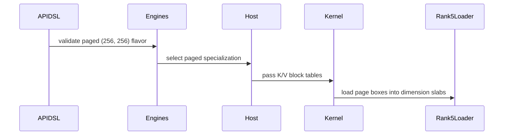

# sdpa: add native paged FP8 D256 on SM100

[Upstream PR](https://github.com/NVIDIA/cudnn-frontend/pull/1887) · state: closed · merged: True

## Original PR description

Paged per-tensor FP8 attention with native D256 heads currently declines on SM100/SM103. This change adds block-table K/V loads to the D256 core and connects them to the existing prepared graph and standalone execution paths. Short pages retain the full shared-memory dimension-slab pitch, and K/V can use independent tables and HND/NHD layouts.

The new coverage includes page boundaries, padding/causal/windows, packed and unpacked heads, supported splits, sinks, changed bindings and retained CUDA Graph replays. It also fixes sink-only rows producing negative-infinite Stats for a very negative finite sink. Capability rows and the support matrix are updated; quantized paged THD queries and block-scaled outputs retain their existing exclusions.

Validation: 103 focused GPU tests plus two persistent multiwave controls passed. Five targeted cases each passed memcheck and synccheck with zero reported errors; these sanitizer runs reloaded the compiled artifacts before instrumenting execution and replay. Two additional SM103 variants compiled successfully. Scoped formatting/license hooks pass. The paged/dense numerical control uses identical inputs and checks exact equality; the pre-existing D256 Stats deviation was independently reproduced with the parent dense kernel. The FP8 reference now follows D256's P-cast scale, and the D256 Stats absolute bound matches the existing prepared suite without a relative allowance.

<!-- This is an auto-generated comment: release notes by coderabbit.ai -->
<!-- coderabbit-ai-generated:v1 -->

## Summary by CodeRabbit

* **New Features**
  * Paged key/value attention now supports per-tensor FP8 with 256-dimensional query and key heads on supported hardware, including pages shorter than the KV tile.
* **Bug Fixes**
  * Attention rows with no valid key/value entries now produce zero outputs and report the sink value in their statistics, including for very negative sink values.
  * Paged FP8 behavior is validated across page boundaries, changing sequence lengths, and dense-versus-paged execution.
<!-- end of auto-generated comment: release notes by coderabbit.ai -->

## Review and discussion

### reviews

- Anerudhan · APPROVED · 2026-10-26T19:53:40Z · [source](https://github.com/NVIDIA/cudnn-frontend/pull/1887#pullrequestreview-5658114706)

**Codex bot review · model: `gpt-6-astra`**

Reviewed `3ec20abea2f6` against base `fb1d3bf81e36`.

The updated analyzer tests resolve the stale D256 exclusion found in the earlier review. They now accept HND/NHD D256 while retaining D192, THD and invalid-page rejection checks. No findings remain in the paged loader or sink correction.

Validation: Compared this head with 73e270ec: only test_sdpa_graph_analyzer.py changed. All 80 paged analyzer checks passed on the new head, including the two previously failing assertions. Reused independent validation of the unchanged runtime and native tests: 55 focused SM100 tests passed with DSL 4.8, covering page boundaries, independent K/V layouts, splits, sinks, rebinding, capture and exact dense/paged arithmetic comparisons. Two independent B17/Hq16/D256 cases at page sizes 8 and 256 passed reference checks and three poisoned eager plus three captured byte comparisons of O, Stats and Amax, including split-3 E5M2 and packed sink attention. The parent reproduces invalid sink-only Stats at sink -120; the reviewed correction passes -120 and +120 controls. A bounded dense parent/head timing check found no regression. Two targeted tests passed synccheck with zero reported errors. Reused current-head CI pipeline 76825253. All changed runtime and test files match its integration tree. SM80, SM100, SM103 and SM107 lanes passed; SM120 remains running. The SM100 artifact confirms both corrected analyzer tests passed. Style and Security checks passed.

Limitations: Independent native checks used SM100. No independent memcheck or full performance sweep was run. The shared-device timing check covers one dense workload only; repeatability evidence applies to the tested fixed configurations. The previous native results were not rerun for this test-only revision. Their runtime and native test blobs are unchanged.

Approved: no P0 or high-risk P1 found. Remaining findings stay with the owner; merge timing stays with the owner.

<!-- codex-fe-review:v2:1887:3ec20abea2f6f3b241282724a2d2dbbf51da6a44:complete:no-blocker -->

### issue_comments

- YangXu1990uiuc · comment · 2026-10-26T18:04:19Z · [source](https://github.com/NVIDIA/cudnn-frontend/pull/1887#issuecomment-6423624381)

@cudnn-ci-bot run python/sdpa/frost

- cudnn-ci-bot · comment · 2026-10-26T18:04:30Z · [source](https://github.com/NVIDIA/cudnn-frontend/pull/1887#issuecomment-6423628642)

🏁 Pipeline finished

SHA: `73e270e`
Targets: `python/sdpa/frost`
Branch: [cudnn-gh/pr-1887-73e270e](https://nv/cudnn-gitlab-ci/-/tree/cudnn-gh/pr-1887-73e270e)
Pipeline: [76813487](https://nv/cudnn-gitlab-ci/-/pipelines/76813487)
Last updated: 2026-10-26 19:00 UTC

**20 passed, 3 failed, 2 canceled, 3 skipped, 11 manual**

### <code>manual</code>

- <code>manual:python_samples</code> - Manual
- <code>manual:python</code> - Manual
- <code>manual:python/sdpa/frost</code> - ✅ Passed
- <code>manual:python/linear_attention/frost</code> - Manual
- <code>manual:python/gemm/frost</code> - Manual
- <code>manual:python/*/frost</code> - Manual
- <code>manual:python/gemm/cutedsl</code> - Manual
- <code>manual:python/*/cutedsl</code> - Manual
- <code>manual:python/*/jax</code> - Manual
- <code>manual:pycudnn</code> - Manual
- <code>manual:multi_gpu</code> - Manual
- <code>manual:backend</code> - Manual

### <code>analysis</code>

- <code>analysis:cudnn_clang_disable_exception</code> - ✅ Passed
- <code>analysis:cudnn_v9_no_half_conversion</code> - ✅ Passed
- <code>analysis:cudnn_clang</code> - ✅ Passed
- <code>analysis:check-relative-includes</code> - ✅ Passed
- <code>analysis:check-CUDNN_FRONTEND_SKIP_JSON_LIB</code> - ✅ Passed
- <code>analysis:guardwords_scan</code> - ✅ Passed
- <code>analysis:jax-import-guard</code> - ✅ Passed
- <code>analysis:pytest-gpu</code> - ✅ Passed
- <code>san:build</code> - ✅ Passed

### <code>build</code>

- <code>analysis:api_index</code> - ✅ Passed
- <code>build:dev:linux:amd64</code> - ✅ Passed
- <code>build:rel:linux:amd64</code> - ✅ Passed
- <code>build:dev:linux:arm64</code> - ✅ Passed
- <code>build:rel:linux:arm64</code> - ✅ Passed
- <code>build:rel:win:amd64</code> - ✅ Passed

### <code>frost_tests</code>

- <code>python/sdpa/frost:cutlass-rel:sm80</code> - ❌ **New Failure!** (nightly passed)
- <code>python/sdpa/frost:cutlass-rel:sm100</code> - ❌ **New Failure!** (nightly passed)
- <code>python/sdpa/frost:cutlass-rel:sm120</code> - Canceled
- <code>python/linear_attention/frost:cutlass-rel:sm100</code> - Skipped
- <code>python/gemm/frost:cutlass-rel:sm100</code> - Skipped
- <code>python/*/frost:cutlass-rel:sm100</code> - Skipped
- <code>python/sdpa/frost:cutlass-rel:sm103</code> - ❌ **New Failure!** (nightly passed)
- <code>python/sdpa/frost:cutlass-4.8:sm107</code> - ✅ Passed

### <code>sanitizer_tests</code>

- <code>san:cpp_test:sm80</code> - ✅ Passed
- <code>san:cpp_test:sm90</code> - ✅ Passed
- <code>san:cpp_test:sm100</code> - ✅ Passed

### <code>triage</code>

- <code>triage:ai</code> - Canceled

- coderabbitai[bot] · comment · 2026-10-26T18:04:55Z · [source](https://github.com/NVIDIA/cudnn-frontend/pull/1887#issuecomment-6423637447)

<!-- coderabbit-ai-generated:v1 -->

<!-- This is an auto-generated comment: summarize by coderabbit.ai -->
<!-- review_stack_entry_start -->

<a href="https://app.coderabbit.ai/change-stack/NVIDIA/cudnn-frontend/pull/1887?scope=ghh_OusAJGA4HG8ljoOV0wJvVx8NmnZIjc2DdjmxOu0xZWA&amp;cs_source=review_comment"><picture><source media="(prefers-color-scheme: dark)" srcset="https://storage.googleapis.com/coderabbit_public_assets/review-stack-in-coderabbit-ui-dark.svg?v=3"><source media="(prefers-color-scheme: light)" srcset="https://storage.googleapis.com/coderabbit_public_assets/review-stack-in-coderabbit-ui.svg?v=3"></picture></a>

<!-- review_stack_entry_end -->
<!-- recent_review_start -->

No actionable comments were generated in the recent review.

<strong><picture></picture> Recent review info</strong>

<dl>
<dd>

<!-- review_info_content -->

<strong><picture><source media="(prefers-color-scheme: dark)" srcset="https://storage.googleapis.com/coderabbit_public_assets/review-comment-icons-v1/cog-dark.svg"></picture> Run configuration</strong>

<dl>
<dd>

- **Source mode**: Auto
- **Repository**: [NVIDIA/cudnn-frontend](<https://github.com/NVIDIA/cudnn-frontend>)
- **Branch**: [develop](<https://github.com/NVIDIA/cudnn-frontend/tree/develop>)
- **File**: [.coderabbit.yaml](<https://github.com/NVIDIA/cudnn-frontend/blob/fa065f1e52a6d154a0d7f4c1d8f10174c44145d0/.coderabbit.yaml>)
- **Commit**: [fa065f1](<https://github.com/NVIDIA/cudnn-frontend/commit/fa065f1e52a6d154a0d7f4c1d8f10174c44145d0>)
- **Layers**: Repository YAML
- **Review profile**: CHILL
- **Plan**: Enterprise
- **Run ID**: `42800781-a75e-4d97-a801-856242b087ba`

</dd>
</dl>

<strong><picture><source media="(prefers-color-scheme: dark)" srcset="https://storage.googleapis.com/coderabbit_public_assets/review-comment-icons-v1/git-commit-horizontal-dark.svg"></picture> Commits</strong>

<dl>
<dd>

Reviewing files that changed from the base of the PR and between 73e270ec79fb50499f4f490d37604efcd11930f1 and 3ec20abea2f6f3b241282724a2d2dbbf51da6a44.

</dd>
</dl>

<strong><picture><source media="(prefers-color-scheme: dark)" srcset="https://storage.googleapis.com/coderabbit_public_assets/review-comment-icons-v1/file-plus-corner-dark.svg"></picture> Files selected for processing: 1</strong>

<dl>
<dd>

* `test/python/sdpa/frost/test_sdpa_graph_analyzer.py`

</dd>
</dl>

**Included review availability:** This review used your included allowance. Your plan provides up to 12 included reviews per hour; 10 remain after this review.

</dd>
</dl>

<!-- recent_review_end -->
<!-- walkthrough_start -->

<strong>Walkthrough</strong>

<dl>
<dd>

The SM100 per-tensor FP8 D256 path now accepts paged KV. The kernel loads paged K/V through block tables and rank-5 TMA operations. Sink-only rows receive explicit output and LSE values. Tests cover D256 paged execution and sink behavior.

**Changes: Paged FP8 D256**

|Layer / File(s)|Summary|
|:---|:---|
|**Capability and prepared compilation**   `python/cudnn/sdpa/fwd/api_dsl.py`, `python/cudnn/sdpa/fwd/engines.py`, `python/cudnn/sdpa/fwd/kernels/sm100/prefill_d256_fp8.py`, `python/cudnn/sdpa/frost/SUPPORT_MATRIX_TRACKER.md`, `test/python/sdpa/frost/test_sdpa_graph_analyzer.py`|Paged per-tensor FP8 accepts the exact `(256, 256)` flavor on SM100. Prepared compilation permits paged specializations, while Rubin remains without paged-KV support.|
|**Paged TMA loading**   `python/cudnn/sdpa/fwd/kernels/sm100/prefill_d256_fp8.py`|The D256 kernel receives K/V block tables and uses rank-5 page loads with page-bounded boxes and full-tile dimension-slab pitches. Dense KV retains its existing TMA path.|
|**Sink-only row results**   `python/cudnn/sdpa/fwd/kernels/sm100/prefill_d256_fp8.py`, `python/cudnn/sdpa/AGENTS.md`, `test/python/sdpa/frost/test_sdpa_fwd_paged_sm100.py`, `test/python/sdpa/frost/test_sdpa_prepared_fp8_paged.py`|When a row has no valid KV keys, the epilogue sets LSE to the sink logit and the output scale factor to zero. Tests cover negative and positive sinks and padded output positions.|
|**D256 paged execution coverage**   `test/python/sdpa/frost/test_sdpa_fwd_paged_sm100.py`, `test/python/sdpa/frost/test_sdpa_prepared_fp8_paged.py`|Tests add D256 cases for page boundaries, graph replay, persistent batches, pool layouts, and paged-versus-dense comparisons. LSE tolerances vary by head dimension.|

<!-- change_assessment_start -->
<strong>Priority: <picture></picture> Normal</strong>

**Estimated code review effort:** 4 (Complex) | ~45 minutes

<!-- change_assessment_commit:"3ec20abea2f6f3b241282724a2d2dbbf51da6a44" -->
**Change:** Feature
<!-- change_assessment_end -->

### Sequence Diagram(s)

**Possibly related issues**
- [NVIDIA/cudnn-frontend#380](https://github.com/NVIDIA/cudnn-frontend/issues/380) — The PR adds SM103 paged per-tensor FP8 D256 coverage and updates the shared support matrix.

**Suggested labels:** `cat-feature`, `cat-bugfix`, `mod-frost`

**Suggested reviewers:** `vedaanta`

</dd>
</dl>

<!-- walkthrough_end -->

<strong>Merge Risk:</strong> <strong><picture></picture> Minimal</strong> · up to <code>3ec20</code>

<dl>
<dd>

<!-- final_review_risk_start -->
<!-- final_review_risk_label
**Merge Risk:** **⚪ Minimal** · up to `3ec20`
-->
<!-- final_review_risk_coverage:{"sourceCommitId":"3ec20abea2f6f3b241282724a2d2dbbf51da6a44","coveredCommitId":"3ec20abea2f6f3b241282724a2d2dbbf51da6a44","kind":"reviewed"} -->

The updated graph-analyzer expectations do not present an actionable merge risk.
<!-- final_review_risk_end -->

</dd>
</dl>

<!-- pre_merge_checks_walkthrough_start -->

<strong>Pre-merge checks: <picture></picture> 4 · <picture></picture> 1</strong>

<dl>
<dd>

<strong><picture></picture> Failed checks: 1 warning</strong>

|     Check name     |                                              Status                                              | Explanation                                                                                                                                                                                 | Resolution                                                                         |
| :---------------- | :----------------------------------------------------------------------------------------------: | :------------------------------------------------------------------------------------------------------------------------------------------------------------------------------------------ | :--------------------------------------------------------------------------------- |
| Docstring Coverage |  | Docstring coverage is 58.62% which is insufficient. The required threshold is 80.00%. Docstring coverage is scoped to functions touched by this diff. Analyzed 29 functions across 6 files. | Write docstrings for the functions missing them to satisfy the coverage threshold. |

<strong><picture></picture> Passed checks: 4 passed</strong>

<dl>
<dd>

|         Check name         |                                             Status                                             | Explanation                                                                                                                                                                                               |
| :------------------------ | :--------------------------------------------------------------------------------------------: | :-------------------------------------------------------------------------------------------------------------------------------------------------------------------------------------------------------- |
|         Title check        |  | The title clearly and concisely identifies the main change: native paged FP8 D256 support on SM100.                                                                                                       |
|      Description check     |  | The description provides a clear summary, motivation, compatibility limits, implementation details, and extensive testing results. It does not reproduce the template headings or checklist, and it omit… |
|     Linked Issues check    |  | Check skipped because no linked issues were found for this pull request.                                                                                                                                  |
| Out of Scope Changes check |  | Check skipped because no linked issues were found for this pull request.                                                                                                                                  |

<strong>Full details: Description check</strong>

<dl>
<dd>

**Explanation**

The description provides a clear summary, motivation, compatibility limits, implementation details, and extensive testing results. It does not reproduce the template headings or checklist, and it omits explicit related issues and a separate API-impact section, but the required technical information is mostly present.

</dd>
</dl>

</dd>
</dl>

</dd>
</dl>

<!-- pre_merge_checks_walkthrough_end -->
<!-- finishing_touch_checkbox_start -->

<strong>Finishing Touches</strong>

<dl>
<dd>

<strong>🧪 Generate unit tests (beta)</strong>

<dl>
<dd>

- [ ] <!-- {"checkboxId": "f47ac10b-58cc-4372-a567-0e02b2c3d479", "radioGroupId": "utg-output-choice-group-unknown_comment_id"} --> Create a new PR

</dd>
</dl>

</dd>
</dl>

<!-- finishing_touch_checkbox_end -->

<!-- autopilot:start -->
- [ ] <!-- {"checkboxId":"2708ad07-9f24-4260-9c11-7dc76a49f2e3"} --> <strong title="Keep fixing CodeRabbit findings and required CI, and resolving merge conflicts">Autofix</strong> · Keep fixing CodeRabbit findings and required CI, and resolving merge conflicts
<!-- autopilot:end -->
<!-- tips_start -->

Comment `@coderabbitai help` to get the list of available commands.

<!-- tips_end -->

- YangXu1990uiuc · comment · 2026-10-26T18:53:37Z · [source](https://github.com/NVIDIA/cudnn-frontend/pull/1887#issuecomment-6424650933)

Updated the two existing graph-analyzer assertions for native paged D256 FP8 admission. HND/NHD acceptance is covered, and unsupported D192 and THD declarations retain rejection checks. Both targeted tests and scoped pre-commit checks pass.

@cudnn-ci-bot run python/sdpa/frost

- YangXu1990uiuc · comment · 2026-10-26T18:56:21Z · [source](https://github.com/NVIDIA/cudnn-frontend/pull/1887#issuecomment-6424704672)

@cudnn-ci-bot run python/sdpa/frost

- cudnn-ci-bot · comment · 2026-10-26T18:56:25Z · [source](https://github.com/NVIDIA/cudnn-frontend/pull/1887#issuecomment-6424705865)

🏁 Pipeline finished

SHA: `3ec20ab`
Targets: `python/sdpa/frost`
Branch: [cudnn-gh/pr-1887-3ec20ab](https://nv/cudnn-gitlab-ci/-/tree/cudnn-gh/pr-1887-3ec20ab)
Pipeline: [76825253](https://nv/cudnn-gitlab-ci/-/pipelines/76825253)
Cancelled this PR's older pipelines: 76813487
Last updated: 2026-10-26 19:55 UTC

**25 passed, 3 skipped, 11 manual**

### <code>manual</code>

- <code>manual:python_samples</code> - Manual
- <code>manual:python</code> - Manual
- <code>manual:python/sdpa/frost</code> - ✅ Passed
- <code>manual:python/linear_attention/frost</code> - Manual
- <code>manual:python/gemm/frost</code> - Manual
- <code>manual:python/*/frost</code> - Manual
- <code>manual:python/gemm/cutedsl</code> - Manual
- <code>manual:python/*/cutedsl</code> - Manual
- <code>manual:python/*/jax</code> - Manual
- <code>manual:pycudnn</code> - Manual
- <code>manual:multi_gpu</code> - Manual
- <code>manual:backend</code> - Manual

### <code>analysis</code>

- <code>analysis:cudnn_clang_disable_exception</code> - ✅ Passed
- <code>analysis:cudnn_v9_no_half_conversion</code> - ✅ Passed
- <code>analysis:cudnn_clang</code> - ✅ Passed
- <code>analysis:check-relative-includes</code> - ✅ Passed
- <code>analysis:check-CUDNN_FRONTEND_SKIP_JSON_LIB</code> - ✅ Passed
- <code>analysis:guardwords_scan</code> - ✅ Passed
- <code>analysis:jax-import-guard</code> - ✅ Passed
- <code>analysis:pytest-gpu</code> - ✅ Passed
- <code>san:build</code> - ✅ Passed

### <code>build</code>

- <code>analysis:api_index</code> - ✅ Passed
- <code>build:dev:linux:amd64</code> - ✅ Passed
- <code>build:rel:linux:amd64</code> - ✅ Passed
- <code>build:dev:linux:arm64</code> - ✅ Passed
- <code>build:rel:linux:arm64</code> - ✅ Passed
- <code>build:rel:win:amd64</code> - ✅ Passed

### <code>frost_tests</code>

- <code>python/sdpa/frost:cutlass-rel:sm80</code> - ✅ Passed
- <code>python/sdpa/frost:cutlass-rel:sm100</code> - ✅ Passed
- <code>python/sdpa/frost:cutlass-rel:sm120</code> - ✅ Passed
- <code>python/linear_attention/frost:cutlass-rel:sm100</code> - Skipped
- <code>python/gemm/frost:cutlass-rel:sm100</code> - Skipped
- <code>python/*/frost:cutlass-rel:sm100</code> - Skipped
- <code>python/sdpa/frost:cutlass-rel:sm103</code> - ✅ Passed
- <code>python/sdpa/frost:cutlass-4.8:sm107</code> - ✅ Passed

### <code>sanitizer_tests</code>

- <code>san:cpp_test:sm80</code> - ✅ Passed
- <code>san:cpp_test:sm90</code> - ✅ Passed
- <code>san:cpp_test:sm100</code> - ✅ Passed

### <code>triage</code>

- <code>triage:ai</code> - ✅ Passed

- YangXu1990uiuc · comment · 2026-10-26T19:18:48Z · [source](https://github.com/NVIDIA/cudnn-frontend/pull/1887#issuecomment-6425168113)

Native SM100 validation for `3ec20abea2f6f3b241282724a2d2dbbf51da6a44`: **27 targeted tests passed, zero skips or failures**, on B200 with cuDNN 9.27, CuTeDSL 4.8.0 and Torch 2.14.1/CUDA 13.0. I verified the actual source/native bindings and exercised page boundaries, independent K/V pool layouts, prepared rebinding/capture, persistent multiwave batch lengths and keyless sink rows.

An additional probe covered page 8 with packing/sink and page 256 with split-KV=2, each under all three supported schedulers. All six configurations passed their initial O/LSE reference checks. Ten poisoned-output CUDA-graph replays per configuration then produced identical O/LSE/Amax bits. This is repeatability within each fixed configuration, not a claim of batch invariance or equality across split/scheduler choices.

I also tested the multiwave detector with a private negative control: removing only the page-count refresh after a persistent batch handoff makes the test fail with NaN output. Restoring this head makes the same test pass. Thus that regression test detects the stale-page-count error, rather than merely compiling the path.

The updated head only changes the two stale analyzer expectations relative to `73e270ec`; the validated kernel and targeted GPU tests are unchanged. No new issue found in this bounded validation. Current-head CI is still pending, and I did not repeat a performance or sanitizer sweep.

Codex bot review — model `gpt-6-astra`.

<!-- codex-fe-ci:v1:1887:3ec20abea2f6f3b241282724a2d2dbbf51da6a44:native-validation-sm100 -->

- YangXu1990uiuc · comment · 2026-10-26T20:00:29Z · [source](https://github.com/NVIDIA/cudnn-frontend/pull/1887#issuecomment-6425998383)

CI follow-up for `3ec20abea2f6`: pipeline **76825253** has finished. The selected SDPA FROST jobs passed on SM80, SM100, SM103, SM107 and SM120; the build/analysis and C++ sanitizer controls also passed. This agrees with the [updated CI acknowledgement](https://github.com/NVIDIA/cudnn-frontend/pull/1887#issuecomment-6424705865).

This qualifies the current head's selected CI scope, alongside the earlier native B200 supplement. It does not count unselected/manual targets as coverage or replace an independent review/approval.

Codex bot review — model `gpt-6-astra`.

<!-- codex-fe-ci:v1:1887:3ec20abea2f6f3b241282724a2d2dbbf51da6a44:pipeline-76825253-terminal -->

### inline_comments

## Changed files and fixed code

- `python/cudnn/sdpa/AGENTS.md` · modified · additions 15 / deletions 0
  - [head](https://github.com/YangXu1990uiuc/cudnn-frontend/blob/3ec20abea2f6f3b241282724a2d2dbbf51da6a44/python/cudnn/sdpa/AGENTS.md)
  - [base](https://github.com/NVIDIA/cudnn-frontend/blob/fa065f1e52a6d154a0d7f4c1d8f10174c44145d0/python/cudnn/sdpa/AGENTS.md)
- `python/cudnn/sdpa/frost/SUPPORT_MATRIX_TRACKER.md` · modified · additions 8 / deletions 6
  - [head](https://github.com/YangXu1990uiuc/cudnn-frontend/blob/3ec20abea2f6f3b241282724a2d2dbbf51da6a44/python/cudnn/sdpa/frost/SUPPORT_MATRIX_TRACKER.md)
  - [base](https://github.com/NVIDIA/cudnn-frontend/blob/fa065f1e52a6d154a0d7f4c1d8f10174c44145d0/python/cudnn/sdpa/frost/SUPPORT_MATRIX_TRACKER.md)
- `python/cudnn/sdpa/fwd/api_dsl.py` · modified · additions 2 / deletions 2
  - [head](https://github.com/YangXu1990uiuc/cudnn-frontend/blob/3ec20abea2f6f3b241282724a2d2dbbf51da6a44/python/cudnn/sdpa/fwd/api_dsl.py)
  - [base](https://github.com/NVIDIA/cudnn-frontend/blob/fa065f1e52a6d154a0d7f4c1d8f10174c44145d0/python/cudnn/sdpa/fwd/api_dsl.py)
- `python/cudnn/sdpa/fwd/engines.py` · modified · additions 6 / deletions 15
  - [head](https://github.com/YangXu1990uiuc/cudnn-frontend/blob/3ec20abea2f6f3b241282724a2d2dbbf51da6a44/python/cudnn/sdpa/fwd/engines.py)
  - [base](https://github.com/NVIDIA/cudnn-frontend/blob/fa065f1e52a6d154a0d7f4c1d8f10174c44145d0/python/cudnn/sdpa/fwd/engines.py)
- `python/cudnn/sdpa/fwd/kernels/sm100/prefill_d256_fp8.py` · modified · additions 237 / deletions 60
  - [head](https://github.com/YangXu1990uiuc/cudnn-frontend/blob/3ec20abea2f6f3b241282724a2d2dbbf51da6a44/python/cudnn/sdpa/fwd/kernels/sm100/prefill_d256_fp8.py)
  - [base](https://github.com/NVIDIA/cudnn-frontend/blob/fa065f1e52a6d154a0d7f4c1d8f10174c44145d0/python/cudnn/sdpa/fwd/kernels/sm100/prefill_d256_fp8.py)
- `test/python/sdpa/frost/test_sdpa_fwd_paged_sm100.py` · modified · additions 163 / deletions 24
  - [head](https://github.com/YangXu1990uiuc/cudnn-frontend/blob/3ec20abea2f6f3b241282724a2d2dbbf51da6a44/test/python/sdpa/frost/test_sdpa_fwd_paged_sm100.py)
  - [base](https://github.com/NVIDIA/cudnn-frontend/blob/fa065f1e52a6d154a0d7f4c1d8f10174c44145d0/test/python/sdpa/frost/test_sdpa_fwd_paged_sm100.py)
- `test/python/sdpa/frost/test_sdpa_graph_analyzer.py` · modified · additions 11 / deletions 10
  - [head](https://github.com/YangXu1990uiuc/cudnn-frontend/blob/3ec20abea2f6f3b241282724a2d2dbbf51da6a44/test/python/sdpa/frost/test_sdpa_graph_analyzer.py)
  - [base](https://github.com/NVIDIA/cudnn-frontend/blob/fa065f1e52a6d154a0d7f4c1d8f10174c44145d0/test/python/sdpa/frost/test_sdpa_graph_analyzer.py)
- `test/python/sdpa/frost/test_sdpa_prepared_fp8_paged.py` · modified · additions 33 / deletions 3
  - [head](https://github.com/YangXu1990uiuc/cudnn-frontend/blob/3ec20abea2f6f3b241282724a2d2dbbf51da6a44/test/python/sdpa/frost/test_sdpa_prepared_fp8_paged.py)
  - [base](https://github.com/NVIDIA/cudnn-frontend/blob/fa065f1e52a6d154a0d7f4c1d8f10174c44145d0/test/python/sdpa/frost/test_sdpa_prepared_fp8_paged.py)

## Evidence and interpretation boundary

[Original JSON, discussions and patches](../../../../../../evidence/prs/NVIDIA--cudnn-frontend/1887-2b54b55504acd5f8093e50d142cf1fa98f1b2f5f54bb53b232a014797ed4ad73.json) · SHA-256 `2b54b55504acd5f8093e50d142cf1fa98f1b2f5f54bb53b232a014797ed4ad73`.

Diff complete: True. Missing/binary/truncated patches require pinned source inspection. This is a source page, not an independently verified optimization case. Open, merged and released are different states; recheck the deployed dependency.
