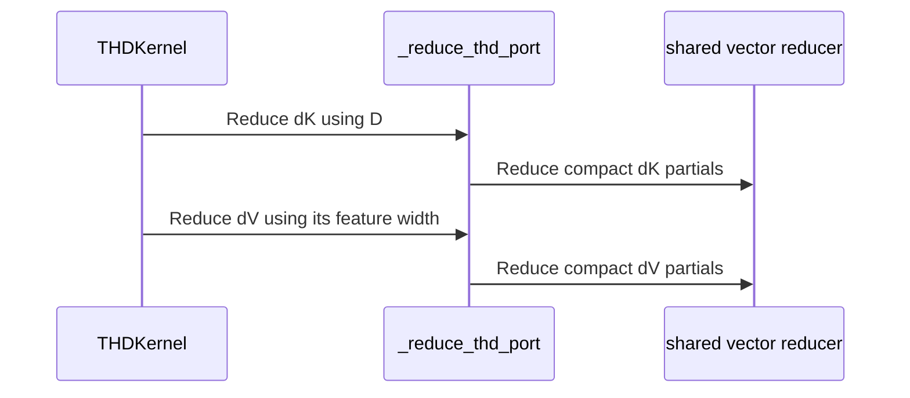

# sdpa: support native D192x128 THD backward

[Upstream PR](https://github.com/NVIDIA/cudnn-frontend/pull/1925) · state: closed · merged: True

## Original PR description

D192x128 half backward was native only for dense BSHD tensors. This extends the same SM100/SM103 engine to packed THD, carrying the real QK/V widths through delta, scratch and grouped-gradient reduction. It also fixes a bounded unequal-width reduction bug: a dK vector rejected by the device row limit must not fall into the dV interval with a negative index.

## Before submitting

- [x] I agree to license this contribution under the terms of LICENSE.txt.
- [x] I ran scoped pre-commit hooks and committed formatting changes.
- [x] I reviewed the applicable AGENTS.md Hard Rules; the support tracker and the new bounded-reducer regression guidance are included.
- [x] Required category, area and origin labels are applied.

## Affected area

FE OSS SDPA backward kernels and tests.

## Summary

- Serve D192x128 THD natively through graph and standalone APIs, with independent per-port physical origins, both Stats layouts, and compact standalone prefixes.
- Preserve separate 192-wide dK and 128-wide dV addressing, with live-row guards on each output interval.
- Share the existing D256 FP64/canary/rebinding/replay harness while preserving its test IDs.

## Why

Dense and packed storage should expose the same native rectangular geometry. The new compact regression caught the row-limit fallthrough before this capability was enabled.

## Related issues

Extends #1883 and #1872.

## API and compatibility impact

The existing opt-in `sdpa_bwd_sm100_d256` engine accepts the additional half-precision THD head pair. Public signatures and default placement are unchanged. No staging/repacking kernels are added. Other existing eligibility restrictions remain.

## Testing

On SM100, Torch 2.13.0+cu130, cuDNN 9.27 and public CuTeDSL 4.8:

```bash
cd test/python
pytest -m L0 sdpa/frost/test_sdpa_bwd_thd_d192_sm100.py sdpa/frost/test_sdpa_bwd_d192_sm100.py sdpa/frost/test_sdpa_bwd_thd_d256_sm100.py -k 'rectangular_thd or exact_head_pair or unqualified_native or origins_rebind_and_replay'
# 25 passed
pytest -m L0 sdpa/frost/test_sdpa_bwd_d192_sm100.py -k rectangular_backward_replay_and_rebind
# 14 passed
```

Three BF16 compact/physical-origin replay cases passed Compute Sanitizer memcheck with 0 errors; the physical-origin graph case passed synccheck with 0 errors. Coverage includes poisoned gaps/workspace, per-sequence FP64 gradients, changed device lengths/offsets, empty sequences, rebinding and retained captures with compilation forbidden. The old admission and the bounded-reducer tail-canary failure were observed before their fixes.

Compact and physical-origin stage-2 variants plus the physical-origin reducer compile for SM100 and SM103; the corrected compact bounded reducer also compiles for SM103. Native SM103 execution remains for CI. Scoped formatting hooks pass. No performance claim is made by this coverage extension.


<!-- This is an auto-generated comment: release notes by coderabbit.ai -->

<!-- coderabbit-ai-generated:v1 -->

## Summary by CodeRabbit

* **New Features**
  * Added support for packed THD attention backward with 192-wide query/key heads and 128-wide value heads, including MHA, GQA, and MQA configurations.
  * Support includes causal and windowed masks, compact or physically separated data layouts, and graph replay.

* **Bug Fixes**
  * Improved backward processing for different query/key and value widths, including GQA reductions and gradient calculations.
  * Prevented masked gradient values from being assigned to the wrong output.

<!-- end of auto-generated comment: release notes by coderabbit.ai -->

## Review and discussion

### reviews

- Anerudhan · APPROVED · 2026-10-27T09:29:39Z · [source](https://github.com/NVIDIA/cudnn-frontend/pull/1925#pullrequestreview-5664872623)

**Codex bot review · model: `gpt-6-astra`**

Reviewed `75fd2903644d` against base `43976e70ba8d`.

No actionable finding. The D192x128 THD extension carries separate Q/K and V widths through scratch allocation, delta, and both reduction routes. Admission remains limited to the qualified head pairs and architectures.

Validation: Reviewed all 14 changed files and traced admission, workspace sizes, compact/origin indexing, and graph rebinding. The unequal-width reducer now excludes K vectors from the V branch; the THD reducer assigns each live output vector one owner with fixed reduction order. On SM100, 39 selected tests passed: native FP16/BF16 D192x128 THD correctness, masks and grouped heads, compact/API/graph rebinding and replay, admission guards, and dense/D256 regressions. Replay checks cover changed and empty lengths, restored origins, poisoned workspace/tails, and exact repeat results for tested inputs. Compute Sanitizer memcheck passed all three BF16 packed replay routes with zero reported device errors. Synccheck passed the BF16 origins graph route with zero reported device errors. Current-head Style and Security checks passed. Requested the SDPA FROST target; pipeline 76977480 is running. Its SM100/SM103 selection includes the new test module.

Limitations: No independent native SM103 run or performance comparison. CI remains pending; repeatability checks cover the tested cases and do not establish a cross-device guarantee. Validation reused a native extension whose C++ and header sources match this head. Sanitizer processes emitted nanobind object-retention warnings at shutdown; their cause was not established. Device error summaries were zero.

Approved: no P0 or high-risk P1 found. Remaining findings stay with the owner; merge timing stays with the owner.

<!-- codex-fe-review:v2:1925:75fd2903644d494d9a699ea654c7f883a23a9f7c:complete:no-blocker -->

### issue_comments

- coderabbitai[bot] · comment · 2026-10-27T08:05:21Z · [source](https://github.com/NVIDIA/cudnn-frontend/pull/1925#issuecomment-6436787170)

<!-- coderabbit-ai-generated:v1 -->

<!-- This is an auto-generated comment: summarize by coderabbit.ai -->
<!-- review_stack_entry_start -->

<a href="https://app.coderabbit.ai/change-stack/NVIDIA/cudnn-frontend/pull/1925?scope=ghh_OusAJGA4HG8ljoOV0wJvVx8NmnZIjc2DdjmxOu0xZWA&amp;cs_source=review_comment"><picture><source media="(prefers-color-scheme: dark)" srcset="https://storage.googleapis.com/coderabbit_public_assets/review-stack-in-coderabbit-ui-dark.svg?v=3"><source media="(prefers-color-scheme: light)" srcset="https://storage.googleapis.com/coderabbit_public_assets/review-stack-in-coderabbit-ui.svg?v=3"></picture></a>

<!-- review_stack_entry_end -->
<!-- recent_review_start -->

No actionable comments were generated in the recent review.

<details>
<summary><strong><picture></picture> Recent review info</strong></summary>
<dl>
<dd>

<!-- review_info_content -->
<details>
<summary><strong><picture><source media="(prefers-color-scheme: dark)" srcset="https://storage.googleapis.com/coderabbit_public_assets/review-comment-icons-v1/cog-dark.svg"></picture> Run configuration</strong></summary>
<dl>
<dd>

- **Source mode**: Auto
- **Repository**: [NVIDIA/cudnn-frontend](<https://github.com/NVIDIA/cudnn-frontend>)
- **Branch**: [develop](<https://github.com/NVIDIA/cudnn-frontend/tree/develop>)
- **File**: [.coderabbit.yaml](<https://github.com/NVIDIA/cudnn-frontend/blob/4be64c8112f05740311d13b670f50eaba045b86f/.coderabbit.yaml>)
- **Commit**: [4be64c8](<https://github.com/NVIDIA/cudnn-frontend/commit/4be64c8112f05740311d13b670f50eaba045b86f>)
- **Layers**: Repository YAML
- **Review profile**: CHILL
- **Plan**: Enterprise
- **Run ID**: `abfabc45-be87-4c01-bddb-e8b11f651e74`

</dd>
</dl>
</details>

<details>
<summary><strong><picture><source media="(prefers-color-scheme: dark)" srcset="https://storage.googleapis.com/coderabbit_public_assets/review-comment-icons-v1/git-commit-horizontal-dark.svg"></picture> Commits</strong></summary>
<dl>
<dd>

Reviewing files that changed from the base of the PR and between 4be64c8112f05740311d13b670f50eaba045b86f and 75fd2903644d494d9a699ea654c7f883a23a9f7c.

</dd>
</dl>
</details>

<details>
<summary><strong><picture><source media="(prefers-color-scheme: dark)" srcset="https://storage.googleapis.com/coderabbit_public_assets/review-comment-icons-v1/file-plus-corner-dark.svg"></picture> Files selected for processing: 14</strong></summary>
<dl>
<dd>

* `python/cudnn/sdpa/bwd/api_dsl_sm100_d256.py`
* `python/cudnn/sdpa/bwd/api_dsl_sm107.py`
* `python/cudnn/sdpa/bwd/config_d256_2x2.py`
* `python/cudnn/sdpa/bwd/engines.py`
* `python/cudnn/sdpa/bwd/kernels/bprop_chain_common.py`
* `python/cudnn/sdpa/bwd/kernels/bprop_thd_reduce.py`
* `python/cudnn/sdpa/bwd/kernels/sm107/prepared_host.py`
* `python/cudnn/sdpa/frost/SUPPORT_MATRIX_TRACKER.md`
* `test/AGENTS.md`
* `test/python/sdpa/frost/test_sdpa_bwd_d192_sm100.py`
* `test/python/sdpa/frost/test_sdpa_bwd_d256_sm100.py`
* `test/python/sdpa/frost/test_sdpa_bwd_thd_d192_sm100.py`
* `test/python/sdpa/frost/test_sdpa_bwd_thd_d256_sm100.py`
* `test/python/sdpa/frost/test_sdpa_bwd_thd_sm107.py`

</dd>
</dl>
</details>

**Included review availability:** This review used your included allowance. Your plan provides up to 12 included reviews per hour; 9 remain after this review.

</dd>
</dl>
</details>


<!-- recent_review_end -->
<!-- walkthrough_start -->

<details>
<summary><strong>Walkthrough</strong></summary>
<dl>
<dd>

SM100 D192×128 backward now accepts THD storage. The THD reduction, scratch allocation, and host paths account for distinct query/key and value widths. Tests cover rectangular THD execution, masks, origins, and replay.

**Changes: SM100 D192×128 THD backward**

|Layer / File(s)|Summary|
|:---|:---|
|**Handle separate dK and dV widths** <br> `python/cudnn/sdpa/bwd/kernels/bprop_chain_common.py`, `python/cudnn/sdpa/bwd/kernels/bprop_thd_reduce.py`, `python/cudnn/sdpa/bwd/api_dsl_sm107.py`, `python/cudnn/sdpa/bwd/kernels/sm107/prepared_host.py`|THD reduction and host paths use each output’s feature width. The dV vector-range check prevents masked dK vectors from being treated as dV vectors.|
|**Admit SM100 D192×128 THD geometry** <br> `python/cudnn/sdpa/bwd/api_dsl_sm100_d256.py`, `python/cudnn/sdpa/bwd/config_d256_2x2.py`, `python/cudnn/sdpa/bwd/engines.py`, `test/python/sdpa/frost/test_sdpa_bwd_d192_sm100.py`, `test/python/sdpa/frost/test_sdpa_bwd_d256_sm100.py`, `python/cudnn/sdpa/frost/SUPPORT_MATRIX_TRACKER.md`|Configuration and engine checks accept D192×128 for THD on SM100. The support matrix and admission tests reflect this support.|
|**Exercise rectangular THD backward** <br> `test/python/sdpa/frost/test_sdpa_bwd_thd_d192_sm100.py`, `test/python/sdpa/frost/test_sdpa_bwd_thd_d256_sm100.py`, `test/python/sdpa/frost/test_sdpa_bwd_thd_sm107.py`, `test/AGENTS.md`, `python/cudnn/sdpa/frost/SUPPORT_MATRIX_TRACKER.md`|Tests cover rectangular dimensions, masks, physical and compact origins, and replay. Test payloads support separate dK and dV widths.|

<!-- change_assessment_start -->
<strong>Priority: <picture></picture> Normal</strong>

**Estimated code review effort:** 3 (Moderate) | ~25 minutes

<!-- change_assessment_commit:"75fd2903644d494d9a699ea654c7f883a23a9f7c" -->
**Change:** Feature
<!-- change_assessment_end -->

### Sequence Diagram(s)



**Possibly related issues**
- [NVIDIA/cudnn-frontend#379](https://github.com/NVIDIA/cudnn-frontend/issues/379): The issue describes missing SM100 and SM103 D192×128 THD backward support, which this change adds for SM100.
- [NVIDIA/cudnn-frontend#539](https://github.com/NVIDIA/cudnn-frontend/issues/539): The change adds SM100 D192×128 THD tests for independent physical origins; the issue’s broader stride and addressing requirements are not established as fully addressed.
- [NVIDIA/cudnn-frontend#737](https://github.com/NVIDIA/cudnn-frontend/issues/737): The change tests THD origins and compact prefixes, but the issue’s padded-ragged-offset behavior remains a separate requirement.

**Possibly related PRs**
- [NVIDIA/cudnn-frontend#1883](https://github.com/NVIDIA/cudnn-frontend/pull/1883): Adds the dense SM100 D192×128 backward specialization that this change extends to THD.
- [NVIDIA/cudnn-frontend#1629](https://github.com/NVIDIA/cudnn-frontend/pull/1629): Updates backward paths for separate dK and dV dimensions, a distinction this change applies to THD.
- [NVIDIA/cudnn-frontend#1872](https://github.com/NVIDIA/cudnn-frontend/pull/1872): Adds SM100 D256 THD backward with independent physical origins, which this change extends to D192×128.

**Suggested labels:** `cat-feature`, `mod-frost`

**Suggested reviewers:** `romananders90`, `vedaanta`

</dd>
</dl>
</details>

<!-- walkthrough_end -->
<details>
<summary><strong>Merge Risk:</strong> <strong><picture></picture> Minimal</strong> · up to <code>75fd2</code></summary>
<dl>
<dd>

<!-- final_review_risk_start -->
<!-- final_review_risk_label
**Merge Risk:** **⚪ Minimal** · up to `75fd2`
-->
<!-- final_review_risk_coverage:{"sourceCommitId":"75fd2903644d494d9a699ea654c7f883a23a9f7c","coveredCommitId":"75fd2903644d494d9a699ea654c7f883a23a9f7c","kind":"reviewed"} -->

The reviewed change is mergeable after normal checks; no actionable issue was identified.
<!-- final_review_risk_end -->

</dd>
</dl>
</details>
<!-- pre_merge_checks_walkthrough_start -->

<details>
<summary><strong>Pre-merge checks: <sup><picture></picture></sup> 4 · <sup><picture></picture></sup> 1</strong></summary>
<dl>
<dd>

<strong><sup><picture></picture></sup> Failed checks: 1 warning</strong>

|     Check name     |                                              Status                                              | Explanation                                                                                                                                                                                               | Resolution                                                                         |
| :---------------- | :----------------------------------------------------------------------------------------------: | :-------------------------------------------------------------------------------------------------------------------------------------------------------------------------------------------------------- | :--------------------------------------------------------------------------------- |
| Docstring Coverage |  | Docstring coverage is 37.50% which is insufficient. The required threshold is 80.00%. Docstring coverage is scoped to functions touched by this diff. Documentation-only edits and deletions within surv… | Write docstrings for the functions missing them to satisfy the coverage threshold. |

<details>
<summary><strong><sup><picture></picture></sup> Passed checks: 4 passed</strong></summary>
<dl>
<dd>

|         Check name         |                                             Status                                             | Explanation                                                                                                                                                               |
| :------------------------ | :--------------------------------------------------------------------------------------------: | :------------------------------------------------------------------------------------------------------------------------------------------------------------------------ |
|         Title check        |  | The title clearly and concisely describes the main change: native D192x128 THD backward support.                                                                          |
|      Description check     |  | The description includes all required sections, completed submission checks, a clear summary, rationale, compatibility impact, related issues, and exact testing results. |
|     Linked Issues check    |  | Check skipped because no linked issues were found for this pull request.                                                                                                  |
| Out of Scope Changes check |  | Check skipped because no linked issues were found for this pull request.                                                                                                  |

</dd>
</dl>
</details>

<details>
<summary><strong>Full details: Docstring Coverage</strong></summary>
<dl>
<dd>

**Explanation**

Docstring coverage is 37.50% which is insufficient. The required threshold is 80.00%. Docstring coverage is scoped to functions touched by this diff. Documentation-only edits and deletions within surviving functions are included; unchanged diff context and fully deleted functions are excluded. Analyzed 24 functions across 12 files. (2 skipped: 2 unsupported.)

**Resolution**

Write docstrings for the functions missing them to satisfy the coverage threshold.

</dd>
</dl>
</details>

</dd>
</dl>
</details>

<!-- pre_merge_checks_walkthrough_end -->
<!-- finishing_touch_checkbox_start -->

<details>
<summary><strong>Finishing Touches: 💡 1</strong></summary>
<dl>
<dd>

<!-- finishing_touch_suggestion:fix_ci -->
<details open>
<summary><strong>🛠️ Fix failing CI checks: 💡</strong></summary>
<dl>
<dd>

- [ ] <!-- {"checkboxId": "9f0d24fb-b419-4f01-baf0-8b26b6424f34", "radioGroupId": "fix-ci-output-choice-group-unknown_comment_id"} --> Commit to this branch
- [ ] <!-- {"checkboxId": "6d21cfe8-ec3f-40e2-9222-b8318b64d3b0", "radioGroupId": "fix-ci-output-choice-group-unknown_comment_id"} --> Create a new PR

</dd>
</dl>
</details>
<details open>
<summary><strong>🧪 Generate unit tests (beta)</strong></summary>
<dl>
<dd>

- [ ] <!-- {"checkboxId": "f47ac10b-58cc-4372-a567-0e02b2c3d479", "radioGroupId": "utg-output-choice-group-unknown_comment_id"} --> Create a new PR

</dd>
</dl>
</details>

</dd>
</dl>
</details>

<!-- finishing_touch_checkbox_end -->

<!-- autopilot:start -->
- [ ] <!-- {"checkboxId":"2708ad07-9f24-4260-9c11-7dc76a49f2e3"} --> <strong title="Keep fixing CodeRabbit findings and required CI, and resolving merge conflicts">Autofix</strong> · Keep fixing CodeRabbit findings and required CI, and resolving merge conflicts
<!-- autopilot:end -->
<!-- tips_start -->


<sub>Comment `@coderabbitai help` to get the list of available commands.</sub>

<!-- tips_end -->

- Anerudhan · comment · 2026-10-27T09:17:14Z · [source](https://github.com/NVIDIA/cudnn-frontend/pull/1925#issuecomment-6438065898)

Requesting `python/sdpa/frost` CI for `75fd2903644d` to cover the new rectangular THD backward path and shared reducers, including SM103. Local SM100 replay and canary checks are in progress; no blocking issue has been found so far.

Codex bot review — model `gpt-6-astra`.

<!-- codex-fe-ci:v1:1925:75fd2903644d494d9a699ea654c7f883a23a9f7c:ci-sdpa-frost-notice -->

- Anerudhan · comment · 2026-10-27T09:18:30Z · [source](https://github.com/NVIDIA/cudnn-frontend/pull/1925#issuecomment-6438088885)

@cudnn-ci-bot run python/sdpa/frost

- cudnn-ci-bot · comment · 2026-10-27T09:18:34Z · [source](https://github.com/NVIDIA/cudnn-frontend/pull/1925#issuecomment-6438090240)

🏁 Pipeline finished

SHA: `75fd290`
Targets: `python/sdpa/frost`
Branch: [cudnn-gh/pr-1925-75fd290](https://nv/cudnn-gitlab-ci/-/tree/cudnn-gh/pr-1925-75fd290)
Pipeline: [76977480](https://nv/cudnn-gitlab-ci/-/pipelines/76977480)
Last updated: 2026-10-27 10:47 UTC

**21 passed, 4 failed, 3 skipped, 11 manual**

### <code>manual</code>

- <code>manual:python_samples</code> - Manual
- <code>manual:python</code> - Manual
- <code>manual:python/sdpa/frost</code> - ✅ Passed
- <code>manual:python/linear_attention/frost</code> - Manual
- <code>manual:python/gemm/frost</code> - Manual
- <code>manual:python/*/frost</code> - Manual
- <code>manual:python/gemm/cutedsl</code> - Manual
- <code>manual:python/*/cutedsl</code> - Manual
- <code>manual:python/*/jax</code> - Manual
- <code>manual:pycudnn</code> - Manual
- <code>manual:multi_gpu</code> - Manual
- <code>manual:backend</code> - Manual

### <code>analysis</code>

- <code>analysis:cudnn_clang_disable_exception</code> - ✅ Passed
- <code>analysis:cudnn_v9_no_half_conversion</code> - ✅ Passed
- <code>analysis:cudnn_clang</code> - ✅ Passed
- <code>analysis:check-relative-includes</code> - ✅ Passed
- <code>analysis:check-CUDNN_FRONTEND_SKIP_JSON_LIB</code> - ✅ Passed
- <code>analysis:guardwords_scan</code> - ✅ Passed
- <code>analysis:jax-import-guard</code> - ✅ Passed
- <code>analysis:pytest-gpu</code> - ✅ Passed
- <code>san:build</code> - ✅ Passed

### <code>build</code>

- <code>analysis:api_index</code> - ✅ Passed
- <code>build:dev:linux:amd64</code> - ✅ Passed
- <code>build:rel:linux:amd64</code> - ✅ Passed
- <code>build:dev:linux:arm64</code> - ✅ Passed
- <code>build:rel:linux:arm64</code> - ✅ Passed
- <code>build:rel:win:amd64</code> - ✅ Passed

### <code>frost_tests</code>

- <code>python/sdpa/frost:cutlass-rel:sm80</code> - ❌ **Old Failure** (nightly failed)
- <code>python/sdpa/frost:cutlass-rel:sm100</code> - ❌ **Old Failure** (nightly failed)
- <code>python/sdpa/frost:cutlass-rel:sm120</code> - ❌ **Old Failure** (nightly failed)
- <code>python/linear_attention/frost:cutlass-rel:sm100</code> - Skipped
- <code>python/gemm/frost:cutlass-rel:sm100</code> - Skipped
- <code>python/*/frost:cutlass-rel:sm100</code> - Skipped
- <code>python/sdpa/frost:cutlass-rel:sm103</code> - ❌ **Old Failure** (nightly failed)
- <code>python/sdpa/frost:cutlass-4.8:sm107</code> - ✅ Passed

### <code>sanitizer_tests</code>

- <code>san:cpp_test:sm80</code> - ✅ Passed
- <code>san:cpp_test:sm90</code> - ✅ Passed
- <code>san:cpp_test:sm100</code> - ✅ Passed

### <code>triage</code>

- <code>triage:ai</code> - ✅ Passed

### inline_comments

## Changed files and fixed code

- `python/cudnn/sdpa/bwd/api_dsl_sm100_d256.py` · modified · additions 2 / deletions 3
  - [head](https://github.com/YangXu1990uiuc/cudnn-frontend/blob/75fd2903644d494d9a699ea654c7f883a23a9f7c/python/cudnn/sdpa/bwd/api_dsl_sm100_d256.py)
  - [base](https://github.com/NVIDIA/cudnn-frontend/blob/4be64c8112f05740311d13b670f50eaba045b86f/python/cudnn/sdpa/bwd/api_dsl_sm100_d256.py)
- `python/cudnn/sdpa/bwd/api_dsl_sm107.py` · modified · additions 2 / deletions 2
  - [head](https://github.com/YangXu1990uiuc/cudnn-frontend/blob/75fd2903644d494d9a699ea654c7f883a23a9f7c/python/cudnn/sdpa/bwd/api_dsl_sm107.py)
  - [base](https://github.com/NVIDIA/cudnn-frontend/blob/4be64c8112f05740311d13b670f50eaba045b86f/python/cudnn/sdpa/bwd/api_dsl_sm107.py)
- `python/cudnn/sdpa/bwd/config_d256_2x2.py` · modified · additions 4 / deletions 7
  - [head](https://github.com/YangXu1990uiuc/cudnn-frontend/blob/75fd2903644d494d9a699ea654c7f883a23a9f7c/python/cudnn/sdpa/bwd/config_d256_2x2.py)
  - [base](https://github.com/NVIDIA/cudnn-frontend/blob/4be64c8112f05740311d13b670f50eaba045b86f/python/cudnn/sdpa/bwd/config_d256_2x2.py)
- `python/cudnn/sdpa/bwd/engines.py` · modified · additions 3 / deletions 3
  - [head](https://github.com/YangXu1990uiuc/cudnn-frontend/blob/75fd2903644d494d9a699ea654c7f883a23a9f7c/python/cudnn/sdpa/bwd/engines.py)
  - [base](https://github.com/NVIDIA/cudnn-frontend/blob/4be64c8112f05740311d13b670f50eaba045b86f/python/cudnn/sdpa/bwd/engines.py)
- `python/cudnn/sdpa/bwd/kernels/bprop_chain_common.py` · modified · additions 3 / deletions 1
  - [head](https://github.com/YangXu1990uiuc/cudnn-frontend/blob/75fd2903644d494d9a699ea654c7f883a23a9f7c/python/cudnn/sdpa/bwd/kernels/bprop_chain_common.py)
  - [base](https://github.com/NVIDIA/cudnn-frontend/blob/4be64c8112f05740311d13b670f50eaba045b86f/python/cudnn/sdpa/bwd/kernels/bprop_chain_common.py)
- `python/cudnn/sdpa/bwd/kernels/bprop_thd_reduce.py` · modified · additions 47 / deletions 43
  - [head](https://github.com/YangXu1990uiuc/cudnn-frontend/blob/75fd2903644d494d9a699ea654c7f883a23a9f7c/python/cudnn/sdpa/bwd/kernels/bprop_thd_reduce.py)
  - [base](https://github.com/NVIDIA/cudnn-frontend/blob/4be64c8112f05740311d13b670f50eaba045b86f/python/cudnn/sdpa/bwd/kernels/bprop_thd_reduce.py)
- `python/cudnn/sdpa/bwd/kernels/sm107/prepared_host.py` · modified · additions 4 / deletions 3
  - [head](https://github.com/YangXu1990uiuc/cudnn-frontend/blob/75fd2903644d494d9a699ea654c7f883a23a9f7c/python/cudnn/sdpa/bwd/kernels/sm107/prepared_host.py)
  - [base](https://github.com/NVIDIA/cudnn-frontend/blob/4be64c8112f05740311d13b670f50eaba045b86f/python/cudnn/sdpa/bwd/kernels/sm107/prepared_host.py)
- `python/cudnn/sdpa/frost/SUPPORT_MATRIX_TRACKER.md` · modified · additions 7 / deletions 3
  - [head](https://github.com/YangXu1990uiuc/cudnn-frontend/blob/75fd2903644d494d9a699ea654c7f883a23a9f7c/python/cudnn/sdpa/frost/SUPPORT_MATRIX_TRACKER.md)
  - [base](https://github.com/NVIDIA/cudnn-frontend/blob/4be64c8112f05740311d13b670f50eaba045b86f/python/cudnn/sdpa/frost/SUPPORT_MATRIX_TRACKER.md)
- `test/AGENTS.md` · modified · additions 6 / deletions 0
  - [head](https://github.com/YangXu1990uiuc/cudnn-frontend/blob/75fd2903644d494d9a699ea654c7f883a23a9f7c/test/AGENTS.md)
  - [base](https://github.com/NVIDIA/cudnn-frontend/blob/4be64c8112f05740311d13b670f50eaba045b86f/test/AGENTS.md)
- `test/python/sdpa/frost/test_sdpa_bwd_d192_sm100.py` · modified · additions 2 / deletions 2
  - [head](https://github.com/YangXu1990uiuc/cudnn-frontend/blob/75fd2903644d494d9a699ea654c7f883a23a9f7c/test/python/sdpa/frost/test_sdpa_bwd_d192_sm100.py)
  - [base](https://github.com/NVIDIA/cudnn-frontend/blob/4be64c8112f05740311d13b670f50eaba045b86f/test/python/sdpa/frost/test_sdpa_bwd_d192_sm100.py)
- `test/python/sdpa/frost/test_sdpa_bwd_d256_sm100.py` · modified · additions 1 / deletions 1
  - [head](https://github.com/YangXu1990uiuc/cudnn-frontend/blob/75fd2903644d494d9a699ea654c7f883a23a9f7c/test/python/sdpa/frost/test_sdpa_bwd_d256_sm100.py)
  - [base](https://github.com/NVIDIA/cudnn-frontend/blob/4be64c8112f05740311d13b670f50eaba045b86f/test/python/sdpa/frost/test_sdpa_bwd_d256_sm100.py)
- `test/python/sdpa/frost/test_sdpa_bwd_thd_d192_sm100.py` · added · additions 68 / deletions 0
  - [head](https://github.com/YangXu1990uiuc/cudnn-frontend/blob/75fd2903644d494d9a699ea654c7f883a23a9f7c/test/python/sdpa/frost/test_sdpa_bwd_thd_d192_sm100.py)
  - [base](https://github.com/NVIDIA/cudnn-frontend/blob/4be64c8112f05740311d13b670f50eaba045b86f/test/python/sdpa/frost/test_sdpa_bwd_thd_d192_sm100.py)
- `test/python/sdpa/frost/test_sdpa_bwd_thd_d256_sm100.py` · modified · additions 53 / deletions 16
  - [head](https://github.com/YangXu1990uiuc/cudnn-frontend/blob/75fd2903644d494d9a699ea654c7f883a23a9f7c/test/python/sdpa/frost/test_sdpa_bwd_thd_d256_sm100.py)
  - [base](https://github.com/NVIDIA/cudnn-frontend/blob/4be64c8112f05740311d13b670f50eaba045b86f/test/python/sdpa/frost/test_sdpa_bwd_thd_d256_sm100.py)
- `test/python/sdpa/frost/test_sdpa_bwd_thd_sm107.py` · modified · additions 22 / deletions 7
  - [head](https://github.com/YangXu1990uiuc/cudnn-frontend/blob/75fd2903644d494d9a699ea654c7f883a23a9f7c/test/python/sdpa/frost/test_sdpa_bwd_thd_sm107.py)
  - [base](https://github.com/NVIDIA/cudnn-frontend/blob/4be64c8112f05740311d13b670f50eaba045b86f/test/python/sdpa/frost/test_sdpa_bwd_thd_sm107.py)

## Evidence and interpretation boundary

[Original JSON, discussions and patches](../../../../../../evidence/prs/NVIDIA--cudnn-frontend/1925-e63bd3796b3dbf3887692b226e9d84056000338b5d793a45a0fb8f6039d9dc03.json) · SHA-256 `e63bd3796b3dbf3887692b226e9d84056000338b5d793a45a0fb8f6039d9dc03`.

Diff complete: True. Missing/binary/truncated patches require pinned source inspection. This is a source page, not an independently verified optimization case. Open, merged and released are different states; recheck the deployed dependency.
