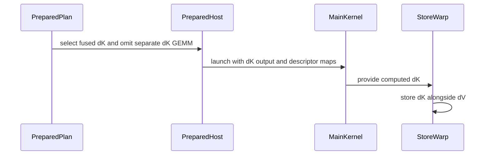

# perf: fuse dK into native D192 half backward

[Upstream PR](https://github.com/NVIDIA/cudnn-frontend/pull/1959) · state: closed · merged: True

## Original PR description

D192/V128 half backward previously materialized dS and launched separate dK and dQ GEMMs. Compute dK inside the native main kernel alongside dV, using the existing store warp for the additional Q loads. This removes the dK GEMM while retaining dense operand prefetch and the fixed reduction order.

Apply the same path to dense and THD plans, including GQA chunks and independent physical origins. Account for the added shared-memory and barrier resources, order dS reuse after both readers, and reuse THD descriptor scratch after the main kernel completes. D256 and default raw stage-2 templates retain their existing execution paths; graph eligibility and selection policy are unchanged.


## Before submitting

- [x] I agree to license this contribution under LICENSE.txt.
- [x] Scoped pre-commit checks passed and formatting changes are committed.
- [x] Reviewed the applicable AGENTS.md Hard Rules.
- [x] Applied originator, category, and affected-area labels.

## Affected area

FE OSS kernels / CuTeDSL: native SM100 half backward.

## Related issues

Follow-up to #1955.

## API and compatibility impact

No public signature, graph eligibility, or policy change. Default raw templates retain their existing argument frame. Explicitly fused raw D192 templates append the documented dK arguments.

## Testing

From `test/python`, with this checkout confirmed as the imported package:

```bash
python -m pytest -o addopts= -q --disable-warnings -x sdpa/frost/test_sdpa_bwd_d192_sm100.py sdpa/frost/test_sdpa_bwd_thd_d192_sm100.py sdpa/frost/test_sdpa_bwd_half_deterministic_sm100.py sdpa/frost/test_sdpa_bwd_config_d256_2x2.py sdpa/frost/test_sdpa_bwd_d256_sm100.py::test_every_smem_tile_takes_the_module_desc_version sdpa/frost/test_sdpa_bwd_d256_sm100.py::test_idesc_k_dim_and_q_loop_bounds_come_from_the_shared_primitives sdpa/frost/test_sdpa_bwd_d256_sm100.py::test_mbarrier_ledger_matches_the_config
```

174 passed.

```bash
python -m pytest -o addopts= -q --disable-warnings -x sdpa/frost/test_sdpa_bwd_d192_sm100.py::test_rectangular_raw_stage2_frame sdpa/frost/test_sdpa_bwd_d256_sm100.py::test_mma_order_arms_match_the_fp64_reference
```

6 passed.

The existing profile compatibility test also passed (181 passing test executions across these runs). Two memcheck and two synccheck cases completed with zero errors. A separate harness compiled four fused dense/THD × BF16/FP16 SM103 variants and verified emitted cubin targets. Eight-case parent comparison passed full-gradient FP64, poisoned replay, changed inputs and fresh bindings; profiling confirmed one fewer GEMM per execution. Scoped formatting and license checks passed.

The follow-up CodeQL cleanup removes only an unused `typing.Tuple` import; AST comparison confirms no other change.


<!-- This is an auto-generated comment: release notes by coderabbit.ai -->

<!-- coderabbit-ai-generated:v1 -->

## Summary by CodeRabbit

* **New Features**
  * D192 backward attention can compute dK alongside dV for dense and THD inputs in BF16 and FP16.
  * THD D192 supports independent sequence origins when using fused dK computation.
* **Improvements**
  * Fused D192 plans skip the separate dK computation stage, leaving only dQ in stage 3. D256 retains its existing separate stage-3 computations.

<!-- end of auto-generated comment: release notes by coderabbit.ai -->

## Review and discussion

### reviews

- github-advanced-security[bot] · COMMENTED · 2026-10-27T22:15:02Z · [source](https://github.com/NVIDIA/cudnn-frontend/pull/1959#pullrequestreview-5675156492)

(No body; status only.)

- Anerudhan · APPROVED · 2026-10-27T22:58:31Z · [source](https://github.com/NVIDIA/cudnn-frontend/pull/1959#pullrequestreview-5675536221)

**Codex bot review · model: `gpt-6-astra`**

Reviewed `d6259ee73ce3` against base `75662192ded8`.

No new actionable correctness findings. The fused dK path preserves the raw default frame, ordered gradient reduction, and dense/THD output contracts in the checks below.

Validation: 49 current-base integration checks passed, including backward selection rules, default engine registration, and BF16/FP16 D192 graph replay/rebinding. 178 focused tests passed on native SM100 with CuTeDSL 4.8.0: raw legacy/fused frames, D192 dense/THD replay and rebinding, determinism, D256 controls, and resource/barrier checks. Four baseline/head comparisons passed FP64 dQ/dK/dV checks and 160 poisoned eager/captured executions. Gradient bits were stable across repetitions and identical between arms, including a long-KV multi-wave case and a single-tile case. 12 additional THD cases passed 120 poisoned captured replays with output canaries and repeat-bit checks: BF16/FP16, compact/independent origins, MHA/GQA, empty queries with live keys, and mixed empty sequences. Traced dS dual-reader completion, P-ring alias reuse, descriptor lifetime, and barrier arrival counts (checklist A01/A06/A07/A13). Precheck produced no candidates. Requested python/sdpa/frost CI; pipeline 77139132 is running. Its integration tree matches all nine changed files. Current GitHub Actions pass.

Limitations: A one-query/one-key exact-zero reference probe produced the same tiny gradient residuals on baseline and head; this is not a fusion regression. CPU and GPU timing was sampled on a shared GPU. Results varied by workload and do not establish a production speedup or regression; validate long-KV performance under controlled load. No independent sanitizer or native SM103 run here. CI is not yet green: an analysis job failed while native lanes remain running.

Approved: no P0 or high-risk P1 found. Remaining findings stay with the owner; merge timing stays with the owner.

<!-- codex-fe-review:v2:1959:d6259ee73ce3b0587dc99b24e2ce689496ed1b2b:complete:no-blocker -->

### issue_comments

- coderabbitai[bot] · comment · 2026-10-27T21:58:43Z · [source](https://github.com/NVIDIA/cudnn-frontend/pull/1959#issuecomment-6454646220)

<!-- coderabbit-ai-generated:v1 -->

<!-- This is an auto-generated comment: summarize by coderabbit.ai -->
<!-- review_stack_entry_start -->

<a href="https://app.coderabbit.ai/change-stack/NVIDIA/cudnn-frontend/pull/1959?scope=ghh_OusAJGA4HG8ljoOV0wJvVx8NmnZIjc2DdjmxOu0xZWA&amp;cs_source=review_comment"><picture><source media="(prefers-color-scheme: dark)" srcset="https://storage.googleapis.com/coderabbit_public_assets/review-stack-in-coderabbit-ui-dark.svg?v=3"><source media="(prefers-color-scheme: light)" srcset="https://storage.googleapis.com/coderabbit_public_assets/review-stack-in-coderabbit-ui.svg?v=3"></picture></a>

<!-- review_stack_entry_end -->
<!-- recent_review_start -->

No actionable comments were generated in the recent review.

<details>
<summary><strong><picture></picture> Recent review info</strong></summary>
<dl>
<dd>

<!-- review_info_content -->
<details>
<summary><strong><picture><source media="(prefers-color-scheme: dark)" srcset="https://storage.googleapis.com/coderabbit_public_assets/review-comment-icons-v1/cog-dark.svg"></picture> Run configuration</strong></summary>
<dl>
<dd>

- **Source mode**: Auto
- **Repository**: [NVIDIA/cudnn-frontend](<https://github.com/NVIDIA/cudnn-frontend>)
- **Branch**: [develop](<https://github.com/NVIDIA/cudnn-frontend/tree/develop>)
- **File**: [.coderabbit.yaml](<https://github.com/NVIDIA/cudnn-frontend/blob/bc986c9827102309f9133a55425fefe09f9d5eb6/.coderabbit.yaml>)
- **Commit**: [bc986c9](<https://github.com/NVIDIA/cudnn-frontend/commit/bc986c9827102309f9133a55425fefe09f9d5eb6>)
- **Layers**: Repository YAML
- **Review profile**: CHILL
- **Plan**: Enterprise
- **Run ID**: `71a5eaf0-90fd-4a6b-a04b-2657c2dec9c6`

</dd>
</dl>
</details>

<details>
<summary><strong><picture><source media="(prefers-color-scheme: dark)" srcset="https://storage.googleapis.com/coderabbit_public_assets/review-comment-icons-v1/git-commit-horizontal-dark.svg"></picture> Commits</strong></summary>
<dl>
<dd>

Reviewing files that changed from the base of the PR and between 7f1e61af820a657a612f2093b65a4832fdb03013 and d6259ee73ce3b0587dc99b24e2ce689496ed1b2b.

</dd>
</dl>
</details>

<details>
<summary><strong><picture><source media="(prefers-color-scheme: dark)" srcset="https://storage.googleapis.com/coderabbit_public_assets/review-comment-icons-v1/file-plus-corner-dark.svg"></picture> Files selected for processing: 1</strong></summary>
<dl>
<dd>

* `python/cudnn/sdpa/bwd/kernels/bprop_d256_2x2_f16.py`

</dd>
</dl>
</details>

**Included review availability:** This review used your included allowance. Your plan provides up to 12 included reviews per hour; 9 remain after this review.

</dd>
</dl>
</details>


<!-- recent_review_end -->
<!-- walkthrough_start -->

<details>
<summary><strong>Walkthrough</strong></summary>
<dl>
<dd>

SM100 D192×128 backward plans now compute dK in the main kernel alongside dV. Prepared dense and THD paths omit the separate dK GEMM when fusion is enabled. D256 retains both stage-3 GEMMs. Configuration checks and tests cover fused resource use, output values, and THD descriptors.

**Changes: SM100 D192 fused dK**

|Layer / File(s)|Summary|
|:---|:---|
|**Fusion configuration and resource bounds** <br> `python/cudnn/sdpa/bwd/api_dsl_sm100_d256.py`, `python/cudnn/sdpa/bwd/config_d256_2x2.py`, `test/python/sdpa/frost/test_sdpa_bwd_config_d256_2x2.py`|D192 plans enable fused dK. Configuration adds dK TMEM and SMEM resources, barriers, THD transfer stages, and validation for supported dimensions and staging bounds. THD D192 plans size descriptor scratch for `(2 * batch_size + 1) * 16` words.|
|**Fused dK kernel computation and storage** <br> `python/cudnn/sdpa/bwd/kernels/bprop_d256_2x2_f16.py`, `test/python/sdpa/frost/test_sdpa_bwd_d256_sm100.py`|The kernel stages Q and dS, computes dK with MMA, and stores dK alongside dV. THD uses per-sequence descriptor maps, with Q maps for physical origins. Barrier-ledger tests cover the added fusion paths.|
|**Prepared-plan integration and execution tests** <br> `python/cudnn/sdpa/bwd/kernels/sm107/prepared_host.py`, `python/cudnn/sdpa/bwd/prepared_sm107.py`, `test/python/sdpa/frost/test_sdpa_bwd_d192_sm100.py`, `test/python/sdpa/frost/test_sdpa_bwd_thd_d192_sm100.py`|When fusion is enabled, prepared dense and THD plans omit the separate dK GEMM and pass the dK output to the main kernel. Tests check fused and unfused results, compiled plan settings, and THD descriptor scratch.|

<!-- change_assessment_start -->
<strong>Priority: <picture></picture> Normal</strong>

**Estimated code review effort:** 4 (Complex) | ~50 minutes

<!-- change_assessment_commit:"d6259ee73ce3b0587dc99b24e2ce689496ed1b2b" -->
**Change:** Other
<!-- change_assessment_end -->

### Sequence Diagram(s)



**Possibly related issues**

- NVIDIA/cudnn-frontend issue 379: The PR adds the SM100 D192×128 backward dK path, which covers one head-dimension geometry in the issue.
- NVIDIA/cudnn-frontend issue 539: The PR changes THD backward descriptor handling, but the summaries do not establish native support for declared strides or behavior that declines unsupported strides.

**Possibly related PRs**

- [NVIDIA/cudnn-frontend#1952](https://github.com/NVIDIA/cudnn-frontend/pull/1952): Both PRs change the native SM100 D192×128 backward pipeline and its configuration and kernel assumptions.
- [NVIDIA/cudnn-frontend#1883](https://github.com/NVIDIA/cudnn-frontend/pull/1883): This PR extends the native SM100 D192×128 backward path introduced by that PR.
- [NVIDIA/cudnn-frontend#1925](https://github.com/NVIDIA/cudnn-frontend/pull/1925): Both PRs modify the D192×128 THD backward path, including its origins and descriptors.

**Suggested reviewers:** `vedaanta`

</dd>
</dl>
</details>

<!-- walkthrough_end -->
<details>
<summary><strong>Merge Risk:</strong> <strong><picture></picture> Minimal</strong> · up to <code>d6259</code></summary>
<dl>
<dd>

<!-- final_review_risk_start -->
<!-- final_review_risk_label
**Merge Risk:** **⚪ Minimal** · up to `d6259`
-->
<!-- final_review_risk_coverage:{"sourceCommitId":"d6259ee73ce3b0587dc99b24e2ce689496ed1b2b","coveredCommitId":"d6259ee73ce3b0587dc99b24e2ce689496ed1b2b","kind":"reviewed"} -->

No concrete merge-blocking issue remains established for this change.
<!-- final_review_risk_end -->

</dd>
</dl>
</details>
<!-- pre_merge_checks_walkthrough_start -->

<details>
<summary><strong>Pre-merge checks: <sup><picture></picture></sup> 4 · <sup><picture></picture></sup> 1</strong></summary>
<dl>
<dd>

<strong><sup><picture></picture></sup> Failed checks: 1 warning</strong>

|     Check name     |                                              Status                                              | Explanation                                                                                                                                                                                               | Resolution                                                                         |
| :---------------- | :----------------------------------------------------------------------------------------------: | :-------------------------------------------------------------------------------------------------------------------------------------------------------------------------------------------------------- | :--------------------------------------------------------------------------------- |
| Docstring Coverage |  | Docstring coverage is 41.86% which is insufficient. The required threshold is 80.00%. Docstring coverage is scoped to functions touched by this diff. Documentation-only edits and deletions within surv… | Write docstrings for the functions missing them to satisfy the coverage threshold. |

<details>
<summary><strong><sup><picture></picture></sup> Passed checks: 4 passed</strong></summary>
<dl>
<dd>

|         Check name         |                                             Status                                             | Explanation                                                                                                                                                                                               |
| :------------------------ | :--------------------------------------------------------------------------------------------: | :-------------------------------------------------------------------------------------------------------------------------------------------------------------------------------------------------------- |
|         Title check        |  | The title clearly and concisely identifies the main change: fusing dK into native D192 half backward execution.                                                                                           |
|      Description check     |  | The description covers the change, rationale, affected area, compatibility impact, related issue, testing results, and submission checks. It is mostly complete, although the main summary and rationale… |
|     Linked Issues check    |  | Check skipped because no linked issues were found for this pull request.                                                                                                                                  |
| Out of Scope Changes check |  | Check skipped because no linked issues were found for this pull request.                                                                                                                                  |

<details>
<summary><strong>Full details: Description check</strong></summary>
<dl>
<dd>

**Explanation**

The description covers the change, rationale, affected area, compatibility impact, related issue, testing results, and submission checks. It is mostly complete, although the main summary and rationale are presented without explicit "## Summary" and "## Why" headings.

</dd>
</dl>
</details>

</dd>
</dl>
</details>

<details>
<summary><strong>Full details: Docstring Coverage</strong></summary>
<dl>
<dd>

**Explanation**

Docstring coverage is 41.86% which is insufficient. The required threshold is 80.00%. Docstring coverage is scoped to functions touched by this diff. Documentation-only edits and deletions within surviving functions are included; unchanged diff context and fully deleted functions are excluded. Analyzed 43 functions across 9 files.

**Resolution**

Write docstrings for the functions missing them to satisfy the coverage threshold.

</dd>
</dl>
</details>

</dd>
</dl>
</details>

<!-- pre_merge_checks_walkthrough_end -->
<!-- finishing_touch_checkbox_start -->

<details>
<summary><strong>Finishing Touches</strong></summary>
<dl>
<dd>

<details open>
<summary><strong>🧪 Generate unit tests (beta)</strong></summary>
<dl>
<dd>

- [ ] <!-- {"checkboxId": "f47ac10b-58cc-4372-a567-0e02b2c3d479", "radioGroupId": "utg-output-choice-group-unknown_comment_id"} --> Create a new PR

</dd>
</dl>
</details>

</dd>
</dl>
</details>

<!-- finishing_touch_checkbox_end -->

<!-- autopilot:start -->
- [ ] <!-- {"checkboxId":"2708ad07-9f24-4260-9c11-7dc76a49f2e3"} --> <strong title="Keep fixing CodeRabbit findings and required CI, and resolving merge conflicts">Autofix</strong> · Keep fixing CodeRabbit findings and required CI, and resolving merge conflicts
<!-- autopilot:end -->
<!-- tips_start -->


<sub>Comment `@coderabbitai help` to get the list of available commands.</sub>

<!-- tips_end -->

- Anerudhan · comment · 2026-10-27T22:46:48Z · [source](https://github.com/NVIDIA/cudnn-frontend/pull/1959#issuecomment-6455468220)

I am requesting test CI for `d6259ee73ce3` with the following standalone command: `@cudnn-ci-bot run python/sdpa/frost`. For future updates, request the appropriate test target before review; a maintainer may need to trigger it.

Codex bot review — model `gpt-6-astra`.

<!-- codex-fe-ci:v1:1959:d6259ee73ce3b0587dc99b24e2ce689496ed1b2b:request-frost-notice -->

- Anerudhan · comment · 2026-10-27T22:46:56Z · [source](https://github.com/NVIDIA/cudnn-frontend/pull/1959#issuecomment-6455470314)

@cudnn-ci-bot run python/sdpa/frost

- cudnn-ci-bot · comment · 2026-10-27T22:47:00Z · [source](https://github.com/NVIDIA/cudnn-frontend/pull/1959#issuecomment-6455471592)

🏁 Pipeline finished

SHA: `d6259ee`
Targets: `python/sdpa/frost`
Branch: [cudnn-gh/pr-1959-d6259ee](https://nv/cudnn-gitlab-ci/-/tree/cudnn-gh/pr-1959-d6259ee)
Pipeline: [77139132](https://nv/cudnn-gitlab-ci/-/pipelines/77139132)
Last updated: 2026-10-28 03:21 UTC

**20 passed, 5 failed, 3 skipped, 11 manual**

### <code>manual</code>

- <code>manual:python_samples</code> - Manual
- <code>manual:python</code> - Manual
- <code>manual:python/sdpa/frost</code> - ✅ Passed
- <code>manual:python/linear_attention/frost</code> - Manual
- <code>manual:python/gemm/frost</code> - Manual
- <code>manual:python/*/frost</code> - Manual
- <code>manual:python/gemm/cutedsl</code> - Manual
- <code>manual:python/*/cutedsl</code> - Manual
- <code>manual:python/*/jax</code> - Manual
- <code>manual:pycudnn</code> - Manual
- <code>manual:multi_gpu</code> - Manual
- <code>manual:backend</code> - Manual

### <code>analysis</code>

- <code>analysis:cudnn_clang_disable_exception</code> - ✅ Passed
- <code>analysis:cudnn_v9_no_half_conversion</code> - ✅ Passed
- <code>analysis:cudnn_clang</code> - ✅ Passed
- <code>analysis:check-relative-includes</code> - ✅ Passed
- <code>analysis:check-CUDNN_FRONTEND_SKIP_JSON_LIB</code> - ✅ Passed
- <code>analysis:guardwords_scan</code> - ✅ Passed
- <code>analysis:jax-import-guard</code> - ✅ Passed
- <code>analysis:pytest-gpu</code> - ❌ **New Failure!** (nightly passed)
- <code>san:build</code> - ✅ Passed

### <code>build</code>

- <code>analysis:api_index</code> - ✅ Passed
- <code>build:dev:linux:amd64</code> - ✅ Passed
- <code>build:rel:linux:amd64</code> - ✅ Passed
- <code>build:dev:linux:arm64</code> - ✅ Passed
- <code>build:rel:linux:arm64</code> - ✅ Passed
- <code>build:rel:win:amd64</code> - ✅ Passed

### <code>frost_tests</code>

- <code>python/sdpa/frost:cutlass-rel:sm80</code> - ❌ **Old Failure** (nightly failed)
- <code>python/sdpa/frost:cutlass-rel:sm100</code> - ❌ **Old Failure** (nightly failed)
- <code>python/sdpa/frost:cutlass-rel:sm120</code> - ❌ **Old Failure** (nightly failed)
- <code>python/linear_attention/frost:cutlass-rel:sm100</code> - Skipped
- <code>python/gemm/frost:cutlass-rel:sm100</code> - Skipped
- <code>python/*/frost:cutlass-rel:sm100</code> - Skipped
- <code>python/sdpa/frost:cutlass-rel:sm103</code> - ❌ **Old Failure** (nightly failed)
- <code>python/sdpa/frost:cutlass-4.8:sm107</code> - ✅ Passed

### <code>sanitizer_tests</code>

- <code>san:cpp_test:sm80</code> - ✅ Passed
- <code>san:cpp_test:sm90</code> - ✅ Passed
- <code>san:cpp_test:sm100</code> - ✅ Passed

### <code>triage</code>

- <code>triage:ai</code> - ✅ Passed

- Anerudhan · comment · 2026-10-27T23:31:53Z · [source](https://github.com/NVIDIA/cudnn-frontend/pull/1959#issuecomment-6456185974)

CI follow-up for `d6259ee73ce3`: pipeline 77139132 found a host-test regression on both SM100 and SM103. `test_thd_external_delta_is_the_appended_native_slot` fails because `_spec_without_compiling` supplies a mock module without `CFG`, while `compile_plan_thd` now reads `main.CFG.FUSE_DK`.

This PR has merged, so please fix the mock in a follow-up by supplying the non-fused configuration and rerun that test. The failure is still present in the merged source. The 48 tests in the affected D192 THD and deterministic backward suites passed on both devices; the pipeline remains running.

Codex bot review — model `gpt-6-astra`.

<!-- codex-fe-post-merge:v1:1959:d6259ee73ce3b0587dc99b24e2ce689496ed1b2b:pipeline-77139132-host-fixture -->

### inline_comments

- github-advanced-security[bot] · comment · 2026-10-27T22:15:02Z · [source](https://github.com/NVIDIA/cudnn-frontend/pull/1959#discussion_r4394795705)

File: `python/cudnn/sdpa/bwd/kernels/bprop_d256_2x2_f16.py` · line None

## CodeQL / Unused import

Import of 'Tuple' is not used.

[Show more details](https://github.com/NVIDIA/cudnn-frontend/security/code-scanning/4266)

## Changed files and fixed code

- `python/cudnn/sdpa/bwd/api_dsl_sm100_d256.py` · modified · additions 15 / deletions 1
  - [head](https://github.com/YangXu1990uiuc/cudnn-frontend/blob/d6259ee73ce3b0587dc99b24e2ce689496ed1b2b/python/cudnn/sdpa/bwd/api_dsl_sm100_d256.py)
  - [base](https://github.com/NVIDIA/cudnn-frontend/blob/bc986c9827102309f9133a55425fefe09f9d5eb6/python/cudnn/sdpa/bwd/api_dsl_sm100_d256.py)
- `python/cudnn/sdpa/bwd/config_d256_2x2.py` · modified · additions 52 / deletions 8
  - [head](https://github.com/YangXu1990uiuc/cudnn-frontend/blob/d6259ee73ce3b0587dc99b24e2ce689496ed1b2b/python/cudnn/sdpa/bwd/config_d256_2x2.py)
  - [base](https://github.com/NVIDIA/cudnn-frontend/blob/bc986c9827102309f9133a55425fefe09f9d5eb6/python/cudnn/sdpa/bwd/config_d256_2x2.py)
- `python/cudnn/sdpa/bwd/kernels/bprop_d256_2x2_f16.py` · modified · additions 281 / deletions 2
  - [head](https://github.com/YangXu1990uiuc/cudnn-frontend/blob/d6259ee73ce3b0587dc99b24e2ce689496ed1b2b/python/cudnn/sdpa/bwd/kernels/bprop_d256_2x2_f16.py)
  - [base](https://github.com/NVIDIA/cudnn-frontend/blob/bc986c9827102309f9133a55425fefe09f9d5eb6/python/cudnn/sdpa/bwd/kernels/bprop_d256_2x2_f16.py)
- `python/cudnn/sdpa/bwd/kernels/sm107/prepared_host.py` · modified · additions 139 / deletions 55
  - [head](https://github.com/YangXu1990uiuc/cudnn-frontend/blob/d6259ee73ce3b0587dc99b24e2ce689496ed1b2b/python/cudnn/sdpa/bwd/kernels/sm107/prepared_host.py)
  - [base](https://github.com/NVIDIA/cudnn-frontend/blob/bc986c9827102309f9133a55425fefe09f9d5eb6/python/cudnn/sdpa/bwd/kernels/sm107/prepared_host.py)
- `python/cudnn/sdpa/bwd/prepared_sm107.py` · modified · additions 2 / deletions 2
  - [head](https://github.com/YangXu1990uiuc/cudnn-frontend/blob/d6259ee73ce3b0587dc99b24e2ce689496ed1b2b/python/cudnn/sdpa/bwd/prepared_sm107.py)
  - [base](https://github.com/NVIDIA/cudnn-frontend/blob/bc986c9827102309f9133a55425fefe09f9d5eb6/python/cudnn/sdpa/bwd/prepared_sm107.py)
- `test/python/sdpa/frost/test_sdpa_bwd_config_d256_2x2.py` · modified · additions 31 / deletions 0
  - [head](https://github.com/YangXu1990uiuc/cudnn-frontend/blob/d6259ee73ce3b0587dc99b24e2ce689496ed1b2b/test/python/sdpa/frost/test_sdpa_bwd_config_d256_2x2.py)
  - [base](https://github.com/NVIDIA/cudnn-frontend/blob/bc986c9827102309f9133a55425fefe09f9d5eb6/test/python/sdpa/frost/test_sdpa_bwd_config_d256_2x2.py)
- `test/python/sdpa/frost/test_sdpa_bwd_d192_sm100.py` · modified · additions 74 / deletions 0
  - [head](https://github.com/YangXu1990uiuc/cudnn-frontend/blob/d6259ee73ce3b0587dc99b24e2ce689496ed1b2b/test/python/sdpa/frost/test_sdpa_bwd_d192_sm100.py)
  - [base](https://github.com/NVIDIA/cudnn-frontend/blob/bc986c9827102309f9133a55425fefe09f9d5eb6/test/python/sdpa/frost/test_sdpa_bwd_d192_sm100.py)
- `test/python/sdpa/frost/test_sdpa_bwd_d256_sm100.py` · modified · additions 28 / deletions 11
  - [head](https://github.com/YangXu1990uiuc/cudnn-frontend/blob/d6259ee73ce3b0587dc99b24e2ce689496ed1b2b/test/python/sdpa/frost/test_sdpa_bwd_d256_sm100.py)
  - [base](https://github.com/NVIDIA/cudnn-frontend/blob/bc986c9827102309f9133a55425fefe09f9d5eb6/test/python/sdpa/frost/test_sdpa_bwd_d256_sm100.py)
- `test/python/sdpa/frost/test_sdpa_bwd_thd_d192_sm100.py` · modified · additions 14 / deletions 0
  - [head](https://github.com/YangXu1990uiuc/cudnn-frontend/blob/d6259ee73ce3b0587dc99b24e2ce689496ed1b2b/test/python/sdpa/frost/test_sdpa_bwd_thd_d192_sm100.py)
  - [base](https://github.com/NVIDIA/cudnn-frontend/blob/bc986c9827102309f9133a55425fefe09f9d5eb6/test/python/sdpa/frost/test_sdpa_bwd_thd_d192_sm100.py)

## Evidence and interpretation boundary

[Original JSON, discussions and patches](../../../../../../evidence/prs/NVIDIA--cudnn-frontend/1959-a74c01b5e3c1996dc92f9a61b8179b9ea7f1adb368a96ba5fc4cbdcd99d393e4.json) · SHA-256 `a74c01b5e3c1996dc92f9a61b8179b9ea7f1adb368a96ba5fc4cbdcd99d393e4`.

Diff complete: True. Missing/binary/truncated patches require pinned source inspection. This is a source page, not an independently verified optimization case. Open, merged and released are different states; recheck the deployed dependency.
