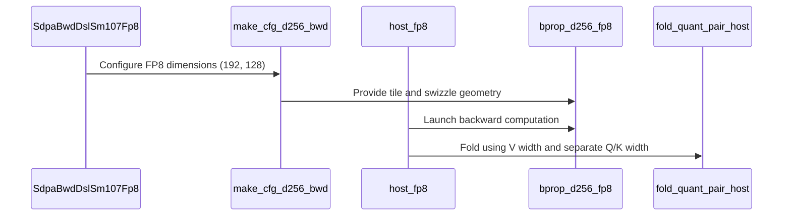

# feat: add native SM107 D192 FP8 backward

[Upstream PR](https://github.com/NVIDIA/cudnn-frontend/pull/1967) · state: closed · merged: True

## Original PR description

## Summary

Adds exact D192/V128 per-tensor FP8 backward to the existing SM107 engine for dense BSHD and packed THD graphs. These graphs previously declined the row. Q/K and V/O retain their own tensor geometry through the native main kernel, workspace, delta reduction and gradient fold.

The dP and transposed dV consumers use separate dO shared-memory swizzles. The paired GQA fold accepts an appended second width and still launches once. Graph admission shares the existing exact-head-pair predicate; the support matrix and an MMA/TMA layout detector are updated together.

## Before submitting

- [x] I agree to license this contribution under the terms of [LICENSE.txt](https://github.com/NVIDIA/cudnn-frontend/blob/develop/LICENSE.txt).
- [x] I ran `pre-commit run` and committed any formatting changes.
- [x] I reviewed the applicable `AGENTS.md` Hard Rules; the change preserves the shared graph contract and updates the support matrix with eligibility.
- [x] I added a change-type label, affected-area labels and an originator label.

## Affected area

FE OSS kernels / CuTeDSL: native SM107 SDPA backward and its existing Python graph lowering.

## Why

The existing per-tensor FP8 backward chain assumed equal 256-wide operands. D192/V128 needs independent Q/K and V/O geometry, including different dO layouts for its two MMA consumers. The implementation keeps dense and packed execution on the same prepared graph contract.

## API and compatibility impact

The opt-in `sdpa_bwd_sm107_fp8` row gains exact `(192, 128)` alongside `(256, 256)`. E4M3 inputs, E4M3/BF16/FP16 gradients, requested amax outputs, both packed Stats layouts and declared-capacity requirements follow the existing contract. D256 template identity and legacy fold defaults are preserved. Public signatures, half/MXFP8 eligibility and selection policy remain unchanged.

## Testing

From `test/python`, with the edited source import verified:

- `pytest sdpa/frost/test_sdpa_bwd_config_sm107.py`: **377 passed**. Includes a regression detector that failed on the incorrect dP swizzle and passed after correction.
- Focused FP8 graph head-pair/capability contracts: **11 passed**.
- `pytest sdpa/frost/test_sdpa_bwd_fp8_sm107.py::test_native_d192_fp8_backward_rebind_and_replay sdpa/frost/test_sdpa_bwd_thd_fp8_sm107.py::test_native_d192_thd_fp8_backward sdpa/frost/test_sdpa_bwd_thd_fp8_sm107.py::test_native_d192_thd_fp8_rebind_lengths_and_replay`: **34 native SM107 cases passed**, plus **four existing D256 controls**. Both dS precisions, all three gradient types, MHA/GQA, masked tails, empty sequences, fresh bindings and changed-input retained replay.
- `pytest sdpa/frost/test_sdpa_bwd_fp8_sm107.py::test_native_d192_fp8_graph_rebind_and_replay sdpa/frost/test_sdpa_bwd_thd_fp8_sm107.py::test_native_d192_thd_fp8_graph_rebind_and_replay`: **18 native graph cases passed**, plus **four existing D256 graph controls**. Rebound buffers/workspace and changed-dO replay check gradients and amax, with explicit handle-stream ordering and packed tail canaries.
- `pytest sdpa/frost/test_sdpa_bwd_fp8_sm107.py::test_fp8_fold_pair_independent_widths`: **16 passed on SM100**, including legacy widths, an independent CPU reference, empty/live-count replay and padding canaries; **16 memchecks, zero errors**.
- Focused native dense/THD tests under `compute-sanitizer --tool memcheck --error-exitcode 91` and `--tool synccheck`: **four cases per tool, zero errors**.
- Native main and complete-chain offline compile probes, including D256 controls, pass. Scoped pre-commit hooks and `git diff --check` pass.

## Related issues

None.

<!-- This is an auto-generated comment: release notes by coderabbit.ai -->

<!-- coderabbit-ai-generated:v1 -->

## Summary by CodeRabbit

- **New Features**
  - Added native FP8 attention backward support for Q/K head dimension 192 with V/O head dimension 128, in both dense and packed-sequence execution.
  - Extended coverage to include graph replay and rebinding, varied gradient dtypes, masking, and edge-case sequence inputs.
- **Bug Fixes**
  - Corrected handling of distinct Q/K and V widths in gradient calculations and memory layouts.
- **Tests**
  - Added checks for supported dimension combinations, configuration limits, and layout consistency.

<!-- end of auto-generated comment: release notes by coderabbit.ai -->

## Review and discussion

### reviews

- Anerudhan · APPROVED · 2026-10-28T00:48:35Z · [source](https://github.com/NVIDIA/cudnn-frontend/pull/1967#pullrequestreview-5676432102)

**Codex bot review · model: `gpt-6-astra`**

Reviewed `b56503f6161f` against base `aae583d0591f`.

No blocking findings. The independent Q/K and V/O widths remain consistent through admission, tensor maps, workspace, delta reduction and gradient folds. Native dense and packed execution, rebinding and retained replay passed; D256 controls retain their existing template behavior.

Validation: 399 local tests passed: 377 configuration tests, six exact-head-pair admission checks, and 16 independent-width/legacy gradient-fold cases. 52 native SM107 D192/V128 cases and six admission checks passed with cuDNN 9.26 and CuTeDSL 4.8.1. Coverage includes both dS precisions, all three gradient types, dense and packed layouts, MHA/GQA, masks, empty sequences, both packed Stats layouts, changed bindings and retained replay. An independent probe passed six internal/external-delta pairs while alternating D192/D256/D192 under both dS types. Gradients and amax matched bitwise when supplied the chain's own delta. The six external-delta plans also passed 30 poisoned-output CUDA Graph replays. Reviewed barrier counts, changed TMA byte extents, separate dP/dV shared-memory layouts, TMEM bounds, shared-buffer alias lifetimes and cache identity. The gradient fold keeps its fixed reduction order; repeated results were bit-identical in the checked cases. Pipeline 77160002 uses the reviewed runtime/test files and remains running. Its analysis failure concerns CI worker grouping. Current merge, style and security Actions passed.

Limitations: No clean sanitizer result is claimed: the installed tool does not support the native SM107 device. On SM100, four fold tests passed under memcheck, but seven driver lookup errors also occurred in a handle-only control. The current CI SM107 lane selects forward tests and does not qualify this backward change; the separate native run above supplies that coverage. No performance comparison was run. Repeatability checks cover fixed configurations, not cross-device or cross-version equivalence.

Approved: no P0 or high-risk P1 found. Remaining findings stay with the owner; merge timing stays with the owner.

<!-- codex-fe-review:v2:1967:b56503f6161fa626ea4117233d8fd4cf7f86018a:complete:no-blocker -->

### issue_comments

- coderabbitai[bot] · comment · 2026-10-28T00:28:47Z · [source](https://github.com/NVIDIA/cudnn-frontend/pull/1967#issuecomment-6457352270)

<!-- coderabbit-ai-generated:v1 -->

<!-- This is an auto-generated comment: summarize by coderabbit.ai -->
<!-- review_stack_entry_start -->

<a href="https://app.coderabbit.ai/change-stack/NVIDIA/cudnn-frontend/pull/1967?scope=ghh_OusAJGA4HG8ljoOV0wJvVx8NmnZIjc2DdjmxOu0xZWA&amp;cs_source=review_comment"><picture><source media="(prefers-color-scheme: dark)" srcset="https://storage.googleapis.com/coderabbit_public_assets/review-stack-in-coderabbit-ui-dark.svg?v=3"><source media="(prefers-color-scheme: light)" srcset="https://storage.googleapis.com/coderabbit_public_assets/review-stack-in-coderabbit-ui.svg?v=3"></picture></a>

<!-- review_stack_entry_end -->
<!-- recent_review_start -->

No actionable comments were generated in the recent review.

<strong><picture></picture> Recent review info</strong>

<dl>
<dd>

<!-- review_info_content -->

<strong><picture><source media="(prefers-color-scheme: dark)" srcset="https://storage.googleapis.com/coderabbit_public_assets/review-comment-icons-v1/cog-dark.svg"></picture> Run configuration</strong>

<dl>
<dd>

- **Source mode**: Auto
- **Repository**: [NVIDIA/cudnn-frontend](<https://github.com/NVIDIA/cudnn-frontend>)
- **Branch**: [develop](<https://github.com/NVIDIA/cudnn-frontend/tree/develop>)
- **File**: [.coderabbit.yaml](<https://github.com/NVIDIA/cudnn-frontend/blob/7d7d8ae639fcf87fb3ebf9f6b7839ecd78337f4b/.coderabbit.yaml>)
- **Commit**: [7d7d8ae](<https://github.com/NVIDIA/cudnn-frontend/commit/7d7d8ae639fcf87fb3ebf9f6b7839ecd78337f4b>)
- **Layers**: Repository YAML
- **Review profile**: CHILL
- **Plan**: Enterprise
- **Run ID**: `6e82e872-4585-41eb-bdf3-a338e7c619b2`

</dd>
</dl>

<strong><picture><source media="(prefers-color-scheme: dark)" srcset="https://storage.googleapis.com/coderabbit_public_assets/review-comment-icons-v1/git-commit-horizontal-dark.svg"></picture> Commits</strong>

<dl>
<dd>

Reviewing files that changed from the base of the PR and between 7d7d8ae639fcf87fb3ebf9f6b7839ecd78337f4b and b56503f6161fa626ea4117233d8fd4cf7f86018a.

</dd>
</dl>

<strong><picture><source media="(prefers-color-scheme: dark)" srcset="https://storage.googleapis.com/coderabbit_public_assets/review-comment-icons-v1/file-plus-corner-dark.svg"></picture> Files selected for processing: 11</strong>

<dl>
<dd>

* `python/cudnn/sdpa/AGENTS.md`
* `python/cudnn/sdpa/bwd/api_dsl_sm107.py`
* `python/cudnn/sdpa/bwd/config_sm107.py`
* `python/cudnn/sdpa/bwd/engines.py`
* `python/cudnn/sdpa/bwd/kernels/bprop_chain_common.py`
* `python/cudnn/sdpa/bwd/kernels/sm107/bprop_d256_fp8.py`
* `python/cudnn/sdpa/bwd/kernels/sm107/prepared_host.py`
* `python/cudnn/sdpa/frost/SUPPORT_MATRIX_TRACKER.md`
* `test/python/sdpa/frost/test_sdpa_bwd_config_sm107.py`
* `test/python/sdpa/frost/test_sdpa_bwd_fp8_sm107.py`
* `test/python/sdpa/frost/test_sdpa_bwd_thd_fp8_sm107.py`

</dd>
</dl>

**Included review availability:** This review used your included allowance. Your plan provides up to 12 included reviews per hour; 8 remain after this review.

</dd>
</dl>

<!-- recent_review_end -->
<!-- walkthrough_start -->

<strong>Walkthrough</strong>

<dl>
<dd>

SM107 per-tensor FP8 backward now supports native Q/K and V head dimensions of 192 and 128. The change updates configuration, kernel layouts, host-side width handling, dense and packed THD execution, and related tests and support documentation.

**Changes: Native FP8 backward**

|Layer / File(s)|Summary|
|:---|:---|
|**Dimension contract and configuration**   `python/cudnn/sdpa/bwd/config_sm107.py`, `python/cudnn/sdpa/bwd/engines.py`, `python/cudnn/sdpa/bwd/api_dsl_sm107.py`|The FP8 path accepts `(192, 128)` alongside `(256, 256)`. Configuration and scratch shapes use separate Q/K and V dimensions. Other backward families remain restricted to `(256, 256)`.|
|**Execution geometry and width-aware folds**   `python/cudnn/sdpa/bwd/kernels/sm107/bprop_d256_fp8.py`, `python/cudnn/sdpa/bwd/kernels/sm107/prepared_host.py`, `python/cudnn/sdpa/bwd/kernels/bprop_chain_common.py`, `python/cudnn/sdpa/bwd/config_sm107.py`|TMA and shared-memory layouts use consumer-specific swizzle geometry. Dense and THD host paths use the V width for delta-dot and pass the Q/K width separately to paired folds.|
|**Coverage and support record**   `test/python/sdpa/frost/test_sdpa_bwd_config_sm107.py`, `test/python/sdpa/frost/test_sdpa_bwd_fp8_sm107.py`, `test/python/sdpa/frost/test_sdpa_bwd_thd_fp8_sm107.py`, `python/cudnn/sdpa/frost/SUPPORT_MATRIX_TRACKER.md`, `python/cudnn/sdpa/AGENTS.md`|Tests cover configuration, numerical results, graph rebinding and replay for dense and packed THD cases. The support tracker and guidance describe the native dimension pair and layout constraints.|

<!-- change_assessment_start -->
<strong>Priority: <picture></picture> Normal</strong>

**Estimated code review effort:** 4 (Complex) | ~45 minutes

<!-- change_assessment_commit:"b56503f6161fa626ea4117233d8fd4cf7f86018a" -->
**Change:** Feature
<!-- change_assessment_end -->

### Sequence Diagram(s)

**Suggested reviewers:** `romananders90`

</dd>
</dl>

<!-- walkthrough_end -->

<strong>Merge Risk:</strong> <strong><picture></picture> Minimal</strong> · up to <code>b5650</code>

<dl>
<dd>

<!-- final_review_risk_start -->
<!-- final_review_risk_label
**Merge Risk:** **⚪ Minimal** · up to `b5650`
-->
<!-- final_review_risk_coverage:{"sourceCommitId":"b56503f6161fa626ea4117233d8fd4cf7f86018a","coveredCommitId":"b56503f6161fa626ea4117233d8fd4cf7f86018a","kind":"reviewed"} -->

No actionable issue remains in the reviewed change; it is mergeable after normal checks.
<!-- final_review_risk_end -->

</dd>
</dl>

<!-- pre_merge_checks_walkthrough_start -->

<strong>Pre-merge checks: <picture></picture> 4 · <picture></picture> 1</strong>

<dl>
<dd>

<strong><picture></picture> Failed checks: 1 warning</strong>

|     Check name     |                                              Status                                              | Explanation                                                                                                                                                                                               | Resolution                                                                         |
| :---------------- | :----------------------------------------------------------------------------------------------: | :-------------------------------------------------------------------------------------------------------------------------------------------------------------------------------------------------------- | :--------------------------------------------------------------------------------- |
| Docstring Coverage |  | Docstring coverage is 55.56% which is insufficient. The required threshold is 80.00%. Docstring coverage is scoped to functions touched by this diff with cyclomatic complexity of at least 2. Documenta… | Write docstrings for the functions missing them to satisfy the coverage threshold. |

<strong><picture></picture> Passed checks: 4 passed</strong>

<dl>
<dd>

|         Check name         |                                             Status                                             | Explanation                                                                                                                                                                             |
| :------------------------ | :--------------------------------------------------------------------------------------------: | :-------------------------------------------------------------------------------------------------------------------------------------------------------------------------------------- |
|         Title check        |  | The title clearly and concisely identifies the main change: native SM107 D192 FP8 backward support.                                                                                     |
|      Description check     |  | The description is complete. It covers the affected area, implementation summary, rationale, compatibility impact, related issues, required checklist items, and detailed test results. |
|     Linked Issues check    |  | Check skipped because no linked issues were found for this pull request.                                                                                                                |
| Out of Scope Changes check |  | Check skipped because no linked issues were found for this pull request.                                                                                                                |

</dd>
</dl>

<strong>Full details: Docstring Coverage</strong>

<dl>
<dd>

**Explanation**

Docstring coverage is 55.56% which is insufficient. The required threshold is 80.00%. Docstring coverage is scoped to functions touched by this diff with cyclomatic complexity of at least 2. Documentation-only edits and deletions within surviving functions are included; unchanged diff context and fully deleted functions are excluded. Analyzed 36 functions across 9 files. (2 skipped: 2 unsupported.)

**Resolution**

Write docstrings for the functions missing them to satisfy the coverage threshold.

</dd>
</dl>

</dd>
</dl>

<!-- pre_merge_checks_walkthrough_end -->
<!-- finishing_touch_checkbox_start -->

<strong>Finishing Touches: 💡 1</strong>

<dl>
<dd>

<!-- finishing_touch_suggestion:fix_ci -->

<strong>🛠️ Fix failing CI checks: 💡</strong>

<dl>
<dd>

- [ ] <!-- {"checkboxId": "9f0d24fb-b419-4f01-baf0-8b26b6424f34", "radioGroupId": "fix-ci-output-choice-group-unknown_comment_id"} --> Commit to this branch
- [ ] <!-- {"checkboxId": "6d21cfe8-ec3f-40e2-9222-b8318b64d3b0", "radioGroupId": "fix-ci-output-choice-group-unknown_comment_id"} --> Create a new PR

</dd>
</dl>

<strong>🧪 Generate unit tests (beta)</strong>

<dl>
<dd>

- [ ] <!-- {"checkboxId": "f47ac10b-58cc-4372-a567-0e02b2c3d479", "radioGroupId": "utg-output-choice-group-unknown_comment_id"} --> Create a new PR

</dd>
</dl>

</dd>
</dl>

<!-- finishing_touch_checkbox_end -->

<!-- autopilot:start -->
- [ ] <!-- {"checkboxId":"2708ad07-9f24-4260-9c11-7dc76a49f2e3"} --> <strong title="Keep fixing CodeRabbit findings and required CI, and resolving merge conflicts">Autofix</strong> · Keep fixing CodeRabbit findings and required CI, and resolving merge conflicts
<!-- autopilot:end -->
<!-- tips_start -->

Comment `@coderabbitai help` to get the list of available commands.

<!-- tips_end -->

- YangXu1990uiuc · comment · 2026-10-28T00:29:08Z · [source](https://github.com/NVIDIA/cudnn-frontend/pull/1967#issuecomment-6457357327)

@cudnn-ci-bot run python/sdpa/frost

- cudnn-ci-bot · comment · 2026-10-28T00:29:13Z · [source](https://github.com/NVIDIA/cudnn-frontend/pull/1967#issuecomment-6457358482)

🏁 Pipeline finished

SHA: `b56503f`
Targets: `python/sdpa/frost`
Branch: [cudnn-gh/pr-1967-b56503f](https://nv/cudnn-gitlab-ci/-/tree/cudnn-gh/pr-1967-b56503f)
Pipeline: [77160002](https://nv/cudnn-gitlab-ci/-/pipelines/77160002)
Last updated: 2026-10-28 05:10 UTC

**20 passed, 5 failed, 3 skipped, 11 manual**

### <code>manual</code>

- <code>manual:python_samples</code> - Manual
- <code>manual:python</code> - Manual
- <code>manual:python/sdpa/frost</code> - ✅ Passed
- <code>manual:python/linear_attention/frost</code> - Manual
- <code>manual:python/gemm/frost</code> - Manual
- <code>manual:python/*/frost</code> - Manual
- <code>manual:python/gemm/cutedsl</code> - Manual
- <code>manual:python/*/cutedsl</code> - Manual
- <code>manual:python/*/jax</code> - Manual
- <code>manual:pycudnn</code> - Manual
- <code>manual:multi_gpu</code> - Manual
- <code>manual:backend</code> - Manual

### <code>analysis</code>

- <code>analysis:cudnn_clang_disable_exception</code> - ✅ Passed
- <code>analysis:cudnn_v9_no_half_conversion</code> - ✅ Passed
- <code>analysis:cudnn_clang</code> - ✅ Passed
- <code>analysis:check-relative-includes</code> - ✅ Passed
- <code>analysis:check-CUDNN_FRONTEND_SKIP_JSON_LIB</code> - ✅ Passed
- <code>analysis:guardwords_scan</code> - ✅ Passed
- <code>analysis:jax-import-guard</code> - ✅ Passed
- <code>analysis:pytest-gpu</code> - ❌ **New Failure!** (nightly passed)
- <code>san:build</code> - ✅ Passed

### <code>build</code>

- <code>analysis:api_index</code> - ✅ Passed
- <code>build:dev:linux:amd64</code> - ✅ Passed
- <code>build:rel:linux:amd64</code> - ✅ Passed
- <code>build:dev:linux:arm64</code> - ✅ Passed
- <code>build:rel:linux:arm64</code> - ✅ Passed
- <code>build:rel:win:amd64</code> - ✅ Passed

### <code>frost_tests</code>

- <code>python/sdpa/frost:cutlass-rel:sm80</code> - ❌ **Old Failure** (nightly failed)
- <code>python/sdpa/frost:cutlass-rel:sm100</code> - ❌ **Old Failure** (nightly failed)
- <code>python/sdpa/frost:cutlass-rel:sm120</code> - ❌ **Old Failure** (nightly failed)
- <code>python/linear_attention/frost:cutlass-rel:sm100</code> - Skipped
- <code>python/gemm/frost:cutlass-rel:sm100</code> - Skipped
- <code>python/*/frost:cutlass-rel:sm100</code> - Skipped
- <code>python/sdpa/frost:cutlass-rel:sm103</code> - ❌ **Old Failure** (nightly failed)
- <code>python/sdpa/frost:cutlass-4.8:sm107</code> - ✅ Passed

### <code>sanitizer_tests</code>

- <code>san:cpp_test:sm80</code> - ✅ Passed
- <code>san:cpp_test:sm90</code> - ✅ Passed
- <code>san:cpp_test:sm100</code> - ✅ Passed

### <code>triage</code>

- <code>triage:ai</code> - ✅ Passed

- Anerudhan · comment · 2026-10-28T01:15:49Z · [source](https://github.com/NVIDIA/cudnn-frontend/pull/1967#issuecomment-6458024141)

[P2] Update the THD FP8 source check for the appended keyword argument.

Pipeline 77160002 exposes a new failure in `test_fp8_thd_stage3_host_threads_the_epilogue_operands` at `test_sdpa_bwd_thd_fp8_sm107.py:1549`. Both SM100 and SM103 jobs fail this check, and I reproduced it locally on `b56503f6161f`.

The test splits the call text on commas and requires the last item to be `live_kv`. This PR correctly appends `D_b=d` to both `fold_quant_pair_host` calls. `live_kv` is still the last positional argument, so the source check now rejects a valid call. The check passes on the parent and fails on the reviewed and merged trees.

This needs a follow-up fix after merge: check the positional argument or parse the call, while retaining the live-length assertion. This is a test regression; it does not establish a native kernel defect. The earlier native correctness results retain their stated scope.

Codex bot review — model `gpt-6-astra`.

<!-- codex-fe-post-merge:v1:1967:b56503f6161fa626ea4117233d8fd4cf7f86018a:pipeline-77160002-host-pin -->

- Anerudhan · comment · 2026-10-28T03:30:06Z · [source](https://github.com/NVIDIA/cudnn-frontend/pull/1967#issuecomment-6459929266)

[P2] Gate the new FP8 fold execution tests to a supported target.

Pipeline 77160002's SM80 job fails all 16 `test_fp8_fold_pair_independent_widths` cases during compilation. The test uses `@requires_sm80` at `test_sdpa_bwd_fp8_sm107.py:2405`, but every case requests `Float8E4M3FN` output conversion. The compiler rejects that operation for SM80 before any kernel runs. These failures are separate from the already reported source-check failure and the inherited mock-CFG failure.

This needs a follow-up fix after merge: gate these FP8 execution cases to SM89+ (as the adjacent FP8 conversion test now does), while keeping architecture-independent geometry checks available on SM80. The faulty test gate is unchanged in the merged tree and current develop. This is a test-coverage regression; it does not invalidate the native SM107 correctness results.

Codex bot review — model `gpt-6-astra`.

<!-- codex-fe-post-merge:v1:1967:b56503f6161fa626ea4117233d8fd4cf7f86018a:pipeline-77160002-sm80-fold-gate -->

### inline_comments

## Changed files and fixed code

- `python/cudnn/sdpa/AGENTS.md` · modified · additions 11 / deletions 0
  - [head](https://github.com/YangXu1990uiuc/cudnn-frontend/blob/b56503f6161fa626ea4117233d8fd4cf7f86018a/python/cudnn/sdpa/AGENTS.md)
  - [base](https://github.com/NVIDIA/cudnn-frontend/blob/7d7d8ae639fcf87fb3ebf9f6b7839ecd78337f4b/python/cudnn/sdpa/AGENTS.md)
- `python/cudnn/sdpa/bwd/api_dsl_sm107.py` · modified · additions 18 / deletions 6
  - [head](https://github.com/YangXu1990uiuc/cudnn-frontend/blob/b56503f6161fa626ea4117233d8fd4cf7f86018a/python/cudnn/sdpa/bwd/api_dsl_sm107.py)
  - [base](https://github.com/NVIDIA/cudnn-frontend/blob/7d7d8ae639fcf87fb3ebf9f6b7839ecd78337f4b/python/cudnn/sdpa/bwd/api_dsl_sm107.py)
- `python/cudnn/sdpa/bwd/config_sm107.py` · modified · additions 39 / deletions 14
  - [head](https://github.com/YangXu1990uiuc/cudnn-frontend/blob/b56503f6161fa626ea4117233d8fd4cf7f86018a/python/cudnn/sdpa/bwd/config_sm107.py)
  - [base](https://github.com/NVIDIA/cudnn-frontend/blob/7d7d8ae639fcf87fb3ebf9f6b7839ecd78337f4b/python/cudnn/sdpa/bwd/config_sm107.py)
- `python/cudnn/sdpa/bwd/engines.py` · modified · additions 6 / deletions 4
  - [head](https://github.com/YangXu1990uiuc/cudnn-frontend/blob/b56503f6161fa626ea4117233d8fd4cf7f86018a/python/cudnn/sdpa/bwd/engines.py)
  - [base](https://github.com/NVIDIA/cudnn-frontend/blob/7d7d8ae639fcf87fb3ebf9f6b7839ecd78337f4b/python/cudnn/sdpa/bwd/engines.py)
- `python/cudnn/sdpa/bwd/kernels/bprop_chain_common.py` · modified · additions 38 / deletions 4
  - [head](https://github.com/YangXu1990uiuc/cudnn-frontend/blob/b56503f6161fa626ea4117233d8fd4cf7f86018a/python/cudnn/sdpa/bwd/kernels/bprop_chain_common.py)
  - [base](https://github.com/NVIDIA/cudnn-frontend/blob/7d7d8ae639fcf87fb3ebf9f6b7839ecd78337f4b/python/cudnn/sdpa/bwd/kernels/bprop_chain_common.py)
- `python/cudnn/sdpa/bwd/kernels/sm107/bprop_d256_fp8.py` · modified · additions 9 / deletions 5
  - [head](https://github.com/YangXu1990uiuc/cudnn-frontend/blob/b56503f6161fa626ea4117233d8fd4cf7f86018a/python/cudnn/sdpa/bwd/kernels/sm107/bprop_d256_fp8.py)
  - [base](https://github.com/NVIDIA/cudnn-frontend/blob/7d7d8ae639fcf87fb3ebf9f6b7839ecd78337f4b/python/cudnn/sdpa/bwd/kernels/sm107/bprop_d256_fp8.py)
- `python/cudnn/sdpa/bwd/kernels/sm107/prepared_host.py` · modified · additions 14 / deletions 8
  - [head](https://github.com/YangXu1990uiuc/cudnn-frontend/blob/b56503f6161fa626ea4117233d8fd4cf7f86018a/python/cudnn/sdpa/bwd/kernels/sm107/prepared_host.py)
  - [base](https://github.com/NVIDIA/cudnn-frontend/blob/7d7d8ae639fcf87fb3ebf9f6b7839ecd78337f4b/python/cudnn/sdpa/bwd/kernels/sm107/prepared_host.py)
- `python/cudnn/sdpa/frost/SUPPORT_MATRIX_TRACKER.md` · modified · additions 22 / deletions 5
  - [head](https://github.com/YangXu1990uiuc/cudnn-frontend/blob/b56503f6161fa626ea4117233d8fd4cf7f86018a/python/cudnn/sdpa/frost/SUPPORT_MATRIX_TRACKER.md)
  - [base](https://github.com/NVIDIA/cudnn-frontend/blob/7d7d8ae639fcf87fb3ebf9f6b7839ecd78337f4b/python/cudnn/sdpa/frost/SUPPORT_MATRIX_TRACKER.md)
- `test/python/sdpa/frost/test_sdpa_bwd_config_sm107.py` · modified · additions 60 / deletions 0
  - [head](https://github.com/YangXu1990uiuc/cudnn-frontend/blob/b56503f6161fa626ea4117233d8fd4cf7f86018a/test/python/sdpa/frost/test_sdpa_bwd_config_sm107.py)
  - [base](https://github.com/NVIDIA/cudnn-frontend/blob/7d7d8ae639fcf87fb3ebf9f6b7839ecd78337f4b/test/python/sdpa/frost/test_sdpa_bwd_config_sm107.py)
- `test/python/sdpa/frost/test_sdpa_bwd_fp8_sm107.py` · modified · additions 230 / deletions 6
  - [head](https://github.com/YangXu1990uiuc/cudnn-frontend/blob/b56503f6161fa626ea4117233d8fd4cf7f86018a/test/python/sdpa/frost/test_sdpa_bwd_fp8_sm107.py)
  - [base](https://github.com/NVIDIA/cudnn-frontend/blob/7d7d8ae639fcf87fb3ebf9f6b7839ecd78337f4b/test/python/sdpa/frost/test_sdpa_bwd_fp8_sm107.py)
- `test/python/sdpa/frost/test_sdpa_bwd_thd_fp8_sm107.py` · modified · additions 121 / deletions 33
  - [head](https://github.com/YangXu1990uiuc/cudnn-frontend/blob/b56503f6161fa626ea4117233d8fd4cf7f86018a/test/python/sdpa/frost/test_sdpa_bwd_thd_fp8_sm107.py)
  - [base](https://github.com/NVIDIA/cudnn-frontend/blob/7d7d8ae639fcf87fb3ebf9f6b7839ecd78337f4b/test/python/sdpa/frost/test_sdpa_bwd_thd_fp8_sm107.py)

## Evidence and interpretation boundary

[Original JSON, discussions and patches](../../../../../../evidence/prs/NVIDIA--cudnn-frontend/1967-139e4dd84881e67d0252535c16745547eff2b2be146c69a56f5cfba36d5f6960.json) · SHA-256 `139e4dd84881e67d0252535c16745547eff2b2be146c69a56f5cfba36d5f6960`.

Diff complete: True. Missing/binary/truncated patches require pinned source inspection. This is a source page, not an independently verified optimization case. Open, merged and released are different states; recheck the deployed dependency.
