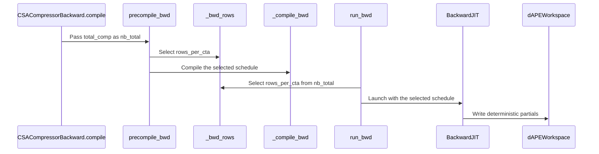

# perf(csa): reduce long-context deterministic workspace

[Upstream PR](https://github.com/NVIDIA/cudnn-frontend/pull/1968) · state: closed · merged: True

## Original PR description

## Before submitting

- [x] I agree to license this contribution under the terms of [LICENSE.txt](https://github.com/NVIDIA/cudnn-frontend/blob/develop/LICENSE.txt).
- [x] I ran `pre-commit run` and committed any formatting changes.
- [x] I reviewed the Hard Rules in the `AGENTS.md` for each directory this PR touches (see [root AGENTS.md § Reviewing a PR](https://github.com/NVIDIA/cudnn-frontend/blob/develop/AGENTS.md#reviewing-a-pr-human-or-agent)) and my changes comply, or I explain the exception below.
- [x] I added GitHub labels: one `cat-*`, one or more `area:*` / `op:*`, and one `orig-*` (see [label list](https://github.com/NVIDIA/cudnn-frontend/labels)).

## Affected area

- FE OSS kernels or CuTeDSL

## Summary

- Keep the existing 8-row producer CTA below 65,536 compressed rows.
- Select a 24-row producer CTA at or above 65,536 compressed rows for
  deterministic ratio-4 backward.
- Include the selected row count in the compiled and fast-launch cache keys so
  short and long plans cannot alias.
- Size caller-owned dAPE partial and reduction-stage workspace from the selected
  schedule.
- Pass the plan's compressed-row capacity into precompilation and teach the
  independent FP64 benchmark reference about the selected schedule.
- Add boundary and production-D128 correctness coverage for the first long bucket.

## Why

The deterministic ratio-4 producer materializes one dAPE partial plane per CTA.
With the existing 8-row schedule, 256K and 1M token inputs require 16.5 and
66 MiB of workspace, respectively. Accumulating 24 compressed rows per CTA cuts
the number of producer partials by about two thirds.

Applying the larger CTA globally regressed short shapes because it exposed too
few producer CTAs. The 65,536-row boundary retains the current short-shape
parallelism while selecting the lower-workspace schedule for the 256K-and-larger
production ratio-4 workloads.

## Related issues

Related to #1932.

## API and compatibility impact

There is no public API, support-envelope, stream-behavior, allocation, or
host/device synchronization change. Deterministic ratio-4 plans at or above the
boundary require less caller-owned scratch. Shorter shapes, ratio 2, ratio 128,
and the atomic path retain their existing schedules.

dKV and dScore retain their operation order and match the FP32 reference bitwise.
The long-context dAPE partial grouping changes from 8 to 24 rows, so its bits are
not expected to match the old schedule. It remains replay-bitwise deterministic
and within the existing FP64 accuracy gate.

## Performance

SM103, PyTorch 2.12.1+cu130, cuDNN Frontend 1.32.0 environment,
and public CuTeDSL 4.8.1. JIT and allocations are outside the timed region. Both
atomic-first and deterministic-first plan-construction orders were measured.

The existing unequal-document production shapes report the full deterministic
operation (producer plus fixed-order dAPE reduction):

| Deterministic ratio=4, coff=1, D128 backward | Current develop (8 rows) | This PR (24 rows) | Time reduction |
| --- | ---: | ---: | ---: |
| 256K packed, CP32/64 | 104.98–105.01 us | 100.56–101.10 us | 3.7–4.2% |
| 1M packed, CP64 | 328.46–328.74 us | 308.53–309.22 us | 5.9–6.1% |

The metadata-stress benchmark added by #1932 shows the same direction:

| Shape | Current develop | This PR | Time reduction |
| --- | ---: | ---: | ---: |
| 256K plain | 88.58 us | 84.07 us | 5.1% |
| 256K packed, 55 sequences | 92.72 us | 86.75 us | 6.4% |
| 1M plain | 308.03 us | 291.57 us | 5.3% |
| 1M packed, 221 sequences | 327.67 us | 299.96 us | 8.5% |

Workspace falls from 16.5 to 5.502 MiB at 256K and from 66 to 22.002 MiB at
1M (-66.7%). The deterministic dAPE maximum absolute errors against an
independent FP64 sum were `1.80e-5` at 256K and `4.52e-5` at 1M.

## Testing

- Scoped repository pre-commit hooks: Black, black-jupyter, and SPDX checks
  passed; clang-format had no applicable files.
- Generic CSA L0 selection excluding the separately dispatched ratio-128 path on
  SM103: `136 passed, 82 deselected`.
  Command: `python -m pytest test/python/compressed_sparse_attention/cutedsl/test_CSA_compressor.py -q -m L0 -k 'not r128' --disable-warnings`.
- Benchmark compatibility: the same script completed `--atomic-only --quick` against
  cuDNN Frontend 1.32.0 without `_bwd_rows`, and completed deterministic `--quick`
  against this PR.
- Boundary tests cover 65,535 compressed rows with the 8-row schedule and 65,536
  rows with the 24-row schedule.
- A production-D128 test at the first long bucket verifies replay bitwise equality,
  bitwise dKV/dScore FP32-reference parity, and the dAPE accuracy gate.
- Both construction orders selected identical workspace sizes and consistent
  operation times, covering schedule cache separation through the class API.
- A plan-time-only A→B→A cache detector verifies that 65,535 and 65,536
  compressed rows compile distinct 8-row and 24-row schedules, and that the
  repeated short plan reuses its original compilation.

<!-- This is an auto-generated comment: release notes by coderabbit.ai -->
<!-- coderabbit-ai-generated:v1 -->

## Summary by CodeRabbit

* **Improvements**
  * Deterministic backward processing for ratio-4 inputs uses 8 rows per CTA below 65,536 compressed rows and 24 rows at or above that threshold.
  * The selected schedule determines workspace sizing and is cached separately. Results remain repeatable across runs.

* **Documentation**
  * Updated long-context performance results and documented the schedule boundary and its effect on compiled-kernel caching.
<!-- end of auto-generated comment: release notes by coderabbit.ai -->

## Review and discussion

### reviews

- YangXu1990uiuc · APPROVED · 2026-10-28T02:44:10Z · [source](https://github.com/NVIDIA/cudnn-frontend/pull/1968#pullrequestreview-5677127027)

**Codex bot review · model: `gpt-6-astra`**

Reviewed `de65ece9760f` against base `4fd2c43e06f9`.

The capacity-selected schedule is consistently reflected in precompilation, the producer/fast-launch cache keys, workspace sizing and reducer arguments. I found no approval-blocking correctness issue. Native SM100 validation also passed real short/long/short schedule transitions, padded ragged inputs and graph replay with changing device-side lengths. Thank you for your contribution!

**[P3] Preserve the documented atomic-only baseline invocation** ([source](https://github.com/NVIDIA/cudnn-frontend/blob/de65ece9760f8ad9c725b7033e3a09112d304f40/benchmark/csa/bench_csa_dape_deterministic.py#L24))

The module still documents running this same script against an unchanged checkout with --atomic-only, but the unconditional import of _bwd_rows now prevents that: the PR's base revision defines _BWD_ROWS but has no _bwd_rows. The script fails at import before it can select the atomic-only path. Please defer the new-selector import to the deterministic reference path, provide an old-schedule fallback, or update the baseline procedure. This only affects benchmark reproducibility, not the runtime optimization.

Evidence: Compared the exact base compressor module at 4fd2c43e06f9 with this import and the module-level baseline instructions. The new selector is absent from that base. Attribution: Introduced by this PR's benchmark import change.

Validation: Exact-head native SM100, CuTeDSL 4.8.1: 22 deterministic CSA tests passed, 196 deselected, zero skips; collection included the new threshold/cache/long-sequence tests plus existing ratio-2/4/128 deterministic, workspace, capture and allocation/synchronization checks. Additional class-API probes at D128/coff=1 and D96/coff=2 alternated compressed capacities 65535 -> 65536 -> 65535. All six configurations passed exact dKV/dScore reference checks, dAPE tolerance, poisoned scratch/output checks and guard-byte checks. Thirty graph replays covered fixed inputs, all-empty device metadata and restoration; results repeated bitwise, with no new compilation and no warm-execute allocation or host synchronization. For the production-shaped 256K-token D128/coff=1 pack, both schedules matched an independent full FP64 eager differentiation: dAPE maximum absolute error was 2.68e-5 for 8 rows and 2.97e-5 for 24 rows; dKV/dScore were bitwise identical between schedules. This checks producer arithmetic too, beyond the benchmark's FP64 sum of already-rounded producer partials. Controlled 8-row versus 24-row schedule comparison on the same SM100 device and inputs: scratch 16.500 -> 5.502 MiB. Seven interleaved rounds gave graph-replay medians 141.5 -> 139.7 us and host-enqueue medians 19.81 -> 19.82 us. GPU samples varied substantially, so this is evidence of the workspace reduction and no clear regression in this case, not a claimed speedup. Requested current-head CI pipeline 77182215 with python/*/cutedsl, whose path selector includes compressed_sparse_attention/cutedsl. The pipeline is running, not yet passing. Completed the missing labels, project membership and current development milestone.

Limitations: Native validation and the bounded timing comparison were on SM100 only; this does not reproduce the author's SM103 measurements or establish a serving-level improvement. The timing control restored the previous 8-row schedule within the same reviewed kernel source; it was not a complete previous-release benchmark. Full CI remains pending.

Approved: no P0 or high-risk P1 found. Remaining findings stay with the owner; merge timing stays with the owner.

<!-- codex-fe-review:v2:1968:de65ece9760f8ad9c725b7033e3a09112d304f40:complete:no-blocker -->

- Anerudhan · COMMENTED · 2026-10-28T03:28:19Z · [source](https://github.com/NVIDIA/cudnn-frontend/pull/1968#pullrequestreview-5677442914)

**Codex bot review · model: `gpt-6-astra`**

Reviewed `18f18570bc3e` against base `0f011221bb13`.

The P3 benchmark compatibility finding is resolved. The selector import now runs only in the deterministic ratio-4 reference path. I verified the documented atomic-only baseline invocation and the current deterministic invocation. No new finding in this follow-up; the existing approval remains. Thank you for your contribution!

Validation: Compared against the prior reviewed de65ece9760f head: only the benchmark import moved; the kernel, API, workspace sizing and cache logic are unchanged. New base changes are confined to unrelated SDPA files. Precheck returned no candidates. On native SM100 with CuTeDSL 4.8.1, the previous benchmark fails at the missing _bwd_rows import against the same pre-selector base source. The fixed script completes --atomic-only --quick --warmup 1 --iters 1 against that source, covering ratio 4 and ratio 128. Exact current source also completes the deterministic quick run for both ratios, including dKV/dScore bitwise parity, repeated dAPE bits and the existing FP64 partial-sum accuracy gate. Started current-head CI pipeline 77189540 with python/*/cutedsl after the author's rejected request. The selected path includes CSA; all five PR files match the tested integration tree. Approved the inspected docs, style and security workflows for this head; docs passed and the other two started. Labels, project and milestone are already populated.

Limitations: This is a focused benchmark follow-up. It does not repeat the prior review's long-context workspace, replay or performance qualification. The quick runs are execution checks, not timing evidence. Current-head GPU CI remains pending. Its analysis job reports three CI grouping/worker-count assertion failures outside this PR's changed files. The prior pipeline was canceled when the new one started.

Comment only: this PR already has an active approval; preserving existing approvals.

<!-- codex-fe-review:v2:1968:18f18570bc3e440c4e5b529eedfb42f46fdb6936:complete:no-blocker -->

### issue_comments

- coderabbitai[bot] · comment · 2026-10-28T02:21:00Z · [source](https://github.com/NVIDIA/cudnn-frontend/pull/1968#issuecomment-6458903061)

<!-- coderabbit-ai-generated:v1 -->

<!-- This is an auto-generated comment: summarize by coderabbit.ai -->
<!-- review_stack_entry_start -->

<a href="https://app.coderabbit.ai/change-stack/NVIDIA/cudnn-frontend/pull/1968?scope=ghh_OusAJGA4HG8ljoOV0wJvVx8NmnZIjc2DdjmxOu0xZWA&amp;cs_source=review_comment"><picture><source media="(prefers-color-scheme: dark)" srcset="https://storage.googleapis.com/coderabbit_public_assets/review-stack-in-coderabbit-ui-dark.svg?v=3"><source media="(prefers-color-scheme: light)" srcset="https://storage.googleapis.com/coderabbit_public_assets/review-stack-in-coderabbit-ui.svg?v=3"></picture></a>

<!-- review_stack_entry_end -->
<!-- recent_review_start -->

No actionable comments were generated in the recent review.

<strong><picture></picture> Recent review info</strong>

<dl>
<dd>

<!-- review_info_content -->

<strong><picture><source media="(prefers-color-scheme: dark)" srcset="https://storage.googleapis.com/coderabbit_public_assets/review-comment-icons-v1/cog-dark.svg"></picture> Run configuration</strong>

<dl>
<dd>

- **Source mode**: Auto
- **Repository**: [NVIDIA/cudnn-frontend](<https://github.com/NVIDIA/cudnn-frontend>)
- **Branch**: [develop](<https://github.com/NVIDIA/cudnn-frontend/tree/develop>)
- **File**: [.coderabbit.yaml](<https://github.com/NVIDIA/cudnn-frontend/blob/4fd2c43e06f90e209b11a405472957cae1c377cc/.coderabbit.yaml>)
- **Commit**: [4fd2c43](<https://github.com/NVIDIA/cudnn-frontend/commit/4fd2c43e06f90e209b11a405472957cae1c377cc>)
- **Layers**: Repository YAML
- **Review profile**: CHILL
- **Plan**: Enterprise
- **Run ID**: `b87b1018-679b-4802-b372-28713731ebd7`

</dd>
</dl>

<strong><picture><source media="(prefers-color-scheme: dark)" srcset="https://storage.googleapis.com/coderabbit_public_assets/review-comment-icons-v1/git-commit-horizontal-dark.svg"></picture> Commits</strong>

<dl>
<dd>

Reviewing files that changed from the base of the PR and between de65ece9760f8ad9c725b7033e3a09112d304f40 and 18f18570bc3e440c4e5b529eedfb42f46fdb6936.

</dd>
</dl>

<strong><picture><source media="(prefers-color-scheme: dark)" srcset="https://storage.googleapis.com/coderabbit_public_assets/review-comment-icons-v1/file-plus-corner-dark.svg"></picture> Files selected for processing: 1</strong>

<dl>
<dd>

* `benchmark/csa/bench_csa_dape_deterministic.py`

</dd>
</dl>

**Included review availability:** This review used your included allowance. Your plan provides up to 12 included reviews per hour; 10 remain after this review.

</dd>
</dl>

<!-- recent_review_end -->
<!-- walkthrough_start -->

<strong>Walkthrough</strong>

<dl>
<dd>

The deterministic ratio-4 backward path now selects 8 or 24 rows per CTA based on compressed-row count. The selected schedule determines JIT compilation, cache selection, and deterministic dAPE workspace sizing. Tests, benchmark calculations, and documentation reflect the schedule.

**Changes: Capacity-aware deterministic ratio-4 schedule**

|Layer / File(s)|Summary|
|:---|:---|
|**Select and compile the schedule**   `python/cudnn/csa/compressor/api.py`, `python/cudnn/csa/compressor/compressor_sm100.py`|Backward precompilation receives plan capacity. The deterministic ratio-4 schedule uses 8 rows per CTA below 65,536 compressed rows and 24 rows at or above that threshold. The selected row count is used for JIT compilation and included in the cache key.|
|**Use the schedule for execution and workspace**   `python/cudnn/csa/compressor/compressor_sm100.py`|Backward execution uses the selected schedule for its JIT call and deterministic dAPE partial count. Workspace sizing uses the selected partial count.|
|**Validate and report the schedule**   `test/python/compressed_sparse_attention/cutedsl/test_CSA_compressor.py`, `benchmark/csa/bench_csa_dape_deterministic.py`, `docs/fe-oss-apis/csa.md`|Tests cover the schedule boundary, cache separation, and deterministic gradient results. The benchmark reference and documentation use the selected schedule. The documentation also reports L20D measurements.|

<!-- change_assessment_start -->
<strong>Priority: <picture></picture> Normal</strong>

**Estimated code review effort:** 3 (Moderate) | ~20 minutes

<!-- change_assessment_commit:"18f18570bc3e440c4e5b529eedfb42f46fdb6936" -->
**Change:** Other
<!-- change_assessment_end -->

### Sequence Diagram(s)

**Possibly related issues**
- NVIDIA/Megatron-LM#6757: The roadmap includes further memory reduction for CSA. This change reports reduced dAPE workspace for the long-context ratio-4 schedule.

**Possibly related PRs**
- [NVIDIA/cudnn-frontend#1717](https://github.com/NVIDIA/cudnn-frontend/pull/1717): Adds the ratio-4 hierarchical deterministic dAPE reduction and workspace that this change updates with a different producer row schedule.
- [NVIDIA/cudnn-frontend#1605](https://github.com/NVIDIA/cudnn-frontend/pull/1605): Introduces deterministic CSA dAPE execution and cache specialization, which this change extends with schedule-specific caching.
- [NVIDIA/cudnn-frontend#1932](https://github.com/NVIDIA/cudnn-frontend/pull/1932): Optimizes the generic ratio-2/4 backward kernel, including deterministic execution in the path whose CTA row schedule changes here.

**Suggested labels:** `cat-perf-bug`

**Suggested reviewers:** `icavan`, `yangxu1990uiuc`

</dd>
</dl>

<!-- walkthrough_end -->

<strong>Merge Risk:</strong> <strong><picture></picture> Minimal</strong> · up to <code>18f18</code>

<dl>
<dd>

<!-- final_review_risk_start -->
<!-- final_review_risk_label
**Merge Risk:** **⚪ Minimal** · up to `18f18`
-->
<!-- final_review_risk_coverage:{"sourceCommitId":"18f18570bc3e440c4e5b529eedfb42f46fdb6936","coveredCommitId":"18f18570bc3e440c4e5b529eedfb42f46fdb6936","kind":"reviewed"} -->

The PR is mergeable with no concrete unresolved runtime or integration risk identified.
<!-- final_review_risk_end -->

</dd>
</dl>

<!-- pre_merge_checks_walkthrough_start -->

<strong>Pre-merge checks: <picture></picture> 5</strong>

<dl>
<dd>

|         Check name         |                                             Status                                             | Explanation                                                                                                                                                                                               |
| :------------------------ | :--------------------------------------------------------------------------------------------: | :-------------------------------------------------------------------------------------------------------------------------------------------------------------------------------------------------------- |
|         Title check        |  | The title clearly and concisely describes the main change: reducing deterministic CSA workspace for long-context workloads.                                                                               |
|      Description check     |  | The description completes all required sections, explains the change and rationale, documents compatibility impact, and provides detailed testing commands and results.                                   |
|     Docstring Coverage     |  | Docstring coverage is 100.00% which is sufficient. The required threshold is 80.00%. Docstring coverage is scoped to functions touched by this diff with cyclomatic complexity of at least 2. Documentat… |
|     Linked Issues check    |  | Check skipped because no linked issues were found for this pull request.                                                                                                                                  |
| Out of Scope Changes check |  | Check skipped because no linked issues were found for this pull request.                                                                                                                                  |

<strong>Full details: Docstring Coverage</strong>

<dl>
<dd>

**Explanation**

Docstring coverage is 100.00% which is sufficient. The required threshold is 80.00%. Docstring coverage is scoped to functions touched by this diff with cyclomatic complexity of at least 2. Documentation-only edits and deletions within surviving functions are included; unchanged diff context and fully deleted functions are excluded. Analyzed 9 functions across 4 files.

</dd>
</dl>

</dd>
</dl>

<!-- pre_merge_checks_walkthrough_end -->
<!-- finishing_touch_checkbox_start -->

<strong>Finishing Touches</strong>

<dl>
<dd>

<strong>🧪 Generate unit tests (beta)</strong>

<dl>
<dd>

- [ ] <!-- {"checkboxId": "f47ac10b-58cc-4372-a567-0e02b2c3d479", "radioGroupId": "utg-output-choice-group-unknown_comment_id"} --> Create a new PR

</dd>
</dl>

</dd>
</dl>

<!-- finishing_touch_checkbox_end -->

<!-- autopilot:start -->
- [ ] <!-- {"checkboxId":"2708ad07-9f24-4260-9c11-7dc76a49f2e3"} --> <strong title="Keep fixing CodeRabbit findings and required CI, and resolving merge conflicts">Autofix</strong> · Keep fixing CodeRabbit findings and required CI, and resolving merge conflicts
<!-- autopilot:end -->
<!-- tips_start -->

Comment `@coderabbitai help` to get the list of available commands.

<!-- tips_end -->

- YangXu1990uiuc · comment · 2026-10-28T02:40:39Z · [source](https://github.com/NVIDIA/cudnn-frontend/pull/1968#issuecomment-6459179487)

I am requesting test CI for `de65ece9760f` with the following standalone command: `@cudnn-ci-bot run python/*/cutedsl`. For future updates, request the appropriate test target before review; a maintainer may need to trigger it.

Codex bot review — model `gpt-6-astra`.

<!-- codex-fe-ci:v1:1968:de65ece9760f8ad9c725b7033e3a09112d304f40:trigger-cutedsl-current-head-notice -->

- YangXu1990uiuc · comment · 2026-10-28T02:40:46Z · [source](https://github.com/NVIDIA/cudnn-frontend/pull/1968#issuecomment-6459181088)

@cudnn-ci-bot run python/*/cutedsl

- cudnn-ci-bot · comment · 2026-10-28T02:40:49Z · [source](https://github.com/NVIDIA/cudnn-frontend/pull/1968#issuecomment-6459181824)

🏁 Pipeline finished

SHA: `de65ece`
Targets: `python/*/cutedsl`
Branch: [cudnn-gh/pr-1968-de65ece](https://nv/cudnn-gitlab-ci/-/tree/cudnn-gh/pr-1968-de65ece)
Pipeline: [77182215](https://nv/cudnn-gitlab-ci/-/pipelines/77182215)
Last updated: 2026-10-28 03:23 UTC

**20 passed, 1 failed, 3 canceled, 2 skipped, 11 manual**

### <code>manual</code>

- <code>manual:python_samples</code> - Manual
- <code>manual:python</code> - Manual
- <code>manual:python/sdpa/frost</code> - Manual
- <code>manual:python/linear_attention/frost</code> - Manual
- <code>manual:python/gemm/frost</code> - Manual
- <code>manual:python/*/frost</code> - Manual
- <code>manual:python/gemm/cutedsl</code> - Manual
- <code>manual:python/*/cutedsl</code> - ✅ Passed
- <code>manual:python/*/jax</code> - Manual
- <code>manual:pycudnn</code> - Manual
- <code>manual:multi_gpu</code> - Manual
- <code>manual:backend</code> - Manual

### <code>analysis</code>

- <code>analysis:cudnn_clang_disable_exception</code> - ✅ Passed
- <code>analysis:cudnn_v9_no_half_conversion</code> - ✅ Passed
- <code>analysis:cudnn_clang</code> - ✅ Passed
- <code>analysis:check-relative-includes</code> - ✅ Passed
- <code>analysis:check-CUDNN_FRONTEND_SKIP_JSON_LIB</code> - ✅ Passed
- <code>analysis:guardwords_scan</code> - ✅ Passed
- <code>analysis:jax-import-guard</code> - ✅ Passed
- <code>analysis:pytest-gpu</code> - ❌ **New Failure!** (nightly passed)
- <code>san:build</code> - ✅ Passed

### <code>build</code>

- <code>analysis:api_index</code> - ✅ Passed
- <code>build:dev:linux:amd64</code> - ✅ Passed
- <code>build:rel:linux:amd64</code> - ✅ Passed
- <code>build:dev:linux:arm64</code> - ✅ Passed
- <code>build:rel:linux:arm64</code> - ✅ Passed
- <code>build:rel:win:amd64</code> - ✅ Passed

### <code>oss_tests</code>

- <code>python/gemm/cutedsl:cutlass-rel:sm100</code> - Skipped
- <code>python/*/cutedsl:cutlass-rel:sm80</code> - Canceled
- <code>python/*/cutedsl:cutlass-rel:sm90</code> - ✅ Passed
- <code>python/*/cutedsl:cutlass-rel:sm100</code> - ✅ Passed
- <code>python/*/jax:cutlass-rel:sm100</code> - Skipped
- <code>python/*/cutedsl:cutlass-4.8:sm107</code> - ✅ Passed

### <code>sanitizer_tests</code>

- <code>san:cpp_test:sm80</code> - Canceled
- <code>san:cpp_test:sm90</code> - ✅ Passed
- <code>san:cpp_test:sm100</code> - ✅ Passed

### <code>triage</code>

- <code>triage:ai</code> - Canceled

- tongke6 · comment · 2026-10-28T03:08:28Z · [source](https://github.com/NVIDIA/cudnn-frontend/pull/1968#issuecomment-6459607383)

@cudnn-ci-bot run python/*/cutedsl

- cudnn-ci-bot · comment · 2026-10-28T03:08:31Z · [source](https://github.com/NVIDIA/cudnn-frontend/pull/1968#issuecomment-6459608098)

Pipeline not launched

Reason: @tongke6 is not allowlisted to run this bot.

Ask an allowlisted maintainer to comment `@cudnn-ci-bot run`.

- tongke6 · comment · 2026-10-28T03:09:03Z · [source](https://github.com/NVIDIA/cudnn-frontend/pull/1968#issuecomment-6459616251)

@YangXu1990uiuc I addressed the P3 benchmark reproducibility finding in `18f18570` by deferring the new `_bwd_rows` import to the deterministic FP64-reference path.

Validation:
- The same script completed `--atomic-only --quick --warmup 1 --iters 1` against the official cuDNN Frontend 1.32.0 package, which has `_BWD_ROWS` but no `_bwd_rows`.
- The current PR overlay completed deterministic `--quick --warmup 1 --iters 1`.
- CSA L0 coverage passed all 136 selected tests (135 single-visible-GPU tests plus the separately rerun multi-device test).
- Black, Python syntax, and `git diff --check` passed.

The CI bot rejected my request because I am not allowlisted. Could you please rerun `@cudnn-ci-bot run python/*/cutedsl` for current head `18f18570`?

- Anerudhan · comment · 2026-10-28T03:22:23Z · [source](https://github.com/NVIDIA/cudnn-frontend/pull/1968#issuecomment-6459815417)

I’ll request `python/*/cutedsl` for `18f18570bc3e`. This target includes the CSA tests. The earlier run covers the preceding head; your current-head request was not launched because the CI bot requires an allowlisted maintainer.

Codex bot review — model `gpt-6-astra`.

<!-- codex-fe-ci:v1:1968:18f18570bc3e440c4e5b529eedfb42f46fdb6936:trigger-cutedsl-current-head-notice -->

- Anerudhan · comment · 2026-10-28T03:22:45Z · [source](https://github.com/NVIDIA/cudnn-frontend/pull/1968#issuecomment-6459820793)

@cudnn-ci-bot run python/*/cutedsl

- cudnn-ci-bot · comment · 2026-10-28T03:22:49Z · [source](https://github.com/NVIDIA/cudnn-frontend/pull/1968#issuecomment-6459821713)

🏁 Pipeline finished

SHA: `18f1857`
Targets: `python/*/cutedsl`
Branch: [cudnn-gh/pr-1968-18f1857](https://nv/cudnn-gitlab-ci/-/tree/cudnn-gh/pr-1968-18f1857)
Pipeline: [77189540](https://nv/cudnn-gitlab-ci/-/pipelines/77189540)
Cancelled this PR's older pipelines: 77182215
Last updated: 2026-10-28 03:56 UTC

**23 passed, 1 failed, 2 skipped, 11 manual**

### <code>manual</code>

- <code>manual:python_samples</code> - Manual
- <code>manual:python</code> - Manual
- <code>manual:python/sdpa/frost</code> - Manual
- <code>manual:python/linear_attention/frost</code> - Manual
- <code>manual:python/gemm/frost</code> - Manual
- <code>manual:python/*/frost</code> - Manual
- <code>manual:python/gemm/cutedsl</code> - Manual
- <code>manual:python/*/cutedsl</code> - ✅ Passed
- <code>manual:python/*/jax</code> - Manual
- <code>manual:pycudnn</code> - Manual
- <code>manual:multi_gpu</code> - Manual
- <code>manual:backend</code> - Manual

### <code>analysis</code>

- <code>analysis:cudnn_clang_disable_exception</code> - ✅ Passed
- <code>analysis:cudnn_v9_no_half_conversion</code> - ✅ Passed
- <code>analysis:cudnn_clang</code> - ✅ Passed
- <code>analysis:check-relative-includes</code> - ✅ Passed
- <code>analysis:check-CUDNN_FRONTEND_SKIP_JSON_LIB</code> - ✅ Passed
- <code>analysis:guardwords_scan</code> - ✅ Passed
- <code>analysis:jax-import-guard</code> - ✅ Passed
- <code>analysis:pytest-gpu</code> - ❌ **New Failure!** (nightly passed)
- <code>san:build</code> - ✅ Passed

### <code>build</code>

- <code>analysis:api_index</code> - ✅ Passed
- <code>build:dev:linux:amd64</code> - ✅ Passed
- <code>build:rel:linux:amd64</code> - ✅ Passed
- <code>build:dev:linux:arm64</code> - ✅ Passed
- <code>build:rel:linux:arm64</code> - ✅ Passed
- <code>build:rel:win:amd64</code> - ✅ Passed

### <code>oss_tests</code>

- <code>python/gemm/cutedsl:cutlass-rel:sm100</code> - Skipped
- <code>python/*/cutedsl:cutlass-rel:sm80</code> - ✅ Passed
- <code>python/*/cutedsl:cutlass-rel:sm90</code> - ✅ Passed
- <code>python/*/cutedsl:cutlass-rel:sm100</code> - ✅ Passed
- <code>python/*/jax:cutlass-rel:sm100</code> - Skipped
- <code>python/*/cutedsl:cutlass-4.8:sm107</code> - ✅ Passed

### <code>sanitizer_tests</code>

- <code>san:cpp_test:sm80</code> - ✅ Passed
- <code>san:cpp_test:sm90</code> - ✅ Passed
- <code>san:cpp_test:sm100</code> - ✅ Passed

### <code>triage</code>

- <code>triage:ai</code> - ✅ Passed

- YangXu1990uiuc · comment · 2026-10-28T04:13:28Z · [source](https://github.com/NVIDIA/cudnn-frontend/pull/1968#issuecomment-6460481140)

Thank you @tongke6 for reducing the workspace used by long deterministic ratio-4 backward plans, and for fixing the benchmark compatibility issue.

Your current-head CI request for `18f18570bc3e` has been handled: all four selected CuTeDSL GPU jobs passed, along with the build checks and GitHub Docs/Style/Security checks. The overall pipeline is still red because three CI analysis tests fail their worker-grouping/worker-count expectations. I independently reproduced all three using the CI harness baseline from before this PR was imported, with the same pytest/xdist versions; the harness and command-selector files are identical. Those failures are in the CI baseline, not demonstrated regressions in this kernel change.

When you consider the PR ready for merge, please comment **ready**. That signals the review flow, and we'll help address any remaining issues through to merge.

<!-- fe-external-watch:1968:18f18570bc3e440c4e5b529eedfb42f46fdb6936:ready-ci-20261028 -->

- tongke6 · comment · 2026-10-28T04:24:35Z · [source](https://github.com/NVIDIA/cudnn-frontend/pull/1968#issuecomment-6460624422)

ready

- YangXu1990uiuc · comment · 2026-10-28T08:19:37Z · [source](https://github.com/NVIDIA/cudnn-frontend/pull/1968#issuecomment-6464139391)

Merged as `08c04c17fbb5`. Thank you @tongke6 for the contribution and for confirming **ready**!

I rebuilt the native bindings and validated the final integration with `develop` on SM100, checking the actual imported source and extension. The CSA suite passed **135 tests**, with one multi-GPU test skipped because the run exposed one GPU. Additional checks passed for the 65535/65536 capacity boundary (short/long/short reuse), ragged and empty segments, workspace guards, 30 CUDA Graph replays with changed metadata, and warm execution without allocation, host synchronization, or recompilation. A long-capacity case also passed an independent full-FP64 dAPE reference check.

All four selected current-head CuTeDSL GPU CI jobs and GitHub checks passed. The overall external pipeline remains red only for the three CI harness assertions already reproduced on the unchanged baseline; this is not a claim that the full pipeline is green. The merge used the verified full head SHA, and the resulting commit tree exactly matches the tested integration.

<!-- fe-external-watch:1968:18f18570bc3e440c4e5b529eedfb42f46fdb6936:merged-20261028 -->

### inline_comments

## Changed files and fixed code

- `benchmark/csa/bench_csa_dape_deterministic.py` · modified · additions 5 / deletions 2
  - [head](https://github.com/tongke6/cudnn-frontend/blob/18f18570bc3e440c4e5b529eedfb42f46fdb6936/benchmark/csa/bench_csa_dape_deterministic.py)
  - [base](https://github.com/NVIDIA/cudnn-frontend/blob/4fd2c43e06f90e209b11a405472957cae1c377cc/benchmark/csa/bench_csa_dape_deterministic.py)
- `docs/fe-oss-apis/csa.md` · modified · additions 18 / deletions 5
  - [head](https://github.com/tongke6/cudnn-frontend/blob/18f18570bc3e440c4e5b529eedfb42f46fdb6936/docs/fe-oss-apis/csa.md)
  - [base](https://github.com/NVIDIA/cudnn-frontend/blob/4fd2c43e06f90e209b11a405472957cae1c377cc/docs/fe-oss-apis/csa.md)
- `python/cudnn/csa/compressor/api.py` · modified · additions 13 / deletions 5
  - [head](https://github.com/tongke6/cudnn-frontend/blob/18f18570bc3e440c4e5b529eedfb42f46fdb6936/python/cudnn/csa/compressor/api.py)
  - [base](https://github.com/NVIDIA/cudnn-frontend/blob/4fd2c43e06f90e209b11a405472957cae1c377cc/python/cudnn/csa/compressor/api.py)
- `python/cudnn/csa/compressor/compressor_sm100.py` · modified · additions 25 / deletions 12
  - [head](https://github.com/tongke6/cudnn-frontend/blob/18f18570bc3e440c4e5b529eedfb42f46fdb6936/python/cudnn/csa/compressor/compressor_sm100.py)
  - [base](https://github.com/NVIDIA/cudnn-frontend/blob/4fd2c43e06f90e209b11a405472957cae1c377cc/python/cudnn/csa/compressor/compressor_sm100.py)
- `test/python/compressed_sparse_attention/cutedsl/test_CSA_compressor.py` · modified · additions 85 / deletions 4
  - [head](https://github.com/tongke6/cudnn-frontend/blob/18f18570bc3e440c4e5b529eedfb42f46fdb6936/test/python/compressed_sparse_attention/cutedsl/test_CSA_compressor.py)
  - [base](https://github.com/NVIDIA/cudnn-frontend/blob/4fd2c43e06f90e209b11a405472957cae1c377cc/test/python/compressed_sparse_attention/cutedsl/test_CSA_compressor.py)

## Evidence and interpretation boundary

[Original JSON, discussions and patches](../../../../../../evidence/prs/NVIDIA--cudnn-frontend/1968-41de15d0572b93adeb9dae1664c69f41a33fd66c870911922b46b822d1208fbc.json) · SHA-256 `41de15d0572b93adeb9dae1664c69f41a33fd66c870911922b46b822d1208fbc`.

Diff complete: True. Missing/binary/truncated patches require pinned source inspection. This is a source page, not an independently verified optimization case. Open, merged and released are different states; recheck the deployed dependency.
