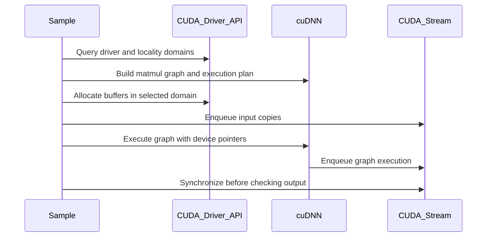

# samples: cuDNN on locality-domain-localized tensors (C++ and Python)

[Upstream PR](https://github.com/NVIDIA/cudnn-frontend/pull/1988) · state: closed · merged: True

## Original PR description

## Before submitting

- [x] I agree to license this contribution under the terms of [LICENSE.txt](https://github.com/NVIDIA/cudnn-frontend/blob/develop/LICENSE.txt).
- [x] I ran `pre-commit run` and committed any formatting changes.
- [x] I reviewed the Hard Rules in the `AGENTS.md` for each directory this PR touches (see [root AGENTS.md § Reviewing a PR](https://github.com/NVIDIA/cudnn-frontend/blob/develop/AGENTS.md#reviewing-a-pr-human-or-agent)) and my changes comply, or I explain the exception below.
- [x] I added GitHub labels: one `cat-*`, one or more `area:*` / `op:*`, and one `orig-*` (see [label list](https://github.com/NVIDIA/cudnn-frontend/labels)).

Exceptions:

- The new notebook has no SPDX header. No existing notebook in `samples/python/` carries one, and the `spdx-license-header` hook does not check notebooks. The new C++ file has the header.
- Labels: `cat-doc` and `orig-nv-eng`, but no `area:*` label, because none fits a samples-only change.

## Affected area

Documentation or samples

## Summary

Two new samples show a cuDNN graph running on **locality-domain-localized tensors**:

- `samples/python/03_localized_tensors.ipynb`
- `samples/cpp/misc/localized_tensors.cpp`: Catch2 case `"Matmul on localized tensors"`, tag `[localized]`

Both samples do the same thing:

1. Place A, B, C and the workspace in one locality domain with the CUDA VMM API: `cuMemCreate` with `CU_MEM_LOCATION_TYPE_DEVICE_LOCALITY_DOMAIN`, then reserve, map, and set access, with access granted to the device.
2. Confirm the placement with `CU_POINTER_ATTRIBUTE_LOCALITY_DOMAIN_ORDINAL`. An ordinary allocation reports -1 as the contrast.
3. Run one matmul graph, built once, in every domain, passing ordinary device pointers. The notebook passes bare integer addresses in the variant pack.

Both samples clean up after errors:

- If reserve, map or set-access fails, the allocator undoes the steps that succeeded, in reverse order, and re-raises the original error.
- Freeing a buffer first waits for pending GPU work. An error raised while a copy or the matmul is still queued therefore never unmaps memory in use.
- In the notebook, the buffer is a context manager and is freed when its `with` block exits, including on an error.
- In the C++ sample, `LocalizedBuffer` frees in its destructor. A small RAII owner detaches the stream from the handle and destroys it on every exit path.

How each sample checks results:

- **Notebook:** compares against a PyTorch reference.
- **C++ sample:** uses constant inputs, so every output element must equal `k * 1.0 * 0.5`. C is pre-filled with NaNs, so a kernel that writes elsewhere cannot pass.

Gating and skips:

- **Notebook:** checks that `cuda-bindings` defines the enum, that the driver is 13.4 or newer, and that the device reports at least 2 locality domains. If a check fails, it prints `SKIP: <reason>` and every later cell prints `Skipping ...`, so Run All finishes cleanly on any GPU. This is the same soft skip as samples 60-65.
- **C++ sample:** guarded by `#if CUDA_VERSION >= 13040`. At runtime it `SKIP()`s on an older driver or on fewer than 2 domains.

Build changes:

- `samples/cpp/CMakeLists.txt` registers the sample and links `CUDA::cuda_driver` explicitly. Until now `libcuda` reached `samples` only transitively.
- The sample defines its own `CU_CHECK` for `CUresult`. `samples/cpp/utils/helpers.h` is unchanged.

## Why

Some GPUs, Rubin among them, divide their SMs and memory into locality domains (CUDA 13.4+). Users who want their tensors in a given domain allocate that memory themselves. These samples show that cuDNN needs nothing special for it:

- everything locality-specific happens in the allocator, above cuDNN;
- from `validate()` to `execute()` this is an ordinary frontend program;
- one graph serves every domain.

No frontend change is needed. The Python bare-int variant pack path already handles raw addresses. The samples also document two easy-to-miss details:

- `CUmemLocation.id` and `CUmemLocation.localized` share storage (a union);
- a domain holds **fewer than half** the SMs, not half: the domains together do not cover every SM.

## Related issues

None

## API and compatibility impact

None (samples only; samples link `CUDA::cuda_driver` explicitly). The samples need CUDA 13.4+ (toolkit and driver) and, for the notebook, `cuda-bindings >= 13.4`. On anything older they skip.

## Testing

Tested on 2026-10-28 at this branch's head, rebased onto `develop` `5091fc5d`. CUDA toolkit 13.4, cuDNN 9.27.0, GCC 13.3, CMake 4.4.4. The notebook used `nvidia-cudnn-frontend` 1.33.0 built from this branch, `cuda-bindings` 13.4.3 and `torch` 2.14.1.

| Host / GPU / driver | What ran | Result |
|---|---|---|
| Rubin (sm_107), 2 locality domains x 100 SMs of 208, driver 620.05 | `samples "[localized]"` | All tests passed (18 assertions in 1 test case); both domains give the expected result |
| Same Rubin | `samples "Cuda graphs with matmul add"` (unchanged sample, new link line) | All tests passed (8204 assertions in 1 test case) |
| Same Rubin | Error-path check (temporary edit, not committed) | Fails with the injected error, exit code 1, no crash or hang. The first `release()` waited 1993 ms for queued work before unmapping |
| *Before this revision; samples otherwise unchanged:* Rubin (sm_107), 2 x 90 SMs of 212, driver 615.71.10 | Notebook end to end | No cell error; domains 0 and 1 placed as requested, an ordinary allocation reports -1, both domains match the reference |
| *Before this revision; samples otherwise unchanged:* B200 (sm_100), driver 610.43.03 (CUDA 13.3) | `samples "[localized]"`, notebook end to end | Old-driver skip: `1 \| 1 skipped` (exit code 4); notebook `SKIP: ...`, no cell error |
| *Before this revision, reviewer-verified (earlier revision; the skip gate is unchanged):* H100 (sm_90), driver 615.71.09 (CUDA 13.4), one locality domain | Both samples | One-domain skip; no notebook cell error |

```
cmake -B build -DCMAKE_BUILD_TYPE=Release -DCUDAToolkit_ROOT=<cuda-13.4> -DCUDNN_PATH=<cudnn-9.27.0> -DCUDNN_FRONTEND_BUILD_TESTS=OFF
cmake --build build -t samples -j 32          # 0 warnings under -Werror -Wall -Wextra -Wpedantic
./build/bin/samples "[localized]"
./build/bin/samples "Cuda graphs with matmul add"
pre-commit run --files <the 3 files>           # clang-format, black-jupyter, SPDX: pass, no changes
```
The notebook was run with every cell executed through `nbclient`.

**Error-path check.** A temporary edit held the stream with a 2 s host function, queued a memset of C behind it, and failed the test right after `execute`. The case reported the error, the first buffer's `release()` waited for the queued work before unmapping, and every unmap and the stream teardown returned success.

**Skips.** Where locality domains are unavailable, both samples skip instead of failing: on a driver older than CUDA 13.4, on fewer than 2 locality domains, and (notebook only) when `cuda-bindings` lacks the locality-domain enum. Catch2 reports the case as skipped. The notebook prints `SKIP: <reason>`, then `Skipping ...` in each later cell.


<!-- This is an auto-generated comment: release notes by coderabbit.ai -->
<!-- coderabbit-ai-generated:v1 -->

## Summary by CodeRabbit

* **New Features**
  * Added C++ and Python examples demonstrating cuDNN matrix multiplication with tensors allocated across GPU locality domains.
  * The examples verify allocation placement and compare results against expected values.
  * Locality-dependent checks are skipped when the CUDA version, driver, or device does not support the required capabilities.
<!-- end of auto-generated comment: release notes by coderabbit.ai -->

## Review and discussion

### reviews

- YangXu1990uiuc · APPROVED · 2026-10-28T23:35:51Z · [source](https://github.com/NVIDIA/cudnn-frontend/pull/1988#pullrequestreview-5691075309)

**Codex bot review · model: `gpt-6-astra`**

Reviewed `31c414e8b5c0` against base `7802470845f2`.

No blocking issues found. Both actual examples run successfully across the device's two locality domains, and the error-path checks below confirm that pending GPU work completes before mappings are released. The allocator/graph separation is clear and agrees with the CUDA VMM contract. I also added the GEMM area label and the existing frontend project membership for discoverability.

Validation: Compiled the exact C++ sample as a focused Catch2 executable with the sample's -Wall/-Wextra/-Werror flags, public CUDA runtime headers and its declared driver/runtime/NVRTC/cuBLASLt dependencies. On a compatible multi-domain SM107 device: 18 assertions passed, exercising the same graph in both domains. Source and executable hashes were checked. Executed all eight unchanged notebook code cells in order against the current-head Python source and compatible public native bindings. Both domain placements were verified and both matmul results matched the PyTorch reference. This was a cell-execution harness, not an interactive notebook UI test. Injected failures at each of cuMemCreate, cuMemAddressReserve, cuMemMap and cuMemSetAccess in the notebook allocator. Every case released exactly the resources already acquired, in reverse order, and preserved the allocation error. Injected an exception after a real matmul was queued behind a delayed host callback. The stream was observably NOT_READY on entry to cleanup; all four actual unmaps occurred only after successful synchronization, and the original injected exception was preserved. On an older-driver environment, all notebook cells finished with the expected soft skip. The compiled C++ case reported one skipped test and Catch2's expected exit code 4. Existing CI has five successful builds and three successful C++ sanitizer jobs. The two red SM100 Python jobs fail the native layernorm/rmsnorm selection assertions also observed in other current PRs, rather than these samples. I inspected the signatures but did not independently reproduce those GPU failures on the base. Checked allocation granularity, the device/domain location fields, device-level access and the single-domain behavior against the official CUDA VMM documentation: https://docs.nvidia.com/cuda/cuda-driver-api/cuda_driver_api/group__CUDA__VA.html . Source precheck and diff check passed.

Limitations: The C++ build was focused on this sample; the broader multi-platform build results above are CI results. The Python fault injection does not independently repeat the author's separate C++ queued-error experiment. These are correctness and lifetime checks. No locality-domain or SM107 performance claim is made. Broader notebook CI is still useful because the author's existing target ran Python tests rather than notebooks.

Approved: no P0 or high-risk P1 found. Remaining findings stay with the owner; merge timing stays with the owner.

<!-- codex-fe-review:v2:1988:31c414e8b5c027cdb8082df420a620f0dbe634a6:complete:no-blocker -->

- msalasooNV · APPROVED · 2026-10-29T21:25:39Z · [source](https://github.com/NVIDIA/cudnn-frontend/pull/1988#pullrequestreview-5705178403)

Reviewed `31c414e8b`. A few non-blocking comments, use your judgement, approving:

1. **[P2] Require `cuda-bindings >= 13.4.3`.**
   The requirement at [03_localized_tensors.ipynb:58](https://github.com/NVIDIA/cudnn-frontend/blob/31c414e8b5c027cdb8082df420a620f0dbe634a6/samples/python/03_localized_tensors.ipynb#L58) admits 13.4.2. That version exposes the locality enum, so preflight passes, but its pointer-attribute helper rejects attribute 22. The placement check then raises `TypeError`.

   This handler is missing in [13.4.2 utils.pxi:243–297](https://github.com/NVIDIA/cuda-python/blob/v13.4.2/cuda_bindings/cuda/bindings/_lib/utils.pxi#L243-L297) and present in [13.4.3 utils.pxi:337–339](https://github.com/NVIDIA/cuda-python/blob/v13.4.3/cuda_bindings/cuda/bindings/_lib/utils.pxi#L337-L339). Please update both the installation instructions and preflight check.

2. **[P2] Avoid forcing a load-time driver dependency on the shared samples executable.**
   [CMakeLists.txt:118](https://github.com/NVIDIA/cudnn-frontend/blob/31c414e8b5c027cdb8082df420a620f0dbe634a6/samples/cpp/CMakeLists.txt#L118), combined with the direct driver calls, makes CUDA 13.4+ builds retain a load-time dependency on `libcuda.so.1`. A host without the driver library cannot start the executable—even for `--list-tests`—before any runtime skip can run.

   I haven't compared the complete baseline and PR executables, so I'm flagging the forced dependency rather than claiming a verified startup regression.

   Please resolve the entry points dynamically, following [cudnn_frontend_shim.h:800–804](https://github.com/NVIDIA/cudnn-frontend/blob/31c414e8b5c027cdb8082df420a620f0dbe634a6/include/cudnn_frontend_shim.h#L800-L804), or isolate this case in a separate executable. Also clarify the description’s transitive-link claim: appearing on the link line does not necessarily mean a library was already retained as a runtime dependency.

3. **[P2] Report cleanup failures.**
   Both [localized_tensors.cpp:114–125](https://github.com/NVIDIA/cudnn-frontend/blob/31c414e8b5c027cdb8082df420a620f0dbe634a6/samples/cpp/misc/localized_tensors.cpp#L114-L125) and [03_localized_tensors.ipynb:207–219](https://github.com/NVIDIA/cudnn-frontend/blob/31c414e8b5c027cdb8082df420a620f0dbe634a6/samples/python/03_localized_tensors.ipynb#L207-L219) discard every synchronization and release status. Python also clears ownership state after a failed release.

   Keep destructor cleanup nonthrowing and preserve an existing exception, but log failures. In Python, consider raising cleanup failures when no exception is already in flight; otherwise, log them and preserve the original exception. An already-closed buffer should also return without synchronizing again.

- YangXu1990uiuc · COMMENTED · 2026-10-29T23:00:43Z · [source](https://github.com/NVIDIA/cudnn-frontend/pull/1988#pullrequestreview-5706071530)

**Codex bot review · model: `gpt-6-astra`**

Reviewed `e24d49ecb50e` against base `444be5226556`.

The follow-up addresses the binding-version floor, direct driver linkage and cleanup-diagnostic comments. No new issue found. The rebuilt C++ sample and all notebook cells pass on the two-domain device, including focused failure/retry checks for the new Python cleanup behavior. Existing approvals remain appropriate; no duplicate approval is needed.

Validation: Reviewed the complete three-file delta from previously reviewed 31c414e8b5c0. All other tracked files are unchanged. Diff check passed; the precheck's sole commit-message vocabulary candidate was not a functional finding. Recompiled the exact updated C++ sample with the repository's warning-as-error flags and without linking libcuda. ELF DT_NEEDED contains no direct libcuda dependency; --list-tests succeeds. On the compatible multi-domain SM107 device, 18 assertions passed across both domains. No performance measurements were made. Executed all eight exact notebook code cells on the same device. Both placements were verified and both matmul outputs matched the PyTorch reference. Injected failures separately into unmap, address-free and handle-release. Each cleanup raised an actionable error, retained ownership of the resource still needing release, and succeeded on retry after restoring the real driver call. Repeated successful close was harmless. Injected a body exception plus an unmap failure: the original ValueError survived and cleanup emitted a warning; the remaining mapping was subsequently released. Simulated a binding version below the required floor: all notebook cells skipped before driver initialization. Version parsing covered a missing patch component and a post-release suffix. On the older local driver, the current notebook also completed all cells through its expected soft-skip path. Verified the existing GEMM area label, frontend project membership and release milestone; no metadata correction was needed.

Limitations: The C++ build was a focused sample executable, not the full samples target. Removing its direct ELF dependency and listing tests does not independently qualify every transitive library on a driver-less system. New cleanup-failure injection covered the Python allocator. The C++ diagnostics were source-checked and its normal execution passed; no C++ driver-failure injection was repeated. Earlier normal-path and queued-work cleanup evidence remains applicable to the unchanged execution logic. Current-head notebook/build CI should still run for integration coverage.

Comment only: this PR already has an active approval; preserving existing approvals.

<!-- codex-fe-review:v2:1988:e24d49ecb50e1a06643f77e5b196f6a4fd7f125d:complete:no-blocker -->

### issue_comments

- coderabbitai[bot] · comment · 2026-10-28T21:27:29Z · [source](https://github.com/NVIDIA/cudnn-frontend/pull/1988#issuecomment-6481100711)

<!-- coderabbit-ai-generated:v1 -->

<!-- This is an auto-generated comment: summarize by coderabbit.ai -->
<!-- review_stack_entry_start -->

<a href="https://app.coderabbit.ai/change-stack/NVIDIA/cudnn-frontend/pull/1988?scope=ghh_OusAJGA4HG8ljoOV0wJvVx8NmnZIjc2DdjmxOu0xZWA&amp;cs_source=review_comment"><picture><source media="(prefers-color-scheme: dark)" srcset="https://storage.googleapis.com/coderabbit_public_assets/review-stack-in-coderabbit-ui-dark.svg?v=3"><source media="(prefers-color-scheme: light)" srcset="https://storage.googleapis.com/coderabbit_public_assets/review-stack-in-coderabbit-ui.svg?v=3"></picture></a>

<!-- review_stack_entry_end -->
<!-- walkthrough_start -->

<details>
<summary><strong>Walkthrough</strong></summary>
<dl>
<dd>

The PR adds a C++ sample and a Python notebook that allocate buffers in CUDA locality domains and run a cuDNN matmul graph for each supported domain.

**Changes: Localized Tensor Samples**

|Layer / File(s)|Summary|
|:---|:---|
|**Check locality support and allocate buffers** <br> `samples/cpp/CMakeLists.txt`, `samples/cpp/misc/localized_tensors.cpp`, `samples/python/03_localized_tensors.ipynb`|The build includes the C++ sample. Both examples check locality support, allocate buffers in a selected domain, and verify placement.|
|**Build the cuDNN matmul graph** <br> `samples/cpp/misc/localized_tensors.cpp`, `samples/python/03_localized_tensors.ipynb`|The examples define and build a batched matmul graph with tensor properties and execution plans.|
|**Execute and check each locality domain** <br> `samples/cpp/misc/localized_tensors.cpp`, `samples/python/03_localized_tensors.ipynb`|The examples run the graph with buffers allocated in each domain and check the output. The notebook conditionally releases the cuDNN handle and primary context.|

<!-- change_assessment_start -->
<strong>Priority: <picture></picture> Normal</strong>

**Estimated code review effort:** 4 (Complex) | ~45 minutes

<!-- change_assessment_commit:"e24d49ecb50e1a06643f77e5b196f6a4fd7f125d" -->
**Change:** Other
<!-- change_assessment_end -->

### Sequence Diagram(s)



</dd>
</dl>
</details>

<!-- walkthrough_end -->
<details>
<summary><strong>Merge Risk:</strong> <strong><picture></picture> Minimal</strong> · up to <code>e24d4</code></summary>
<dl>
<dd>

<!-- final_review_risk_start -->
<!-- final_review_risk_label
**Merge Risk:** **⚪ Minimal** · up to `e24d4`
-->
<!-- final_review_risk_coverage:{"sourceCommitId":"e24d49ecb50e1a06643f77e5b196f6a4fd7f125d","coveredCommitId":"e24d49ecb50e1a06643f77e5b196f6a4fd7f125d","kind":"reviewed"} -->

No issue attributable to these samples currently prevents merge. The reported CI failures still need their usual attribution checks.
<!-- final_review_risk_end -->

</dd>
</dl>
</details>
<!-- pre_merge_checks_walkthrough_start -->

<details>
<summary><strong>Pre-merge checks: <sup><picture></picture></sup> 4 · <sup><picture></picture></sup> 1</strong></summary>
<dl>
<dd>

<strong><sup><picture></picture></sup> Failed checks: 1 warning</strong>

|     Check name     |                                              Status                                              | Explanation                                                                                                                                                                                               | Resolution                                                                         |
| :---------------- | :----------------------------------------------------------------------------------------------: | :-------------------------------------------------------------------------------------------------------------------------------------------------------------------------------------------------------- | :--------------------------------------------------------------------------------- |
| Docstring Coverage |  | Docstring coverage is 25.00% which is insufficient. The required threshold is 80.00%. Docstring coverage is scoped to functions touched by this diff with cyclomatic complexity of at least 2. Documenta… | Write docstrings for the functions missing them to satisfy the coverage threshold. |

<details>
<summary><strong><sup><picture></picture></sup> Passed checks: 4 passed</strong></summary>
<dl>
<dd>

|         Check name         |                                             Status                                             | Explanation                                                                                                                                                                                |
| :------------------------ | :--------------------------------------------------------------------------------------------: | :----------------------------------------------------------------------------------------------------------------------------------------------------------------------------------------- |
|         Title check        |  | The title clearly identifies the main change: new C++ and Python samples for cuDNN on locality-domain-localized tensors. It is concise and specific.                                       |
|      Description check     |  | The description includes all required sections, explains the changes and rationale, documents compatibility impact and related issues, and provides detailed testing results and commands. |
|     Linked Issues check    |  | Check skipped because no linked issues were found for this pull request.                                                                                                                   |
| Out of Scope Changes check |  | Check skipped because no linked issues were found for this pull request.                                                                                                                   |

</dd>
</dl>
</details>

<details>
<summary><strong>Full details: Docstring Coverage</strong></summary>
<dl>
<dd>

**Explanation**

Docstring coverage is 25.00% which is insufficient. The required threshold is 80.00%. Docstring coverage is scoped to functions touched by this diff with cyclomatic complexity of at least 2. Documentation-only edits and deletions within surviving functions are included; unchanged diff context and fully deleted functions are excluded. Analyzed 4 functions across 1 files. (2 skipped: 2 unsupported.)

**Resolution**

Write docstrings for the functions missing them to satisfy the coverage threshold.

</dd>
</dl>
</details>

</dd>
</dl>
</details>

<!-- pre_merge_checks_walkthrough_end -->
<!-- finishing_touch_checkbox_start -->

<details>
<summary><strong>Finishing Touches</strong></summary>
<dl>
<dd>

<details open>
<summary><strong>🧪 Generate unit tests (beta)</strong></summary>
<dl>
<dd>

- [ ] <!-- {"checkboxId": "f47ac10b-58cc-4372-a567-0e02b2c3d479", "radioGroupId": "utg-output-choice-group-unknown_comment_id"} --> Create a new PR

</dd>
</dl>
</details>

</dd>
</dl>
</details>

<!-- finishing_touch_checkbox_end -->

<!-- autopilot:start -->
- [ ] <!-- {"checkboxId":"2708ad07-9f24-4260-9c11-7dc76a49f2e3"} --> <strong title="Keep fixing CodeRabbit findings and required CI, and resolving merge conflicts">Autofix</strong> · Keep fixing CodeRabbit findings and required CI, and resolving merge conflicts
<!-- autopilot:end -->
<!-- This is an auto-generated comment: all tool run failures by coderabbit.ai -->

> [!WARNING]
> Some tools did not complete. Review the errors below.
> 
> <details>
> <summary><strong><picture><source media="(prefers-color-scheme: dark)" srcset="https://storage.googleapis.com/coderabbit_public_assets/review-comment-icons-v1/wrench-dark.svg"></picture> Cppcheck (2.22.0)</strong></summary>
> <dl>
> <dd>
> 
> <details>
> <summary><strong>samples/cpp/misc/localized_tensors.cpp</strong></summary>
> <dl>
> <dd>
> 
> Cppcheck timed out; analysis of this file is incomplete
> 
> </dd>
> </dl>
> </details>
> 
> </dd>
> </dl>
> </details>

<!-- end of auto-generated comment: all tool run failures by coderabbit.ai -->
<!-- tips_start -->


<sub>Comment `@coderabbitai help` to get the list of available commands.</sub>

<!-- tips_end -->

- chmayer-gpu · comment · 2026-10-28T21:49:35Z · [source](https://github.com/NVIDIA/cudnn-frontend/pull/1988#issuecomment-6481534635)

@cudnn-ci-bot run python_tests

- cudnn-ci-bot · comment · 2026-10-28T21:49:38Z · [source](https://github.com/NVIDIA/cudnn-frontend/pull/1988#issuecomment-6481535789)

🏁 Pipeline finished

SHA: `31c414e`
Targets: `python_tests`
Branch: [cudnn-gh/pr-1988-31c414e](https://nv/cudnn-gitlab-ci/-/tree/cudnn-gh/pr-1988-31c414e)
Pipeline: [77419898](https://nv/cudnn-gitlab-ci/-/pipelines/77419898)
Last updated: 2026-10-28 22:19 UTC

**24 passed, 2 failed, 11 manual**

### <code>manual</code>

- <code>manual:python_samples</code> - Manual
- <code>manual:python</code> - ✅ Passed
- <code>manual:python/sdpa/frost</code> - Manual
- <code>manual:python/linear_attention/frost</code> - Manual
- <code>manual:python/gemm/frost</code> - Manual
- <code>manual:python/*/frost</code> - Manual
- <code>manual:python/gemm/cutedsl</code> - Manual
- <code>manual:python/*/cutedsl</code> - Manual
- <code>manual:python/*/jax</code> - Manual
- <code>manual:pycudnn</code> - Manual
- <code>manual:multi_gpu</code> - Manual
- <code>manual:backend</code> - Manual

### <code>analysis</code>

- <code>analysis:cudnn_clang_disable_exception</code> - ✅ Passed
- <code>analysis:cudnn_v9_no_half_conversion</code> - ✅ Passed
- <code>analysis:cudnn_clang</code> - ✅ Passed
- <code>analysis:check-relative-includes</code> - ✅ Passed
- <code>analysis:check-CUDNN_FRONTEND_SKIP_JSON_LIB</code> - ✅ Passed
- <code>analysis:guardwords_scan</code> - ✅ Passed
- <code>analysis:jax-import-guard</code> - ✅ Passed
- <code>analysis:pytest-gpu</code> - ✅ Passed
- <code>san:build</code> - ✅ Passed

### <code>build</code>

- <code>analysis:api_index</code> - ✅ Passed
- <code>build:dev:linux:amd64</code> - ✅ Passed
- <code>build:rel:linux:amd64</code> - ✅ Passed
- <code>build:dev:linux:arm64</code> - ✅ Passed
- <code>build:rel:linux:arm64</code> - ✅ Passed
- <code>build:rel:win:amd64</code> - ✅ Passed

### <code>python_tests</code>

- <code>python:dev:sm80</code> - ✅ Passed
- <code>python:dev:sm90</code> - ✅ Passed
- <code>python:dev:sm100</code> - ❌ **New Failure!** (nightly passed)
- <code>python:rel:sm80</code> - ✅ Passed
- <code>python:rel:sm90</code> - ✅ Passed
- <code>python:rel:sm100</code> - ❌ **New Failure!** (nightly passed)

### <code>sanitizer_tests</code>

- <code>san:cpp_test:sm80</code> - ✅ Passed
- <code>san:cpp_test:sm90</code> - ✅ Passed
- <code>san:cpp_test:sm100</code> - ✅ Passed

### <code>triage</code>

- <code>triage:ai</code> - ✅ Passed

- YangXu1990uiuc · comment · 2026-10-28T23:37:02Z · [source](https://github.com/NVIDIA/cudnn-frontend/pull/1988#issuecomment-6483558031)

The native validation above passed. I am also requesting `python_samples` for `31c414e8b5c0`: the existing `python_tests` run does not execute notebooks. I checked that the notebook runner includes the new `03_` sample on its SM90/SM100 lanes; those lanes provide additional compatibility/skip coverage, while the actual two-domain execution was validated separately above. For future notebook updates, `@cudnn-ci-bot run python_samples` is the relevant target.

Codex bot review — model `gpt-6-astra`.

<!-- codex-fe-ci:v1:1988:31c414e8b5c027cdb8082df420a620f0dbe634a6:localized-notebook-ci-notice -->

- YangXu1990uiuc · comment · 2026-10-28T23:37:48Z · [source](https://github.com/NVIDIA/cudnn-frontend/pull/1988#issuecomment-6483570864)

@cudnn-ci-bot run python_samples

- cudnn-ci-bot · comment · 2026-10-28T23:37:52Z · [source](https://github.com/NVIDIA/cudnn-frontend/pull/1988#issuecomment-6483572108)

🏁 Pipeline finished

SHA: `31c414e`
Targets: `python_samples`
Branch: [cudnn-gh/pr-1988-31c414e](https://nv/cudnn-gitlab-ci/-/tree/cudnn-gh/pr-1988-31c414e)
Pipeline: [77443287](https://nv/cudnn-gitlab-ci/-/pipelines/77443287)
Last updated: 2026-10-29 00:02 UTC

**24 passed, 2 failed, 12 manual**

### <code>manual</code>

- <code>manual:python_samples</code> - ✅ Passed
- <code>manual:python/sdpa/frost</code> - Manual
- <code>manual:python/sdpa/misc</code> - Manual
- <code>manual:python/linear_attention</code> - Manual
- <code>manual:python/gemm/frost</code> - Manual
- <code>manual:python/gemm/cutedsl</code> - Manual
- <code>manual:python/gemm/misc</code> - Manual
- <code>manual:python/conv</code> - Manual
- <code>manual:python/norm</code> - Manual
- <code>manual:python/misc</code> - Manual
- <code>manual:pycudnn</code> - Manual
- <code>manual:multi_gpu</code> - Manual
- <code>manual:backend</code> - Manual

### <code>analysis</code>

- <code>analysis:cudnn_clang_disable_exception</code> - ✅ Passed
- <code>analysis:cudnn_v9_no_half_conversion</code> - ✅ Passed
- <code>analysis:cudnn_clang</code> - ✅ Passed
- <code>analysis:check-relative-includes</code> - ✅ Passed
- <code>analysis:check-CUDNN_FRONTEND_SKIP_JSON_LIB</code> - ✅ Passed
- <code>analysis:guardwords_scan</code> - ✅ Passed
- <code>analysis:jax-import-guard</code> - ✅ Passed
- <code>analysis:pytest-gpu</code> - ✅ Passed
- <code>san:build</code> - ✅ Passed

### <code>build</code>

- <code>analysis:api_index</code> - ✅ Passed
- <code>build:dev:linux:amd64</code> - ✅ Passed
- <code>build:rel:linux:amd64</code> - ✅ Passed
- <code>build:dev:linux:arm64</code> - ✅ Passed
- <code>build:rel:linux:arm64</code> - ✅ Passed
- <code>build:rel:win:amd64</code> - ✅ Passed

### <code>python_samples</code>

- <code>py_samples:rel:sm80</code> - ✅ Passed
- <code>py_samples:rel:sm90</code> - ✅ Passed
- <code>py_samples:rel:sm100</code> - ❌ **New Failure!** (nightly passed)
- <code>py_samples:dev:sm80</code> - ✅ Passed
- <code>py_samples:dev:sm90</code> - ✅ Passed
- <code>py_samples:dev:sm100</code> - ❌ **New Failure!** (nightly passed)

### <code>sanitizer_tests</code>

- <code>san:cpp_test:sm80</code> - ✅ Passed
- <code>san:cpp_test:sm90</code> - ✅ Passed
- <code>san:cpp_test:sm100</code> - ✅ Passed

### <code>triage</code>

- <code>triage:ai</code> - ✅ Passed

- YangXu1990uiuc · comment · 2026-10-29T00:11:34Z · [source](https://github.com/NVIDIA/cudnn-frontend/pull/1988#issuecomment-6484137262)

The additional `python_samples` pipeline **77443287** has finished for `31c414e8b5c0`.

The SM90/SM80 sample jobs, all five builds and all three C++ sanitizer jobs passed. Both SM100 sample jobs got past the new `03_localized_tensors.ipynb`, then failed in the unchanged `20_layernorm_forward.ipynb`: `graph.execute(...)` raises `KeyError` from the FROST norm variant-pack resolution (`resolved[id(facts.x_t)]`). Later notebooks in those two jobs were therefore not reached.

This identifies the remaining red as a layernorm execution failure, not a failure in the new locality sample. I have not independently reproduced that failure against the base revision, so I am not claiming it is a proven baseline issue. The separate native two-domain checks and cleanup probes reported in my review remain the direct validation of this PR's new behavior.

Codex bot review — model `gpt-6-astra`.

<!-- codex-fe-ci:v1:1988:31c414e8b5c027cdb8082df420a620f0dbe634a6:pipeline-77443287-finished -->

- YangXu1990uiuc · comment · 2026-10-29T23:01:11Z · [source](https://github.com/NVIDIA/cudnn-frontend/pull/1988#issuecomment-6510530397)

The updated sample passed the native two-domain and cleanup checks above. I am requesting `python_samples` on `e24d49ecb50e` for current-head notebook and build integration coverage; the previous pipeline covered the earlier head.

Codex bot review — model `gpt-6-astra`.

<!-- codex-fe-ci:v1:1988:e24d49ecb50e1a06643f77e5b196f6a4fd7f125d:localized-notebook-ci-e24d49-notice -->

- YangXu1990uiuc · comment · 2026-10-29T23:01:38Z · [source](https://github.com/NVIDIA/cudnn-frontend/pull/1988#issuecomment-6510538247)

@cudnn-ci-bot run python_samples

- cudnn-ci-bot · comment · 2026-10-29T23:01:41Z · [source](https://github.com/NVIDIA/cudnn-frontend/pull/1988#issuecomment-6510539279)

🏁 Pipeline finished

SHA: `e24d49e`
Targets: `python_samples`
Branch: [cudnn-gh/pr-1988-e24d49e](https://nv/cudnn-gitlab-ci/-/tree/cudnn-gh/pr-1988-e24d49e)
Pipeline: [77730193](https://nv/cudnn-gitlab-ci/-/pipelines/77730193)
Last updated: 2026-10-29 23:14 UTC

**24 passed, 2 failed, 12 manual**

### <code>manual</code>

- <code>manual:python_samples</code> - ✅ Passed
- <code>manual:python/sdpa/frost</code> - Manual
- <code>manual:python/sdpa/misc</code> - Manual
- <code>manual:python/linear_attention</code> - Manual
- <code>manual:python/gemm/frost</code> - Manual
- <code>manual:python/gemm/cutedsl</code> - Manual
- <code>manual:python/gemm/misc</code> - Manual
- <code>manual:python/conv</code> - Manual
- <code>manual:python/norm</code> - Manual
- <code>manual:python/misc</code> - Manual
- <code>manual:pycudnn</code> - Manual
- <code>manual:multi_gpu</code> - Manual
- <code>manual:backend</code> - Manual

### <code>analysis</code>

- <code>analysis:cudnn_clang_disable_exception</code> - ✅ Passed
- <code>analysis:cudnn_v9_no_half_conversion</code> - ✅ Passed
- <code>analysis:cudnn_clang</code> - ✅ Passed
- <code>analysis:check-relative-includes</code> - ✅ Passed
- <code>analysis:check-CUDNN_FRONTEND_SKIP_JSON_LIB</code> - ✅ Passed
- <code>analysis:guardwords_scan</code> - ✅ Passed
- <code>analysis:jax-import-guard</code> - ✅ Passed
- <code>analysis:pytest-gpu</code> - ✅ Passed
- <code>san:build</code> - ✅ Passed

### <code>build</code>

- <code>analysis:api_index</code> - ✅ Passed
- <code>build:dev:linux:amd64</code> - ✅ Passed
- <code>build:rel:linux:amd64</code> - ✅ Passed
- <code>build:dev:linux:arm64</code> - ✅ Passed
- <code>build:rel:linux:arm64</code> - ✅ Passed
- <code>build:rel:win:amd64</code> - ✅ Passed

### <code>python_samples</code>

- <code>py_samples:rel:sm80</code> - ✅ Passed
- <code>py_samples:rel:sm90</code> - ✅ Passed
- <code>py_samples:rel:sm100</code> - ❌ **Old Failure** (nightly failed)
- <code>py_samples:dev:sm80</code> - ✅ Passed
- <code>py_samples:dev:sm90</code> - ✅ Passed
- <code>py_samples:dev:sm100</code> - ❌ **Old Failure** (nightly failed)

### <code>sanitizer_tests</code>

- <code>san:cpp_test:sm80</code> - ✅ Passed
- <code>san:cpp_test:sm90</code> - ✅ Passed
- <code>san:cpp_test:sm100</code> - ✅ Passed

### <code>triage</code>

- <code>triage:ai</code> - ✅ Passed

- YangXu1990uiuc · comment · 2026-10-29T23:16:00Z · [source](https://github.com/NVIDIA/cudnn-frontend/pull/1988#issuecomment-6510761918)

Current-head `python_samples` pipeline **77730193** has finished for `e24d49ecb50e`: **24 jobs passed, 2 failed**.

All five builds, all three C++ sanitizer jobs, and the SM80/SM90 notebook jobs passed. Both SM100 notebook jobs completed `03_localized_tensors.ipynb`, then failed in the unchanged `20_layernorm_forward.ipynb` with the same FROST norm `resolved[id(facts.x_t)]` KeyError [reported on the previous head](https://github.com/NVIDIA/cudnn-frontend/pull/1988#issuecomment-6484137262). Later notebooks in those jobs were not reached.

The three changed sample-file blobs in the CI mirror match this reviewed head. No failure in the updated locality sample was observed. The native two-domain and cleanup-failure checks in the review remain the direct validation of its new behavior; this CI result does not independently establish the cause of the separate layernorm failure.

Codex bot review — model `gpt-6-astra`.

<!-- codex-fe-ci:v1:1988:e24d49ecb50e1a06643f77e5b196f6a4fd7f125d:pipeline-77730193-finished -->

- chmayer-gpu · comment · 2026-10-29T23:36:58Z · [source](https://github.com/NVIDIA/cudnn-frontend/pull/1988#issuecomment-6511076377)

@cudnn-ci-bot run python_samples

- chmayer-gpu · comment · 2026-10-29T23:36:59Z · [source](https://github.com/NVIDIA/cudnn-frontend/pull/1988#issuecomment-6511076664)

[CLAUDE] Re @msalasooNV's review, item 1:

> **[P2] Require `cuda-bindings >= 13.4.3`.** The requirement at 03_localized_tensors.ipynb:58 admits 13.4.2. That version exposes the locality enum, so preflight passes, but its pointer-attribute helper rejects attribute 22. The placement check then raises `TypeError`. [...] Please update both the installation instructions and preflight check.

Fixed in e24d49ec. The Prerequisites, the commented `pip install` line (`'cuda-bindings>=13.4.3'`) and the preflight cell now all require 13.4.3. The preflight checks `cuda.bindings.__version__` instead of looking for the enum, so 13.4.2 now skips with:

```
SKIP: this notebook needs cuda-bindings >= 13.4.3; this is cuda-bindings 13.4.2
```

I checked both sides with `cuda-bindings` 13.4.2. `cuPointerGetAttribute(CU_POINTER_ATTRIBUTE_LOCALITY_DOMAIN_ORDINAL, ...)` raises `TypeError: Unsupported attribute: CU_POINTER_ATTRIBUTE_LOCALITY_DOMAIN_ORDINAL`, as you found, and the new preflight cell skips with the message above. With 13.4.3 the notebook still runs end to end on Rubin.


- chmayer-gpu · comment · 2026-10-29T23:37:00Z · [source](https://github.com/NVIDIA/cudnn-frontend/pull/1988#issuecomment-6511076982)

[CLAUDE] Re @msalasooNV's review, item 2:

> **[P2] Avoid forcing a load-time driver dependency on the shared samples executable.** CMakeLists.txt:118, combined with the direct driver calls, makes CUDA 13.4+ builds retain a load-time dependency on `libcuda.so.1`. A host without the driver library cannot start the executable—even for `--list-tests`—before any runtime skip can run. [...] Please resolve the entry points dynamically, following cudnn_frontend_shim.h:800–804 [...]. Also clarify the description's transitive-link claim [...]

Fixed in e24d49ec. `CUDA::cuda_driver` is no longer on the `samples` link line. The sample now looks up the 14 driver functions it calls with `cudaGetDriverEntryPointByVersion`, into a struct of `PFN_*` pointers. Each one is requested at the version its `PFN_*_v<N>` type names. For example, `cuCtxSynchronize` is requested at 2000, because CUDA 13.0 added a `_v13000` ABI that takes a context. If a function is missing, the case skips.

`readelf -d build/bin/samples | grep NEEDED`, same Rubin build setup:

| | `NEEDED` |
|---|---|
| before (31c414e8) | libcudnn.so.9, libcublasLt.so.13, libcudart.so.13, **libcuda.so.1**, libnvrtc.so.13, libstdc++.so.6, libm.so.6, libgcc_s.so.1, libc.so.6 |
| after (e24d49ec) | the same list without libcuda.so.1 (also checked on a GCC 11 / CMake 3.27 build) |

The startup failure you flagged was real. In a container with no NVIDIA driver, `samples --list-tests` at 31c414e8 fails with `error while loading shared libraries: libcuda.so.1: cannot open shared object file` (exit 127). At e24d49ec it lists the tests, and `samples "[localized]"` skips with `Locality domains need a CUDA 13.4 or newer driver; this driver is 0`.

On the description: you're right. The "only transitively" sentence was not backed by a check of the binary. The updated description drops it and says only what `readelf` shows: the samples link no driver library.


- chmayer-gpu · comment · 2026-10-29T23:37:01Z · [source](https://github.com/NVIDIA/cudnn-frontend/pull/1988#issuecomment-6511077316)

[CLAUDE] Re @msalasooNV's review, item 3:

> **[P2] Report cleanup failures.** Both localized_tensors.cpp:114–125 and 03_localized_tensors.ipynb:207–219 discard every synchronization and release status. Python also clears ownership state after a failed release. Keep destructor cleanup nonthrowing and preserve an existing exception, but log failures. In Python, consider raising cleanup failures when no exception is already in flight; otherwise, log them and preserve the original exception. An already-closed buffer should also return without synchronizing again.

Fixed in e24d49ec, along the lines you suggested:

- **C++:** `release()` still never throws. A failed sync, unmap, address free or release prints one line to stderr: `LocalizedBuffer cleanup: <call> failed: <error string> (<code>)`.
- **Notebook:** `close()` marks a step undone only when it succeeds, so a failed step keeps ownership and a later `close()` can retry it. With no exception in flight, it raises the failures. If `__exit__` or the constructor is already handling an exception, it prints a warning instead, and the original exception propagates. A closed buffer makes no driver call, so it does not synchronize again.

Tested on Rubin:

- **C++:** I injected a failure right after `execute`, with work still queued on the stream. The test reports that failure, the first `release()` waits about 2 s for the queued work, and no cleanup line is printed. I also injected an invalid `cuMemRelease`. Then each buffer prints `LocalizedBuffer cleanup: cuMemRelease (...) failed: invalid argument (1)`, and the test still reports the original failure.
- **Notebook:** I injected driver failures into the notebook's own `LocalizedBuffer`:
  - an unmap failure at a normal `with` exit raises `RuntimeError` naming `cuMemUnmap`, the buffer keeps its mapping, and a retry frees it;
  - a free failure while a `ValueError` propagates prints a warning, and the `ValueError` reaches the caller;
  - a second `close()` makes no driver call.


- cudnn-ci-bot · comment · 2026-10-29T23:37:03Z · [source](https://github.com/NVIDIA/cudnn-frontend/pull/1988#issuecomment-6511077786)

🏁 Pipeline finished

SHA: `e24d49e`
Targets: `python_samples`
Branch: [cudnn-gh/pr-1988-e24d49e](https://nv/cudnn-gitlab-ci/-/tree/cudnn-gh/pr-1988-e24d49e)
Pipeline: [77737699](https://nv/cudnn-gitlab-ci/-/pipelines/77737699)
Last updated: 2026-10-29 23:50 UTC

**24 passed, 2 failed, 12 manual**

### <code>manual</code>

- <code>manual:python_samples</code> - ✅ Passed
- <code>manual:python/sdpa/frost</code> - Manual
- <code>manual:python/sdpa/misc</code> - Manual
- <code>manual:python/linear_attention</code> - Manual
- <code>manual:python/gemm/frost</code> - Manual
- <code>manual:python/gemm/cutedsl</code> - Manual
- <code>manual:python/gemm/misc</code> - Manual
- <code>manual:python/conv</code> - Manual
- <code>manual:python/norm</code> - Manual
- <code>manual:python/misc</code> - Manual
- <code>manual:pycudnn</code> - Manual
- <code>manual:multi_gpu</code> - Manual
- <code>manual:backend</code> - Manual

### <code>analysis</code>

- <code>analysis:cudnn_clang_disable_exception</code> - ✅ Passed
- <code>analysis:cudnn_v9_no_half_conversion</code> - ✅ Passed
- <code>analysis:cudnn_clang</code> - ✅ Passed
- <code>analysis:check-relative-includes</code> - ✅ Passed
- <code>analysis:check-CUDNN_FRONTEND_SKIP_JSON_LIB</code> - ✅ Passed
- <code>analysis:guardwords_scan</code> - ✅ Passed
- <code>analysis:jax-import-guard</code> - ✅ Passed
- <code>analysis:pytest-gpu</code> - ✅ Passed
- <code>san:build</code> - ✅ Passed

### <code>build</code>

- <code>analysis:api_index</code> - ✅ Passed
- <code>build:dev:linux:amd64</code> - ✅ Passed
- <code>build:rel:linux:amd64</code> - ✅ Passed
- <code>build:dev:linux:arm64</code> - ✅ Passed
- <code>build:rel:linux:arm64</code> - ✅ Passed
- <code>build:rel:win:amd64</code> - ✅ Passed

### <code>python_samples</code>

- <code>py_samples:rel:sm80</code> - ✅ Passed
- <code>py_samples:rel:sm90</code> - ✅ Passed
- <code>py_samples:rel:sm100</code> - ❌ **Old Failure** (nightly failed)
- <code>py_samples:dev:sm80</code> - ✅ Passed
- <code>py_samples:dev:sm90</code> - ✅ Passed
- <code>py_samples:dev:sm100</code> - ❌ **Old Failure** (nightly failed)

### <code>sanitizer_tests</code>

- <code>san:cpp_test:sm80</code> - ✅ Passed
- <code>san:cpp_test:sm90</code> - ✅ Passed
- <code>san:cpp_test:sm100</code> - ✅ Passed

### <code>triage</code>

- <code>triage:ai</code> - ✅ Passed

### inline_comments

## Changed files and fixed code

- `samples/cpp/CMakeLists.txt` · modified · additions 1 / deletions 0
  - [head](https://github.com/chmayer-gpu/cudnn-frontend/blob/e24d49ecb50e1a06643f77e5b196f6a4fd7f125d/samples/cpp/CMakeLists.txt)
  - [base](https://github.com/NVIDIA/cudnn-frontend/blob/850a7e99f01a879f218ce6e0059c272b685418d2/samples/cpp/CMakeLists.txt)
- `samples/cpp/misc/localized_tensors.cpp` · added · additions 345 / deletions 0
  - [head](https://github.com/chmayer-gpu/cudnn-frontend/blob/e24d49ecb50e1a06643f77e5b196f6a4fd7f125d/samples/cpp/misc/localized_tensors.cpp)
  - [base](https://github.com/NVIDIA/cudnn-frontend/blob/850a7e99f01a879f218ce6e0059c272b685418d2/samples/cpp/misc/localized_tensors.cpp)
- `samples/python/03_localized_tensors.ipynb` · added · additions 435 / deletions 0
  - [head](https://github.com/chmayer-gpu/cudnn-frontend/blob/e24d49ecb50e1a06643f77e5b196f6a4fd7f125d/samples/python/03_localized_tensors.ipynb)
  - [base](https://github.com/NVIDIA/cudnn-frontend/blob/850a7e99f01a879f218ce6e0059c272b685418d2/samples/python/03_localized_tensors.ipynb)

## Evidence and interpretation boundary

[Original JSON, discussions and patches](../../../../../../evidence/prs/NVIDIA--cudnn-frontend/1988-829932c03eae0d7f83069a8718b54d6077e989ddd65cb0246283b2d2d0eda173.json) · SHA-256 `829932c03eae0d7f83069a8718b54d6077e989ddd65cb0246283b2d2d0eda173`.

Diff complete: True. Missing/binary/truncated patches require pinned source inspection. This is a source page, not an independently verified optimization case. Open, merged and released are different states; recheck the deployed dependency.
