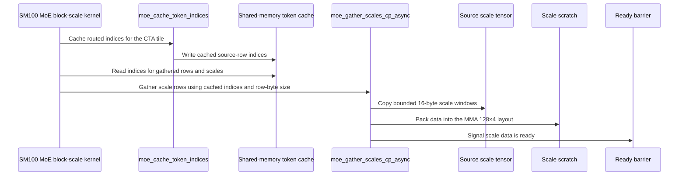

# optimize-moe-gather-for-bs

[Upstream PR](https://github.com/NVIDIA/cudnn-frontend/pull/2000) · state: closed · merged: True

## Original PR description

## Before submitting

- [x] I agree to license this contribution under the terms of [LICENSE.txt](https://github.com/NVIDIA/cudnn-frontend/blob/develop/LICENSE.txt).
- [x] I ran `pre-commit run` and committed any formatting changes.
- [x] I reviewed the Hard Rules in the `AGENTS.md` for each directory this PR touches (see [root AGENTS.md § Reviewing a PR](https://github.com/NVIDIA/cudnn-frontend/blob/develop/AGENTS.md#reviewing-a-pr-human-or-agent)) and my changes comply, or I explain the exception below.
- [x] I added GitHub labels: one `cat-*`, one or more `area:*` / `op:*`, and one `orig-*` (see [label list](https://github.com/NVIDIA/cudnn-frontend/labels)).

## Affected area

<!-- Choose one:
- C++ frontend API or graph construction
- Python API or bindings
- FE OSS kernels or CuTeDSL
- Build, packaging, or installation
- CI or test infrastructure
- Documentation or samples
- Benchmarks or performance
- Not sure
-->

## Summary

Optimize moe gather performance

## Why

<!-- What problem does this solve, and why is this approach appropriate? -->

## Related issues

<!-- Use "Fixes #123" or "Related to #123" where applicable. -->

## API and compatibility impact

<!-- Note public API, supported GPU/cuDNN/CUDA/Python versions, performance, or backward-compatibility changes. Write "None" if not applicable. -->

## Testing

<!-- List exact commands and results. If something was not tested, explain why. -->

<!-- This is an auto-generated comment: release notes by coderabbit.ai -->

<!-- coderabbit-ai-generated:v1 -->

## Summary by CodeRabbit

* **Improvements**
  * Improved MoE grouped matrix multiplication for gathered and block-scaled workloads, including cases where A and B are swapped.
  * Updated handling of routed token and scale data across tiles to support these workloads more consistently.

<!-- end of auto-generated comment: release notes by coderabbit.ai -->

## Review and discussion

### reviews

- YangXu1990uiuc · APPROVED · 2026-10-29T07:32:19Z · [source](https://github.com/NVIDIA/cudnn-frontend/pull/2000#pullrequestreview-5694246253)

**Codex bot review · model: `gpt-6-astra`**

Reviewed `6d7ae4f8b85d` against base `ce16f495a892`.

No approval-blocking regression found in this change. The token cache is refreshed for each scheduler tile, and the new scale loads preserve bounded reads, zero filling, SF packing and producer/consumer ordering. The optimization is worth landing after CI completes. Thank you for your contribution! Please retain a separate follow-up for the pre-existing cluster racecheck report described below.

Validation: Native SM100 at 6d7ae4f8b85d: 117 gather tests passed (1149 unrelated tests deselected). Coverage includes plain and block-scaled gather, NVFP4/MXFP4/MXFP8, swapAB, 1/2-CTA MMA, multicast, empty/ragged groups, padded scale strides, K tails, mixed/one-sided dequantization, and changed routing/scales/offsets during CUDA Graph replay. Compute Sanitizer: 12 targeted cases passed memcheck with zero device-memory errors; six single-CTA cases passed racecheck with zero hazards. These runs disabled API-error reporting, not device-memory/race checks. Four independent spot cases retained bitwise output across three repeated runs and wrote correct outputs after poisoned-output graph replay. A base/head/head/base comparison on a local SM100 validation device showed lower GPU replay time: NVFP4 K=512 normal about 30–32 to 13.3 us; NVFP4 K=4096 swapped about 152–153 to 47.8 us; MXFP8 K=4096 normal about 320–322 to 77–78 us; MXFP8 K=544 swapped about 52.8 to 18.6–20.4 us. Each used 137 source tokens, 259 routed rows, N=128, two experts and six groups, with fixed 128x128 tiles. CPU submission was roughly unchanged, about 71–84 us across these cases. Timings exclude compilation and use 32 calls per captured graph. Requested the operation-scoped python/gemm/frost CI target; pipeline 77528166 is running for this exact head.

Limitations: Cluster racecheck is not clean: the same six geometry cases report potential writes into an exited peer CTA on both base ce16f495 and this head (959 and 956 reports respectively). The displayed reports point to the unchanged scheduler warp's remote broadcast slots. Numerical comparisons pass, but this remains a scheduler-lifetime/tooling question to triage separately; I am not treating those runs as passing racecheck. Local performance is a bounded synthetic comparison on an SM100 validation device, not B200 qualification or downstream end-to-end performance. Other architectures were not run locally, and CI is still pending.

Approved: no P0 or high-risk P1 found. Remaining findings stay with the owner; merge timing stays with the owner.

<!-- codex-fe-review:v2:2000:6d7ae4f8b85d37d08a0f9b0d2cf47c0b6d724262:complete:no-blocker -->

### issue_comments

- coderabbitai[bot] · comment · 2026-10-29T06:53:10Z · [source](https://github.com/NVIDIA/cudnn-frontend/pull/2000#issuecomment-6490064864)

<!-- coderabbit-ai-generated:v1 -->

<!-- This is an auto-generated comment: summarize by coderabbit.ai -->
<!-- review_stack_entry_start -->

<a href="https://app.coderabbit.ai/change-stack/NVIDIA/cudnn-frontend/pull/2000?scope=ghh_OusAJGA4HG8ljoOV0wJvVx8NmnZIjc2DdjmxOu0xZWA&amp;cs_source=review_comment"><picture><source media="(prefers-color-scheme: dark)" srcset="https://storage.googleapis.com/coderabbit_public_assets/review-stack-in-coderabbit-ui-dark.svg?v=3"><source media="(prefers-color-scheme: light)" srcset="https://storage.googleapis.com/coderabbit_public_assets/review-stack-in-coderabbit-ui.svg?v=3"></picture></a>

<!-- review_stack_entry_end -->
<!-- recent_review_start -->

No actionable comments were generated in the recent review.

<strong><picture></picture> Recent review info</strong>

<dl>
<dd>

<!-- review_info_content -->

<strong><picture><source media="(prefers-color-scheme: dark)" srcset="https://storage.googleapis.com/coderabbit_public_assets/review-comment-icons-v1/cog-dark.svg"></picture> Run configuration</strong>

<dl>
<dd>

- **Source mode**: Auto
- **Repository**: [NVIDIA/cudnn-frontend](<https://github.com/NVIDIA/cudnn-frontend>)
- **Branch**: [develop](<https://github.com/NVIDIA/cudnn-frontend/tree/develop>)
- **File**: [.coderabbit.yaml](<https://github.com/NVIDIA/cudnn-frontend/blob/ce16f495a89296fe7fb3a62cf947ae12296789af/.coderabbit.yaml>)
- **Commit**: [ce16f49](<https://github.com/NVIDIA/cudnn-frontend/commit/ce16f495a89296fe7fb3a62cf947ae12296789af>)
- **Layers**: Repository YAML
- **Review profile**: CHILL
- **Plan**: Enterprise
- **Run ID**: `5656f412-80d1-4058-9877-1c50232d897f`

</dd>
</dl>

<strong><picture><source media="(prefers-color-scheme: dark)" srcset="https://storage.googleapis.com/coderabbit_public_assets/review-comment-icons-v1/git-commit-horizontal-dark.svg"></picture> Commits</strong>

<dl>
<dd>

Reviewing files that changed from the base of the PR and between ce16f495a89296fe7fb3a62cf947ae12296789af and 6d7ae4f8b85d37d08a0f9b0d2cf47c0b6d724262.

</dd>
</dl>

<strong><picture><source media="(prefers-color-scheme: dark)" srcset="https://storage.googleapis.com/coderabbit_public_assets/review-comment-icons-v1/file-plus-corner-dark.svg"></picture> Files selected for processing: 6</strong>

<dl>
<dd>

* `python/cudnn/gemm/frost/sm100/compiler.py`
* `python/cudnn/gemm/frost/sm100/kernel_templates/sm100_moe_grouped_block_scale_matmul_fwd.py`
* `python/cudnn/gemm/frost/sm100/kernel_templates/sm100_moe_grouped_block_scale_matmul_fwd_swap_ab.py`
* `python/cudnn/gemm/frost/sm100/kernel_templates/sm100_moe_grouped_matmul_fwd.py`
* `python/cudnn/gemm/frost/sm100/kernel_templates/sm100_moe_grouped_matmul_fwd_swap_ab.py`
* `python/cudnn/gemm/frost/tile_helpers.py`

</dd>
</dl>

**Included review availability:** This review used your included allowance. Your plan provides up to 12 included reviews per hour; 11 remain after this review.

</dd>
</dl>

<!-- recent_review_end -->
<!-- walkthrough_start -->

<strong>Walkthrough</strong>

<dl>
<dd>

The SM100 MoE GEMM kernels now cache routed token indices in shared memory. The compiler includes aligned token-index and scale-row storage in its shared-memory calculations. Block-scale kernels use an asynchronous helper to gather scale data from cached indices.

**Changes: MoE gather path**

|Layer / File(s)|Summary|
|:---|:---|
|**Gather storage sizing**   `python/cudnn/gemm/frost/sm100/compiler.py`|The compiler calculates token-row counts and aligned storage for gathered indices and scale rows. Generated constants and shared-memory stage budgets include these sizes.|
|**Cached token indices**   `python/cudnn/gemm/frost/tile_helpers.py`, `python/cudnn/gemm/frost/sm100/kernel_templates/sm100_moe_grouped_matmul_fwd*.py`, `python/cudnn/gemm/frost/sm100/kernel_templates/sm100_moe_grouped_block_scale_matmul_fwd*.py`|The helper caches routed source-row indices. Standard and block-scale kernels use the cached indices to load gathered rows, including the appropriate multicast-slice offsets.|
|**Asynchronous scale gathering**   `python/cudnn/gemm/frost/tile_helpers.py`, `python/cudnn/gemm/frost/sm100/kernel_templates/sm100_moe_grouped_block_scale_matmul_fwd*.py`|Block-scale kernels size scale scratch using `gather_sf_row_bytes` and call `moe_gather_scales_cp_async`. The helper copies bounded 16-byte windows, packs scale data into the MMA 128×4 layout, and signals the ready barrier.|

<!-- change_assessment_start -->
<!-- change_assessment_priority:{"version":1,"urgency":"p3","manual":false} -->

**Estimated code review effort:** 3 (Moderate) | ~25 minutes

<!-- change_assessment_commit:"6d7ae4f8b85d37d08a0f9b0d2cf47c0b6d724262" -->
**Change:** Refactor
<!-- change_assessment_end -->

### Sequence Diagram(s)

**Suggested labels:** `mod-frost`, `area:frost`, `area:gemm`, `cat-enhancements`

**Suggested reviewers:** `yihuawei`, `anerudhan`, `yangxu1990uiuc`

</dd>
</dl>

<!-- walkthrough_end -->

<strong>Merge Risk:</strong> <strong><picture></picture> Minimal</strong> · up to <code>6d7ae</code>

<dl>
<dd>

<!-- final_review_risk_start -->
<!-- final_review_risk_label
**Merge Risk:** **⚪ Minimal** · up to `6d7ae`
-->
<!-- final_review_risk_coverage:{"sourceCommitId":"6d7ae4f8b85d37d08a0f9b0d2cf47c0b6d724262","coveredCommitId":"6d7ae4f8b85d37d08a0f9b0d2cf47c0b6d724262","kind":"reviewed"} -->

No confirmed issue currently blocks merging; complete the normal GPU validation before release.
<!-- final_review_risk_end -->

</dd>
</dl>

<!-- pre_merge_checks_walkthrough_start -->

<strong>Pre-merge checks: <picture></picture> 3 · <picture></picture> 2</strong>

<dl>
<dd>

<strong><picture></picture> Failed checks: 2 warnings</strong>

|     Check name     |                                              Status                                              | Explanation                                                                                                                                                                                               | Resolution                                                                                                                                                                                                                                        |
| :---------------- | :----------------------------------------------------------------------------------------------: | :-------------------------------------------------------------------------------------------------------------------------------------------------------------------------------------------------------- | :------------------------------------------------------------------------------------------------------------------------------------------------------------------------------------------------------------------------------------------------ |
| Docstring Coverage |  | Docstring coverage is 75.00% which is insufficient. The required threshold is 80.00%. Docstring coverage is scoped to functions touched by this diff with cyclomatic complexity of at least 2. Documenta… | Write docstrings for the functions missing them to satisfy the coverage threshold.                                                                                                                                                                |
|  Description check |  | The checklist is complete, but the required PR content is largely missing. The affected area is not selected, the summary is too vague, and the Why, API and compatibility impact, and Testing sections … | Select the affected area and document the MoE gather optimization in the Summary and Why sections. State the API, compatibility, GPU, CUDA, Python, and performance impact, or write "None" where applicable. Add exact test commands and result… |

<strong><picture></picture> Passed checks: 3 passed</strong>

<dl>
<dd>

|         Check name         |                                             Status                                             | Explanation                                                                                                                                                                                               |
| :------------------------ | :--------------------------------------------------------------------------------------------: | :-------------------------------------------------------------------------------------------------------------------------------------------------------------------------------------------------------- |
|         Title check        |  | The title "optimize-moe-gather-for-bs" is a single hyphenated token that names the change: optimizing MoE gather for batch size. The raw summary confirms the changes are about MoE gather in GEMM kerne… |
|     Linked Issues check    |  | Check skipped because no linked issues were found for this pull request.                                                                                                                                  |
| Out of Scope Changes check |  | Check skipped because no linked issues were found for this pull request.                                                                                                                                  |

<strong>Full details: Title check</strong>

<dl>
<dd>

**Explanation**

The title "optimize-moe-gather-for-bs" is a single hyphenated token that names the change: optimizing MoE gather for batch size. The raw summary confirms the changes are about MoE gather in GEMM kernels, so the title is related to the main change. It is brief and specific enough, but it is written as a slug rather than a readable sentence, and it does not name the mechanism (token-index caching in shared memory and async scale gathering).

</dd>
</dl>

</dd>
</dl>

<strong>Full details: Docstring Coverage</strong>

<dl>
<dd>

**Explanation**

Docstring coverage is 75.00% which is insufficient. The required threshold is 80.00%. Docstring coverage is scoped to functions touched by this diff with cyclomatic complexity of at least 2. Documentation-only edits and deletions within surviving functions are included; unchanged diff context and fully deleted functions are excluded. Analyzed 8 functions across 6 files.

**Resolution**

Write docstrings for the functions missing them to satisfy the coverage threshold.

</dd>
</dl>

<strong>Full details: Description check</strong>

<dl>
<dd>

**Explanation**

The checklist is complete, but the required PR content is largely missing. The affected area is not selected, the summary is too vague, and the Why, API and compatibility impact, and Testing sections are empty. Related issues are also not stated.

**Resolution**

Select the affected area and document the MoE gather optimization in the Summary and Why sections. State the API, compatibility, GPU, CUDA, Python, and performance impact, or write "None" where applicable. Add exact test commands and results, explain any untested cases, and state related issues or that none apply.

</dd>
</dl>

</dd>
</dl>

<!-- pre_merge_checks_walkthrough_end -->
<!-- finishing_touch_checkbox_start -->

<strong>Finishing Touches</strong>

<dl>
<dd>

<!-- finishing_touch_suggestion:fix_ci -->

<strong>Fix failing CI checks</strong>

<dl>
<dd>

- [ ] <!-- {"checkboxId": "9f0d24fb-b419-4f01-baf0-8b26b6424f34", "radioGroupId": "fix-ci-output-choice-group-unknown_comment_id"} --> Commit to this branch
- [ ] <!-- {"checkboxId": "6d21cfe8-ec3f-40e2-9222-b8318b64d3b0", "radioGroupId": "fix-ci-output-choice-group-unknown_comment_id"} --> Create a new PR

</dd>
</dl>

<strong>🧪 Generate unit tests (beta)</strong>

<dl>
<dd>

- [ ] <!-- {"checkboxId": "f47ac10b-58cc-4372-a567-0e02b2c3d479", "radioGroupId": "utg-output-choice-group-unknown_comment_id"} --> Create a new PR

</dd>
</dl>

</dd>
</dl>

<!-- finishing_touch_checkbox_end -->

<!-- autopilot:start -->
- [ ] <!-- {"checkboxId":"2708ad07-9f24-4260-9c11-7dc76a49f2e3"} --> <strong title="Keep fixing CodeRabbit findings and required CI, and resolving merge conflicts">Autofix</strong> · Keep fixing CodeRabbit findings and required CI, and resolving merge conflicts
<!-- autopilot:end -->

- YangXu1990uiuc · comment · 2026-10-29T07:18:34Z · [source](https://github.com/NVIDIA/cudnn-frontend/pull/2000#issuecomment-6490521449)

I am requesting test CI for `6d7ae4f8b85d` with the following standalone command: `@cudnn-ci-bot run python/gemm/frost`. For future updates, request the appropriate test target before review; a maintainer may need to trigger it.

Codex bot review — model `gpt-6-astra`.

<!-- codex-fe-ci:v1:2000:6d7ae4f8b85d37d08a0f9b0d2cf47c0b6d724262:ci-gemm-frost-6d7ae4f8b85d-notice -->

- YangXu1990uiuc · comment · 2026-10-29T07:18:41Z · [source](https://github.com/NVIDIA/cudnn-frontend/pull/2000#issuecomment-6490523379)

@cudnn-ci-bot run python/gemm/frost

- cudnn-ci-bot · comment · 2026-10-29T07:19:03Z · [source](https://github.com/NVIDIA/cudnn-frontend/pull/2000#issuecomment-6490530337)

🏁 Pipeline finished

SHA: `6d7ae4f`
Targets: `python/gemm/frost`
Branch: [cudnn-gh/pr-2000-6d7ae4f](https://nv/cudnn-gitlab-ci/-/tree/cudnn-gh/pr-2000-6d7ae4f)
Pipeline: [77528166](https://nv/cudnn-gitlab-ci/-/pipelines/77528166)
Last updated: 2026-10-29 07:45 UTC

**21 passed, 12 manual**

### <code>manual</code>

- <code>manual:python_samples</code> - Manual
- <code>manual:python/sdpa/frost</code> - Manual
- <code>manual:python/sdpa/misc</code> - Manual
- <code>manual:python/linear_attention</code> - Manual
- <code>manual:python/gemm/frost</code> - ✅ Passed
- <code>manual:python/gemm/cutedsl</code> - Manual
- <code>manual:python/gemm/misc</code> - Manual
- <code>manual:python/conv</code> - Manual
- <code>manual:python/norm</code> - Manual
- <code>manual:python/misc</code> - Manual
- <code>manual:pycudnn</code> - Manual
- <code>manual:multi_gpu</code> - Manual
- <code>manual:backend</code> - Manual

### <code>analysis</code>

- <code>analysis:cudnn_clang_disable_exception</code> - ✅ Passed
- <code>analysis:cudnn_v9_no_half_conversion</code> - ✅ Passed
- <code>analysis:cudnn_clang</code> - ✅ Passed
- <code>analysis:check-relative-includes</code> - ✅ Passed
- <code>analysis:check-CUDNN_FRONTEND_SKIP_JSON_LIB</code> - ✅ Passed
- <code>analysis:guardwords_scan</code> - ✅ Passed
- <code>analysis:jax-import-guard</code> - ✅ Passed
- <code>analysis:pytest-gpu</code> - ✅ Passed
- <code>san:build</code> - ✅ Passed

### <code>build</code>

- <code>analysis:api_index</code> - ✅ Passed
- <code>build:dev:linux:amd64</code> - ✅ Passed
- <code>build:rel:linux:amd64</code> - ✅ Passed
- <code>build:dev:linux:arm64</code> - ✅ Passed
- <code>build:rel:linux:arm64</code> - ✅ Passed
- <code>build:rel:win:amd64</code> - ✅ Passed

### <code>python/gemm/frost</code>

- <code>python/gemm/frost:be-9.27.0-cutedsl-4.8.0:sm100</code> - ✅ Passed

### <code>sanitizer_tests</code>

- <code>san:cpp_test:sm80</code> - ✅ Passed
- <code>san:cpp_test:sm90</code> - ✅ Passed
- <code>san:cpp_test:sm100</code> - ✅ Passed

### <code>triage</code>

- <code>triage:ai</code> - ✅ Passed

- YangXu1990uiuc · comment · 2026-10-29T07:51:52Z · [source](https://github.com/NVIDIA/cudnn-frontend/pull/2000#issuecomment-6491106939)

CI follow-up for `6d7ae4f8b85d`: pipeline **77528166 passed**. The selected SM100 GEMM/FROST suite reports **7,224 passed and 3,676 skipped**; the standard build, analysis and C++ sanitizer jobs also passed.

This completes the requested CI coverage for the reviewed head. The separate pre-existing cluster racecheck observation in [my review](https://github.com/NVIDIA/cudnn-frontend/pull/2000#pullrequestreview-5694246253) remains a follow-up; passing this CI suite does not resolve that observation. Approval remains in place.

Codex bot review — model `gpt-6-astra`.

<!-- codex-fe-ci:v1:2000:6d7ae4f8b85d37d08a0f9b0d2cf47c0b6d724262:pipeline-77528166-finished -->

### inline_comments

## Changed files and fixed code

- `python/cudnn/gemm/frost/epilogue_codegen.py` · modified · additions 31 / deletions 0
  - [head](https://github.com/yanqinz2/cudnn-frontend/blob/6400c6022c66c74914d70d7c4ff1e0bf6a8087f1/python/cudnn/gemm/frost/epilogue_codegen.py)
  - [base](https://github.com/NVIDIA/cudnn-frontend/blob/411fd5e8f0bac020378d838e10275acbcbcd2c18/python/cudnn/gemm/frost/epilogue_codegen.py)
- `python/cudnn/gemm/frost/kernel_registry.py` · modified · additions 55 / deletions 1
  - [head](https://github.com/yanqinz2/cudnn-frontend/blob/6400c6022c66c74914d70d7c4ff1e0bf6a8087f1/python/cudnn/gemm/frost/kernel_registry.py)
  - [base](https://github.com/NVIDIA/cudnn-frontend/blob/411fd5e8f0bac020378d838e10275acbcbcd2c18/python/cudnn/gemm/frost/kernel_registry.py)
- `python/cudnn/gemm/frost/sm100/compiler.py` · modified · additions 186 / deletions 23
  - [head](https://github.com/yanqinz2/cudnn-frontend/blob/6400c6022c66c74914d70d7c4ff1e0bf6a8087f1/python/cudnn/gemm/frost/sm100/compiler.py)
  - [base](https://github.com/NVIDIA/cudnn-frontend/blob/411fd5e8f0bac020378d838e10275acbcbcd2c18/python/cudnn/gemm/frost/sm100/compiler.py)
- `python/cudnn/gemm/frost/sm100/kernel_templates/sm100_moe_grouped_block_scale_matmul_fwd.py` · modified · additions 44 / deletions 112
  - [head](https://github.com/yanqinz2/cudnn-frontend/blob/6400c6022c66c74914d70d7c4ff1e0bf6a8087f1/python/cudnn/gemm/frost/sm100/kernel_templates/sm100_moe_grouped_block_scale_matmul_fwd.py)
  - [base](https://github.com/NVIDIA/cudnn-frontend/blob/411fd5e8f0bac020378d838e10275acbcbcd2c18/python/cudnn/gemm/frost/sm100/kernel_templates/sm100_moe_grouped_block_scale_matmul_fwd.py)
- `python/cudnn/gemm/frost/sm100/kernel_templates/sm100_moe_grouped_block_scale_matmul_fwd_gather_mode.py` · added · additions 2517 / deletions 0
  - [head](https://github.com/yanqinz2/cudnn-frontend/blob/6400c6022c66c74914d70d7c4ff1e0bf6a8087f1/python/cudnn/gemm/frost/sm100/kernel_templates/sm100_moe_grouped_block_scale_matmul_fwd_gather_mode.py)
  - [base](https://github.com/NVIDIA/cudnn-frontend/blob/411fd5e8f0bac020378d838e10275acbcbcd2c18/python/cudnn/gemm/frost/sm100/kernel_templates/sm100_moe_grouped_block_scale_matmul_fwd_gather_mode.py)
- `python/cudnn/gemm/frost/sm100/kernel_templates/sm100_moe_grouped_block_scale_matmul_fwd_gather_mode_swap_ab.py` · added · additions 2488 / deletions 0
  - [head](https://github.com/yanqinz2/cudnn-frontend/blob/6400c6022c66c74914d70d7c4ff1e0bf6a8087f1/python/cudnn/gemm/frost/sm100/kernel_templates/sm100_moe_grouped_block_scale_matmul_fwd_gather_mode_swap_ab.py)
  - [base](https://github.com/NVIDIA/cudnn-frontend/blob/411fd5e8f0bac020378d838e10275acbcbcd2c18/python/cudnn/gemm/frost/sm100/kernel_templates/sm100_moe_grouped_block_scale_matmul_fwd_gather_mode_swap_ab.py)
- `python/cudnn/gemm/frost/sm100/kernel_templates/sm100_moe_grouped_block_scale_matmul_fwd_swap_ab.py` · modified · additions 44 / deletions 112
  - [head](https://github.com/yanqinz2/cudnn-frontend/blob/6400c6022c66c74914d70d7c4ff1e0bf6a8087f1/python/cudnn/gemm/frost/sm100/kernel_templates/sm100_moe_grouped_block_scale_matmul_fwd_swap_ab.py)
  - [base](https://github.com/NVIDIA/cudnn-frontend/blob/411fd5e8f0bac020378d838e10275acbcbcd2c18/python/cudnn/gemm/frost/sm100/kernel_templates/sm100_moe_grouped_block_scale_matmul_fwd_swap_ab.py)
- `python/cudnn/gemm/frost/sm100/kernel_templates/sm100_moe_grouped_matmul_fwd.py` · modified · additions 20 / deletions 47
  - [head](https://github.com/yanqinz2/cudnn-frontend/blob/6400c6022c66c74914d70d7c4ff1e0bf6a8087f1/python/cudnn/gemm/frost/sm100/kernel_templates/sm100_moe_grouped_matmul_fwd.py)
  - [base](https://github.com/NVIDIA/cudnn-frontend/blob/411fd5e8f0bac020378d838e10275acbcbcd2c18/python/cudnn/gemm/frost/sm100/kernel_templates/sm100_moe_grouped_matmul_fwd.py)
- `python/cudnn/gemm/frost/sm100/kernel_templates/sm100_moe_grouped_matmul_fwd_gather_mode.py` · added · additions 1595 / deletions 0
  - [head](https://github.com/yanqinz2/cudnn-frontend/blob/6400c6022c66c74914d70d7c4ff1e0bf6a8087f1/python/cudnn/gemm/frost/sm100/kernel_templates/sm100_moe_grouped_matmul_fwd_gather_mode.py)
  - [base](https://github.com/NVIDIA/cudnn-frontend/blob/411fd5e8f0bac020378d838e10275acbcbcd2c18/python/cudnn/gemm/frost/sm100/kernel_templates/sm100_moe_grouped_matmul_fwd_gather_mode.py)
- `python/cudnn/gemm/frost/sm100/kernel_templates/sm100_moe_grouped_matmul_fwd_gather_mode_swap_ab.py` · added · additions 1592 / deletions 0
  - [head](https://github.com/yanqinz2/cudnn-frontend/blob/6400c6022c66c74914d70d7c4ff1e0bf6a8087f1/python/cudnn/gemm/frost/sm100/kernel_templates/sm100_moe_grouped_matmul_fwd_gather_mode_swap_ab.py)
  - [base](https://github.com/NVIDIA/cudnn-frontend/blob/411fd5e8f0bac020378d838e10275acbcbcd2c18/python/cudnn/gemm/frost/sm100/kernel_templates/sm100_moe_grouped_matmul_fwd_gather_mode_swap_ab.py)
- `python/cudnn/gemm/frost/sm100/kernel_templates/sm100_moe_grouped_matmul_fwd_swap_ab.py` · modified · additions 19 / deletions 46
  - [head](https://github.com/yanqinz2/cudnn-frontend/blob/6400c6022c66c74914d70d7c4ff1e0bf6a8087f1/python/cudnn/gemm/frost/sm100/kernel_templates/sm100_moe_grouped_matmul_fwd_swap_ab.py)
  - [base](https://github.com/NVIDIA/cudnn-frontend/blob/411fd5e8f0bac020378d838e10275acbcbcd2c18/python/cudnn/gemm/frost/sm100/kernel_templates/sm100_moe_grouped_matmul_fwd_swap_ab.py)
- `python/cudnn/gemm/frost/tile_helpers.py` · modified · additions 0 / deletions 50
  - [head](https://github.com/yanqinz2/cudnn-frontend/blob/6400c6022c66c74914d70d7c4ff1e0bf6a8087f1/python/cudnn/gemm/frost/tile_helpers.py)
  - [base](https://github.com/NVIDIA/cudnn-frontend/blob/411fd5e8f0bac020378d838e10275acbcbcd2c18/python/cudnn/gemm/frost/tile_helpers.py)
- `test/python/gemm/frost/test_template_epilogue_parity.py` · modified · additions 14 / deletions 6
  - [head](https://github.com/yanqinz2/cudnn-frontend/blob/6400c6022c66c74914d70d7c4ff1e0bf6a8087f1/test/python/gemm/frost/test_template_epilogue_parity.py)
  - [base](https://github.com/NVIDIA/cudnn-frontend/blob/411fd5e8f0bac020378d838e10275acbcbcd2c18/test/python/gemm/frost/test_template_epilogue_parity.py)

## Evidence and interpretation boundary

[Original JSON, discussions and patches](../../../../../../evidence/prs/NVIDIA--cudnn-frontend/2000-8f4af39cd9f5de42d34ab1930c7139125589a92020dcb9b5eaf2ca2f64c26b9d.json) · SHA-256 `8f4af39cd9f5de42d34ab1930c7139125589a92020dcb9b5eaf2ca2f64c26b9d`.

Diff complete: False. Missing/binary/truncated patches require pinned source inspection. This is a source page, not an independently verified optimization case. Open, merged and released are different states; recheck the deployed dependency.
