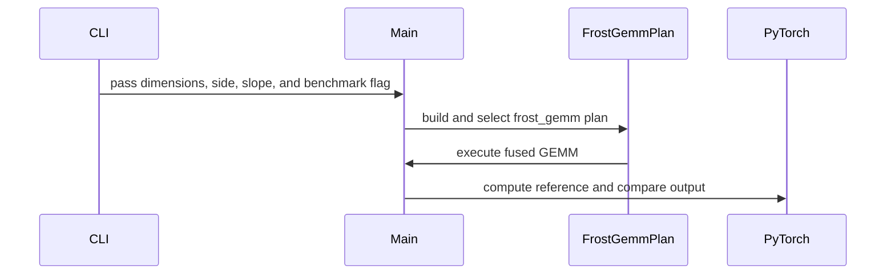

# feat(frost-gemm): fuse parameterized LeakyReLU on matmul operands

[Upstream PR](https://github.com/NVIDIA/cudnn-frontend/pull/2001) · state: closed · merged: True

## Original PR description

## Before submitting

- [x] I agree to license this contribution under the terms of [LICENSE.txt](https://github.com/NVIDIA/cudnn-frontend/blob/develop/LICENSE.txt).
- [x] I ran `pre-commit run` and committed any formatting changes.
- [x] I reviewed the Hard Rules in the applicable `AGENTS.md` files; this change adds no execute-time adaptation, allocations, host reads, or caller API differences.
- [ ] GitHub labels: requested `cat-feature`, `area:frost`, `area:gemm`, `orig-external`. As an external contributor I do not have upstream triage/write permission; maintainer assistance may be needed to apply them.

## Affected area

FE OSS kernels / FROST GEMM graph analysis, with tests and a Python sample.

## Summary

- Allow only `leaky_relu`'s finite `negative_slope` among parameterized mainloop pointwise operations.
- Preserve recorded attributes in each mainloop `FusionOp`, reusing the existing shared pointwise emitter.
- Keep the support gates unchanged. Rejection diagnostics now name the producer, operand, and `operation.attribute`; `gen_index` has its own coordinate-indexing diagnostic. A small inline loop validates attributes without introducing a validation framework.
- Add analyzer/codegen coverage for A, B, and both operands; distinct slopes in consecutive activations; BF16/FP16 rounding metadata; mixed `cos -> leaky_relu` chains; unsupported unary/binary attributes; and nonfinite slopes on both operands. Exact-message checks also verify that a future whitelist extension names the actual attribute rather than a hard-coded slope.
- Add 26 Blackwell end-to-end cases covering one-/two-CTA MMA, full/partial K tiles, observable transformed-padding masking, and exact intermediate-rounding checks through an identity GEMM.
- Add a self-checking sample with an optional separate-activation + FROST GEMM baseline and explanations of the bounded support. It follows neighboring numbered examples with `_build_plans`, a typed callable `main`, separate CLI parsing, and `[07] PASS/SKIP` output. Test builders and GPU cases use the existing file sections and `_plan` / `_vp` helpers.

## Why

`_walk_mainloop_chain` currently refuses every operand producer with scalar attributes. This rejects a graph such as `leaky_relu(A, negative_slope=0.1) @ B`, although `FusionOp.attrs` and the common LeakyReLU emitter already support the slope.

The change connects those existing pieces without adding a new kernel implementation or broadly enabling other parameterized operations. Each pointwise node keeps its compute/output dtype and its intermediate rounding boundary. The existing transformed-K-padding guard remains intact. The new `cos -> leaky_relu` test transforms padding to one on **both** operands, so a missing final K mask produces an observable wrong result.

## Related issues

No specific issue; this is a small feature extension, not a claim of an existing numerical bug.

## API and compatibility impact

No public signatures, engine/knob IDs, template geometries, or execution contracts change. Existing architecture/template restrictions continue to apply. This does not add mainloop broadcast auxiliaries or enable parameterized ReLU/Swish/backward operations.

Nonfinite LeakyReLU slopes are declined before code generation rather than generating invalid `nan`/`inf` Python literals. Finite negative, zero, and positive slopes are covered by analyzer tests.


<!-- This is an auto-generated comment: release notes by coderabbit.ai -->
<!-- coderabbit-ai-generated:v1 -->

## Summary by CodeRabbit

* **New Features**
  * Added fused LeakyReLU support for either or both GEMM input operands, with configurable slope values.
  * Added an example comparing fused execution with separate activation and GEMM operations, including optional benchmarking and result checks.
* **Bug Fixes**
  * LeakyReLU slope values must be finite, and unsupported pointwise attributes are rejected.
<!-- end of auto-generated comment: release notes by coderabbit.ai -->

## Review and discussion

### reviews

- copilot-pull-request-reviewer[bot] · COMMENTED · 2026-10-29T07:45:45Z · [source](https://github.com/NVIDIA/cudnn-frontend/pull/2001#pullrequestreview-5694365059)

Copilot was unable to review this pull request because the user who requested the review has insufficient remaining quota.

- coderabbitai[bot] · COMMENTED · 2026-10-29T07:52:09Z · [source](https://github.com/NVIDIA/cudnn-frontend/pull/2001#pullrequestreview-5694422699)

<!-- coderabbit-ai-generated:v1 -->


<details>
<summary>🔇 Additional comments: 1</summary><blockquote>
<dl>
<dd>

<details>
<summary>samples/frost/gemm/07_matmul_leaky_relu_mainloop.py: 1</summary><blockquote>
<dl>
<dd>

`123-126`: **<picture></picture> Trivial** · **Maintainability & Code Quality** · **Quick win**

⚠️ **Unverified finding**
Verification ran but could not confirm this finding. It is shown for review, not as a verified issue.

**Alternate the benchmark order and record it.**

Line 123 always times `fused` first and `separate` second, from a single sample each. Cache, thermal, and clock-frequency effects can bias a fixed-order comparison. The printed `ratio` is then not reliably order-independent.

Use several samples per path. Alternate which path runs first on each sample. Print the median and the executed order next to the raw timings.

<details>
<summary>♻️ Proposed change</summary>
<dl>
<dd>

```diff
-        fused_us, separate_us = _replay_us(fused), _replay_us(separate)
+        paths = {"fused": fused, "separate": separate}
+        samples: dict[str, list[float]] = {name: [] for name in paths}
+        order: list[tuple[str, ...]] = []
+        for i in range(6):
+            names = ("fused", "separate") if i % 2 == 0 else ("separate", "fused")
+            order.append(names)
+            for name in names:
+                samples[name].append(_replay_us(paths[name]))
+        fused_us = sorted(samples["fused"])[len(samples["fused"]) // 2]
+        separate_us = sorted(samples["separate"])[len(samples["separate"]) // 2]
+        print(f"[07] raw us={samples} order={order}")
```
</dd>
</dl>
</details>

Based on learnings: flag a benchmark comparison that always executes competing implementations in a fixed sequential order, unless it alternates the order per sample and records the executed order alongside raw timings.

_Source: Learnings_

</dd>
</dl>
</blockquote></details>

</dd>
</dl>
</blockquote></details>

---

<details>
<summary><picture></picture> Review info</summary>
<dl>
<dd>

<details>
<summary><picture><source media="(prefers-color-scheme: dark)" srcset="https://storage.googleapis.com/coderabbit_public_assets/review-comment-icons-v1/cog-dark.svg"></picture> Run configuration</summary>
<dl>
<dd>

- **Source mode**: Auto
- **Repository**: [NVIDIA/cudnn-frontend](<https://github.com/NVIDIA/cudnn-frontend>)
- **Branch**: [develop](<https://github.com/NVIDIA/cudnn-frontend/tree/develop>)
- **File**: [.coderabbit.yaml](<https://github.com/NVIDIA/cudnn-frontend/blob/ce16f495a89296fe7fb3a62cf947ae12296789af/.coderabbit.yaml>)
- **Commit**: [ce16f49](<https://github.com/NVIDIA/cudnn-frontend/commit/ce16f495a89296fe7fb3a62cf947ae12296789af>)
- **Layers**: Repository YAML
- **Review profile**: CHILL
- **Plan**: Enterprise
- **Run ID**: `f7e11c08-16de-418d-8539-8288147844ef`

</dd>
</dl>
</details>

<details>
<summary><picture><source media="(prefers-color-scheme: dark)" srcset="https://storage.googleapis.com/coderabbit_public_assets/review-comment-icons-v1/git-commit-horizontal-dark.svg"></picture> Commits</summary>
<dl>
<dd>

Reviewing files that changed from the base of the PR and between ce16f495a89296fe7fb3a62cf947ae12296789af and 761e68a66317ddd36cac402acf22844b13873aae.

</dd>
</dl>
</details>

<details>
<summary><picture><source media="(prefers-color-scheme: dark)" srcset="https://storage.googleapis.com/coderabbit_public_assets/review-comment-icons-v1/file-plus-corner-dark.svg"></picture> Files selected for processing: 3</summary>
<dl>
<dd>

* `python/cudnn/gemm/frost/graph_analyzer.py`
* `samples/frost/gemm/07_matmul_leaky_relu_mainloop.py`
* `test/python/gemm/frost/test_matmul_mainloop_fusion.py`

</dd>
</dl>
</details>

**Included review availability:** This review used your included allowance. Your plan provides up to 12 included reviews per hour; 11 remain after this review.

</dd>
</dl>
</details>

<!-- This is an auto-generated comment by CodeRabbit for review status -->

<!-- coderabbit-review-publication v1 publication=856f9c3e-2282-4e8d-926c-3b8b0163689e attempt=a9f76df7-b38c-40fd-b426-913c67430aca batch=1/1 -->

- Anerudhan · APPROVED · 2026-10-29T08:08:01Z · [source](https://github.com/NVIDIA/cudnn-frontend/pull/2001#pullrequestreview-5694561309)

**Codex bot review · model: `gpt-6-astra`**

Reviewed `761e68a66317` against base `ce16f495a892`.

Thank you for your contribution! The bounded attribute gate and reuse of the existing pointwise emitter preserve the mainloop's rounding and padding contracts. Focused tests and an independent public-API replay probe passed. I found one nonblocking bug in the optional sample benchmark: its GEMM handle is not bound to the capture stream. The kernel change has no approval-blocking finding; operation-scoped CI has been requested.

**[P2] Bind the GEMM handle to the benchmark capture stream** ([source](https://github.com/NVIDIA/cudnn-frontend/blob/761e68a66317ddd36cac402acf22844b13873aae/samples/frost/gemm/07_matmul_leaky_relu_mainloop.py#L61))

The callbacks use g.execute/base.execute without an explicit handle, so their GEMMs stay on the cached cuDNN handle's stream when _replay_us switches to a new Torch stream. The fused capture is empty; the separate capture records its Torch activations but misses the GEMM. Running main(128, 128, 136, 'ab', 0.1, True) emits the empty-CUDA-graph warning and fails the final c_base comparison. Bind a retained cuDNN handle to the warmup/capture stream and pass it to both execute calls. Treat an empty capture as an error and change inputs before replay when checking the benchmark so old outputs cannot hide missing work.

Evidence: The unmodified sample reproduced the empty-graph warning and a 16384/16384 baseline-output mismatch. An independent public graph probe failed on the empty-capture warning, then passed all four slopes and changing-input replays with an explicit stream-bound handle. Attribution: Independently reproduced in this review.

Validation: Reviewed all three changed files, attribute recording, shared emission, intermediate rounding, transformed-K masking, template admission and generated-source cache identity. Precheck returned no candidates. No kernel synchronization or execution ABI changed. SM100 with CUTLASS DSL 4.8.0: 72 focused tests passed (46 analyzer/code-generation checks and all 26 added GPU cases); 170 other cases were deselected. This includes both operand sides, one-/two-CTA MMA, partial K tiles, nonfinite rejection, mixed cos chains, and exact BF16/FP16 intermediate-rounding checks. Independent public pygraph execution: four distinct slopes (-0.25, 0, 0.3, 0.1), both operands and partial K=136. With an explicit capture-stream handle, three changed-input rounds and a return to the first plan matched a separate Torch reference; repeated replays were bitwise equal. The exact-source sample's optional benchmark reproduced the capture defect above. Normal fused execution passed before benchmarking. Requested python/gemm/frost after checking its selector includes the changed suite. Approved the current-head fork Style and Security validation workflows after checking their heads and unchanged workflow contents. CI remains pending.

Limitations: Local tests used the exact Python source with a compatible previously built FE extension. The native differences from that build are an equivalent variant-pack axis-order fast path and unrelated SDPA admission checks; no new binding API is required here. No native SM103, SM107 or SM120 execution was performed. Pending CI is not passing evidence. No performance comparison is claimed: the sample benchmark is invalid as written, and the shared local GPU is busy.

Approved: no P0 or high-risk P1 found. Remaining findings stay with the owner; merge timing stays with the owner.

<!-- codex-fe-review:v2:2001:761e68a66317ddd36cac402acf22844b13873aae:complete:no-blocker -->

- coderabbitai[bot] · COMMENTED · 2026-10-29T08:23:51Z · [source](https://github.com/NVIDIA/cudnn-frontend/pull/2001#pullrequestreview-5694722464)

<!-- coderabbit-ai-generated:v1 -->


<details>
<summary>🔇 Additional comments: 1</summary><blockquote>
<dl>
<dd>

<details>
<summary>samples/frost/gemm/07_matmul_leaky_relu_mainloop.py: 1</summary><blockquote>
<dl>
<dd>

`151-155`: **<picture></picture> Trivial** · **Maintainability & Code Quality** · **Quick win**

⚠️ **Unverified finding**
Verification ran but could not confirm this finding. It is shown for review, not as a verified issue.

**Control the fixed execution order in the fused-versus-separate benchmark.**

Fused always runs first at Line 151, and separate always runs second at Line 155. Cache, thermal, and clock-frequency state differs between these two measurements. The printed `ratio` at Line 157 can therefore include an order effect. It also comes from a single 100-iteration sample per path.

Run both paths in alternating order across several rounds. Record the executed order with the raw timings. Then report a median per path. Restore `a` and `b` after each `_replay_us` call, because `check_replay` mutates them.

Sketch of the intended flow:

```python
timings = {"fused": [], "separate": []}
orders = []
for r in range(4):
    order = ("fused", "separate") if r % 2 == 0 else ("separate", "fused")
    orders.append(order)
    for name in order:
        fn, out = (fused, c) if name == "fused" else (separate, c_base)
        timings[name].append(_replay_us(fn, lambda replay, out=out: check_replay(replay, out)))
        a.neg_()
        b.mul_(2)  # Restore inputs mutated by check_replay.
```

Compare `c` and `c_base` while both buffers hold results for the same mutated inputs. Then print the medians and `orders`.


Based on learnings: "Flag a benchmark comparison that always executes competing implementations in a fixed sequential order, unless order-dependent effects are controlled."

_Source: Learnings_

</dd>
</dl>
</blockquote></details>

</dd>
</dl>
</blockquote></details>

---

<details>
<summary><picture></picture> Review info</summary>
<dl>
<dd>

<details>
<summary><picture><source media="(prefers-color-scheme: dark)" srcset="https://storage.googleapis.com/coderabbit_public_assets/review-comment-icons-v1/cog-dark.svg"></picture> Run configuration</summary>
<dl>
<dd>

- **Source mode**: Auto
- **Repository**: [NVIDIA/cudnn-frontend](<https://github.com/NVIDIA/cudnn-frontend>)
- **Branch**: [develop](<https://github.com/NVIDIA/cudnn-frontend/tree/develop>)
- **File**: [.coderabbit.yaml](<https://github.com/NVIDIA/cudnn-frontend/blob/ce16f495a89296fe7fb3a62cf947ae12296789af/.coderabbit.yaml>)
- **Commit**: [ce16f49](<https://github.com/NVIDIA/cudnn-frontend/commit/ce16f495a89296fe7fb3a62cf947ae12296789af>)
- **Layers**: Repository YAML
- **Review profile**: CHILL
- **Plan**: Enterprise
- **Run ID**: `d6c6be18-7014-47fc-b575-487571db322e`

</dd>
</dl>
</details>

<details>
<summary><picture><source media="(prefers-color-scheme: dark)" srcset="https://storage.googleapis.com/coderabbit_public_assets/review-comment-icons-v1/git-commit-horizontal-dark.svg"></picture> Commits</summary>
<dl>
<dd>

Reviewing files that changed from the base of the PR and between 761e68a66317ddd36cac402acf22844b13873aae and 965cd0570628ee09aec05392c7a4a633f0f8d1e1.

</dd>
</dl>
</details>

<details>
<summary><picture><source media="(prefers-color-scheme: dark)" srcset="https://storage.googleapis.com/coderabbit_public_assets/review-comment-icons-v1/file-plus-corner-dark.svg"></picture> Files selected for processing: 2</summary>
<dl>
<dd>

* `samples/frost/gemm/07_matmul_leaky_relu_mainloop.py`
* `test/python/gemm/frost/test_matmul_mainloop_fusion.py`

</dd>
</dl>
</details>

**Included review availability:** This review used your included allowance. Your plan provides up to 12 included reviews per hour; 10 remain after this review.

</dd>
</dl>
</details>

<!-- This is an auto-generated comment by CodeRabbit for review status -->

<!-- coderabbit-review-publication v1 publication=ef7dbdfa-5937-4cda-8874-5ed304e35606 attempt=ceefe335-88cc-4ff8-81ba-9e9d8d2713a2 batch=1/1 -->

- Anerudhan · COMMENTED · 2026-10-29T08:50:42Z · [source](https://github.com/NVIDIA/cudnn-frontend/pull/2001#pullrequestreview-5695038894)

**Codex bot review · model: `gpt-6-astra`**

Reviewed `965cd0570628` against base `24a8cd43bfcf`.

Thank you for your contribution! The benchmark capture finding is resolved: both GEMMs use a retained handle bound to the capture stream, and changed-input replay checks catch empty or partial captures. All three sample regression cases passed independently. No new finding in this focused follow-up; the existing approval remains in place.

Validation: Reviewed the two-file delta since 761e68a66317, including stream ordering, handle/capture lifetime, failure cleanup, changed-input validation and restoring the same inputs for both timed paths. The mainloop implementation is unchanged; earlier numerical and replay evidence remains applicable. Exact-source SM100 with CUTLASS DSL 4.8.0: all three new sample benchmark regressions passed for A, B and both operands at partial K=136 (3 passed, 242 deselected). Each runs the actual capture, poisoned-output check, changed-input replay and event timing. Reused the peer's current-head python/gemm/frost pipeline 77543992; all three changed blobs match its integration commit. Style and merge requirements passed; Security and GPU CI were still pending at preparation.

Limitations: No qualified performance comparison is claimed. The sample uses one fixed-order timing block per path, and this review used a shared GPU. Focused follow-up only; no new sanitizer or other-architecture execution. Pending CI is not passing evidence.

Comment only: this PR already has an active approval; preserving existing approvals.

<!-- codex-fe-review:v2:2001:965cd0570628ee09aec05392c7a4a633f0f8d1e1:complete:no-blocker -->

### issue_comments

- coderabbitai[bot] · comment · 2026-10-29T07:24:07Z · [source](https://github.com/NVIDIA/cudnn-frontend/pull/2001#issuecomment-6490621702)

<!-- coderabbit-ai-generated:v1 -->

<!-- This is an auto-generated comment: summarize by coderabbit.ai -->
<!-- review_stack_entry_start -->

<a href="https://app.coderabbit.ai/change-stack/NVIDIA/cudnn-frontend/pull/2001?scope=ghh_OusAJGA4HG8ljoOV0wJvVx8NmnZIjc2DdjmxOu0xZWA&amp;cs_source=review_comment"><picture><source media="(prefers-color-scheme: dark)" srcset="https://storage.googleapis.com/coderabbit_public_assets/review-stack-in-coderabbit-ui-dark.svg?v=3"><source media="(prefers-color-scheme: light)" srcset="https://storage.googleapis.com/coderabbit_public_assets/review-stack-in-coderabbit-ui.svg?v=3"></picture></a>

<!-- review_stack_entry_end -->
<!-- walkthrough_start -->

<details>
<summary><strong>Walkthrough</strong></summary>
<dl>
<dd>

The change enables finite `leaky_relu.negative_slope` attributes in FROST GEMM mainloop fusion. It adds a fused GEMM example with optional benchmarking and expands analyzer, code-generation, diagnostic, and SM100 execution tests.

**Changes: Mainloop Fusion**

|Layer / File(s)|Summary|
|:---|:---|
|**Analyzer attribute support** <br> `python/cudnn/gemm/frost/graph_analyzer.py`|The analyzer allows finite `leaky_relu.negative_slope` values, rejects unsupported attributes and `gen_index`, and forwards producer attributes to the fusion operation.|
|**LeakyReLU GEMM example** <br> `samples/frost/gemm/07_matmul_leaky_relu_mainloop.py`|The example builds fused GEMM for operand A, B, or both. It validates inputs, checks device support, verifies results, and optionally benchmarks CUDA-graph replay against separate PyTorch activations and GEMM.|
|**Fusion validation and execution tests** <br> `test/python/gemm/frost/test_matmul_mainloop_fusion.py`|Tests cover analyzer behavior, generated code, invalid attributes, `gen_index`, non-finite slopes, sample execution, partial-K execution, and intermediate rounding for BF16 and FP16 inputs.|

<!-- change_assessment_start -->
<strong>Priority: <picture></picture> Normal</strong>

**Estimated code review effort:** 3 (Moderate) | ~25 minutes

<!-- change_assessment_commit:"965cd0570628ee09aec05392c7a4a633f0f8d1e1" -->

<!-- change_assessment_end -->

### Sequence Diagram(s)



**Possibly related PRs**
- [NVIDIA/cudnn-frontend#1993](https://github.com/NVIDIA/cudnn-frontend/pull/1993): Changes FROST mainloop fusion analysis and code generation for fused unary and binary operations, which this change extends with LeakyReLU slope attributes.

**Suggested reviewers:** `anerudhan`

</dd>
</dl>
</details>

<!-- walkthrough_end -->
<details>
<summary><strong>Merge Risk:</strong> <strong><picture></picture> Low</strong> · up to <code>965cd</code></summary>
<dl>
<dd>

<!-- final_review_risk_start -->
<!-- final_review_risk_label
**Merge Risk:** **🔵 Low** · up to `965cd`
-->
<!-- final_review_risk_coverage:{"sourceCommitId":"965cd0570628ee09aec05392c7a4a633f0f8d1e1","coveredCommitId":"965cd0570628ee09aec05392c7a4a633f0f8d1e1","kind":"reviewed"} -->

The optional timing comparison may be influenced by measurement order. This limited concern does not block merging.
<!-- final_review_risk_end -->

</dd>
</dl>
</details>
<!-- pre_merge_checks_walkthrough_start -->

<details>
<summary><strong>Pre-merge checks: <sup><picture></picture></sup> 4 · <sup><picture></picture></sup> 1</strong></summary>
<dl>
<dd>

<strong><sup><picture></picture></sup> Failed checks: 1 warning</strong>

|     Check name     |                                              Status                                              | Explanation                                                                                                                                                                                               | Resolution                                                                         |
| :---------------- | :----------------------------------------------------------------------------------------------: | :-------------------------------------------------------------------------------------------------------------------------------------------------------------------------------------------------------- | :--------------------------------------------------------------------------------- |
| Docstring Coverage |  | Docstring coverage is 31.25% which is insufficient. The required threshold is 80.00%. Docstring coverage is scoped to functions touched by this diff with cyclomatic complexity of at least 2. Documenta… | Write docstrings for the functions missing them to satisfy the coverage threshold. |

<details>
<summary><strong><sup><picture></picture></sup> Passed checks: 4 passed</strong></summary>
<dl>
<dd>

|         Check name         |                                             Status                                             | Explanation                                                                                                                                                                                               |
| :------------------------ | :--------------------------------------------------------------------------------------------: | :-------------------------------------------------------------------------------------------------------------------------------------------------------------------------------------------------------- |
|         Title check        |  | The title clearly and concisely describes the main change: adding parameterized LeakyReLU fusion to FROST GEMM matmul operands.                                                                           |
|      Description check     |  | The description is mostly complete and covers the affected area, summary, rationale, related issues, compatibility impact, validation scope, and required checklist items. It does not include a dedicat… |
|     Linked Issues check    |  | Check skipped because no linked issues were found for this pull request.                                                                                                                                  |
| Out of Scope Changes check |  | Check skipped because no linked issues were found for this pull request.                                                                                                                                  |

<details>
<summary><strong>Full details: Description check</strong></summary>
<dl>
<dd>

**Explanation**

The description is mostly complete and covers the affected area, summary, rationale, related issues, compatibility impact, validation scope, and required checklist items. It does not include a dedicated Testing section with exact commands and results, but the overall change and test coverage are clearly documented.

</dd>
</dl>
</details>

</dd>
</dl>
</details>

<details>
<summary><strong>Full details: Docstring Coverage</strong></summary>
<dl>
<dd>

**Explanation**

Docstring coverage is 31.25% which is insufficient. The required threshold is 80.00%. Docstring coverage is scoped to functions touched by this diff with cyclomatic complexity of at least 2. Documentation-only edits and deletions within surviving functions are included; unchanged diff context and fully deleted functions are excluded. Analyzed 16 functions across 3 files.

**Resolution**

Write docstrings for the functions missing them to satisfy the coverage threshold.

</dd>
</dl>
</details>

</dd>
</dl>
</details>

<!-- pre_merge_checks_walkthrough_end -->
<!-- finishing_touch_checkbox_start -->

<details>
<summary><strong>Finishing Touches</strong></summary>
<dl>
<dd>

<details open>
<summary><strong>🧪 Generate unit tests (beta)</strong></summary>
<dl>
<dd>

- [ ] <!-- {"checkboxId": "f47ac10b-58cc-4372-a567-0e02b2c3d479", "radioGroupId": "utg-output-choice-group-unknown_comment_id"} --> Create a new PR

</dd>
</dl>
</details>

</dd>
</dl>
</details>

<!-- finishing_touch_checkbox_end -->

<!-- autopilot:start -->
- [ ] <!-- {"checkboxId":"2708ad07-9f24-4260-9c11-7dc76a49f2e3"} --> <strong title="Keep fixing CodeRabbit findings and required CI, and resolving merge conflicts">Autofix</strong> · Keep fixing CodeRabbit findings and required CI, and resolving merge conflicts
<!-- autopilot:end -->
<!-- tips_start -->


<sub>Comment `@coderabbitai help` to get the list of available commands.</sub>

<!-- tips_end -->

- Anerudhan · comment · 2026-10-29T08:04:30Z · [source](https://github.com/NVIDIA/cudnn-frontend/pull/2001#issuecomment-6491334603)

Requesting `python/gemm/frost` for `761e68a66317`. The target collects the changed mainloop-fusion suite; 72 focused analyzer, code-generation and GPU checks passed locally on SM100. The sample's capture-stream issue is isolated to its optional benchmark and does not prevent useful kernel CI.

Codex bot review — model `gpt-6-astra`.

<!-- codex-fe-ci:v1:2001:761e68a66317ddd36cac402acf22844b13873aae:leaky-mainloop-gemm-notice -->

- Anerudhan · comment · 2026-10-29T08:05:15Z · [source](https://github.com/NVIDIA/cudnn-frontend/pull/2001#issuecomment-6491348753)

@cudnn-ci-bot run python/gemm/frost

- YangXu1990uiuc · comment · 2026-10-29T08:05:18Z · [source](https://github.com/NVIDIA/cudnn-frontend/pull/2001#issuecomment-6491349465)

Thanks for contributing the LeakyReLU operand fusion and its tests and sample! The requested labels and the Frontend 1.33.0 milestone are now in place, addressing the missing PR metadata.

When you consider the PR ready, please comment `ready`. The review bot can then review it, and we'll help work through review, CI, and integration toward merge; you do not need permission to merge it yourself.


- cudnn-ci-bot · comment · 2026-10-29T08:05:19Z · [source](https://github.com/NVIDIA/cudnn-frontend/pull/2001#issuecomment-6491350111)

🏁 Pipeline finished

SHA: `761e68a`
Targets: `python/gemm/frost`
Branch: [cudnn-gh/pr-2001-761e68a](https://nv/cudnn-gitlab-ci/-/tree/cudnn-gh/pr-2001-761e68a)
Pipeline: [77537102](https://nv/cudnn-gitlab-ci/-/pipelines/77537102)
Last updated: 2026-10-29 08:28 UTC

**20 passed, 1 failed, 12 manual**

### <code>manual</code>

- <code>manual:python_samples</code> - Manual
- <code>manual:python/sdpa/frost</code> - Manual
- <code>manual:python/sdpa/misc</code> - Manual
- <code>manual:python/linear_attention</code> - Manual
- <code>manual:python/gemm/frost</code> - ✅ Passed
- <code>manual:python/gemm/cutedsl</code> - Manual
- <code>manual:python/gemm/misc</code> - Manual
- <code>manual:python/conv</code> - Manual
- <code>manual:python/norm</code> - Manual
- <code>manual:python/misc</code> - Manual
- <code>manual:pycudnn</code> - Manual
- <code>manual:multi_gpu</code> - Manual
- <code>manual:backend</code> - Manual

### <code>analysis</code>

- <code>analysis:cudnn_clang_disable_exception</code> - ✅ Passed
- <code>analysis:cudnn_v9_no_half_conversion</code> - ✅ Passed
- <code>analysis:cudnn_clang</code> - ✅ Passed
- <code>analysis:check-relative-includes</code> - ✅ Passed
- <code>analysis:check-CUDNN_FRONTEND_SKIP_JSON_LIB</code> - ✅ Passed
- <code>analysis:guardwords_scan</code> - ✅ Passed
- <code>analysis:jax-import-guard</code> - ✅ Passed
- <code>analysis:pytest-gpu</code> - ✅ Passed
- <code>san:build</code> - ✅ Passed

### <code>build</code>

- <code>analysis:api_index</code> - ✅ Passed
- <code>build:dev:linux:amd64</code> - ✅ Passed
- <code>build:rel:linux:amd64</code> - ✅ Passed
- <code>build:dev:linux:arm64</code> - ✅ Passed
- <code>build:rel:linux:arm64</code> - ✅ Passed
- <code>build:rel:win:amd64</code> - ✅ Passed

### <code>python/gemm/frost</code>

- <code>python/gemm/frost:be-9.27.0-cutedsl-4.8.0:sm100</code> - ❌ **Failed** (nightly unknown)

### <code>sanitizer_tests</code>

- <code>san:cpp_test:sm80</code> - ✅ Passed
- <code>san:cpp_test:sm90</code> - ✅ Passed
- <code>san:cpp_test:sm100</code> - ✅ Passed

### <code>triage</code>

- <code>triage:ai</code> - ✅ Passed

- meinie0826 · comment · 2026-10-29T08:23:04Z · [source](https://github.com/NVIDIA/cudnn-frontend/pull/2001#issuecomment-6491681968)

ready

- YangXu1990uiuc · comment · 2026-10-29T08:43:20Z · [source](https://github.com/NVIDIA/cudnn-frontend/pull/2001#issuecomment-6492075783)

Requesting `python/gemm/frost` for `965cd0570628`. The 66 focused checks passed locally on SM100, including the three updated sample capture/replay regressions. The previous run on `761e68a` failed before GPU tests started because the scheduler did not respond; this run will cover the current head and its new regression tests.

Codex bot review — model `gpt-6-astra`.

<!-- codex-fe-ci:v1:2001:965cd0570628ee09aec05392c7a4a633f0f8d1e1:leaky-mainloop-sample-replay-notice -->

- YangXu1990uiuc · comment · 2026-10-29T08:43:41Z · [source](https://github.com/NVIDIA/cudnn-frontend/pull/2001#issuecomment-6492082579)

@cudnn-ci-bot run python/gemm/frost

- cudnn-ci-bot · comment · 2026-10-29T08:45:59Z · [source](https://github.com/NVIDIA/cudnn-frontend/pull/2001#issuecomment-6492126387)

🏁 Pipeline finished

SHA: `965cd05`
Targets: `python/gemm/frost`
Branch: [cudnn-gh/pr-2001-965cd05](https://nv/cudnn-gitlab-ci/-/tree/cudnn-gh/pr-2001-965cd05)
Pipeline: [77543992](https://nv/cudnn-gitlab-ci/-/pipelines/77543992)
Last updated: 2026-10-29 09:02 UTC

**21 passed, 12 manual**

### <code>manual</code>

- <code>manual:python_samples</code> - Manual
- <code>manual:python/sdpa/frost</code> - Manual
- <code>manual:python/sdpa/misc</code> - Manual
- <code>manual:python/linear_attention</code> - Manual
- <code>manual:python/gemm/frost</code> - ✅ Passed
- <code>manual:python/gemm/cutedsl</code> - Manual
- <code>manual:python/gemm/misc</code> - Manual
- <code>manual:python/conv</code> - Manual
- <code>manual:python/norm</code> - Manual
- <code>manual:python/misc</code> - Manual
- <code>manual:pycudnn</code> - Manual
- <code>manual:multi_gpu</code> - Manual
- <code>manual:backend</code> - Manual

### <code>analysis</code>

- <code>analysis:cudnn_clang_disable_exception</code> - ✅ Passed
- <code>analysis:cudnn_v9_no_half_conversion</code> - ✅ Passed
- <code>analysis:cudnn_clang</code> - ✅ Passed
- <code>analysis:check-relative-includes</code> - ✅ Passed
- <code>analysis:check-CUDNN_FRONTEND_SKIP_JSON_LIB</code> - ✅ Passed
- <code>analysis:guardwords_scan</code> - ✅ Passed
- <code>analysis:jax-import-guard</code> - ✅ Passed
- <code>analysis:pytest-gpu</code> - ✅ Passed
- <code>san:build</code> - ✅ Passed

### <code>build</code>

- <code>analysis:api_index</code> - ✅ Passed
- <code>build:dev:linux:amd64</code> - ✅ Passed
- <code>build:rel:linux:amd64</code> - ✅ Passed
- <code>build:dev:linux:arm64</code> - ✅ Passed
- <code>build:rel:linux:arm64</code> - ✅ Passed
- <code>build:rel:win:amd64</code> - ✅ Passed

### <code>python/gemm/frost</code>

- <code>python/gemm/frost:be-9.27.0-cutedsl-4.8.0:sm100</code> - ✅ Passed

### <code>sanitizer_tests</code>

- <code>san:cpp_test:sm80</code> - ✅ Passed
- <code>san:cpp_test:sm90</code> - ✅ Passed
- <code>san:cpp_test:sm100</code> - ✅ Passed

### <code>triage</code>

- <code>triage:ai</code> - ✅ Passed

- meinie0826 · comment · 2026-10-29T08:59:43Z · [source](https://github.com/NVIDIA/cudnn-frontend/pull/2001#issuecomment-6492393277)

@YangXu1990uiuc could you help merge this PR? thanks!

- YangXu1990uiuc · comment · 2026-10-29T12:05:25Z · [source](https://github.com/NVIDIA/cudnn-frontend/pull/2001#issuecomment-6496169327)

Thanks @meinie0826 for the LeakyReLU operand fusion, tests, and sample, and for fixing the benchmark capture-stream handling! This PR is now merged. We appreciate the contribution and the follow-up validation.


### inline_comments

## Changed files and fixed code

- `python/cudnn/gemm/frost/graph_analyzer.py` · modified · additions 16 / deletions 6
  - [head](https://github.com/meinie0826/cudnn-frontend/blob/965cd0570628ee09aec05392c7a4a633f0f8d1e1/python/cudnn/gemm/frost/graph_analyzer.py)
  - [base](https://github.com/NVIDIA/cudnn-frontend/blob/ce16f495a89296fe7fb3a62cf947ae12296789af/python/cudnn/gemm/frost/graph_analyzer.py)
- `samples/frost/gemm/07_matmul_leaky_relu_mainloop.py` · added · additions 171 / deletions 0
  - [head](https://github.com/meinie0826/cudnn-frontend/blob/965cd0570628ee09aec05392c7a4a633f0f8d1e1/samples/frost/gemm/07_matmul_leaky_relu_mainloop.py)
  - [base](https://github.com/NVIDIA/cudnn-frontend/blob/ce16f495a89296fe7fb3a62cf947ae12296789af/samples/frost/gemm/07_matmul_leaky_relu_mainloop.py)
- `test/python/gemm/frost/test_matmul_mainloop_fusion.py` · modified · additions 214 / deletions 0
  - [head](https://github.com/meinie0826/cudnn-frontend/blob/965cd0570628ee09aec05392c7a4a633f0f8d1e1/test/python/gemm/frost/test_matmul_mainloop_fusion.py)
  - [base](https://github.com/NVIDIA/cudnn-frontend/blob/ce16f495a89296fe7fb3a62cf947ae12296789af/test/python/gemm/frost/test_matmul_mainloop_fusion.py)

## Evidence and interpretation boundary

[Original JSON, discussions and patches](../../../../../../evidence/prs/NVIDIA--cudnn-frontend/2001-fd5b49dd120ebb72e98d4c54d02643c46c4099383e334893f276abc0cd8e646e.json) · SHA-256 `fd5b49dd120ebb72e98d4c54d02643c46c4099383e334893f276abc0cd8e646e`.

Diff complete: True. Missing/binary/truncated patches require pinned source inspection. This is a source page, not an independently verified optimization case. Open, merged and released are different states; recheck the deployed dependency.
