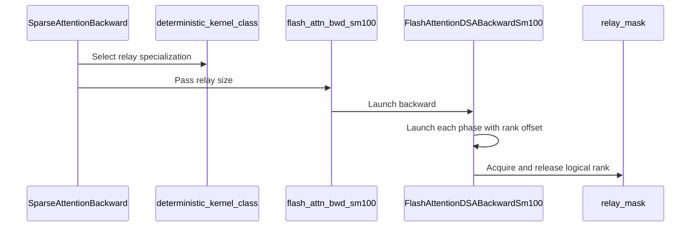

# feat(dsa): expose deterministic relay cluster size

[Upstream PR](https://github.com/NVIDIA/cudnn-frontend/pull/2082) · state: closed · merged: True

## Original PR description

## Before submitting

- [x] I agree to license this contribution under the terms of [LICENSE.txt](https://github.com/NVIDIA/cudnn-frontend/blob/develop/LICENSE.txt).
- [x] I ran `pre-commit run` and committed any formatting changes.
- [x] I reviewed the Hard Rules in the `AGENTS.md` for each directory this PR touches and the changes comply.
- [ ] I added GitHub labels: one `cat-*`, one or more `area:*` / `op:*`, and one `orig-*`.

## Affected area

- FE OSS kernels or CuTeDSL
- Python API or bindings
- Documentation or samples
- Benchmarks or performance

## Summary

- Add an optional `deterministic_relay_cluster_size` plan parameter for exact 4-, 8-, 16-, 32-, or 64-CTA logical SM100 large-context relays.
- Lower logical cluster-32/64 as two/four ordered 16-CTA physical-cluster phases, reducing scratch to four/two FP32 planes without cross-cluster residency waits.
- Preserve the automatic policy by default; it never selects 64. Invalid non-deterministic, non-generic, or non-relay requests fail instead of silently falling back.
- Thread the specialization through workspace sizing, compile/cache selection, execution, benchmark tooling, documentation, and CUDA Graph coverage.

## Why

Some CP64-sized workloads need a wider deterministic relay primarily to reduce scratch memory. SM100 hardware clusters contain at most 16 CTAs, so logical relay widths above 16 use same-stream physical phases. Kernel completion orders each phase before the next ranks reuse the plane; no CTA spins on a non-resident physical cluster.

The explicit option lets a framework choose the memory/performance point. Cluster-64 is a memory-first choice: it saves more scratch but is slower in the measured workloads, so automatic selection remains unchanged.

## Related issues

Follow-up to #2072.

## API and compatibility impact

Adds optional `deterministic_relay_cluster_size=None` at the end of the DSA backward plan and convenience-wrapper signatures. Accepted values are 4, 8, 16, 32, and 64 only for deterministic SM100 generic-M64 shapes that already select the large-context relay. `None` preserves existing selection, workspace, compilation, and execution behavior.

The value is plan-time state: it fixes the compiled artifact, workspace requirement, cache key, and CUDA Graph replay behavior. Cluster-32 and cluster-64 are logical relay sizes; they do not request unsupported 32- or 64-CTA hardware clusters.

## Testing

AIStudio SM100 environment, PyTorch 2.14.1+cu130, cuDNN 9.24.0, CuTe DSL 4.8.1:

- `pytest -q deepseek_sparse_attention/cutedsl/test_DSA_sparse_attention_backward.py -k 'relay_cluster_public_validation or relay_cluster_requires_deterministic or relay_acquire_load_controls_exit'`: 9 passed.
- `pytest -q -m L2 deepseek_sparse_attention/cutedsl/test_DSA_sparse_attention_backward.py -k 'explicit_relay_cluster_size or cluster64_repeat100'`: 6 passed; covers cluster 4/8/16/32/64 correctness, bitwise reuse, short-workspace/cache-key rejection, CUDA Graph replay, and 100 repeated cluster-64 executions.
- `pytest -q -m L2 deepseek_sparse_attention/cutedsl/test_DSA_sparse_attention_backward.py -k cluster32_repeat100`: 1 passed.
- A fresh cluster-64 compile with PTX retained: 1 passed. PTX contained one 64-bit mask setup atomic, four GPU-scope 64-bit release atomics, eight GPU-scope 64-bit acquire loads, eight relay CTA barriers, and no broad GPU membar.
- `pre-commit run --files <changed files>`, `python -m compileall`, and `git diff --check`: passed on the rebased head.

Compatibility audit: passed. Default `None`, all five explicit values, invalid values, non-deterministic/non-generic/non-relay rejection, exact and short workspace, cache separation, changed-input replay, and unchanged automatic policy were checked.

Docstring audit: passed for the plan constructor, workspace query, low-level SM100 entry, convenience wrapper, benchmark option, and execution/replay lifetime contract.

Fence audit: passed. The mask-setup-to-main-launch edge, reducer-GMEM-to-release edge, acquire-to-reducer edge, same-stream physical-phase ordering, and final fold/convert ordering were checked. No non-resident cross-cluster spin or broad GPU membar is introduced.

### SM100 BF16 benchmark

All rows use the same input generator and ten warm-ups; top-k 129 and 64 use 50 timed calls, while top-k 2048 uses 30.

| shape | top-k | logical CTAs/group | workspace GiB | latency ms | TFLOPS |
| --- | ---: | ---: | ---: | ---: | ---: |
| Q4096 / KV65537 / H64 / D512 | 129 | 16 | 1.033 | 2.095 | 82.64 |
| Q4096 / KV65537 / H64 / D512 | 129 | 32 | 0.533 | **2.050** | **84.47** |
| Q4096 / KV65537 / H64 / D512 | 129 | 64 | **0.283** | 3.478 | 49.78 |
| Q16384 / KV1048576 / H64 / D576 | 64 | 16 | 20.008 | 11.129 | 33.19 |
| Q16384 / KV1048576 / H64 / D576 | 64 | 32 | 11.008 | **8.258** | **44.73** |
| Q16384 / KV1048576 / H64 / D576 | 64 | 64 | **6.508** | 10.971 | 33.67 |
| Q16384 / KV1048576 / H64 / D576 | 2048 | 16 | 20.008 | 73.000 | 161.92 |
| Q16384 / KV1048576 / H64 / D576 | 2048 | 32 | 11.008 | **68.901** | **171.55** |
| Q16384 / KV1048576 / H64 / D576 | 2048 | 64 | **6.508** | 126.322 | 93.57 |

Compared with cluster-32, cluster-64 reduces the CP64-sized scratch by another 40.9% (`11.008 -> 6.508 GiB`), but regresses latency by 32.9% at top-k 64 and 83.3% at top-k 2048. Cluster-32 remains the practical memory/performance point; cluster-64 is available when the smaller allocation is more important than throughput.


<!-- This is an auto-generated comment: release notes by coderabbit.ai -->

<!-- coderabbit-ai-generated:v1 -->

## Summary by CodeRabbit

* **New Features**
  * Deterministic sparse attention backward now supports an optional relay cluster size of 4, 8, 16, 32, or 64. If omitted, the size is selected automatically.
  * Larger relay sizes are supported through multi-phase execution. Choosing a size may affect workspace requirements and is limited to deterministic execution on supported configurations.
  * Benchmark results now report the selected relay size and compare workspace use and latency across supported sizes.
* **Documentation**
  * Added guidance on relay-size eligibility, workspace requirements, and performance tradeoffs.

<!-- end of auto-generated comment: release notes by coderabbit.ai -->

## Review and discussion

### reviews

- Anerudhan · APPROVED · 2026-10-30T20:06:21Z · [source](https://github.com/NVIDIA/cudnn-frontend/pull/2082#pullrequestreview-5718052130)

**Codex bot review · model: `gpt-6-astra`**

Reviewed `05fe13bb6d0b` against base `6b21be0e01ff`.

Thank you for your contribution! No correctness finding. The 32/64-rank relays keep cross-phase ordering on one stream, with physical clusters capped at 16 CTAs. The explicit choice is carried through workspace sizing, compilation, caching and execution; the default policy is retained. Native validation passes at the scope below. Shared-path CI is pending.

Validation: Reviewed all nine changed files, including 64-bit mask addressing, acquire/release control flow, reducer-barrier participation, query/head/wave mapping, fixed-order finalization and public argument validation. Precheck returned no candidates; no consumed DSA contract changed in the newer base. Exact-source native SM100: 18 focused tests passed. These cover invalid values, deterministic-only requests, automatic policy and workspace selection, all five explicit relay widths, exact/short workspace handling, repeated outputs and CUDA Graph replay. Widths 32 and 64 each passed 100 repeated executions with overlapping rows. Additional native FP16/D576/H128 case with width 64 passed numerical reference checks, five repeated executions and graph replay. It exercises two head blocks, partial row overlap, no top-k-length buffer and a partial final query wave. A default bounded-wave control passed numerical checks, bitwise reuse and changed-length graph replay. The supplied relay graph tests also verify that replay consumes changed top-k lengths after scratch/output poisoning. Pipeline 77977667 is running python/misc for shared DSA regression coverage; all nine changed files match its integration. Docs passed; Style and Security were approved and are running. The new L2 relay cases were run locally; they are not assumed to run in the default CI selection.

Limitations: Current-head CI is pending. No sanitizer run was added, and the author's CP64-scale latency measurements were not independently repeated on the shared GPU. Repeatability was checked within each fixed configuration. This does not claim bitwise equality between relay widths; duplicate active top-k indices remain outside the documented deterministic contract.

Approved: no P0 or high-risk P1 found. Remaining findings stay with the owner; merge timing stays with the owner.

<!-- codex-fe-review:v2:2082:05fe13bb6d0b03487d4ac1ac20f1eb9d1e56f388:complete:no-blocker -->

### issue_comments

- coderabbitai[bot] · comment · 2026-10-30T09:44:11Z · [source](https://github.com/NVIDIA/cudnn-frontend/pull/2082#issuecomment-6519748170)

<!-- coderabbit-ai-generated:v1 -->

<!-- This is an auto-generated comment: summarize by coderabbit.ai -->
<!-- review_stack_entry_start -->

<a href="https://app.coderabbit.ai/change-stack/NVIDIA/cudnn-frontend/pull/2082?scope=ghh_OusAJGA4HG8ljoOV0wJvVx8NmnZIjc2DdjmxOu0xZWA&amp;cs_source=review_comment"><picture><source media="(prefers-color-scheme: dark)" srcset="https://storage.googleapis.com/coderabbit_public_assets/review-stack-in-coderabbit-ui-dark.svg?v=3"><source media="(prefers-color-scheme: light)" srcset="https://storage.googleapis.com/coderabbit_public_assets/review-stack-in-coderabbit-ui.svg?v=3"></picture></a>

<!-- review_stack_entry_end -->
<!-- recent_review_start -->

No actionable comments were generated in the recent review.

<details>
<summary><strong><picture></picture> Recent review info</strong></summary>
<dl>
<dd>

<!-- review_info_content -->
<details>
<summary><strong><picture><source media="(prefers-color-scheme: dark)" srcset="https://storage.googleapis.com/coderabbit_public_assets/review-comment-icons-v1/cog-dark.svg"></picture> Run configuration</strong></summary>
<dl>
<dd>

- **Source mode**: Auto
- **Repository**: [NVIDIA/cudnn-frontend](<https://github.com/NVIDIA/cudnn-frontend>)
- **Branch**: [develop](<https://github.com/NVIDIA/cudnn-frontend/tree/develop>)
- **File**: [.coderabbit.yaml](<https://github.com/NVIDIA/cudnn-frontend/blob/6b46e888e49e9fc282f38b6ef99f8169220ac681/.coderabbit.yaml>)
- **Commit**: [6b46e88](<https://github.com/NVIDIA/cudnn-frontend/commit/6b46e888e49e9fc282f38b6ef99f8169220ac681>)
- **Layers**: Repository YAML
- **Review profile**: CHILL
- **Plan**: Enterprise
- **Run ID**: `b40d089c-1bae-449e-9a78-01a8c9fc7cab`

</dd>
</dl>
</details>

<details>
<summary><strong><picture><source media="(prefers-color-scheme: dark)" srcset="https://storage.googleapis.com/coderabbit_public_assets/review-comment-icons-v1/git-commit-horizontal-dark.svg"></picture> Commits</strong></summary>
<dl>
<dd>

Reviewing files that changed from the base of the PR and between 6b46e888e49e9fc282f38b6ef99f8169220ac681 and 05fe13bb6d0b03487d4ac1ac20f1eb9d1e56f388.

</dd>
</dl>
</details>

<details>
<summary><strong><picture><source media="(prefers-color-scheme: dark)" srcset="https://storage.googleapis.com/coderabbit_public_assets/review-comment-icons-v1/file-plus-corner-dark.svg"></picture> Files selected for processing: 9</strong></summary>
<dl>
<dd>

* `benchmark/dsa/README.md`
* `benchmark/dsa/benchmark_dsa_sparse_attention_backward.py`
* `docs/operations/sparse_attention/dsa.md`
* `python/cudnn/deepseek_sparse_attention/sparse_attention_backward/_interface_sm100.py`
* `python/cudnn/deepseek_sparse_attention/sparse_attention_backward/_interface_sm100_common.py`
* `python/cudnn/deepseek_sparse_attention/sparse_attention_backward/api.py`
* `python/cudnn/deepseek_sparse_attention/sparse_attention_backward/dsa_bwd_sm100.py`
* `python/cudnn/deepseek_sparse_attention/sparse_attention_backward/dsa_bwd_sm100_deterministic.py`
* `test/python/deepseek_sparse_attention/cutedsl/test_DSA_sparse_attention_backward.py`

</dd>
</dl>
</details>

**Included review availability:** This review used your included allowance. Your plan provides up to 12 included reviews per hour; 11 remain after this review.

</dd>
</dl>
</details>


<!-- recent_review_end -->
<!-- walkthrough_start -->

<details>
<summary><strong>Walkthrough</strong></summary>
<dl>
<dd>

The deterministic SM100 sparse-attention backward path adds an optional relay cluster size of 4, 8, 16, 32, or 64 CTAs. The update adds cluster-32 and cluster-64 kernel specializations, multi-phase launches for larger clusters, plan and workspace integration, and benchmark and documentation updates.

**Changes: Deterministic relay sizing**

|Layer / File(s)|Summary|
|:---|:---|
|**Relay masks and specializations** <br> `python/cudnn/deepseek_sparse_attention/sparse_attention_backward/dsa_bwd_sm100_deterministic.py`, `test/python/deepseek_sparse_attention/cutedsl/test_DSA_sparse_attention_backward.py`|Relay masks support 32-bit and 64-bit words. Cluster-32 and cluster-64 specializations are registered, and selector tests cover supported sizes and invalid requests.|
|**Multi-phase backward launches** <br> `python/cudnn/deepseek_sparse_attention/sparse_attention_backward/dsa_bwd_sm100.py`, `test/python/deepseek_sparse_attention/cutedsl/test_DSA_sparse_attention_backward.py`|Backward launches run once per relay phase with a phase-specific rank offset. Tests exercise explicit sizes, repeated execution, and graph replay.|
|**Plan selection and workspace** <br> `python/cudnn/deepseek_sparse_attention/sparse_attention_backward/api.py`, `python/cudnn/deepseek_sparse_attention/sparse_attention_backward/_interface_sm100.py`, `python/cudnn/deepseek_sparse_attention/sparse_attention_backward/_interface_sm100_common.py`, `test/python/deepseek_sparse_attention/cutedsl/test_DSA_sparse_attention_backward.py`|The plan and SM100 interfaces accept and validate the relay-size option. Kernel selection, workspace sizing, execution, and the plan-cache key use the selected specialization.|
|**Benchmarking and documented options** <br> `benchmark/dsa/benchmark_dsa_sparse_attention_backward.py`, `benchmark/dsa/README.md`, `docs/operations/sparse_attention/dsa.md`|The benchmark accepts the option and includes its value in output. The documentation describes supported sizes, phases, workspace behavior, and benchmark measurements.|

<!-- change_assessment_start -->
<strong>Priority: <picture></picture> Normal</strong>

**Estimated code review effort:** 4 (Complex) | ~45 minutes

<!-- change_assessment_commit:"05fe13bb6d0b03487d4ac1ac20f1eb9d1e56f388" -->
**Change:** Feature
<!-- change_assessment_end -->

### Sequence Diagram(s)



**Suggested labels:** `cat-feature`, `mod-cutedsl`, `op: DSA`, `area:sparse_attention`

**Suggested reviewers:** `anerudhan`, `tongke6`, `yangxu1990uiuc`

</dd>
</dl>
</details>

<!-- walkthrough_end -->
<details>
<summary><strong>Merge Risk:</strong> <strong><picture></picture> Minimal</strong> · up to <code>05fe1</code></summary>
<dl>
<dd>

<!-- final_review_risk_start -->
<!-- final_review_risk_label
**Merge Risk:** **⚪ Minimal** · up to `05fe1`
-->
<!-- final_review_risk_coverage:{"sourceCommitId":"05fe13bb6d0b03487d4ac1ac20f1eb9d1e56f388","coveredCommitId":"05fe13bb6d0b03487d4ac1ac20f1eb9d1e56f388","kind":"reviewed"} -->

No actionable issue is established from the available evidence; the change is ready for normal merge checks.
<!-- final_review_risk_end -->

</dd>
</dl>
</details>
<!-- pre_merge_checks_walkthrough_start -->

<details>
<summary><strong>Pre-merge checks: <sup><picture></picture></sup> 5</strong></summary>
<dl>
<dd>

|         Check name         |                                             Status                                             | Explanation                                                                                                                                                                                               |
| :------------------------ | :--------------------------------------------------------------------------------------------: | :-------------------------------------------------------------------------------------------------------------------------------------------------------------------------------------------------------- |
|         Title check        |  | The title clearly and concisely describes the main change: exposing the deterministic relay cluster size for DSA.                                                                                         |
|      Description check     |  | The description follows the required template and provides affected areas, change summary, rationale, related issue, API and compatibility impact, detailed testing, benchmarks, and validation results.… |
|     Docstring Coverage     |  | Docstring coverage is 92.59% which is sufficient. The required threshold is 80.00%. Docstring coverage is scoped to functions touched by this diff with cyclomatic complexity of at least 2. Documentati… |
|     Linked Issues check    |  | Check skipped because no linked issues were found for this pull request.                                                                                                                                  |
| Out of Scope Changes check |  | Check skipped because no linked issues were found for this pull request.                                                                                                                                  |

<details>
<summary><strong>Full details: Description check</strong></summary>
<dl>
<dd>

**Explanation**

The description follows the required template and provides affected areas, change summary, rationale, related issue, API and compatibility impact, detailed testing, benchmarks, and validation results. The GitHub labels checklist remains unchecked, but this is a non-critical omission for the description check.

</dd>
</dl>
</details>

<details>
<summary><strong>Full details: Docstring Coverage</strong></summary>
<dl>
<dd>

**Explanation**

Docstring coverage is 92.59% which is sufficient. The required threshold is 80.00%. Docstring coverage is scoped to functions touched by this diff with cyclomatic complexity of at least 2. Documentation-only edits and deletions within surviving functions are included; unchanged diff context and fully deleted functions are excluded. Analyzed 27 functions across 7 files. (2 skipped: 2 unsupported.)

</dd>
</dl>
</details>

</dd>
</dl>
</details>

<!-- pre_merge_checks_walkthrough_end -->
<!-- finishing_touch_checkbox_start -->

<details>
<summary><strong>Finishing Touches: 💡 1</strong></summary>
<dl>
<dd>

<!-- finishing_touch_suggestion:fix_ci -->
<details open>
<summary><strong>🛠️ Fix failing CI checks: 💡</strong></summary>
<dl>
<dd>

- [ ] <!-- {"checkboxId": "9f0d24fb-b419-4f01-baf0-8b26b6424f34", "radioGroupId": "fix-ci-output-choice-group-unknown_comment_id"} --> Commit to this branch
- [ ] <!-- {"checkboxId": "6d21cfe8-ec3f-40e2-9222-b8318b64d3b0", "radioGroupId": "fix-ci-output-choice-group-unknown_comment_id"} --> Create a new PR

</dd>
</dl>
</details>
<details open>
<summary><strong>🧪 Generate unit tests (beta)</strong></summary>
<dl>
<dd>

- [ ] <!-- {"checkboxId": "f47ac10b-58cc-4372-a567-0e02b2c3d479", "radioGroupId": "utg-output-choice-group-unknown_comment_id"} --> Create a new PR

</dd>
</dl>
</details>

</dd>
</dl>
</details>

<!-- finishing_touch_checkbox_end -->

<!-- autopilot:start -->
- [ ] <!-- {"checkboxId":"2708ad07-9f24-4260-9c11-7dc76a49f2e3"} --> <strong title="Keep fixing CodeRabbit findings and required CI, and resolving merge conflicts">Autofix</strong> · Keep fixing CodeRabbit findings and required CI, and resolving merge conflicts
<!-- autopilot:end -->
<!-- tips_start -->


<sub>Comment `@coderabbitai help` to get the list of available commands.</sub>

<!-- tips_end -->

- YangXu1990uiuc · comment · 2026-10-30T12:02:41Z · [source](https://github.com/NVIDIA/cudnn-frontend/pull/2082#issuecomment-6522254588)

Thank you for the follow-up to #2072! Making the relay workspace/latency trade-off explicit looks useful for memory-constrained long-context workloads. I have added this PR to the external-contribution tracking list.

When you feel the scope is ready, please leave a comment saying **ready**. The review bot can then review it, and we will help work through feedback, native SM100 validation, CI and final integration toward merge; you do not need merge permission yourself. The logical 32/64-CTA phase ordering, workspace/cache separation and changed-input graph replay will need to be covered independently, alongside the existing default policy.

<!-- fe-external-watch:ready-invite:2082 -->


- Anerudhan · comment · 2026-10-30T20:02:30Z · [source](https://github.com/NVIDIA/cudnn-frontend/pull/2082#issuecomment-6532351804)

Requesting `python/misc` for `05fe13bb6d0b` to check shared DSA paths. Local native SM100 validation passed all five explicit relay widths, the 32/64-width repeat and graph cases, and an additional FP16/D576 two-head-block case. The new relay tests are marked L2, so this CI request complements those local checks.

Codex bot review — model `gpt-6-astra`.

<!-- codex-fe-ci:v1:2082:05fe13bb6d0b03487d4ac1ac20f1eb9d1e56f388:request-relay-regression-validation-notice -->

- Anerudhan · comment · 2026-10-30T20:03:03Z · [source](https://github.com/NVIDIA/cudnn-frontend/pull/2082#issuecomment-6532361373)

@cudnn-ci-bot run python/misc

- cudnn-ci-bot · comment · 2026-10-30T20:03:07Z · [source](https://github.com/NVIDIA/cudnn-frontend/pull/2082#issuecomment-6532362559)

🏁 Pipeline finished

SHA: `05fe13b`
Targets: `python/misc`
Branch: [cudnn-gh/pr-2082-05fe13b](https://nv/cudnn-gitlab-ci/-/tree/cudnn-gh/pr-2082-05fe13b)
Pipeline: [77977667](https://nv/cudnn-gitlab-ci/-/pipelines/77977667)
Last updated: 2026-10-30 20:20 UTC

**23 passed, 5 failed, 12 manual**

### <code>manual</code>

- <code>manual:python_samples</code> - Manual
- <code>manual:python/sdpa/frost</code> - Manual
- <code>manual:python/sdpa/misc</code> - Manual
- <code>manual:python/linear_attention</code> - Manual
- <code>manual:python/gemm/frost</code> - Manual
- <code>manual:python/gemm/cutedsl</code> - Manual
- <code>manual:python/gemm/misc</code> - Manual
- <code>manual:python/conv</code> - Manual
- <code>manual:python/norm</code> - Manual
- <code>manual:python/misc</code> - ✅ Passed
- <code>manual:pycudnn</code> - Manual
- <code>manual:multi_gpu</code> - Manual
- <code>manual:backend</code> - Manual

### <code>analysis</code>

- <code>analysis:cudnn_clang_disable_exception</code> - ✅ Passed
- <code>analysis:cudnn_v9_no_half_conversion</code> - ✅ Passed
- <code>analysis:cudnn_clang</code> - ✅ Passed
- <code>analysis:check-relative-includes</code> - ✅ Passed
- <code>analysis:check-CUDNN_FRONTEND_SKIP_JSON_LIB</code> - ✅ Passed
- <code>analysis:guardwords_scan</code> - ✅ Passed
- <code>analysis:jax-import-guard</code> - ✅ Passed
- <code>analysis:pytest-gpu</code> - ✅ Passed
- <code>san:build</code> - ✅ Passed

### <code>build</code>

- <code>analysis:api_index</code> - ✅ Passed
- <code>build:dev:linux:amd64</code> - ✅ Passed
- <code>build:rel:linux:amd64</code> - ✅ Passed
- <code>build:dev:linux:arm64</code> - ✅ Passed
- <code>build:rel:linux:arm64</code> - ✅ Passed
- <code>build:rel:win:amd64</code> - ✅ Passed

### <code>python/misc</code>

- <code>python/misc:be-9.27.0-cutedsl-4.8.0:sm80</code> - ✅ Passed
- <code>python/misc:be-9.27.0-cutedsl-4.8.0:sm90</code> - ✅ Passed
- <code>python/misc:be-9.27.0-cutedsl-4.8.0:sm100</code> - ❌ **Failed** (nightly unknown)
- <code>python/misc/frost:be-9.27.0-cutedsl-4.8.0:sm100</code> - ✅ Passed
- <code>python/misc/cutedsl:be-9.27.0-cutedsl-4.8.0:sm80</code> - ❌ **Failed** (nightly unknown)
- <code>python/misc/cutedsl:be-9.27.0-cutedsl-4.8.0:sm90</code> - ❌ **Failed** (nightly unknown)
- <code>python/misc/cutedsl:be-9.27.0-cutedsl-4.8.0:sm100</code> - ❌ **Failed** (nightly unknown)
- <code>python/misc/cutedsl:be-9.27i-cutedsl-4.8.0:sm107</code> - ❌ **Failed** (nightly unknown)

### <code>sanitizer_tests</code>

- <code>san:cpp_test:sm80</code> - ✅ Passed
- <code>san:cpp_test:sm90</code> - ✅ Passed
- <code>san:cpp_test:sm100</code> - ✅ Passed

### <code>triage</code>

- <code>triage:ai</code> - ✅ Passed

- Anerudhan · comment · 2026-10-30T20:22:00Z · [source](https://github.com/NVIDIA/cudnn-frontend/pull/2082#issuecomment-6532692249)

Pipeline **77977667** finished with failures outside the changed DSA path. The affected backward suite has **247 passed / 19 skipped on SM100**, **139 passed / 127 skipped on SM90**, and **174 passed / 92 skipped on SM107**, with no failures. The new public validation cases passed. The new L2 relay execution cases were not collected by this CI run; the native results in my review cover those separately.

The inspected failures concern BSA dispatch expectations, triangle attention/update tests, and native graph normalization lowering. All nine changed files match the CI integration. Docs, Style and Security passed.

Codex bot review — model `gpt-6-astra`.

<!-- codex-fe-ci:v1:2082:05fe13bb6d0b03487d4ac1ac20f1eb9d1e56f388:pipeline-77977667-finished -->

- 0z5a · comment · 2026-10-31T19:51:51Z · [source](https://github.com/NVIDIA/cudnn-frontend/pull/2082#issuecomment-6548342043)

An SM103 data point (B300), since DSA training now serves cc 10.3 (#2101, #2110).

This head (`05fe13bb`) branches from before #2110. Its DSA backward hardware cases therefore still require exactly `(10, 0)`, and on SM103 they skip: 314 passed, 62 skipped, with 43 of those skips "SM100 (10, 0) GPU required". I merged develop into it locally; the merge was clean. Then:

```
python -m pytest -m "L0 or L1 or L2" deepseek_sparse_attention/cutedsl/test_DSA_sparse_attention_backward.py
```

Result: 384 passed, 19 skipped (all "SM90 GPU required"). All 14 relay cases this PR adds pass, including the five L2 `test_DSA_sparse_attention_backward_sm100_explicit_relay_cluster_size[cluster4|8|16|32|64]` runs. For reference, develop alone on the same part gives 349 passed, 19 skipped under `-m "L0 or L1"`.

Setup: cuDNN 9.27.0.42, CuTeDSL 4.8.1, torch 2.14.1+cu130.


### inline_comments

## Changed files and fixed code

- `benchmark/dsa/README.md` · modified · additions 39 / deletions 0
  - [head](https://github.com/icavan/cudnn-frontend/blob/05fe13bb6d0b03487d4ac1ac20f1eb9d1e56f388/benchmark/dsa/README.md)
  - [base](https://github.com/NVIDIA/cudnn-frontend/blob/6b46e888e49e9fc282f38b6ef99f8169220ac681/benchmark/dsa/README.md)
- `benchmark/dsa/benchmark_dsa_sparse_attention_backward.py` · modified · additions 15 / deletions 1
  - [head](https://github.com/icavan/cudnn-frontend/blob/05fe13bb6d0b03487d4ac1ac20f1eb9d1e56f388/benchmark/dsa/benchmark_dsa_sparse_attention_backward.py)
  - [base](https://github.com/NVIDIA/cudnn-frontend/blob/6b46e888e49e9fc282f38b6ef99f8169220ac681/benchmark/dsa/benchmark_dsa_sparse_attention_backward.py)
- `docs/operations/sparse_attention/dsa.md` · modified · additions 27 / deletions 5
  - [head](https://github.com/icavan/cudnn-frontend/blob/05fe13bb6d0b03487d4ac1ac20f1eb9d1e56f388/docs/operations/sparse_attention/dsa.md)
  - [base](https://github.com/NVIDIA/cudnn-frontend/blob/6b46e888e49e9fc282f38b6ef99f8169220ac681/docs/operations/sparse_attention/dsa.md)
- `python/cudnn/deepseek_sparse_attention/sparse_attention_backward/_interface_sm100.py` · modified · additions 33 / deletions 7
  - [head](https://github.com/icavan/cudnn-frontend/blob/05fe13bb6d0b03487d4ac1ac20f1eb9d1e56f388/python/cudnn/deepseek_sparse_attention/sparse_attention_backward/_interface_sm100.py)
  - [base](https://github.com/NVIDIA/cudnn-frontend/blob/6b46e888e49e9fc282f38b6ef99f8169220ac681/python/cudnn/deepseek_sparse_attention/sparse_attention_backward/_interface_sm100.py)
- `python/cudnn/deepseek_sparse_attention/sparse_attention_backward/_interface_sm100_common.py` · modified · additions 22 / deletions 2
  - [head](https://github.com/icavan/cudnn-frontend/blob/05fe13bb6d0b03487d4ac1ac20f1eb9d1e56f388/python/cudnn/deepseek_sparse_attention/sparse_attention_backward/_interface_sm100_common.py)
  - [base](https://github.com/NVIDIA/cudnn-frontend/blob/6b46e888e49e9fc282f38b6ef99f8169220ac681/python/cudnn/deepseek_sparse_attention/sparse_attention_backward/_interface_sm100_common.py)
- `python/cudnn/deepseek_sparse_attention/sparse_attention_backward/api.py` · modified · additions 49 / deletions 4
  - [head](https://github.com/icavan/cudnn-frontend/blob/05fe13bb6d0b03487d4ac1ac20f1eb9d1e56f388/python/cudnn/deepseek_sparse_attention/sparse_attention_backward/api.py)
  - [base](https://github.com/NVIDIA/cudnn-frontend/blob/6b46e888e49e9fc282f38b6ef99f8169220ac681/python/cudnn/deepseek_sparse_attention/sparse_attention_backward/api.py)
- `python/cudnn/deepseek_sparse_attention/sparse_attention_backward/dsa_bwd_sm100.py` · modified · additions 68 / deletions 56
  - [head](https://github.com/icavan/cudnn-frontend/blob/05fe13bb6d0b03487d4ac1ac20f1eb9d1e56f388/python/cudnn/deepseek_sparse_attention/sparse_attention_backward/dsa_bwd_sm100.py)
  - [base](https://github.com/NVIDIA/cudnn-frontend/blob/6b46e888e49e9fc282f38b6ef99f8169220ac681/python/cudnn/deepseek_sparse_attention/sparse_attention_backward/dsa_bwd_sm100.py)
- `python/cudnn/deepseek_sparse_attention/sparse_attention_backward/dsa_bwd_sm100_deterministic.py` · modified · additions 102 / deletions 21
  - [head](https://github.com/icavan/cudnn-frontend/blob/05fe13bb6d0b03487d4ac1ac20f1eb9d1e56f388/python/cudnn/deepseek_sparse_attention/sparse_attention_backward/dsa_bwd_sm100_deterministic.py)
  - [base](https://github.com/NVIDIA/cudnn-frontend/blob/6b46e888e49e9fc282f38b6ef99f8169220ac681/python/cudnn/deepseek_sparse_attention/sparse_attention_backward/dsa_bwd_sm100_deterministic.py)
- `test/python/deepseek_sparse_attention/cutedsl/test_DSA_sparse_attention_backward.py` · modified · additions 178 / deletions 4
  - [head](https://github.com/icavan/cudnn-frontend/blob/05fe13bb6d0b03487d4ac1ac20f1eb9d1e56f388/test/python/deepseek_sparse_attention/cutedsl/test_DSA_sparse_attention_backward.py)
  - [base](https://github.com/NVIDIA/cudnn-frontend/blob/6b46e888e49e9fc282f38b6ef99f8169220ac681/test/python/deepseek_sparse_attention/cutedsl/test_DSA_sparse_attention_backward.py)

## Evidence and interpretation boundary

[Original JSON, discussions and patches](../../../../../../evidence/prs/NVIDIA--cudnn-frontend/2082-dda5b36524b4c48bf29db60d9e2f0045e3a8b115a9f7adae4a659261fe12cce1.json) · SHA-256 `dda5b36524b4c48bf29db60d9e2f0045e3a8b115a9f7adae4a659261fe12cce1`.

Diff complete: True. Missing/binary/truncated patches require pinned source inspection. This is a source page, not an independently verified optimization case. Open, merged and released are different states; recheck the deployed dependency.
