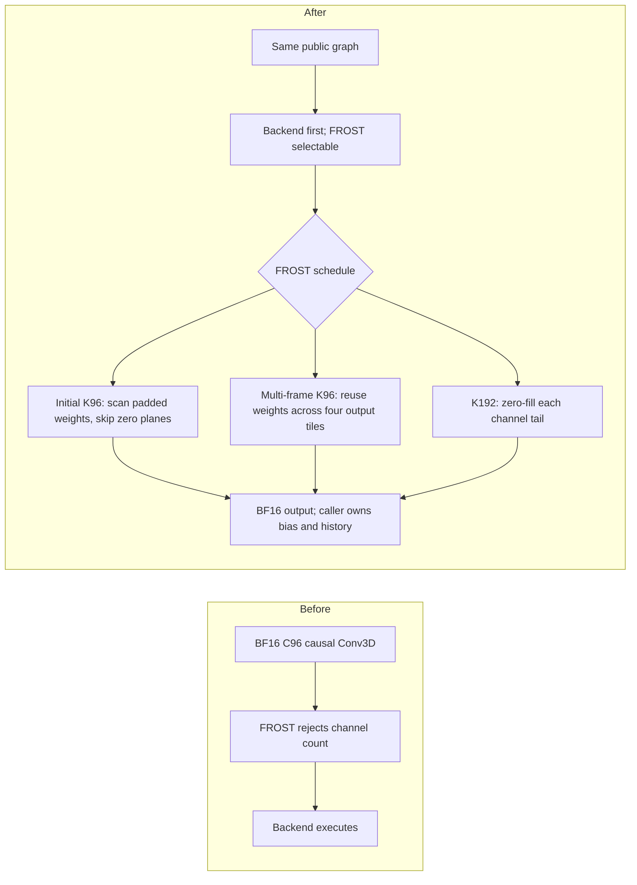
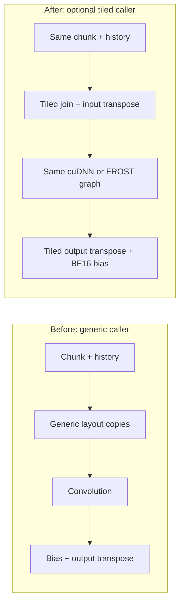
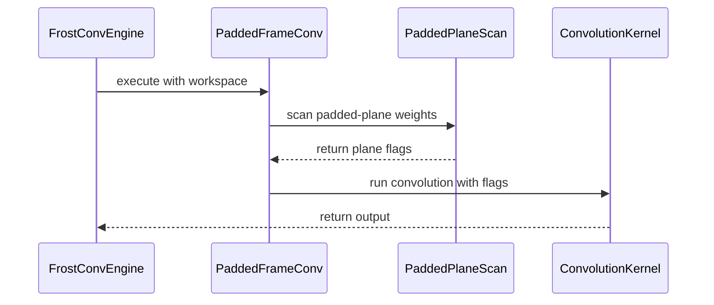

# Add SM100 C96 causal Conv3D support to FROST

[Upstream PR](https://github.com/NVIDIA/cudnn-frontend/pull/2089) · state: open · merged: False

## Original PR description

## Before submitting

- [x] I agree to license this contribution under the terms of [LICENSE.txt](https://github.com/NVIDIA/cudnn-frontend/blob/develop/LICENSE.txt).
- [x] I ran `pre-commit run` and committed any formatting changes.
- [x] I reviewed the Hard Rules in the `AGENTS.md` for each directory this PR touches (see [root AGENTS.md § Reviewing a PR](https://github.com/NVIDIA/cudnn-frontend/blob/develop/AGENTS.md#reviewing-a-pr-human-or-agent)) and my changes comply, or I explain the exception below.
- [x] I added GitHub labels: one `cat-*`, one or more `area:*` / `op:*`, and one `orig-*`.

## Affected area

FE OSS kernels / CuTeDSL: dense forward Conv3D on SM100, with tests and a causal-chunk example.

## Summary

### Human Reviewers

BF16 C96 causal 3×3×3 convolutions can now run through FROST with K96 or K192. Previously, FROST rejected their partial 64-channel reduction tile. Inputs and weights retain compact C96 storage.



On the tested DRIVE P2021 SM100, prepared convolution beats the retained cuDNN engine-73 CUTLASS3x plans on all 12 frozen encoder rows. The equal-row geometric-mean latency ratios are **0.8123 (cu12)** and **0.8035 (cu13)** with CuTe DSL 4.9.0a0 prerelease. Initial-frame timing includes the weight scan.

The optional tiled caller reduces complete-operation latency by **11.1% (cu12)** and **11.5% (cu13)** versus cuDNN using the same conversions. Complete ratios are **0.8893** and **0.8853**; graph-replay ratios are **0.8658** and **0.8591**. Both meet the original aggregate target. The smallest K192 eager call still regresses, so backend-first placement remains appropriate. These results do not establish B200 or whole-encoder speedups.

Compared with the measured C128 workaround, native C96's prepared ratios are **0.5261 (cu12)** and **0.5227 (cu13)**; complete ratios are **0.2954** and **0.2940**. Complete-operation gains include differences in caller implementation: the workaround retains separate concatenation, padding and layout conversion. A fused C128 caller could reduce that overhead.



Both providers use identical caller conversions. Allocations remain outside `graph.execute()`, and bias remains after BF16 convolution rounding.

The original convolution validation passed 312 regression cases, 25 sanitizer cases per tool, and 352 exact pretrained-encoder comparisons. The caller follow-up passes 102 C96/caller tests and 25 caller cases under each sanitizer with zero errors. A full-encoder run with the tiled prototype failed some 256² cache comparisons; a fresh diagnostic run was exact, including 60 same-input old/new caller comparisons. That process-to-process difference remains unresolved.

CuTe DSL 4.9.0a0 prerelease cu12 and cu13 each pass 108 checks, including all 77 dense C96 cases; two rejection-only cases skip. No API shim or version-gate change was needed. These runs use PyTorch/cuDNN from a CUDA 13 stack and qualify the CuTe compiler flavors on the tested SM100 setup. Public 4.8.1 still rejects dense C96.

The #2107 integration keeps BF16 C96 limited to SM100 and uses the device-aware compilation cache for both launch paths. It passes 353 regression tests per compiler; 48 affected checks also pass at the final documentation-only head.

### Agent Reviewers

#### Revision and contract

Target: `NVIDIA/cudnn-frontend:develop`, base `a0f7b9f4e8e311f7f9decc41f33d68941cb37c4b`, head `0dac31c07af0271f9d4020d23c6ba28ee138b4e7`, branch `yeliu/frost-c96-causal-conv3d-pr`. The eleven-file diff includes the C96 implementation, caller example, dependency gates, and architecture/compiler regressions.

Merged current `develop`, including #2107. Both C96 compile branches now use its device/target-aware cache, device context, and explicit GPU target. BF16 C96 remains restricted to SM100; existing SM103 support is preserved. The integration has executed cu12/cu13 regression coverage below. Performance tables remain measurements of `fafa9cb212ccc7fadea24a45cbd2fec62c25f39a`; they were not rerun for this follow-up.

The added envelope is dense inference forward, SM100, BF16 image/weight/output, FP32 accumulation, C96, K96 or K192, one group, 3×3×3 filter, unit stride/dilation, pre-padding `(0|1|2,1,1)`, post-padding `(0,1,1)`, and no fused pointwise epilogue. Existing compact channels-last layout, alignment and geometry requirements apply. Tensor dimensions remain logical NCDHW/KCTRS. The dense runtime gate requires CuTe DSL 4.9 or a compatible internal build. Block-scaled C96 support is not added.

#### Implementation and invariants

- `FrostConvEngine.check_support` admits the bounded C96 envelope. The family heuristic uses the established backend placement marker, retaining previous supported-shape ordering, including FLOAT C96. Explicit selection and `OPENSOURCE` queries expose the new path.
- `sm100_conv.compile` tiles the input-channel dimension separately at each filter position: K96 uses three C32 tiles; K192 uses two C64 tiles. Each pipeline tile covers one filter position. TMA zero-fills the second C64 tile's final 32 lanes; input and weight storage remains compact C96. Logical tensor dimensions and caller layout requirements are unchanged.
- Initial-frame K96 scans the two fully padded temporal weight planes. A nonfinite weight sets its output-channel flag because `0 × NaN/Inf` contributes NaN. The convolution omits those planes and applies the flag in its epilogue. This preserves value-level exceptional behavior, without promising NaN payload or signed-zero identity.
- `_PaddedFrameConv` holds compiled launchables and owns no device scratch. Its 96 int32 flags use 384 bytes of caller workspace, refreshed on every execute/replay. The plan rejects observable wrong-device storage, insufficient capacity, misalignment and operand overlap before launch. Concurrent calls need separate workspaces; bare addresses retain the caller-owned placement/capacity contract.
- The multi-frame K96 two-CTA schedule loads one weight tile for four adjacent output tiles. Each output keeps its own accumulator and reduction order. Producer byte counts, accumulator phases and the final drain cover all four outputs. This schedule requires no additional caller workspace. K192 and other supported geometries retain one output tile per work item; four-output weight reuse applies only to the qualified multi-frame K96 schedule.

The existing engine/template boundary contains these changes. A separate C96 kernel would duplicate scheduling, barriers and epilogues. Padding to C128 was measured as a control and adds conversion/reduction work. A new generic cache or schedule interface is unnecessary for this scope.

Compilation resolves `(device, gpu_arch)` before entering `_compile_cached`. Occupancy queries and both the padded-plane scan/convolution path and the ordinary convolution path compile inside `device_context(device)` with an explicit `--gpu-arch`. The C96 host regressions model two SM100 device ordinals and verify separate artifacts, reuse on return, the active compilation context, and caller-context restoration. These are host contract checks, not physical multi-GPU qualification.

#### Original numerical and execution validation

The original results below predate the #2107 integration. Their evidence records source hashes, extension hash, hardware, runtime, and harness hashes; current integration validation is listed separately below.

Results: **312 passed** across Conv3D, workspace-capacity and kernel-symbol tests; **25 passed / zero errors** under each of memcheck and synccheck. The four L0 cases cover initial-frame workspace placement through mapping/ordered APIs and K96/K192 stream rebinding/capture. The K96 replay shape `(1,96,3,7,9)` has implicit M=189, selecting the two-CTA four-output schedule. Replay changes both image and weight contents.

The safe workspace regression records would-be launches: both mapping and ordered cases failed before the guard and passed afterward. The original architecture controls tested the earlier exact-SM100 family gate. The follow-up replaces that assumption with a C96-specific SM100 guard and preserves existing BF16 C128 and FLOAT C96 admission on modeled SM103.

The broader suite covers channel tails, odd spatial shapes, multiple batches, persistent scheduling, nonintegral values, separate BF16 bias, future-frame perturbations, history transitions/reset, NaN/±Inf flags, workspace bounds/aliasing, separate capture workspaces and unsupported envelopes. Existing supported dtype/channel routes also pass.

Cosmos is pinned at `1a2f03ab6111b457633827736f94f67d55bd5202`; the Wan2.1 VAE checkpoint revision is `37ec512624d61f7aa208f7ea8140a131f93afc9a`, SHA256 `38071ab59bd94681c686fa51d75a1968f64e470262043be31f7a094e442fd981`. Strict weight loading passes. Seeded nine-frame clips at 256² and 512² use the original 1+4+4 schedule. Five encoder convolution modules select FROST. All 352 comparisons of chunk outputs, caches, final latents and contaminated-cache resets have max absolute error zero. The oracle rejects shape mismatches/nonfinite values and retains fixed BF16 `atol=rtol=0.015625`.

#### Review follow-up validation

The merged implementation at `5d1b06f030af06cf93c357ed77717cfd808d283f` passes **353 tests with 2 expected skips per compiler** on DRIVE P2021 SM100, using CuTe DSL 4.9.0a0 prerelease cu12 and cu13 and freshly rebuilt frontend bindings. The skips are rejection-only tests for an older installed DSL. This covers the full L0/L1 convolution suite, kernel-symbol checks, and workspace-capacity tests:

```bash
python -X faulthandler -m pytest -q -rA -m 'L0 or L1' conv/frost core/frost/test_frost_kernel_name_prefix.py core/frost/test_workspace_capacity.py
```

The 12 new host cases check C96 admission and the initial/multi-frame K96/K192 compile paths. Reintroducing the missing architecture guard and compilation context in memory produces the six expected failures. The final documentation commit preserves executable ASTs. The final head additionally passes 48 affected compiler, nonfinite, capture, and caller-layout checks per compiler, with no skips.

No SM103 C96 execution or new performance qualification is claimed. CodeRabbit's documentation warning is addressed with docstrings for the changed functions and test invariants.

#### Performance with CuTe DSL 4.9 prerelease cu12 and cu13

Hardware/software: NVIDIA DRIVE P2021 SM100, 68 SMs; driver 595.71.05; Python 3.12.13; PyTorch 2.14.1+cu130; cuDNN 9.24.0.43. Both runs use CuTe DSL 4.9.0a0 prerelease with matching base/core/compiler packages. The loaded cu12 compiler reports CUDA 12.9; cu13 reports CUDA 13.4. No B200 measurements or public PyPI 4.9 release qualification are claimed.

Both performance runs execute the prior head `fafa9cb212ccc7fadea24a45cbd2fec62c25f39a`. They retain all seven routes on the same 12 frozen pretrained encoder calls. Timing uses nine alternating CUDA-event batches, targeting 200 ms per route. One-time weight packing, compilation and plan search are excluded. Complete calls include per-call allocations, validation, history assembly, layout work, convolution, separate BF16 bias and next-history copies. Graph replay excludes capture construction. Prepared timing includes every FROST kernel, including initial-frame flag generation.

Every row has equal aggregate weight. The 95% bootstrap intervals use 10,000 independent batch resamples within each fixed row. They describe within-run variation, not deployment uncertainty. The original target requires a complete-call point estimate at most 0.90 and an upper interval below 1.0.

| Compiler | Prepared C96 / CUTLASS (95% CI) | Complete C96 / best alternative (95% CI) | Graph replay ratio (95% CI) | Complete target |
|---|---|---|---|---|
| cu12 | 0.8123 [0.8108, 0.8129] | 0.8893 [0.8884, 0.8901] | 0.8658 [0.8657, 0.8662] | Passed |
| cu13 | 0.8035 [0.8028, 0.8041] | 0.8853 [0.8847, 0.8858] | 0.8591 [0.8589, 0.8592] | Passed |

The CUTLASS baseline is the fastest measured supported engine-73 plan offered by cuDNN heuristic modes A/B/FALLBACK under a 1-GiB workspace limit. A separate kernel-only sweep confirmed the same winners in all 12 direct-asymmetric and 12 explicit-padding comparisons. This is not an exhaustive tuning-knob search or proof of the fastest possible cuDNN kernel. Both 4.9 runs reuse and numerically revalidate those exact plans.

The selected K96 plan is `eng73_k13=3_k17=1_k27=8_k28=1_k37=1_k38=1_k40=4_k41=3`. Its observed kernel symbol is:

```text
cutlass3x_sm100_tensorop_s256x128x16implicit_gemm_fprop_bf16_bf16_f32_void_bf16_f32_256x128x64_dyn_cga_ndhwc_ndhwc_ndhwc_align8_2sm_relu_valpha_stream_k
```

K192 uses `eng73_k13=3_k17=1_k27=2_k28=1_k37=1_k38=0_k40=4_k41=4`, mapped to the 256×256×64 non-Stream-K CUTLASS3x variant. Profiling matched all 24 route/row plan bindings to actual CUDA symbols. Engine number alone does not identify the kernel.

X is the current chunk before history concatenation, in logical `[N,C,D,H,W]` order. History assembly gives depth `D + history` before explicit zero padding. Video frame indices are zero-based. Rows c96-01–06 come from the 256×256 nine-frame encoder run; c96-07–12 come from the 512×512 run. Each row reuses its captured values across implementations and repetitions.

The C128 workaround zero-pads input and weight channels from 96 to 128, keeps K unchanged, and executes FROST. Its complete call retains separate concatenation, padding and layout conversion. Native C96 uses the shared tiled caller. A fused C128 caller could reduce the measured complete-operation gap. All ratios are latency ratios; values below one favor native C96 FROST.

**cu13: prepared convolution**

| Row | Current X [N,C,D,H,W] | Video chunk | History | K | CUTLASS3x µs | C96 FROST µs | C96 / CUTLASS | C128 FROST µs | C96 / C128 |
|---|---|---|---:|---:|---:|---:|---:|---:|---:|
| c96-01 | `[1,96,1,256,256]` | Frame 0 | 0 | 96 | 116.53 | 70.41 | 0.6042 | 174.51 | 0.4035 |
| c96-02 | `[1,96,1,128,128]` | Frame 0 | 0 | 192 | 58.89 | 47.24 | 0.8021 | 61.22 | 0.7716 |
| c96-03 | `[1,96,4,256,256]` | Frames 1–4 | 1 | 96 | 482.85 | 432.51 | 0.8957 | 997.12 | 0.4338 |
| c96-04 | `[1,96,4,128,128]` | Frames 1–4 | 1 | 192 | 209.61 | 181.20 | 0.8645 | 268.23 | 0.6755 |
| c96-05 | `[1,96,4,256,256]` | Frames 5–8 | 2 | 96 | 487.00 | 441.30 | 0.9062 | 1045.67 | 0.4220 |
| c96-06 | `[1,96,4,128,128]` | Frames 5–8 | 2 | 192 | 210.00 | 183.81 | 0.8753 | 278.03 | 0.6611 |
| c96-07 | `[1,96,1,512,512]` | Frame 0 | 0 | 96 | 441.04 | 225.12 | 0.5104 | 646.10 | 0.3484 |
| c96-08 | `[1,96,1,256,256]` | Frame 0 | 0 | 192 | 208.69 | 165.01 | 0.7907 | 218.64 | 0.7547 |
| c96-09 | `[1,96,4,512,512]` | Frames 1–4 | 1 | 96 | 1875.88 | 1649.43 | 0.8793 | 3969.38 | 0.4155 |
| c96-10 | `[1,96,4,256,256]` | Frames 1–4 | 1 | 192 | 777.98 | 682.69 | 0.8775 | 1089.33 | 0.6267 |
| c96-11 | `[1,96,4,512,512]` | Frames 5–8 | 2 | 96 | 1889.88 | 1675.32 | 0.8865 | 4137.99 | 0.4049 |
| c96-12 | `[1,96,4,256,256]` | Frames 5–8 | 2 | 192 | 778.30 | 685.91 | 0.8813 | 1163.31 | 0.5896 |

**cu13: complete causal operation**

| Row | Current X [N,C,D,H,W] | Video chunk | History | K | Tiled cuDNN ms | Tiled C96 FROST ms | C96 / cuDNN | C128 workaround ms | C96 / C128 |
|---|---|---|---:|---:|---:|---:|---:|---:|---:|
| c96-01 | `[1,96,1,256,256]` | Frame 0 | 0 | 96 | 0.1679 | 0.1283 | 0.7640 | 0.4581 | 0.2800 |
| c96-02 | `[1,96,1,128,128]` | Frame 0 | 0 | 192 | 0.1012 | 0.1145 | 1.1320 | 0.1689 | 0.6781 |
| c96-03 | `[1,96,4,256,256]` | Frames 1–4 | 1 | 96 | 0.7258 | 0.6727 | 0.9269 | 2.4893 | 0.2702 |
| c96-04 | `[1,96,4,128,128]` | Frames 1–4 | 1 | 192 | 0.2840 | 0.2520 | 0.8875 | 0.7532 | 0.3346 |
| c96-05 | `[1,96,4,256,256]` | Frames 5–8 | 2 | 96 | 0.7503 | 0.6976 | 0.9298 | 2.7457 | 0.2541 |
| c96-06 | `[1,96,4,128,128]` | Frames 5–8 | 2 | 192 | 0.2913 | 0.2615 | 0.8977 | 0.8159 | 0.3205 |
| c96-07 | `[1,96,1,512,512]` | Frame 0 | 0 | 96 | 0.6500 | 0.4303 | 0.6621 | 1.7693 | 0.2432 |
| c96-08 | `[1,96,1,256,256]` | Frame 0 | 0 | 192 | 0.2805 | 0.2338 | 0.8334 | 0.6030 | 0.3877 |
| c96-09 | `[1,96,4,512,512]` | Frames 1–4 | 1 | 96 | 2.8160 | 2.5868 | 0.9186 | 13.5735 | 0.1906 |
| c96-10 | `[1,96,4,256,256]` | Frames 1–4 | 1 | 192 | 1.0601 | 0.9730 | 0.9178 | 3.0626 | 0.3177 |
| c96-11 | `[1,96,4,512,512]` | Frames 5–8 | 2 | 96 | 2.9081 | 2.6900 | 0.9250 | 15.0231 | 0.1791 |
| c96-12 | `[1,96,4,256,256]` | Frames 5–8 | 2 | 192 | 1.0781 | 0.9781 | 0.9072 | 3.3561 | 0.2914 |

<details>
<summary>cu12: the same prepared and complete measurements</summary>

**cu12: prepared convolution**

| Row | Current X [N,C,D,H,W] | Video chunk | History | K | CUTLASS3x µs | C96 FROST µs | C96 / CUTLASS | C128 FROST µs | C96 / C128 |
|---|---|---|---:|---:|---:|---:|---:|---:|---:|
| c96-01 | `[1,96,1,256,256]` | Frame 0 | 0 | 96 | 114.27 | 70.58 | 0.6177 | 172.50 | 0.4092 |
| c96-02 | `[1,96,1,128,128]` | Frame 0 | 0 | 192 | 58.20 | 46.84 | 0.8049 | 60.84 | 0.7699 |
| c96-03 | `[1,96,4,256,256]` | Frames 1–4 | 1 | 96 | 482.23 | 439.38 | 0.9111 | 998.75 | 0.4399 |
| c96-04 | `[1,96,4,128,128]` | Frames 1–4 | 1 | 192 | 209.54 | 181.31 | 0.8653 | 269.28 | 0.6733 |
| c96-05 | `[1,96,4,256,256]` | Frames 5–8 | 2 | 96 | 487.29 | 448.27 | 0.9199 | 1046.17 | 0.4285 |
| c96-06 | `[1,96,4,128,128]` | Frames 5–8 | 2 | 192 | 209.91 | 183.96 | 0.8764 | 278.63 | 0.6602 |
| c96-07 | `[1,96,1,512,512]` | Frame 0 | 0 | 96 | 440.22 | 228.59 | 0.5193 | 657.33 | 0.3478 |
| c96-08 | `[1,96,1,256,256]` | Frame 0 | 0 | 192 | 208.65 | 164.88 | 0.7902 | 219.19 | 0.7522 |
| c96-09 | `[1,96,4,512,512]` | Frames 1–4 | 1 | 96 | 1875.45 | 1681.02 | 0.8963 | 3982.49 | 0.4221 |
| c96-10 | `[1,96,4,256,256]` | Frames 1–4 | 1 | 192 | 777.26 | 693.79 | 0.8926 | 1088.81 | 0.6372 |
| c96-11 | `[1,96,4,512,512]` | Frames 5–8 | 2 | 96 | 1889.74 | 1708.45 | 0.9041 | 4139.31 | 0.4127 |
| c96-12 | `[1,96,4,256,256]` | Frames 5–8 | 2 | 192 | 778.05 | 684.40 | 0.8796 | 1167.51 | 0.5862 |

**cu12: complete causal operation**

| Row | Current X [N,C,D,H,W] | Video chunk | History | K | Tiled cuDNN ms | Tiled C96 FROST ms | C96 / cuDNN | C128 workaround ms | C96 / C128 |
|---|---|---|---:|---:|---:|---:|---:|---:|---:|
| c96-01 | `[1,96,1,256,256]` | Frame 0 | 0 | 96 | 0.1645 | 0.1278 | 0.7770 | 0.4530 | 0.2822 |
| c96-02 | `[1,96,1,128,128]` | Frame 0 | 0 | 192 | 0.1021 | 0.1134 | 1.1102 | 0.1674 | 0.6773 |
| c96-03 | `[1,96,4,256,256]` | Frames 1–4 | 1 | 96 | 0.7254 | 0.6795 | 0.9367 | 2.4905 | 0.2728 |
| c96-04 | `[1,96,4,128,128]` | Frames 1–4 | 1 | 192 | 0.2837 | 0.2523 | 0.8891 | 0.7550 | 0.3341 |
| c96-05 | `[1,96,4,256,256]` | Frames 5–8 | 2 | 96 | 0.7506 | 0.7032 | 0.9369 | 2.7445 | 0.2562 |
| c96-06 | `[1,96,4,128,128]` | Frames 5–8 | 2 | 192 | 0.2915 | 0.2618 | 0.8983 | 0.8161 | 0.3208 |
| c96-07 | `[1,96,1,512,512]` | Frame 0 | 0 | 96 | 0.6495 | 0.4325 | 0.6659 | 1.7700 | 0.2443 |
| c96-08 | `[1,96,1,256,256]` | Frame 0 | 0 | 192 | 0.2805 | 0.2338 | 0.8336 | 0.6038 | 0.3873 |
| c96-09 | `[1,96,4,512,512]` | Frames 1–4 | 1 | 96 | 2.8151 | 2.6183 | 0.9301 | 13.6031 | 0.1925 |
| c96-10 | `[1,96,4,256,256]` | Frames 1–4 | 1 | 192 | 1.0597 | 0.9753 | 0.9204 | 3.0672 | 0.3180 |
| c96-11 | `[1,96,4,512,512]` | Frames 5–8 | 2 | 96 | 2.9084 | 2.7243 | 0.9367 | 14.9609 | 0.1821 |
| c96-12 | `[1,96,4,256,256]` | Frames 5–8 | 2 | 192 | 1.0782 | 0.9810 | 0.9098 | 3.3508 | 0.2927 |

</details>

| Compiler | Prepared C96 / C128 | Complete C96 / C128 |
|---|---:|---:|
| cu12 | 0.5261 | 0.2954 |
| cu13 | 0.5227 | 0.2940 |

Native tiled cuDNN is the fastest measured alternative in every row of both runs. All 84 route/row numerical comparisons, 84 captured-output comparisons and 84 captured-cache comparisons pass per compiler. The retained JSON reports include every batch, selected plan, workspace, extra tensor allocation, weight-packing and plan-search measurement. The exact compiler fingerprints and raw reports are retained with the validation evidence.

Historical measurements remain available: the generic-caller complete ratio was 0.9864; the prior internal CUDA 13.3 build with the repository tiled caller measured 0.8816 complete and 0.8587 graph replay. The current tables use only the two 4.9 prerelease runs. Earlier all-engine, FlashInfer-adapter and whole-encoder timing experiments do not qualify these measurements. No whole-encoder speedup is claimed.

#### Tiled caller follow-up

`causal_c96_layout.py` adds optional example code using the existing Triton extra. The input kernel joins history and transposes positive-strided BF16 C96 input to compact channels-last storage. The output kernel transposes compact K96/K192 output and adds a contiguous BF16 bias vector after convolution rounding. The host wrappers validate dtype, rank, shape, device, positive strides, 32-bit offsets, and launch-grid bounds before launch. They allocate returned storage on the input device and use its current CUDA stream. No FROST-only conversion or allocation is added to graph execution.

The two Triton kernels retain the measured prototype's executable ASTs; the follow-up adds docstrings only. Keeping this implementation in the example makes the caller cost explicit and lets both providers use it. A CuTe rewrite would require separate numerical and performance qualification; it is not necessary to demonstrate or use the optional caller path.

Earlier prototype runs gave complete ratios 0.885711 and 0.883985; both are retained. The first interval crossed 0.90. A full-encoder prototype process passed final latent tolerance but failed some 256² cache comparisons; 512² was exact. A fresh diagnostic process passed all 352 checks exactly and 60 old/new same-input calls were bitwise equal. Tolerances were not relaxed, and the failing process remains evidence. The exact reference plan causing the process difference was not captured, so no cause is asserted.

#### CuTe compiler-flavor validation

| Installed CuTe DSL | Selected compiler library | Result |
|---|---|---|
| Public 4.8.1 cu12 | `_cutlass_ir.cu12`, CUDA 12.9 | 33 passed; 77 dense C96 execution cases skipped |
| Public 4.8.1 cu13 | `_cutlass_ir.cu13`, CUDA 13.4 | 33 passed; 77 dense C96 execution cases skipped |
| 4.9.0a0 prerelease cu12 | `_cutlass_ir.cu12`, CUDA 12.9 | 108 passed; two rejection-only cases skipped |
| 4.9.0a0 prerelease cu13 | `_cutlass_ir.cu13`, CUDA 13.4 | 108 passed; two rejection-only cases skipped |
| Internal 0.3.0 | CUDA 13.3 | 102 C96/caller tests passed; two rejection-only cases skipped |

Each public run executes five existing gate tests, one compiled NVFP4 block-scaled convolution checked against a numerical reference, two C96 real-dependency rejection tests, and 25 tiled caller tests. Both public environments also pass the cuDNN tiled example at K96/K192. The internal runtime passes both providers with plain and tiled layouts, and all 25 caller cases pass memcheck/synccheck with zero errors.

The actual compiler was verified through `cutlass.base_dsl.version_info.CUDA_VERSION` and loaded library paths. CUDA Python is 12.9.5 with 12.9.10 bindings in the cu12 environment and 13.2.0 in the cu13 environment. Both use the same PyTorch 2.14.1+cu130 and cuDNN 9.24 for tensors/references. This isolates the CuTe compiler flavor; it does not qualify an entire CUDA 12 application stack.

Both public wheels lack `cutlass.experimental.cuda.create_tensor_map_im2col`. The inherited dense floor remains 4.9. The new tests exercise real C96 graphs through support checking and plan construction, asserting the installed-version error before dense template import. No gate is bypassed or lowered. The 4.9.0a0 prerelease runs pass all 77 C96 tests and 25 caller tests, plus the six existing gate/block-scaled controls, using each actual compiler library shown above. Both providers also pass the K96/K192 tiled examples. These results do not claim qualification of a public 4.9 release. Deprecation and division/modulo migration warnings remain in the logs. Passing block-scaled controls does not add block-scaled C96 coverage.

## Why

The Cosmos Wan VAE encoder uses 96 feature channels. Supporting those channels directly removes FROST's coverage rejection and avoids a C128 caller-padding workaround. First-frame zero-plane work and repeated weight loads were measured kernel bottlenecks. Generic caller transposes dominated the largest complete-call regressions; the optional shared conversion example reduces that cost for both providers.

## Related issues

No linked issue.

## API and compatibility impact

No public signature, binary export or required dependency is added. The existing graph API exposes additional FROST coverage on SM100. Newly supported BF16 C96 plans follow ordinary cuDNN plans; callers can select FROST explicitly. History ownership, bias and layout conversion remain caller responsibilities. Initial-frame K96 callers must supply the workspace advertised by the graph.

## Testing

Executed from the PR checkout with the validated task runtime:

```bash
export CUDNN_FRONTEND_ENABLE_FROST_ENGINES=1
cd test/python
pytest conv/frost core/frost/test_frost_kernel_name_prefix.py core/frost/test_workspace_capacity.py -m 'L0 or L1' -q
compute-sanitizer --tool memcheck --error-exitcode 86 python -m pytest conv/frost/test_frost_conv_c96.py -m L1 -k 'history or nonintegral_values_and_bias or initial or stream_rebinding' -n 0 -q
compute-sanitizer --tool synccheck --error-exitcode 87 python -m pytest conv/frost/test_frost_conv_c96.py -m L1 -k 'history or nonintegral_values_and_bias or initial or stream_rebinding' -n 0 -q
```

The task-local model and benchmark scripts ran with:

```bash
python "$FROST_TASK_ROOT/scripts/integrate_cosmos.py" --tag pr-prepared-20261029
python "$FROST_TASK_ROOT/scripts/benchmark_eng73.py" --reuse-plans "$FROST_TASK_ROOT/results/operator-benchmark-eng73-feedback.json" --tag pr-prepared-20261029 --batches 7 --batch-ms 150
```

Earlier 4.8.1/internal-compiler follow-up commands (run from `test/python`):

```bash
python -X faulthandler -m pytest -q -rA -m 'L0 or L1' conv/frost/test_conv_cutedsl_version_gate.py 'conv/frost/test_block_scale_conv.py::test_block_scale_conv_correctness[implicit_identity-bf16]'
python -X faulthandler -m pytest -q -rA -m 'L0 or L1' conv/frost/test_frost_conv_c96_dependency_gate.py conv/frost/test_frost_conv_c96.py conv/frost/examples/test_frost_causal_c96_layout.py
python conv/frost/examples/03_causal_c96.py --provider cudnn --tiled-layout
compute-sanitizer --tool memcheck --error-exitcode 86 python -m pytest -q -m L1 conv/frost/examples/test_frost_causal_c96_layout.py
compute-sanitizer --tool synccheck --error-exitcode 86 python -m pytest -q -m L1 conv/frost/examples/test_frost_causal_c96_layout.py
```

The 4.9 prerelease correctness runs use each environment's interpreter as `TEST_PY`, from `test/python`:

```bash
"$TEST_PY" -X faulthandler -m pytest -q -rA -m 'L0 or L1' conv/frost/test_conv_cutedsl_version_gate.py 'conv/frost/test_block_scale_conv.py::test_block_scale_conv_correctness[implicit_identity-bf16]' conv/frost/test_frost_conv_c96_dependency_gate.py conv/frost/test_frost_conv_c96.py conv/frost/examples/test_frost_causal_c96_layout.py --junitxml="$REPORT_DIR/$flavor-c96.xml"
```

The earlier internal-compiler follow-up benchmark ran from the PR checkout:

```bash
python "$FROST_TASK_ROOT/complete-perf-20261030/benchmark_repo_layout.py" --reuse-plans "$FROST_TASK_ROOT/results/operator-benchmark-pr-prepared-20261029.json" --tag repo-caller-v2 --batches 9 --batch-ms 200
```

Formatting, SPDX, and `git diff --check` pass. The review follow-up has author source review and the executed checks above; earlier independent reviews cover the prior implementation. Current-head milestone, formatting, dependency review, and both CodeQL scan jobs pass. The CodeQL aggregate remains neutral: it reports an inherited configuration mismatch after upstream renamed the C/C++ job in #2092, and flags the intentional `value != value` NaN test in the CuTe device kernel. The final-head GPU tests exercise that path with NaN, positive infinity, and negative infinity on both compiler flavors. No GPU CI job is configured in the inspected workflows; the GPU results above are local runs.


<!-- This is an auto-generated comment: release notes by coderabbit.ai -->

<!-- coderabbit-ai-generated:v1 -->

## Summary by CodeRabbit

* **New Features**
  * Added support for selected BF16 3D convolution configurations with 96 input channels and 96 or 192 output channels.
  * Added a causal video-processing example that handles input in chunks while carrying frame history between them, with optional tiled data layouts.
  * Convolution plans now manage required workspace and validate its device and memory overlap before execution.
* **Documentation**
  * Added guidance on the example’s supported configurations, history padding, workspace requirements, and optional layout conversions.

<!-- end of auto-generated comment: release notes by coderabbit.ai -->

## Review and discussion

### reviews

- github-advanced-security[bot] · COMMENTED · 2026-11-03T15:17:02Z · [source](https://github.com/NVIDIA/cudnn-frontend/pull/2089#pullrequestreview-5754714326)

(No body; status only.)

- Anerudhan · COMMENTED · 2026-11-03T15:22:42Z · [source](https://github.com/NVIDIA/cudnn-frontend/pull/2089#pullrequestreview-5754806021)

**Codex bot review · model: `gpt-6-astra`**

Reviewed `0dac31c07af0` against base `a0f7b9f4e8e3`.

The architecture guard and device/target cache integration address the source concerns raised in the discussion. No new defect is confirmed from my checks. Independent review remains incomplete because the available DSL cannot compile the changed convolution kernels.

Validation: 35 tests passed on SM100 with the reviewed source: eight architecture-admission checks, two real dependency-rejection checks, and 25 caller-layout tests. The caller tests cover strided packing, BF16 bias, exceptional values, and graph replay. 15 additional host execute-adapter checks passed with a launch recorder: workspace size, alignment, observable device, operand overlap, raw-address capacity, and a disjoint region. These checks do not execute the convolution. Read the full change and traced the compact C96 channel tail, padded-plane flags, four-output scheduling, barrier counts, workspace ownership, and backend-first placement. Precheck found no candidates.

Limitations: The installed DSL is 4.8.0. All 77 C96 convolution cases and four compiler-context cases skipped under their existing version gate. I have not independently validated convolution numerics, sanitizer behavior, capture/replay, determinism, or performance on a compatible compiler. The current python/conv CI configuration also uses DSL 4.8.0, so it cannot close this kernel-validation gap. No duplicate or alternate CI run was started. The author's newer-compiler results remain author-supplied evidence.

Review incomplete; approval is deferred.

<!-- codex-fe-review:v2:2089:0dac31c07af0271f9d4020d23c6ba28ee138b4e7:deferred:no-blocker -->

### issue_comments

- coderabbitai[bot] · comment · 2026-10-30T20:15:20Z · [source](https://github.com/NVIDIA/cudnn-frontend/pull/2089#issuecomment-6532571034)

<!-- coderabbit-ai-generated:v1 -->

<!-- This is an auto-generated comment: summarize by coderabbit.ai -->
<!-- review_stack_entry_start -->

<a href="https://app.coderabbit.ai/change-stack/NVIDIA/cudnn-frontend/pull/2089?scope=ghh_OusAJGA4HG8ljoOV0wJvVx8NmnZIjc2DdjmxOu0xZWA&amp;cs_source=review_comment"><picture><source media="(prefers-color-scheme: dark)" srcset="https://storage.googleapis.com/coderabbit_public_assets/review-stack-in-coderabbit-ui-dark.svg?v=3"><source media="(prefers-color-scheme: light)" srcset="https://storage.googleapis.com/coderabbit_public_assets/review-stack-in-coderabbit-ui.svg?v=3"></picture></a>

<!-- review_stack_entry_end -->
<!-- recent_review_status_start -->

No actionable comments were generated in the recent review.

<!-- recent_review_status_end -->
<!-- walkthrough_start -->

<details>
<summary><strong>Walkthrough</strong></summary>
<dl>
<dd>

FROST adds BF16 C96 convolution support for K96 and K192, including specialized SM100 kernel paths and workspace handling for a qualified padded-frame case. The change also adds plan heuristics, tests, and a chunked causal Conv3D example with optional Triton layout conversions.

**Changes: C96 convolution**

|Layer / File(s)|Summary|
|:---|:---|
|**Plan routing and configuration** <br> `python/cudnn/conv/frost/engine.py`, `python/cudnn/conv/frost/heuristics.py`, `python/cudnn/engines/manifest.py`, `python/cudnn/conv/frost/templates/sm100_conv.py`, `test/python/conv/frost/test_frost_conv_c96_dependency_gate.py`, `test/python/conv/frost/test_frost_conv_c96.py`|The manifest registers Frost analysis and proposal functions. Support checks and dense configuration selection enable the specified BF16 C96 cases. The dependency-gate and plan-selection tests check those paths.|
|**Grouped SM100 convolution execution** <br> `python/cudnn/conv/frost/templates/sm100_conv.py`, `test/python/conv/frost/test_frost_conv_c96.py`|The kernel supports grouped output tiles, C96 channel traversal, and separate accumulators. Tests compare output values and causal behavior, and exercise partial tiles, streams, and graph capture.|
|**Padded-plane handling and workspace** <br> `python/cudnn/conv/frost/templates/sm100_conv.py`, `python/cudnn/conv/frost/engine.py`, `test/python/conv/frost/test_frost_conv_c96.py`|The qualified K96 path scans padded-plane weights and uses the resulting flags in convolution. The plan exposes and validates workspace size, device placement, and overlap. Tests cover nonfinite weights, workspace errors, and graph replay.|
|**Causal example and caller layout** <br> `test/python/conv/frost/examples/03_causal_c96.py`, `test/python/conv/frost/examples/causal_c96_layout.py`, `test/python/conv/frost/examples/test_frost_causal_c96_layout.py`, `test/python/conv/frost/examples/README.md`|The example processes video chunks with retained history and checks the result against a padded reference. Optional Triton conversions pack input and history and unpack output with bias. The tests and README cover these paths and their constraints.|

<!-- change_assessment_start -->


**Estimated code review effort:** 4 (Complex) | ~60 minutes

<!-- change_assessment_commit:"fafa9cb212ccc7fadea24a45cbd2fec62c25f39a" -->
<!-- change_assessment_priority:{"version":1,"urgency":"p2","manual":false} -->
**Change:** Feature
<!-- change_assessment_end -->

### Sequence Diagram(s)



**Suggested reviewers:** `zach-ye0`

</dd>
</dl>
</details>

<!-- walkthrough_end -->
<details>
<summary><strong>Merge Risk:</strong> <strong><picture></picture> Minimal</strong> · up to <code>fafa9</code></summary>
<dl>
<dd>

<!-- final_review_risk_start -->
<!-- final_review_risk_label
**Merge Risk:** **⚪ Minimal** · up to `fafa9`
-->
<!-- final_review_risk_coverage:{"sourceCommitId":"fafa9cb212ccc7fadea24a45cbd2fec62c25f39a","coveredCommitId":"fafa9cb212ccc7fadea24a45cbd2fec62c25f39a","kind":"reviewed"} -->

This PR adds BF16 C96 Conv3D support on SM100 and gates it behind the CuTe DSL version requirement. No concrete merge-blocking defect was found. Before merging, set the PR milestone so the merge-requirements check passes. The PR also notes that the combined tree is unvalidated and remote CI has not run.
<!-- final_review_risk_end -->

</dd>
</dl>
</details>
<!-- pre_merge_checks_walkthrough_start -->

<details>
<summary><strong>Pre-merge checks: <sup><picture></picture></sup> 4 · <sup><picture></picture></sup> 1</strong></summary>
<dl>
<dd>

<strong><sup><picture></picture></sup> Failed checks: 1 warning</strong>

|     Check name     |                                              Status                                              | Explanation                                                                                                                                                                                               | Resolution                                                                         |
| :---------------- | :----------------------------------------------------------------------------------------------: | :-------------------------------------------------------------------------------------------------------------------------------------------------------------------------------------------------------- | :--------------------------------------------------------------------------------- |
| Docstring Coverage |  | Docstring coverage is 30.30% which is insufficient. The required threshold is 80.00%. Docstring coverage is scoped to functions touched by this diff with cyclomatic complexity of at least 2. Documenta… | Write docstrings for the functions missing them to satisfy the coverage threshold. |

<details>
<summary><strong><sup><picture></picture></sup> Passed checks: 4 passed</strong></summary>
<dl>
<dd>

|         Check name         |                                             Status                                             | Explanation                                                                                                                                                                                               |
| :------------------------ | :--------------------------------------------------------------------------------------------: | :-------------------------------------------------------------------------------------------------------------------------------------------------------------------------------------------------------- |
|         Title check        |  | The title clearly and concisely identifies the main change: SM100 C96 causal Conv3D support in FROST.                                                                                                     |
|     Linked Issues check    |  | Check skipped because no linked issues were found for this pull request.                                                                                                                                  |
| Out of Scope Changes check |  | Check skipped because no linked issues were found for this pull request.                                                                                                                                  |
|      Description check     |  | The description follows the repository template and fills every section: the pre-submission checklist, affected area, summary, why, related issues, API and compatibility impact, and testing. It gives … |

<details>
<summary><strong>Full details: Description check</strong></summary>
<dl>
<dd>

**Explanation**

The description follows the repository template and fills every section: the pre-submission checklist, affected area, summary, why, related issues, API and compatibility impact, and testing. It gives concrete scope (dense forward Conv3D on SM100, K96/K192, BF16 C96), the rationale (removing the FROST coverage rejection and the C128 padding workaround), extensive performance and validation evidence, and exact test commands. The Summary section runs long and mixes reviewer audiences, and the testing section is dense. These are style issues, not missing required information. The description also says the performance results were not rerun for the follow-up head, and it notes that remote CI has not run. Both points are disclosed, so the description stays accurate about what was validated.

</dd>
</dl>
</details>

</dd>
</dl>
</details>

<details>
<summary><strong>Full details: Docstring Coverage</strong></summary>
<dl>
<dd>

**Explanation**

Docstring coverage is 30.30% which is insufficient. The required threshold is 80.00%. Docstring coverage is scoped to functions touched by this diff with cyclomatic complexity of at least 2. Documentation-only edits and deletions within surviving functions are included; unchanged diff context and fully deleted functions are excluded. Analyzed 33 functions across 9 files. (1 skipped: 1 unsupported.)

**Resolution**

Write docstrings for the functions missing them to satisfy the coverage threshold.

</dd>
</dl>
</details>

</dd>
</dl>
</details>

<!-- pre_merge_checks_walkthrough_end -->
<!-- finishing_touch_checkbox_start -->

<details>
<summary><strong>Finishing Touches</strong></summary>
<dl>
<dd>

<details open>
<summary><strong>Generate unit tests (beta)</strong></summary>
<dl>
<dd>

- [ ] <!-- {"checkboxId": "f47ac10b-58cc-4372-a567-0e02b2c3d479", "radioGroupId": "utg-output-choice-group-unknown_comment_id"} --> Create a new PR

</dd>
</dl>
</details>

</dd>
</dl>
</details>

<!-- finishing_touch_checkbox_end -->

<!-- autopilot:start -->
- [ ] <!-- {"checkboxId":"2708ad07-9f24-4260-9c11-7dc76a49f2e3"} --> <strong title="Keep fixing CodeRabbit findings and required CI, and resolving merge conflicts">Autofix</strong> · Keep fixing CodeRabbit findings and required CI, and resolving merge conflicts
<!-- autopilot:end -->
<!-- announcements_start -->

> [!TIP]
> <details>
> <summary><strong>🎯 Customize your risk assessments</strong></summary>
> <dl>
> <dd>
> 
> Guide how CodeRabbit assesses merge risk and security architecture risk. Highlight sensitive changes and explain your security boundaries using **Merge Risk Instructions** and **Security Risk Instructions** in your review settings. Security architecture risk assessments require the **Advanced plan or above**.
> 
> </dd>
> </dl>
> </details>
> 
> <details>
> <summary><strong>✅ Automatic approvals, with your rules</strong></summary>
> <dl>
> <dd>
> 
> Let CodeRabbit approve pull requests once required threads are resolved, pre-merge checks pass, and your risk limits are met. Enable **Automatic approvals** in review settings, with overrides for teams or file paths.
> 
> </dd>
> </dl>
> </details>

<!-- announcements_end -->
<!-- verify_invitation_start -->
### CodeRabbit Verify

- [ ] <!-- {"checkboxId":"run-qa-agent"} --> Run CodeRabbit Verify to test the changes in this pull request.
<!-- verify_invitation_end -->
<!-- recent_review_start -->

<h6>
<details>
<summary><strong><picture></picture> Recent review info</strong></summary>
<dl>
<dd>

<!-- review_info_content -->
<details>
<summary><strong><picture><source media="(prefers-color-scheme: dark)" srcset="https://storage.googleapis.com/coderabbit_public_assets/review-comment-icons-v1/cog-dark.svg"></picture> Run configuration</strong></summary>
<dl>
<dd>

- **Source mode**: Auto
- **Repository**: [NVIDIA/cudnn-frontend](<https://github.com/NVIDIA/cudnn-frontend>)
- **Branch**: [develop](<https://github.com/NVIDIA/cudnn-frontend/tree/develop>)
- **File**: [.coderabbit.yaml](<https://github.com/NVIDIA/cudnn-frontend/blob/6b21be0e01ffe408c62399b4381d88639c06ddcd/.coderabbit.yaml>)
- **Commit**: [6b21be0](<https://github.com/NVIDIA/cudnn-frontend/commit/6b21be0e01ffe408c62399b4381d88639c06ddcd>)
- **Layers**: Repository YAML
- **Review profile**: CHILL
- **Plan**: Enterprise
- **Run ID**: `6fde4c01-1ad3-436b-b4f2-deaa337eafc6`

</dd>
</dl>
</details>

<details>
<summary><strong><picture><source media="(prefers-color-scheme: dark)" srcset="https://storage.googleapis.com/coderabbit_public_assets/review-comment-icons-v1/git-commit-horizontal-dark.svg"></picture> Commits</strong></summary>
<dl>
<dd>

Reviewing files that changed from the base of the PR and between 6b21be0e01ffe408c62399b4381d88639c06ddcd and fafa9cb212ccc7fadea24a45cbd2fec62c25f39a.

</dd>
</dl>
</details>

<details>
<summary><strong><picture><source media="(prefers-color-scheme: dark)" srcset="https://storage.googleapis.com/coderabbit_public_assets/review-comment-icons-v1/file-plus-corner-dark.svg"></picture> Files selected for processing: 10</strong></summary>
<dl>
<dd>

* `python/cudnn/conv/frost/engine.py`
* `python/cudnn/conv/frost/heuristics.py`
* `python/cudnn/conv/frost/templates/sm100_conv.py`
* `python/cudnn/engines/manifest.py`
* `test/python/conv/frost/examples/03_causal_c96.py`
* `test/python/conv/frost/examples/README.md`
* `test/python/conv/frost/examples/causal_c96_layout.py`
* `test/python/conv/frost/examples/test_frost_causal_c96_layout.py`
* `test/python/conv/frost/test_frost_conv_c96.py`
* `test/python/conv/frost/test_frost_conv_c96_dependency_gate.py`

</dd>
</dl>
</details>

**Included review availability:** This review used your included allowance. Your plan provides up to 12 included reviews per hour; 11 remain after this review.

</dd>
</dl>
</details>
</h6>

<!-- recent_review_end -->

- 0z5a · comment · 2026-10-31T19:16:21Z · [source](https://github.com/NVIDIA/cudnn-frontend/pull/2089#issuecomment-6547969084)

A note from #2107 (`conv(frost): serve SM103`, approved). The two PRs touch the same code:

1. **Compile path.** #2107 moves the body of `sm100_conv.compile` into an `lru_cache`d `_compile_cached(..., device, gpu_arch)`. It runs `HardwareInfo` and `cute.compile` inside `device_context(device)` and passes `--gpu-arch {gpu_arch}` (sm_100a / sm_103a, from `_cutedsl.build_target()`). The padded-plane-scan `cute.compile` added here still uses `options="--enable-tvm-ffi"`. Whichever PR lands second should move it inside the same block with the same options. That is how I resolved the conflict locally:

   ```python
   with device_context(device):
       max_active_clusters = utils.HardwareInfo().get_max_active_clusters(cluster_size)
       use_padded_plane_scan = (...)  # unchanged
       if use_padded_plane_scan:
           flags = make_fake_compact_tensor(cutlass.Int32, (96,), assumed_align=16)
           return _PaddedFrameConv(
               cute.compile(fprop_op, fake_a, fake_b, fake_c, max_active_clusters, make_fake_stream(), epilogue_op, flags,
                            options=f"--enable-tvm-ffi --gpu-arch {gpu_arch}")
           )
       return cute.compile(..., options=f"--enable-tvm-ffi --gpu-arch {gpu_arch}")
   ```

   The `@lru_cache` this PR keeps on `compile` goes away with that change: `_compile_cached` is the cached function. I can rebase #2107 onto this PR if it lands first.

2. **SM103 admission.** Once both land, `_check_sm100` accepts SM103 and the `c96_causal` admission in `engine.py` has no compute-capability condition. C96 graphs would then run on SM103, although these tests gate on `(10, 0)` ("qualified on SM100"). Either gate C96 to `(10, 0)` until it is measured there, or qualify it on SM103.

   I tried it on a B300 (SM103): the local merge above, with this PR's two test gates widened to SM103. `test_frost_conv_c96.py`, the dependency gate and the layout example gave 27 passed and 77 skipped, and `conv/frost` gave 135 passed and 165 skipped. Every C96 kernel case was among the skips: they need `nvidia-cutlass-dsl >= 4.9`, and 4.8.1 is the newest release on PyPI. So I cannot vouch for the kernels on SM103, only for the host paths.


- yeliu-oss · comment · 2026-11-03T14:59:49Z · [source](https://github.com/NVIDIA/cudnn-frontend/pull/2089#issuecomment-6607180781)

Addressed in 5d1b06f03 and 0dac31c07.

- Merged current `develop`, including #2107. The padded-plane scan and ordinary convolution both compile inside `device_context(device)` with `--gpu-arch {gpu_arch}`. Only `_compile_cached` is memoized, with device and target in its key.
- Added an explicit SM100 guard for the BF16 C96 causal envelope. Existing SM103 support remains available for the previously supported channel/type cases. C96 is not claimed qualified on SM103.
- Added 12 host regressions covering admission, both compile paths, device separation, and cache reuse. Removing the guard and compilation context in memory causes the six expected failures.

With rebuilt bindings on DRIVE P2021 SM100, CuTe 4.9 prerelease cu12 and cu13 each pass 353 tests with two expected old-version skips. The final docstring-only head also passes 48 affected checks per compiler. The documentation commit preserves executable ASTs. Existing performance tables retain their original measurement revision.

Also added the missing function docstrings and assigned Frontend 1.33.0, matching #2107.


- yeliu-oss · comment · 2026-11-03T16:51:38Z · [source](https://github.com/NVIDIA/cudnn-frontend/pull/2089#issuecomment-6610091054)

@Anerudhan Could your agent try a compatible CuTe DSL 4.9 prerelease and rerun the 77 C96 convolution tests and four compiler-context checks that skipped?

For discovery, try searching internal docs or Slack for "CuTe DSL prerelease wheels" and "wheel installation migration." We used compatible cu12 and cu13 prerelease builds for the author validation. Please share the test results here without posting internal package locations.


### inline_comments

- github-advanced-security[bot] · comment · 2026-11-03T15:17:02Z · [source](https://github.com/NVIDIA/cudnn-frontend/pull/2089#discussion_r4456617278)

File: `python/cudnn/conv/frost/templates/sm100_conv.py` · line 199

## CodeQL / Comparison of identical values

Comparison of identical values; use cmath.isnan() if testing for not-a-number.

[Show more details](https://github.com/NVIDIA/cudnn-frontend/security/code-scanning/4741)

## Changed files and fixed code

- `python/cudnn/conv/frost/engine.py` · modified · additions 44 / deletions 2
  - [head](https://github.com/yeliu-oss/cudnn-frontend/blob/0dac31c07af0271f9d4020d23c6ba28ee138b4e7/python/cudnn/conv/frost/engine.py)
  - [base](https://github.com/NVIDIA/cudnn-frontend/blob/a0f7b9f4e8e311f7f9decc41f33d68941cb37c4b/python/cudnn/conv/frost/engine.py)
- `python/cudnn/conv/frost/heuristics.py` · added · additions 31 / deletions 0
  - [head](https://github.com/yeliu-oss/cudnn-frontend/blob/0dac31c07af0271f9d4020d23c6ba28ee138b4e7/python/cudnn/conv/frost/heuristics.py)
  - [base](https://github.com/NVIDIA/cudnn-frontend/blob/a0f7b9f4e8e311f7f9decc41f33d68941cb37c4b/python/cudnn/conv/frost/heuristics.py)
- `python/cudnn/conv/frost/templates/sm100_conv.py` · modified · additions 438 / deletions 290
  - [head](https://github.com/yeliu-oss/cudnn-frontend/blob/0dac31c07af0271f9d4020d23c6ba28ee138b4e7/python/cudnn/conv/frost/templates/sm100_conv.py)
  - [base](https://github.com/NVIDIA/cudnn-frontend/blob/a0f7b9f4e8e311f7f9decc41f33d68941cb37c4b/python/cudnn/conv/frost/templates/sm100_conv.py)
- `python/cudnn/engines/manifest.py` · modified · additions 2 / deletions 0
  - [head](https://github.com/yeliu-oss/cudnn-frontend/blob/0dac31c07af0271f9d4020d23c6ba28ee138b4e7/python/cudnn/engines/manifest.py)
  - [base](https://github.com/NVIDIA/cudnn-frontend/blob/a0f7b9f4e8e311f7f9decc41f33d68941cb37c4b/python/cudnn/engines/manifest.py)
- `test/python/conv/frost/examples/03_causal_c96.py` · added · additions 94 / deletions 0
  - [head](https://github.com/yeliu-oss/cudnn-frontend/blob/0dac31c07af0271f9d4020d23c6ba28ee138b4e7/test/python/conv/frost/examples/03_causal_c96.py)
  - [base](https://github.com/NVIDIA/cudnn-frontend/blob/a0f7b9f4e8e311f7f9decc41f33d68941cb37c4b/test/python/conv/frost/examples/03_causal_c96.py)
- `test/python/conv/frost/examples/README.md` · added · additions 75 / deletions 0
  - [head](https://github.com/yeliu-oss/cudnn-frontend/blob/0dac31c07af0271f9d4020d23c6ba28ee138b4e7/test/python/conv/frost/examples/README.md)
  - [base](https://github.com/NVIDIA/cudnn-frontend/blob/a0f7b9f4e8e311f7f9decc41f33d68941cb37c4b/test/python/conv/frost/examples/README.md)
- `test/python/conv/frost/examples/causal_c96_layout.py` · added · additions 110 / deletions 0
  - [head](https://github.com/yeliu-oss/cudnn-frontend/blob/0dac31c07af0271f9d4020d23c6ba28ee138b4e7/test/python/conv/frost/examples/causal_c96_layout.py)
  - [base](https://github.com/NVIDIA/cudnn-frontend/blob/a0f7b9f4e8e311f7f9decc41f33d68941cb37c4b/test/python/conv/frost/examples/causal_c96_layout.py)
- `test/python/conv/frost/examples/test_frost_causal_c96_layout.py` · added · additions 92 / deletions 0
  - [head](https://github.com/yeliu-oss/cudnn-frontend/blob/0dac31c07af0271f9d4020d23c6ba28ee138b4e7/test/python/conv/frost/examples/test_frost_causal_c96_layout.py)
  - [base](https://github.com/NVIDIA/cudnn-frontend/blob/a0f7b9f4e8e311f7f9decc41f33d68941cb37c4b/test/python/conv/frost/examples/test_frost_causal_c96_layout.py)
- `test/python/conv/frost/test_frost_conv_c96.py` · added · additions 457 / deletions 0
  - [head](https://github.com/yeliu-oss/cudnn-frontend/blob/0dac31c07af0271f9d4020d23c6ba28ee138b4e7/test/python/conv/frost/test_frost_conv_c96.py)
  - [base](https://github.com/NVIDIA/cudnn-frontend/blob/a0f7b9f4e8e311f7f9decc41f33d68941cb37c4b/test/python/conv/frost/test_frost_conv_c96.py)
- `test/python/conv/frost/test_frost_conv_c96_compilation.py` · added · additions 97 / deletions 0
  - [head](https://github.com/yeliu-oss/cudnn-frontend/blob/0dac31c07af0271f9d4020d23c6ba28ee138b4e7/test/python/conv/frost/test_frost_conv_c96_compilation.py)
  - [base](https://github.com/NVIDIA/cudnn-frontend/blob/a0f7b9f4e8e311f7f9decc41f33d68941cb37c4b/test/python/conv/frost/test_frost_conv_c96_compilation.py)
- `test/python/conv/frost/test_frost_conv_c96_dependency_gate.py` · added · additions 42 / deletions 0
  - [head](https://github.com/yeliu-oss/cudnn-frontend/blob/0dac31c07af0271f9d4020d23c6ba28ee138b4e7/test/python/conv/frost/test_frost_conv_c96_dependency_gate.py)
  - [base](https://github.com/NVIDIA/cudnn-frontend/blob/a0f7b9f4e8e311f7f9decc41f33d68941cb37c4b/test/python/conv/frost/test_frost_conv_c96_dependency_gate.py)

## Evidence and interpretation boundary

[Original JSON, discussions and patches](../../../../../../evidence/prs/NVIDIA--cudnn-frontend/2089-be98093cc15608de9c89ab00dc067159e093ac75a1a0e428a5a174621a2fa342.json) · SHA-256 `be98093cc15608de9c89ab00dc067159e093ac75a1a0e428a5a174621a2fa342`.

Diff complete: True. Missing/binary/truncated patches require pinned source inspection. This is a source page, not an independently verified optimization case. Open, merged and released are different states; recheck the deployed dependency.
