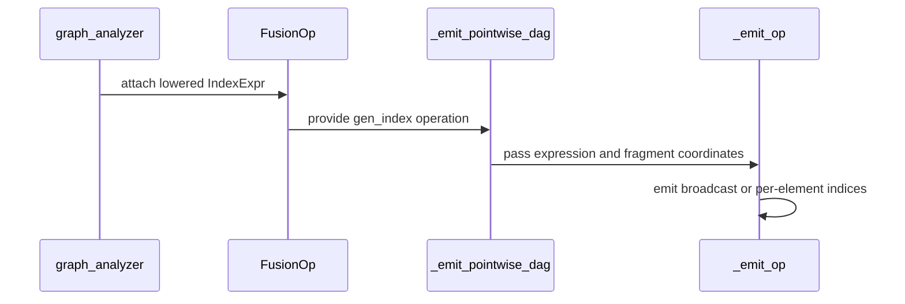

# feat(frost-gemm): preserve logical gen_index axes in rank-N epilogues

[Upstream PR](https://github.com/NVIDIA/cudnn-frontend/pull/2154) · state: closed · merged: True

## Original PR description

## Before submitting

- [x] I agree to license this contribution under the terms of [LICENSE.txt](https://github.com/NVIDIA/cudnn-frontend/blob/develop/LICENSE.txt).
- [x] I ran `pre-commit run` and committed any formatting changes.
- [x] I reviewed the Hard Rules in the applicable root, Python, test and samples `AGENTS.md` files.
- [x] The maintainer applied feature / GEMM / FROST / external-contribution labels.

## Affected area

FE OSS kernels or CuTeDSL; Python graph lowering and tests.

## Summary

Support every logical axis of `gen_index` in a plain rank-N GEMM pointwise epilogue, including the batch-prefix axes that rank normalization previously rejected.

For an output `[B,H,M,N]` normalized to `[B*H,M,N]`, the B and H indices are respectively `L // H` and `L % H`, where L is the kernel's logical batch coordinate. Matrix axes on GEMM/pointwise-descendant branches continue to use runtime M/N coordinates, including axes prepared at extent one. Unit batch axes and fixed singleton matrix axes on auxiliary-only branches produce zero; broadcast consumer coordinates must not become producer indices.

The feature carries a small immutable integer coordinate expression through lowering: constant, axis reference, floor division and remainder by positive Int64 constants. Swap-AB composes an M/N substitution structurally; the original graph axis attribute remains unchanged. The shared SM100/SM120 epilogue emitter performs integer arithmetic before casting to the operation compute dtype.

The layers are separate: fusion_ir holds expression semantics, graph_analyzer maps logical matrix axes, and epilogue_codegen renders expressions against an explicit per-element fragment coordinate table. Uniform axes are conservatively inferred from that table, not hard-coded to M or N. Legacy axis-based IR enters the same emitter. This is not a CuTe layout clone or a new storage/thread ownership system.

The public graph composition `Y[b,h,m,n] = (A @ B)[b,h,m,n] + b + h + m + n` is retained as a regression test. The standalone sample was removed at the contributor's request to keep this PR focused.

## Why

Flattening batch dimensions is a storage/launch view, not a change to `gen_index` semantics. Previously all logical batch axes were rejected, even when their coordinates could be reconstructed exactly without materialization. Delivering the coordinate-expression infrastructure with this concrete operation keeps its initial vocabulary and contracts bounded.

## Related issues

Follow-up to the merged matrix-rank/transpose (#2073) and operand-view (#2104) support. No reopening or expansion of those PRs.

## API and compatibility impact

- No public graph API or native binding signature changes. Optional internal record fields are appended, with legacy manual rank-3 FusionOp axis handling retained.
- Single plain GEMM + pointwise graph scope. Existing specialized MoE, block-scale and multi-GEMM lowering paths are unchanged; this does not add mainloop `gen_index` support or an SM120 operand-pointwise template.
- Existing batch-prefix and zero-copy layout validation remains intact. Batch factors are prepared constants; matrix M/N rebinding remains supported where the existing view contract allows it. No symbolic dimensions or dynamic reshape inference.
- No execute-time coordinate evaluation, extra GPU launch, allocation, conversion, host synchronization or C++ binder work is added.
- No performance speedup claim. Full Blackwell execution remains unqualified locally; native qualification is left to maintainer review and CI.
- Repository Markdown files are unchanged.


## Testing

Local H20 (SM90), cuDNN 9.19, Torch 2.11.0+cu128, CuTe DSL 4.8.1. The editable package resolves to this checkout. From `test/python`, using `/root/.venvs/cudnn-frontend-upstream/bin/python`:

```bash
CUDA_VISIBLE_DEVICES=1 CUDNN_TEST_NO_ISOLATION=1 python -m pytest -q -m 'L0 or L1' \
  gemm/frost/test_logical_gen_index.py gemm/frost/test_matmul_reshape_mainloop.py \
  gemm/frost/test_matmul_transpose_mainloop.py gemm/frost/test_matmul_per_k_scale.py \
  gemm/frost/test_matmul_mainloop_fusion.py gemm/frost/test_execute_recipe.py \
  gemm/frost/test_multi_gemm.py gemm/frost/test_gemm_python_validate.py \
  gemm/frost/test_gemm_knobs.py gemm/frost/test_epilogue_int32_compute.py \
  core/graph/test_variant_pack_normalization.py
```

**1201 passed, 442 skipped, 1 deselected** (30.98 s). `pre-commit run` and staged whitespace checks passed. Full SM100/SM120 GEMM cases remain architecture-skipped locally, not qualified by these H20 checks.

### Auxiliary-rebinding review follow-up

The new singleton-auxiliary fixtures now declare a fixed batch pitch of 256 elements, covering both `(M,N)=(128,192)` and `(160,224)`, and allocate with the exact declared strides. The original native full-GEMM rebind and changed-input capture tests are retained. No kernel, runtime binding, or auxiliary stride contract change is made.

Two new executable SM90+ CuTe tests use the production auxiliary fake declaration and batch-fold geometry. They check small-to-large-to-small shapes, the original pointer, distinct values per batch, rejection of compact auxiliary pitches with output untouched, recovery, and changed-input CUDA graph replay with an explicit capture stream and graph cleanup. These verify the actual FFI contract, not just a launch-recorder mock, but do not qualify Blackwell tensor-core kernels. Five expression/fragment contract tests also gained explanatory docstrings.

The previous-head SM100 CI results (all 60 selected gen_index cases passed; 22 baseline-reproduced quantization failures) do not qualify this new head or the two L1 rebind cases, which were outside that selection. Updated native CI is requested separately.

<!-- This is an auto-generated comment: release notes by coderabbit.ai -->
<!-- coderabbit-ai-generated:v1 -->

## Summary by CodeRabbit

* **New Features**
  * Expanded index generation in fused matrix multiplication epilogues to support logical batch, row, and column coordinates, including composed index expressions.
  * Added support for broadcast inputs with singleton dimensions, which use zero coordinates along broadcast axes.
  * Extended coordinate indexing across more matrix layouts and batch configurations, including dynamically sized dimensions.

* **Bug Fixes**
  * Improved validation of unsupported index placements and invalid dimensions, with clearer errors for invalid inputs.
<!-- end of auto-generated comment: release notes by coderabbit.ai -->

## Review and discussion

### reviews

- copilot-pull-request-reviewer[bot] · COMMENTED · 2026-11-01T12:20:34Z · [source](https://github.com/NVIDIA/cudnn-frontend/pull/2154#pullrequestreview-5727997747)

Copilot was unable to review this pull request because the user who requested the review has insufficient remaining quota. Try requesting a review at a lower effort level.

- Anerudhan · APPROVED · 2026-11-01T13:07:34Z · [source](https://github.com/NVIDIA/cudnn-frontend/pull/2154#pullrequestreview-5728209748)

**Codex bot review · model: `gpt-6-astra`**

Reviewed `79a2f14f919c` against base `61ec45272d66`.

Thank you for your contribution! Logical batch coordinates, swap-AB composition and singleton auxiliary indices work in the tested paths. The review found one nonblocking test issue: two newly added rebinding cases exceed the existing auxiliary stride contract. This is a visible binding rejection, not a new index-arithmetic failure.

**[P2] Keep the new auxiliary rebind fixtures within the stride contract** ([source](https://github.com/NVIDIA/cudnn-frontend/blob/79a2f14f919c09e653a45f930313a4069dbdf1f7/test/python/gemm/frost/test_matmul_transpose_mainloop.py#L1153))

The rank-4 aux_unary cases prefix39 and prefix40 fail on their second shape. _buffers creates compact auxiliaries whose batch pitches grow from 192/128 to 224/160, but the compiled FFI entry fixes those pitches at preparation. Both fail with Mismatched index_input.strides[0]. A plain ReLU-auxiliary control reproduces this on both base and head, leaves outputs untouched, and recovers at the original shape. Prepare these fixtures with a fixed legal pitch large enough for both shapes, or explicitly extend the auxiliary stride contract before expecting that rebind. Keep the native rebind check; the mocked binding test does not catch this constraint.

Evidence: Exact-head focused run: 2 failed, 175 passed, 7 skipped. The failures are test_frost_matrix_gen_index_gpu[prefix39-2-False-sm100-aux_unary] and [prefix40-3-True-sm100-aux_unary]. Independent base/head ReLU controls reproduce the same FFI rejection without gen_index. Attribution: New test coverage exposes an existing fixed auxiliary-stride limitation.

Validation: 175 focused tests passed, seven SM120 cases skipped, and the two cases above failed on SM100. Coverage includes generated Int64 arithmetic, logical axes, swap-AB, STG/split-K GEMM, binding, and changed-input graph replay. An independent graph adding all four logical indices passed normal/swapped operands and small-to-large-to-small shape changes, with exact analytic references and bitwise repeatability across retained graph replays. A bounded base/head check of existing M/N index paths found no material GPU or enqueue regression. The current-base merge is clean and its consumed GEMM contracts are unchanged. GEMM CI pipeline 78346900 is running; all six changed files match its integration tree. Style passed and Security is running.

Limitations: No native SM120 validation or sanitizer run was completed. The performance check covers two small existing index paths on shared SM100 hardware, not all new workloads.

Approved: no P0 or high-risk P1 found. Remaining findings stay with the owner; merge timing stays with the owner.

<!-- codex-fe-review:v2:2154:79a2f14f919c09e653a45f930313a4069dbdf1f7:complete:no-blocker -->

- Anerudhan · COMMENTED · 2026-11-01T14:08:29Z · [source](https://github.com/NVIDIA/cudnn-frontend/pull/2154#pullrequestreview-5728456220)

**Codex bot review · model: `gpt-6-astra`**

Reviewed `81f24b90fdb0` against base `5237e6cc394c`.

Thank you for the follow-up! The fixed 256-element auxiliary batch pitch resolves the two rebinding failures from my prior review. The native GEMM tests are retained, and the new L0 tests exercise the real FFI stride contract. No unresolved findings from this follow-up. The existing approval remains applicable.

Validation: The complete follow-up diff changes two test files only; production code is identical to reviewed head 79a2f14f919c. The current develop merge is clean and preserves the tested GEMM code. Focused exact-head run on SM100: 176 passed, seven SM120 cases skipped. This includes the two formerly failing rank-4 auxiliary-unary cases, with larger-shape rebinding and changed-input graph replay. Eight selected regressions also pass on the clean current-base merge, including both real-FFI cases and the formerly failing native GEMM cases. The new FFI tests check small→large→small shapes, the original storage pointer, distinct batch values, rejection of compact pitches with output unchanged, recovery and graph replay after input changes. Both collect under L0 for GEMM CI. Reused the prior independent logical-axis, swap-AB, numerical, repeatability and performance evidence because production code is unchanged. No new performance claim or additional timing sweep. Current-head python/gemm/frost pipeline 78356827 is running; all GEMM/FROST code and GEMM tests match the reviewed head. Approved the unchanged formatting/security workflows. The CI bot canceled older-head pipeline 78346900; its failure evidence remains separate.

Limitations: No local native SM120 qualification. Current-head CI is pending; the two full-GEMM rank-4 cases remain L1 and are covered by the independent local run.

Comment only: this PR already has an active approval; preserving existing approvals.

<!-- codex-fe-review:v2:2154:81f24b90fdb0be603979e9a8f1565b47603cc860:complete:no-blocker -->

- Anerudhan · COMMENTED · 2026-11-01T16:42:10Z · [source](https://github.com/NVIDIA/cudnn-frontend/pull/2154#pullrequestreview-5729157303)

**Codex bot review · model: `gpt-6-astra`**

Reviewed `834dcc75a978` against base `2b54370b3689`.

Thank you for your contribution! The test-only import fix resolves the active-family lookup failure. All four composition cases fail on the previous head with SM120 source selection and pass on this head. Production source is unchanged; no new findings.

Validation: Reviewed the complete delta from 81f24b90fdb0: one shared-helper import and its use. Production Python and C++ source are identical. Reused the earlier native feature and rebinding evidence. Four affected cases passed with SM120 source selection, four with SM100 source selection, and four with SM120 source selection on a clean merge with current develop. The previous head fails all four at the old architecture-specific helper lookup. Current-head CI integration ec4b83965421 contains all six exact feature/test files. SM100 job 522445996 passed all 60 selected logical-index cases. Its 22 quantization failures have the same case names and error messages as the prior baseline-reproduced failures. Precheck returned no candidates. Existing labels, milestone and project membership are correct; the unchanged standard Style and Security workflows were authorized. Rechecked the final develop update: clean merge, GEMM/FROST source and tests unchanged; the added norm FFI code is retained.

Limitations: Local family selection checks host graph analysis and code generation, not native SM120 execution. The maintainer's native SM103/SM120 results are separate evidence. Pipeline 78377907 and the authorized workflows are still running. The full CI pipeline is not reported as passed.

Comment only: this PR already has an active approval; preserving existing approvals.

<!-- codex-fe-review:v2:2154:834dcc75a978fe8680c17cc169fbe1890793e868:complete:no-blocker -->

### issue_comments

- coderabbitai[bot] · comment · 2026-11-01T11:05:29Z · [source](https://github.com/NVIDIA/cudnn-frontend/pull/2154#issuecomment-6557089207)

<!-- coderabbit-ai-generated:v1 -->

<!-- This is an auto-generated comment: summarize by coderabbit.ai -->
<!-- review_stack_entry_start -->

<a href="https://app.coderabbit.ai/change-stack/NVIDIA/cudnn-frontend/pull/2154?scope=ghh_OusAJGA4HG8ljoOV0wJvVx8NmnZIjc2DdjmxOu0xZWA&amp;cs_source=review_comment"><picture><source media="(prefers-color-scheme: dark)" srcset="https://storage.googleapis.com/coderabbit_public_assets/review-stack-in-coderabbit-ui-dark.svg?v=3"><source media="(prefers-color-scheme: light)" srcset="https://storage.googleapis.com/coderabbit_public_assets/review-stack-in-coderabbit-ui.svg?v=3"></picture></a>

<!-- review_stack_entry_end -->
<!-- This is an auto-generated comment: skip review by coderabbit.ai -->

> [!IMPORTANT]
> ## Review skipped
> 
> Auto reviews are disabled on this repository. Please check the settings in the CodeRabbit UI or the `.coderabbit.yaml` file in this repository. To trigger a single review, invoke the `@coderabbitai review` command.
> 
> <details>
> <summary><strong><picture><source media="(prefers-color-scheme: dark)" srcset="https://storage.googleapis.com/coderabbit_public_assets/review-comment-icons-v1/cog-dark.svg"></picture> Run configuration</strong></summary>
> <dl>
> <dd>
> 
> - **Source mode**: Auto
> - **Repository**: [NVIDIA/cudnn-frontend](<https://github.com/NVIDIA/cudnn-frontend>)
> - **Branch**: [develop](<https://github.com/NVIDIA/cudnn-frontend/tree/develop>)
> - **File**: [.coderabbit.yaml](<https://github.com/NVIDIA/cudnn-frontend/blob/0c4168d47a539ee844cdd8c29c61727ae56d9dd2/.coderabbit.yaml>)
> - **Commit**: [0c4168d](<https://github.com/NVIDIA/cudnn-frontend/commit/0c4168d47a539ee844cdd8c29c61727ae56d9dd2>)
> - **Layers**: Repository YAML
> - **Review profile**: CHILL
> - **Plan**: Enterprise
> - **Run ID**: `f7e95780-66c3-4a5d-bb0d-9b3555d5bc54`
> 
> </dd>
> </dl>
> </details>
> 
> You can disable this status message by setting the `reviews.review_status` to `false` in the CodeRabbit configuration file.
> 
> Use the checkbox below for a quick retry:
> - [ ] <!-- {"checkboxId":"e9bb8d72-00e8-4f67-9cb2-caf3b22574fe"} --> Trigger review

<!-- end of auto-generated comment: skip review by coderabbit.ai -->

<!-- recent_review_start -->

No actionable comments were generated in the recent review.

<details>
<summary><strong><picture></picture> Recent review info</strong></summary>
<dl>
<dd>

<!-- review_info_content -->
<details>
<summary><strong><picture><source media="(prefers-color-scheme: dark)" srcset="https://storage.googleapis.com/coderabbit_public_assets/review-comment-icons-v1/cog-dark.svg"></picture> Run configuration</strong></summary>
<dl>
<dd>

- **Source mode**: Auto
- **Repository**: [NVIDIA/cudnn-frontend](<https://github.com/NVIDIA/cudnn-frontend>)
- **Branch**: [develop](<https://github.com/NVIDIA/cudnn-frontend/tree/develop>)
- **File**: [.coderabbit.yaml](<https://github.com/NVIDIA/cudnn-frontend/blob/0c4168d47a539ee844cdd8c29c61727ae56d9dd2/.coderabbit.yaml>)
- **Commit**: [0c4168d](<https://github.com/NVIDIA/cudnn-frontend/commit/0c4168d47a539ee844cdd8c29c61727ae56d9dd2>)
- **Layers**: Repository YAML
- **Review profile**: CHILL
- **Plan**: Enterprise
- **Run ID**: `0395c030-e4f2-4578-b4e4-c26836407c3b`

</dd>
</dl>
</details>

<details>
<summary><strong><picture><source media="(prefers-color-scheme: dark)" srcset="https://storage.googleapis.com/coderabbit_public_assets/review-comment-icons-v1/git-commit-horizontal-dark.svg"></picture> Commits</strong></summary>
<dl>
<dd>

Reviewing files that changed from the base of the PR and between 0c4168d47a539ee844cdd8c29c61727ae56d9dd2 and 81f24b90fdb0be603979e9a8f1565b47603cc860.

</dd>
</dl>
</details>

<details>
<summary><strong><picture><source media="(prefers-color-scheme: dark)" srcset="https://storage.googleapis.com/coderabbit_public_assets/review-comment-icons-v1/file-plus-corner-dark.svg"></picture> Files selected for processing: 6</strong></summary>
<dl>
<dd>

* `python/cudnn/gemm/frost/epilogue_codegen.py`
* `python/cudnn/gemm/frost/fusion_ir.py`
* `python/cudnn/gemm/frost/graph_analyzer.py`
* `test/python/gemm/frost/test_logical_gen_index.py`
* `test/python/gemm/frost/test_matmul_reshape_mainloop.py`
* `test/python/gemm/frost/test_matmul_transpose_mainloop.py`

</dd>
</dl>
</details>

**Included review availability:** This review used your included allowance. Your plan provides up to 12 included reviews per hour; 11 remain after this review.

</dd>
</dl>
</details>


<!-- recent_review_end -->
<!-- walkthrough_start -->

<details>
<summary><strong>Walkthrough</strong></summary>
<dl>
<dd>

FROST now represents logical `gen_index` coordinates with composable expressions. Graph analysis lowers batch and matrix axes into those expressions, and epilogue code generation renders them against fragment coordinates. Tests cover expression behavior, generated fragments, and matmul integration.

**Changes: Logical gen_index indexing**

|Layer / File(s)|Summary|
|:---|:---|
|**Index expressions and graph lowering** <br> `python/cudnn/gemm/frost/fusion_ir.py`, `python/cudnn/gemm/frost/graph_analyzer.py`, `test/python/gemm/frost/test_logical_gen_index.py`, `test/python/gemm/frost/test_matmul_reshape_mainloop.py`|`IndexExpr` represents axis coordinates, constants, floor division, and modulo. Graph analysis lowers logical axes, including batch axes, and handles singleton dimensions. Tests cover expression evaluation, validation, lowering, and unsupported operand placements around reshapes.|
|**Fragment-coordinate code generation** <br> `python/cudnn/gemm/frost/epilogue_codegen.py`, `test/python/gemm/frost/test_logical_gen_index.py`|Epilogue generation renders expressions using fragment coordinates. It emits broadcasts for uniform indices and per-element values otherwise. Tests cover coordinate layouts, compatibility with legacy axis attributes, CUDA execution, and FFI input validation.|
|**Matmul integration and axis coverage** <br> `test/python/gemm/frost/test_matmul_transpose_mainloop.py`|Tests cover logical batch and matrix axes, auxiliary index sources, axis swaps, dynamic shapes, backend routes, and graph-binding validation.|

<!-- change_assessment_start -->


**Estimated code review effort:** 4 (Complex) | ~45 minutes

<!-- change_assessment_commit:"81f24b90fdb0be603979e9a8f1565b47603cc860" -->
<!-- change_assessment_priority:{"version":1,"urgency":"p2","manual":false} -->
**Change:** Feature
<!-- change_assessment_end -->

### Sequence Diagram(s)



**Possibly related PRs**

- [NVIDIA/cudnn-frontend#2006](https://github.com/NVIDIA/cudnn-frontend/pull/2006): Adds `Axis` and symbolic GEMM extents used by the logical-coordinate expressions.
- [NVIDIA/cudnn-frontend#1993](https://github.com/NVIDIA/cudnn-frontend/pull/1993): Creates shared FROST epilogue and graph-analysis paths extended here to carry fragment coordinates and logical index expressions.
- [NVIDIA/cudnn-frontend#2073](https://github.com/NVIDIA/cudnn-frontend/pull/2073): Remaps `gen_index` matrix axes during transpose normalization; this change also preserves logical axes through lowering and `swap_ab`.

**Suggested reviewers:** `yanqinz2`, `anerudhan`

</dd>
</dl>
</details>

<!-- walkthrough_end -->
<details>
<summary><strong>Merge Risk:</strong> <strong><picture></picture> Minimal</strong> · previous review <code>81f24</code></summary>
<dl>
<dd>

<!-- final_review_risk_start -->
<!-- final_review_risk_label
**Merge Risk:** **⚪ Minimal** · up to `81f24`
-->
<!-- final_review_risk_coverage:{"sourceCommitId":"81f24b90fdb0be603979e9a8f1565b47603cc860","coveredCommitId":"81f24b90fdb0be603979e9a8f1565b47603cc860","kind":"reviewed"} -->

No confirmed issue prevents merging on the supplied evidence. The unexercised GPU cases remain worth running when the required hardware is available.
<!-- final_review_risk_end -->

</dd>
</dl>
</details>
<!-- pre_merge_checks_walkthrough_start -->

<details>
<summary><strong>Pre-merge checks: <sup><picture></picture></sup> 4 · <sup><picture></picture></sup> 1</strong></summary>
<dl>
<dd>

<strong><sup><picture></picture></sup> Failed checks: 1 warning</strong>

|     Check name     |                                              Status                                              | Explanation                                                                                                                                                                                               | Resolution                                                                         |
| :---------------- | :----------------------------------------------------------------------------------------------: | :-------------------------------------------------------------------------------------------------------------------------------------------------------------------------------------------------------- | :--------------------------------------------------------------------------------- |
| Docstring Coverage |  | Docstring coverage is 74.36% which is insufficient. The required threshold is 80.00%. Docstring coverage is scoped to functions touched by this diff with cyclomatic complexity of at least 2. Documenta… | Write docstrings for the functions missing them to satisfy the coverage threshold. |

<details>
<summary><strong><sup><picture></picture></sup> Passed checks: 4 passed</strong></summary>
<dl>
<dd>

|         Check name         |                                             Status                                             | Explanation                                                                                                                                                                                               |
| :------------------------ | :--------------------------------------------------------------------------------------------: | :-------------------------------------------------------------------------------------------------------------------------------------------------------------------------------------------------------- |
|         Title check        |  | The title clearly and concisely describes the main change: preserving logical gen_index axes in rank-N epilogues.                                                                                         |
|      Description check     |  | The description covers the affected area, summary, motivation, related work, compatibility impact, scope limits, testing commands and results, and architecture-specific limitations. It is complete and… |
|     Linked Issues check    |  | Check skipped because no linked issues were found for this pull request.                                                                                                                                  |
| Out of Scope Changes check |  | Check skipped because no linked issues were found for this pull request.                                                                                                                                  |

<details>
<summary><strong>Full details: Description check</strong></summary>
<dl>
<dd>

**Explanation**

The description covers the affected area, summary, motivation, related work, compatibility impact, scope limits, testing commands and results, and architecture-specific limitations. It is complete and relevant to the changeset.

</dd>
</dl>
</details>

</dd>
</dl>
</details>

<details>
<summary><strong>Full details: Docstring Coverage</strong></summary>
<dl>
<dd>

**Explanation**

Docstring coverage is 74.36% which is insufficient. The required threshold is 80.00%. Docstring coverage is scoped to functions touched by this diff with cyclomatic complexity of at least 2. Documentation-only edits and deletions within surviving functions are included; unchanged diff context and fully deleted functions are excluded. Analyzed 39 functions across 6 files.

**Resolution**

Write docstrings for the functions missing them to satisfy the coverage threshold.

</dd>
</dl>
</details>

</dd>
</dl>
</details>

<!-- pre_merge_checks_walkthrough_end -->
<!-- finishing_touch_checkbox_start -->

<details>
<summary><strong>Finishing Touches</strong></summary>
<dl>
<dd>

<details open>
<summary><strong>Generate unit tests (beta)</strong></summary>
<dl>
<dd>

- [ ] <!-- {"checkboxId": "f47ac10b-58cc-4372-a567-0e02b2c3d479", "radioGroupId": "utg-output-choice-group-6558914247"} --> Create a new PR

</dd>
</dl>
</details>

</dd>
</dl>
</details>

<!-- finishing_touch_checkbox_end -->

<!-- autopilot:start -->
- [ ] <!-- {"checkboxId":"2708ad07-9f24-4260-9c11-7dc76a49f2e3"} --> <strong title="Keep fixing CodeRabbit findings and required CI, and resolving merge conflicts">Autofix</strong> · Keep fixing CodeRabbit findings and required CI, and resolving merge conflicts
<!-- autopilot:end -->

- YangXu1990uiuc · comment · 2026-11-01T12:04:26Z · [source](https://github.com/NVIDIA/cudnn-frontend/pull/2154#issuecomment-6557681463)

Thank you for the logical-axis support and the explicit host-versus-native validation scope. I added the requested feature, GEMM/FROST, and external-contribution labels and included this draft in our maintenance tracking.

When you feel it is ready, mark the PR ready for review and comment `ready`. The review bot will review it, and we will help work through remaining validation and fixes toward merge.


- meinie0826 · comment · 2026-11-01T12:39:04Z · [source](https://github.com/NVIDIA/cudnn-frontend/pull/2154#issuecomment-6558056042)

ready


- meinie0826 · comment · 2026-11-01T12:41:46Z · [source](https://github.com/NVIDIA/cudnn-frontend/pull/2154#issuecomment-6558083851)

@coderabbitai full review

- coderabbitai[bot] · comment · 2026-11-01T12:41:52Z · [source](https://github.com/NVIDIA/cudnn-frontend/pull/2154#issuecomment-6558084897)

<!-- coderabbit-ai-generated:v1 -->

<!-- This is an auto-generated reply by CodeRabbit -->
<!-- CodeRabbit review command invocation: v2:fdcba1da28d7d5d903daa3d5da1aa26dc0b8b3d4df3161d9777781cbe968e64a -->
<details>
<summary>Action performed</summary>
<dl>
<dd>

Full review finished.

</dd>
</dl>
</details>

- Anerudhan · comment · 2026-11-01T12:58:53Z · [source](https://github.com/NVIDIA/cudnn-frontend/pull/2154#issuecomment-6558266605)

I am requesting test CI for `79a2f14f919c` with the following standalone command: `@cudnn-ci-bot run python/gemm/frost`. For future updates, request the appropriate test target before review; a maintainer may need to trigger it.

Codex bot review — model `gpt-6-astra`.

<!-- codex-fe-ci:v1:2154:79a2f14f919c09e653a45f930313a4069dbdf1f7:request-gemm-frost-notice -->

- Anerudhan · comment · 2026-11-01T12:58:59Z · [source](https://github.com/NVIDIA/cudnn-frontend/pull/2154#issuecomment-6558267797)

@cudnn-ci-bot run python/gemm/frost

- cudnn-ci-bot · comment · 2026-11-01T12:59:02Z · [source](https://github.com/NVIDIA/cudnn-frontend/pull/2154#issuecomment-6558268521)

🏁 Pipeline finished

SHA: `79a2f14`
Targets: `python/gemm/frost`
Branch: [cudnn-gh/pr-2154-79a2f14](https://nv/cudnn-gitlab-ci/-/tree/cudnn-gh/pr-2154-79a2f14)
Pipeline: [78346900](https://nv/cudnn-gitlab-ci/-/pipelines/78346900)
Last updated: 2026-11-01 14:06 UTC

**18 passed, 1 failed, 2 canceled, 12 manual**

### <code>manual</code>

- <code>manual:python_samples</code> - Manual
- <code>manual:python/sdpa/frost</code> - Manual
- <code>manual:python/sdpa/misc</code> - Manual
- <code>manual:python/linear_attention</code> - Manual
- <code>manual:python/gemm/frost</code> - ✅ Passed
- <code>manual:python/gemm/cutedsl</code> - Manual
- <code>manual:python/gemm/misc</code> - Manual
- <code>manual:python/conv</code> - Manual
- <code>manual:python/norm</code> - Manual
- <code>manual:python/misc</code> - Manual
- <code>manual:pycudnn</code> - Manual
- <code>manual:multi_gpu</code> - Manual
- <code>manual:backend</code> - Manual

### <code>analysis</code>

- <code>analysis:cudnn_clang_disable_exception</code> - ✅ Passed
- <code>analysis:cudnn_v9_no_half_conversion</code> - ✅ Passed
- <code>analysis:cudnn_clang</code> - ✅ Passed
- <code>analysis:check-relative-includes</code> - ✅ Passed
- <code>analysis:check-CUDNN_FRONTEND_SKIP_JSON_LIB</code> - ✅ Passed
- <code>analysis:guardwords_scan</code> - ✅ Passed
- <code>analysis:jax-import-guard</code> - ✅ Passed
- <code>analysis:pytest-gpu</code> - ✅ Passed
- <code>san:build</code> - ✅ Passed

### <code>build</code>

- <code>analysis:api_index</code> - ✅ Passed
- <code>build:dev:linux:amd64</code> - ✅ Passed
- <code>build:rel:linux:amd64</code> - ✅ Passed
- <code>build:dev:linux:arm64</code> - ✅ Passed
- <code>build:rel:linux:arm64</code> - ✅ Passed
- <code>build:rel:win:amd64</code> - ✅ Passed

### <code>python/gemm/frost</code>

- <code>python/gemm/frost:be-9.27.0-cutedsl-4.8.0:sm100</code> - ❌ **Old Failure** (nightly failed)

### <code>sanitizer_tests</code>

- <code>san:cpp_test:sm80</code> - Canceled
- <code>san:cpp_test:sm90</code> - ✅ Passed
- <code>san:cpp_test:sm100</code> - ✅ Passed

### <code>triage</code>

- <code>triage:ai</code> - Canceled

- Anerudhan · comment · 2026-11-01T13:21:36Z · [source](https://github.com/NVIDIA/cudnn-frontend/pull/2154#issuecomment-6558524077)

SM100 job 522236978 in pipeline 78346900 completed with 22 failures. All 60 selected `gen_index` cases passed. I reproduced all 22 failures on the PR baseline: the unchanged SM120 quantization tests hit block-size prechecks or an architecture-error message mismatch on SM100. The compiler and affected test files are unchanged between that baseline and the CI integration tree.

This does not resolve the two L1 auxiliary-rebinding failures noted in my review; those cases were outside this CI selection. Other lanes are still running.

Codex bot review — model `gpt-6-astra`.

<!-- codex-fe-ci:v1:2154:79a2f14f919c09e653a45f930313a4069dbdf1f7:pipeline-78346900-sm100-failures -->

- meinie0826 · comment · 2026-11-01T13:29:21Z · [source](https://github.com/NVIDIA/cudnn-frontend/pull/2154#issuecomment-6558608776)

@cudnn-ci-bot run python/gemm/frost

- cudnn-ci-bot · comment · 2026-11-01T13:29:24Z · [source](https://github.com/NVIDIA/cudnn-frontend/pull/2154#issuecomment-6558609344)

Pipeline not launched

Reason: @meinie0826 is not allowlisted to run this bot.

Ask an allowlisted maintainer to comment `@cudnn-ci-bot run`.

- meinie0826 · comment · 2026-11-01T13:56:52Z · [source](https://github.com/NVIDIA/cudnn-frontend/pull/2154#issuecomment-6558914247)

@coderabbitai full review

- coderabbitai[bot] · comment · 2026-11-01T13:56:59Z · [source](https://github.com/NVIDIA/cudnn-frontend/pull/2154#issuecomment-6558915488)

<!-- coderabbit-ai-generated:v1 -->

<!-- This is an auto-generated reply by CodeRabbit -->
<!-- CodeRabbit review command invocation: v2:3517a185c6a20bb9393d85cdcf10257ee2a52119a7a874cb94eb6f93029bf442 -->
<details>
<summary>Action performed</summary>
<dl>
<dd>

Full review finished.

</dd>
</dl>
</details>

- Anerudhan · comment · 2026-11-01T14:04:53Z · [source](https://github.com/NVIDIA/cudnn-frontend/pull/2154#issuecomment-6559008563)

I am requesting test CI for `81f24b90fdb0` with the following standalone command: `@cudnn-ci-bot run python/gemm/frost`. For future updates, request the appropriate test target before review; a maintainer may need to trigger it.

Codex bot review — model `gpt-6-astra`.

<!-- codex-fe-ci:v1:2154:81f24b90fdb0be603979e9a8f1565b47603cc860:request-gemm-frost-notice -->

- Anerudhan · comment · 2026-11-01T14:05:00Z · [source](https://github.com/NVIDIA/cudnn-frontend/pull/2154#issuecomment-6559009792)

@cudnn-ci-bot run python/gemm/frost

- cudnn-ci-bot · comment · 2026-11-01T14:05:34Z · [source](https://github.com/NVIDIA/cudnn-frontend/pull/2154#issuecomment-6559016335)

🏁 Pipeline finished

SHA: `81f24b9`
Targets: `python/gemm/frost`
Branch: [cudnn-gh/pr-2154-81f24b9](https://nv/cudnn-gitlab-ci/-/tree/cudnn-gh/pr-2154-81f24b9)
Pipeline: [78356827](https://nv/cudnn-gitlab-ci/-/pipelines/78356827)
Cancelled this PR's older pipelines: 78346900
Last updated: 2026-11-01 16:20 UTC

**20 passed, 1 failed, 12 manual**

### <code>manual</code>

- <code>manual:python_samples</code> - Manual
- <code>manual:python/sdpa/frost</code> - Manual
- <code>manual:python/sdpa/misc</code> - Manual
- <code>manual:python/linear_attention</code> - Manual
- <code>manual:python/gemm/frost</code> - ✅ Passed
- <code>manual:python/gemm/cutedsl</code> - Manual
- <code>manual:python/gemm/misc</code> - Manual
- <code>manual:python/conv</code> - Manual
- <code>manual:python/norm</code> - Manual
- <code>manual:python/misc</code> - Manual
- <code>manual:pycudnn</code> - Manual
- <code>manual:multi_gpu</code> - Manual
- <code>manual:backend</code> - Manual

### <code>analysis</code>

- <code>analysis:cudnn_clang_disable_exception</code> - ✅ Passed
- <code>analysis:cudnn_v9_no_half_conversion</code> - ✅ Passed
- <code>analysis:cudnn_clang</code> - ✅ Passed
- <code>analysis:check-relative-includes</code> - ✅ Passed
- <code>analysis:check-CUDNN_FRONTEND_SKIP_JSON_LIB</code> - ✅ Passed
- <code>analysis:guardwords_scan</code> - ✅ Passed
- <code>analysis:jax-import-guard</code> - ✅ Passed
- <code>analysis:pytest-gpu</code> - ✅ Passed
- <code>san:build</code> - ✅ Passed

### <code>build</code>

- <code>analysis:api_index</code> - ✅ Passed
- <code>build:dev:linux:amd64</code> - ✅ Passed
- <code>build:rel:linux:amd64</code> - ✅ Passed
- <code>build:dev:linux:arm64</code> - ✅ Passed
- <code>build:rel:linux:arm64</code> - ✅ Passed
- <code>build:rel:win:amd64</code> - ✅ Passed

### <code>python/gemm/frost</code>

- <code>python/gemm/frost:be-9.27.0-cutedsl-4.8.0:sm100</code> - ❌ **Old Failure** (nightly failed)

### <code>sanitizer_tests</code>

- <code>san:cpp_test:sm80</code> - ✅ Passed
- <code>san:cpp_test:sm90</code> - ✅ Passed
- <code>san:cpp_test:sm100</code> - ✅ Passed

### <code>triage</code>

- <code>triage:ai</code> - ✅ Passed

- Anerudhan · comment · 2026-11-01T14:25:26Z · [source](https://github.com/NVIDIA/cudnn-frontend/pull/2154#issuecomment-6559251063)

SM100 job 522308464 in pipeline 78356827 passed all 60 logical-index tests and both new auxiliary FFI contract tests. Its 22 failures match the previous pipeline’s cases and messages exactly, in unchanged SM120 quantization tests; those failures were also reproduced on the PR baseline.

The two full-GEMM rank-4 rebinding cases remain outside the default L0 selection. Both passed independently on this head and the current-base merge. Other CI lanes are still running.

Codex bot review — model `gpt-6-astra`.

<!-- codex-fe-ci:v1:2154:81f24b90fdb0be603979e9a8f1565b47603cc860:pipeline-78356827-sm100-failures -->

- meinie0826 · comment · 2026-11-01T16:10:55Z · [source](https://github.com/NVIDIA/cudnn-frontend/pull/2154#issuecomment-6560470328)

@YangXu1990uiuc could you help merge this PR? thanks!

- YangXu1990uiuc · comment · 2026-11-01T16:21:25Z · [source](https://github.com/NVIDIA/cudnn-frontend/pull/2154#issuecomment-6560594395)

The additional native SM120 pass found four failures in the new public-graph composition test: it looked up `_FragmentCoordinates` on the explicitly imported SM100 module, while shared helpers are published on the active family. The native SM120 logical-index cases themselves passed.

I added the bounded test-only fix `834dcc75a978` to import that helper from the shared epilogue facade. The four failing SM120 cases now pass, and the changed-file formatting/license checks pass. The full affected files now pass on this exact head and its develop integration: **873 passed, 7 skipped on SM103; 826 passed, 54 skipped on native SM120**. Imports were verified against the integration source. Style/Security fork-workflow authorization is still pending.

The current-head GEMM CI has 22 failures whose case names and error messages exactly match the prior [baseline-reproduced failures](https://github.com/NVIDIA/cudnn-frontend/pull/2154#issuecomment-6559251063), in the existing quantization tests. Other lanes are still running; this is not a claim that the full CI pipeline passed.

<!-- fe-external-watch:sm120-import-fix:834dcc75a978fe8680c17cc169fbe1890793e868 -->

- YangXu1990uiuc · comment · 2026-11-01T16:21:49Z · [source](https://github.com/NVIDIA/cudnn-frontend/pull/2154#issuecomment-6560599074)

@cudnn-ci-bot run python/gemm/frost

- cudnn-ci-bot · comment · 2026-11-01T16:21:52Z · [source](https://github.com/NVIDIA/cudnn-frontend/pull/2154#issuecomment-6560599685)

🏁 Pipeline finished

SHA: `834dcc7`
Targets: `python/gemm/frost`
Branch: [cudnn-gh/pr-2154-834dcc7](https://nv/cudnn-gitlab-ci/-/tree/cudnn-gh/pr-2154-834dcc7)
Pipeline: [78377907](https://nv/cudnn-gitlab-ci/-/pipelines/78377907)
Last updated: 2026-11-01 17:32 UTC

**20 passed, 1 failed, 12 manual**

### <code>manual</code>

- <code>manual:python_samples</code> - Manual
- <code>manual:python/sdpa/frost</code> - Manual
- <code>manual:python/sdpa/misc</code> - Manual
- <code>manual:python/linear_attention</code> - Manual
- <code>manual:python/gemm/frost</code> - ✅ Passed
- <code>manual:python/gemm/cutedsl</code> - Manual
- <code>manual:python/gemm/misc</code> - Manual
- <code>manual:python/conv</code> - Manual
- <code>manual:python/norm</code> - Manual
- <code>manual:python/misc</code> - Manual
- <code>manual:pycudnn</code> - Manual
- <code>manual:multi_gpu</code> - Manual
- <code>manual:backend</code> - Manual

### <code>analysis</code>

- <code>analysis:cudnn_clang_disable_exception</code> - ✅ Passed
- <code>analysis:cudnn_v9_no_half_conversion</code> - ✅ Passed
- <code>analysis:cudnn_clang</code> - ✅ Passed
- <code>analysis:check-relative-includes</code> - ✅ Passed
- <code>analysis:check-CUDNN_FRONTEND_SKIP_JSON_LIB</code> - ✅ Passed
- <code>analysis:guardwords_scan</code> - ✅ Passed
- <code>analysis:jax-import-guard</code> - ✅ Passed
- <code>analysis:pytest-gpu</code> - ✅ Passed
- <code>san:build</code> - ✅ Passed

### <code>build</code>

- <code>analysis:api_index</code> - ✅ Passed
- <code>build:dev:linux:amd64</code> - ✅ Passed
- <code>build:rel:linux:amd64</code> - ✅ Passed
- <code>build:dev:linux:arm64</code> - ✅ Passed
- <code>build:rel:linux:arm64</code> - ✅ Passed
- <code>build:rel:win:amd64</code> - ✅ Passed

### <code>python/gemm/frost</code>

- <code>python/gemm/frost:be-9.27.0-cutedsl-4.8.0:sm100</code> - ❌ **Old Failure** (nightly failed)

### <code>sanitizer_tests</code>

- <code>san:cpp_test:sm80</code> - ✅ Passed
- <code>san:cpp_test:sm90</code> - ✅ Passed
- <code>san:cpp_test:sm100</code> - ✅ Passed

### <code>triage</code>

- <code>triage:ai</code> - ✅ Passed

- YangXu1990uiuc · comment · 2026-11-01T20:07:33Z · [source](https://github.com/NVIDIA/cudnn-frontend/pull/2154#issuecomment-6563211750)

Thanks for the contribution and the follow-up fixes! Merged as `54d66348796b` after checking the approved head `834dcc75a978` and the actual develop integration.

Validation on the actual develop integration: 873 passed and 7 skipped on native SM103; 826 passed and 54 skipped on native SM120. The shared-helper test fix and all affected logical-index/reshape/transpose cases are included. The completed exact-head GEMM CI has 22 failures matching the previously baseline-reproduced quantization cases; the feature cases pass. This is not a claim that the entire pipeline was green.

Required merge checks, Style, and Security passed. The normal merge used the full head SHA, and the merged tree matches the tested integration.

<!-- fe-external-watch:merged:2154:834dcc75a978fe8680c17cc169fbe1890793e868 -->


### inline_comments

## Changed files and fixed code

- `python/cudnn/gemm/frost/epilogue_codegen.py` · modified · additions 72 / deletions 11
  - [head](https://github.com/meinie0826/cudnn-frontend/blob/834dcc75a978fe8680c17cc169fbe1890793e868/python/cudnn/gemm/frost/epilogue_codegen.py)
  - [base](https://github.com/NVIDIA/cudnn-frontend/blob/0c4168d47a539ee844cdd8c29c61727ae56d9dd2/python/cudnn/gemm/frost/epilogue_codegen.py)
- `python/cudnn/gemm/frost/fusion_ir.py` · modified · additions 97 / deletions 0
  - [head](https://github.com/meinie0826/cudnn-frontend/blob/834dcc75a978fe8680c17cc169fbe1890793e868/python/cudnn/gemm/frost/fusion_ir.py)
  - [base](https://github.com/NVIDIA/cudnn-frontend/blob/0c4168d47a539ee844cdd8c29c61727ae56d9dd2/python/cudnn/gemm/frost/fusion_ir.py)
- `python/cudnn/gemm/frost/graph_analyzer.py` · modified · additions 67 / deletions 19
  - [head](https://github.com/meinie0826/cudnn-frontend/blob/834dcc75a978fe8680c17cc169fbe1890793e868/python/cudnn/gemm/frost/graph_analyzer.py)
  - [base](https://github.com/NVIDIA/cudnn-frontend/blob/0c4168d47a539ee844cdd8c29c61727ae56d9dd2/python/cudnn/gemm/frost/graph_analyzer.py)
- `test/python/gemm/frost/test_logical_gen_index.py` · added · additions 276 / deletions 0
  - [head](https://github.com/meinie0826/cudnn-frontend/blob/834dcc75a978fe8680c17cc169fbe1890793e868/test/python/gemm/frost/test_logical_gen_index.py)
  - [base](https://github.com/NVIDIA/cudnn-frontend/blob/0c4168d47a539ee844cdd8c29c61727ae56d9dd2/test/python/gemm/frost/test_logical_gen_index.py)
- `test/python/gemm/frost/test_matmul_reshape_mainloop.py` · modified · additions 19 / deletions 0
  - [head](https://github.com/meinie0826/cudnn-frontend/blob/834dcc75a978fe8680c17cc169fbe1890793e868/test/python/gemm/frost/test_matmul_reshape_mainloop.py)
  - [base](https://github.com/NVIDIA/cudnn-frontend/blob/0c4168d47a539ee844cdd8c29c61727ae56d9dd2/test/python/gemm/frost/test_matmul_reshape_mainloop.py)
- `test/python/gemm/frost/test_matmul_transpose_mainloop.py` · modified · additions 257 / deletions 44
  - [head](https://github.com/meinie0826/cudnn-frontend/blob/834dcc75a978fe8680c17cc169fbe1890793e868/test/python/gemm/frost/test_matmul_transpose_mainloop.py)
  - [base](https://github.com/NVIDIA/cudnn-frontend/blob/0c4168d47a539ee844cdd8c29c61727ae56d9dd2/test/python/gemm/frost/test_matmul_transpose_mainloop.py)

## Evidence and interpretation boundary

[Original JSON, discussions and patches](../../../../../../evidence/prs/NVIDIA--cudnn-frontend/2154-ec7a8473d2f1348afda46e8b8b574fef4a30f4922f854d1db1b875bf033ed8cf.json) · SHA-256 `ec7a8473d2f1348afda46e8b8b574fef4a30f4922f854d1db1b875bf033ed8cf`.

Diff complete: True. Missing/binary/truncated patches require pinned source inspection. This is a source page, not an independently verified optimization case. Open, merged and released are different states; recheck the deployed dependency.
