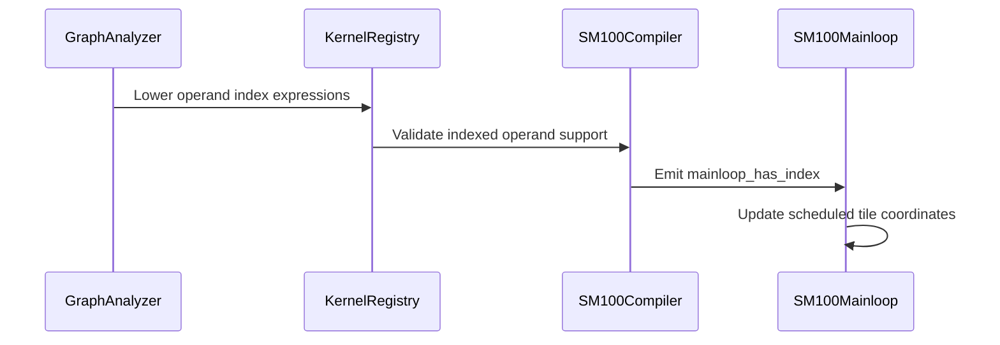

# feat(frost-gemm): fuse logical operand indices through views

[Upstream PR](https://github.com/NVIDIA/cudnn-frontend/pull/2186) · state: closed · merged: True

## Original PR description

## Before submitting

- [x] I agree to license this contribution under [LICENSE.txt](https://github.com/NVIDIA/cudnn-frontend/blob/develop/LICENSE.txt).
- [x] I ran `pre-commit run` and committed the formatting changes.
- [x] I reviewed the applicable root, Python and test AGENTS guides.
- [ ] Please apply `cat-feature`, `area:gemm`, `area:frost` and `orig-external`; repository labels may require maintainer permission.

## Affected area

Python graph lowering; FROST SM100 operand mainloop fusion; coordinate IR and tests.

## Summary

Deliver minimal logical coordinate-map infrastructure with its first operand feature: `gen_index` can cross fixed-shape reshape/last-two-axis transpose views and fuse into a GEMM operand mainloop, on A, B, or both.

For example:

```python
X[B,H,S,K]
 -> X + gen_index(X, axis=H)
 -> reshape[B,H*S,K]
 -> GEMM
```

The GEMM A coordinates `(b,m,k)` map back to `(b,m//S,m%S,k)`, so the original H index is `m//S`. The implementation composes consumer-to-producer maps rather than adding a special case for that reshape.

- Extend immutable `IndexExpr` with scoped integer graph-axis references and add/multiply; retain positive-constant division/remainder, checked Int64 constants, substitution, simplification and independent evaluation.
- Add fixed-shape `IndexMap` identity, full permutation, lexicographic reshape, broadcast and composition. Its rectangular domain and producer extents are explicit, shape/element-count constraints are checked, and conservative intermediate bounds must fit Int64. Broadcast is not assumed invertible. No symbolic extent inference or general algebra solver.
- Graph lowering composes view maps before matrix rank folding, then binds operand row/column axes to M/K or K/N. Auxiliary singleton broadcasting also uses the logical map; prepared-unit operand matrix axes remain live where the existing no-reshape contract allows rebinding.
- Permit same-carrier index branch fan-in such as `X + gen_index(X)`, using existing FusionOp parent references. Independent storage carriers and partial broadcasts across reshape remain rejected.
- Shared codegen renders integer expressions, preserving per-node compute/output dtype rounding. The SM100 mainloop supplies logical unswizzled coordinates for K-major and grouped M/N-major TMA layouts and tracks batch/spatial origins through CLC, cluster fallback, two-CTA and split-K projection.
- Guard expression evaluation by valid M/N/K coordinates and zero transformed padding after the complete DAG. Swap-AB substitutes M/N in the operand expressions while preserving K.

## API / compatibility and scope

- No public graph API, C++ binding, framework dependency or recipe execution signature changes.
- Logical maps are separate from `OperandView`/`reshape_layout` storage proofs. Unsupported zero-copy layouts still fail before launch; execute adds no allocation, conversion or GPU launch.
- One plain GEMM, BF16/FP16 MMA operands with no operand load cast. Existing scalar auxiliaries and per-K multiply contracts remain intact. This does not add an SM120 operand-pointwise template, mainloop reduction, general independent-input DAG, arbitrary batch-axis transpose lowering, or dynamic reshape.
- Fixed reshape source/target shape and stride contracts are unchanged. No unconstrained symbolic dimensions or extent strings are introduced.
- Existing kernels without logical indices compile out the new scheduler-coordinate work. No performance speedup or CPU-overhead claim is made.
- No repository Markdown or standalone sample changes. Keep draft pending native Blackwell validation.

## Related issues

Related to #2154 (logical epilogue indices), #2104 (operand views) and #2073 (rank/transpose normalization).


<!-- This is an auto-generated comment: release notes by coderabbit.ai -->

<!-- coderabbit-ai-generated:v1 -->

## Summary by CodeRabbit

* **New Features**
  * Frost GEMM now supports index-based values within matrix operands, including across reshape and transpose views, broadcasts, and batch or reduction coordinates.
  * Index expressions can combine coordinates using addition and multiplication.
  * Results are safely handled at matrix and reduction boundaries, with unsupported configurations rejected.

<!-- end of auto-generated comment: release notes by coderabbit.ai -->

## Review and discussion

### reviews

- copilot-pull-request-reviewer[bot] · COMMENTED · 2026-11-02T02:53:36Z · [source](https://github.com/NVIDIA/cudnn-frontend/pull/2186#pullrequestreview-5731619506)

Copilot was unable to review this pull request because the user who requested the review has insufficient remaining quota. Try requesting a review at a lower effort level.

- Anerudhan · APPROVED · 2026-11-02T03:21:33Z · [source](https://github.com/NVIDIA/cudnn-frontend/pull/2186#pullrequestreview-5731754705)

**Codex bot review · model: `gpt-6-astra`**

Reviewed `4e4bd29eec60` against base `969128549418`.

Thank you for your contribution! The logical maps, operand fan-in and scheduler coordinates are consistent with the native results. No approval-blocking finding. One new split-K test needs caller workspace so its advertised coverage can run.

**[P2] Supply caller workspace in the split-K regression test** ([source](https://github.com/NVIDIA/cudnn-frontend/blob/4e4bd29eec60d9b1e3bbd1f88d82e8035be78719/test/python/gemm/frost/test_matmul_operand_gen_index.py#L97))

The new L1 case test_frost_operand_index_gpu[ab-reshape-False-1-2-1] reaches execute with this unconditional None workspace and fails before launching: the plan requires 295936 bytes. It therefore does not test split-K coordinates, capture or repeatability. Allocate engine.get_workspace_size() bytes before execution, pass the buffer through normalization, and retain it through replay. The same test passes when only that workspace is supplied and kept alive.

Evidence: Exact-head native SM100 failure in the unmodified test; independent merged-tree control runs the original test function with caller-owned workspace and passes capture, rebinding and repeatability. Attribution: introduced

Validation: Reviewed all ten changed files and the clean merge with current develop. Checked coordinate composition, axis substitution, dtype rounding, same-carrier fan-in, unswizzled vector positions, transformed padding and preserved barrier participation (checklist A01/A07/C10). Native SM100, CuTeDSL 4.8.0: 204 operand/index checks passed on the merged tree, with only the reported workspace case excluded. A further 190 existing analyzer, codegen, scalar/per-K and reshape controls passed. The isolated workspace control passed the original split-K test. Three independent full-kernel probes passed with B=2, M=2056, N=3080, K=136, rank-four/rank-five source views, M/N/K tails and grids larger than the resident SM count. They cover one-CTA, swapped two-CTA and split-K=2 execution, changed inputs and bitwise repeatability of repeated calls. Pipeline 78462891 is running for python/gemm/frost. Its changed source and tests match the independently tested merge tree. Precheck reports no candidates; metadata is complete.

Limitations: Native execution was limited to SM100. Fallback-cluster execution was not forced; no sanitizer or performance result is claimed. CI remains pending.

Approved: no P0 or high-risk P1 found. Remaining findings stay with the owner; merge timing stays with the owner.

<!-- codex-fe-review:v2:2186:4e4bd29eec60d9b1e3bbd1f88d82e8035be78719:complete:no-blocker -->

- github-advanced-security[bot] · COMMENTED · 2026-11-02T03:23:57Z · [source](https://github.com/NVIDIA/cudnn-frontend/pull/2186#pullrequestreview-5731773719)

(No body; status only.)

- Anerudhan · COMMENTED · 2026-11-02T03:55:27Z · [source](https://github.com/NVIDIA/cudnn-frontend/pull/2186#pullrequestreview-5731934291)

**Codex bot review · model: `gpt-6-astra`**

Reviewed `81f4da7f775c` against base `969128549418`.

Thank you for your contribution! The split-K workspace finding and both CI parity findings are resolved. The test retains caller workspace through capture and graph reset; the parity checks now cover the mainloop stage without dropping identity or fallback assertions. The shared coordinate and analysis-local map changes preserve the checked behavior. No new finding; the existing approval remains applicable.

Validation: Reviewed all five files changed since 4e4bd29eec60 and their clean merge with current develop. Traced per-axis map selection, shared Int64 coordinates, per-K loads, final padding masks and workspace lifetime. Kernel synchronization and scheduler source are unchanged (checklist A01/A07/C10). Native SM100 with CuTeDSL 4.8.0: 283 focused operand-index, per-K and template-parity checks passed; two skipped. This includes the formerly failing split-K capture/replay case, shared multiple-axis fragments, scale/index combinations and workspace size rejection. On the merged tree, three independent full-kernel cases with two logical index axes per operand passed for B=2, M=2056, N=3080, K=136. They cover unequal extents, M/N/K tails, grids larger than the resident SM count, one-CTA, swapped two-CTA, split-K=2, changed inputs and bitwise repeatability. Both previously failing parity assertions also passed. A bounded current/prior/current SM100 timing check on the same multi-index workload found no material enqueue or GPU regression. This is a single workload on a shared device, not a general performance claim. Requested pipeline 78468302 for python/gemm/frost and approved the unchanged current-head test workflows. The pipeline's twelve changed files match the independently checked merge tree; its CI selectors still collect the affected L0 tests. Pipeline follow-up is active. Precheck has no candidates; PR metadata is complete.

Limitations: Native execution here was limited to SM100. Fallback-cluster execution was not forced and no sanitizer run is claimed. CI is still pending; the prior pipeline's two inherited failures remain separate from the resolved PR findings.

Comment only: this PR already has an active approval; preserving existing approvals.

<!-- codex-fe-review:v2:2186:81f4da7f775c16fe7272ebc3da6e85438f043d5e:complete:no-blocker -->

- github-advanced-security[bot] · COMMENTED · 2026-11-02T04:07:36Z · [source](https://github.com/NVIDIA/cudnn-frontend/pull/2186#pullrequestreview-5731989550)

(No body; status only.)

- YangXu1990uiuc · COMMENTED · 2026-11-02T04:16:40Z · [source](https://github.com/NVIDIA/cudnn-frontend/pull/2186#pullrequestreview-5732032945)

(No body; status only.)

- YangXu1990uiuc · COMMENTED · 2026-11-02T04:16:43Z · [source](https://github.com/NVIDIA/cudnn-frontend/pull/2186#pullrequestreview-5732033161)

(No body; status only.)

- YangXu1990uiuc · COMMENTED · 2026-11-02T04:16:46Z · [source](https://github.com/NVIDIA/cudnn-frontend/pull/2186#pullrequestreview-5732033404)

(No body; status only.)

### issue_comments

- meinie0826 · comment · 2026-11-02T02:38:11Z · [source](https://github.com/NVIDIA/cudnn-frontend/pull/2186#issuecomment-6567730540)

@cudnn-ci-bot run python/gemm/frost

- cudnn-ci-bot · comment · 2026-11-02T02:38:14Z · [source](https://github.com/NVIDIA/cudnn-frontend/pull/2186#issuecomment-6567731075)

Pipeline not launched

Reason: @meinie0826 is not allowlisted to run this bot.

Ask an allowlisted maintainer to comment `@cudnn-ci-bot run`.

- coderabbitai[bot] · comment · 2026-11-02T02:38:17Z · [source](https://github.com/NVIDIA/cudnn-frontend/pull/2186#issuecomment-6567731707)

<!-- coderabbit-ai-generated:v1 -->

<!-- This is an auto-generated comment: summarize by coderabbit.ai -->
<!-- review_stack_entry_start -->

<a href="https://app.coderabbit.ai/change-stack/NVIDIA/cudnn-frontend/pull/2186?scope=ghh_OusAJGA4HG8ljoOV0wJvVx8NmnZIjc2DdjmxOu0xZWA&amp;cs_source=review_comment"><picture><source media="(prefers-color-scheme: dark)" srcset="https://storage.googleapis.com/coderabbit_public_assets/review-stack-in-coderabbit-ui-dark.svg?v=3"><source media="(prefers-color-scheme: light)" srcset="https://storage.googleapis.com/coderabbit_public_assets/review-stack-in-coderabbit-ui.svg?v=3"></picture></a>

<!-- review_stack_entry_end -->
<!-- This is an auto-generated comment: skip review by coderabbit.ai -->

> [!IMPORTANT]
> ## Review skipped
> 
> Auto reviews are disabled on this repository. Please check the settings in the CodeRabbit UI or the `.coderabbit.yaml` file in this repository. To trigger a single review, invoke the `@coderabbitai review` command.
> 
> <details>
> <summary><strong><picture><source media="(prefers-color-scheme: dark)" srcset="https://storage.googleapis.com/coderabbit_public_assets/review-comment-icons-v1/cog-dark.svg"></picture> Run configuration</strong></summary>
> <dl>
> <dd>
> 
> - **Source mode**: Auto
> - **Repository**: [NVIDIA/cudnn-frontend](<https://github.com/NVIDIA/cudnn-frontend>)
> - **Branch**: [develop](<https://github.com/NVIDIA/cudnn-frontend/tree/develop>)
> - **File**: [.coderabbit.yaml](<https://github.com/NVIDIA/cudnn-frontend/blob/969128549418931b2137817ed2c38639b246ce58/.coderabbit.yaml>)
> - **Commit**: [9691285](<https://github.com/NVIDIA/cudnn-frontend/commit/969128549418931b2137817ed2c38639b246ce58>)
> - **Layers**: Repository YAML
> - **Review profile**: CHILL
> - **Plan**: Enterprise
> - **Run ID**: `f462f96d-dd6c-4c1b-904d-82215d3cc933`
> 
> </dd>
> </dl>
> </details>
> 
> You can disable this status message by setting the `reviews.review_status` to `false` in the CodeRabbit configuration file.
> 
> Use the checkbox below for a quick retry:
> - [ ] <!-- {"checkboxId":"e9bb8d72-00e8-4f67-9cb2-caf3b22574fe"} --> Trigger review

<!-- end of auto-generated comment: skip review by coderabbit.ai -->

<!-- recent_review_start -->

No actionable comments were generated in the recent review.

<details>
<summary><strong><picture></picture> Recent review info</strong></summary>
<dl>
<dd>

<!-- review_info_content -->
<details>
<summary><strong><picture><source media="(prefers-color-scheme: dark)" srcset="https://storage.googleapis.com/coderabbit_public_assets/review-comment-icons-v1/cog-dark.svg"></picture> Run configuration</strong></summary>
<dl>
<dd>

- **Source mode**: Auto
- **Repository**: [NVIDIA/cudnn-frontend](<https://github.com/NVIDIA/cudnn-frontend>)
- **Branch**: [develop](<https://github.com/NVIDIA/cudnn-frontend/tree/develop>)
- **File**: [.coderabbit.yaml](<https://github.com/NVIDIA/cudnn-frontend/blob/969128549418931b2137817ed2c38639b246ce58/.coderabbit.yaml>)
- **Commit**: [9691285](<https://github.com/NVIDIA/cudnn-frontend/commit/969128549418931b2137817ed2c38639b246ce58>)
- **Layers**: Repository YAML
- **Review profile**: CHILL
- **Plan**: Enterprise
- **Run ID**: `f025e744-66bb-4f3b-afbc-d3b956f52846`

</dd>
</dl>
</details>

<details>
<summary><strong><picture><source media="(prefers-color-scheme: dark)" srcset="https://storage.googleapis.com/coderabbit_public_assets/review-comment-icons-v1/git-commit-horizontal-dark.svg"></picture> Commits</strong></summary>
<dl>
<dd>

Reviewing files that changed from the base of the PR and between 969128549418931b2137817ed2c38639b246ce58 and 4e4bd29eec60d9b1e3bbd1f88d82e8035be78719.

</dd>
</dl>
</details>

<details>
<summary><strong><picture><source media="(prefers-color-scheme: dark)" srcset="https://storage.googleapis.com/coderabbit_public_assets/review-comment-icons-v1/file-plus-corner-dark.svg"></picture> Files selected for processing: 10</strong></summary>
<dl>
<dd>

* `python/cudnn/gemm/frost/epilogue_codegen.py`
* `python/cudnn/gemm/frost/fusion_ir.py`
* `python/cudnn/gemm/frost/graph_analyzer.py`
* `python/cudnn/gemm/frost/kernel_registry.py`
* `python/cudnn/gemm/frost/sm100/compiler.py`
* `python/cudnn/gemm/frost/sm100/kernel_templates/sm100_matmul_mainloop.py`
* `test/python/gemm/frost/test_logical_gen_index.py`
* `test/python/gemm/frost/test_matmul_mainloop_fusion.py`
* `test/python/gemm/frost/test_matmul_operand_gen_index.py`
* `test/python/gemm/frost/test_matmul_reshape_mainloop.py`

</dd>
</dl>
</details>

**Included review availability:** This review used your included allowance. Your plan provides up to 12 included reviews per hour; 11 remain after this review.

</dd>
</dl>
</details>


<!-- recent_review_end -->
<!-- walkthrough_start -->

<details>
<summary><strong>Walkthrough</strong></summary>
<dl>
<dd>

Frost GEMM now supports lowered logical index expressions on supported operands. Graph analysis maps indices through reshape and permutation views, and generated mainloops evaluate the expressions using tile coordinates.

**Changes: Logical indexed GEMM operands**

|Layer / File(s)|Summary|
|:---|:---|
|**Index expressions and coordinate maps** <br> `python/cudnn/gemm/frost/fusion_ir.py`, `test/python/gemm/frost/test_logical_gen_index.py`|`IndexExpr` supports addition and multiplication with folding, substitution, and evaluation. `IndexMap` supports identity, permutation, reshape, broadcast, composition, and coordinate binding. Fusion validation applies operand-specific axis rules, and operand swapping transforms indexed operations. Tests cover mappings, arithmetic, and validation.|
|**Operand graph index lowering** <br> `python/cudnn/gemm/frost/graph_analyzer.py`, `test/python/gemm/frost/test_matmul_mainloop_fusion.py`, `test/python/gemm/frost/test_matmul_operand_gen_index.py`, `test/python/gemm/frost/test_matmul_reshape_mainloop.py`|Graph analysis lowers index expressions through supported operand views and chains. It handles supported binary branches and checks storage-carrier constraints. Tests check coordinate expressions and invalid graph cases.|
|**Mainloop code generation and execution** <br> `python/cudnn/gemm/frost/epilogue_codegen.py`, `python/cudnn/gemm/frost/kernel_registry.py`, `python/cudnn/gemm/frost/sm100/compiler.py`, `python/cudnn/gemm/frost/sm100/kernel_templates/sm100_matmul_mainloop.py`, `test/python/gemm/frost/test_matmul_operand_gen_index.py`|Code generation evaluates index expressions per lane and masks invalid coordinates. Kernel validation checks operand dtype, load casts, and lowered coordinates. SM100 code emits and uses `mainloop_has_index` to update scheduled tile coordinates. Tests cover generated fragments, full GEMM execution, and scheduler configurations.|

<!-- change_assessment_start -->


**Estimated code review effort:** 4 (Complex) | ~60 minutes

<!-- change_assessment_commit:"4e4bd29eec60d9b1e3bbd1f88d82e8035be78719" -->
<!-- change_assessment_priority:{"version":1,"urgency":"p2","manual":false} -->
**Change:** Feature
<!-- change_assessment_end -->

### Sequence Diagram(s)



**Suggested reviewers:** `yanqinz2`

</dd>
</dl>
</details>

<!-- walkthrough_end -->
<details>
<summary><strong>Merge Risk:</strong> <strong><picture></picture> Minimal</strong> · previous review <code>4e4bd</code></summary>
<dl>
<dd>

<!-- final_review_risk_start -->
<!-- final_review_risk_label
**Merge Risk:** **⚪ Minimal** · up to `4e4bd`
-->
<!-- final_review_risk_coverage:{"sourceCommitId":"4e4bd29eec60d9b1e3bbd1f88d82e8035be78719","coveredCommitId":"4e4bd29eec60d9b1e3bbd1f88d82e8035be78719","kind":"reviewed"} -->

This change adds logical index fusion for FROST GEMM operands, and no concrete defect remains after review. Native Blackwell validation is still pending on the draft PR, which is normal before merge.
<!-- final_review_risk_end -->

</dd>
</dl>
</details>
<!-- pre_merge_checks_walkthrough_start -->

<details>
<summary><strong>Pre-merge checks: <sup><picture></picture></sup> 4 · <sup><picture></picture></sup> 1</strong></summary>
<dl>
<dd>

<strong><sup><picture></picture></sup> Failed checks: 1 warning</strong>

|     Check name     |                                              Status                                              | Explanation                                                                                                                                                                                               | Resolution                                                                         |
| :---------------- | :----------------------------------------------------------------------------------------------: | :-------------------------------------------------------------------------------------------------------------------------------------------------------------------------------------------------------- | :--------------------------------------------------------------------------------- |
| Docstring Coverage |  | Docstring coverage is 56.52% which is insufficient. The required threshold is 80.00%. Docstring coverage is scoped to functions touched by this diff with cyclomatic complexity of at least 2. Documenta… | Write docstrings for the functions missing them to satisfy the coverage threshold. |

<details>
<summary><strong><sup><picture></picture></sup> Passed checks: 4 passed</strong></summary>
<dl>
<dd>

|         Check name         |                                             Status                                             | Explanation                                                                                                                                                                                               |
| :------------------------ | :--------------------------------------------------------------------------------------------: | :-------------------------------------------------------------------------------------------------------------------------------------------------------------------------------------------------------- |
|         Title check        |  | The title clearly and concisely describes the main change: fusing FROST GEMM logical operand indices through views.                                                                                       |
|      Description check     |  | The description is detailed and covers the affected area, summary, rationale, compatibility impact, scope limits, and related issues. It is mostly complete, but it omits the required Testing section w… |
|     Linked Issues check    |  | Check skipped because no linked issues were found for this pull request.                                                                                                                                  |
| Out of Scope Changes check |  | Check skipped because no linked issues were found for this pull request.                                                                                                                                  |

<details>
<summary><strong>Full details: Description check</strong></summary>
<dl>
<dd>

**Explanation**

The description is detailed and covers the affected area, summary, rationale, compatibility impact, scope limits, and related issues. It is mostly complete, but it omits the required Testing section with exact commands and results.

</dd>
</dl>
</details>

</dd>
</dl>
</details>

<details>
<summary><strong>Full details: Docstring Coverage</strong></summary>
<dl>
<dd>

**Explanation**

Docstring coverage is 56.52% which is insufficient. The required threshold is 80.00%. Docstring coverage is scoped to functions touched by this diff with cyclomatic complexity of at least 2. Documentation-only edits and deletions within surviving functions are included; unchanged diff context and fully deleted functions are excluded. Analyzed 46 functions across 10 files.

**Resolution**

Write docstrings for the functions missing them to satisfy the coverage threshold.

</dd>
</dl>
</details>

</dd>
</dl>
</details>

<!-- pre_merge_checks_walkthrough_end -->
<!-- finishing_touch_checkbox_start -->

<details>
<summary><strong>Finishing Touches</strong></summary>
<dl>
<dd>

<details open>
<summary><strong>Generate unit tests (beta)</strong></summary>
<dl>
<dd>

- [ ] <!-- {"checkboxId": "f47ac10b-58cc-4372-a567-0e02b2c3d479", "radioGroupId": "utg-output-choice-group-6567914705"} --> Create a new PR

</dd>
</dl>
</details>

</dd>
</dl>
</details>

<!-- finishing_touch_checkbox_end -->

<!-- autopilot:start -->
- [ ] <!-- {"checkboxId":"2708ad07-9f24-4260-9c11-7dc76a49f2e3"} --> <strong title="Keep fixing CodeRabbit findings and required CI, and resolving merge conflicts">Autofix</strong> · Keep fixing CodeRabbit findings and required CI, and resolving merge conflicts
<!-- autopilot:end -->

- meinie0826 · comment · 2026-11-02T02:54:03Z · [source](https://github.com/NVIDIA/cudnn-frontend/pull/2186#issuecomment-6567914705)

@coderabbitai full review

- coderabbitai[bot] · comment · 2026-11-02T02:54:09Z · [source](https://github.com/NVIDIA/cudnn-frontend/pull/2186#issuecomment-6567915934)

<!-- coderabbit-ai-generated:v1 -->

<!-- This is an auto-generated reply by CodeRabbit -->
<!-- CodeRabbit review command invocation: v2:f36e575768f3d0a899a608ee34478667f794c23620ee2b46f7ba2d47affcc762 -->
<details>
<summary>Action performed</summary>
<dl>
<dd>

Full review finished.

</dd>
</dl>
</details>

- Anerudhan · comment · 2026-11-02T03:14:19Z · [source](https://github.com/NVIDIA/cudnn-frontend/pull/2186#issuecomment-6568161143)

I am requesting test CI for `4e4bd29eec60` with the following standalone command: `@cudnn-ci-bot run python/gemm/frost`. For future updates, request the appropriate test target before review; a maintainer may need to trigger it.

Codex bot review — model `gpt-6-astra`.

<!-- codex-fe-ci:v1:2186:4e4bd29eec60d9b1e3bbd1f88d82e8035be78719:request-gemm-frost-notice -->

- Anerudhan · comment · 2026-11-02T03:14:26Z · [source](https://github.com/NVIDIA/cudnn-frontend/pull/2186#issuecomment-6568162633)

@cudnn-ci-bot run python/gemm/frost

- cudnn-ci-bot · comment · 2026-11-02T03:14:30Z · [source](https://github.com/NVIDIA/cudnn-frontend/pull/2186#issuecomment-6568163405)

🏁 Pipeline finished

SHA: `4e4bd29`
Targets: `python/gemm/frost`
Branch: [cudnn-gh/pr-2186-4e4bd29](https://nv/cudnn-gitlab-ci/-/tree/cudnn-gh/pr-2186-4e4bd29)
Pipeline: [78462891](https://nv/cudnn-gitlab-ci/-/pipelines/78462891)
Last updated: 2026-11-02 03:25 UTC

**20 passed, 1 failed, 12 manual**

### <code>manual</code>

- <code>manual:python_samples</code> - Manual
- <code>manual:python/sdpa/frost</code> - Manual
- <code>manual:python/sdpa/misc</code> - Manual
- <code>manual:python/linear_attention</code> - Manual
- <code>manual:python/gemm/frost</code> - ✅ Passed
- <code>manual:python/gemm/cutedsl</code> - Manual
- <code>manual:python/gemm/misc</code> - Manual
- <code>manual:python/conv</code> - Manual
- <code>manual:python/norm</code> - Manual
- <code>manual:python/misc</code> - Manual
- <code>manual:pycudnn</code> - Manual
- <code>manual:multi_gpu</code> - Manual
- <code>manual:backend</code> - Manual

### <code>analysis</code>

- <code>analysis:cudnn_clang_disable_exception</code> - ✅ Passed
- <code>analysis:cudnn_v9_no_half_conversion</code> - ✅ Passed
- <code>analysis:cudnn_clang</code> - ✅ Passed
- <code>analysis:check-relative-includes</code> - ✅ Passed
- <code>analysis:check-CUDNN_FRONTEND_SKIP_JSON_LIB</code> - ✅ Passed
- <code>analysis:guardwords_scan</code> - ✅ Passed
- <code>analysis:jax-import-guard</code> - ✅ Passed
- <code>analysis:pytest-gpu</code> - ✅ Passed
- <code>san:build</code> - ✅ Passed

### <code>build</code>

- <code>analysis:api_index</code> - ✅ Passed
- <code>build:dev:linux:amd64</code> - ✅ Passed
- <code>build:rel:linux:amd64</code> - ✅ Passed
- <code>build:dev:linux:arm64</code> - ✅ Passed
- <code>build:rel:linux:arm64</code> - ✅ Passed
- <code>build:rel:win:amd64</code> - ✅ Passed

### <code>python/gemm/frost</code>

- <code>python/gemm/frost:be-9.27.0-cutedsl-4.8.0:sm100</code> - ❌ **Old Failure** (nightly failed)

### <code>sanitizer_tests</code>

- <code>san:cpp_test:sm80</code> - ✅ Passed
- <code>san:cpp_test:sm90</code> - ✅ Passed
- <code>san:cpp_test:sm100</code> - ✅ Passed

### <code>triage</code>

- <code>triage:ai</code> - ✅ Passed

- Anerudhan · comment · 2026-11-02T03:28:28Z · [source](https://github.com/NVIDIA/cudnn-frontend/pull/2186#issuecomment-6568343923)

CI follow-up for `4e4bd29eec60`: all 180 selected index tests passed on SM100. Two additional **P2 test-maintenance issues** need attention in `test_template_epilogue_parity.py`: the L2 check still expects three calls, while the new mainloop coordinate stage adds a fourth; the mask/shift check assumes `m_idx`/`n_idx`, while that stage uses `_m_idx`/`_n_idx`. Extend the checks to cover the new stage while retaining their identity and preferred/fallback assertions. Both checks pass on current develop and fail on this integration tree.

The other two SM100 failures reproduce on base `969128549418`: a template-inventory count of 18 versus 14, and the plain-gather MoE AVG compile error for missing `moe_used_rows`. They are not introduced here.

The two CodeQL unused-variable reports concern template inputs `ml_coord_m` and `ml_batch`. Generated mainloop snippets read those values; retain them. Pipeline 78462891 is still running.

Codex bot review — model `gpt-6-astra`.

<!-- codex-fe-ci:v1:2186:4e4bd29eec60d9b1e3bbd1f88d82e8035be78719:ci-parity-checks-78462891 -->

- Anerudhan · comment · 2026-11-02T03:29:24Z · [source](https://github.com/NVIDIA/cudnn-frontend/pull/2186#issuecomment-6568354937)

Pipeline 78462891 has now finished with one failed job: SM100 GEMM FROST. Its four failures and the 180 passing index tests are detailed in the [CI follow-up](https://github.com/NVIDIA/cudnn-frontend/pull/2186#issuecomment-6568343923). No additional job failed. Style, Security and metadata checks passed.

Codex bot review — model `gpt-6-astra`.

<!-- codex-fe-ci:v1:2186:4e4bd29eec60d9b1e3bbd1f88d82e8035be78719:pipeline-78462891-finished -->

- meinie0826 · comment · 2026-11-02T03:34:49Z · [source](https://github.com/NVIDIA/cudnn-frontend/pull/2186#issuecomment-6568418497)

Updated in 81f4da7f (ordinary push; the original commit is retained).

- Prepare logical operand fragment coordinates and validity once, sharing them across gen_index, per-K scaling and final padding masking. Cache view IndexMaps within one analysis.
- Supply caller-owned workspace to the split-K capture regression and retain it through graph reset. Added host coverage for missing/undersized workspace and pointer/capacity forwarding.
- Update the L2 parity checks for the mainloop coordinate stage, including its own CLC response bindings. Identity and preferred/fallback assertions remain active; deliberate identity/fallback corruptions are rejected.
- Retain ml_coord_m and ml_batch: generated snippets consume these template inputs.

Local validation on H20 / SM90, DSL 4.8.1:
- The analyzer/recipe/transpose/operand-index/per-K regression subset: 921 passed, 170 skipped; logical-index/reshape/mainloop/epilogue subset: 193 passed, 495 skipped.
- After the workspace fix: test_matmul_operand_gen_index.py with `-k "not generated_transform" -m "L0 or L1"`: 84 passed, 28 skipped.
- After the CI parity fix: test_template_epilogue_parity.py: 42 passed, 2 skipped. pre-commit passed.

Native SM100 scheduler/capture execution is not available locally; the prior SM100 review applies to the previous head. Could an allowlisted maintainer rerun `@cudnn-ci-bot run python/gemm/frost` for this new head before re-review?

- Anerudhan · comment · 2026-11-02T03:49:44Z · [source](https://github.com/NVIDIA/cudnn-frontend/pull/2186#issuecomment-6568594440)

Requesting GEMM FROST CI for 81f4da7f775c after reviewing the workspace, parity-check and shared-coordinate changes. The selected target covers the changed GEMM tests. Native follow-up checks are in progress.

Codex bot review — model `gpt-6-astra`.

<!-- codex-fe-ci:v1:2186:81f4da7f775c16fe7272ebc3da6e85438f043d5e:request-gemm-frost-notice -->

- Anerudhan · comment · 2026-11-02T03:50:08Z · [source](https://github.com/NVIDIA/cudnn-frontend/pull/2186#issuecomment-6568598806)

@cudnn-ci-bot run python/gemm/frost

- cudnn-ci-bot · comment · 2026-11-02T03:50:11Z · [source](https://github.com/NVIDIA/cudnn-frontend/pull/2186#issuecomment-6568599571)

🏁 Pipeline finished

SHA: `81f4da7`
Targets: `python/gemm/frost`
Branch: [cudnn-gh/pr-2186-81f4da7](https://nv/cudnn-gitlab-ci/-/tree/cudnn-gh/pr-2186-81f4da7)
Pipeline: [78468302](https://nv/cudnn-gitlab-ci/-/pipelines/78468302)
Last updated: 2026-11-02 04:01 UTC

**20 passed, 1 failed, 12 manual**

### <code>manual</code>

- <code>manual:python_samples</code> - Manual
- <code>manual:python/sdpa/frost</code> - Manual
- <code>manual:python/sdpa/misc</code> - Manual
- <code>manual:python/linear_attention</code> - Manual
- <code>manual:python/gemm/frost</code> - ✅ Passed
- <code>manual:python/gemm/cutedsl</code> - Manual
- <code>manual:python/gemm/misc</code> - Manual
- <code>manual:python/conv</code> - Manual
- <code>manual:python/norm</code> - Manual
- <code>manual:python/misc</code> - Manual
- <code>manual:pycudnn</code> - Manual
- <code>manual:multi_gpu</code> - Manual
- <code>manual:backend</code> - Manual

### <code>analysis</code>

- <code>analysis:cudnn_clang_disable_exception</code> - ✅ Passed
- <code>analysis:cudnn_v9_no_half_conversion</code> - ✅ Passed
- <code>analysis:cudnn_clang</code> - ✅ Passed
- <code>analysis:check-relative-includes</code> - ✅ Passed
- <code>analysis:check-CUDNN_FRONTEND_SKIP_JSON_LIB</code> - ✅ Passed
- <code>analysis:guardwords_scan</code> - ✅ Passed
- <code>analysis:jax-import-guard</code> - ✅ Passed
- <code>analysis:pytest-gpu</code> - ✅ Passed
- <code>san:build</code> - ✅ Passed

### <code>build</code>

- <code>analysis:api_index</code> - ✅ Passed
- <code>build:dev:linux:amd64</code> - ✅ Passed
- <code>build:rel:linux:amd64</code> - ✅ Passed
- <code>build:dev:linux:arm64</code> - ✅ Passed
- <code>build:rel:linux:arm64</code> - ✅ Passed
- <code>build:rel:win:amd64</code> - ✅ Passed

### <code>python/gemm/frost</code>

- <code>python/gemm/frost:be-9.27.0-cutedsl-4.8.0:sm100</code> - ❌ **Old Failure** (nightly failed)

### <code>sanitizer_tests</code>

- <code>san:cpp_test:sm80</code> - ✅ Passed
- <code>san:cpp_test:sm90</code> - ✅ Passed
- <code>san:cpp_test:sm100</code> - ✅ Passed

### <code>triage</code>

- <code>triage:ai</code> - ✅ Passed

- YangXu1990uiuc · comment · 2026-11-02T04:02:37Z · [source](https://github.com/NVIDIA/cudnn-frontend/pull/2186#issuecomment-6568743508)

Thanks for the contribution! When you feel this is ready for us to take through review and merge, please leave a comment saying `ready`. The review bot will review it (or the latest updates), and we will help work through remaining fixes and validation toward the final merge. The requested CI for `81f4da7f775c` is already running, so we will follow that run rather than launch a duplicate. A CI request alone is not being treated as permission to merge.

<!-- fe-external-watch:ready-invitation:2186:v1 -->


- meinie0826 · comment · 2026-11-02T04:04:03Z · [source](https://github.com/NVIDIA/cudnn-frontend/pull/2186#issuecomment-6568760101)

ready

- Anerudhan · comment · 2026-11-02T04:06:02Z · [source](https://github.com/NVIDIA/cudnn-frontend/pull/2186#issuecomment-6568784619)

Pipeline 78468302 finished for `81f4da7f775c`. SM100 passed 151 operand-index, 65 per-K and 42 template-parity tests; two parity tests were skipped. The previous parity failures are resolved. The L1 split-K capture test also passed locally.

The only failed job reports the same two failures reproduced on base `969128549418`: the template-inventory assertion (18 versus 14) and the plain-gather MoE AVG compile error for `moe_used_rows`. No new failure was found among the 11,786 SM100 cases. All other launched pipeline jobs passed. Style and metadata checks passed; Python CodeQL is still running.

Codex bot review — model `gpt-6-astra`.

<!-- codex-fe-ci:v1:2186:81f4da7f775c16fe7272ebc3da6e85438f043d5e:pipeline-78468302-finished -->

- YangXu1990uiuc · comment · 2026-11-02T04:17:44Z · [source](https://github.com/NVIDIA/cudnn-frontend/pull/2186#issuecomment-6568932901)

Thanks for the contribution and the follow-up fixes! Merged as `0af9c1050dc8` after checking the approved head `81f4da7f775c` and the actual develop integration.

The actual integrated source passed 283 focused operand-index, per-K and template-parity checks on native SM103 (2 skipped), including capture/replay. The completed current-head GPU pipeline has two remaining failures: the template-inventory assertion and plain-gather MoE AVG compilation. I independently reproduced both on unmodified develop 969128549418; they remain separate baseline follow-ups. The PR-specific parity failures are resolved. All three CodeQL review threads were examined and resolved with generated-source or control-flow evidence; security checks were not bypassed.

Required merge checks, Style, and Security passed. The normal merge used the full head SHA, and the merged tree matches the tested integration.

<!-- fe-external-watch:merged:2186:81f4da7f775c16fe7272ebc3da6e85438f043d5e -->


### inline_comments

- github-advanced-security[bot] · comment · 2026-11-02T03:23:57Z · [source](https://github.com/NVIDIA/cudnn-frontend/pull/2186#discussion_r4438643159)

File: `python/cudnn/gemm/frost/sm100/kernel_templates/sm100_matmul_mainloop.py` · line 1095

## CodeQL / Unused local variable

Variable ml_coord_m is not used.

[Show more details](https://github.com/NVIDIA/cudnn-frontend/security/code-scanning/4689)

- github-advanced-security[bot] · comment · 2026-11-02T03:23:57Z · [source](https://github.com/NVIDIA/cudnn-frontend/pull/2186#discussion_r4438643191)

File: `python/cudnn/gemm/frost/sm100/kernel_templates/sm100_matmul_mainloop.py` · line 1100

## CodeQL / Unused local variable

Variable ml_batch is not used.

[Show more details](https://github.com/NVIDIA/cudnn-frontend/security/code-scanning/4690)

- github-advanced-security[bot] · comment · 2026-11-02T04:07:36Z · [source](https://github.com/NVIDIA/cudnn-frontend/pull/2186#discussion_r4438828054)

File: `python/cudnn/gemm/frost/epilogue_codegen.py` · line 973

## CodeQL / Potentially uninitialized local variable

Local variable 'index_valid' may be used before it is initialized.

[Show more details](https://github.com/NVIDIA/cudnn-frontend/security/code-scanning/4691)

- YangXu1990uiuc · comment · 2026-11-02T04:16:40Z · [source](https://github.com/NVIDIA/cudnn-frontend/pull/2186#discussion_r4438863374)

File: `python/cudnn/gemm/frost/sm100/kernel_templates/sm100_matmul_mainloop.py` · line 1095

This binding is consumed by generated mainloop code. `_prepare_mainloop_index_coordinates` emits `cutlass.Int64(ml_coord_m)` into the operand fragment coordinate calculation. I checked the rendered kernels from the current integrated source: the generated AST contains reads of this variable, including both storage layouts and split-K. The template file alone does not contain those injected reads. Native SM103 validation passed 283 focused operand-index, per-K and template-parity checks (2 skipped). Resolving this unused-variable template false positive; the binding is required.

<!-- fe-external-watch:2186:codeql:4438643159:81f4da7f775c16fe7272ebc3da6e85438f043d5e -->

- YangXu1990uiuc · comment · 2026-11-02T04:16:43Z · [source](https://github.com/NVIDIA/cudnn-frontend/pull/2186#discussion_r4438863535)

File: `python/cudnn/gemm/frost/sm100/kernel_templates/sm100_matmul_mainloop.py` · line 1100

This binding supplies the batch coordinate for generated operand-index expressions when the operand batch is greater than one. `_prepare_mainloop_index_coordinates` maps `Axis.BATCH` to `ml_batch`, and the rendered kernel AST contains the resulting reads. The template alone hides those injected reads. Native SM103 validation passed 283 focused checks (2 skipped), including batched operand indices and split-K capture/replay. Resolving this unused-variable template false positive; the binding is required.

<!-- fe-external-watch:2186:codeql:4438643191:81f4da7f775c16fe7272ebc3da6e85438f043d5e -->

- YangXu1990uiuc · comment · 2026-11-02T04:16:46Z · [source](https://github.com/NVIDIA/cudnn-frontend/pull/2186#discussion_r4438863749)

File: `python/cudnn/gemm/frost/epilogue_codegen.py` · line 973

The use here is dominated by `op.op == "gen_index"`. Before iterating over this same operation list, `has_index = any(op.op == "gen_index" for op in ops)` causes `_prepare_mainloop_index_coordinates` to initialize `index_coordinates` and `index_valid`. The loop does not mutate the operation list or operation kinds. Thus entering this branch implies that initialization already ran. The other uses are guarded by `has_index` as well. Native SM103 validation of the integrated source passed 283 operand-index, per-K and template-parity checks (2 skipped), including indexed and non-indexed paths. Resolving this path-correlation false positive.

<!-- fe-external-watch:2186:codeql:4438828054:81f4da7f775c16fe7272ebc3da6e85438f043d5e -->

## Changed files and fixed code

- `python/cudnn/gemm/frost/epilogue_codegen.py` · modified · additions 88 / deletions 7
  - [head](https://github.com/meinie0826/cudnn-frontend/blob/81f4da7f775c16fe7272ebc3da6e85438f043d5e/python/cudnn/gemm/frost/epilogue_codegen.py)
  - [base](https://github.com/NVIDIA/cudnn-frontend/blob/969128549418931b2137817ed2c38639b246ce58/python/cudnn/gemm/frost/epilogue_codegen.py)
- `python/cudnn/gemm/frost/fusion_ir.py` · modified · additions 164 / deletions 16
  - [head](https://github.com/meinie0826/cudnn-frontend/blob/81f4da7f775c16fe7272ebc3da6e85438f043d5e/python/cudnn/gemm/frost/fusion_ir.py)
  - [base](https://github.com/NVIDIA/cudnn-frontend/blob/969128549418931b2137817ed2c38639b246ce58/python/cudnn/gemm/frost/fusion_ir.py)
- `python/cudnn/gemm/frost/graph_analyzer.py` · modified · additions 118 / deletions 70
  - [head](https://github.com/meinie0826/cudnn-frontend/blob/81f4da7f775c16fe7272ebc3da6e85438f043d5e/python/cudnn/gemm/frost/graph_analyzer.py)
  - [base](https://github.com/NVIDIA/cudnn-frontend/blob/969128549418931b2137817ed2c38639b246ce58/python/cudnn/gemm/frost/graph_analyzer.py)
- `python/cudnn/gemm/frost/kernel_registry.py` · modified · additions 7 / deletions 0
  - [head](https://github.com/meinie0826/cudnn-frontend/blob/81f4da7f775c16fe7272ebc3da6e85438f043d5e/python/cudnn/gemm/frost/kernel_registry.py)
  - [base](https://github.com/NVIDIA/cudnn-frontend/blob/969128549418931b2137817ed2c38639b246ce58/python/cudnn/gemm/frost/kernel_registry.py)
- `python/cudnn/gemm/frost/sm100/compiler.py` · modified · additions 1 / deletions 0
  - [head](https://github.com/meinie0826/cudnn-frontend/blob/81f4da7f775c16fe7272ebc3da6e85438f043d5e/python/cudnn/gemm/frost/sm100/compiler.py)
  - [base](https://github.com/NVIDIA/cudnn-frontend/blob/969128549418931b2137817ed2c38639b246ce58/python/cudnn/gemm/frost/sm100/compiler.py)
- `python/cudnn/gemm/frost/sm100/kernel_templates/sm100_matmul_mainloop.py` · modified · additions 22 / deletions 0
  - [head](https://github.com/meinie0826/cudnn-frontend/blob/81f4da7f775c16fe7272ebc3da6e85438f043d5e/python/cudnn/gemm/frost/sm100/kernel_templates/sm100_matmul_mainloop.py)
  - [base](https://github.com/NVIDIA/cudnn-frontend/blob/969128549418931b2137817ed2c38639b246ce58/python/cudnn/gemm/frost/sm100/kernel_templates/sm100_matmul_mainloop.py)
- `test/python/gemm/frost/test_logical_gen_index.py` · modified · additions 49 / deletions 3
  - [head](https://github.com/meinie0826/cudnn-frontend/blob/81f4da7f775c16fe7272ebc3da6e85438f043d5e/test/python/gemm/frost/test_logical_gen_index.py)
  - [base](https://github.com/NVIDIA/cudnn-frontend/blob/969128549418931b2137817ed2c38639b246ce58/test/python/gemm/frost/test_logical_gen_index.py)
- `test/python/gemm/frost/test_matmul_mainloop_fusion.py` · modified · additions 6 / deletions 6
  - [head](https://github.com/meinie0826/cudnn-frontend/blob/81f4da7f775c16fe7272ebc3da6e85438f043d5e/test/python/gemm/frost/test_matmul_mainloop_fusion.py)
  - [base](https://github.com/NVIDIA/cudnn-frontend/blob/969128549418931b2137817ed2c38639b246ce58/test/python/gemm/frost/test_matmul_mainloop_fusion.py)
- `test/python/gemm/frost/test_matmul_operand_gen_index.py` · added · additions 405 / deletions 0
  - [head](https://github.com/meinie0826/cudnn-frontend/blob/81f4da7f775c16fe7272ebc3da6e85438f043d5e/test/python/gemm/frost/test_matmul_operand_gen_index.py)
  - [base](https://github.com/NVIDIA/cudnn-frontend/blob/969128549418931b2137817ed2c38639b246ce58/test/python/gemm/frost/test_matmul_operand_gen_index.py)
- `test/python/gemm/frost/test_matmul_per_k_scale.py` · modified · additions 17 / deletions 3
  - [head](https://github.com/meinie0826/cudnn-frontend/blob/81f4da7f775c16fe7272ebc3da6e85438f043d5e/test/python/gemm/frost/test_matmul_per_k_scale.py)
  - [base](https://github.com/NVIDIA/cudnn-frontend/blob/969128549418931b2137817ed2c38639b246ce58/test/python/gemm/frost/test_matmul_per_k_scale.py)
- `test/python/gemm/frost/test_matmul_reshape_mainloop.py` · modified · additions 6 / deletions 5
  - [head](https://github.com/meinie0826/cudnn-frontend/blob/81f4da7f775c16fe7272ebc3da6e85438f043d5e/test/python/gemm/frost/test_matmul_reshape_mainloop.py)
  - [base](https://github.com/NVIDIA/cudnn-frontend/blob/969128549418931b2137817ed2c38639b246ce58/test/python/gemm/frost/test_matmul_reshape_mainloop.py)
- `test/python/gemm/frost/test_template_epilogue_parity.py` · modified · additions 7 / deletions 2
  - [head](https://github.com/meinie0826/cudnn-frontend/blob/81f4da7f775c16fe7272ebc3da6e85438f043d5e/test/python/gemm/frost/test_template_epilogue_parity.py)
  - [base](https://github.com/NVIDIA/cudnn-frontend/blob/969128549418931b2137817ed2c38639b246ce58/test/python/gemm/frost/test_template_epilogue_parity.py)

## Evidence and interpretation boundary

[Original JSON, discussions and patches](../../../../../../evidence/prs/NVIDIA--cudnn-frontend/2186-f58feab54ad5d39962b4fbcbaa20cbe3971753ea80d45012ae8dc59d9c1cbb55.json) · SHA-256 `f58feab54ad5d39962b4fbcbaa20cbe3971753ea80d45012ae8dc59d9c1cbb55`.

Diff complete: True. Missing/binary/truncated patches require pinned source inspection. This is a source page, not an independently verified optimization case. Open, merged and released are different states; recheck the deployed dependency.
