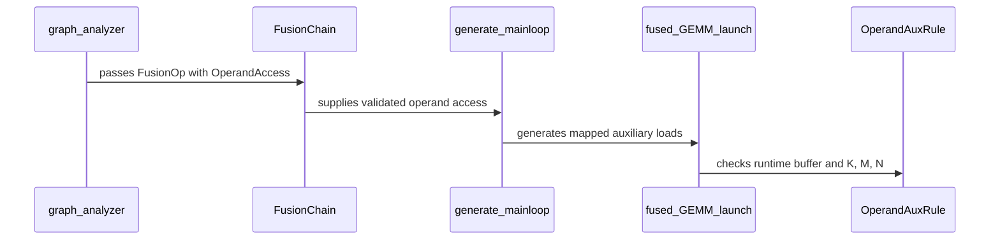

# feat(frost-gemm): lower operand broadcasts through coordinate maps

[Upstream PR](https://github.com/NVIDIA/cudnn-frontend/pull/2189) · state: open · merged: False

## Original PR description

## Summary

Lower direct graph-input operand auxiliaries through a consumer-to-source coordinate map, instead of extending rank/axis broadcast whitelists.

- Compose broadcast, transpose and reshape semantics through the existing `IndexMap`, then bind the map to shared mainloop fragment coordinates.
- Introduce `OperandAccess` for lowered source coordinates and a fixed canonical operand domain; keep auxiliary buffers in their original rank/shape/strides.
- Load mapped auxiliaries with their actual runtime strides, reuse scalar loads when fragment coordinates are invariant, and preserve per-node compute/output rounding and final padded-lane zeroing.
- Preserve existing dynamic scalar/per-K paths, including transpose bindings; use coordinate loading for strided per-K inputs instead of rejecting the broadcast solely because the vector-load optimization is unavailable.
- Share read-only checked layout geometry with reshape/transpose; do not relax writable overlap checks or add runtime materialization/native view objects for mapped auxiliaries.
- Keep mapped operands out of epilogue preloads and validate fixed shape/dtype/domain before launch.

## Scope and limitations

The mapped loading path targets the existing SM100 mainloop pipeline with BF16/FP16 operands, BF16/FP16/FP32 auxiliaries and FP32 pointwise compute. Generic mapped domains remain fixed-shape; this does not introduce unrestricted dynamic reshape or symbolic shape inference. Auxiliary reuse with the epilogue matrix ABI remains explicitly unsupported.

The four scheduled-tile decoding sites in `sm100_matmul_mainloop.py` now call one local `@cute.jit` helper: initial work, TMA, mainloop and epilogue. It preserves compile-time preferred/fallback shifts and the L2 identity fast path. Each stage still owns its work coordinates and batch ID; the mainloop consumes its own CLC response under its existing coordinate gate. Other templates are unchanged. No shared work descriptor, scheduling/barrier protocol change or performance speedup is claimed.

No documentation/sample or C++ binding changes.

<!-- This is an auto-generated comment: release notes by coderabbit.ai -->
<!-- coderabbit-ai-generated:v1 -->

## Summary by CodeRabbit

* **New Features**
  * GEMM fusion supports auxiliary tensors broadcast across operand rows and columns, including through reshape and transpose views.
  * Per-K auxiliary scales support non-unit strides in eligible configurations.
* **Bug Fixes**
  * Improved coordinate-based auxiliary loading and scheduled tile handling across supported cluster configurations.
  * Validation now checks auxiliary layouts and ensures broadcast domains match runtime GEMM dimensions.
<!-- end of auto-generated comment: release notes by coderabbit.ai -->

## Review and discussion

### reviews

- copilot-pull-request-reviewer[bot] · COMMENTED · 2026-11-02T05:43:59Z · [source](https://github.com/NVIDIA/cudnn-frontend/pull/2189#pullrequestreview-5732527989)

Copilot was unable to review this pull request because the user who requested the review has insufficient remaining quota. Try requesting a review at a lower effort level.

- Anerudhan · APPROVED · 2026-11-02T06:12:33Z · [source](https://github.com/NVIDIA/cudnn-frontend/pull/2189#pullrequestreview-5732703970)

**Codex bot review · model: `gpt-6-astra`**

Reviewed `ab964d180b36` against base `0d72d59efd21`.

Thank you for your contribution! The coordinate maps preserve operand/view semantics and per-node rounding, and mapped auxiliaries retain their runtime storage layout. The shared decoder keeps each pipeline stage's own scheduled coordinates. No findings after source review and focused SM100 validation.

Validation: 354 focused tests passed and six skipped: broadcast maps/bindings, generated load fragments, native operand transforms, existing index/per-K paths and template checks. Another 53 legacy analyzer/scalar/rounding controls passed. Independent native probes passed for one CTA, swapped two-CTA and split-K execution with unequal M/N, M/N/K tails and more tiles than resident SMs. They use varying rank-four/rank-five auxiliaries on both operands, per-node rounding, changed values on CUDA Graph replay and bitwise repeats. Rebinding fresh contiguous and zero-stride auxiliary buffers on the same compiled plan also passed all three configurations. Three existing indexed-operand scheduling probes passed. A head/base/head comparison of the shared decoder path found no material CPU enqueue or GPU execution regression in the measured SM100 workload. Pipeline 78488256 is running for python/gemm/frost. Its integration source matches all 15 reviewed files and the selected lane collects the new tests. Style and metadata checks passed; Security was still running at the last check.

Limitations: Native execution was checked on SM100. No new sanitizer or other-device qualification was performed. The timing spot check covers one existing workload; it does not establish a general speedup. The test pipeline remains pending and requires follow-up.

Approved: no P0 or high-risk P1 found. Remaining findings stay with the owner; merge timing stays with the owner.

<!-- codex-fe-review:v2:2189:ab964d180b36b774678985fddd8b6f2fdc474fe0:complete:no-blocker -->

- github-advanced-security[bot] · COMMENTED · 2026-11-02T06:20:28Z · [source](https://github.com/NVIDIA/cudnn-frontend/pull/2189#pullrequestreview-5732757678)

(No body; status only.)

- Anerudhan · COMMENTED · 2026-11-02T11:10:59Z · [source](https://github.com/NVIDIA/cudnn-frontend/pull/2189#pullrequestreview-5735657756)

**Codex bot review · model: `gpt-6-astra`**

Reviewed `b30cf027bacf` against base `c24ef3727132`.

Thank you for your contribution! No new findings in the two-line follow-up. Initializing the coordinate locals makes the existing control flow explicit without changing generated kernel code. My earlier approval remains in place; style and security workflows still require approval before they can run.

Validation: Compared the full delta against the previously reviewed head: only two local initializers changed. Coordinate-consuming operations still imply needs_coordinates and overwrite these defaults before use. Pipeline 78515261 passed on source matching all 15 PR files. Its SM100 report contains 11,861 cases with no failures; the operand-broadcast module has 65 passes and four skips. Retained the earlier independent native broadcast, scheduled-tile, split-K, rebinding and rounding checks. Newer base commits do not change this GEMM path.

Limitations: Current-head style and security workflows report action_required. I did not approve, bypass, or count them as passing. No new sanitizer, performance or other-device run was needed for these local initializers.

Comment only: this PR already has an active approval; preserving existing approvals.

<!-- codex-fe-review:v2:2189:b30cf027bacf72acdbe04625629a87131ae5a738:complete:no-blocker -->

- Anerudhan · COMMENTED · 2026-11-03T05:46:45Z · [source](https://github.com/NVIDIA/cudnn-frontend/pull/2189#pullrequestreview-5747731117)

**Codex bot review · model: `gpt-6-astra`**

Reviewed `bbc39e24c49d` against base `92bab162f3cb`.

Thank you for your contribution! The follow-up fixes shared-auxiliary layout selection and preserves the mapped fallback when legacy per-K loading is not eligible. No new findings. My earlier approval remains in place; current-head CI and workflow approval still need follow-up.

Validation: The two affected modules passed on SM100: 223 passed and four intentional scalar-route skips. This includes generated fragments, native GEMM, changed-input graph replay, and legacy per-K controls. All 81 new host cases pass on this head. With the previous implementation modules and the same new tests, 59 fail and 22 pass, confirming that the checks detect the shared-layout and MN-major admission problems. Three independent native checks passed for one-CTA, swapped two-CTA, and split-K execution. One varying auxiliary buffer is shared by both operands but addresses K on A and N on B; changed values on captured replay match the exact reference with poisoned outputs. Reviewed all four changed files since b30cf027bacf. Earlier kernel/scheduler validation remains applicable: generated kernel templates are unchanged, and current base changes do not touch the relevant GEMM code or test infrastructure. Pipeline 78792134 is running for this head with python/gemm/frost. Its integration source matches all 15 PR files; 156 operand-broadcast cases are selected by L0.

Limitations: The new CI run is pending, not a passing result. Current-head Security and Style workflows still require maintainer approval. Native checks used SM100; no new other-device, sanitizer, or performance qualification was needed for this host-analysis change.

Comment only: this PR already has an active approval; preserving existing approvals.

<!-- codex-fe-review:v2:2189:bbc39e24c49dab9aaa6667b32c4f4cc338ade3b6:complete:no-blocker -->

### issue_comments

- coderabbitai[bot] · comment · 2026-11-02T05:21:15Z · [source](https://github.com/NVIDIA/cudnn-frontend/pull/2189#issuecomment-6569726690)

<!-- coderabbit-ai-generated:v1 -->

<!-- This is an auto-generated comment: summarize by coderabbit.ai -->
<!-- review_stack_entry_start -->

<a href="https://app.coderabbit.ai/change-stack/NVIDIA/cudnn-frontend/pull/2189?scope=ghh_OusAJGA4HG8ljoOV0wJvVx8NmnZIjc2DdjmxOu0xZWA&amp;cs_source=review_comment"><picture><source media="(prefers-color-scheme: dark)" srcset="https://storage.googleapis.com/coderabbit_public_assets/review-stack-in-coderabbit-ui-dark.svg?v=3"><source media="(prefers-color-scheme: light)" srcset="https://storage.googleapis.com/coderabbit_public_assets/review-stack-in-coderabbit-ui.svg?v=3"></picture></a>

<!-- review_stack_entry_end -->
<!-- recent_review_status_start -->

No actionable comments were generated in the recent review.

<!-- recent_review_status_end -->
<!-- walkthrough_start -->

<strong>Walkthrough</strong>

<dl>
<dd>

FROST GEMM adds coordinate-mapped broadcast auxiliaries for mainloop operands. Graph analysis records their coordinate mappings, code generation loads them using runtime strides, and launch validation checks layouts and matrix domains. SM100 TMA, mainloop, and epilogue paths share scheduled-tile decoding.

**Changes: FROST GEMM Operand Coordinates**

|Layer / File(s)|Summary|
|:---|:---|
|**Operand access model**   `python/cudnn/gemm/frost/fusion_ir.py`, `python/cudnn/gemm/frost/graph_analyzer.py`, `python/cudnn/gemm/frost/kernel_registry.py`|Fusion IR represents coordinate-mapped auxiliaries and validates operand access expressions. Graph analysis composes broadcast and operand-view mappings into access metadata. The registry applies per-K and mapped-broadcast eligibility checks.|
|**Auxiliary loading and validation**   `python/cudnn/gemm/frost/compiler.py`, `python/cudnn/gemm/frost/dtypes.py`, `python/cudnn/gemm/frost/epilogue_codegen.py`, `python/cudnn/gemm/frost/layouts.py`, `python/cudnn/gemm/frost/recipe.py`, `python/cudnn/gemm/frost/sm100/compiler.py`, `test/python/gemm/frost/test_matmul_mainloop_fusion.py`, `test/python/gemm/frost/test_matmul_operand_broadcast.py`, `test/python/gemm/frost/test_matmul_per_k_scale.py`|Generated mainloops load mapped auxiliaries using original-rank coordinates and runtime strides. Recipe rules validate auxiliary layouts and K/M/N domains at launch. Tests cover mapping, generated loads, storage contracts, and supported cases.|
|**SM100 scheduled-tile decoding**   `python/cudnn/gemm/frost/sm100/kernel_templates/sm100_matmul_mainloop.py`, `test/python/gemm/frost/test_matmul_operand_gen_index.py`, `test/python/gemm/frost/test_template_epilogue_parity.py`|TMA, mainloop, and epilogue paths use `_decode_scheduled_tile` for scheduled tile coordinates. Tests check decoder call sites and compare decoded coordinates with the enumerated raster.|

<!-- change_assessment_start -->
**Estimated code review effort:** 4 (Complex) | ~60 minutes

<!-- change_assessment_commit:"bbc39e24c49dab9aaa6667b32c4f4cc338ade3b6" -->
<!-- change_assessment_priority:{"version":1,"urgency":"p2","manual":false} -->
**Change:** Feature
<!-- change_assessment_end -->

### Sequence Diagram(s)

**Possibly related PRs**
- [NVIDIA/cudnn-frontend#2073](https://github.com/NVIDIA/cudnn-frontend/pull/2073): Normalizes operand transposes and records transpose metadata used in GEMM bindings and recipes.
- [NVIDIA/cudnn-frontend#2186](https://github.com/NVIDIA/cudnn-frontend/pull/2186): Adds IndexMap composition and logical coordinate lowering through reshape and transpose views for FROST GEMM mainloops.
- [NVIDIA/cudnn-frontend#2006](https://github.com/NVIDIA/cudnn-frontend/pull/2006): Adds coordinate-based per-K auxiliary loading, symbolic shapes, fake-stride rules, and launch validation.

**Suggested labels:** `mod-frost`, `mod-cutedsl`

**Suggested reviewers:** `anerudhan`, `yanqinz2`, `yangxu1990uiuc`

</dd>
</dl>

<!-- walkthrough_end -->

<strong>Merge Risk:</strong> <strong><picture></picture> Minimal</strong> · up to <code>bbc39</code>

<dl>
<dd>

<!-- final_review_risk_start -->
<!-- final_review_risk_label
**Merge Risk:** **⚪ Minimal** · up to `bbc39`
-->
<!-- final_review_risk_coverage:{"sourceCommitId":"bbc39e24c49dab9aaa6667b32c4f4cc338ade3b6","coveredCommitId":"bbc39e24c49dab9aaa6667b32c4f4cc338ade3b6","kind":"reviewed"} -->

No actionable merge-blocking issue remains from this review; proceed with normal checks.
<!-- final_review_risk_end -->

</dd>
</dl>

<!-- pre_merge_checks_walkthrough_start -->

<strong>Pre-merge checks: <picture></picture> 3 · <picture></picture> 2</strong>

<dl>
<dd>

<strong><picture></picture> Failed checks: 2 warnings</strong>

|     Check name     |                                              Status                                              | Explanation                                                                                                                                                                                               | Resolution                                                                                                                                                                                                                                        |
| :---------------- | :----------------------------------------------------------------------------------------------: | :-------------------------------------------------------------------------------------------------------------------------------------------------------------------------------------------------------- | :------------------------------------------------------------------------------------------------------------------------------------------------------------------------------------------------------------------------------------------------ |
|  Description check |  | The description provides a detailed summary and scope, but it omits several required template sections and completion details. It does not identify the affected area, explain why the approach is appro… | Complete the template by selecting the affected area, adding a Why section, stating related issues or None, documenting API and compatibility impact, and listing exact testing commands with results. Confirm the Before submitting checklist i… |
| Docstring Coverage |  | Docstring coverage is 60.61% which is insufficient. The required threshold is 80.00%. Docstring coverage is scoped to functions touched by this diff with cyclomatic complexity of at least 2. Documenta… | Write docstrings for the functions missing them to satisfy the coverage threshold.                                                                                                                                                                |

<strong><picture></picture> Passed checks: 3 passed</strong>

<dl>
<dd>

|         Check name         |                                             Status                                             | Explanation                                                                                                                |
| :------------------------ | :--------------------------------------------------------------------------------------------: | :------------------------------------------------------------------------------------------------------------------------- |
|         Title check        |  | The title clearly and concisely describes the main change: lowering Frost GEMM operand broadcasts through coordinate maps. |
|     Linked Issues check    |  | Check skipped because no linked issues were found for this pull request.                                                   |
| Out of Scope Changes check |  | Check skipped because no linked issues were found for this pull request.                                                   |

</dd>
</dl>

<strong>Full details: Description check</strong>

<dl>
<dd>

**Explanation**

The description provides a detailed summary and scope, but it omits several required template sections and completion details. It does not identify the affected area, explain why the approach is appropriate under a dedicated Why section, state related issues, document API and compatibility impact, or list exact testing commands and results. The required checklist items are also left unchecked.

**Resolution**

Complete the template by selecting the affected area, adding a Why section, stating related issues or None, documenting API and compatibility impact, and listing exact testing commands with results. Confirm the Before submitting checklist items or explain any exceptions.

</dd>
</dl>

<strong>Full details: Docstring Coverage</strong>

<dl>
<dd>

**Explanation**

Docstring coverage is 60.61% which is insufficient. The required threshold is 80.00%. Docstring coverage is scoped to functions touched by this diff with cyclomatic complexity of at least 2. Documentation-only edits and deletions within surviving functions are included; unchanged diff context and fully deleted functions are excluded. Analyzed 66 functions across 15 files.

**Resolution**

Write docstrings for the functions missing them to satisfy the coverage threshold.

</dd>
</dl>

</dd>
</dl>

<!-- pre_merge_checks_walkthrough_end -->
<!-- finishing_touch_checkbox_start -->

<strong>Finishing Touches</strong>

<dl>
<dd>

<strong>Generate unit tests (beta)</strong>

<dl>
<dd>

- [ ] <!-- {"checkboxId": "f47ac10b-58cc-4372-a567-0e02b2c3d479", "radioGroupId": "utg-output-choice-group-6596212457"} --> Create a new PR

</dd>
</dl>

</dd>
</dl>

<!-- finishing_touch_checkbox_end -->

<!-- autopilot:start -->
- [ ] <!-- {"checkboxId":"2708ad07-9f24-4260-9c11-7dc76a49f2e3"} --> <strong title="Keep fixing CodeRabbit findings and required CI, and resolving merge conflicts">Autofix</strong> · Keep fixing CodeRabbit findings and required CI, and resolving merge conflicts
<!-- autopilot:end -->
<!-- announcements_start -->

> [!TIP]
> 

> 
<strong>🎯 Customize your risk assessments</strong>

> <dl>
> <dd>
> 
> Guide how CodeRabbit assesses merge risk and security architecture risk. Highlight sensitive changes and explain your security boundaries using **Merge Risk Instructions** and **Security Risk Instructions** in your review settings. Security architecture risk assessments require the **Advanced plan or above**.
> 
> </dd>
> </dl>
> 

> 
> 

> 
<strong>✅ Automatic approvals, with your rules</strong>

> <dl>
> <dd>
> 
> Let CodeRabbit approve pull requests once required threads are resolved, pre-merge checks pass, and your risk limits are met. Enable **Automatic approvals** in review settings, with overrides for teams or file paths.
> 
> </dd>
> </dl>
> 

<!-- announcements_end -->
<!-- verify_invitation_start -->
### CodeRabbit Verify

- [ ] <!-- {"checkboxId":"run-qa-agent"} --> Run CodeRabbit Verify to test the changes in this pull request.
<!-- verify_invitation_end -->
<!-- recent_review_start -->

<h6>

<strong><picture></picture> Recent review info</strong>

<dl>
<dd>

<!-- review_info_content -->

<strong><picture><source media="(prefers-color-scheme: dark)" srcset="https://storage.googleapis.com/coderabbit_public_assets/review-comment-icons-v1/cog-dark.svg"></picture> Run configuration</strong>

<dl>
<dd>

- **Source mode**: Auto
- **Repository**: [NVIDIA/cudnn-frontend](<https://github.com/NVIDIA/cudnn-frontend>)
- **Branch**: [develop](<https://github.com/NVIDIA/cudnn-frontend/tree/develop>)
- **File**: [.coderabbit.yaml](<https://github.com/NVIDIA/cudnn-frontend/blob/0d72d59efd21401c7e13d606584fef2544e45934/.coderabbit.yaml>)
- **Commit**: [0d72d59](<https://github.com/NVIDIA/cudnn-frontend/commit/0d72d59efd21401c7e13d606584fef2544e45934>)
- **Layers**: Repository YAML
- **Review profile**: CHILL
- **Plan**: Enterprise
- **Run ID**: `ed24a2d6-f301-48bc-b516-2967c74894c8`

</dd>
</dl>

<strong><picture><source media="(prefers-color-scheme: dark)" srcset="https://storage.googleapis.com/coderabbit_public_assets/review-comment-icons-v1/git-commit-horizontal-dark.svg"></picture> Commits</strong>

<dl>
<dd>

Reviewing files that changed from the base of the PR and between 0d72d59efd21401c7e13d606584fef2544e45934 and bbc39e24c49dab9aaa6667b32c4f4cc338ade3b6.

</dd>
</dl>

<strong><picture><source media="(prefers-color-scheme: dark)" srcset="https://storage.googleapis.com/coderabbit_public_assets/review-comment-icons-v1/file-plus-corner-dark.svg"></picture> Files selected for processing: 15</strong>

<dl>
<dd>

* `python/cudnn/gemm/frost/compiler.py`
* `python/cudnn/gemm/frost/dtypes.py`
* `python/cudnn/gemm/frost/epilogue_codegen.py`
* `python/cudnn/gemm/frost/fusion_ir.py`
* `python/cudnn/gemm/frost/graph_analyzer.py`
* `python/cudnn/gemm/frost/kernel_registry.py`
* `python/cudnn/gemm/frost/layouts.py`
* `python/cudnn/gemm/frost/recipe.py`
* `python/cudnn/gemm/frost/sm100/compiler.py`
* `python/cudnn/gemm/frost/sm100/kernel_templates/sm100_matmul_mainloop.py`
* `test/python/gemm/frost/test_matmul_mainloop_fusion.py`
* `test/python/gemm/frost/test_matmul_operand_broadcast.py`
* `test/python/gemm/frost/test_matmul_operand_gen_index.py`
* `test/python/gemm/frost/test_matmul_per_k_scale.py`
* `test/python/gemm/frost/test_template_epilogue_parity.py`

</dd>
</dl>

**Included review availability:** This review used your included allowance. Your plan provides up to 12 included reviews per hour; 11 remain after this review.

</dd>
</dl>

</h6>

<!-- recent_review_end -->

- Anerudhan · comment · 2026-11-02T06:02:34Z · [source](https://github.com/NVIDIA/cudnn-frontend/pull/2189#issuecomment-6570292641)

I am requesting test CI for `ab964d180b36` with the following standalone command: `@cudnn-ci-bot run python/gemm/frost`. For future updates, request the appropriate test target before review; a maintainer may need to trigger it.

Codex bot review — model `gpt-6-astra`.

<!-- codex-fe-ci:v1:2189:ab964d180b36b774678985fddd8b6f2fdc474fe0:request-frost-notice -->

- Anerudhan · comment · 2026-11-02T06:02:40Z · [source](https://github.com/NVIDIA/cudnn-frontend/pull/2189#issuecomment-6570294423)

@cudnn-ci-bot run python/gemm/frost

- cudnn-ci-bot · comment · 2026-11-02T06:02:44Z · [source](https://github.com/NVIDIA/cudnn-frontend/pull/2189#issuecomment-6570295402)

🏁 Pipeline finished

SHA: `ab964d1`
Targets: `python/gemm/frost`
Branch: [cudnn-gh/pr-2189-ab964d1](https://nv/cudnn-gitlab-ci/-/tree/cudnn-gh/pr-2189-ab964d1)
Pipeline: [78488256](https://nv/cudnn-gitlab-ci/-/pipelines/78488256)
Last updated: 2026-11-02 06:15 UTC

**21 passed, 12 manual**

### <code>manual</code>

- <code>manual:python_samples</code> - Manual
- <code>manual:python/sdpa/frost</code> - Manual
- <code>manual:python/sdpa/misc</code> - Manual
- <code>manual:python/linear_attention</code> - Manual
- <code>manual:python/gemm/frost</code> - ✅ Passed
- <code>manual:python/gemm/cutedsl</code> - Manual
- <code>manual:python/gemm/misc</code> - Manual
- <code>manual:python/conv</code> - Manual
- <code>manual:python/norm</code> - Manual
- <code>manual:python/misc</code> - Manual
- <code>manual:pycudnn</code> - Manual
- <code>manual:multi_gpu</code> - Manual
- <code>manual:backend</code> - Manual

### <code>analysis</code>

- <code>analysis:cudnn_clang_disable_exception</code> - ✅ Passed
- <code>analysis:cudnn_v9_no_half_conversion</code> - ✅ Passed
- <code>analysis:cudnn_clang</code> - ✅ Passed
- <code>analysis:check-relative-includes</code> - ✅ Passed
- <code>analysis:check-CUDNN_FRONTEND_SKIP_JSON_LIB</code> - ✅ Passed
- <code>analysis:guardwords_scan</code> - ✅ Passed
- <code>analysis:jax-import-guard</code> - ✅ Passed
- <code>analysis:pytest-gpu</code> - ✅ Passed
- <code>san:build</code> - ✅ Passed

### <code>build</code>

- <code>analysis:api_index</code> - ✅ Passed
- <code>build:dev:linux:amd64</code> - ✅ Passed
- <code>build:rel:linux:amd64</code> - ✅ Passed
- <code>build:dev:linux:arm64</code> - ✅ Passed
- <code>build:rel:linux:arm64</code> - ✅ Passed
- <code>build:rel:win:amd64</code> - ✅ Passed

### <code>python/gemm/frost</code>

- <code>python/gemm/frost:be-9.27.0-cutedsl-4.8.0:sm100</code> - ✅ Passed

### <code>sanitizer_tests</code>

- <code>san:cpp_test:sm80</code> - ✅ Passed
- <code>san:cpp_test:sm90</code> - ✅ Passed
- <code>san:cpp_test:sm100</code> - ✅ Passed

### <code>triage</code>

- <code>triage:ai</code> - ✅ Passed

- Anerudhan · comment · 2026-11-02T06:16:18Z · [source](https://github.com/NVIDIA/cudnn-frontend/pull/2189#issuecomment-6570488000)

Pipeline 78488256 passed for `ab964d180b36` with `python/gemm/frost`. The SM100 lane recorded 11,861 test cases with no failures; the new operand-broadcast module had 65 passes and four skips. The integration source matches all 15 reviewed files.

Style and metadata checks passed. Security is still running. The CI status comment has not yet caught up with the completed pipeline; the result above is verified from the pipeline API and test report.

Codex bot review — model `gpt-6-astra`.

<!-- codex-fe-ci:v1:2189:ab964d180b36b774678985fddd8b6f2fdc474fe0:pipeline-78488256-finished -->

- cudnn-ci-bot · comment · 2026-11-02T06:48:27Z · [source](https://github.com/NVIDIA/cudnn-frontend/pull/2189#issuecomment-6570964453)

Pipeline not launched

Reason: @meinie0826 is not allowlisted to run this bot.

Ask an allowlisted maintainer to comment `@cudnn-ci-bot run`.

- meinie0826 · comment · 2026-11-02T06:48:51Z · [source](https://github.com/NVIDIA/cudnn-frontend/pull/2189#issuecomment-6570969901)

@coderabbitai full review

- coderabbitai[bot] · comment · 2026-11-02T06:48:57Z · [source](https://github.com/NVIDIA/cudnn-frontend/pull/2189#issuecomment-6570971383)

<!-- coderabbit-ai-generated:v1 -->

<!-- This is an auto-generated reply by CodeRabbit -->
<!-- CodeRabbit review command invocation: v2:cc0a7fb686aa4b046318ead9c353cadd8a9688987c419dc9f9f0929909f3905b -->

Action performed

<dl>
<dd>

Full review finished.

</dd>
</dl>

- meinie0826 · comment · 2026-11-02T07:58:24Z · [source](https://github.com/NVIDIA/cudnn-frontend/pull/2189#issuecomment-6572047313)

ready

- YangXu1990uiuc · comment · 2026-11-02T08:09:36Z · [source](https://github.com/NVIDIA/cudnn-frontend/pull/2189#issuecomment-6572233240)

@cudnn-ci-bot run python/gemm/frost

- cudnn-ci-bot · comment · 2026-11-02T08:09:40Z · [source](https://github.com/NVIDIA/cudnn-frontend/pull/2189#issuecomment-6572234445)

🏁 Pipeline finished

SHA: `b30cf02`
Targets: `python/gemm/frost`
Branch: [cudnn-gh/pr-2189-b30cf02](https://nv/cudnn-gitlab-ci/-/tree/cudnn-gh/pr-2189-b30cf02)
Pipeline: [78515261](https://nv/cudnn-gitlab-ci/-/pipelines/78515261)
Last updated: 2026-11-02 08:24 UTC

**21 passed, 12 manual**

### <code>manual</code>

- <code>manual:python_samples</code> - Manual
- <code>manual:python/sdpa/frost</code> - Manual
- <code>manual:python/sdpa/misc</code> - Manual
- <code>manual:python/linear_attention</code> - Manual
- <code>manual:python/gemm/frost</code> - ✅ Passed
- <code>manual:python/gemm/cutedsl</code> - Manual
- <code>manual:python/gemm/misc</code> - Manual
- <code>manual:python/conv</code> - Manual
- <code>manual:python/norm</code> - Manual
- <code>manual:python/misc</code> - Manual
- <code>manual:pycudnn</code> - Manual
- <code>manual:multi_gpu</code> - Manual
- <code>manual:backend</code> - Manual

### <code>analysis</code>

- <code>analysis:cudnn_clang_disable_exception</code> - ✅ Passed
- <code>analysis:cudnn_v9_no_half_conversion</code> - ✅ Passed
- <code>analysis:cudnn_clang</code> - ✅ Passed
- <code>analysis:check-relative-includes</code> - ✅ Passed
- <code>analysis:check-CUDNN_FRONTEND_SKIP_JSON_LIB</code> - ✅ Passed
- <code>analysis:guardwords_scan</code> - ✅ Passed
- <code>analysis:jax-import-guard</code> - ✅ Passed
- <code>analysis:pytest-gpu</code> - ✅ Passed
- <code>san:build</code> - ✅ Passed

### <code>build</code>

- <code>analysis:api_index</code> - ✅ Passed
- <code>build:dev:linux:amd64</code> - ✅ Passed
- <code>build:rel:linux:amd64</code> - ✅ Passed
- <code>build:dev:linux:arm64</code> - ✅ Passed
- <code>build:rel:linux:arm64</code> - ✅ Passed
- <code>build:rel:win:amd64</code> - ✅ Passed

### <code>python/gemm/frost</code>

- <code>python/gemm/frost:be-9.27.0-cutedsl-4.8.0:sm100</code> - ✅ Passed

### <code>sanitizer_tests</code>

- <code>san:cpp_test:sm80</code> - ✅ Passed
- <code>san:cpp_test:sm90</code> - ✅ Passed
- <code>san:cpp_test:sm100</code> - ✅ Passed

### <code>triage</code>

- <code>triage:ai</code> - ✅ Passed

- meinie0826 · comment · 2026-11-02T08:59:28Z · [source](https://github.com/NVIDIA/cudnn-frontend/pull/2189#issuecomment-6573103619)

@YangXu1990uiuc could you please help me merge this pr ? thanks!

- meinie0826 · comment · 2026-11-03T02:25:52Z · [source](https://github.com/NVIDIA/cudnn-frontend/pull/2189#issuecomment-6593836982)

@YangXu1990uiuc it seems the workflows not approval to work, could you please help me approve it?

- YangXu1990uiuc · comment · 2026-11-03T04:04:35Z · [source](https://github.com/NVIDIA/cudnn-frontend/pull/2189#issuecomment-6595154809)

Thanks for the ping. Your current-head GEMM CI and approval are recorded. The two existing Style/Security runs are still awaiting maintainer workflow approval; I have retained your request for that remaining step. No duplicate GPU CI request is needed.

<!-- fe-external-watch:workflow-followup:2189:6593836982 -->

- cudnn-ci-bot · comment · 2026-11-03T05:25:48Z · [source](https://github.com/NVIDIA/cudnn-frontend/pull/2189#issuecomment-6596191802)

Pipeline not launched

Reason: @meinie0826 is not allowlisted to run this bot.

Ask an allowlisted maintainer to comment `@cudnn-ci-bot run`.

- meinie0826 · comment · 2026-11-03T05:27:20Z · [source](https://github.com/NVIDIA/cudnn-frontend/pull/2189#issuecomment-6596211064)

ready

- meinie0826 · comment · 2026-11-03T05:27:26Z · [source](https://github.com/NVIDIA/cudnn-frontend/pull/2189#issuecomment-6596212457)

@coderabbitai full review

- coderabbitai[bot] · comment · 2026-11-03T05:27:33Z · [source](https://github.com/NVIDIA/cudnn-frontend/pull/2189#issuecomment-6596213801)

<!-- coderabbit-ai-generated:v1 -->

<!-- This is an auto-generated reply by CodeRabbit -->
<!-- CodeRabbit review command invocation: v2:e6b5443838840fb8583e7f6764abb0611feb580f781634d4d04bb8ed990aee61 -->

Action performed

<dl>
<dd>

Full review finished.

</dd>
</dl>

- Anerudhan · comment · 2026-11-03T05:42:12Z · [source](https://github.com/NVIDIA/cudnn-frontend/pull/2189#issuecomment-6596403318)

The updated shared-auxiliary and MN-major paths passed focused SM100 tests. I am requesting `python/gemm/frost` for current head `bbc39e24c49d`; the earlier green pipeline covers the previous head. The contributor's request was not launched, so this uses the maintainer trigger.

Codex bot review — model `gpt-6-astra`.

<!-- codex-fe-ci:v1:2189:bbc39e24c49dab9aaa6667b32c4f4cc338ade3b6:request-frost-notice -->

- Anerudhan · comment · 2026-11-03T05:42:34Z · [source](https://github.com/NVIDIA/cudnn-frontend/pull/2189#issuecomment-6596408087)

@cudnn-ci-bot run python/gemm/frost

- cudnn-ci-bot · comment · 2026-11-03T05:42:37Z · [source](https://github.com/NVIDIA/cudnn-frontend/pull/2189#issuecomment-6596408798)

🏁 Pipeline finished

SHA: `bbc39e2`
Targets: `python/gemm/frost`
Branch: [cudnn-gh/pr-2189-bbc39e2](https://nv/cudnn-gitlab-ci/-/tree/cudnn-gh/pr-2189-bbc39e2)
Pipeline: [78792134](https://nv/cudnn-gitlab-ci/-/pipelines/78792134)
Last updated: 2026-11-03 05:58 UTC

**21 passed, 12 manual**

### <code>manual</code>

- <code>manual:python_samples</code> - Manual
- <code>manual:python/sdpa/frost</code> - Manual
- <code>manual:python/sdpa/misc</code> - Manual
- <code>manual:python/linear_attention</code> - Manual
- <code>manual:python/gemm/frost</code> - ✅ Passed
- <code>manual:python/gemm/cutedsl</code> - Manual
- <code>manual:python/gemm/misc</code> - Manual
- <code>manual:python/conv</code> - Manual
- <code>manual:python/norm</code> - Manual
- <code>manual:python/misc</code> - Manual
- <code>manual:pycudnn</code> - Manual
- <code>manual:multi_gpu</code> - Manual
- <code>manual:backend</code> - Manual

### <code>analysis</code>

- <code>analysis:cudnn_clang_disable_exception</code> - ✅ Passed
- <code>analysis:cudnn_v9_no_half_conversion</code> - ✅ Passed
- <code>analysis:cudnn_clang</code> - ✅ Passed
- <code>analysis:check-relative-includes</code> - ✅ Passed
- <code>analysis:check-CUDNN_FRONTEND_SKIP_JSON_LIB</code> - ✅ Passed
- <code>analysis:guardwords_scan</code> - ✅ Passed
- <code>analysis:jax-import-guard</code> - ✅ Passed
- <code>analysis:pytest-gpu</code> - ✅ Passed
- <code>san:build</code> - ✅ Passed

### <code>build</code>

- <code>analysis:api_index</code> - ✅ Passed
- <code>build:dev:linux:amd64</code> - ✅ Passed
- <code>build:rel:linux:amd64</code> - ✅ Passed
- <code>build:dev:linux:arm64</code> - ✅ Passed
- <code>build:rel:linux:arm64</code> - ✅ Passed
- <code>build:rel:win:amd64</code> - ✅ Passed

### <code>python/gemm/frost</code>

- <code>python/gemm/frost:be-9.27.0-cutedsl-4.8.0:sm100</code> - ✅ Passed

### <code>sanitizer_tests</code>

- <code>san:cpp_test:sm80</code> - ✅ Passed
- <code>san:cpp_test:sm90</code> - ✅ Passed
- <code>san:cpp_test:sm100</code> - ✅ Passed

### <code>triage</code>

- <code>triage:ai</code> - ✅ Passed

- Anerudhan · comment · 2026-11-03T06:02:15Z · [source](https://github.com/NVIDIA/cudnn-frontend/pull/2189#issuecomment-6596665736)

Pipeline 78792134 passed for `bbc39e24c49d`. The tested integration commit matches all 15 changed files.

The SM100 GEMM FROST job passed 8,120 tests, with 3,828 skipped and no failures. This includes 614 passing cases across mainloop fusion, operand broadcasting, operand index generation, and per-K scaling; four scalar batch-route cases were skipped.

Security and Style workflows still require maintainer approval. The existing code approval remains unchanged.

Codex bot review — model `gpt-6-astra`.

<!-- codex-fe-ci:v1:2189:bbc39e24c49dab9aaa6667b32c4f4cc338ade3b6:pipeline-78792134-finished -->

### inline_comments

- github-advanced-security[bot] · comment · 2026-11-02T06:20:28Z · [source](https://github.com/NVIDIA/cudnn-frontend/pull/2189#discussion_r4439443999)

File: `python/cudnn/gemm/frost/epilogue_codegen.py` · line 966

## CodeQL / Potentially uninitialized local variable

Local variable 'index_valid' may be used before it is initialized.

[Show more details](https://github.com/NVIDIA/cudnn-frontend/security/code-scanning/4698)

## Changed files and fixed code

- `python/cudnn/gemm/frost/compiler.py` · modified · additions 17 / deletions 8
  - [head](https://github.com/meinie0826/cudnn-frontend/blob/bbc39e24c49dab9aaa6667b32c4f4cc338ade3b6/python/cudnn/gemm/frost/compiler.py)
  - [base](https://github.com/NVIDIA/cudnn-frontend/blob/0d72d59efd21401c7e13d606584fef2544e45934/python/cudnn/gemm/frost/compiler.py)
- `python/cudnn/gemm/frost/dtypes.py` · modified · additions 3 / deletions 0
  - [head](https://github.com/meinie0826/cudnn-frontend/blob/bbc39e24c49dab9aaa6667b32c4f4cc338ade3b6/python/cudnn/gemm/frost/dtypes.py)
  - [base](https://github.com/NVIDIA/cudnn-frontend/blob/0d72d59efd21401c7e13d606584fef2544e45934/python/cudnn/gemm/frost/dtypes.py)
- `python/cudnn/gemm/frost/epilogue_codegen.py` · modified · additions 49 / deletions 12
  - [head](https://github.com/meinie0826/cudnn-frontend/blob/bbc39e24c49dab9aaa6667b32c4f4cc338ade3b6/python/cudnn/gemm/frost/epilogue_codegen.py)
  - [base](https://github.com/NVIDIA/cudnn-frontend/blob/0d72d59efd21401c7e13d606584fef2544e45934/python/cudnn/gemm/frost/epilogue_codegen.py)
- `python/cudnn/gemm/frost/fusion_ir.py` · modified · additions 53 / deletions 3
  - [head](https://github.com/meinie0826/cudnn-frontend/blob/bbc39e24c49dab9aaa6667b32c4f4cc338ade3b6/python/cudnn/gemm/frost/fusion_ir.py)
  - [base](https://github.com/NVIDIA/cudnn-frontend/blob/0d72d59efd21401c7e13d606584fef2544e45934/python/cudnn/gemm/frost/fusion_ir.py)
- `python/cudnn/gemm/frost/graph_analyzer.py` · modified · additions 169 / deletions 8
  - [head](https://github.com/meinie0826/cudnn-frontend/blob/bbc39e24c49dab9aaa6667b32c4f4cc338ade3b6/python/cudnn/gemm/frost/graph_analyzer.py)
  - [base](https://github.com/NVIDIA/cudnn-frontend/blob/0d72d59efd21401c7e13d606584fef2544e45934/python/cudnn/gemm/frost/graph_analyzer.py)
- `python/cudnn/gemm/frost/kernel_registry.py` · modified · additions 45 / deletions 16
  - [head](https://github.com/meinie0826/cudnn-frontend/blob/bbc39e24c49dab9aaa6667b32c4f4cc338ade3b6/python/cudnn/gemm/frost/kernel_registry.py)
  - [base](https://github.com/NVIDIA/cudnn-frontend/blob/0d72d59efd21401c7e13d606584fef2544e45934/python/cudnn/gemm/frost/kernel_registry.py)
- `python/cudnn/gemm/frost/layouts.py` · modified · additions 17 / deletions 5
  - [head](https://github.com/meinie0826/cudnn-frontend/blob/bbc39e24c49dab9aaa6667b32c4f4cc338ade3b6/python/cudnn/gemm/frost/layouts.py)
  - [base](https://github.com/NVIDIA/cudnn-frontend/blob/0d72d59efd21401c7e13d606584fef2544e45934/python/cudnn/gemm/frost/layouts.py)
- `python/cudnn/gemm/frost/recipe.py` · modified · additions 37 / deletions 1
  - [head](https://github.com/meinie0826/cudnn-frontend/blob/bbc39e24c49dab9aaa6667b32c4f4cc338ade3b6/python/cudnn/gemm/frost/recipe.py)
  - [base](https://github.com/NVIDIA/cudnn-frontend/blob/0d72d59efd21401c7e13d606584fef2544e45934/python/cudnn/gemm/frost/recipe.py)
- `python/cudnn/gemm/frost/sm100/compiler.py` · modified · additions 6 / deletions 2
  - [head](https://github.com/meinie0826/cudnn-frontend/blob/bbc39e24c49dab9aaa6667b32c4f4cc338ade3b6/python/cudnn/gemm/frost/sm100/compiler.py)
  - [base](https://github.com/NVIDIA/cudnn-frontend/blob/0d72d59efd21401c7e13d606584fef2544e45934/python/cudnn/gemm/frost/sm100/compiler.py)
- `python/cudnn/gemm/frost/sm100/kernel_templates/sm100_matmul_mainloop.py` · modified · additions 27 / deletions 68
  - [head](https://github.com/meinie0826/cudnn-frontend/blob/bbc39e24c49dab9aaa6667b32c4f4cc338ade3b6/python/cudnn/gemm/frost/sm100/kernel_templates/sm100_matmul_mainloop.py)
  - [base](https://github.com/NVIDIA/cudnn-frontend/blob/0d72d59efd21401c7e13d606584fef2544e45934/python/cudnn/gemm/frost/sm100/kernel_templates/sm100_matmul_mainloop.py)
- `test/python/gemm/frost/test_matmul_mainloop_fusion.py` · modified · additions 9 / deletions 4
  - [head](https://github.com/meinie0826/cudnn-frontend/blob/bbc39e24c49dab9aaa6667b32c4f4cc338ade3b6/test/python/gemm/frost/test_matmul_mainloop_fusion.py)
  - [base](https://github.com/NVIDIA/cudnn-frontend/blob/0d72d59efd21401c7e13d606584fef2544e45934/test/python/gemm/frost/test_matmul_mainloop_fusion.py)
- `test/python/gemm/frost/test_matmul_operand_broadcast.py` · added · additions 430 / deletions 0
  - [head](https://github.com/meinie0826/cudnn-frontend/blob/bbc39e24c49dab9aaa6667b32c4f4cc338ade3b6/test/python/gemm/frost/test_matmul_operand_broadcast.py)
  - [base](https://github.com/NVIDIA/cudnn-frontend/blob/0d72d59efd21401c7e13d606584fef2544e45934/test/python/gemm/frost/test_matmul_operand_broadcast.py)
- `test/python/gemm/frost/test_matmul_operand_gen_index.py` · modified · additions 3 / deletions 2
  - [head](https://github.com/meinie0826/cudnn-frontend/blob/bbc39e24c49dab9aaa6667b32c4f4cc338ade3b6/test/python/gemm/frost/test_matmul_operand_gen_index.py)
  - [base](https://github.com/NVIDIA/cudnn-frontend/blob/0d72d59efd21401c7e13d606584fef2544e45934/test/python/gemm/frost/test_matmul_operand_gen_index.py)
- `test/python/gemm/frost/test_matmul_per_k_scale.py` · modified · additions 19 / deletions 3
  - [head](https://github.com/meinie0826/cudnn-frontend/blob/bbc39e24c49dab9aaa6667b32c4f4cc338ade3b6/test/python/gemm/frost/test_matmul_per_k_scale.py)
  - [base](https://github.com/NVIDIA/cudnn-frontend/blob/0d72d59efd21401c7e13d606584fef2544e45934/test/python/gemm/frost/test_matmul_per_k_scale.py)
- `test/python/gemm/frost/test_template_epilogue_parity.py` · modified · additions 79 / deletions 5
  - [head](https://github.com/meinie0826/cudnn-frontend/blob/bbc39e24c49dab9aaa6667b32c4f4cc338ade3b6/test/python/gemm/frost/test_template_epilogue_parity.py)
  - [base](https://github.com/NVIDIA/cudnn-frontend/blob/0d72d59efd21401c7e13d606584fef2544e45934/test/python/gemm/frost/test_template_epilogue_parity.py)

## Evidence and interpretation boundary

[Original JSON, discussions and patches](../../../../../../evidence/prs/NVIDIA--cudnn-frontend/2189-38193797fa226dfe61c35561ddaf328d7002626544607e6d84e59f422c135bcf.json) · SHA-256 `38193797fa226dfe61c35561ddaf328d7002626544607e6d84e59f422c135bcf`.

Diff complete: True. Missing/binary/truncated patches require pinned source inspection. This is a source page, not an independently verified optimization case. Open, merged and released are different states; recheck the deployed dependency.
