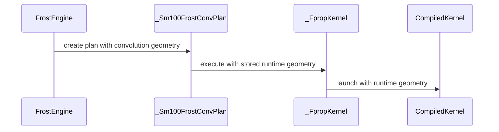

# [frost] Support dynamic-shaped convolution kernel (except nvfp4)

[Upstream PR](https://github.com/NVIDIA/cudnn-frontend/pull/2229) · state: closed · merged: True

## Original PR description

## Before submitting

- [X] I agree to license this contribution under the terms of [LICENSE.txt](https://github.com/NVIDIA/cudnn-frontend/blob/develop/LICENSE.txt).
- [X] I ran `pre-commit run` and committed any formatting changes.
- [X] I reviewed the Hard Rules in the `AGENTS.md` for each directory this PR touches (see [root AGENTS.md § Reviewing a PR](https://github.com/NVIDIA/cudnn-frontend/blob/develop/AGENTS.md#reviewing-a-pr-human-or-agent)) and my changes comply, or I explain the exception below.
- [X] I added GitHub labels: one `cat-*`, one or more `area:*` / `op:*`, and one `orig-*` (see [label list](https://github.com/NVIDIA/cudnn-frontend/labels)).

## Affected area

- FE OSS kernels or CuTeDSL

## Summary

Support dynamic-shaped for frost convolution kernels (except nvfp4, which will be another PR). Changing input shapes will not compile a new kernel as long as the input and output data types and MMA tile sizes remains the same.

## Why

To reduce JIT compilation overhead.

## Related issues

None.

## API and compatibility impact

None.

## Testing

Compared BF16 -> BF16 TFLOPS before and after this MR with 11 input shapes mentioned in #961, with the same settings (B200, locked at 1005MHz, tile config CONFIG_sm100_128x256x128_128x256x32_cluster2x1_2ctamma).

Two additional small benchmarks are also added to prove the overhead of dynamic shaped kernel is also acceptable:
* S1: `(N,C,D,H,W) = (1,128,1,33,27)`, `(K,T,R,S) = (256,1,3,3)`, lower padding `(0,1,1)`, upper padding `(0,2,2)`, stride `(1,2,2)`, dilation `(1,2,2)`.
* S2: `(N,C,D,H,W) = (1,256,1,288,288)`, `(K,T,R,S) = (128,1,3,3)`, lower padding `(0,1,1)`, upper padding `(0,1,1)`, stride `(1,1,1)`, dilation `(1,1,1)`.

| ID | FROST dynamic-shaped TFLOPS | FROST static-shaped TFLOPS | dynamic/static |
|---|---:|---:|---:|
|ID1|862.89|863.39|0.999x|
|ID2|1195.91|1195.46|1.000x|
|ID3|1186.21|1186.31|1.000x|
|ID4|1201.92|1201.78|1.000x|
|ID5|1195.56|1195.62|1.000x|
|ID6|1198.80|1198.80|1.000x|
|ID7|1186.11|1186.45|1.000x|
|ID8|1200.88|1200.76|1.000x|
|ID9|1195.44|1195.68|1.000x|
|ID10|1197.60|1197.47|1.000x|
|ID11|1185.14|1185.64|1.000x|
|S1|6.87|6.88|0.999x|
|S2|477.92|478.59|0.999x|

<!-- This is an auto-generated comment: release notes by coderabbit.ai -->

<!-- coderabbit-ai-generated:v1 -->

## Summary by CodeRabbit

* **New Features**
  * Dense convolution now supports runtime padding, stride, and dilation settings, allowing compiled kernels to be reused across compatible convolution geometries.
* **Improvements**
  * Verbose benchmark output now includes worker messages, kernel timings, and detailed diagnostics when profiling fails.

<!-- end of auto-generated comment: release notes by coderabbit.ai -->

## Review and discussion

### reviews

- Anerudhan · COMMENTED · 2026-11-03T09:33:48Z · [source](https://github.com/NVIDIA/cudnn-frontend/pull/2229#pullrequestreview-5749805598)

**Codex bot review · model: `gpt-6-astra`**

Reviewed `787a58fe5afe` against base `a0f7b9f4e8e3`.

Review remains incomplete. The head conflicts with develop in sm100_conv.py. When resolving the conflict, retain develop's device context and explicit compiler target in the new cached compilation path. The matching Python binding builds, but I could not independently validate dynamic artifact reuse, convolution accuracy, or graph replay with the required DSL. CI is deferred until the merge conflict is resolved.

Validation: Read all six changed files and traced graph execution, runtime geometry, cache keys, tensor validation, and the producer/consumer loops. The change keeps the barrier ownership and accumulation order; runtime trip counts and coordinate decoding need native coverage. Built the native Python binding at the reviewed head. Deterministic precheck returned no candidates; its automatic barrier ledger does not cover this template path. Verified the conflict against the current develop commit. No conflicted source was executed.

Limitations: The local DSL 4.9 package is incomplete, and the standard package index did not supply a usable replacement. The attempted test run failed during imports before convolution execution; those failures are not attributed to this PR. Native dynamic-shape tests, A-to-B-to-A artifact reuse, changed-input graph replay, and before/after device performance remain unverified.

Review incomplete; approval is deferred.

<!-- codex-fe-review:v2:2229:787a58fe5afebfc8dd24dfc25dbe607aa03ebfd3:deferred:no-blocker -->

- Anerudhan · COMMENTED · 2026-11-04T02:41:19Z · [source](https://github.com/NVIDIA/cudnn-frontend/pull/2229#pullrequestreview-5762465517)

**Codex bot review · model: `gpt-6-astra`**

Reviewed `38858b07d63d` against base `42200cd663d1`.

The earlier merge conflict is resolved. The dynamic compile cache now retains the build device, explicit GPU target and device context. Native validation of the dynamic convolution path is still missing, so I cannot approve this head yet.

Validation: Rechecked all six changed files and the follow-up against the earlier reviewed head. The merge preview against current develop has no conflicts. Verified that all six changed files in pipeline 79062099 match this head. Its SM100 FROST convolution job passed 65 tests and skipped 51. All 13 collected tests from test_conv_dynamic_geometry.py skipped because the lane has DSL 4.8.0 and dense convolution requires 4.9. The numerical and graph-replay tests are L1 and were outside this run. The separate SM100 CuTe DSL convolution job failed on repository access before pytest started; it supplies no kernel result. The author already requested the correct CI targets, and no duplicate run was started. The three GitHub Actions runs for this head passed.

Limitations: Please supply a run with a complete compatible DSL 4.9 package that includes the dynamic-shape and separate-graph capture/replay cases with L0 and L1 enabled. The available local package remains incomplete, and public PyPI does not offer 4.9.0 at this check. Dynamic runtime numerics, repeatability, cross-shape artifact reuse and CPU/GPU performance remain unverified. Existing host checks and skipped tests do not establish those properties.

Review incomplete; approval is deferred.

<!-- codex-fe-review:v2:2229:38858b07d63d1d64eecc0d6d6f5d5f794994c3a9:deferred:no-blocker -->

- Adnios · APPROVED · 2026-11-04T03:24:48Z · [source](https://github.com/NVIDIA/cudnn-frontend/pull/2229#pullrequestreview-5762742974)

LGTM

- Anerudhan · COMMENTED · 2026-11-04T06:16:14Z · [source](https://github.com/NVIDIA/cudnn-frontend/pull/2229#pullrequestreview-5764087835)

**Codex bot review · model: `gpt-6-astra`**

Reviewed `05e76f255228` against base `98ff541b2aac`.

The naming follow-up is consistent and introduces no observed behavior change. The existing human approval is retained. My independent review still lacks the native dynamic-convolution validation requested in the prior review.

Validation: Reviewed the full one-file delta. After normalizing the explicit variable/parameter renames and the edited docstring, the Python syntax tree is identical to 38858b07. The private kernel is called positionally, so the parameter rename preserves its caller contract. The newer base changes only BSA tests since the last review; no consumed convolution contract changed. Merge preview is clean, precheck has no candidates, and all three current GitHub workflows passed. Reused the prior six-file source review and pipeline 79062099 evidence. That earlier run skipped all 13 collected dynamic-geometry cases on DSL 4.8.0; the numerical and graph-replay cases were outside its L0 selection. No new runtime evidence was supplied by this rename-only update.

Limitations: Dynamic runtime accuracy, cross-shape artifact reuse, graph replay, repeatability and performance remain unverified independently. The compatible DSL 4.9 run with L0 and L1 enabled requested in review 5762465517 remains the useful next validation. No GPU tests or failed imports were repeated for these renames. The existing CI access hold remains; no duplicate or alternate CI run was requested.

Comment only: this PR already has an active approval; preserving existing approvals.

<!-- codex-fe-review:v2:2229:05e76f255228caea0a4814dd605dcfaa8826f36b:deferred:no-blocker -->

### issue_comments

- coderabbitai[bot] · comment · 2026-11-03T08:03:33Z · [source](https://github.com/NVIDIA/cudnn-frontend/pull/2229#issuecomment-6598485456)

<!-- coderabbit-ai-generated:v1 -->

<!-- This is an auto-generated comment: summarize by coderabbit.ai -->
<!-- review_stack_entry_start -->

<a href="https://app.coderabbit.ai/change-stack/NVIDIA/cudnn-frontend/pull/2229?scope=ghh_OusAJGA4HG8ljoOV0wJvVx8NmnZIjc2DdjmxOu0xZWA&amp;cs_source=review_comment"><picture><source media="(prefers-color-scheme: dark)" srcset="https://storage.googleapis.com/coderabbit_public_assets/review-stack-buttons-v1/explain-change-dark.svg"><source media="(prefers-color-scheme: light)" srcset="https://storage.googleapis.com/coderabbit_public_assets/review-stack-buttons-v1/explain-change.svg"></picture></a>

<!-- review_stack_entry_end -->
<!-- This is an auto-generated comment: skip review by coderabbit.ai -->

> [!IMPORTANT]
> ## Review skipped
> 
> Auto reviews are disabled on this repository. Please check the settings in the CodeRabbit UI or the `.coderabbit.yaml` file in this repository. To trigger a single review, invoke the `@coderabbitai review` command.
> 
> 

> 
<strong><picture><source media="(prefers-color-scheme: dark)" srcset="https://storage.googleapis.com/coderabbit_public_assets/review-comment-icons-v1/cog-dark.svg"></picture> Run configuration</strong>

> <dl>
> <dd>
> 
> - **Source mode**: Auto
> - **Repository**: [NVIDIA/cudnn-frontend](<https://github.com/NVIDIA/cudnn-frontend>)
> - **Branch**: [develop](<https://github.com/NVIDIA/cudnn-frontend/tree/develop>)
> - **File**: [.coderabbit.yaml](<https://github.com/NVIDIA/cudnn-frontend/blob/42200cd663d13e8a01ee076fe1e157949a35b071/.coderabbit.yaml>)
> - **Commit**: [42200cd](<https://github.com/NVIDIA/cudnn-frontend/commit/42200cd663d13e8a01ee076fe1e157949a35b071>)
> - **Layers**: Repository YAML
> - **Review profile**: CHILL
> - **Plan**: Enterprise
> - **Run ID**: `89a6f486-a181-4853-99a1-c4581c1cb4cf`
> 
> </dd>
> </dl>
> 

> 
> You can disable this status message by setting the `reviews.review_status` to `false` in the CodeRabbit configuration file.
> 
> Use the checkbox below for a quick retry:
> - [ ] <!-- {"checkboxId":"e9bb8d72-00e8-4f67-9cb2-caf3b22574fe"} --> Trigger review

<!-- end of auto-generated comment: skip review by coderabbit.ai -->

<!-- recent_review_status_start -->

No actionable comments were generated in the recent review.

<!-- recent_review_status_end -->
<!-- walkthrough_start -->

<strong>Walkthrough</strong>

<dl>
<dd>

Dense Frost convolution now passes padding, stride, and dilation at runtime. Compilation reuses artifacts across geometry changes while retaining cache boundaries for other settings. The engine, benchmarks, and tests now pass and validate runtime geometry.

**Changes: Dynamic convolution geometry**

|Layer / File(s)|Summary|
|:---|:---|
|**Runtime geometry in the convolution kernel**   `python/cudnn/conv/frost/templates/sm100_conv.py`|The kernel accepts runtime geometry for validation and launch. It derives filter dimensions from the filter tensor and uses fast-divmod divisors for output dimensions.|
|**Compilation and cache boundaries**   `python/cudnn/conv/frost/templates/sm100_conv.py`, `test/python/conv/frost/test_conv_dynamic_geometry.py`|Compilation validates geometry for tile selection and uses a cache key that excludes input shape and convolution geometry. Tests check reuse across geometry changes and recompilation for other cache-key settings.|
|**Plan execution, benchmark wiring, and validation**   `python/cudnn/conv/frost/engine.py`, `benchmark/conv/frost/benchmark_conv.py`, `benchmark/conv/frost/benchmark_utils.py`, `test/python/conv/frost/test_conv_dynamic_geometry.py`, `test/python/conv/frost/test_conv_tile_config.py`|The engine and benchmark pass runtime geometry to compiled kernels. Tests cover multiple geometries, CUDA graph replay, plan binding mismatches, and tile configuration. Verbose benchmark mode prints full caught exceptions.|

<!-- change_assessment_start -->

**Estimated code review effort:** 3 (Moderate) | ~25 minutes

<!-- change_assessment_commit:"38858b07d63d1d64eecc0d6d6f5d5f794994c3a9" -->
<!-- change_assessment_priority:{"version":1,"urgency":"p3","manual":false} -->
**Change:** Feature
<!-- change_assessment_end -->

### Sequence Diagram(s)

**Suggested reviewers:** `0z5a`

</dd>
</dl>

<!-- walkthrough_end -->

<strong>Merge Risk:</strong> <strong><picture></picture> Minimal</strong> · previous review <code>38858</code>

<dl>
<dd>

<!-- final_review_risk_start -->
<!-- final_review_risk_label
**Merge Risk:** **⚪ Minimal** · up to `38858`
-->
<!-- final_review_risk_coverage:{"sourceCommitId":"38858b07d63d1d64eecc0d6d6f5d5f794994c3a9","coveredCommitId":"38858b07d63d1d64eecc0d6d6f5d5f794994c3a9","kind":"reviewed"} -->

No actionable merge-blocking issue is established; the change is mergeable after normal checks.
<!-- final_review_risk_end -->

</dd>
</dl>

<!-- pre_merge_checks_walkthrough_start -->

<strong>Pre-merge checks: <picture></picture> 4 · <picture></picture> 1</strong>

<dl>
<dd>

<strong><picture></picture> Failed checks: 1 warning</strong>

|     Check name     |                                              Status                                              | Explanation                                                                                                                                                                                               | Resolution                                                                         |
| :---------------- | :----------------------------------------------------------------------------------------------: | :-------------------------------------------------------------------------------------------------------------------------------------------------------------------------------------------------------- | :--------------------------------------------------------------------------------- |
| Docstring Coverage |  | Docstring coverage is 50.00% which is insufficient. The required threshold is 80.00%. Docstring coverage is scoped to functions touched by this diff with cyclomatic complexity of at least 2. Documenta… | Write docstrings for the functions missing them to satisfy the coverage threshold. |

<strong><picture></picture> Passed checks: 4 passed</strong>

<dl>
<dd>

|         Check name         |                                             Status                                             | Explanation                                                                                                                                                          |
| :------------------------ | :--------------------------------------------------------------------------------------------: | :------------------------------------------------------------------------------------------------------------------------------------------------------------------- |
|         Title check        |  | The title clearly and concisely describes the main change: dynamic-shaped FROST convolution kernel support, with the NVFP4 exception.                                |
|      Description check     |  | The description includes all required template sections, explains the motivation and compatibility impact, and provides detailed testing results and benchmark data. |
|     Linked Issues check    |  | Check skipped because no linked issues were found for this pull request.                                                                                             |
| Out of Scope Changes check |  | Check skipped because no linked issues were found for this pull request.                                                                                             |

</dd>
</dl>

<strong>Full details: Docstring Coverage</strong>

<dl>
<dd>

**Explanation**

Docstring coverage is 50.00% which is insufficient. The required threshold is 80.00%. Docstring coverage is scoped to functions touched by this diff with cyclomatic complexity of at least 2. Documentation-only edits and deletions within surviving functions are included; unchanged diff context and fully deleted functions are excluded. Analyzed 12 functions across 6 files.

**Resolution**

Write docstrings for the functions missing them to satisfy the coverage threshold.

</dd>
</dl>

</dd>
</dl>

<!-- pre_merge_checks_walkthrough_end -->
<!-- finishing_touch_checkbox_start -->

<strong>Finishing Touches</strong>

<dl>
<dd>

<strong>Generate unit tests (beta)</strong>

<dl>
<dd>

- [ ] <!-- {"checkboxId": "f47ac10b-58cc-4372-a567-0e02b2c3d479", "radioGroupId": "utg-output-choice-group-6598485456"} --> Create a new PR

</dd>
</dl>

</dd>
</dl>

<!-- finishing_touch_checkbox_end -->

<!-- autopilot:start -->
- [ ] <!-- {"checkboxId":"2708ad07-9f24-4260-9c11-7dc76a49f2e3"} --> <strong title="Keep fixing CodeRabbit findings and required CI, and resolving merge conflicts">Autofix</strong> · Keep fixing CodeRabbit findings and required CI, and resolving merge conflicts
<!-- autopilot:end -->
<!-- announcements_start -->

> [!TIP]
> 

> 
<strong>🎯 Customize your risk assessments</strong>

> <dl>
> <dd>
> 
> Guide how CodeRabbit assesses merge risk and security architecture risk. Highlight sensitive changes and explain your security boundaries using **Merge Risk Instructions** and **Security Risk Instructions** in your review settings. Security architecture risk assessments require the **Advanced plan or above**.
> 
> </dd>
> </dl>
> 

> 
> 

> 
<strong>✅ Automatic approvals, with your rules</strong>

> <dl>
> <dd>
> 
> Let CodeRabbit approve pull requests once required threads are resolved, pre-merge checks pass, and your risk limits are met. Enable **Automatic approvals** in review settings, with overrides for teams or file paths.
> 
> </dd>
> </dl>
> 

<!-- announcements_end -->
<!-- recent_review_start -->

<h6>

<strong><picture></picture> Recent review info</strong>

<dl>
<dd>

<!-- review_info_content -->

<strong><picture><source media="(prefers-color-scheme: dark)" srcset="https://storage.googleapis.com/coderabbit_public_assets/review-comment-icons-v1/cog-dark.svg"></picture> Run configuration</strong>

<dl>
<dd>

- **Source mode**: Auto
- **Repository**: [NVIDIA/cudnn-frontend](<https://github.com/NVIDIA/cudnn-frontend>)
- **Branch**: [develop](<https://github.com/NVIDIA/cudnn-frontend/tree/develop>)
- **File**: [.coderabbit.yaml](<https://github.com/NVIDIA/cudnn-frontend/blob/42200cd663d13e8a01ee076fe1e157949a35b071/.coderabbit.yaml>)
- **Commit**: [42200cd](<https://github.com/NVIDIA/cudnn-frontend/commit/42200cd663d13e8a01ee076fe1e157949a35b071>)
- **Layers**: Repository YAML
- **Review profile**: CHILL
- **Plan**: Enterprise
- **Run ID**: `9b5c8f2d-5dd4-4158-a27f-13d509fd9e76`

</dd>
</dl>

<strong><picture><source media="(prefers-color-scheme: dark)" srcset="https://storage.googleapis.com/coderabbit_public_assets/review-comment-icons-v1/git-commit-horizontal-dark.svg"></picture> Commits</strong>

<dl>
<dd>

Reviewing files that changed from the base of the PR and between 42200cd663d13e8a01ee076fe1e157949a35b071 and 38858b07d63d1d64eecc0d6d6f5d5f794994c3a9.

</dd>
</dl>

<strong><picture><source media="(prefers-color-scheme: dark)" srcset="https://storage.googleapis.com/coderabbit_public_assets/review-comment-icons-v1/file-plus-corner-dark.svg"></picture> Files selected for processing: 6</strong>

<dl>
<dd>

* `benchmark/conv/frost/benchmark_conv.py`
* `benchmark/conv/frost/benchmark_utils.py`
* `python/cudnn/conv/frost/engine.py`
* `python/cudnn/conv/frost/templates/sm100_conv.py`
* `test/python/conv/frost/test_conv_dynamic_geometry.py`
* `test/python/conv/frost/test_conv_tile_config.py`

</dd>
</dl>

**Included review availability:** This review used your included allowance. Your plan provides up to 12 included reviews per hour; 11 remain after this review.

</dd>
</dl>

</h6>

<!-- recent_review_end -->

- zach-ye0 · comment · 2026-11-04T02:19:21Z · [source](https://github.com/NVIDIA/cudnn-frontend/pull/2229#issuecomment-6620769491)

@cudnn-ci-bot run frost

- cudnn-ci-bot · comment · 2026-11-04T02:19:25Z · [source](https://github.com/NVIDIA/cudnn-frontend/pull/2229#issuecomment-6620770225)

Pipeline not launched

Unknown target(s): `frost`
Valid targets: `backend`, `multi_gpu`, `pycudnn`, `python/conv`, `python/gemm/cutedsl`, `python/gemm/frost`, `python/gemm/misc`, `python/linear_attention`, `python/misc`, `python/norm`, `python/sdpa/frost`, `python/sdpa/misc`, `python_samples`

Example: `@cudnn-ci-bot run python_samples,python/conv`.

- zach-ye0 · comment · 2026-11-04T02:20:15Z · [source](https://github.com/NVIDIA/cudnn-frontend/pull/2229#issuecomment-6620782043)

@cudnn-ci-bot run python_samples,python/conv

- cudnn-ci-bot · comment · 2026-11-04T02:20:19Z · [source](https://github.com/NVIDIA/cudnn-frontend/pull/2229#issuecomment-6620782972)

🏁 Pipeline finished

SHA: `38858b0`
Targets: `python_samples`, `python/conv`
Branch: [cudnn-gh/pr-2229-38858b0](https://nv/cudnn-gitlab-ci/-/tree/cudnn-gh/pr-2229-38858b0)
Pipeline: [79062099](https://nv/cudnn-gitlab-ci/-/pipelines/79062099)
Last updated: 2026-11-04 02:34 UTC

**33 passed, 1 failed, 11 manual**

### <code>manual</code>

- <code>manual:python_samples</code> - ✅ Passed
- <code>manual:python/sdpa/frost</code> - Manual
- <code>manual:python/sdpa/misc</code> - Manual
- <code>manual:python/linear_attention</code> - Manual
- <code>manual:python/gemm/frost</code> - Manual
- <code>manual:python/gemm/cutedsl</code> - Manual
- <code>manual:python/gemm/misc</code> - Manual
- <code>manual:python/conv</code> - ✅ Passed
- <code>manual:python/norm</code> - Manual
- <code>manual:python/misc</code> - Manual
- <code>manual:pycudnn</code> - Manual
- <code>manual:multi_gpu</code> - Manual
- <code>manual:backend</code> - Manual

### <code>analysis</code>

- <code>analysis:cudnn_clang_disable_exception</code> - ✅ Passed
- <code>analysis:cudnn_v9_no_half_conversion</code> - ✅ Passed
- <code>analysis:cudnn_clang</code> - ✅ Passed
- <code>analysis:check-relative-includes</code> - ✅ Passed
- <code>analysis:check-CUDNN_FRONTEND_SKIP_JSON_LIB</code> - ✅ Passed
- <code>analysis:guardwords_scan</code> - ✅ Passed
- <code>analysis:jax-import-guard</code> - ✅ Passed
- <code>analysis:pytest-gpu</code> - ✅ Passed
- <code>san:build</code> - ✅ Passed

### <code>build</code>

- <code>analysis:api_index</code> - ✅ Passed
- <code>build:dev:linux:amd64</code> - ✅ Passed
- <code>build:rel:linux:amd64</code> - ✅ Passed
- <code>build:dev:linux:arm64</code> - ✅ Passed
- <code>build:rel:linux:arm64</code> - ✅ Passed
- <code>build:rel:win:amd64</code> - ✅ Passed

### <code>python_samples</code>

- <code>py_samples:rel:sm80</code> - ✅ Passed
- <code>py_samples:rel:sm90</code> - ✅ Passed
- <code>py_samples:rel:sm100</code> - ✅ Passed
- <code>py_samples:dev:sm80</code> - ✅ Passed
- <code>py_samples:dev:sm90</code> - ✅ Passed
- <code>py_samples:dev:sm100</code> - ✅ Passed

### <code>python/conv</code>

- <code>python/conv:be-9.27.0-cutedsl-4.8.0:sm80</code> - ✅ Passed
- <code>python/conv:be-9.27.0-cutedsl-4.8.0:sm90</code> - ✅ Passed
- <code>python/conv:be-9.27.0-cutedsl-4.8.0:sm100</code> - ✅ Passed
- <code>python/conv/frost:be-9.27.0-cutedsl-4.8.0:sm100</code> - ✅ Passed
- <code>python/conv/cutedsl:be-9.27.0-cutedsl-4.8.0:sm80</code> - ✅ Passed
- <code>python/conv/cutedsl:be-9.27.0-cutedsl-4.8.0:sm90</code> - ✅ Passed
- <code>python/conv/cutedsl:be-9.27.0-cutedsl-4.8.0:sm100</code> - ❌ **Failed** (nightly unknown)

### <code>sanitizer_tests</code>

- <code>san:cpp_test:sm80</code> - ✅ Passed
- <code>san:cpp_test:sm90</code> - ✅ Passed
- <code>san:cpp_test:sm100</code> - ✅ Passed

### <code>triage</code>

- <code>triage:ai</code> - ✅ Passed

- zach-ye0 · comment · 2026-11-04T07:29:05Z · [source](https://github.com/NVIDIA/cudnn-frontend/pull/2229#issuecomment-6625243652)

@cudnn-ci-bot run python_samples,python/conv

- cudnn-ci-bot · comment · 2026-11-04T07:29:08Z · [source](https://github.com/NVIDIA/cudnn-frontend/pull/2229#issuecomment-6625244631)

🏁 Pipeline finished

SHA: `05e76f2`
Targets: `python_samples`, `python/conv`
Branch: [cudnn-gh/pr-2229-05e76f2](https://nv/cudnn-gitlab-ci/-/tree/cudnn-gh/pr-2229-05e76f2)
Pipeline: [79125584](https://nv/cudnn-gitlab-ci/-/pipelines/79125584)
Last updated: 2026-11-04 07:45 UTC

**33 passed, 1 failed, 11 manual**

### <code>manual</code>

- <code>manual:python_samples</code> - ✅ Passed
- <code>manual:python/sdpa/frost</code> - Manual
- <code>manual:python/sdpa/misc</code> - Manual
- <code>manual:python/linear_attention</code> - Manual
- <code>manual:python/gemm/frost</code> - Manual
- <code>manual:python/gemm/cutedsl</code> - Manual
- <code>manual:python/gemm/misc</code> - Manual
- <code>manual:python/conv</code> - ✅ Passed
- <code>manual:python/norm</code> - Manual
- <code>manual:python/misc</code> - Manual
- <code>manual:pycudnn</code> - Manual
- <code>manual:multi_gpu</code> - Manual
- <code>manual:backend</code> - Manual

### <code>analysis</code>

- <code>analysis:cudnn_clang_disable_exception</code> - ✅ Passed
- <code>analysis:cudnn_v9_no_half_conversion</code> - ✅ Passed
- <code>analysis:cudnn_clang</code> - ✅ Passed
- <code>analysis:check-relative-includes</code> - ✅ Passed
- <code>analysis:check-CUDNN_FRONTEND_SKIP_JSON_LIB</code> - ✅ Passed
- <code>analysis:guardwords_scan</code> - ✅ Passed
- <code>analysis:jax-import-guard</code> - ✅ Passed
- <code>analysis:pytest-gpu</code> - ✅ Passed
- <code>san:build</code> - ✅ Passed

### <code>build</code>

- <code>analysis:api_index</code> - ✅ Passed
- <code>build:dev:linux:amd64</code> - ✅ Passed
- <code>build:rel:linux:amd64</code> - ✅ Passed
- <code>build:dev:linux:arm64</code> - ✅ Passed
- <code>build:rel:linux:arm64</code> - ✅ Passed
- <code>build:rel:win:amd64</code> - ✅ Passed

### <code>python_samples</code>

- <code>py_samples:rel:sm80</code> - ✅ Passed
- <code>py_samples:rel:sm90</code> - ✅ Passed
- <code>py_samples:rel:sm100</code> - ✅ Passed
- <code>py_samples:dev:sm80</code> - ✅ Passed
- <code>py_samples:dev:sm90</code> - ✅ Passed
- <code>py_samples:dev:sm100</code> - ✅ Passed

### <code>python/conv</code>

- <code>python/conv:be-9.27.0-cutedsl-4.8.0:sm80</code> - ✅ Passed
- <code>python/conv:be-9.27.0-cutedsl-4.8.0:sm90</code> - ✅ Passed
- <code>python/conv:be-9.27.0-cutedsl-4.8.0:sm100</code> - ✅ Passed
- <code>python/conv/frost:be-9.27.0-cutedsl-4.8.0:sm100</code> - ✅ Passed
- <code>python/conv/cutedsl:be-9.27.0-cutedsl-4.8.0:sm80</code> - ✅ Passed
- <code>python/conv/cutedsl:be-9.27.0-cutedsl-4.8.0:sm90</code> - ✅ Passed
- <code>python/conv/cutedsl:be-9.27.0-cutedsl-4.8.0:sm100</code> - ❌ **Failed** (nightly unknown)

### <code>sanitizer_tests</code>

- <code>san:cpp_test:sm80</code> - ✅ Passed
- <code>san:cpp_test:sm90</code> - ✅ Passed
- <code>san:cpp_test:sm100</code> - ✅ Passed

### <code>triage</code>

- <code>triage:ai</code> - ✅ Passed

### inline_comments

- Adnios · comment · 2026-11-04T03:20:03Z · [source](https://github.com/NVIDIA/cudnn-frontend/pull/2229#discussion_r4463184666)

File: `python/cudnn/conv/frost/templates/sm100_conv.py` · line 1622

Nit: zpq -> zpq_divisors?

## Changed files and fixed code

- `benchmark/conv/frost/benchmark_conv.py` · modified · additions 10 / deletions 1
  - [head](https://github.com/zach-ye0/cudnn-frontend/blob/05e76f255228caea0a4814dd605dcfaa8826f36b/benchmark/conv/frost/benchmark_conv.py)
  - [base](https://github.com/NVIDIA/cudnn-frontend/blob/42200cd663d13e8a01ee076fe1e157949a35b071/benchmark/conv/frost/benchmark_conv.py)
- `benchmark/conv/frost/benchmark_utils.py` · modified · additions 5 / deletions 1
  - [head](https://github.com/zach-ye0/cudnn-frontend/blob/05e76f255228caea0a4814dd605dcfaa8826f36b/benchmark/conv/frost/benchmark_utils.py)
  - [base](https://github.com/NVIDIA/cudnn-frontend/blob/42200cd663d13e8a01ee076fe1e157949a35b071/benchmark/conv/frost/benchmark_utils.py)
- `python/cudnn/conv/frost/engine.py` · modified · additions 8 / deletions 5
  - [head](https://github.com/zach-ye0/cudnn-frontend/blob/05e76f255228caea0a4814dd605dcfaa8826f36b/python/cudnn/conv/frost/engine.py)
  - [base](https://github.com/NVIDIA/cudnn-frontend/blob/42200cd663d13e8a01ee076fe1e157949a35b071/python/cudnn/conv/frost/engine.py)
- `python/cudnn/conv/frost/templates/sm100_conv.py` · modified · additions 99 / deletions 139
  - [head](https://github.com/zach-ye0/cudnn-frontend/blob/05e76f255228caea0a4814dd605dcfaa8826f36b/python/cudnn/conv/frost/templates/sm100_conv.py)
  - [base](https://github.com/NVIDIA/cudnn-frontend/blob/42200cd663d13e8a01ee076fe1e157949a35b071/python/cudnn/conv/frost/templates/sm100_conv.py)
- `test/python/conv/frost/test_conv_dynamic_geometry.py` · added · additions 174 / deletions 0
  - [head](https://github.com/zach-ye0/cudnn-frontend/blob/05e76f255228caea0a4814dd605dcfaa8826f36b/test/python/conv/frost/test_conv_dynamic_geometry.py)
  - [base](https://github.com/NVIDIA/cudnn-frontend/blob/42200cd663d13e8a01ee076fe1e157949a35b071/test/python/conv/frost/test_conv_dynamic_geometry.py)
- `test/python/conv/frost/test_conv_tile_config.py` · modified · additions 5 / deletions 0
  - [head](https://github.com/zach-ye0/cudnn-frontend/blob/05e76f255228caea0a4814dd605dcfaa8826f36b/test/python/conv/frost/test_conv_tile_config.py)
  - [base](https://github.com/NVIDIA/cudnn-frontend/blob/42200cd663d13e8a01ee076fe1e157949a35b071/test/python/conv/frost/test_conv_tile_config.py)

## Evidence and interpretation boundary

[Original JSON, discussions and patches](../../../../../../evidence/prs/NVIDIA--cudnn-frontend/2229-f2622727155c33bd9318faeeffb9c2ca8a095f8aed92a96d8a6c1f7b5c385326.json) · SHA-256 `f2622727155c33bd9318faeeffb9c2ca8a095f8aed92a96d8a6c1f7b5c385326`.

Diff complete: True. Missing/binary/truncated patches require pinned source inspection. This is a source page, not an independently verified optimization case. Open, merged and released are different states; recheck the deployed dependency.
