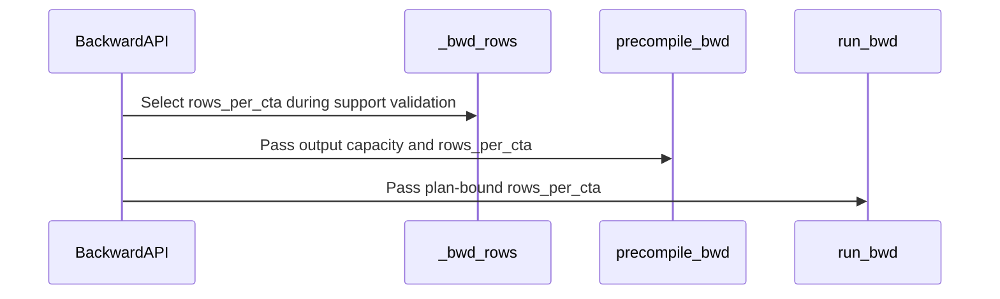

# feat(csa): enable compressor ratio 2 and 4 on SM90

[Upstream PR](https://github.com/NVIDIA/cudnn-frontend/pull/2247) · state: open · merged: False

## Original PR description

## Before submitting

- [x] I agree to license this contribution under the terms of [LICENSE.txt](https://github.com/NVIDIA/cudnn-frontend/blob/develop/LICENSE.txt).
- [x] I ran `pre-commit run` and committed any formatting changes.
- [x] I reviewed the Hard Rules in the `AGENTS.md` for each directory this PR touches and my changes comply.
- [x] A maintainer applied the required labels and the Frontend 1.33.0 milestone.

## Affected area

FE OSS kernels or CuTeDSL; sparse-attention Python API, tests, benchmark, and documentation.

## Summary

- Enable the generic CSA compressor at ratios 2 and 4 on SM90 for forward, atomic backward, and deterministic dAPE backward.
- Keep ratio 128 explicitly rejected on SM90; its separately tuned schedules remain follow-up work.
- Bind the SM90 ratio-2 backward schedule in the prepared plan and pass the same finite `rows_per_cta` value to workspace sizing, compilation, and execution.
- Add measured 16-row producer buckets for production `coff=2`, with a conservative half-open atomic d512 interval `[4,096, 5,121)` compressed rows. Deterministic d512 retains rows 16 above 2,048 rows.
- Keep the compile-artifact row domain bounded to `{8, 16, 24}` and preserve the prepared caller-workspace/CUDA Graph contract.

## Why

The ratio-2/4 compressor uses CUDA-core loads/stores, FP32 atomics, CTA barriers, and fixed-order global-memory reducers; it does not depend on SM100-only tensor-memory, cluster, or asynchronous-copy features. The existing prepared class API already separates compile from execute, exposes caller-owned deterministic workspace, and performs no execute-time allocation, synchronization, or device-to-host read.

This PR intentionally keeps the complete compressor contract atomic: forward, non-deterministic backward, and deterministic dAPE backward become available together rather than exposing a partially trainable surface.

## API and compatibility impact

- No public signature or default changes.
- Ratio 2/4 now accepts SM90 in addition to compute-capability major 10 and newer.
- Ratio 128 remains compute-capability major 10 and newer and raises a specific error on SM90.
- Forward compile artifacts remain keyed by `(ratio, head_dim, coff, device)`. Generic backward additionally specializes only on `deterministic` and the finite plan-bound `rows_per_cta` bucket. Packed lengths and sequence distributions do not create artifacts within a bucket.
- `compile()` and `execute()` use the same plan-bound schedule. `execute()` does not query capability, allocate workspace, or read sequence metadata to the host.
- Empty outputs, d256/unmeasured shapes, `coff=1`, ratio 4, and SM100-family plans retain their prior schedules.

## H200 performance

CUDA-event medians over 100 samples, with rows-8 control and selected schedule interleaved AB/BA in one locked process. `operation` includes the atomic path's required dAPE zero-fill; deterministic dAPE overwrites its output. JIT and allocation are excluded.

| ratio / d / compressed rows | atomic rows | det rows | atomic operation | det operation | det / atomic | det workspace | atomic new / old | det new / old |
|---|---:|---:|---:|---:|---:|---:|---:|---:|
| r2 / d128 / 4,096 | 8 | 16 | 30.816 us | 37.760 us | 1.225x | 0.500 MiB | 0.999x | 0.957x |
| r2 / d128 / 8,192 | 16 | 16 | 36.816 us | 49.872 us | 1.355x | 1.000 MiB | 0.958x | 0.862x |
| r2 / d128 / 16,384 | 16 | 16 | 53.568 us | 71.360 us | 1.332x | 2.000 MiB | 0.923x | 0.706x |
| r2 / d512 / 2,048 | 8 | 16 | 34.432 us | 40.032 us | 1.163x | 1.000 MiB | 0.998x | 0.988x |
| r2 / d512 / 4,096 | 16 | 16 | 48.688 us | 56.448 us | 1.159x | 2.000 MiB | 0.945x | 0.851x |
| r2 / d512 / 5,120 | 16 | 16 | 53.104 us | 62.288 us | 1.173x | 2.500 MiB | 0.915x | 0.745x |
| r2 / d512 / 5,121 | 8 | 16 | 58.000 us | 62.704 us | 1.081x | 2.508 MiB | 0.998x | 0.747x |
| r2 / d512 / 8,192 | 8 | 16 | 76.800 us | 95.920 us | 1.249x | 4.000 MiB | 0.999x | 0.835x |

The deterministic rows-16 bucket halves workspace versus rows 8. Threshold-minus-one controls stayed within measurement noise. Ratio-4 d128/d512 controls stayed within `0.997–1.002x`, and the SM100-family selector remains rows 8.

## Testing

H200, CUDA 13.0, PyTorch 2.12.1, cuDNN 9.20, CuTe DSL 4.8.1 (CUDA 13.4 compiler):

- Full focused compressor suite: `146 passed, 87 skipped, 0 failed` in 58.96s.
- Final selector/API regression after adding the conservative atomic d512 upper bound: `10 passed, 0 failed`.
- Deterministic CUDA Graph stress: 1,000,000 ratio-2 d512 ragged-tail replays and 1,000,000 ratio-4 d128 ragged-tail replays. Every replay poisoned workspace and outputs in-graph and accumulated raw-bit mismatches for dKV/dScore/dAPE on device: 0 mismatches for both ratios.
- `compute-sanitizer --tool synccheck`: 8 boundary/tail cases, 0 errors.
- `compute-sanitizer --tool memcheck --report-api-errors no --leak-check no`: 8 boundary/tail cases, 0 errors.
- `compute-sanitizer --tool initcheck`: 8 boundary/tail cases, 0 errors.
- `pre-commit run --files <changed files>`: passed.
- `python -m compileall -q ...`: passed.

Fence audit: passed. Generic producer/reducer GMEM edges are ordered by consecutive launches on the caller stream; ratio-4 reducer SMEM publish/read edges use CTA barriers; atomic dAPE uses FP32 atomics. The generic kernels have no async-proxy, cluster, WGMMA, or tensor-memory edges.

Compatibility audit: passed. Architecture/ratio/coff/head-dimension gates, threshold-minus-one/threshold/upper-bound transitions, empty and ragged-tail shapes, atomic/deterministic modes, prepared/wrapper APIs, workspace ownership/aliasing, streams, compile-cache bounds, and CUDA Graph replay were checked.

Docstring audit: passed. The prepared classes, wrappers, architecture restrictions, workspace ownership, schedule binding, and capture behavior are documented.

## Latest-base and review follow-up

- Rebased onto `NVIDIA/develop@8e3171fcc`; the focused latest-base suite remains **146 passed, 87 skipped**.
- CodeRabbit's one verified benchmark-plan compatibility finding was fixed in `8e1eb6dc`; the affected checks passed and the review thread is resolved.
- Official Codex review approved the current head with no blocking findings after independent host checks and offline SM90 compilation.

<!-- This is an auto-generated comment: release notes by coderabbit.ai -->

<!-- coderabbit-ai-generated:v1 -->

## Summary by CodeRabbit

* **New Features**
  * Generic ratio-2 and ratio-4 sparse attention is now supported on SM90 GPUs. Ratio-128 support remains limited to SM100 or newer.
  * Backward plans can select schedule sizes based on configuration, reducing workspace for certain deterministic workloads.
* **Documentation**
  * Updated architecture support guidance and clarified how backward plan caching handles schedule buckets and runtime input sizes.

<!-- end of auto-generated comment: release notes by coderabbit.ai -->

## Review and discussion

### reviews

- Anerudhan · APPROVED · 2026-11-04T10:51:03Z · [source](https://github.com/NVIDIA/cudnn-frontend/pull/2247#pullrequestreview-5767127483)

**Codex bot review · model: `gpt-6-astra`**

Reviewed `8e1eb6dc4449` against base `f88a1ef2a35b`.

Thank you for your contribution! No blocking findings. The prepared plan uses one row schedule for workspace sizing, compilation and execution; SM90 ratio-128 rejection and existing SM100 schedules are preserved. The device kernels and their launch functions are unchanged.

Validation: Independent host checks passed 576 plan/workspace/bound-launch cases across architecture, ratio, deterministic mode, head dimension, overlap and schedule boundaries; six unsupported architecture/ratio cases rejected. These use meta tensors and mocked compiler/launcher calls. 25 offline sm_90a forward/backward/reducer compile cases passed, including row schedules 8/16/24 and an odd-dimension tail. All 233 compressor tests collect (checklist E01/E14). Checked producer ownership, fixed reduction order, stream ordering, compile-key bounds and unchanged-base compatibility.

Limitations: No independent native SM90 execution, sanitizer, graph replay or performance measurement. The H200 measurements in the PR are author evidence; the local GPU was busy. Current-head GitHub workflows require maintainer approval. No workflow approval or alternate CI trigger was attempted. After that hold is cleared, python/misc covers the compressor tests.

Approved: no P0 or high-risk P1 found. Remaining findings stay with the owner; merge timing stays with the owner.

<!-- codex-fe-review:v2:2247:8e1eb6dc4449782a989f90ffd4e5b5ac6bb20a21:complete:no-blocker -->

### issue_comments

- coderabbitai[bot] · comment · 2026-11-04T09:31:24Z · [source](https://github.com/NVIDIA/cudnn-frontend/pull/2247#issuecomment-6627477174)

<!-- coderabbit-ai-generated:v1 -->

<!-- This is an auto-generated comment: summarize by coderabbit.ai -->
<!-- review_stack_entry_start -->

<a href="https://app.coderabbit.ai/change-stack/NVIDIA/cudnn-frontend/pull/2247?scope=ghh_OusAJGA4HG8ljoOV0wJvVx8NmnZIjc2DdjmxOu0xZWA&amp;cs_source=review_comment"><picture><source media="(prefers-color-scheme: dark)" srcset="https://storage.googleapis.com/coderabbit_public_assets/review-stack-buttons-v1/explain-change-dark.svg"><source media="(prefers-color-scheme: light)" srcset="https://storage.googleapis.com/coderabbit_public_assets/review-stack-buttons-v1/explain-change.svg"></picture></a>

<!-- review_stack_entry_end -->
<!-- recent_review_status_start -->

No actionable comments were generated in the recent review.

<!-- recent_review_status_end -->
<!-- walkthrough_start -->

<strong>Walkthrough</strong>

<dl>
<dd>

Generic ratio-2/4 compression now accepts SM90 devices, while ratio 128 remains restricted to compute-capability major 10 and newer. Generic backward plans select and retain a CTA row count for workspace sizing, compilation, and execution. Tests, documentation, and benchmarks cover these changes.

**Changes: Generic CSA SM90 support**

|Layer / File(s)|Summary|
|:---|:---|
|**Ratio-specific device support**   `python/cudnn/csa/compressor/api.py`, `python/cudnn/csa/compressor/compressor_sm100.py`, `test/python/compressed_sparse_attention/cutedsl/test_CSA_compressor.py`, `docs/operations/sparse_attention/csa.md`|Generic ratios 2 and 4 accept SM90 or compute-capability major 10 and newer. Ratio 128 remains limited to major 10 and newer. Tests now apply ratio-aware device checks.|
|**Plan-bound backward row schedule**   `python/cudnn/csa/compressor/api.py`, `python/cudnn/csa/compressor/compressor_sm100.py`, `test/python/compressed_sparse_attention/cutedsl/test_CSA_compressor.py`, `docs/operations/sparse_attention/csa.md`|SM90 ratio-2 backward plans select among supported CTA row counts. The selected count is passed to workspace sizing, compilation, and execution. Tests check schedule thresholds and plan-bound behavior.|
|**Cache behavior and benchmark coverage**   `docs/operations/sparse_attention/csa.md`, `test/python/compressed_sparse_attention/cutedsl/test_CSA_compressor.py`, `benchmark/csa/bench_csa_dape_deterministic.py`|Documentation describes bounded prepared-instance caching. Tests check compilation reuse across runtime extents. The benchmark adds a generic-only suite and reports each plan’s row count.|

<!-- change_assessment_start -->

**Estimated code review effort:** 4 (Complex) | ~45 minutes

<!-- change_assessment_commit:"8e1eb6dc4449782a989f90ffd4e5b5ac6bb20a21" -->
<!-- change_assessment_priority:{"version":1,"urgency":"p2","manual":false} -->
**Change:** Feature
<!-- change_assessment_end -->

### Sequence Diagram(s)

**Suggested reviewers:** `zkyue`, `tongke6`

</dd>
</dl>

<!-- walkthrough_end -->

<strong>Merge Risk:</strong> <strong><picture></picture> Moderate</strong> · up to <code>8e1eb</code>

<dl>
<dd>

<!-- final_review_risk_start -->
<!-- final_review_risk_label
**Merge Risk:** **🟡 Moderate** · up to `8e1eb`
-->
<!-- final_review_risk_coverage:{"sourceCommitId":"8e1eb6dc4449782a989f90ffd4e5b5ac6bb20a21","coveredCommitId":"8e1eb6dc4449782a989f90ffd4e5b5ac6bb20a21","kind":"reviewed"} -->

The recorded merge-requirements check fails because the PR has no milestone. Assign one and rerun the check before merging.
<!-- final_review_risk_end -->

</dd>
</dl>

<!-- pre_merge_checks_walkthrough_start -->

<strong>Pre-merge checks: <picture></picture> 5</strong>

<dl>
<dd>

|         Check name         |                                             Status                                             | Explanation                                                                                                                                                                                               |
| :------------------------ | :--------------------------------------------------------------------------------------------: | :-------------------------------------------------------------------------------------------------------------------------------------------------------------------------------------------------------- |
|         Title check        |  | The title "feat(csa): enable compressor ratio 2 and 4 on SM90" names the main change. The changeset enables the generic CSA compressor at ratios 2 and 4 on SM90 across forward, atomic backward, and de… |
|     Docstring Coverage     |  | Docstring coverage is 94.29% which is sufficient. The required threshold is 80.00%. Docstring coverage is scoped to functions touched by this diff with cyclomatic complexity of at least 2. Documentati… |
|     Linked Issues check    |  | Check skipped because no linked issues were found for this pull request.                                                                                                                                  |
| Out of Scope Changes check |  | Check skipped because no linked issues were found for this pull request.                                                                                                                                  |
|      Description check     |  | The description follows the repository template and is mostly complete. It has a Before submitting checklist, Affected area, Summary, Why, API and compatibility impact, and Testing sections. The Summa… |

<strong>Full details: Title check</strong>

<dl>
<dd>

**Explanation**

The title "feat(csa): enable compressor ratio 2 and 4 on SM90" names the main change. The changeset enables the generic CSA compressor at ratios 2 and 4 on SM90 across forward, atomic backward, and deterministic dAPE backward paths, and the title reflects that. It is concise, uses a conventional prefix, and states the primary intent. It does not mention the supporting schedule and benchmark work, which is expected for a title.

</dd>
</dl>

<strong>Full details: Docstring Coverage</strong>

<dl>
<dd>

**Explanation**

Docstring coverage is 94.29% which is sufficient. The required threshold is 80.00%. Docstring coverage is scoped to functions touched by this diff with cyclomatic complexity of at least 2. Documentation-only edits and deletions within surviving functions are included; unchanged diff context and fully deleted functions are excluded. Analyzed 35 functions across 4 files. (1 skipped: 1 unsupported.)

</dd>
</dl>

<strong>Full details: Description check</strong>

<dl>
<dd>

**Explanation**

The description follows the repository template and is mostly complete. It has a Before submitting checklist, Affected area, Summary, Why, API and compatibility impact, and Testing sections. The Summary lists the SM90 enablement for ratios 2 and 4, the rejection of ratio 128 on SM90, the rows_per_cta binding, and the measured 16-row buckets. The Why section gives a technical rationale. The API section states that no public signatures or defaults change. The Testing section gives exact pass counts, the hardware and software stack, and sanitizer results. The Related issues section is not filled in. It does not link the PR to an issue or state 'None'. The template's 'Affected area' guidance is met. The PR also includes a 'Related issues' gap and some unverifiable claims about a fence audit and a Codex review. These do not block the check.

</dd>
</dl>

</dd>
</dl>

<!-- pre_merge_checks_walkthrough_end -->
<!-- finishing_touch_checkbox_start -->

<strong>Finishing Touches</strong>

<dl>
<dd>

<strong>Generate unit tests (beta)</strong>

<dl>
<dd>

- [ ] <!-- {"checkboxId": "f47ac10b-58cc-4372-a567-0e02b2c3d479", "radioGroupId": "utg-output-choice-group-6628203715"} --> Create a new PR

</dd>
</dl>

</dd>
</dl>

<!-- finishing_touch_checkbox_end -->

<!-- autopilot:start -->
- [ ] <!-- {"checkboxId":"2708ad07-9f24-4260-9c11-7dc76a49f2e3"} --> <strong title="Keep fixing CodeRabbit findings and required CI, and resolving merge conflicts">Autofix</strong> · Keep fixing CodeRabbit findings and required CI, and resolving merge conflicts
<!-- autopilot:end -->
<!-- recent_review_start -->

<h6>

<strong><picture></picture> Recent review info</strong>

<dl>
<dd>

<!-- review_info_content -->

<strong><picture><source media="(prefers-color-scheme: dark)" srcset="https://storage.googleapis.com/coderabbit_public_assets/review-comment-icons-v1/cog-dark.svg"></picture> Run configuration</strong>

<dl>
<dd>

- **Source mode**: Auto
- **Repository**: [NVIDIA/cudnn-frontend](<https://github.com/NVIDIA/cudnn-frontend>)
- **Branch**: [develop](<https://github.com/NVIDIA/cudnn-frontend/tree/develop>)
- **File**: [.coderabbit.yaml](<https://github.com/NVIDIA/cudnn-frontend/blob/8e3171fccbdcf452fdc14234d068953120511b22/.coderabbit.yaml>)
- **Commit**: [8e3171f](<https://github.com/NVIDIA/cudnn-frontend/commit/8e3171fccbdcf452fdc14234d068953120511b22>)
- **Layers**: Repository YAML
- **Review profile**: CHILL
- **Plan**: Enterprise
- **Run ID**: `af633b95-2c2c-473e-9ecf-ffcd4252a63e`

</dd>
</dl>

<strong><picture><source media="(prefers-color-scheme: dark)" srcset="https://storage.googleapis.com/coderabbit_public_assets/review-comment-icons-v1/git-commit-horizontal-dark.svg"></picture> Commits</strong>

<dl>
<dd>

Reviewing files that changed from the base of the PR and between 8e3171fccbdcf452fdc14234d068953120511b22 and 8e1eb6dc4449782a989f90ffd4e5b5ac6bb20a21.

</dd>
</dl>

<strong><picture><source media="(prefers-color-scheme: dark)" srcset="https://storage.googleapis.com/coderabbit_public_assets/review-comment-icons-v1/file-plus-corner-dark.svg"></picture> Files selected for processing: 5</strong>

<dl>
<dd>

* `benchmark/csa/bench_csa_dape_deterministic.py`
* `docs/operations/sparse_attention/csa.md`
* `python/cudnn/csa/compressor/api.py`
* `python/cudnn/csa/compressor/compressor_sm100.py`
* `test/python/compressed_sparse_attention/cutedsl/test_CSA_compressor.py`

</dd>
</dl>

**Included review availability:** This review used your included allowance. Your plan provides up to 12 included reviews per hour; 11 remain after this review.

</dd>
</dl>

</h6>

<!-- recent_review_end -->

- icavan · comment · 2026-11-04T10:14:42Z · [source](https://github.com/NVIDIA/cudnn-frontend/pull/2247#issuecomment-6628203715)

@coderabbitai review

- coderabbitai[bot] · comment · 2026-11-04T10:14:49Z · [source](https://github.com/NVIDIA/cudnn-frontend/pull/2247#issuecomment-6628205761)

<!-- coderabbit-ai-generated:v1 -->

<!-- This is an auto-generated reply by CodeRabbit -->
<!-- CodeRabbit review command invocation: v2:25cd58fc5e26add0aa90b9582f30a4694e37a9981b1271e66bfa58b3d0c17d26 -->

Action performed

<dl>
<dd>

Review finished.

> Note: CodeRabbit is an incremental review system and does not re-review already reviewed commits. This command is applicable only when automatic reviews are paused.

</dd>
</dl>

- YangXu1990uiuc · comment · 2026-11-04T12:05:53Z · [source](https://github.com/NVIDIA/cudnn-frontend/pull/2247#issuecomment-6630144548)

Thanks for the SM90 CSA compressor ratio-2/4 support and the focused compatibility and determinism coverage! I have added this PR to our external-contribution tracking.

When you consider it ready to land, please leave a comment saying `ready`. The review bot will review any remaining updates, and we will help work through review, validation and integration toward merge.

<!-- fe-external-watch:2247:ready-invitation -->

- icavan · comment · 2026-11-04T12:09:48Z · [source](https://github.com/NVIDIA/cudnn-frontend/pull/2247#issuecomment-6630223957)

ready

- YangXu1990uiuc · comment · 2026-11-04T16:07:22Z · [source](https://github.com/NVIDIA/cudnn-frontend/pull/2247#issuecomment-6635555614)

Native SM90 qualification update for `8e1eb6dc4449782a989f90ffd4e5b5ac6bb20a21`:

I tested an isolated merge preview onto develop `f88a1ef2a35bc405967691dd798eb062298fcd9a` (tree `015c447255a4beaee8291dd4d0e494fb9254dd1c`). The loaded Frontend, compressor API and kernel module paths/hashes were checked against that source, and the merge tree remained unchanged after testing.

On H100 NVL (SM90), PyTorch 2.14.1+cu130, cuDNN 9.24.0 and CuTeDSL 4.8.0 (CUDA 12.9 compiler), the full focused compressor `L0 or L1` suite passed: **146 passed, 87 skipped**. The source checkout used the official Frontend 1.32.1 wheel's native extension.

Coverage includes 17 deterministic cases and five CUDA Graph cases, including ratio-2/4 dAPE overwrite/replay and wrapper workspace retention. Skips were 85 ratio-128 cases and one ratio-8 case requiring compute-capability major 10+, plus one test requiring two visible GPUs. This run did not include sanitizer, performance or million-replay stress measurements.

The current head retains its independent approval and your `ready` reply is recorded. Style, Security and Docs workflows still require release; this update does not claim remote CI completion. No duplicate backend CI run was requested.

<!-- fe-external-watch:2247:native-sm90:8e1eb6dc4449782a989f90ffd4e5b5ac6bb20a21 -->

### inline_comments

## Changed files and fixed code

- `benchmark/csa/bench_csa_dape_deterministic.py` · modified · additions 17 / deletions 0
  - [head](https://github.com/icavan/cudnn-frontend/blob/8e1eb6dc4449782a989f90ffd4e5b5ac6bb20a21/benchmark/csa/bench_csa_dape_deterministic.py)
  - [base](https://github.com/NVIDIA/cudnn-frontend/blob/8e3171fccbdcf452fdc14234d068953120511b22/benchmark/csa/bench_csa_dape_deterministic.py)
- `docs/operations/sparse_attention/csa.md` · modified · additions 24 / deletions 4
  - [head](https://github.com/icavan/cudnn-frontend/blob/8e1eb6dc4449782a989f90ffd4e5b5ac6bb20a21/docs/operations/sparse_attention/csa.md)
  - [base](https://github.com/NVIDIA/cudnn-frontend/blob/8e3171fccbdcf452fdc14234d068953120511b22/docs/operations/sparse_attention/csa.md)
- `python/cudnn/csa/compressor/api.py` · modified · additions 95 / deletions 33
  - [head](https://github.com/icavan/cudnn-frontend/blob/8e1eb6dc4449782a989f90ffd4e5b5ac6bb20a21/python/cudnn/csa/compressor/api.py)
  - [base](https://github.com/NVIDIA/cudnn-frontend/blob/8e3171fccbdcf452fdc14234d068953120511b22/python/cudnn/csa/compressor/api.py)
- `python/cudnn/csa/compressor/compressor_sm100.py` · modified · additions 53 / deletions 13
  - [head](https://github.com/icavan/cudnn-frontend/blob/8e1eb6dc4449782a989f90ffd4e5b5ac6bb20a21/python/cudnn/csa/compressor/compressor_sm100.py)
  - [base](https://github.com/NVIDIA/cudnn-frontend/blob/8e3171fccbdcf452fdc14234d068953120511b22/python/cudnn/csa/compressor/compressor_sm100.py)
- `test/python/compressed_sparse_attention/cutedsl/test_CSA_compressor.py` · modified · additions 266 / deletions 45
  - [head](https://github.com/icavan/cudnn-frontend/blob/8e1eb6dc4449782a989f90ffd4e5b5ac6bb20a21/test/python/compressed_sparse_attention/cutedsl/test_CSA_compressor.py)
  - [base](https://github.com/NVIDIA/cudnn-frontend/blob/8e3171fccbdcf452fdc14234d068953120511b22/test/python/compressed_sparse_attention/cutedsl/test_CSA_compressor.py)

## Evidence and interpretation boundary

[Original JSON, discussions and patches](../../../../../../evidence/prs/NVIDIA--cudnn-frontend/2247-125ec8c3056ba32029eb0f31dd71a3fc9db6f096f080ac74774bf7713cca2b17.json) · SHA-256 `125ec8c3056ba32029eb0f31dd71a3fc9db6f096f080ac74774bf7713cca2b17`.

Diff complete: True. Missing/binary/truncated patches require pinned source inspection. This is a source page, not an independently verified optimization case. Open, merged and released are different states; recheck the deployed dependency.
