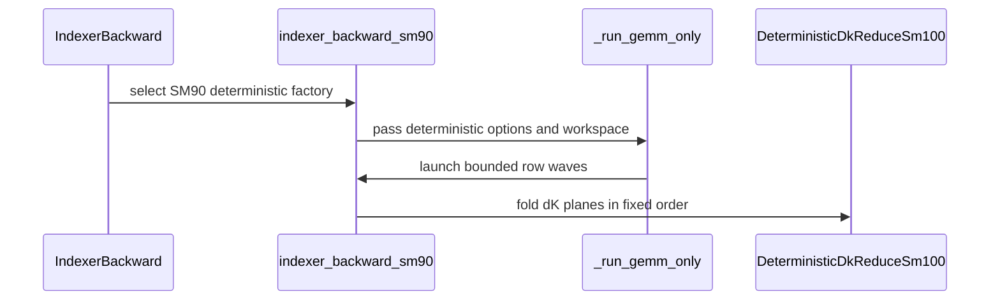

# feat(dsa): add deterministic SM90 indexer backward

[Upstream PR](https://github.com/NVIDIA/cudnn-frontend/pull/2249) · state: open · merged: False

## Original PR description

## Summary

- add request-or-fail deterministic SM90 sparse IndexerBackward for H64 / D128 / block-I 128 / 128-multiple top-k up to 2048
- use stream-ordered bounded waves with 96, 128, or 148 fixed FP32 dK planes and a fixed-order reducer
- replace dW shared-atomic arbitration with deterministic hierarchical folding; top-k below 512 keeps the private-slot fold, while top-k 512 and above uses a fixed lane-quad then warp-order fold
- keep packed batch/sequence extents out of the CuTeDSL compile key and preserve caller-owned workspace plus CUDA Graph capture/replay
- use unaligned CTA barriers for warp-role subsets; ordinary and deterministic paths share the corrected synchronization primitives

## Scope

This PR changes sparse IndexerBackward only. It does not change DSA forward, score recompute, or CSA.

## Validation

Final HEAD is rebased on `8e3171fcc` and validated on H200 with cuDNN backend 9.20 and CuTeDSL 4.8.1:

- complete focused SM90 L0/L1 file: 70 passed / 51 inapplicable skipped
- guard-amended old-fold versus lane-quad A/B: raw dQ/dW/dK/grad-signal hashes are identical for B1 and B2 at top-k 512 and 1024
- compute-sanitizer synccheck on B2 local-ID FP32 dK, top-k 512 multi-wave, and top-k 2048: 3 passed, 0 errors
- compute-sanitizer memcheck with API errors disabled on the same set: 3 passed, 0 errors
- compute-sanitizer initcheck, candidate kernels only:
  - B2 Sq49 Sk512 top-k 512, P96, FP32 dK: 0 errors
  - B1 Sq193 Sk2048 top-k 2048, P96, FP32 dK: 0 errors
- the full pytest driver is not a valid initcheck harness: its post-kernel PyTorch BF16 autograd reference reports 13,508,608 reads in PyTorch `launch_clamp_scalar` / gather-backward `scatter_gather` kernels. A reference-only reproducer reports the same sites without launching this PR's kernels; the reference helper blob is identical at HEAD, the feature base, and `develop` (`eaa23b91559c211950ee6f4b3c15864c2da4b78b`)
- 1,000,000 CUDA Graph replays at top-k 512 and another 1,000,000 at top-k 2048, using a device-side sticky raw-byte comparison over dQ, dW, dK, and grad-signal: 0 mismatches; final hashes match the frozen references
- packed-shape compile reuse, exact workspace sizing/alias rejection, local/global index conventions, FP32/BF16 dK, 96/128/148 planes, top-k boundaries 384/512, short/single/multi-wave grids, batch remapping, Sk tails, and multi-wave CUDA Graph replay are covered
- pre-commit, `py_compile`, and `git diff --check` passed after the final guard amendment

The CUDA 12.9 port baseline was also validated before the dW-only performance amendment: cold-cache deterministic contract passed, deterministic matrix 22 passed / 3 inapplicable skipped, and the complete focused file 67 passed / 51 inapplicable skipped.

## Performance and workspace

Operation-level CUDA-event medians, serialized on one GPU with outputs/workspace preallocated and FP32 dK:

| Shape | Ordinary | Deterministic P96 | Slowdown | Deterministic workspace |
|---|---:|---:|---:|---:|
| B1 Sq64 Sk512 H64 D128 top-k 128 | 54.176 us | 88.656 us | 1.636x | 24 MiB |
| B1 Sq193 Sk2048 H64 D128 top-k 896 | 73.408 us | 162.848 us | 2.218x | 96 MiB |
| B1 Sq193 Sk2048 H64 D128 top-k 2048 | 140.704 us | 306.032 us | 2.175x | 96 MiB |

The lane-quad amendment keeps raw bits unchanged and reduces deterministic dW operation time relative to the private-slot fold:

| Shape | Private-slot fold | Lane-quad fold | Change |
|---|---:|---:|---:|
| B1 Sq193 Sk2048 top-k 512 | 139.872 us | 125.072 us | -10.58% |
| B2 Sq49 Sk512 top-k 512 | 116.480 us | 115.936 us | -0.47% |
| B1 Sq193 Sk2048 top-k 1024 | 192.880 us | 176.304 us | -8.59% |
| B2 Sq49 Sk1024 top-k 1024 | 150.000 us | 139.536 us | -6.98% |

Ordinary FP32 dK needs no scratch. Deterministic scratch is exactly `planes * B * Sk * D * sizeof(float)`; the table uses the default P96. Plane tuning remains explicit: P128 can improve some long-sequence cases at 4/3 the P96 workspace, while P148 uses 148/96 times the P96 workspace. No exact-shape auto-policy was added.

## Audit state

- compile-cache audit: passed; the optimization reuses the existing bounded `topk` specialization, B/Sq/Sk remain runtime values, and the plane domain stays 96/128/148
- CUDA Graph audit: passed; plan/workspace/output allocation remains outside execute, and execute has no host readback or allocation
- fence audit: passed; Q TMA, generic-to-async shared visibility, dK bulk-reduce staging/reuse, dW warp-partial publication, same-stream wave reuse, and memset/wave/reducer ordering were checked edge by edge
- compatibility and docstring audits: passed

## Review state

CodeRabbit reviewed the patch-equivalent fork diff. Its sole suggestion requested an `aligned=False` keyword that CuTe DSL 4.8.1 does not expose; the subset barrier operations already lower as non-aligned. The finding was answered with API and lowering evidence, and the thread was resolved.

This NVIDIA PR is Ready for review. A maintainer applied the required labels and the Frontend 1.33.0 milestone; merge-requirements now passes.

<!-- This is an auto-generated comment: release notes by coderabbit.ai -->

<!-- coderabbit-ai-generated:v1 -->

## Summary by CodeRabbit

* **New Features**
  * Deterministic Indexer backward execution is now supported on SM90 GPUs, extending reproducible gradient computation to another architecture.
  * On SM90, deterministic execution requires a hidden dimension of 64. SM100-family GPUs support hidden dimensions of 32 or 64; other shape and top-k constraints apply.
* **Documentation**
  * Updated the deterministic support details and execution behavior for SM90 and SM100-family GPUs.

<!-- end of auto-generated comment: release notes by coderabbit.ai -->

## Review and discussion

### reviews

- Anerudhan · COMMENTED · 2026-11-04T10:45:10Z · [source](https://github.com/NVIDIA/cudnn-frontend/pull/2249#pullrequestreview-5767069359)

**Codex bot review · model: `gpt-6-astra`**

Reviewed `eb37a74da868` against base `f88a1ef2a35b`.

Thank you for your contribution! No confirmed defect in the wave ownership, fixed reductions or workspace handling. Approval is deferred pending independent native SM90 validation of the changed synchronization and deterministic paths. A maintainer must clear the pending workflow approval; python/misc is the relevant CI target afterward.

Validation: Reviewed all five changed files, sparse dispatch and shared dense callers. Checked barrier participant counts, stream-ordered plane reuse, batch addressing and workspace-before-mutation checks (checklist A02). Offline sm_90a compilation passed for ordinary sparse, private-slot deterministic, quad deterministic and ordinary dense routes, plus six reducer combinations covering 96/128/148 planes and BF16/FP32 output. No GPU kernels executed. Checked the actual 128-thread MMA head layout. Host checks passed 100 bitwise comparisons of the private-slot and quad folds and 117 wave ownership cases. All 122 indexer backward cases collect. The two L0 deterministic contract cases cover local/global IDs and multiple waves; broader strategy-boundary, packed-shape and graph cases are L1.

Limitations: No local SM90 hardware, native replay, sanitizer or timing result. The H200 results in the PR description are author evidence and were not independently reproduced here. GitHub workflows for this head require maintainer approval. No workflow approval, alternate CI trigger or retry was attempted.

Review incomplete; approval is deferred.

<!-- codex-fe-review:v2:2249:eb37a74da868c2a7ed6b71d0cf5bcdd78acb362a:deferred:no-blocker -->

### issue_comments

- coderabbitai[bot] · comment · 2026-11-04T09:32:08Z · [source](https://github.com/NVIDIA/cudnn-frontend/pull/2249#issuecomment-6627492223)

<!-- coderabbit-ai-generated:v1 -->

<!-- This is an auto-generated comment: summarize by coderabbit.ai -->
<!-- review_stack_entry_start -->

<a href="https://app.coderabbit.ai/change-stack/NVIDIA/cudnn-frontend/pull/2249?scope=ghh_OusAJGA4HG8ljoOV0wJvVx8NmnZIjc2DdjmxOu0xZWA&amp;cs_source=review_comment"><picture><source media="(prefers-color-scheme: dark)" srcset="https://storage.googleapis.com/coderabbit_public_assets/review-stack-buttons-v1/explain-change-dark.svg"><source media="(prefers-color-scheme: light)" srcset="https://storage.googleapis.com/coderabbit_public_assets/review-stack-buttons-v1/explain-change.svg"></picture></a>

<!-- review_stack_entry_end -->
<!-- recent_review_status_start -->

No actionable comments were generated in the recent review.

<!-- recent_review_status_end -->
<!-- walkthrough_start -->

<strong>Walkthrough</strong>

<dl>
<dd>

Deterministic `IndexerBackward` now supports SM90, with an H=64 constraint. The SM90 path uses bounded row waves and fixed-order dK and dW reductions. API routing, documentation, and tests now include SM90.

**Changes: SM90 Deterministic Indexer Backward**

|Layer / File(s)|Summary|
|:---|:---|
|**Document and route deterministic support**   `python/cudnn/deepseek_sparse_attention/indexer_backward/api.py`, `docs/operations/sparse_attention/dsa.md`|The deterministic capability check and factory selection now include SM90. Documentation specifies the SM90 H=64 constraint and its bounded one-row waves, while retaining the SM100-family H=32-or-64 constraint.|
|**Schedule SM90 rows and reduce dK**   `python/cudnn/deepseek_sparse_attention/indexer_backward/indexer_backward_sm90.py`, `python/cudnn/deepseek_sparse_attention/indexer_backward/deterministic_dk_sm100.py`|The SM90 path launches bounded row waves, accumulates dK into configured FP32 planes, and folds the planes in fixed order. The reducer documentation describes its scalar operations as architecture-neutral.|
|**Fold dW deterministically**   `python/cudnn/deepseek_sparse_attention/indexer_backward/indexer_backward_sm90.py`|Deterministic dW uses private-slot folding below top-k 512 and lane-quad and warp-order folding at or above 512. The kernel uses NVVM CTA barrier primitives for synchronization.|
|**Validate support and reproducibility**   `test/python/deepseek_sparse_attention/cutedsl/test_DSA_indexer_backward.py`|Tests cover the expanded support envelope, compilation reuse across packed shapes, dW fold boundaries, multi-wave execution, workspace behavior, invalid policy, and CUDA graphs.|

<!-- change_assessment_start -->

**Estimated code review effort:** 4 (Complex) | ~60 minutes

<!-- change_assessment_commit:"eb37a74da868c2a7ed6b71d0cf5bcdd78acb362a" -->
<!-- change_assessment_priority:{"version":1,"urgency":"p2","manual":false} -->
**Change:** Feature
<!-- change_assessment_end -->

### Sequence Diagram(s)

**Suggested reviewers:** `jiayus-nvidia`

</dd>
</dl>

<!-- walkthrough_end -->

<strong>Merge Risk:</strong> <strong><picture></picture> Minimal</strong> · up to <code>eb37a</code>

<dl>
<dd>

<!-- final_review_risk_start -->
<!-- final_review_risk_label
**Merge Risk:** **⚪ Minimal** · up to `eb37a`
-->
<!-- final_review_risk_coverage:{"sourceCommitId":"eb37a74da868c2a7ed6b71d0cf5bcdd78acb362a","coveredCommitId":"eb37a74da868c2a7ed6b71d0cf5bcdd78acb362a","kind":"reviewed"} -->

This change adds deterministic SM90 sparse IndexerBackward behind the existing deterministic option. The review found no concrete code defect. The CI check fails only because the PR has no milestone, which needs to be set before merge.
<!-- final_review_risk_end -->

</dd>
</dl>

<!-- pre_merge_checks_walkthrough_start -->

<strong>Pre-merge checks: <picture></picture> 4 · <picture></picture> 1</strong>

<dl>
<dd>

<strong><picture></picture> Failed checks: 1 warning</strong>

|     Check name     |                                              Status                                              | Explanation                                                                                                                                                                                               | Resolution                                                                         |
| :---------------- | :----------------------------------------------------------------------------------------------: | :-------------------------------------------------------------------------------------------------------------------------------------------------------------------------------------------------------- | :--------------------------------------------------------------------------------- |
| Docstring Coverage |  | Docstring coverage is 76.19% which is insufficient. The required threshold is 80.00%. Docstring coverage is scoped to functions touched by this diff with cyclomatic complexity of at least 2. Documenta… | Write docstrings for the functions missing them to satisfy the coverage threshold. |

<strong><picture></picture> Passed checks: 4 passed</strong>

<dl>
<dd>

|         Check name         |                                             Status                                             | Explanation                                                                                                                                                                                               |
| :------------------------ | :--------------------------------------------------------------------------------------------: | :-------------------------------------------------------------------------------------------------------------------------------------------------------------------------------------------------------- |
|         Title check        |  | The title clearly and concisely identifies the main change: deterministic SM90 IndexerBackward support.                                                                                                   |
|     Linked Issues check    |  | Check skipped because no linked issues were found for this pull request.                                                                                                                                  |
| Out of Scope Changes check |  | Check skipped because no linked issues were found for this pull request.                                                                                                                                  |
|      Description check     |  | The description is thorough and mostly complete for this repository's template. It has a clear Summary, a detailed Why-equivalent context through the Scope and Validation sections, extensive Testing r… |

<strong>Full details: Description check</strong>

<dl>
<dd>

**Explanation**

The description is thorough and mostly complete for this repository's template. It has a clear Summary, a detailed Why-equivalent context through the Scope and Validation sections, extensive Testing results with exact commands and outcomes, and an API/compatibility-related Performance and workspace section. The template's pre-submission checklist is not visible in the description: there is no confirmation of the license agreement, no explicit statement that pre-commit was run (the Validation section does mention pre-commit passed), no statement on AGENTS.md Hard Rules review, and no explicit check of the GitHub labels (the Review state section says a maintainer applied labels). The 'Affected area' section is missing. The 'Related issues' section is missing, and the PR objectives reference PR `#2249` without a linked issue. The 'API and compatibility impact' section is not explicitly headed, though the Performance and workspace section and the compatibility audit cover some of this. The description also states the PR is Ready for review while the objectives say it remains Draft, which is a discrepancy worth noting. Overall the description is mostly complete, so the check passes, with minor gaps in template sections.

</dd>
</dl>

</dd>
</dl>

<strong>Full details: Docstring Coverage</strong>

<dl>
<dd>

**Explanation**

Docstring coverage is 76.19% which is insufficient. The required threshold is 80.00%. Docstring coverage is scoped to functions touched by this diff with cyclomatic complexity of at least 2. Documentation-only edits and deletions within surviving functions are included; unchanged diff context and fully deleted functions are excluded. Analyzed 21 functions across 4 files. (1 skipped: 1 unsupported.)

**Resolution**

Write docstrings for the functions missing them to satisfy the coverage threshold.

</dd>
</dl>

</dd>
</dl>

<!-- pre_merge_checks_walkthrough_end -->
<!-- finishing_touch_checkbox_start -->

<strong>Finishing Touches</strong>

<dl>
<dd>

<strong>Generate unit tests (beta)</strong>

<dl>
<dd>

- [ ] <!-- {"checkboxId": "f47ac10b-58cc-4372-a567-0e02b2c3d479", "radioGroupId": "utg-output-choice-group-6628205385"} --> Create a new PR

</dd>
</dl>

</dd>
</dl>

<!-- finishing_touch_checkbox_end -->

<!-- autopilot:start -->
- [ ] <!-- {"checkboxId":"2708ad07-9f24-4260-9c11-7dc76a49f2e3"} --> <strong title="Keep fixing CodeRabbit findings and required CI, and resolving merge conflicts">Autofix</strong> · Keep fixing CodeRabbit findings and required CI, and resolving merge conflicts
<!-- autopilot:end -->
<!-- recent_review_start -->

<h6>

<strong><picture></picture> Recent review info</strong>

<dl>
<dd>

<!-- review_info_content -->

<strong><picture><source media="(prefers-color-scheme: dark)" srcset="https://storage.googleapis.com/coderabbit_public_assets/review-comment-icons-v1/cog-dark.svg"></picture> Run configuration</strong>

<dl>
<dd>

- **Source mode**: Auto
- **Repository**: [NVIDIA/cudnn-frontend](<https://github.com/NVIDIA/cudnn-frontend>)
- **Branch**: [develop](<https://github.com/NVIDIA/cudnn-frontend/tree/develop>)
- **File**: [.coderabbit.yaml](<https://github.com/NVIDIA/cudnn-frontend/blob/8e3171fccbdcf452fdc14234d068953120511b22/.coderabbit.yaml>)
- **Commit**: [8e3171f](<https://github.com/NVIDIA/cudnn-frontend/commit/8e3171fccbdcf452fdc14234d068953120511b22>)
- **Layers**: Repository YAML
- **Review profile**: CHILL
- **Plan**: Enterprise
- **Run ID**: `7e17e808-0d33-47de-bdcc-04345361bd35`

</dd>
</dl>

<strong><picture><source media="(prefers-color-scheme: dark)" srcset="https://storage.googleapis.com/coderabbit_public_assets/review-comment-icons-v1/git-commit-horizontal-dark.svg"></picture> Commits</strong>

<dl>
<dd>

Reviewing files that changed from the base of the PR and between 8e3171fccbdcf452fdc14234d068953120511b22 and eb37a74da868c2a7ed6b71d0cf5bcdd78acb362a.

</dd>
</dl>

<strong><picture><source media="(prefers-color-scheme: dark)" srcset="https://storage.googleapis.com/coderabbit_public_assets/review-comment-icons-v1/file-plus-corner-dark.svg"></picture> Files selected for processing: 5</strong>

<dl>
<dd>

* `docs/operations/sparse_attention/dsa.md`
* `python/cudnn/deepseek_sparse_attention/indexer_backward/api.py`
* `python/cudnn/deepseek_sparse_attention/indexer_backward/deterministic_dk_sm100.py`
* `python/cudnn/deepseek_sparse_attention/indexer_backward/indexer_backward_sm90.py`
* `test/python/deepseek_sparse_attention/cutedsl/test_DSA_indexer_backward.py`

</dd>
</dl>

**Included review availability:** This review used your included allowance. Your plan provides up to 12 included reviews per hour; 9 remain after this review.

</dd>
</dl>

</h6>

<!-- recent_review_end -->

- icavan · comment · 2026-11-04T10:14:48Z · [source](https://github.com/NVIDIA/cudnn-frontend/pull/2249#issuecomment-6628205385)

@coderabbitai review

- coderabbitai[bot] · comment · 2026-11-04T10:14:55Z · [source](https://github.com/NVIDIA/cudnn-frontend/pull/2249#issuecomment-6628207250)

<!-- coderabbit-ai-generated:v1 -->

<!-- This is an auto-generated reply by CodeRabbit -->
<!-- CodeRabbit review command invocation: v2:a14edbc39eabbc2e519bf1da629469d38e92c39b87a09aed5cc482c041dbeb65 -->

Action performed

<dl>
<dd>

Review finished.

> Note: CodeRabbit is an incremental review system and does not re-review already reviewed commits. This command is applicable only when automatic reviews are paused.

</dd>
</dl>

- YangXu1990uiuc · comment · 2026-11-04T12:05:59Z · [source](https://github.com/NVIDIA/cudnn-frontend/pull/2249#issuecomment-6630146738)

Thanks for the deterministic SM90 indexer backward implementation and the detailed validation coverage! I have added this PR to our external-contribution tracking.

When you consider it ready to land, please leave a comment saying `ready`. The review bot will review any remaining updates, and we will help work through review, validation and integration toward merge.

<!-- fe-external-watch:2249:ready-invitation -->

- icavan · comment · 2026-11-04T12:09:49Z · [source](https://github.com/NVIDIA/cudnn-frontend/pull/2249#issuecomment-6630224056)

ready

### inline_comments

## Changed files and fixed code

- `docs/operations/sparse_attention/dsa.md` · modified · additions 15 / deletions 8
  - [head](https://github.com/icavan/cudnn-frontend/blob/eb37a74da868c2a7ed6b71d0cf5bcdd78acb362a/docs/operations/sparse_attention/dsa.md)
  - [base](https://github.com/NVIDIA/cudnn-frontend/blob/8e3171fccbdcf452fdc14234d068953120511b22/docs/operations/sparse_attention/dsa.md)
- `python/cudnn/deepseek_sparse_attention/indexer_backward/api.py` · modified · additions 14 / deletions 11
  - [head](https://github.com/icavan/cudnn-frontend/blob/eb37a74da868c2a7ed6b71d0cf5bcdd78acb362a/python/cudnn/deepseek_sparse_attention/indexer_backward/api.py)
  - [base](https://github.com/NVIDIA/cudnn-frontend/blob/8e3171fccbdcf452fdc14234d068953120511b22/python/cudnn/deepseek_sparse_attention/indexer_backward/api.py)
- `python/cudnn/deepseek_sparse_attention/indexer_backward/deterministic_dk_sm100.py` · modified · additions 5 / deletions 3
  - [head](https://github.com/icavan/cudnn-frontend/blob/eb37a74da868c2a7ed6b71d0cf5bcdd78acb362a/python/cudnn/deepseek_sparse_attention/indexer_backward/deterministic_dk_sm100.py)
  - [base](https://github.com/NVIDIA/cudnn-frontend/blob/8e3171fccbdcf452fdc14234d068953120511b22/python/cudnn/deepseek_sparse_attention/indexer_backward/deterministic_dk_sm100.py)
- `python/cudnn/deepseek_sparse_attention/indexer_backward/indexer_backward_sm90.py` · modified · additions 430 / deletions 177
  - [head](https://github.com/icavan/cudnn-frontend/blob/eb37a74da868c2a7ed6b71d0cf5bcdd78acb362a/python/cudnn/deepseek_sparse_attention/indexer_backward/indexer_backward_sm90.py)
  - [base](https://github.com/NVIDIA/cudnn-frontend/blob/8e3171fccbdcf452fdc14234d068953120511b22/python/cudnn/deepseek_sparse_attention/indexer_backward/indexer_backward_sm90.py)
- `test/python/deepseek_sparse_attention/cutedsl/test_DSA_indexer_backward.py` · modified · additions 73 / deletions 21
  - [head](https://github.com/icavan/cudnn-frontend/blob/eb37a74da868c2a7ed6b71d0cf5bcdd78acb362a/test/python/deepseek_sparse_attention/cutedsl/test_DSA_indexer_backward.py)
  - [base](https://github.com/NVIDIA/cudnn-frontend/blob/8e3171fccbdcf452fdc14234d068953120511b22/test/python/deepseek_sparse_attention/cutedsl/test_DSA_indexer_backward.py)

## Evidence and interpretation boundary

[Original JSON, discussions and patches](../../../../../../evidence/prs/NVIDIA--cudnn-frontend/2249-3e46258d9748987c4ed42a7bb42074a18e30ddec87d2937c7e9eaeefefae87ba.json) · SHA-256 `3e46258d9748987c4ed42a7bb42074a18e30ddec87d2937c7e9eaeefefae87ba`.

Diff complete: True. Missing/binary/truncated patches require pinned source inspection. This is a source page, not an independently verified optimization case. Open, merged and released are different states; recheck the deployed dependency.
