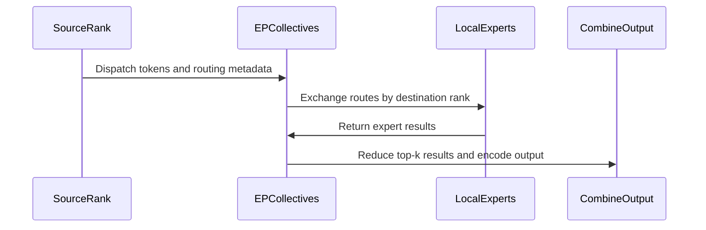

# Add MoE + expert-parallel Python API surface, PyTorch reference, and tests

[Upstream PR](https://github.com/NVIDIA/cudnn-frontend/pull/389) · state: open · merged: False

## Original PR description

## Summary

Proposes the public contract for a fused SwiGLU MoE operator with expert parallelism (`cudnn.MoeEp`), ahead of the device implementation:

- **`python/cudnn/moe_ep/`** — `MoeEp` (plain class: constructor + `__call__` + `backward`) with bf16, mxfp8, and nvfp4 public outputs. Quantized operands travel as `BlockScaledTensor` (data + scale bundled, logical/unswizzled layouts). Both `__call__` and `backward` currently allocate correctly-shaped results without launching a kernel.
- **`test/python/fe_api/moe_ep/moe_ep_reference.py`** — executable pure-PyTorch semantic reference: routing (contiguous expert sharding, `-1` = dropped route), variable-size `all_to_all_single` EP dispatch, local SwiGLU experts (`silu(gate) * up`, optional DeepSeek-style clamp, router weight in FC1 or FC2 epilogue), Form-A per-top-k combine with quantized-combine round-trips, and block-scaled output encoding.
- **Training integration (forward)** — `generate_c=True` returns `(output, fc1_c, route_metadata)`: the expert-rank-local pre-SwiGLU BF16 accumulator and its row-aligned `(local_expert, src_rank, src_token, src_slot)` routing words.
- **Backward API** — `backward(grad_output, forward inputs..., fc1_c, route_metadata)` returns FP32 `(grad_activation, grad_fc1_weight, grad_fc2_weight, grad_topk_weights)`. It is a collective (every EP rank participates): `MoeEpReference.backward` re-dispatches gradient rows along the identical forward routes, recomputes SwiGLU from the `fc1_c` stash (no post-SwiGLU intermediate is saved), reconstructs the row permutation purely from `route_metadata`, and returns/scatters route gradients to their source `(token, slot)`. Quantization round-trips are straight-through.
- **`docs/fe-oss-apis/moe_ep.md`** — design proposal: mapping to the MegaMoE kernel interface (why workspaces, peer pointer mappers, streams, and launch config are not public arguments), the `fc1_c`/`route_metadata` contract, the backward call contract (argument/return tables), the saved-tensors-for-backward table, and the numerical conventions a fused kernel must match (straight-through quantization round-trips, bf16 stash recompute, inclusive clamp bounds).

## Testing

`pytest test/python/fe_api/moe_ep` — 25 tests:

- Forward validated against naive per-token loops (bf16/fp32 and mxfp8/nvfp4 block-scaled inputs; both `apply_topk_in_fc1` modes; clamp).
- Backward validated against torch autograd replicas for fp32 and block-scaled inputs, including zero gradient at `-1` routes.
- 4-rank/4-GPU NCCL expert-parallel test (forward, `fc1_c`, `route_metadata`, and backward gradients cross-checked from deterministic seeds); skips below 4 GPUs.
- 7 strict-xfail API-vs-reference gates (forward per output format, quantized inputs, `generate_c`, and backward) that flip to hard failures once the device kernels are wired.

Verified on a single-GPU SM100 machine and on 8x B200 nodes.

🤖 Generated with [Claude Code](https://claude.com/claude-code)


## Review and discussion

### reviews

- coderabbitai[bot] · COMMENTED · 2026-07-14T18:09:20Z · [source](https://github.com/NVIDIA/cudnn-frontend/pull/389#pullrequestreview-4697241996)

**Actionable comments posted: 3**

<details>
<summary>🧹 Nitpick comments (2)</summary><blockquote>

<details>
<summary>test/python/fe_api/moe_ep/test_moe_ep.py (1)</summary><blockquote>

`624-771`: _📐 Maintainability & Code Quality_ | _🔵 Trivial_

**Only a 4-rank NCCL test is present; the PR description's claimed 2-rank Gloo coverage doesn't appear anywhere in this file.**

The PR objectives state tests cover "2-rank Gloo and 4-GPU NCCL expert-parallel runs," but `_distributed_worker`/`test_four_rank_expert_parallel` only exercises `backend="nccl"` (Line 628) with 4 ranks; there's no Gloo-backed distributed test in this file. The current cohort's own layer description also only mentions "four-rank NCCL execution," so this may simply be deferred to another commit/file not in this batch — worth confirming whether a 2-rank Gloo test is still planned here, since it's the only path that exercises the CPU-staging branch of `_collective_device`/`_all_to_all` in `moe_ep_reference.py`.

Want me to draft a 2-rank Gloo variant of `_distributed_worker` (spawning with `backend="gloo"` and no CUDA requirement) to close this gap?

<details>
<summary>🤖 Prompt for AI Agents</summary>

```
Verify each finding against current code. Fix only still-valid issues, skip the
rest with a brief reason, keep changes minimal, and validate.

In `@test/python/fe_api/moe_ep/test_moe_ep.py` around lines 624 - 771, Add a
2-rank Gloo distributed test alongside _distributed_worker and
test_four_rank_expert_parallel, using a CPU-only execution path that exercises
the CPU-staging behavior in _collective_device/_all_to_all. Parameterize or
adapt the worker to select the backend and device setup, preserve the existing
4-rank NCCL test, and add a Gloo test entry that spawns two ranks without
requiring CUDA.
```

</details>

<!-- cr-comment:v1:3655f80ce0cbf5c376125c1d -->

</blockquote></details>
<details>
<summary>test/python/fe_api/moe_ep/moe_ep_reference.py (1)</summary><blockquote>

`1-1`: _📐 Maintainability & Code Quality_ | _🔵 Trivial_ | _⚡ Quick win_

**`format` parameter shadows the builtin in three places (Ruff A002).** Same root cause across all three sites: a parameter is literally named `format`. No functional impact today (the builtin isn't called in any of these bodies), but it's flagged as a Ruff error and could fail a lint gate.
- `test/python/fe_api/moe_ep/moe_ep_reference.py#L207-270`: rename the `quantize_blockwise` parameter `format` (Line 209) to e.g. `fmt`, updating the internal `_parse_format(format)` call and all in-function references.
- `test/python/fe_api/moe_ep/moe_ep_reference.py#L313-316`: rename the `_format_round_trip` parameter `format` (Line 313) to `fmt` and update its body accordingly.
- `test/python/fe_api/moe_ep/test_moe_ep.py#L68-75`: rename the `test_block_scaled_round_trip` parameter `format` (Line 75) to `fmt`/`moe_format`, and update the `pytest.mark.parametrize("format,...")` string (Line 69) to match.

<details>
<summary>🔧 Example fix for the production function</summary>

```diff
 def quantize_blockwise(
     tensor: torch.Tensor,
-    format: Union[MoeFormat, str],
+    fmt_arg: Union[MoeFormat, str],
     *,
     axis: int = -1,
 ) -> BlockScaledTensor:
     ...
-    fmt = _parse_format(format)
+    fmt = _parse_format(fmt_arg)
```
</details>

<details>
<summary>🤖 Prompt for AI Agents</summary>

```
Verify each finding against current code. Fix only still-valid issues, skip the
rest with a brief reason, keep changes minimal, and validate.

In `@test/python/fe_api/moe_ep/moe_ep_reference.py` at line 1, Rename the format
parameters that trigger Ruff A002 in quantize_blockwise, _format_round_trip, and
test_block_scaled_round_trip to fmt or moe_format, updating each function’s
internal references and the corresponding pytest.mark.parametrize argument name
so all callers and bindings remain consistent.
```

</details>

<!-- cr-comment:v1:40b652df4ac86f7139e36ba4 -->

_Source: Linters/SAST tools_

</blockquote></details>

</blockquote></details>

<details>
<summary>🤖 Prompt for all review comments with AI agents</summary>

```
Verify each finding against current code. Fix only still-valid issues, skip the
rest with a brief reason, keep changes minimal, and validate.

Inline comments:
In `@python/cudnn/__init__.py`:
- Around line 281-283: Update the lazy export mapping in the cudnn package
initializer to expose BlockScaledTensor and MoeTensor from .moe_ep alongside
MoeEp and MoeFormat, preserving the existing lazy-import pattern. Add a focused
root-import test verifying both symbols can be imported from cudnn.

In `@python/cudnn/moe_ep/api.py`:
- Around line 53-84: Update BlockScaledTensor.__post_init__ to validate that
data.device and scale.device match, raising a clear ValueError when they differ;
retain the existing normalization behavior and device property.
- Around line 257-329: Validate all non-sentinel values in topk_idx against [-1,
self.num_experts) during __call__ before the early !self.generate_c return.
Reuse or factor the existing range validation from _count_local_routes so both
generate_c paths preserve identical validation without duplicating logic.

---

Nitpick comments:
In `@test/python/fe_api/moe_ep/moe_ep_reference.py`:
- Line 1: Rename the format parameters that trigger Ruff A002 in
quantize_blockwise, _format_round_trip, and test_block_scaled_round_trip to fmt
or moe_format, updating each function’s internal references and the
corresponding pytest.mark.parametrize argument name so all callers and bindings
remain consistent.

In `@test/python/fe_api/moe_ep/test_moe_ep.py`:
- Around line 624-771: Add a 2-rank Gloo distributed test alongside
_distributed_worker and test_four_rank_expert_parallel, using a CPU-only
execution path that exercises the CPU-staging behavior in
_collective_device/_all_to_all. Parameterize or adapt the worker to select the
backend and device setup, preserve the existing 4-rank NCCL test, and add a Gloo
test entry that spawns two ranks without requiring CUDA.
```

</details>

<details>
<summary>🪄 Autofix (Beta)</summary>

Fix all unresolved CodeRabbit comments on this PR:

- [ ] <!-- {"checkboxId": "4b0d0e0a-96d7-4f10-b296-3a18ea78f0b9"} --> Push a commit to this branch (recommended)
- [ ] <!-- {"checkboxId": "ff5b1114-7d8c-49e6-8ac1-43f82af23a33"} --> Create a new PR with the fixes

</details>

---

<details>
<summary>ℹ️ Review info</summary>

<details>
<summary>⚙️ Run configuration</summary>

**Configuration used**: Path: .coderabbit.yaml

**Review profile**: CHILL

**Plan**: Enterprise

**Run ID**: `ce53cbf6-e65a-4ef6-bfa1-855baf8a4775`

</details>

<details>
<summary>📥 Commits</summary>

Reviewing files that changed from the base of the PR and between 0041a2bb917f886a46388b0b59781ee185ed8f11 and c159fb64b92b05e79911edf20400396187402906.

</details>

<details>
<summary>📒 Files selected for processing (7)</summary>

* `docs/fe-oss-apis/moe_ep.md`
* `docs/fe-oss-apis/overview.md`
* `python/cudnn/__init__.py`
* `python/cudnn/moe_ep/__init__.py`
* `python/cudnn/moe_ep/api.py`
* `test/python/fe_api/moe_ep/moe_ep_reference.py`
* `test/python/fe_api/moe_ep/test_moe_ep.py`

</details>

</details>

<!-- This is an auto-generated comment by CodeRabbit for review status -->

- coderabbitai[bot] · COMMENTED · 2026-07-14T18:19:54Z · [source](https://github.com/NVIDIA/cudnn-frontend/pull/389#pullrequestreview-4697329131)

**Actionable comments posted: 1**

<details>
<summary>🤖 Prompt for all review comments with AI agents</summary>

```
Verify each finding against current code. Fix only still-valid issues, skip the
rest with a brief reason, keep changes minimal, and validate.

Inline comments:
In `@python/cudnn/moe_ep/api.py`:
- Around line 358-371: Update backward to mirror __call__’s input validation
before deriving device from activation: require activation, grad_output,
fc1_weight, fc2_weight, topk_idx, topk_weights, fc1_c, and route_metadata to
share that device. Validate the re-supplied tensor shapes and dtypes
consistently with __call__, including bf16 fc1_c and int32 route_metadata. Use
_count_local_routes with topk_idx to ensure route_metadata.shape[0] matches the
valid-route count before backend execution.
```

</details>

<details>
<summary>🪄 Autofix (Beta)</summary>

Fix all unresolved CodeRabbit comments on this PR:

- [ ] <!-- {"checkboxId": "4b0d0e0a-96d7-4f10-b296-3a18ea78f0b9"} --> Push a commit to this branch (recommended)
- [ ] <!-- {"checkboxId": "ff5b1114-7d8c-49e6-8ac1-43f82af23a33"} --> Create a new PR with the fixes

</details>

---

<details>
<summary>ℹ️ Review info</summary>

<details>
<summary>⚙️ Run configuration</summary>

**Configuration used**: Path: .coderabbit.yaml

**Review profile**: CHILL

**Plan**: Enterprise

**Run ID**: `c7dce11e-fcaa-4220-bd36-637479513ff6`

</details>

<details>
<summary>📥 Commits</summary>

Reviewing files that changed from the base of the PR and between b7138037e3c04c19c8868fbbe66dc9c4a1a2d586 and 50df079e8e0f954e1d1eaca5568c7eb47e31d905.

</details>

<details>
<summary>📒 Files selected for processing (3)</summary>

* `docs/fe-oss-apis/moe_ep.md`
* `python/cudnn/moe_ep/api.py`
* `test/python/fe_api/moe_ep/test_moe_ep.py`

</details>

<details>
<summary>🚧 Files skipped from review as they are similar to previous changes (2)</summary>

* docs/fe-oss-apis/moe_ep.md
* test/python/fe_api/moe_ep/test_moe_ep.py

</details>

</details>

<!-- This is an auto-generated comment by CodeRabbit for review status -->

- Anerudhan · COMMENTED · 2026-07-14T18:28:13Z · [source](https://github.com/NVIDIA/cudnn-frontend/pull/389#pullrequestreview-4697388062)

(No body; status only.)

- YangXu1990uiuc · CHANGES_REQUESTED · 2026-09-15T08:20:27Z · [source](https://github.com/NVIDIA/cudnn-frontend/pull/389#pullrequestreview-5207411148)

**Codex bot review · model: `gpt-6-astra`**

Reviewed `50df079e8e0f` against base `08b9a909ceac`.

The explicit EP ownership, combine-versus-output encoding, and expert-local backward stash form a coherent proposal. I am requesting changes on the public compute stub: it must report that execution is unavailable instead of returning unwritten results. There is also a reproduced public/reference tensor-type mismatch. Two existing validation findings remain confirmed below.

**[P1 · blocks approval] Make the public compute entrypoints fail explicitly until execution exists** ([source](https://github.com/NVIDIA/cudnn-frontend/blob/50df079e8e0f954e1d1eaca5568c7eb47e31d905/python/cudnn/moe_ep/api.py#L327))

Keeping the API proposal ahead of its kernel is reasonable, but exporting cudnn.MoeEp with __call__/backward that successfully return torch.empty buffers lets a caller consume uninitialized activations or gradients as a computed result. Documentation and xfail markers do not guard runtime use. With valid all-dropped routes, zero inputs and zero incoming gradients, the reference returns exact zeros; enabling PyTorch deterministic uninitialized-memory filling makes the public output and all four gradient tensors NaN without raising. This is a high-risk P1 because the normal public call can silently corrupt a model computation. Keep any shape/allocation helper private or explicitly named, and raise NotImplementedError from the compute entrypoints until they execute a backend (or provide an explicit reference mode). The proposal can land without requiring the fused kernel to be finished.

Evidence: SM100 probe on unchanged api.py: torch.use_deterministic_algorithms(True) plus torch.utils.deterministic.fill_uninitialized_memory=True; T3/H32/E2/I16/K2, all topk_idx=-1. Output and four gradients all NaN; independent reference outputs/gradients exact zero. No allocator monkeypatch. Attribution: Forward behavior introduced in c159fb64; backward public allocation stub added in 50df079e. Intentional placeholder behavior in this PR, but unsafe as a successful public compute call.

**[P2] Exercise the public BlockScaledTensor in the semantic reference** ([source](https://github.com/NVIDIA/cudnn-frontend/blob/50df079e8e0f954e1d1eaca5568c7eb47e31d905/test/python/fe_api/moe_ep/moe_ep_reference.py#L299))

The reference defines a different BlockScaledTensor class from cudnn.moe_ep.api. A valid public MXFP8 bundle therefore misses this isinstance branch and reaches tensor.is_floating_point(), raising AttributeError. I reproduced it by rewrapping the reference quantizer's exact same data/scale/shape/axis in cudnn.moe_ep.BlockScaledTensor. Existing quantized-input tests only construct the reference class, so they miss the public integration boundary. Share the representation/validation or add an explicit adapter, and test the public class through both the API and oracle.

Evidence: SM100 valid public MXFP8 activation: AttributeError("'BlockScaledTensor' object has no attribute 'is_floating_point'"); identical payload works in the reference class. Attribution: Introduced with the two separate representations and their tests in c159fb64.

- **[P2] Still open:** [Validate data and scale storage together](https://github.com/NVIDIA/cudnn-frontend/pull/389#discussion_r3581510380).

- **[P2] Still open:** [Keep route validation independent of generate_c](https://github.com/NVIDIA/cudnn-frontend/pull/389#discussion_r3581510402).

Validation: Focused suite on SM100:17 passed,7 expected failures,1 four-GPU NCCL test skipped. The expected failures cover the unimplemented numerical API; they are not passing kernel evidence. Four-process CPU/Gloo probe:all four scenarios passed on every rank, checking forward, stash/metadata and all gradients against per-route math/autograd. Covered unequal token counts including a zero-token rank, all-dropped and duplicate routes, all-to-one expert-rank skew, and both router-weight placements. SM100 contract probes reproduced uninitialized public output/gradients, rejection of the public quantized representation by the reference, mixed-device bundle acceptance, and generate_c-dependent route validation. NVFP4 finite inputs at 2688/3000/10000 encoded finite in the tested PyTorch build; no overflow finding. Tests used a prospective merge with current develop, resolving only the additive lazy-import-map conflict locally by retaining both sides. All three new implementation/test files are identical to the reviewed head, and the reused native extension has matching native sources. Rechecked after develop advanced to 08b9a909 (#1068): the same focused suite again reports17 passed,7 expected failures,1 NCCL skip. The MoE proposal files and discussion are unchanged.

Limitations: No four-GPU NCCL or fused-device execution was independently validated in this review. Gloo coverage establishes reference communication semantics only. No performance measurement applies to a public stub and semantic reference. The PR needs an import-map rebase before test CI can run on the integration revision. After rebasing, request the OSS test target with a standalone `@cudnn-ci-bot run oss` comment, or ask a maintainer to send it if needed; include the four-GPU test explicitly when validating NCCL coverage.

The P0/high-risk P1 findings marked above need fixes and re-review before approval.

<!-- codex-fe-review:v2:389:50df079e8e0f954e1d1eaca5568c7eb47e31d905:complete:blocking-p1 -->

### issue_comments

- coderabbitai[bot] · comment · 2026-07-14T17:58:44Z · [source](https://github.com/NVIDIA/cudnn-frontend/pull/389#issuecomment-4972358967)

<!-- This is an auto-generated comment: summarize by coderabbit.ai -->
<!-- review_stack_entry_start -->

[](https://app.coderabbit.ai/change-stack/NVIDIA/cudnn-frontend/pull/389?utm_source=github_walkthrough&utm_medium=github&utm_campaign=change_stack)

<!-- review_stack_entry_end -->
<!-- walkthrough_start -->

<details>
<summary>📝 Walkthrough</summary>

## Walkthrough

Adds a documented MoE expert-parallel API, its Python contract implementation, a quantized PyTorch reference with forward and backward routing, and tests covering quantization, single-rank behavior, public API allocation, and distributed execution.

### Changes

**MoE Expert-Parallel API**

|Layer / File(s)|Summary|
|---|---|
|**API contract and exports** <br> `docs/fe-oss-apis/moe_ep.md`, `docs/fe-oss-apis/overview.md`, `python/cudnn/__init__.py`, `python/cudnn/moe_ep/__init__.py`|Documents the `MoeEp` interface, tensor contracts, quantization and routing semantics, training metadata, and implementation boundaries; adds lazy loading and public exports.|
|**Public Python API implementation** <br> `python/cudnn/moe_ep/api.py`|Adds `MoeFormat`, `BlockScaledTensor`, `MoeEp`, input validation, block-scaled output allocation, expert-parallel route counting, and optional `generate_c` allocations.|
|**Reference quantization and execution** <br> `test/python/fe_api/moe_ep/moe_ep_reference.py`|Implements blockwise MXFP8/NVFP4 conversion, stable expert-parallel dispatch, SwiGLU execution, route combination, quantized outputs, and generate-c backward reconstruction.|
|**Validation suite** <br> `test/python/fe_api/moe_ep/test_moe_ep.py`|Adds quantization, forward, backward, public API, quantized-input, and four-rank distributed tests.|

**Estimated code review effort:** 5 (Critical) | ~120 minutes

### Sequence Diagram(s)



</details>

<!-- walkthrough_end -->
<!-- pre_merge_checks_walkthrough_start -->

<details>
<summary>🚥 Pre-merge checks | ✅ 4 | ❌ 1</summary>

### ❌ Failed checks (1 warning)

|     Check name     | Status     | Explanation                                                                           | Resolution                                                                         |
| :----------------: | :--------- | :------------------------------------------------------------------------------------ | :--------------------------------------------------------------------------------- |
| Docstring Coverage | ⚠️ Warning | Docstring coverage is 36.36% which is insufficient. The required threshold is 80.00%. | Write docstrings for the functions missing them to satisfy the coverage threshold. |

<details>
<summary>✅ Passed checks (4 passed)</summary>

|         Check name         | Status   | Explanation                                                                                                              |
| :------------------------: | :------- | :----------------------------------------------------------------------------------------------------------------------- |
|     Linked Issues check    | ✅ Passed | Check skipped because no linked issues were found for this pull request.                                                 |
| Out of Scope Changes check | ✅ Passed | Check skipped because no linked issues were found for this pull request.                                                 |
|      Description Check     | ✅ Passed | Check skipped - CodeRabbit’s high-level summary is enabled.                                                              |
|         Title check        | ✅ Passed | The title clearly summarizes the main change: a new MoE expert-parallel Python API, reference implementation, and tests. |

</details>

</details>

<!-- pre_merge_checks_walkthrough_end -->
<!-- finishing_touch_checkbox_start -->

<details>
<summary>✨ Finishing Touches</summary>

<details>
<summary>🧪 Generate unit tests (beta)</summary>

- [ ] <!-- {"checkboxId": "f47ac10b-58cc-4372-a567-0e02b2c3d479", "radioGroupId": "utg-output-choice-group-unknown_comment_id"} -->   Create PR with unit tests

</details>

</details>

<!-- finishing_touch_checkbox_end -->
<!-- tips_start -->

---


<sub>Comment `@coderabbitai help` to get the list of available commands.</sub>

<!-- tips_end -->

- github-actions[bot] · comment · 2026-08-25T02:49:30Z · [source](https://github.com/NVIDIA/cudnn-frontend/pull/389#issuecomment-5404420058)

This PR has been inactive for 3 weeks and is now marked stale. It will be closed in 3 more weeks unless there is new activity (a comment, a push, or removal of the stale label).

### inline_comments

- coderabbitai[bot] · comment · 2026-07-14T18:09:19Z · [source](https://github.com/NVIDIA/cudnn-frontend/pull/389#discussion_r3581510370)

File: `python/cudnn/__init__.py` · line 283

_📐 Maintainability & Code Quality_ | _🟡 Minor_ | _⚡ Quick win_

<details>
<summary>🧩 Analysis chain</summary>

🏁 Script executed:

```shell
#!/bin/bash
set -euo pipefail

printf 'Repository root: '; pwd
printf '\nFiles:\n'
git ls-files 'python/cudnn/**' | sed -n '1,120p'

printf '\nRelevant files:\n'
git ls-files 'python/cudnn/__init__.py' 'python/cudnn/moe_ep/__init__.py' 'test/python/fe_api/**' 2>/dev/null || true
```

Repository: NVIDIA/cudnn-frontend

Length of output: 10964

---

🏁 Script executed:

```shell
#!/bin/bash
set -euo pipefail

printf 'Repository root: '; pwd

printf '\npython/cudnn/__init__.py outline:\n'
ast-grep outline python/cudnn/__init__.py --view expanded || true

printf '\npython/cudnn/moe_ep/__init__.py outline:\n'
ast-grep outline python/cudnn/moe_ep/__init__.py --view expanded || true

printf '\nfe_api tests mentioning moe_ep / BlockScaledTensor / MoeTensor:\n'
rg -n "BlockScaledTensor|MoeTensor|MoeEp|moe_ep" test/python/fe_api python/cudnn -g'*.py' || true
```

Repository: NVIDIA/cudnn-frontend

Length of output: 7902

---

🏁 Script executed:

```shell
#!/bin/bash
set -euo pipefail

printf 'Searching for root-level imports and docs for moe_ep symbols...\n'
rg -n "from cudnn import (BlockScaledTensor|MoeTensor|MoeEp|MoeFormat)|import .*BlockScaledTensor|import .*MoeTensor|cudnn\.BlockScaledTensor|cudnn\.MoeTensor" \
  python test -g'*.py' -g'*.md' || true

printf '\nTop-level lazy import mapping around moe_ep:\n'
sed -n '275,292p' python/cudnn/__init__.py

printf '\nMoeEp package init:\n'
sed -n '1,40p' python/cudnn/moe_ep/__init__.py
```

Repository: NVIDIA/cudnn-frontend

Length of output: 1875

---


</details>

**Expose `BlockScaledTensor` and `MoeTensor` from `cudnn` if they’re public API.** `python/cudnn/moe_ep/__init__.py` exports both, but `python/cudnn/__init__.py` only wires up `moe_ep`, `MoeEp`, and `MoeFormat`, so `from cudnn import BlockScaledTensor`/`MoeTensor` will fail today. Add the missing lazy imports and a small root-import test if these symbols are meant to be user-facing.

<details>
<summary>🤖 Prompt for AI Agents</summary>

```
Verify each finding against current code. Fix only still-valid issues, skip the
rest with a brief reason, keep changes minimal, and validate.

In `@python/cudnn/__init__.py` around lines 281 - 283, Update the lazy export
mapping in the cudnn package initializer to expose BlockScaledTensor and
MoeTensor from .moe_ep alongside MoeEp and MoeFormat, preserving the existing
lazy-import pattern. Add a focused root-import test verifying both symbols can
be imported from cudnn.
```

</details>

<!-- fingerprinting:phantom:poseidon:beignet -->

<!-- cr-indicator-types:potential_issue -->

<!-- cr-comment:v1:a9c8d8020572b3a657affd70 -->

<!-- This is an auto-generated comment by CodeRabbit -->

- coderabbitai[bot] · comment · 2026-07-14T18:09:19Z · [source](https://github.com/NVIDIA/cudnn-frontend/pull/389#discussion_r3581510380)

File: `python/cudnn/moe_ep/api.py` · line 84

_🗄️ Data Integrity & Integration_ | _🟡 Minor_ | _⚡ Quick win_

**`BlockScaledTensor` doesn't enforce the documented data/scale device-match contract.**

moe_ep.md states "Quantized data and its scale tensor must also share a device," but `__post_init__` never checks `self.data.device == self.scale.device`, and the `.device` property (lines 77-79) only reflects `data.device`, so `MoeEp.__call__`'s device-consistency loop (lines 314-322) can't catch a mismatched `scale` on an input `BlockScaledTensor`.

<details>
<summary>🛡️ Proposed fix</summary>

```diff
     def __post_init__(self) -> None:
         fmt = _parse_format(self.format)
         if fmt is MoeFormat.BF16:
             raise ValueError("BlockScaledTensor only represents mxfp8 or nvfp4")
+        if self.data.device != self.scale.device:
+            raise ValueError(f"data device {self.data.device} does not match scale device {self.scale.device}")
         logical_shape = tuple(int(dim) for dim in self.logical_shape)
```
</details>

<!-- suggestion_start -->

<details>
<summary>📝 Committable suggestion</summary>

> ‼️ **IMPORTANT**
> Carefully review the code before committing. Ensure that it accurately replaces the highlighted code, contains no missing lines, and has no issues with indentation. Thoroughly test & benchmark the code to ensure it meets the requirements.

```suggestion
`@dataclass`(frozen=True)
class BlockScaledTensor:
    """Data-plus-scale result returned for MXFP8 and NVFP4 outputs."""

    data: torch.Tensor
    scale: torch.Tensor
    format: Union[MoeFormat, str]
    logical_shape: Tuple[int, ...]
    axis: int = -1

    def __post_init__(self) -> None:
        fmt = _parse_format(self.format)
        if fmt is MoeFormat.BF16:
            raise ValueError("BlockScaledTensor only represents mxfp8 or nvfp4")
        if self.data.device != self.scale.device:
            raise ValueError(f"data device {self.data.device} does not match scale device {self.scale.device}")
        logical_shape = tuple(int(dim) for dim in self.logical_shape)
        axis = _normalize_axis(self.axis, len(logical_shape))
        object.__setattr__(self, "format", fmt)
        object.__setattr__(self, "logical_shape", logical_shape)
        object.__setattr__(self, "axis", axis)

    `@property`
    def shape(self) -> Tuple[int, ...]:
        return self.logical_shape

    `@property`
    def device(self) -> torch.device:
        return self.data.device

    `@property`
    def block_size(self) -> int:
        return 32 if self.format is MoeFormat.MXFP8 else 16
```

</details>

<!-- suggestion_end -->

<details>
<summary>🤖 Prompt for AI Agents</summary>

```
Verify each finding against current code. Fix only still-valid issues, skip the
rest with a brief reason, keep changes minimal, and validate.

In `@python/cudnn/moe_ep/api.py` around lines 53 - 84, Update
BlockScaledTensor.__post_init__ to validate that data.device and scale.device
match, raising a clear ValueError when they differ; retain the existing
normalization behavior and device property.
```

</details>

<!-- fingerprinting:phantom:poseidon:beignet -->

<!-- cr-indicator-types:potential_issue -->

<!-- cr-comment:v1:82037310dd18a0f6dad8cc41 -->

<!-- This is an auto-generated comment by CodeRabbit -->

- coderabbitai[bot] · comment · 2026-07-14T18:09:19Z · [source](https://github.com/NVIDIA/cudnn-frontend/pull/389#discussion_r3581510402)

File: `python/cudnn/moe_ep/api.py` · line 329

_🎯 Functional Correctness_ | _🟠 Major_ | _⚡ Quick win_

<details>
<summary>🧩 Analysis chain</summary>

🏁 Script executed:

```shell
#!/bin/bash
set -euo pipefail

printf '\n## File map\n'
git ls-files python/cudnn/moe_ep/api.py test/python/fe_api | sed -n '1,200p'

printf '\n## Relevant source around the reviewed lines\n'
sed -n '240,350p' python/cudnn/moe_ep/api.py

printf '\n## Documentation references for topk_idx contract\n'
rg -n "topk_idx|unused route|out-of-range|route" python/cudnn -g '*.md' -g '*.py'

printf '\n## Tests in test/python/fe_api related to moe_ep\n'
rg -n "moe_ep|MoeEp|topk_idx|generate_c|out-of-range" test/python/fe_api -g '*.py'
```

Repository: NVIDIA/cudnn-frontend

Length of output: 42868

---

🏁 Script executed:

```shell
#!/bin/bash
set -euo pipefail

printf '\n## Outline of python/cudnn/moe_ep/api.py\n'
ast-grep outline python/cudnn/moe_ep/api.py --view expanded

printf '\n## Outline of test/python/fe_api/moe_ep/test_moe_ep.py if present\n'
if [ -f test/python/fe_api/moe_ep/test_moe_ep.py ]; then
  ast-grep outline test/python/fe_api/moe_ep/test_moe_ep.py --view expanded
fi
```

Repository: NVIDIA/cudnn-frontend

Length of output: 2696

---

🏁 Script executed:

```shell
#!/bin/bash
set -euo pipefail

python3 - <<'PY'
from pathlib import Path
p = Path('python/cudnn/moe_ep/api.py')
text = p.read_text()
for needle in ['def _count_local_routes', 'def __call__', 'class BlockScaledTensor', 'def __post_init__']:
    idx = text.find(needle)
    print(f'\n## {needle} @ {idx}')
    if idx != -1:
        start = max(0, text.rfind('\n', 0, idx-200))
        end = min(len(text), idx+1200)
        print(text[start:end])
PY
```

Repository: NVIDIA/cudnn-frontend

Length of output: 5962

---


</details>

**Validate `topk_idx` before the `generate_c` branch**

`_count_local_routes()` is the only place that rejects expert ids outside `[-1, num_experts)`, and `__call__()` only reaches it when `generate_c=True`. That leaves the default path accepting malformed `topk_idx` values instead of raising. Move the range check ahead of the early return, or factor it into a shared helper.

<details>
<summary>🤖 Prompt for AI Agents</summary>

```
Verify each finding against current code. Fix only still-valid issues, skip the
rest with a brief reason, keep changes minimal, and validate.

In `@python/cudnn/moe_ep/api.py` around lines 257 - 329, Validate all non-sentinel
values in topk_idx against [-1, self.num_experts) during __call__ before the
early !self.generate_c return. Reuse or factor the existing range validation
from _count_local_routes so both generate_c paths preserve identical validation
without duplicating logic.
```

</details>

<!-- fingerprinting:phantom:poseidon:beignet -->

<!-- cr-indicator-types:potential_issue -->

<!-- cr-comment:v1:2fcb7f0000aafbf7adbe0e56 -->

<!-- This is an auto-generated comment by CodeRabbit -->

- coderabbitai[bot] · comment · 2026-07-14T18:19:53Z · [source](https://github.com/NVIDIA/cudnn-frontend/pull/389#discussion_r3581587580)

File: `python/cudnn/moe_ep/api.py` · line 371

_🗄️ Data Integrity & Integration_ | _🟠 Major_ | _⚡ Quick win_

**`backward` skips the device-consistency check `__call__` enforces.**

`__call__` validates every input tensor is on the same device (lines 314-322), but `backward` derives `device` solely from `activation` and never checks `grad_output`, `fc1_weight`, `fc2_weight`, `topk_idx`, `topk_weights`, `fc1_c`, or `route_metadata` against it. A caller who passes a stash/tensor on the wrong device won't be caught here; it will only surface once the real backend launch consumes these tensors together.

Also, unlike `__call__`, `backward` doesn't validate the shapes of the re-supplied `activation`/`fc1_weight`/`fc2_weight`/`topk_idx`/`topk_weights`, nor the dtypes of `fc1_c` (bf16 per forward) / `route_metadata` (int32 per forward), nor that `route_metadata.shape[0]` actually matches the valid-route count implied by `topk_idx` (forward's `_count_local_routes` already computes this).

<details>
<summary>🛡️ Proposed fix for device consistency</summary>

```diff
         if tuple(fc1_c.shape) != (int(route_metadata.shape[0]), two_i):
             raise ValueError(f"fc1_c shape must be {(int(route_metadata.shape[0]), two_i)}, got {tuple(fc1_c.shape)}")

         device = _tensor_device(activation)
+        for name, tensor in (
+            ("fc1_weight", fc1_weight),
+            ("fc2_weight", fc2_weight),
+            ("topk_idx", topk_idx),
+            ("topk_weights", topk_weights),
+            ("fc1_c", fc1_c),
+            ("route_metadata", route_metadata),
+            ("grad_output", grad_output),
+        ):
+            if _tensor_device(tensor) != device:
+                raise ValueError(f"{name} must be on {device}, got {_tensor_device(tensor)}")
         # TODO: re-dispatch grad_output rows, recompute SwiGLU from fc1_c,
```
</details>

<!-- suggestion_start -->

<details>
<summary>📝 Committable suggestion</summary>

> ‼️ **IMPORTANT**
> Carefully review the code before committing. Ensure that it accurately replaces the highlighted code, contains no missing lines, and has no issues with indentation. Thoroughly test & benchmark the code to ensure it meets the requirements.

```suggestion
        if not self.generate_c:
            raise RuntimeError("backward requires the operator to be constructed with generate_c=True")
        token_count = topk_idx.shape[0]
        if tuple(grad_output.shape) != (token_count, self.hidden_size):
            raise ValueError(f"grad_output shape must be {(token_count, self.hidden_size)}, got {tuple(grad_output.shape)}")
        if not grad_output.is_floating_point():
            raise TypeError(f"grad_output must be floating point, got {grad_output.dtype}")
        two_i = 2 * self.intermediate_size
        if route_metadata.ndim != 2 or route_metadata.shape[1] != 4:
            raise ValueError(f"route_metadata shape must be (local_routes, 4), got {tuple(route_metadata.shape)}")
        if tuple(fc1_c.shape) != (int(route_metadata.shape[0]), two_i):
            raise ValueError(f"fc1_c shape must be {(int(route_metadata.shape[0]), two_i)}, got {tuple(fc1_c.shape)}")

        device = _tensor_device(activation)
        for name, tensor in (
            ("fc1_weight", fc1_weight),
            ("fc2_weight", fc2_weight),
            ("topk_idx", topk_idx),
            ("topk_weights", topk_weights),
            ("fc1_c", fc1_c),
            ("route_metadata", route_metadata),
            ("grad_output", grad_output),
        ):
            if _tensor_device(tensor) != device:
                raise ValueError(f"{name} must be on {device}, got {_tensor_device(tensor)}")
```

</details>

<!-- suggestion_end -->

<details>
<summary>🤖 Prompt for AI Agents</summary>

```
Verify each finding against current code. Fix only still-valid issues, skip the
rest with a brief reason, keep changes minimal, and validate.

In `@python/cudnn/moe_ep/api.py` around lines 358 - 371, Update backward to mirror
__call__’s input validation before deriving device from activation: require
activation, grad_output, fc1_weight, fc2_weight, topk_idx, topk_weights, fc1_c,
and route_metadata to share that device. Validate the re-supplied tensor shapes
and dtypes consistently with __call__, including bf16 fc1_c and int32
route_metadata. Use _count_local_routes with topk_idx to ensure
route_metadata.shape[0] matches the valid-route count before backend execution.
```

</details>

<!-- fingerprinting:phantom:poseidon:beignet -->

<!-- cr-indicator-types:potential_issue -->

<!-- cr-comment:v1:71058af5e5477adba9f9295c -->

<!-- This is an auto-generated comment by CodeRabbit -->

- Anerudhan · comment · 2026-07-14T18:28:13Z · [source](https://github.com/NVIDIA/cudnn-frontend/pull/389#discussion_r3581639462)

File: `test/python/fe_api/moe_ep/test_moe_ep.py` · line 663

Usage and reference

## Changed files and fixed code

- `docs/fe-oss-apis/moe_ep.md` · added · additions 498 / deletions 0
  - [head](https://github.com/Anerudhan/cudnn-frontend/blob/50df079e8e0f954e1d1eaca5568c7eb47e31d905/docs/fe-oss-apis/moe_ep.md)
  - [base](https://github.com/NVIDIA/cudnn-frontend/blob/0041a2bb917f886a46388b0b59781ee185ed8f11/docs/fe-oss-apis/moe_ep.md)
- `docs/fe-oss-apis/overview.md` · modified · additions 1 / deletions 0
  - [head](https://github.com/Anerudhan/cudnn-frontend/blob/50df079e8e0f954e1d1eaca5568c7eb47e31d905/docs/fe-oss-apis/overview.md)
  - [base](https://github.com/NVIDIA/cudnn-frontend/blob/0041a2bb917f886a46388b0b59781ee185ed8f11/docs/fe-oss-apis/overview.md)
- `python/cudnn/__init__.py` · modified · additions 3 / deletions 0
  - [head](https://github.com/Anerudhan/cudnn-frontend/blob/50df079e8e0f954e1d1eaca5568c7eb47e31d905/python/cudnn/__init__.py)
  - [base](https://github.com/NVIDIA/cudnn-frontend/blob/0041a2bb917f886a46388b0b59781ee185ed8f11/python/cudnn/__init__.py)
- `python/cudnn/moe_ep/__init__.py` · added · additions 6 / deletions 0
  - [head](https://github.com/Anerudhan/cudnn-frontend/blob/50df079e8e0f954e1d1eaca5568c7eb47e31d905/python/cudnn/moe_ep/__init__.py)
  - [base](https://github.com/NVIDIA/cudnn-frontend/blob/0041a2bb917f886a46388b0b59781ee185ed8f11/python/cudnn/moe_ep/__init__.py)
- `python/cudnn/moe_ep/api.py` · added · additions 390 / deletions 0
  - [head](https://github.com/Anerudhan/cudnn-frontend/blob/50df079e8e0f954e1d1eaca5568c7eb47e31d905/python/cudnn/moe_ep/api.py)
  - [base](https://github.com/NVIDIA/cudnn-frontend/blob/0041a2bb917f886a46388b0b59781ee185ed8f11/python/cudnn/moe_ep/api.py)
- `test/python/fe_api/moe_ep/moe_ep_reference.py` · added · additions 792 / deletions 0
  - [head](https://github.com/Anerudhan/cudnn-frontend/blob/50df079e8e0f954e1d1eaca5568c7eb47e31d905/test/python/fe_api/moe_ep/moe_ep_reference.py)
  - [base](https://github.com/NVIDIA/cudnn-frontend/blob/0041a2bb917f886a46388b0b59781ee185ed8f11/test/python/fe_api/moe_ep/moe_ep_reference.py)
- `test/python/fe_api/moe_ep/test_moe_ep.py` · added · additions 855 / deletions 0
  - [head](https://github.com/Anerudhan/cudnn-frontend/blob/50df079e8e0f954e1d1eaca5568c7eb47e31d905/test/python/fe_api/moe_ep/test_moe_ep.py)
  - [base](https://github.com/NVIDIA/cudnn-frontend/blob/0041a2bb917f886a46388b0b59781ee185ed8f11/test/python/fe_api/moe_ep/test_moe_ep.py)

## Evidence and interpretation boundary

[Original JSON, discussions and patches](../../../../../../evidence/prs/NVIDIA--cudnn-frontend/389-bba0f900ebda67c71d13b52b753fbc7b87537aeaeb054dee1fd0214a77a66205.json) · SHA-256 `bba0f900ebda67c71d13b52b753fbc7b87537aeaeb054dee1fd0214a77a66205`.

Diff complete: True. Missing/binary/truncated patches require pinned source inspection. This is a source page, not an independently verified optimization case. Open, merged and released are different states; recheck the deployed dependency.
