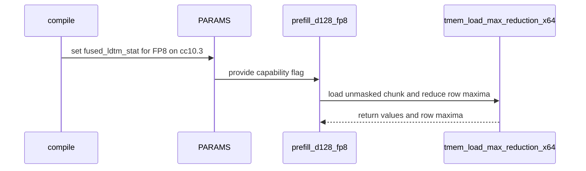

# sdpa fp8 sm100: fused LDTM row-max on cc10.3 (per-tensor FP8)

[Upstream PR](https://github.com/NVIDIA/cudnn-frontend/pull/586) · state: open · merged: False

## Original PR description

## Summary

cc10.3 has the fused LDTM.STAT row-max, but only the **MXFP8** kernel read the `fused_ldtm_stat` flag — the per-tensor FP8 kernel ran the manual `tcgen05_ld` + software reduction on every part, leaving the win on the table on SM103. This wires the identical specialization into the per-tensor kernel (unmasked path only; masked iters keep the software reduction since the fused max reduces before a mask could apply). cc10.0 folds to the manual path unchanged.

Three-line summary of the mechanism for reviewers new to it: `fused_ldtm_stat` is per-specialization state in the frozen `TemplateParams` (auto-set from the device in the adapter), so one kernel file yields distinct traced variants per device class — the same routing MXFP8 has used since its bring-up, and the SM107 sibling simply bakes.

## Evidence

- The added branch is byte-for-byte the one the SM107 sibling bakes, **board-proven on cc10.7** (the LDTM lever carried most of a −7.5% step at 65k there).
- The helper (`tmem_load_max_reduction_x64`) and instruction are the same ones the MXFP8 kernel exercises on cc10.3 in production.
- SM100 (cc10.0): 34 passed, behaviorally identical (flag stays False).
- Direct cc10.3 hardware validation queued on a B300 node; result will be posted in-thread before merge if reviewers want it as a gate.

🤖 Generated with [Claude Code](https://claude.com/claude-code)

<!-- This is an auto-generated comment: release notes by coderabbit.ai -->
## Summary by CodeRabbit

- **Performance**
  - Improved FP8 attention processing on compatible compute capability 10.3 hardware by enabling fused softmax statistics handling.
  - Retained manual reduction support for compute capability 10.0, preserving compatibility across supported hardware.
  - FP16 processing remains unchanged.
- **Documentation**
  - Updated configuration documentation to clarify FP8 and FP16 behavior across hardware capabilities.
<!-- end of auto-generated comment: release notes by coderabbit.ai -->

## Review and discussion

### reviews

- jhjpark · APPROVED · 2026-08-13T20:04:31Z · [source](https://github.com/NVIDIA/cudnn-frontend/pull/586#pullrequestreview-4931132300)

(No body; status only.)

- YangXu1990uiuc · APPROVED · 2026-09-15T01:06:14Z · [source](https://github.com/NVIDIA/cudnn-frontend/pull/586#pullrequestreview-5204465876)

**Codex bot review · model: `gpt-6-astra`**

Reviewed `182d3a732a57` against base `c61a5e4eb5c5`.

The specialization makes sense: use the fused load/reduction only on cc10.3 and only for unmasked iterations, retain software reduction after masking, and include the flag in the existing frozen specialization key. I found no actionable correctness defect in the reviewed change.

Validation: Built a matching extension from this head. The per-tensor FP8 suite passed independently on SM103/B300 (32 passed) and SM100 (32 passed), explicitly selecting L0 and L1. B300 baseline/head/head/baseline spot check against branch point 61d6506cb561: B=1, Hq=8, Hkv=2, D=128, E4M3 inputs and FP16 output. GPU kernel time: S=128 dense 7.49 -> 7.44 us; S=2048 dense 23.19 -> 21.77 us; S=2048 causal 25.61 -> 24.09 us; S=2048 left-window 64 19.97 -> 19.84 us; S=4096 dense 39.72 -> 36.84 us. Prepared CPU launch medians were 4.96–5.14 us baseline and 4.89–5.26 us head. Every timed arm passed O/amax reference checks, an independent LSE reference, exact replay checks after poisoning output buffers, and a changed-V zero-output control. Verified the actual specialization flag and emitted sm_103a PTX: the head contains tcgen05.ld.red; the baseline does not. A private integration overlay on develop c61a5e4e also passed 16 B300 mask, padding, sink and GQA cases. It resolves the one api_dsl.py conflict by changing only fused_ldtm_stat while preserving the current scheduler policy logic and the renamed kernel path.

Limitations: Timing covers the prepared compiled kernel, including its amax writes. It excludes graph.execute scalar reads, amax reset/divide launches, compilation, and full-application overhead; these are focused measurements, not a general end-to-end claim. The existing exact-head CI has SM120 ragged-FP8 worker crashes and guardword failures. I have not attributed those to this change. There is no pending fork test workflow to approve, and I did not launch a duplicate pipeline. Please rebase and run the current CI before merging. When rebasing, preserve develop's sched_policy=None derivation rather than restoring the older natural/LPT selection. The adjacent comment saying FP8 does not read this flag also needs to be updated.

Approved under the trial's no-P0 threshold; any P1/P2 findings above remain for the owner to address. Merge timing stays with the owner.

<!-- codex-fe-review:v1:586:182d3a732a57bdde5262e2140642f96c66ea380b:complete:no-p0 -->

- YangXu1990uiuc · COMMENTED · 2026-09-15T12:15:10Z · [source](https://github.com/NVIDIA/cudnn-frontend/pull/586#pullrequestreview-5209800868)

**Codex bot review · model: `gpt-6-astra`**

Reviewed `93a91a9e774f` against base `0ed2710bc6db`.

Re-reviewed the rebase at `93a91a9e774f`; no new actionable finding. The updated entry point preserves scheduler-policy derivation, gates the fused operation to cc10.3, and leaves masked iterations on their software reduction. Existing approvals remain in place; this is an incremental comment.

Validation: Reviewed all three changed files. The kernel and configuration are byte-identical to the B300-tested integration overlay from the [previous review](https://github.com/NVIDIA/cudnn-frontend/pull/586#pullrequestreview-5204465876); the compile method has the same AST after removing the old unused local. Checked intervening dispatch changes and a clean merge onto develop `0ed2710bc6db`. Fresh exact-head validation: 31 focused SM100 FP8 tests passed, covering masks, output dtypes/Amax, sinks, GQA, padding, strided/omitted LSE, rectangular bottom-right and short/empty Q. Retained target-hardware evidence from the previous review: 32 SM103 tests, 16 tests of the integration overlay, and the B300 CPU/GPU ABBA spot checks with capture/correctness controls. These are previous measurements, not a new-head B300 run. Retried the explicitly failed pre-launch CI request; FROST CI now runs the verified full head SHA.

Limitations: Current-head SM103 CI is still pending. Fresh local tests exercise the SM100 fallback; target-hardware timing was not repeated for this equivalent rebase.

Comment only: this PR already has an active approval; preserving existing approvals.

<!-- codex-fe-review:v2:586:93a91a9e774f02e090a5f5dbc52f390585146466:complete:no-blocker -->

### issue_comments

- coderabbitai[bot] · comment · 2026-08-13T18:42:05Z · [source](https://github.com/NVIDIA/cudnn-frontend/pull/586#issuecomment-5284941312)

<!-- This is an auto-generated comment: summarize by coderabbit.ai -->
<!-- review_stack_entry_start -->

<a href="https://app.coderabbit.ai/change-stack/NVIDIA/cudnn-frontend/pull/586#gh-light-mode-only"></a><a href="https://app.coderabbit.ai/change-stack/NVIDIA/cudnn-frontend/pull/586#gh-dark-mode-only"></a>

<!-- review_stack_entry_end -->
<!-- recent_review_start -->

No actionable comments were generated in the recent review. 🎉

<details>
<summary>ℹ️ Recent review info</summary>

<details>
<summary>⚙️ Run configuration</summary>

**Configuration used**: Path: .coderabbit.yaml

**Review profile**: CHILL

**Plan**: Enterprise

**Run ID**: `b82dd318-840a-4554-8b1c-335e7b6fb7f2`

</details>

<details>
<summary>📥 Commits</summary>

Reviewing files that changed from the base of the PR and between 182d3a732a57bdde5262e2140642f96c66ea380b and 93a91a9e774f02e090a5f5dbc52f390585146466.

</details>

<details>
<summary>📒 Files selected for processing (3)</summary>

* `python/cudnn/sdpa/fwd/api_dsl.py`
* `python/cudnn/sdpa/fwd/config_sm100.py`
* `python/cudnn/sdpa/fwd/kernels/sm100/prefill_d128_fp8.py`

</details>

<details>
<summary>🚧 Files skipped from review as they are similar to previous changes (1)</summary>

* python/cudnn/sdpa/fwd/config_sm100.py

</details>

**Included review availability:** Your plan provides up to 12 included reviews per hour; 10 remain after this review.

</details>

---


<!-- recent_review_end -->
<!-- walkthrough_start -->

<details>
<summary>📝 Walkthrough</summary>

## Walkthrough

SM100 compilation now enables fused LDTM statistics for MXFP8 and per-tensor FP8 on compute capability 10.3. The FP8 prefill kernel uses fused row-max reduction for unmasked chunks and retains software reduction otherwise.

### Changes

**SM100 FP8 reduction path**

|Layer / File(s)|Summary|
|---|---|
|**FP8 fused-stat capability selection** <br> `python/cudnn/sdpa/fwd/api_dsl.py`, `python/cudnn/sdpa/fwd/config_sm100.py`|Compilation enables `fused_ldtm_stat` for MXFP8 and per-tensor FP8 on compute capability 10.3. The parameter documentation reflects both FP8 modes.|
|**Fused kernel row reduction** <br> `python/cudnn/sdpa/fwd/kernels/sm100/prefill_d128_fp8.py`|The kernel reads `PARAMS.fused_ldtm_stat` and uses `tmem_load_max_reduction_x64` for unmasked FP8 chunks when enabled. Manual TMEM loads and software row reduction remain the fallback, and masked chunks retain the software path.|

<!-- change_assessment_start -->
**Priority:** ⬇️ Low

**Estimated code review effort:** 3 (Moderate) | ~20 minutes

<!-- change_assessment_commit:"93a91a9e774f02e090a5f5dbc52f390585146466" -->
**Change:** Feature
<!-- change_assessment_end -->

### Sequence Diagram(s)



**Suggested reviewers:** `romananders90`, `anerudhan`

</details>

<!-- walkthrough_end -->
<!-- final_review_risk_start -->
**Merge Risk:** _⚪ Minimal_ · up to `93a91`
<!-- final_review_risk_coverage:{"sourceCommitId":"93a91a9e774f02e090a5f5dbc52f390585146466","coveredCommitId":"93a91a9e774f02e090a5f5dbc52f390585146466","kind":"reviewed"} -->

The FP8 fused reduction change has no identified merge-blocking correctness or availability risk.
<!-- final_review_risk_end -->
<!-- pre_merge_checks_walkthrough_start -->

<details>
<summary>🚥 Pre-merge checks | ✅ 3 | ❌ 2</summary>

### ❌ Failed checks (2 warnings)

|     Check name     | Status     | Explanation                                                                                                                                                                                               | Resolution                                                                                                                                                                                                                                        |
| :----------------: | :--------- | :-------------------------------------------------------------------------------------------------------------------------------------------------------------------------------------------------------- | :------------------------------------------------------------------------------------------------------------------------------------------------------------------------------------------------------------------------------------------------ |
|  Description check | ⚠️ Warning | The description explains the implementation and includes validation evidence, but it omits most required template sections, including checklist items, affected area, explicit Why, Related issues, API … | Complete the repository template. Add the required checklist, select the affected area, provide explicit Why, state Related issues or None, document API and compatibility impact, and move testing details into a Testing section with exact co… |
| Docstring Coverage | ⚠️ Warning | Docstring coverage is 50.00% which is insufficient. The required threshold is 80.00%. Docstring coverage is scoped to functions touched by this diff. Analyzed 2 functions across 3 files.                | Write docstrings for the functions missing them to satisfy the coverage threshold.                                                                                                                                                                |

<details>
<summary>✅ Passed checks (3 passed)</summary>

|         Check name         | Status   | Explanation                                                                                                         |
| :------------------------: | :------- | :------------------------------------------------------------------------------------------------------------------ |
|         Title check        | ✅ Passed | The title clearly identifies the per-tensor FP8 SM100 change and the target cc10.3 fused LDTM row-max optimization. |
|     Linked Issues check    | ✅ Passed | Check skipped because no linked issues were found for this pull request.                                            |
| Out of Scope Changes check | ✅ Passed | Check skipped because no linked issues were found for this pull request.                                            |

</details>

<details>
<summary>Full details: Description check</summary>

**Explanation**

The description explains the implementation and includes validation evidence, but it omits most required template sections, including checklist items, affected area, explicit Why, Related issues, API and compatibility impact, and a Testing section with exact commands and results.

**Resolution**

Complete the repository template. Add the required checklist, select the affected area, provide explicit Why, state Related issues or None, document API and compatibility impact, and move testing details into a Testing section with exact commands and results.

</details>

</details>

<!-- pre_merge_checks_walkthrough_end -->

- [ ] <!-- {"checkboxId":"585bb3f6-faf5-4dbf-96d2-74e382adf19a"} --> Fix all pre-merge checks with AI
<!-- finishing_touch_checkbox_start -->

<details>
<summary>✨ Finishing Touches</summary>

<details>
<summary>🧪 Generate unit tests (beta)</summary>

- [ ] <!-- {"checkboxId": "f47ac10b-58cc-4372-a567-0e02b2c3d479", "radioGroupId": "utg-output-choice-group-unknown_comment_id"} -->   Create PR with unit tests

</details>

</details>

<!-- finishing_touch_checkbox_end -->
<!-- tips_start -->

---


<sub>Comment `@coderabbitai help` to get the list of available commands.</sub>

<!-- tips_end -->

- vedaanta · comment · 2026-08-13T20:37:39Z · [source](https://github.com/NVIDIA/cudnn-frontend/pull/586#issuecomment-5286114436)

@cudnn-ci-bot run frost

- cudnn-ci-bot · comment · 2026-08-13T20:43:35Z · [source](https://github.com/NVIDIA/cudnn-frontend/pull/586#issuecomment-5286170159)

🚀 Running mirror pipeline

Branch: [cudnn-gh/pr-586-182d3a7](https://nv/cudnn-gitlab-ci/-/tree/cudnn-gh/pr-586-182d3a7)
Pipeline: [62590986](https://nv/cudnn-gitlab-ci/-/pipelines/62590986)
Targets: `frost`

- vedaanta · comment · 2026-08-15T06:28:21Z · [source](https://github.com/NVIDIA/cudnn-frontend/pull/586#issuecomment-5300939897)

B300 (sm103, cc 10.3) hardware validation done — the merge gate from the PR description is cleared.

Setup: B300 SXM6 node, NGC pytorch:26.03 container, FE source-built from this branch, cuDNN backend 9.25.0, nvidia-cutlass-dsl 4.7.0.

```
test_sdpa_fwd_fp8_sm100.py -m "L0 or L1": 32 passed in 97s, cc (10, 3)
```

The per-tensor fp8 e2e suite runs the fused `tcgen05.ld.red` row-max branch on sm103 with this PR applied; all cases match reference.

- vedaanta · comment · 2026-09-15T06:10:24Z · [source](https://github.com/NVIDIA/cudnn-frontend/pull/586#issuecomment-5675594206)

@cudnn-ci-bot run frost

- cudnn-ci-bot · comment · 2026-09-15T06:10:32Z · [source](https://github.com/NVIDIA/cudnn-frontend/pull/586#issuecomment-5675595399)

Could not launch CI

The bot failed before the pipeline started. The details are in the bot's log; ask a maintainer to look, then try `@cudnn-ci-bot run` again.

- YangXu1990uiuc · comment · 2026-09-15T12:01:51Z · [source](https://github.com/NVIDIA/cudnn-frontend/pull/586#issuecomment-5679820797)

**Codex bot review · model `gpt-6-astra`**

The previous CI request failed before a pipeline started. I am retrying FROST test CI for the current head (`93a91a9e774f`) with the next standalone command.

<!-- codex-fe-ci:586:93a91a9e774f02e090a5f5dbc52f390585146466:frost -->

- YangXu1990uiuc · comment · 2026-09-15T12:01:52Z · [source](https://github.com/NVIDIA/cudnn-frontend/pull/586#issuecomment-5679820989)

@cudnn-ci-bot run frost

- cudnn-ci-bot · comment · 2026-09-15T12:01:55Z · [source](https://github.com/NVIDIA/cudnn-frontend/pull/586#issuecomment-5679821415)

🏁 Pipeline finished

SHA: `93a91a9`
Targets: `frost`
Branch: [cudnn-gh/pr-586-93a91a9](https://nv/cudnn-gitlab-ci/-/tree/cudnn-gh/pr-586-93a91a9)
Pipeline: [67966084](https://nv/cudnn-gitlab-ci/-/pipelines/67966084)
Last updated: 2026-09-15 13:05 UTC

**22 passed, 3 failed, 6 manual**

### <code>manual</code>

- <code>manual:python_samples</code> - Manual
- <code>manual:python_tests</code> - Manual
- <code>manual:frost</code> - ✅ Passed
- <code>manual:oss</code> - Manual
- <code>manual:pycudnn</code> - Manual
- <code>manual:multi_gpu</code> - Manual
- <code>manual:backend</code> - Manual

### <code>analysis</code>

- <code>analysis:cudnn_clang_disable_exception</code> - ✅ Passed
- <code>analysis:cudnn_v9_no_half_conversion</code> - ✅ Passed
- <code>analysis:cudnn_clang</code> - ✅ Passed
- <code>analysis:check-relative-includes</code> - ✅ Passed
- <code>analysis:check-CUDNN_FRONTEND_SKIP_JSON_LIB</code> - ✅ Passed
- <code>analysis:guardwords_scan</code> - ❌ Failed
- <code>analysis:jax-import-guard</code> - ✅ Passed
- <code>san:build</code> - ✅ Passed

### <code>build</code>

- <code>build:dev:linux:amd64</code> - ✅ Passed
- <code>build:rel:linux:amd64</code> - ✅ Passed
- <code>build:dev:linux:arm64</code> - ✅ Passed
- <code>build:rel:linux:arm64</code> - ✅ Passed
- <code>build:rel:win:amd64</code> - ✅ Passed

### <code>frost_tests</code>

- <code>frost-sdpa:cutlass-rel:sm80</code> - ✅ Passed
- <code>frost-sdpa:cutlass-rel:sm100</code> - ✅ Passed
- <code>frost-sdpa:cutlass-rel:sm120</code> - ❌ Failed
- <code>frost-linear:cutlass-rel:sm100</code> - ✅ Passed
- <code>frost-gemm:cutlass-rel:sm100</code> - ✅ Passed
- <code>frost-sdpa:cutlass-rel:sm103</code> - ✅ Passed
- <code>frost-sdpa:cutlass-4.8:sm107</code> - ❌ Failed

### <code>sanitizer_tests</code>

- <code>san:cpp_test:sm80</code> - ✅ Passed
- <code>san:cpp_test:sm90</code> - ✅ Passed
- <code>san:cpp_test:sm100</code> - ✅ Passed

### <code>triage</code>

- <code>triage:ai</code> - ✅ Passed

- YangXu1990uiuc · comment · 2026-09-15T13:17:07Z · [source](https://github.com/NVIDIA/cudnn-frontend/pull/586#issuecomment-5680813374)

**Codex bot review · model `gpt-6-astra`**

CI follow-up for current head `93a91a9e774f`: the SM103 FROST SDPA lane passed (4,770 passed, 1,806 skipped). SM80/SM100 SDPA and SM100 GEMM/linear also passed. This adds current-head target-architecture CI to the focused evidence in the review.

The remaining numerical test failure is SM120 backward D256 sliding-window bitwise reproducibility, outside this SM103 FP8-forward change; I have not reproduced it on the base. Rubin failed during runner setup for lack of disk space, and the text scan flagged an unchanged convolution comment. Existing approvals are retained.

<!-- codex-fe-ci-followup:586:93a91a9e774f02e090a5f5dbc52f390585146466 -->

### inline_comments

## Changed files and fixed code

- `python/cudnn/sdpa/fwd/api_dsl.py` · modified · additions 6 / deletions 4
  - [head](https://github.com/vedaanta/cudnn-frontend/blob/93a91a9e774f02e090a5f5dbc52f390585146466/python/cudnn/sdpa/fwd/api_dsl.py)
  - [base](https://github.com/NVIDIA/cudnn-frontend/blob/2a0343f079b081f9c8fa8f7b886ecdc5e8a6b49a/python/cudnn/sdpa/fwd/api_dsl.py)
- `python/cudnn/sdpa/fwd/config_sm100.py` · modified · additions 1 / deletions 1
  - [head](https://github.com/vedaanta/cudnn-frontend/blob/93a91a9e774f02e090a5f5dbc52f390585146466/python/cudnn/sdpa/fwd/config_sm100.py)
  - [base](https://github.com/NVIDIA/cudnn-frontend/blob/2a0343f079b081f9c8fa8f7b886ecdc5e8a6b49a/python/cudnn/sdpa/fwd/config_sm100.py)
- `python/cudnn/sdpa/fwd/kernels/sm100/prefill_d128_fp8.py` · modified · additions 24 / deletions 5
  - [head](https://github.com/vedaanta/cudnn-frontend/blob/93a91a9e774f02e090a5f5dbc52f390585146466/python/cudnn/sdpa/fwd/kernels/sm100/prefill_d128_fp8.py)
  - [base](https://github.com/NVIDIA/cudnn-frontend/blob/2a0343f079b081f9c8fa8f7b886ecdc5e8a6b49a/python/cudnn/sdpa/fwd/kernels/sm100/prefill_d128_fp8.py)

## Evidence and interpretation boundary

[Original JSON, discussions and patches](../../../../../../evidence/prs/NVIDIA--cudnn-frontend/586-77404943a4201a411a2dd1e2aff7678ee141124ecc0dc62c52f4942b8b9b10bf.json) · SHA-256 `77404943a4201a411a2dd1e2aff7678ee141124ecc0dc62c52f4942b8b9b10bf`.

Diff complete: True. Missing/binary/truncated patches require pinned source inspection. This is a source page, not an independently verified optimization case. Open, merged and released are different states; recheck the deployed dependency.
