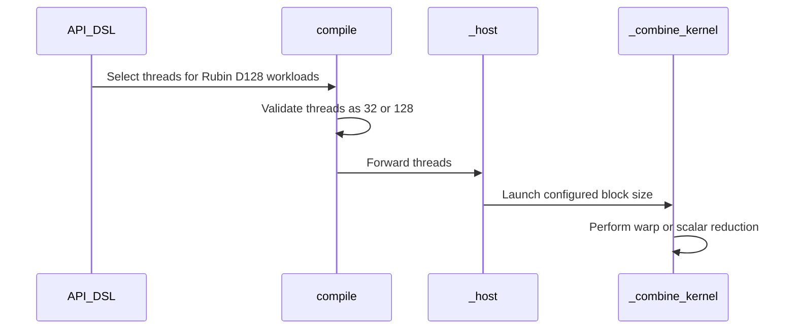

# Optimize Rubin split-KV combine

[Upstream PR](https://github.com/NVIDIA/cudnn-frontend/pull/914) · state: closed · merged: False

## Original PR description

## Summary

- distribute split LSE loads and softmax-weight calculation across warp lanes, then broadcast the results with warp shuffles
- reduce the recombined-output amax once per warp before publishing it instead of issuing one atomic per lane
- use a 32-thread combine block for SM107 D128 at split factors 2 through 6; retain the 128-thread block for larger factors and all other architectures/head dimensions
- retain the original scalar combine for partial-warp output widths and split counts above 32

The combine owns one output row per block. On Rubin D128, the original 128-thread block made four warps independently repeat the same row-uniform LSE and weight work. The context workloads have thousands of output rows, so one warp per row preserves enough grid parallelism while removing that duplication. Split-8 measured slower with one warp, hence the split-6 cutoff.

## GR100 performance

NVIDIA Graphics Device, SM107, 208 SMs. Times are medians from 7 repeats of 50 iterations after 5 warmups. Baseline and prototype were run on the same idle GPU with identical settings.

```text
Shape                 Split  Combine baseline  Prototype  Gain     E2E baseline  Prototype  Gain
--------------------  -----  ----------------  ---------  -------  ------------  ---------  ------
Llama TP8 context       4       0.037313 ms     0.027920   25.17%    0.400018 ms   0.394310    1.43%
Llama TP4 context       2       0.065644 ms     0.028798   56.13%    0.775188 ms   0.744993    3.90%
Llama TP2 context       4       0.130337 ms     0.087505   32.86%    1.183657 ms   1.160637    1.94%
AR-DiT context          4       0.041142 ms     0.028924   29.70%    0.218333 ms   0.207395    5.01%
Llama TP8 8K x 8K       1       0.000000 ms     0.000000    0.00%    0.132817 ms   0.132844   -0.02%
```

The saturated 8K x 8K case remains unsplit, so this change does not alter its kernel path; the measured -0.02% is noise.

## Validation

- `test/python/sdpa/frost/test_sdpa_fp8_sm107.py`: 15 passed on SM107
- direct D128 split-8 combine with dead splits: passed
- direct D16 split-3 scalar fallback: passed
- adapter-level SM107 split-4 (32 threads) and split-8 (128 threads): passed
- no NaNs; output and LSE stayed within existing tolerances
- recombined amax stayed within 0.3% of the output reference
- Black, `py_compile`, and `git diff --check`: passed


<!-- This is an auto-generated comment: release notes by coderabbit.ai -->

## Summary by CodeRabbit

* **Performance**
  * Improved split-KV attention recombination performance for select Rubin hardware configurations.
  * Added optimized warp-based processing for eligible workloads, including more efficient output scaling and maximum-value reduction.
* **Compatibility**
  * Existing configurations continue using the standard 128-thread execution path.
  * Supported thread configurations are limited to validated options.

<!-- end of auto-generated comment: release notes by coderabbit.ai -->

## Review and discussion

### reviews

- YangXu1990uiuc · APPROVED · 2026-09-15T06:54:39Z · [source](https://github.com/NVIDIA/cudnn-frontend/pull/914#pullrequestreview-5206568982)

**Codex bot review · model: `gpt-6-astra`**

Reviewed `6113b4495478` against base `2a0343f079b0`.

The lane-distributed weights and warp-level amax reduction make sense, and the focused correctness checks passed on both SM100 and SM107. The unconditional 32-thread selection covers more workloads than the measured winning cases.

**[P2] Include row count and amax usage in the 32-thread selection** ([source](https://github.com/NVIDIA/cudnn-frontend/blob/6113b449547817d8a98c3e12f7b9e77a8d2c8a47/python/cudnn/sdpa/fwd/api_dsl.py#L1405))

This condition also selects one warp for small grids and ordinary f16/bf16 inference without amax, although those workloads have a different trade-off. On SM107, split-4 `(B,H,SQ,D)=(1,4,4,128)` with LSE/amax took 5.15 us on the baseline versus 9.51 us on this selection; the same new kernel forced to 128 threads took 4.29 us. For `(1,4,2048,128)` without LSE/amax, the three times were 23.95 / 26.29 / 18.70 us. Please retain 128 threads outside a benchmarked row-count/output-feature domain rather than applying the cutoff solely by architecture, D and split count.

Evidence: Repeated interleaved three-arm measurements on SM107 (208 SMs), with 100 combine calls per CUDA Graph; both reported regressions also appeared in a preceding independent run. Every measured arm passed the reference and changed-input/poisoned-output graph-replay checks. These are combine-only timings, not full-attention regressions. Attribution: PR-introduced thread-selection regression; the 128-thread control retains the new kernel optimization.

Validation: 20 direct baseline/head correctness cases passed on each of SM100 and SM107: D16/40/96/128/256/512, split factors through 32 and the >32 scalar fallback, dead splits with NaN partials, fully dead rows, strided LSE, optional outputs, fp16/bf16 and changed-input CUDA Graph replay. For the large D128 grid with amax/LSE, SM107 combine time improved at splits 2/4/6/8 (approximately 34.14->17.19, 38.88->28.14, 40.19->37.01 and 44.10->39.48 us). Six SM100 component spot checks showed no regression. Steady-state compiled-call CPU enqueue medians stayed around 3.0-3.3 us on the SM107 host and 5.0-5.4 us on the SM100 host.

Limitations: Current develop has a conflict in the relocated `kernels/sm100/split_combine.py`. On rebase, preserve its compiled-cache path, FP32 partials, FP8 output scaling and pre-scale amax contract, and append `threads` after the newer compile arguments. The measurements above cover the PR head against its branch baseline, not a resolved merge or full attention. I approved the pending fork [Style workflow](https://github.com/NVIDIA/cudnn-frontend/actions/runs/33899158969); it passed. GPU CI remains deferred until rebase. Afterwards, a maintainer can request `@cudnn-ci-bot run frost`; fork Actions may separately need maintainer approval.

Approved: no P0 or high-risk P1 found. Remaining findings stay with the owner; merge timing stays with the owner.

<!-- codex-fe-review:v2:914:6113b449547817d8a98c3e12f7b9e77a8d2c8a47:complete:no-blocker -->

### issue_comments

- coderabbitai[bot] · comment · 2026-09-04T17:10:58Z · [source](https://github.com/NVIDIA/cudnn-frontend/pull/914#issuecomment-5543978134)

<!-- This is an auto-generated comment: summarize by coderabbit.ai -->
<!-- review_stack_entry_start -->

[](https://app.coderabbit.ai/change-stack/NVIDIA/cudnn-frontend/pull/914)

<!-- review_stack_entry_end -->
<!-- recent_review_start -->

No actionable comments were generated in the recent review. 🎉

<details>
<summary>ℹ️ Recent review info</summary>

<details>
<summary>⚙️ Run configuration</summary>

**Configuration used**: Path: .coderabbit.yaml

**Review profile**: CHILL

**Plan**: Enterprise

**Run ID**: `ba479253-10f3-4b77-b808-a71c649db2ad`

</details>

<details>
<summary>📥 Commits</summary>

Reviewing files that changed from the base of the PR and between edc7c2833327d699d70b616c6f264b6ae92599b2 and 6113b449547817d8a98c3e12f7b9e77a8d2c8a47.

</details>

<details>
<summary>📒 Files selected for processing (2)</summary>

* `python/cudnn/sdpa/fwd/api_dsl.py`
* `python/cudnn/sdpa/fwd/kernels/split_combine_sm100.py`

</details>

**Included review availability:** Your plan provides up to 12 included reviews per hour; 11 remain after this review.

</details>

---


<!-- recent_review_end -->
<!-- walkthrough_start -->

<details>
<summary>📝 Walkthrough</summary>

## Walkthrough

The split-KV combine path adds warp-based reduction for eligible SM100 workloads. It supports compile-time selection of 32 or 128 threads. Rubin D128 workloads with up to six splits use 32 threads.

### Changes

**Split-KV combine optimization**

|Layer / File(s)|Summary|
|---|---|
|**Warp-based split reduction** <br> `python/cudnn/sdpa/fwd/kernels/split_combine_sm100.py`|The kernel adds warp-shuffle reductions for LSE values, split weights, and outputs. Scalar fallback paths remain available. Amax updates now use one atomic operation per warp.|
|**Thread configuration and launch wiring** <br> `python/cudnn/sdpa/fwd/kernels/split_combine_sm100.py`, `python/cudnn/sdpa/fwd/api_dsl.py`|The host and compile paths accept 32 or 128 threads. The API selects 32 threads for eligible Rubin D128 workloads and uses 128 threads otherwise.|

**Estimated code review effort:** 4 (Complex) | ~45 minutes

<!-- final_review_risk_start -->
**Merge Risk:** _⚪ Minimal_ · up to `6113b`
<!-- final_review_risk_coverage:{"sourceCommitId":"6113b449547817d8a98c3e12f7b9e77a8d2c8a47","coveredCommitId":"6113b449547817d8a98c3e12f7b9e77a8d2c8a47","kind":"reviewed"} -->

This change optimizes eligible Rubin split-KV combine workloads with warp-level reductions and a 32-thread launch configuration, while retaining fallback behavior for other configurations. No concrete current-head merge-blocking risk is identified.
<!-- final_review_risk_end -->

### Sequence Diagram(s)



**Suggested reviewers:** `aneureka`

</details>

<!-- walkthrough_end -->
<!-- pre_merge_checks_walkthrough_start -->

<details>
<summary>🚥 Pre-merge checks | ✅ 4 | ❌ 1</summary>

### ❌ Failed checks (1 warning)

|     Check name     | Status     | Explanation                                                                                                                                                                                | Resolution                                                                         |
| :----------------: | :--------- | :----------------------------------------------------------------------------------------------------------------------------------------------------------------------------------------- | :--------------------------------------------------------------------------------- |
| Docstring Coverage | ⚠️ Warning | Docstring coverage is 25.00% which is insufficient. The required threshold is 80.00%. Docstring coverage is scoped to functions touched by this diff. Analyzed 4 functions across 2 files. | Write docstrings for the functions missing them to satisfy the coverage threshold. |

<details>
<summary>✅ Passed checks (4 passed)</summary>

|         Check name         | Status   | Explanation                                                                                                                                                                                               |
| :------------------------: | :------- | :-------------------------------------------------------------------------------------------------------------------------------------------------------------------------------------------------------- |
|         Title check        | ✅ Passed | The title is concise, specific, and accurately describes the main change: optimizing the Rubin split-KV combine path.                                                                                     |
|      Description check     | ✅ Passed | The description clearly documents the optimization, rationale, performance results, compatibility behavior, and validation. It does not reproduce the template's Affected area, Related issues, API and … |
|     Linked Issues check    | ✅ Passed | Check skipped because no linked issues were found for this pull request.                                                                                                                                  |
| Out of Scope Changes check | ✅ Passed | Check skipped because no linked issues were found for this pull request.                                                                                                                                  |

</details>

</details>

<!-- pre_merge_checks_walkthrough_end -->

- [ ] <!-- {"checkboxId":"585bb3f6-faf5-4dbf-96d2-74e382adf19a"} --> Fix all pre-merge checks with AI
<!-- finishing_touch_checkbox_start -->

<details>
<summary>✨ Finishing Touches 💡 1</summary>

<!-- finishing_touch_suggestion:fix_ci -->
<details open>
<summary>🛠️ Fix failing CI checks 💡</summary>

- [ ] <!-- {"checkboxId": "6d21cfe8-ec3f-40e2-9222-b8318b64d3b0", "radioGroupId": "fix-ci-output-choice-group-unknown_comment_id"} -->   Create stacked PR
- [ ] <!-- {"checkboxId": "9f0d24fb-b419-4f01-baf0-8b26b6424f34", "radioGroupId": "fix-ci-output-choice-group-unknown_comment_id"} -->   Commit on current branch

</details>
<details>
<summary>🧪 Generate unit tests (beta)</summary>

- [ ] <!-- {"checkboxId": "f47ac10b-58cc-4372-a567-0e02b2c3d479", "radioGroupId": "utg-output-choice-group-unknown_comment_id"} -->   Create PR with unit tests

</details>

</details>

<!-- finishing_touch_checkbox_end -->
<!-- tips_start -->

---


<sub>Comment `@coderabbitai help` to get the list of available commands.</sub>

<!-- tips_end -->

- github-actions[bot] · comment · 2026-10-07T02:53:51Z · [source](https://github.com/NVIDIA/cudnn-frontend/pull/914#issuecomment-6029919519)

This PR has been inactive for 3 weeks and is now marked stale. It will be closed in 3 more weeks unless there is new activity (a comment, a push, or removal of the stale label).

- github-actions[bot] · comment · 2026-10-29T02:37:11Z · [source](https://github.com/NVIDIA/cudnn-frontend/pull/914#issuecomment-6486346076)

Closing this PR after 6 weeks of inactivity. Feel free to reopen or open a new PR when you're ready to continue.

### inline_comments

## Changed files and fixed code

- `python/cudnn/sdpa/fwd/api_dsl.py` · modified · additions 5 / deletions 0
  - [head](https://github.com/scottyokim/cudnn-frontend/blob/6113b449547817d8a98c3e12f7b9e77a8d2c8a47/python/cudnn/sdpa/fwd/api_dsl.py)
  - [base](https://github.com/NVIDIA/cudnn-frontend/blob/edc7c2833327d699d70b616c6f264b6ae92599b2/python/cudnn/sdpa/fwd/api_dsl.py)
- `python/cudnn/sdpa/fwd/kernels/split_combine_sm100.py` · modified · additions 92 / deletions 40
  - [head](https://github.com/scottyokim/cudnn-frontend/blob/6113b449547817d8a98c3e12f7b9e77a8d2c8a47/python/cudnn/sdpa/fwd/kernels/split_combine_sm100.py)
  - [base](https://github.com/NVIDIA/cudnn-frontend/blob/edc7c2833327d699d70b616c6f264b6ae92599b2/python/cudnn/sdpa/fwd/kernels/split_combine_sm100.py)

## Evidence and interpretation boundary

[Original JSON, discussions and patches](../../../../../../evidence/prs/NVIDIA--cudnn-frontend/914-893beef0937fc9641420f6a9155a56889a22a19ff3d565d60fb17c18ccc51894.json) · SHA-256 `893beef0937fc9641420f6a9155a56889a22a19ff3d565d60fb17c18ccc51894`.

Diff complete: True. Missing/binary/truncated patches require pinned source inspection. This is a source page, not an independently verified optimization case. Open, merged and released are different states; recheck the deployed dependency.
