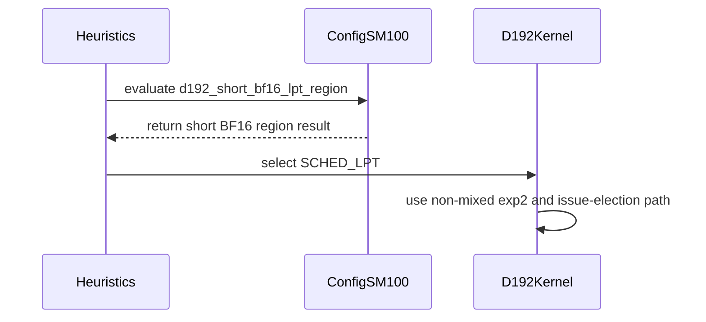

# Fix D192 BF16 short-sequence performance regression

[Upstream PR](https://github.com/NVIDIA/cudnn-frontend/pull/932) · state: open · merged: False

## Original PR description

## Before submitting

- [x] I agree to license this contribution under the terms of [LICENSE.txt](https://github.com/NVIDIA/cudnn-frontend/blob/develop/LICENSE.txt).
- [x] I ran `pre-commit run` and committed any formatting changes.
- [x] I reviewed the Hard Rules in the `AGENTS.md` for each directory this PR touches and the changes comply.
- [x] I added the required category, area, and origin labels.

## Affected area

FE OSS kernels or CuTeDSL; benchmarks or performance.

## Summary

Fix the SM100 D192/D128 BF16 short-sequence performance regression by selecting the measured D192 scheduler and matching source schedule for square top-left causal sequences from 512 through 3584 tokens.

## Why

The D192 half kernel previously used plain LPT. After scheduler selection moved to the generic heuristic, short BF16 sequences selected LPT-L2. The public-source exp2/descriptor/election schedule used by the long-sequence path also costs additional time when paired with plain LPT at these short lengths. Earlier validation focused on 8K and did not expose the short-sequence crossover.

This change:

- selects LPT as the D192-specific primary only in the measured short BF16 region;
- selects the matching existing source schedule through a private codegen flag;
- preserves explicit user knobs, the LPT-L2 and NATURAL runner configurations, and NATURAL fallback behavior;
- leaves FP16, FP8, MXFP8, no-mask, bottom-right, GQA, sink, SWA, THD/runtime-length, CTA1, and split-KV paths unchanged.

The remaining 2K gap to a historical build is about 2.4-3.0%. That build used internal compiler controls which cannot be used in public source; this PR recovers the public-source regression without restoring them. Later public-source tuning has already recovered essentially all of the corresponding 8K gap.

Paired measurements used a local SM100 GPU at fixed 847 MHz SM / 4000 MHz memory clocks, with 10 warmups and 40 measured iterations per side. Lower is better.

| BF16 top-left, Sq=Skv=2048 | Upstream | PR | Change |
|---|---:|---:|---:|
| Kimi K2.6, B2 H64 | 0.341 ms | 0.323 ms | -5.28% |
| Kimi K3, B2 H96 | 0.485 ms | 0.474 ms | -2.27% |
| DeepSeek V3, B2 H128 | 0.660 ms | 0.620 ms | -6.06% |

The non-target regression sweep covered 87 BF16/per-tensor-FP8/MXFP8 model cells across 2K/4K/8K/16K/32K and top-left/no-mask. Median change was 0.000%; the largest slowdown was 0.321% (1 microsecond). A supplementary 30-cell FP16 sweep also had a 0.000% median; its only initial outlier disappeared in four crossed-order repeats.

## Related issues

None.

## API and compatibility impact

No API or engine-capability change. Explicit scheduler/CGA choices remain authoritative.

## Testing

```bash
cd test/python
python3 -m pytest -q sdpa/frost/test_sdpa_fwd_heuristics.py
python3 -m pytest -q -m "L0 or L1" \
  sdpa/frost/test_sdpa_fwd_dsl_sm100.py::test_dsl_sm100_d192_d128 \
  sdpa/frost/test_sdpa_fwd_dsl_sm100.py::test_dsl_sm100_d192_d128_short_bf16_lpt
```

- Heuristic suite: `24 passed`.
- D192 FP16/BF16 dense/causal plus the exact 2K BF16 O/LSE reference case: `5 passed`.
- Representative 2K path: Compute Sanitizer synccheck and memcheck both reported `0 errors`.
- Pre-commit hooks passed on all changed files.


<!-- This is an auto-generated comment: release notes by coderabbit.ai -->

## Summary by CodeRabbit

* **Performance Improvements**
  * Improved scheduling for short, dense BF16 attention workloads on supported hardware.
  * Added specialized handling for D192/D128 causal attention configurations.

* **Bug Fixes**
  * Corrected execution-path selection for qualifying BF16 causal workloads while preserving existing behavior for other configurations.

* **Tests**
  * Added regression coverage comparing outputs and statistics with FP32 references.
  * Expanded scheduler-selection tests across sequence lengths and configuration variations.

<!-- end of auto-generated comment: release notes by coderabbit.ai -->

## Review and discussion

### reviews

- YangXu1990uiuc · APPROVED · 2026-09-15T04:12:20Z · [source](https://github.com/NVIDIA/cudnn-frontend/pull/932#pullrequestreview-5205416741)

**Codex bot review · model: `gpt-6-astra`**

Reviewed `f94abb9ac9dc` against base `64f6b391144c`.

The scoped scheduler/codegen change makes sense, and I found no actionable correctness issue. Explicit scheduler choices and the NATURAL fallback remain intact. Two non-blocking suggestions: record the measured GPU model/SM count alongside the clock settings, since the 2K gain did not transfer to the smaller SM100 device below; and put one short-path numerical case in L0, since the new 2K O/LSE regression is L1. Rebase the single import conflict in the renamed kernels/sm100/prefill_d192_d128_f16.py by retaining both read_clc_payload and SCHED_LPT. I verified that resolution only in a disposable integration checkout; the PR branch is unchanged.

Validation: Built matching bindings for the reviewed head and its exact merge base. With CuTe DSL 4.8 on SM100, the heuristic suite passed 26 tests and the focused D192 suite passed 11 tests under explicit L0/L1 selection. Eight additional full O/LSE reference cases passed at square lengths 511, 512, 513, 1025, 3583, 3584, 3585 and 4096. The actual loaded module enabled the short schedule only inside [512,3584]. NATURAL, LPT and LPT-L2 were each explicitly selected and verified at length 513, with numerical results checked. Paired merge-base/head measurements used ABBA order, actual template/scheduler checks, reference rows across all heads, 16 calls per captured graph, seven timing batches, and changed-V/poisoned-output replay checks. On the 68-SM SM100 device, B2/H8/S512 BF16 causal improved from 22.67 to 21.16 us (-6.69%). B2/H64/S2048 was 516.15 -> 520.85 us (+0.91%); B2/H128/S2048 was 1015.10 -> 1017.77 us (+0.26%). These small 2K slowdowns repeated in both arms; the claimed 2K speedup was not reproduced on this device. Non-target controls were essentially unchanged: BF16 causal S4096 +0.01%, BF16 non-causal S2048 +0.02%, FP16 causal S2048 +0.33% (all B2/H8). Warmed graph-call CPU time stayed about 28–34 us; observed differences were at most about 1.1 us. No clocks were changed. A temporary merge onto develop 64f6b391144c, resolving only the import conflict and building separate bindings for that integrated source, passed the three directly affected tests: scoped scheduler selection, NATURAL fallback and the new 2K O/LSE regression. The template-cache identity includes all frozen template parameters, so the new private flag is part of that identity. Current-head Style passed.

Limitations: The performance check is a component measurement on a 68-SM device with CuTe DSL 4.8; it does not independently reproduce the reported fixed-clock model grids or the broad 87-cell/30-cell sweeps. The reviewed head still needs the described rebase. The three temporary integration tests do not establish that the complete integrated CI suite passes. Existing current-head CI requests were reused for inspection rather than duplicated; SM103/SM107 execution was not independently rerun.

Approved under the trial's no-P0 threshold; any P1/P2 findings above remain for the owner to address. Merge timing stays with the owner.

<!-- codex-fe-review:v1:932:f94abb9ac9dc2cffd230815c69dee0bbc1a7249c:complete:no-p0 -->

### issue_comments

- coderabbitai[bot] · comment · 2026-09-07T10:08:01Z · [source](https://github.com/NVIDIA/cudnn-frontend/pull/932#issuecomment-5569005190)

<!-- This is an auto-generated comment: summarize by coderabbit.ai -->
<!-- review_stack_entry_start -->

[](https://app.coderabbit.ai/change-stack/NVIDIA/cudnn-frontend/pull/932)

<!-- review_stack_entry_end -->
<!-- recent_review_start -->

No actionable comments were generated in the recent review. 🎉

<details>
<summary>ℹ️ Recent review info</summary>

<details>
<summary>⚙️ Run configuration</summary>

**Configuration used**: Path: .coderabbit.yaml

**Review profile**: CHILL

**Plan**: Enterprise

**Run ID**: `be3e0cb6-76dd-456e-8abd-8ec70d0e7cff`

</details>

<details>
<summary>📥 Commits</summary>

Reviewing files that changed from the base of the PR and between 2cc71fbfa96171d7d43cbcdf0a25c260026871ad and f94abb9ac9dc2cffd230815c69dee0bbc1a7249c.

</details>

<details>
<summary>📒 Files selected for processing (5)</summary>

* `python/cudnn/sdpa/fwd/config_sm100.py`
* `python/cudnn/sdpa/fwd/heuristics.py`
* `python/cudnn/sdpa/fwd/kernels/prefill_d192_d128_f16_sm100.py`
* `test/python/sdpa/frost/test_sdpa_fwd_dsl_sm100.py`
* `test/python/sdpa/frost/test_sdpa_fwd_heuristics.py`

</details>

**Included review availability:** Your plan provides up to 12 included reviews per hour; 11 remain after this review.

</details>

---


<!-- recent_review_end -->
<!-- walkthrough_start -->

<details>
<summary>📝 Walkthrough</summary>

## Walkthrough

The change adds short-sequence BF16 D192 LPT detection, scheduler selection, template propagation, and kernel dispatch behavior. New tests validate scheduler decisions, derived parameters, output values, and LSE statistics.

### Changes

**D192 BF16 LPT specialization**

|Layer / File(s)|Summary|
|---|---|
|**Short-region contract** <br> `python/cudnn/sdpa/fwd/config_sm100.py`|Defines `TemplateParams.d192_short_bf16_lpt`. Derives the flag for dense square BF16 D192 configurations that meet the causal, topology, and sequence-length constraints.|
|**Scheduler selection and validation** <br> `python/cudnn/sdpa/fwd/heuristics.py`, `test/python/sdpa/frost/test_sdpa_fwd_heuristics.py`|Selects `SCHED_LPT` for qualifying short BF16 D192 cases. Preserves other scheduler behavior and validates short, long, split, recommendation, and fallback cases.|
|**Kernel specialization dispatch** <br> `python/cudnn/sdpa/fwd/kernels/prefill_d192_d128_f16_sm100.py`, `test/python/sdpa/frost/test_sdpa_fwd_dsl_sm100.py`|Adds `SCHED_LPT` dispatch and excludes the short BF16 specialization from the dense causal mixed-exp2 path. Validates output and LSE statistics against the FP32 reference.|

**Estimated code review effort:** 3 (Moderate) | ~20 minutes

<!-- final_review_risk_start -->
**Merge Risk:** _⚪ Minimal_ · up to `f94ab`
<!-- final_review_risk_coverage:{"sourceCommitId":"f94abb9ac9dc2cffd230815c69dee0bbc1a7249c","coveredCommitId":"f94abb9ac9dc2cffd230815c69dee0bbc1a7249c","kind":"reviewed"} -->

This change selects an LPT specialization for qualifying short BF16 D192 causal attention workloads while preserving stated fallback behavior. Functional and scheduler regression coverage is included, with no concrete current-head merge-blocking risk identified.
<!-- final_review_risk_end -->

**Suggested reviewers:** `vedaanta`

### Sequence Diagram(s)



</details>

<!-- walkthrough_end -->
<!-- pre_merge_checks_walkthrough_start -->

<details>
<summary>🚥 Pre-merge checks | ✅ 4 | ❌ 1</summary>

### ❌ Failed checks (1 warning)

|     Check name     | Status     | Explanation                                                                                                                                                                                 | Resolution                                                                         |
| :----------------: | :--------- | :------------------------------------------------------------------------------------------------------------------------------------------------------------------------------------------ | :--------------------------------------------------------------------------------- |
| Docstring Coverage | ⚠️ Warning | Docstring coverage is 66.67% which is insufficient. The required threshold is 80.00%. Docstring coverage is scoped to functions touched by this diff. Analyzed 12 functions across 5 files. | Write docstrings for the functions missing them to satisfy the coverage threshold. |

<details>
<summary>✅ Passed checks (4 passed)</summary>

|         Check name         | Status   | Explanation                                                                                                                                                                                               |
| :------------------------: | :------- | :-------------------------------------------------------------------------------------------------------------------------------------------------------------------------------------------------------- |
|         Title check        | ✅ Passed | The title clearly and concisely describes the main change: fixing the D192 BF16 short-sequence performance regression.                                                                                    |
|      Description check     | ✅ Passed | The description follows the repository template, identifies the affected areas, explains the problem and solution, documents compatibility impact, and lists testing commands with results. All required… |
|     Linked Issues check    | ✅ Passed | Check skipped because no linked issues were found for this pull request.                                                                                                                                  |
| Out of Scope Changes check | ✅ Passed | Check skipped because no linked issues were found for this pull request.                                                                                                                                  |

</details>

</details>

<!-- pre_merge_checks_walkthrough_end -->

- [ ] <!-- {"checkboxId":"585bb3f6-faf5-4dbf-96d2-74e382adf19a"} --> Fix all pre-merge checks with AI
<!-- finishing_touch_checkbox_start -->

<details>
<summary>✨ Finishing Touches 💡 1</summary>

<!-- finishing_touch_suggestion:fix_ci -->
<details open>
<summary>🛠️ Fix failing CI checks 💡</summary>

- [ ] <!-- {"checkboxId": "6d21cfe8-ec3f-40e2-9222-b8318b64d3b0", "radioGroupId": "fix-ci-output-choice-group-unknown_comment_id"} -->   Create stacked PR
- [ ] <!-- {"checkboxId": "9f0d24fb-b419-4f01-baf0-8b26b6424f34", "radioGroupId": "fix-ci-output-choice-group-unknown_comment_id"} -->   Commit on current branch

</details>
<details>
<summary>🧪 Generate unit tests (beta)</summary>

- [ ] <!-- {"checkboxId": "f47ac10b-58cc-4372-a567-0e02b2c3d479", "radioGroupId": "utg-output-choice-group-unknown_comment_id"} -->   Create PR with unit tests

</details>

</details>

<!-- finishing_touch_checkbox_end -->
<!-- tips_start -->

---


<sub>Comment `@coderabbitai help` to get the list of available commands.</sub>

<!-- tips_end -->

- adshen · comment · 2026-09-07T10:10:48Z · [source](https://github.com/NVIDIA/cudnn-frontend/pull/932#issuecomment-5569039521)

@cudnn-ci-bot run frost

- cudnn-ci-bot · comment · 2026-09-07T10:10:52Z · [source](https://github.com/NVIDIA/cudnn-frontend/pull/932#issuecomment-5569040341)

🏁 Pipeline finished

SHA: `f94abb9`
Targets: `frost`
Branch: [cudnn-gh/pr-932-f94abb9](https://nv/cudnn-gitlab-ci/-/tree/cudnn-gh/pr-932-f94abb9)
Pipeline: [66608912](https://nv/cudnn-gitlab-ci/-/pipelines/66608912)
Last updated: 2026-09-07 11:02 UTC

- vedaanta · comment · 2026-09-08T23:33:36Z · [source](https://github.com/NVIDIA/cudnn-frontend/pull/932#issuecomment-5593365064)

@cudnn-ci-bot run frost

- cudnn-ci-bot · comment · 2026-09-08T23:33:39Z · [source](https://github.com/NVIDIA/cudnn-frontend/pull/932#issuecomment-5593365619)

🏁 Pipeline finished

SHA: `f94abb9`
Targets: `frost`
Branch: [cudnn-gh/pr-932-f94abb9](https://nv/cudnn-gitlab-ci/-/tree/cudnn-gh/pr-932-f94abb9)
Pipeline: [66864570](https://nv/cudnn-gitlab-ci/-/pipelines/66864570)
Last updated: 2026-09-09 00:27 UTC

### inline_comments

## Changed files and fixed code

- `python/cudnn/sdpa/fwd/config_sm100.py` · modified · additions 28 / deletions 2
  - [head](https://github.com/adshen/cudnn-frontend/blob/f94abb9ac9dc2cffd230815c69dee0bbc1a7249c/python/cudnn/sdpa/fwd/config_sm100.py)
  - [base](https://github.com/NVIDIA/cudnn-frontend/blob/2cc71fbfa96171d7d43cbcdf0a25c260026871ad/python/cudnn/sdpa/fwd/config_sm100.py)
- `python/cudnn/sdpa/fwd/heuristics.py` · modified · additions 14 / deletions 1
  - [head](https://github.com/adshen/cudnn-frontend/blob/f94abb9ac9dc2cffd230815c69dee0bbc1a7249c/python/cudnn/sdpa/fwd/heuristics.py)
  - [base](https://github.com/NVIDIA/cudnn-frontend/blob/2cc71fbfa96171d7d43cbcdf0a25c260026871ad/python/cudnn/sdpa/fwd/heuristics.py)
- `python/cudnn/sdpa/fwd/kernels/prefill_d192_d128_f16_sm100.py` · modified · additions 5 / deletions 1
  - [head](https://github.com/adshen/cudnn-frontend/blob/f94abb9ac9dc2cffd230815c69dee0bbc1a7249c/python/cudnn/sdpa/fwd/kernels/prefill_d192_d128_f16_sm100.py)
  - [base](https://github.com/NVIDIA/cudnn-frontend/blob/2cc71fbfa96171d7d43cbcdf0a25c260026871ad/python/cudnn/sdpa/fwd/kernels/prefill_d192_d128_f16_sm100.py)
- `test/python/sdpa/frost/test_sdpa_fwd_dsl_sm100.py` · modified · additions 19 / deletions 0
  - [head](https://github.com/adshen/cudnn-frontend/blob/f94abb9ac9dc2cffd230815c69dee0bbc1a7249c/test/python/sdpa/frost/test_sdpa_fwd_dsl_sm100.py)
  - [base](https://github.com/NVIDIA/cudnn-frontend/blob/2cc71fbfa96171d7d43cbcdf0a25c260026871ad/test/python/sdpa/frost/test_sdpa_fwd_dsl_sm100.py)
- `test/python/sdpa/frost/test_sdpa_fwd_heuristics.py` · modified · additions 81 / deletions 4
  - [head](https://github.com/adshen/cudnn-frontend/blob/f94abb9ac9dc2cffd230815c69dee0bbc1a7249c/test/python/sdpa/frost/test_sdpa_fwd_heuristics.py)
  - [base](https://github.com/NVIDIA/cudnn-frontend/blob/2cc71fbfa96171d7d43cbcdf0a25c260026871ad/test/python/sdpa/frost/test_sdpa_fwd_heuristics.py)

## Evidence and interpretation boundary

[Original JSON, discussions and patches](../../../../../../evidence/prs/NVIDIA--cudnn-frontend/932-f1e377d51712f048c342940af00cb0ce918499445e4b5c5dcb514667552963d1.json) · SHA-256 `f1e377d51712f048c342940af00cb0ce918499445e4b5c5dcb514667552963d1`.

Diff complete: True. Missing/binary/truncated patches require pinned source inspection. This is a source page, not an independently verified optimization case. Open, merged and released are different states; recheck the deployed dependency.
