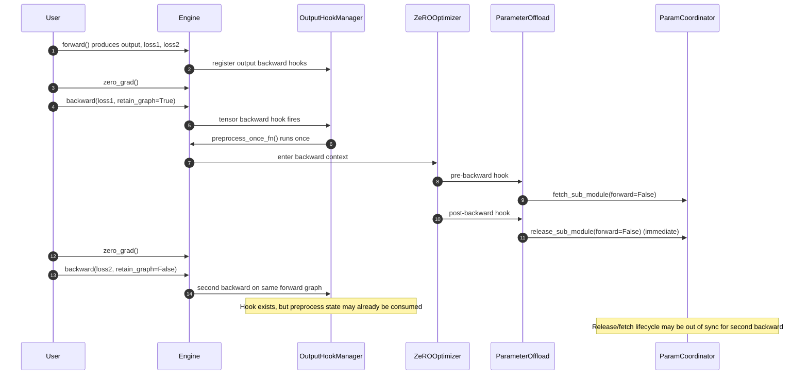
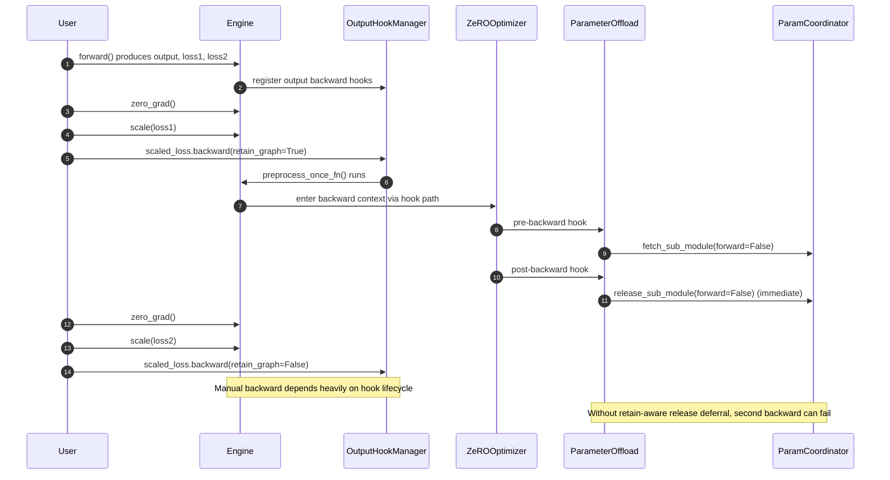
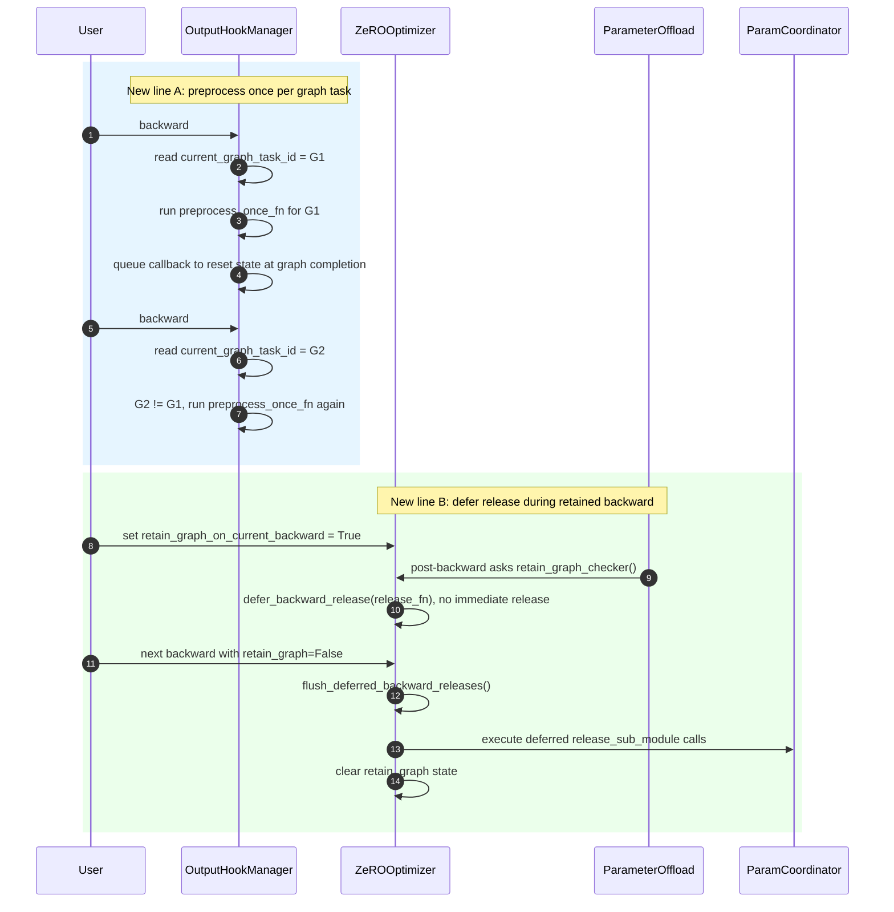

# Feature/zero multi loss separate backward

[Upstream PR](https://github.com/deepspeedai/DeepSpeed/pull/8135) · state: closed · merged: False

## Original PR description

## Summary

This PR fixes retained-graph backward behavior for ZeRO when running two separate backward passes on the same forward graph.

Specifically, it addresses the sequence:

- `zero_grad()`
- `backward(loss1, retain_graph=True)`
- `zero_grad()`
- `backward(loss2)`

where ZeRO-3 previously failed on the second backward.

Issue: #7352

---

## Background

The retained-graph path exposed two related lifecycle problems:

1. Backward preprocess state was consumed by the first backward and not re-run correctly for the second backward graph task.
2. In ZeRO-3, parameter release could occur too early during the retained window, making the follow-up backward invalid.

This is a correctness issue (not a latency optimization).

---

## What changed

1. **Graph-task-aware backward preprocess lifecycle**
   - Re-runs preprocess once per backward graph task for retained-graph execution, instead of relying on a single stale one-shot state.

2. **Deferred ZeRO-3 param release during retained backward**
   - When `retain_graph=True`, ZeRO-3 release is deferred within the retained window.
   - Deferred releases are flushed after the follow-up non-retained backward.
   - State cleanup is guarded to avoid leakage across steps.

3. **Retained-backward lifecycle test hardening**
   - Added/updated focused tests for:
     - two-loss separate backward correctness
     - preprocess behavior per backward graph task
     - ZeRO-3 retain-window release behavior
     - retained-window state cleanup / no cross-step contamination

---

## Why this approach

Both fixes are required:

- Preprocess re-run alone does not prevent premature ZeRO-3 release.
- Deferred release alone does not restore missing preprocess behavior.
- Together they make retained-graph reuse correct and stable.

---

## Validation

### A/B branch comparison

I ran the same targeted retained-graph subset on:

- branch **without** this fix (master baseline)
- branch **with** this fix

Result:

- baseline branch: reproduced failures (including ZeRO-3 second-backward failure and lifecycle assertion failures)
- patched branch: all selected tests passed

### Targeted tests covered

- `test_two_losses_separate_backward_gas1`
- `test_two_losses_separate_manual_backward_gas1`
- `test_preprocess_runs_once_per_backward_graph_task`
- `test_zero3_retain_graph_defers_release_until_followup_backward`
- retained-window cleanup / contamination checks

(Details and logs are included in the PR discussion.)

---

## Risk / Follow-up

- **Risk level:** low to moderate, scoped to retained-graph lifecycle paths.
- Default non-retained backward behavior remains unchanged.
- Follow-up option: add additional stress coverage for broader retained-graph multi-step patterns if needed.

---

## Notes

- `retain_graph=True` in core PyTorch semantics primarily keeps autograd graph/saved intermediates alive.
- This PR does not change that meaning; it aligns ZeRO runtime-managed param lifecycle with that semantic so retained-graph follow-up backward remains valid.

---

cc @sfc-gh-truwase @tohtana

## Review and discussion

### reviews

- chatgpt-codex-connector[bot] · COMMENTED · 2026-07-12T09:57:44Z · [source](https://github.com/deepspeedai/DeepSpeed/pull/8135#pullrequestreview-4679832230)

### 💡 Codex Review

https://github.com/deepspeedai/DeepSpeed/blob/f873f694103f66132f190732d97ac8899a4ce168/deepspeed/runtime/engine.py#L4348-L4350
**  Validate checkpoint directory before the barrier**

After removing the all-rank `save_dir` validation, a misconfigured `save_checkpoint(save_dir=None)` or empty string now fails only on rank 0 inside `makedirs`, while the other ranks proceed to `dist.barrier()` and can hang indefinitely. The previous check failed synchronously on every rank before this rank-gated filesystem call, so distributed checkpoint misconfiguration no longer fails cleanly.
    

 
ℹ️ About Codex in GitHub

 

Codex has been enabled to automatically review pull requests in this repo. Reviews are triggered when you
- Open a pull request for review
- Mark a draft as ready
- Comment "@codex review".

If Codex has suggestions, it will comment; otherwise it will react with 👍.

When you [sign up for Codex through ChatGPT](https://openai.com/codex), Codex can also answer questions or update the PR, like "@codex address that feedback".
            

### issue_comments

- tohtana · comment · 2026-07-12T19:02:11Z · [source](https://github.com/deepspeedai/DeepSpeed/pull/8135#issuecomment-4952384546)

Hi @nathon-lee,
Thank you for submitting this PR!
With this change, do we keep all parameteres gathered after the first backward? If so, it defeats the purpose of ZeRO-3.

- nathon-lee · comment · 2026-07-13T08:18:04Z · [source](https://github.com/deepspeedai/DeepSpeed/pull/8135#issuecomment-4955877810)

Thanks, @tohtana — great point. I agree this tradeoff should be explicit.

I’ll scope it tightly: delayed ZeRO-3 release applies only to the explicit retain_graph=True backward on the same forward graph, and the state is reset in finally, so default backward behavior remains unchanged.

I’ll also add targeted coverage to confirm (1) no state leak beyond that window and (2) normal ZeRO-3 flow is unaffected outside this path.

Thanks again, @tohtana. If you see a cleaner approach here, I’d really appreciate your suggestion.

- sfc-gh-truwase · comment · 2026-07-13T16:13:18Z · [source](https://github.com/deepspeedai/DeepSpeed/pull/8135#issuecomment-4960067803)

@nathon-lee thanks for this improved PR. 

Can you and @tohtana help clarify this discussion concerning parameter gather/release, as I think [gather](https://github.com/deepspeedai/DeepSpeed/blob/46c9e20f1e07623392633e3f1d9aaae41e348c0f/deepspeed/runtime/zero/partitioned_param_coordinator.py#L536) and [release](https://github.com/deepspeedai/DeepSpeed/blob/46c9e20f1e07623392633e3f1d9aaae41e348c0f/deepspeed/runtime/zero/partitioned_param_coordinator.py#L573) is orthogonal to your changes. Is this correct? 

- tohtana · comment · 2026-07-13T23:21:11Z · [source](https://github.com/deepspeedai/DeepSpeed/pull/8135#issuecomment-4963765095)

Hi @sfc-gh-truwase,
I think the gather/release primitives themselves are orthogonal, but the parameter lifetime is not. `pre_sub_module_backward_function()` already gathers through `fetch_sub_module()`, while this PR explicitly skips the matching `release_sub_module()` when `retain_graph=True`.

- sfc-gh-truwase · comment · 2026-07-14T16:25:24Z · [source](https://github.com/deepspeedai/DeepSpeed/pull/8135#issuecomment-4971508780)

@tohtana thanks, I just noticed the relevant [change](https://github.com/deepspeedai/DeepSpeed/pull/8135/changes#diff-8ddf688b22025a3af470b32edde03d44fb69e3a82692c567adf69f96cd2f3deeR571-R572). 

@nathon-lee is there a reason for skipping param release? If it is latency-related, I suggest reverting and addressing in a follow up, if needed. If it is correctness-related, then we can discuss more. Thanks! 

- nathon-lee · comment · 2026-07-15T07:27:43Z · [source](https://github.com/deepspeedai/DeepSpeed/pull/8135#issuecomment-4977978593)

Thanks @sfc-gh-truwase and @tohtana for the helpful review comments. I pushed an update aligned with the focused lifecycle/test changes from nathon-lee/DeepSpeed_woo#28.

You are right that gather/release primitives themselves are orthogonal.
The change is about parameter lifetime control, and it is for correctness, not latency.

Specifically:

We do not keep parameters gathered indefinitely after the first backward.
When [retain_graph=True](vscode-file://vscode-app/d:/software/vscode/Microsoft%20VS%20Code/4fe60c8b1c/resources/app/out/vs/code/electron-browser/workbench/workbench.html), release is only deferred within that retained-graph window so the second backward on the same forward graph remains valid.
Once a non-retained backward runs, deferred releases are flushed, so parameters are released normally and do not persist across steps.
So this does not change purpose of ZeRO-3; it only prevents premature release during retained-graph reuse..

- sfc-gh-truwase · comment · 2026-07-15T14:34:42Z · [source](https://github.com/deepspeedai/DeepSpeed/pull/8135#issuecomment-4981789348)

@nathon-lee thanks for the update. I am still confused about why we need to defer param release so that the second backward works. Since the gather hooks are attached to (sub)modules, my expectation is that the 2nd (or Nth) backward (or forward) should work correctly. 

- sfc-gh-truwase · comment · 2026-07-15T14:48:34Z · [source](https://github.com/deepspeedai/DeepSpeed/pull/8135#issuecomment-4981938840)

@nathon-lee, @tohtana, my understanding of `retain_graph=True` is that it affects the lifetimes of activations and intermediate tensors, rather than parameters or gradients. Does that align with your understanding? 

- nathon-lee · comment · 2026-07-19T16:24:37Z · [source](https://github.com/deepspeedai/DeepSpeed/pull/8135#issuecomment-5016472389)

Sorry for the delayed reply, I’ve been a bit busy recently.
Thanks, @sfc-gh-truwase  great question.
You’re right that the hooks are still attached and do fire on the 2nd/Nth backward. The issue is timing: in ZeRO-3, if we release/re-partition params right after the first backward (while [retain_graph=True](vscode-file://vscode-app/d:/software/vscode/Microsoft%20VS%20Code/4fe60c8b1c/resources/app/out/vs/code/electron-browser/workbench/workbench.html)), the retained graph may still need those gathered param views in the next backward. So this is not “hook missing”, it’s “hook fired but state/lifetime already advanced.”
Deferring release only during the retained window keeps params valid for the follow-up backward, then we flush releases after the non-retained backward.

- nathon-lee · comment · 2026-07-19T16:25:39Z · [source](https://github.com/deepspeedai/DeepSpeed/pull/8135#issuecomment-5016475964)

> @nathon-lee，@tohtana我的理解`retain_graph=True`是，它影响的是激活函数和中间张量的生命周期，而不是参数或梯度。你的理解是否与此一致？

Yes, I agree with that interpretation in general PyTorch semantics.
[retain_graph=True](vscode-file://vscode-app/d:/software/vscode/Microsoft%20VS%20Code/4fe60c8b1c/resources/app/out/vs/code/electron-browser/workbench/workbench.html) primarily means autograd graph + saved intermediates stay alive.
What we’re doing in ZeRO-3 is mapping that semantic to our runtime-managed param lifecycle: since params are dynamically gathered/released, we need to avoid releasing them too early while the retained graph is still going to run another backward. So this is an implementation-level requirement, not a change to the core meaning of [retain_graph=True](vscode-file://vscode-app/d:/software/vscode/Microsoft%20VS%20Code/4fe60c8b1c/resources/app/out/vs/code/electron-browser/workbench/workbench.html).

- nathon-lee · comment · 2026-07-19T16:40:48Z · [source](https://github.com/deepspeedai/DeepSpeed/pull/8135#issuecomment-5016526483)

**I’ll walk through this issue in detail below. I added several unit tests and ran them on both branches (with and without this change). The branch without this change consistently reproduces the original issue. I’ll also explain what is going wrong and why this fix addresses it.**

### Problem statement
**1) Master Branch Problem**

On master, the “same forward, two separate backward calls” pattern is broken in ZeRO-3:

- Sequence:
  zero_grad -> backward(loss1, retain_graph=True) -> zero_grad -> backward(loss2)
- Observed behavior:
  stage1/2 may pass, but stage3 fails with backward/runtime errors.
- Key failure signals:
  - Tensor size mismatch on the second backward (0 vs 4).
  - Preprocess/prologue is triggered only once across two backward calls (expected twice).
  - ZeRO-3 releasable params are not kept AVAILABLE during the retained-backward window.

This indicates two distinct issues:
1. Pre-backward preprocessing is not re-triggered per backward graph task.
2. ZeRO-3 parameter release happens too early for retained-graph workflows.

---

**2) How I fixed it**

I fixed this with two coordinated changes:

1. Graph-task-aware preprocess re-run  
Instead of a single global “already processed” flag, preprocess is executed once per autograd graph task.  
This guarantees the second backward on the same forward graph gets its own preprocessing lifecycle.

2. Deferred ZeRO-3 release during retained backward  
When `retain_graph=True`, ZeRO-3 release is deferred instead of executed immediately.  
Deferred releases are flushed after the follow-up non-retained backward.

Why both are required:
- Preprocess re-run alone does not prevent early parameter release.
- Deferred release alone does not restore missing backward preprocessing.
- Both are needed to make the workflow correct and stable.

---

**3) Validation summary**

Your A/B results are consistent with the intended fix:

- Master: multiple failures in the selected regression/mechanism tests.
- Patched branch: all selected tests pass.

This validates:
- Functional correctness (loss1/loss2 backward behavior)
- Mechanism correctness (preprocess frequency + release timing)

---

**4) Sequence Diagrams**

**Before fix: engine.backward path**

**Before fix: manual scale(...).backward path**

**After PR #8135: only the two new lines (graph-task preprocess + deferred release)**

### Unit tests

`
@pytest.mark.parametrize("zero_stage", [1, 2, 3])
class TestZeroUserBackwardSeparateLoss(DistributedTest):
    """Test using separate loss functions"""
    world_size = 2

    def test_separate_loss_function(self, zero_stage):
        """Test that separate loss function works correctly by comparing with PyTorch DDP"""
        hidden_dim = 4
        batch_size = 2

        # Create DDP and DeepSpeed models
        model_ddp, optimizer_ddp, model_engine, device, dtype = setup_models_and_engines(model_class=SimpleOutputModel,
                                                                                         zero_stage=zero_stage,
                                                                                         hidden_dim=hidden_dim)

        # Define loss function separately
        loss_fn = torch.nn.CrossEntropyLoss()

        # Create input data
        torch.manual_seed(456)
        x = torch.randn(batch_size, hidden_dim, device=device, dtype=dtype)
        y = torch.randint(0, hidden_dim, (batch_size, ), device=device)

        # DDP: forward, loss, backward
        optimizer_ddp.zero_grad()
        output_ddp = model_ddp(x)
        loss_ddp = loss_fn(output_ddp, y)
        loss_ddp.backward()
        grads_ddp = collect_ddp_gradients(model_ddp)

        # DeepSpeed: forward, loss, backward
        output_ds = model_engine(x)
        loss_ds = loss_fn(output_ds, y)
        loss_ds.backward()
        grads_ds = collect_gradients_safe(model_engine)

        # Compare gradients
        compare_gradients(grads_ddp, grads_ds)

        model_engine.destroy()

    def test_two_losses_separate_backward_gas1(self, zero_stage):
        """Regression: one forward, two backward calls with zero_grad in between."""
        hidden_dim = 4
        batch_size = 2

        model_ddp, optimizer_ddp, model_engine, device, dtype = setup_models_and_engines(model_class=SimpleOutputModel,
                                                                                         zero_stage=zero_stage,
                                                                                         hidden_dim=hidden_dim)

        loss_fn = torch.nn.CrossEntropyLoss()

        torch.manual_seed(456)
        x = torch.randn(batch_size, hidden_dim, device=device, dtype=dtype)
        y1 = torch.randint(0, hidden_dim, (batch_size, ), device=device)
        y2 = torch.randint(0, hidden_dim, (batch_size, ), device=device)

        # DDP baseline
        output_ddp = model_ddp(x)
        loss1_ddp = loss_fn(output_ddp, y1)
        loss2_ddp = loss_fn(output_ddp, y2)

        optimizer_ddp.zero_grad()
        loss1_ddp.backward(retain_graph=True)
        grads1_ddp = collect_ddp_gradients(model_ddp)

        optimizer_ddp.zero_grad()
        loss2_ddp.backward()
        grads2_ddp = collect_ddp_gradients(model_ddp)

        # DeepSpeed sequence under test
        output_ds = model_engine(x)
        loss1_ds = loss_fn(output_ds, y1)
        loss2_ds = loss_fn(output_ds, y2)

        model_engine.zero_grad()
        model_engine.backward(loss1_ds, retain_graph=True)
        grads1_ds = collect_gradients_safe(model_engine)

        model_engine.zero_grad()
        model_engine.backward(loss2_ds)
        grads2_ds = collect_gradients_safe(model_engine)

        compare_gradients(grads1_ddp, grads1_ds, "loss1")
        compare_gradients(grads2_ddp, grads2_ds, "loss2")

        model_engine.destroy()

    def test_preprocess_runs_once_per_backward_graph_task(self, zero_stage):
        """Mechanism check: preprocess should run for each backward call on retained graph."""
        hidden_dim = 4
        batch_size = 2

        model_engine = create_deepspeed_engine(model_class=SimpleOutputModel, zero_stage=zero_stage, hidden_dim=hidden_dim)
        device = get_accelerator().current_device_name()
        dtype = preferred_dtype()
        loss_fn = torch.nn.CrossEntropyLoss()

        # Wrap backward prologue before forward() so output hooks capture this wrapper.
        prologue_calls = {"count": 0}
        original_prologue = model_engine._backward_prologue

        def wrapped_prologue():
            prologue_calls["count"] += 1
            return original_prologue()

        model_engine._backward_prologue = wrapped_prologue

        torch.manual_seed(789)
        x = torch.randn(batch_size, hidden_dim, device=device, dtype=dtype)
        y1 = torch.randint(0, hidden_dim, (batch_size, ), device=device)
        y2 = torch.randint(0, hidden_dim, (batch_size, ), device=device)

        output = model_engine(x)
        loss1 = loss_fn(output, y1)
        loss2 = loss_fn(output, y2)

        model_engine.zero_grad()
        model_engine.backward(loss1, retain_graph=True)
        model_engine.zero_grad()
        model_engine.backward(loss2)

        assert prologue_calls["count"] == 2, \
            f"expected 2 backward prologue calls for two backward graph tasks, got {prologue_calls['count']}"

        model_engine.destroy()

@pytest.mark.parametrize("zero_stage", [3])
class TestZeroUserBackwardRetainGraphReleaseWindow(DistributedTest):
    """Mechanism check for ZeRO-3: retain_graph should keep releasable params available until follow-up backward."""
    world_size = 2

    def _releasable_zero3_param_statuses(self, model_engine):
        from deepspeed.runtime.zero.partition_parameters import ZeroParamStatus

        statuses = []
        for _, param in model_engine.named_parameters():
            if hasattr(param, "ds_status") and not getattr(param, "ds_persist", False):
                statuses.append(param.ds_status)
        assert statuses, "Expected ZeRO-3 parameters with ds_status metadata"
        return statuses, ZeroParamStatus

    def test_zero3_retain_graph_defers_release_until_followup_backward(self, zero_stage):
        hidden_dim = 4
        batch_size = 2

        model_engine = create_deepspeed_engine(model_class=SimpleOutputModel, zero_stage=zero_stage, hidden_dim=hidden_dim)
        device = get_accelerator().current_device_name()
        dtype = preferred_dtype()
        loss_fn = torch.nn.CrossEntropyLoss()

        torch.manual_seed(321)
        x = torch.randn(batch_size, hidden_dim, device=device, dtype=dtype)
        y1 = torch.randint(0, hidden_dim, (batch_size, ), device=device)
        y2 = torch.randint(0, hidden_dim, (batch_size, ), device=device)

        output = model_engine(x)
        loss1 = loss_fn(output, y1)
        loss2 = loss_fn(output, y2)

        model_engine.zero_grad()
        model_engine.backward(loss1, retain_graph=True)

        statuses_after_first, ZeroParamStatus = self._releasable_zero3_param_statuses(model_engine)
        assert all(status == ZeroParamStatus.AVAILABLE for status in statuses_after_first), \
            "During retain_graph window, releasable ZeRO-3 params should remain AVAILABLE"

        model_engine.zero_grad()
        model_engine.backward(loss2)

        statuses_after_second, ZeroParamStatus = self._releasable_zero3_param_statuses(model_engine)
        assert all(status != ZeroParamStatus.INFLIGHT for status in statuses_after_second), \
            "After follow-up backward, params should not remain INFLIGHT"
        assert any(status == ZeroParamStatus.NOT_AVAILABLE for status in statuses_after_second), \
            "After follow-up backward, at least some releasable params should be released"

        model_engine.destroy()
`

### Test results
**master branch**

`
root@15c31a442c5f:/workspace/DeepSpeed# git branch
* master
root@15c31a442c5f:/workspace/DeepSpeed# 
root@15c31a442c5f:/workspace/DeepSpeed# pytest -q tests/unit/v1/zero/test_zero_user_backward.py -k "two_losses_separate_backward_gas1 or preprocess_runs_once_per_backward_graph_task or retain_graph_defers_release_until_followup_backward"
========================================================== test session starts ===========================================================
platform linux -- Python 3.12.3, pytest-9.1.1, pluggy-1.6.0 -- /usr/bin/python3.12
cachedir: .pytest_cache
rootdir: /workspace/DeepSpeed/tests
configfile: pytest.ini
plugins: anyio-4.12.0
collected 62 items / 55 deselected / 7 selected                                                                                          

tests/unit/v1/zero/test_zero_user_backward.py::TestZeroUserBackwardSeparateLoss::test_two_losses_separate_backward_gas1[1] PASSED  [ 14%]
tests/unit/v1/zero/test_zero_user_backward.py::TestZeroUserBackwardSeparateLoss::test_two_losses_separate_backward_gas1[2] PASSED  [ 28%]
tests/unit/v1/zero/test_zero_user_backward.py::TestZeroUserBackwardSeparateLoss::test_two_losses_separate_backward_gas1[3] FAILED  [ 42%]
tests/unit/v1/zero/test_zero_user_backward.py::TestZeroUserBackwardSeparateLoss::test_preprocess_runs_once_per_backward_graph_task[1] FAILED [ 57%]
tests/unit/v1/zero/test_zero_user_backward.py::TestZeroUserBackwardSeparateLoss::test_preprocess_runs_once_per_backward_graph_task[2] FAILED [ 71%]
tests/unit/v1/zero/test_zero_user_backward.py::TestZeroUserBackwardSeparateLoss::test_preprocess_runs_once_per_backward_graph_task[3] FAILED [ 85%]
tests/unit/v1/zero/test_zero_user_backward.py::TestZeroUserBackwardRetainGraphReleaseWindow::test_zero3_retain_graph_defers_release_until_followup_backward[3] FAILED [100%]

================================================================ FAILURES ================================================================
_______________________________ TestZeroUserBackwardSeparateLoss.test_two_losses_separate_backward_gas1[3] _______________________________
multiprocessing.pool.RemoteTraceback: 
"""
Traceback (most recent call last):
  File "/usr/lib/python3.12/multiprocessing/pool.py", line 125, in worker
    result = (True, func(*args, **kwds))
                    ^^^^^^^^^^^^^^^^^^^
  File "/usr/lib/python3.12/multiprocessing/pool.py", line 51, in starmapstar
    return list(itertools.starmap(args[0], args[1]))
           ^^^^^^^^^^^^^^^^^^^^^^^^^^^^^^^^^^^^^^^^^
  File "/workspace/DeepSpeed/tests/unit/common.py", line 338, in _dist_run
    raise e
  File "/workspace/DeepSpeed/tests/unit/common.py", line 330, in _dist_run
    self.run(**self._fixture_kwargs)
  File "/workspace/DeepSpeed/tests/unit/common.py", line 481, in run
    self._current_test(**fixture_kwargs)
  File "/workspace/DeepSpeed/tests/unit/v1/zero/test_zero_user_backward.py", line 581, in test_two_losses_separate_backward_gas1
    model_engine.backward(loss2_ds)
  File "/workspace/DeepSpeed/deepspeed/utils/nvtx.py", line 33, in wrapped_fn
    ret_val = func(*args, **kwargs)
              ^^^^^^^^^^^^^^^^^^^^^
  File "/workspace/DeepSpeed/deepspeed/runtime/engine.py", line 3101, in backward
    loss.backward(**backward_kwargs)
  File "/usr/local/lib/python3.12/dist-packages/torch/_tensor.py", line 625, in backward
    torch.autograd.backward(
  File "/usr/local/lib/python3.12/dist-packages/torch/autograd/__init__.py", line 354, in backward
    _engine_run_backward(
  File "/usr/local/lib/python3.12/dist-packages/torch/autograd/graph.py", line 841, in _engine_run_backward
    return Variable._execution_engine.run_backward(  # Calls into the C++ engine to run the backward pass
           ^^^^^^^^^^^^^^^^^^^^^^^^^^^^^^^^^^^^^^^^^^^^^^^^^^^^^^^^^^^^^^^^^^^^^^^^^^^^^^^^^^^^^^^^^^^^^^
RuntimeError: The size of tensor a (0) must match the size of tensor b (4) at non-singleton dimension 1
"""

The above exception was the direct cause of the following exception:

item = <Function test_two_losses_separate_backward_gas1[3]>

    @pytest.hookimpl(tryfirst=True)
    def pytest_runtest_call(item):
        # We want to use our own launching function for distributed tests
        if getattr(item.cls, "is_dist_test", False):
            dist_test_class = item.cls()
>           dist_test_class(item._request)

tests/conftest.py:69: 
_ _ _ _ _ _ _ _ _ _ _ _ _ _ _ _ _ _ _ _ _ _ _ _ _ _ _ _ _ _ _ _ _ _ _ _ _ _ _ _ _ _ _ _ _ _ _ _ _ _ _ _ _ _ _ _ _ _ _ _ _ _ _ _ _ _ _ _ _ 
tests/unit/common.py:498: in __call__
    self._launch_with_file_store(request, world_size)
tests/unit/common.py:350: in _launch_with_file_store
    self._launch_procs(procs, init_method)
tests/unit/common.py:293: in _launch_procs
    self._launch_daemonic_procs(num_procs, init_method)
tests/unit/common.py:203: in _launch_daemonic_procs
    skip_msgs = skip_msgs_async.get(self.exec_timeout)
                ^^^^^^^^^^^^^^^^^^^^^^^^^^^^^^^^^^^^^^
_ _ _ _ _ _ _ _ _ _ _ _ _ _ _ _ _ _ _ _ _ _ _ _ _ _ _ _ _ _ _ _ _ _ _ _ _ _ _ _ _ _ _ _ _ _ _ _ _ _ _ _ _ _ _ _ _ _ _ _ _ _ _ _ _ _ _ _ _ 

self = <multiprocessing.pool.MapResult object at 0x7bf1d7286b10>, timeout = 600

    def get(self, timeout=None):
        self.wait(timeout)
        if not self.ready():
            raise TimeoutError
        if self._success:
            return self._value
        else:
>           raise self._value
E           RuntimeError: The size of tensor a (0) must match the size of tensor b (4) at non-singleton dimension 1

/usr/lib/python3.12/multiprocessing/pool.py:774: RuntimeError
_________________________ TestZeroUserBackwardSeparateLoss.test_preprocess_runs_once_per_backward_graph_task[1] __________________________
multiprocessing.pool.RemoteTraceback: 
"""
Traceback (most recent call last):
  File "/usr/lib/python3.12/multiprocessing/pool.py", line 125, in worker
    result = (True, func(*args, **kwds))
                    ^^^^^^^^^^^^^^^^^^^
  File "/usr/lib/python3.12/multiprocessing/pool.py", line 51, in starmapstar
    return list(itertools.starmap(args[0], args[1]))
           ^^^^^^^^^^^^^^^^^^^^^^^^^^^^^^^^^^^^^^^^^
  File "/workspace/DeepSpeed/tests/unit/common.py", line 338, in _dist_run
    raise e
  File "/workspace/DeepSpeed/tests/unit/common.py", line 330, in _dist_run
    self.run(**self._fixture_kwargs)
  File "/workspace/DeepSpeed/tests/unit/common.py", line 481, in run
    self._current_test(**fixture_kwargs)
  File "/workspace/DeepSpeed/tests/unit/v1/zero/test_zero_user_backward.py", line 623, in test_preprocess_runs_once_per_backward_graph_task
    assert prologue_calls["count"] == 2, \
           ^^^^^^^^^^^^^^^^^^^^^^^^^^^^
AssertionError: expected 2 backward prologue calls for two backward graph tasks, got 1
"""

The above exception was the direct cause of the following exception:

item = <Function test_preprocess_runs_once_per_backward_graph_task[1]>

    @pytest.hookimpl(tryfirst=True)
    def pytest_runtest_call(item):
        # We want to use our own launching function for distributed tests
        if getattr(item.cls, "is_dist_test", False):
            dist_test_class = item.cls()
>           dist_test_class(item._request)

tests/conftest.py:69: 
_ _ _ _ _ _ _ _ _ _ _ _ _ _ _ _ _ _ _ _ _ _ _ _ _ _ _ _ _ _ _ _ _ _ _ _ _ _ _ _ _ _ _ _ _ _ _ _ _ _ _ _ _ _ _ _ _ _ _ _ _ _ _ _ _ _ _ _ _ 
tests/unit/common.py:498: in __call__
    self._launch_with_file_store(request, world_size)
tests/unit/common.py:350: in _launch_with_file_store
    self._launch_procs(procs, init_method)
tests/unit/common.py:293: in _launch_procs
    self._launch_daemonic_procs(num_procs, init_method)
tests/unit/common.py:203: in _launch_daemonic_procs
    skip_msgs = skip_msgs_async.get(self.exec_timeout)
                ^^^^^^^^^^^^^^^^^^^^^^^^^^^^^^^^^^^^^^
_ _ _ _ _ _ _ _ _ _ _ _ _ _ _ _ _ _ _ _ _ _ _ _ _ _ _ _ _ _ _ _ _ _ _ _ _ _ _ _ _ _ _ _ _ _ _ _ _ _ _ _ _ _ _ _ _ _ _ _ _ _ _ _ _ _ _ _ _ 

self = <multiprocessing.pool.MapResult object at 0x7bf1d71200b0>, timeout = 600

    def get(self, timeout=None):
        self.wait(timeout)
        if not self.ready():
            raise TimeoutError
        if self._success:
            return self._value
        else:
>           raise self._value
E           AssertionError: expected 2 backward prologue calls for two backward graph tasks, got 1

/usr/lib/python3.12/multiprocessing/pool.py:774: AssertionError
_________________________ TestZeroUserBackwardSeparateLoss.test_preprocess_runs_once_per_backward_graph_task[2] __________________________
multiprocessing.pool.RemoteTraceback: 
"""
Traceback (most recent call last):
  File "/usr/lib/python3.12/multiprocessing/pool.py", line 125, in worker
    result = (True, func(*args, **kwds))
                    ^^^^^^^^^^^^^^^^^^^
  File "/usr/lib/python3.12/multiprocessing/pool.py", line 51, in starmapstar
    return list(itertools.starmap(args[0], args[1]))
           ^^^^^^^^^^^^^^^^^^^^^^^^^^^^^^^^^^^^^^^^^
  File "/workspace/DeepSpeed/tests/unit/common.py", line 338, in _dist_run
    raise e
  File "/workspace/DeepSpeed/tests/unit/common.py", line 330, in _dist_run
    self.run(**self._fixture_kwargs)
  File "/workspace/DeepSpeed/tests/unit/common.py", line 481, in run
    self._current_test(**fixture_kwargs)
  File "/workspace/DeepSpeed/tests/unit/v1/zero/test_zero_user_backward.py", line 623, in test_preprocess_runs_once_per_backward_graph_task
    assert prologue_calls["count"] == 2, \
           ^^^^^^^^^^^^^^^^^^^^^^^^^^^^
AssertionError: expected 2 backward prologue calls for two backward graph tasks, got 1
"""

The above exception was the direct cause of the following exception:

item = <Function test_preprocess_runs_once_per_backward_graph_task[2]>

    @pytest.hookimpl(tryfirst=True)
    def pytest_runtest_call(item):
        # We want to use our own launching function for distributed tests
        if getattr(item.cls, "is_dist_test", False):
            dist_test_class = item.cls()
>           dist_test_class(item._request)

tests/conftest.py:69: 
_ _ _ _ _ _ _ _ _ _ _ _ _ _ _ _ _ _ _ _ _ _ _ _ _ _ _ _ _ _ _ _ _ _ _ _ _ _ _ _ _ _ _ _ _ _ _ _ _ _ _ _ _ _ _ _ _ _ _ _ _ _ _ _ _ _ _ _ _ 
tests/unit/common.py:498: in __call__
    self._launch_with_file_store(request, world_size)
tests/unit/common.py:350: in _launch_with_file_store
    self._launch_procs(procs, init_method)
tests/unit/common.py:293: in _launch_procs
    self._launch_daemonic_procs(num_procs, init_method)
tests/unit/common.py:203: in _launch_daemonic_procs
    skip_msgs = skip_msgs_async.get(self.exec_timeout)
                ^^^^^^^^^^^^^^^^^^^^^^^^^^^^^^^^^^^^^^
_ _ _ _ _ _ _ _ _ _ _ _ _ _ _ _ _ _ _ _ _ _ _ _ _ _ _ _ _ _ _ _ _ _ _ _ _ _ _ _ _ _ _ _ _ _ _ _ _ _ _ _ _ _ _ _ _ _ _ _ _ _ _ _ _ _ _ _ _ 

self = <multiprocessing.pool.MapResult object at 0x7bf1d71218b0>, timeout = 600

    def get(self, timeout=None):
        self.wait(timeout)
        if not self.ready():
            raise TimeoutError
        if self._success:
            return self._value
        else:
>           raise self._value
E           AssertionError: expected 2 backward prologue calls for two backward graph tasks, got 1

/usr/lib/python3.12/multiprocessing/pool.py:774: AssertionError
_________________________ TestZeroUserBackwardSeparateLoss.test_preprocess_runs_once_per_backward_graph_task[3] __________________________
multiprocessing.pool.RemoteTraceback: 
"""
Traceback (most recent call last):
  File "/usr/lib/python3.12/multiprocessing/pool.py", line 125, in worker
    result = (True, func(*args, **kwds))
                    ^^^^^^^^^^^^^^^^^^^
  File "/usr/lib/python3.12/multiprocessing/pool.py", line 51, in starmapstar
    return list(itertools.starmap(args[0], args[1]))
           ^^^^^^^^^^^^^^^^^^^^^^^^^^^^^^^^^^^^^^^^^
  File "/workspace/DeepSpeed/tests/unit/common.py", line 338, in _dist_run
    raise e
  File "/workspace/DeepSpeed/tests/unit/common.py", line 330, in _dist_run
    self.run(**self._fixture_kwargs)
  File "/workspace/DeepSpeed/tests/unit/common.py", line 481, in run
    self._current_test(**fixture_kwargs)
  File "/workspace/DeepSpeed/tests/unit/v1/zero/test_zero_user_backward.py", line 621, in test_preprocess_runs_once_per_backward_graph_task
    model_engine.backward(loss2)
  File "/workspace/DeepSpeed/deepspeed/utils/nvtx.py", line 33, in wrapped_fn
    ret_val = func(*args, **kwargs)
              ^^^^^^^^^^^^^^^^^^^^^
  File "/workspace/DeepSpeed/deepspeed/runtime/engine.py", line 3101, in backward
    loss.backward(**backward_kwargs)
  File "/usr/local/lib/python3.12/dist-packages/torch/_tensor.py", line 625, in backward
    torch.autograd.backward(
  File "/usr/local/lib/python3.12/dist-packages/torch/autograd/__init__.py", line 354, in backward
    _engine_run_backward(
  File "/usr/local/lib/python3.12/dist-packages/torch/autograd/graph.py", line 841, in _engine_run_backward
    return Variable._execution_engine.run_backward(  # Calls into the C++ engine to run the backward pass
           ^^^^^^^^^^^^^^^^^^^^^^^^^^^^^^^^^^^^^^^^^^^^^^^^^^^^^^^^^^^^^^^^^^^^^^^^^^^^^^^^^^^^^^^^^^^^^^
RuntimeError: The size of tensor a (0) must match the size of tensor b (4) at non-singleton dimension 1
"""

The above exception was the direct cause of the following exception:

item = <Function test_preprocess_runs_once_per_backward_graph_task[3]>

    @pytest.hookimpl(tryfirst=True)
    def pytest_runtest_call(item):
        # We want to use our own launching function for distributed tests
        if getattr(item.cls, "is_dist_test", False):
            dist_test_class = item.cls()
>           dist_test_class(item._request)

tests/conftest.py:69: 
_ _ _ _ _ _ _ _ _ _ _ _ _ _ _ _ _ _ _ _ _ _ _ _ _ _ _ _ _ _ _ _ _ _ _ _ _ _ _ _ _ _ _ _ _ _ _ _ _ _ _ _ _ _ _ _ _ _ _ _ _ _ _ _ _ _ _ _ _ 
tests/unit/common.py:498: in __call__
    self._launch_with_file_store(request, world_size)
tests/unit/common.py:350: in _launch_with_file_store
    self._launch_procs(procs, init_method)
tests/unit/common.py:293: in _launch_procs
    self._launch_daemonic_procs(num_procs, init_method)
tests/unit/common.py:203: in _launch_daemonic_procs
    skip_msgs = skip_msgs_async.get(self.exec_timeout)
                ^^^^^^^^^^^^^^^^^^^^^^^^^^^^^^^^^^^^^^
_ _ _ _ _ _ _ _ _ _ _ _ _ _ _ _ _ _ _ _ _ _ _ _ _ _ _ _ _ _ _ _ _ _ _ _ _ _ _ _ _ _ _ _ _ _ _ _ _ _ _ _ _ _ _ _ _ _ _ _ _ _ _ _ _ _ _ _ _ 

self = <multiprocessing.pool.MapResult object at 0x7bf1d7123440>, timeout = 600

    def get(self, timeout=None):
        self.wait(timeout)
        if not self.ready():
            raise TimeoutError
        if self._success:
            return self._value
        else:
>           raise self._value
E           RuntimeError: The size of tensor a (0) must match the size of tensor b (4) at non-singleton dimension 1

/usr/lib/python3.12/multiprocessing/pool.py:774: RuntimeError
_____________ TestZeroUserBackwardRetainGraphReleaseWindow.test_zero3_retain_graph_defers_release_until_followup_backward[3] _____________
multiprocessing.pool.RemoteTraceback: 
"""
Traceback (most recent call last):
  File "/usr/lib/python3.12/multiprocessing/pool.py", line 125, in worker
    result = (True, func(*args, **kwds))
                    ^^^^^^^^^^^^^^^^^^^
  File "/usr/lib/python3.12/multiprocessing/pool.py", line 51, in starmapstar
    return list(itertools.starmap(args[0], args[1]))
           ^^^^^^^^^^^^^^^^^^^^^^^^^^^^^^^^^^^^^^^^^
  File "/workspace/DeepSpeed/tests/unit/common.py", line 338, in _dist_run
    raise e
  File "/workspace/DeepSpeed/tests/unit/common.py", line 330, in _dist_run
    self.run(**self._fixture_kwargs)
  File "/workspace/DeepSpeed/tests/unit/common.py", line 481, in run
    self._current_test(**fixture_kwargs)
  File "/workspace/DeepSpeed/tests/unit/v1/zero/test_zero_user_backward.py", line 666, in test_zero3_retain_graph_defers_release_until_followup_backward
    assert all(status == ZeroParamStatus.AVAILABLE for status in statuses_after_first), \
           ^^^^^^^^^^^^^^^^^^^^^^^^^^^^^^^^^^^^^^^^^^^^^^^^^^^^^^^^^^^^^^^^^^^^^^^^^^^
AssertionError: During retain_graph window, releasable ZeRO-3 params should remain AVAILABLE
"""

The above exception was the direct cause of the following exception:

item = <Function test_zero3_retain_graph_defers_release_until_followup_backward[3]>

    @pytest.hookimpl(tryfirst=True)
    def pytest_runtest_call(item):
        # We want to use our own launching function for distributed tests
        if getattr(item.cls, "is_dist_test", False):
            dist_test_class = item.cls()
>           dist_test_class(item._request)

tests/conftest.py:69: 
_ _ _ _ _ _ _ _ _ _ _ _ _ _ _ _ _ _ _ _ _ _ _ _ _ _ _ _ _ _ _ _ _ _ _ _ _ _ _ _ _ _ _ _ _ _ _ _ _ _ _ _ _ _ _ _ _ _ _ _ _ _ _ _ _ _ _ _ _ 
tests/unit/common.py:498: in __call__
    self._launch_with_file_store(request, world_size)
tests/unit/common.py:350: in _launch_with_file_store
    self._launch_procs(procs, init_method)
tests/unit/common.py:293: in _launch_procs
    self._launch_daemonic_procs(num_procs, init_method)
tests/unit/common.py:203: in _launch_daemonic_procs
    skip_msgs = skip_msgs_async.get(self.exec_timeout)
                ^^^^^^^^^^^^^^^^^^^^^^^^^^^^^^^^^^^^^^
_ _ _ _ _ _ _ _ _ _ _ _ _ _ _ _ _ _ _ _ _ _ _ _ _ _ _ _ _ _ _ _ _ _ _ _ _ _ _ _ _ _ _ _ _ _ _ _ _ _ _ _ _ _ _ _ _ _ _ _ _ _ _ _ _ _ _ _ _ 

self = <multiprocessing.pool.MapResult object at 0x7bf1d7175190>, timeout = 600

    def get(self, timeout=None):
        self.wait(timeout)
        if not self.ready():
            raise TimeoutError
        if self._success:
            return self._value
        else:
>           raise self._value
E           AssertionError: During retain_graph window, releasable ZeRO-3 params should remain AVAILABLE

/usr/lib/python3.12/multiprocessing/pool.py:774: AssertionError
============================================================ warnings summary ============================================================
<string>:8
  <string>:8: PytestDeprecationWarning: A private pytest class or function was used.

unit/v1/zero/test_zero_user_backward.py::TestZeroUserBackwardSeparateLoss::test_two_losses_separate_backward_gas1[1]
  /workspace/DeepSpeed/tests/conftest.py:47: UserWarning: Running test without verifying torch version, please provide an expected torch version with --torch_ver
    warnings.warn(

unit/v1/zero/test_zero_user_backward.py::TestZeroUserBackwardSeparateLoss::test_two_losses_separate_backward_gas1[1]
  /workspace/DeepSpeed/tests/conftest.py:54: UserWarning: Running test without verifying cuda version, please provide an expected cuda version with --cuda_ver
    warnings.warn(

unit/v1/zero/test_zero_user_backward.py::TestZeroUserBackwardSeparateLoss::test_two_losses_separate_backward_gas1[1]
unit/v1/zero/test_zero_user_backward.py::TestZeroUserBackwardRetainGraphReleaseWindow::test_zero3_retain_graph_defers_release_until_followup_backward[3]
  /usr/local/lib/python3.12/dist-packages/_pytest/fixtures.py:1313: PytestRemovedIn10Warning: Class-scoped fixture defined as instance method is deprecated.
  Instance attributes set in this fixture will NOT be visible to test methods,
  as each test gets a new instance while the fixture runs only once per class.
  Use @classmethod decorator and set attributes on cls instead.
  See https://docs.pytest.org/en/stable/deprecations.html#class-scoped-fixture-as-instance-method
    fixturefunc = resolve_fixture_function(fixturedef, request)

-- Docs: https://docs.pytest.org/en/stable/how-to/capture-warnings.html
=========================================================== slowest durations ============================================================
41.31s call     unit/v1/zero/test_zero_user_backward.py::TestZeroUserBackwardSeparateLoss::test_two_losses_separate_backward_gas1[1]
11.79s call     unit/v1/zero/test_zero_user_backward.py::TestZeroUserBackwardRetainGraphReleaseWindow::test_zero3_retain_graph_defers_release_until_followup_backward[3]
11.58s call     unit/v1/zero/test_zero_user_backward.py::TestZeroUserBackwardSeparateLoss::test_two_losses_separate_backward_gas1[3]
11.48s call     unit/v1/zero/test_zero_user_backward.py::TestZeroUserBackwardSeparateLoss::test_preprocess_runs_once_per_backward_graph_task[2]
11.43s call     unit/v1/zero/test_zero_user_backward.py::TestZeroUserBackwardSeparateLoss::test_preprocess_runs_once_per_backward_graph_task[1]
11.32s call     unit/v1/zero/test_zero_user_backward.py::TestZeroUserBackwardSeparateLoss::test_preprocess_runs_once_per_backward_graph_task[3]
11.26s call     unit/v1/zero/test_zero_user_backward.py::TestZeroUserBackwardSeparateLoss::test_two_losses_separate_backward_gas1[2]

(14 durations < 1s hidden.)
======================================================== short test summary info =========================================================
FAILED tests/unit/v1/zero/test_zero_user_backward.py::TestZeroUserBackwardSeparateLoss::test_two_losses_separate_backward_gas1[3] - RuntimeError: The size of tensor a (0) must match the size of tensor b (4) at non-singleton dimension 1
FAILED tests/unit/v1/zero/test_zero_user_backward.py::TestZeroUserBackwardSeparateLoss::test_preprocess_runs_once_per_backward_graph_task[1] - AssertionError: expected 2 backward prologue calls for two backward graph tasks, got 1
FAILED tests/unit/v1/zero/test_zero_user_backward.py::TestZeroUserBackwardSeparateLoss::test_preprocess_runs_once_per_backward_graph_task[2] - AssertionError: expected 2 backward prologue calls for two backward graph tasks, got 1
FAILED tests/unit/v1/zero/test_zero_user_backward.py::TestZeroUserBackwardSeparateLoss::test_preprocess_runs_once_per_backward_graph_task[3] - RuntimeError: The size of tensor a (0) must match the size of tensor b (4) at non-singleton dimension 1
FAILED tests/unit/v1/zero/test_zero_user_backward.py::TestZeroUserBackwardRetainGraphReleaseWindow::test_zero3_retain_graph_defers_release_until_followup_backward[3] - AssertionError: During retain_graph window, releasable ZeRO-3 params should remain AVAILABLE
=================================== 5 failed, 2 passed, 55 deselected, 5 warnings in 126.00s (0:02:06) ===================================
root@15c31a442c5f:/workspace/DeepSpeed# 
`

**Modified with PR8135**

`
root@15c31a442c5f:/workspace/DeepSpeed_woo# git branch
* feature/zero-multi-loss-separate-backward
  master
root@15c31a442c5f:/workspace/DeepSpeed_woo# 
root@15c31a442c5f:/workspace/DeepSpeed_woo# 
root@15c31a442c5f:/workspace/DeepSpeed_woo# pytest -q tests/unit/v1/zero/test_zero_user_backward.py -k "two_losses_separate_backward_gas1 or preprocess_runs_once_per_backward_graph_task or retain_graph_defers_release_until_followup_backward"
========================================================== test session starts ===========================================================
platform linux -- Python 3.12.3, pytest-9.1.1, pluggy-1.6.0 -- /usr/bin/python3.12
cachedir: .pytest_cache
rootdir: /workspace/DeepSpeed_woo/tests
configfile: pytest.ini
plugins: anyio-4.12.0
collected 66 items / 58 deselected / 8 selected                                                                                          

tests/unit/v1/zero/test_zero_user_backward.py::TestZeroUserBackwardSeparateLoss::test_two_losses_separate_backward_gas1[1] PASSED  [ 12%]
tests/unit/v1/zero/test_zero_user_backward.py::TestZeroUserBackwardSeparateLoss::test_two_losses_separate_backward_gas1[2] PASSED  [ 25%]
tests/unit/v1/zero/test_zero_user_backward.py::TestZeroUserBackwardSeparateLoss::test_two_losses_separate_backward_gas1[3] PASSED  [ 37%]
tests/unit/v1/zero/test_zero_user_backward.py::TestZeroUserBackwardSeparateLoss::test_preprocess_runs_once_per_backward_graph_task[1] PASSED [ 50%]
tests/unit/v1/zero/test_zero_user_backward.py::TestZeroUserBackwardSeparateLoss::test_preprocess_runs_once_per_backward_graph_task[2] PASSED [ 62%]
tests/unit/v1/zero/test_zero_user_backward.py::TestZeroUserBackwardSeparateLoss::test_preprocess_runs_once_per_backward_graph_task[3] PASSED [ 75%]
tests/unit/v1/zero/test_zero_user_backward.py::TestZeroUserBackwardRetainGraphReleaseWindow::test_zero3_retain_graph_defers_release_until_followup_backward[3] PASSED [ 87%]
tests/unit/v1/zero/test_zero_user_backward.py::TestZeroUserBackwardRetainGraphReleaseWindow::test_two_losses_separate_backward_gas1[3] PASSED [100%]

============================================================ warnings summary ============================================================
<string>:8
  <string>:8: PytestDeprecationWarning: A private pytest class or function was used.

unit/v1/zero/test_zero_user_backward.py::TestZeroUserBackwardSeparateLoss::test_two_losses_separate_backward_gas1[1]
  /workspace/DeepSpeed_woo/tests/conftest.py:47: UserWarning: Running test without verifying torch version, please provide an expected torch version with --torch_ver
    warnings.warn(

unit/v1/zero/test_zero_user_backward.py::TestZeroUserBackwardSeparateLoss::test_two_losses_separate_backward_gas1[1]
  /workspace/DeepSpeed_woo/tests/conftest.py:54: UserWarning: Running test without verifying cuda version, please provide an expected cuda version with --cuda_ver
    warnings.warn(

unit/v1/zero/test_zero_user_backward.py::TestZeroUserBackwardSeparateLoss::test_two_losses_separate_backward_gas1[1]
unit/v1/zero/test_zero_user_backward.py::TestZeroUserBackwardRetainGraphReleaseWindow::test_zero3_retain_graph_defers_release_until_followup_backward[3]
  /usr/local/lib/python3.12/dist-packages/_pytest/fixtures.py:1313: PytestRemovedIn10Warning: Class-scoped fixture defined as instance method is deprecated.
  Instance attributes set in this fixture will NOT be visible to test methods,
  as each test gets a new instance while the fixture runs only once per class.
  Use @classmethod decorator and set attributes on cls instead.
  See https://docs.pytest.org/en/stable/deprecations.html#class-scoped-fixture-as-instance-method
    fixturefunc = resolve_fixture_function(fixturedef, request)

-- Docs: https://docs.pytest.org/en/stable/how-to/capture-warnings.html
=========================================================== slowest durations ============================================================
41.86s call     unit/v1/zero/test_zero_user_backward.py::TestZeroUserBackwardSeparateLoss::test_two_losses_separate_backward_gas1[1]
12.32s call     unit/v1/zero/test_zero_user_backward.py::TestZeroUserBackwardRetainGraphReleaseWindow::test_two_losses_separate_backward_gas1[3]
12.30s call     unit/v1/zero/test_zero_user_backward.py::TestZeroUserBackwardSeparateLoss::test_preprocess_runs_once_per_backward_graph_task[3]
12.30s call     unit/v1/zero/test_zero_user_backward.py::TestZeroUserBackwardRetainGraphReleaseWindow::test_zero3_retain_graph_defers_release_until_followup_backward[3]
12.28s call     unit/v1/zero/test_zero_user_backward.py::TestZeroUserBackwardSeparateLoss::test_two_losses_separate_backward_gas1[3]
11.95s call     unit/v1/zero/test_zero_user_backward.py::TestZeroUserBackwardSeparateLoss::test_preprocess_runs_once_per_backward_graph_task[1]
11.70s call     unit/v1/zero/test_zero_user_backward.py::TestZeroUserBackwardSeparateLoss::test_two_losses_separate_backward_gas1[2]
11.64s call     unit/v1/zero/test_zero_user_backward.py::TestZeroUserBackwardSeparateLoss::test_preprocess_runs_once_per_backward_graph_task[2]

(16 durations < 1s hidden.)
======================================== 8 passed, 58 deselected, 5 warnings in 145.60s (0:02:25) ========================================
root@15c31a442c5f:/workspace/DeepSpeed_woo# 
`

cc @sfc-gh-truwase @tohtana 

- nathon-lee · comment · 2026-07-19T17:31:49Z · [source](https://github.com/deepspeedai/DeepSpeed/pull/8135#issuecomment-5016704072)

> 你好@nathon-lee感谢 您提交此 PR！ 此更改是否意味着我们将保留第一次反向传播之后收集的所有参数？如果是这样，那就违背了 ZeRO-3 的初衷。

Hi @tohtana, thank you for raising this concern.

Great point, and I agree with your lifecycle concern. While gather/release primitives are orthogonal as operations, parameter lifetime is not. In particular, pre_sub_module_backward_function() gathers via fetch_sub_module(), so skipping the matching release_sub_module() must be tightly bounded.

What this PR does is a bounded lifetime extension only within the retained-graph window:

after the first backward with retain_graph=True, release is deferred so the follow-up backward on the same forward graph remains valid;
after the follow-up non-retained backward, deferred releases are flushed and normal ZeRO-3 release behavior resumes.
So this does not keep parameters gathered across regular training steps, and it does not change non-retained flows. The scope is limited to the one-forward/two-backward retained-graph pattern.

### inline_comments

- chatgpt-codex-connector[bot] · comment · 2026-07-12T09:57:44Z · [source](https://github.com/deepspeedai/DeepSpeed/pull/8135#discussion_r3566077606)

File: `deepspeed/runtime/engine.py` · line None

**  Use block eigenvalues when logging events**

When monitoring and eigenvalue logging are enabled at a gradient-accumulation boundary, this block now reads `self.ev_values[i][0]`, but `self.ev_values` is never initialized anywhere on `DeepSpeedEngine` (the local value is `ev_values = self.block_eigenvalue.values()`). That makes `engine.step()` raise `AttributeError` instead of writing the eigenvalue summaries in that configuration.

Useful? React with 👍 / 👎.

## Changed files and fixed code

- `deepspeed/runtime/base_optimizer.py` · modified · additions 22 / deletions 3
  - [head](https://github.com/nathon-lee/DeepSpeed_woo/blob/b0505368d2d661c36d276e2ff612a9c2f5f63490/deepspeed/runtime/base_optimizer.py)
  - [base](https://github.com/deepspeedai/DeepSpeed/blob/4c275f9ee948e37acd72b9eae4a45f450d616e91/deepspeed/runtime/base_optimizer.py)
- `deepspeed/runtime/engine.py` · modified · additions 28 / deletions 17
  - [head](https://github.com/nathon-lee/DeepSpeed_woo/blob/b0505368d2d661c36d276e2ff612a9c2f5f63490/deepspeed/runtime/engine.py)
  - [base](https://github.com/deepspeedai/DeepSpeed/blob/4c275f9ee948e37acd72b9eae4a45f450d616e91/deepspeed/runtime/engine.py)
- `deepspeed/runtime/utils.py` · modified · additions 50 / deletions 2
  - [head](https://github.com/nathon-lee/DeepSpeed_woo/blob/b0505368d2d661c36d276e2ff612a9c2f5f63490/deepspeed/runtime/utils.py)
  - [base](https://github.com/deepspeedai/DeepSpeed/blob/4c275f9ee948e37acd72b9eae4a45f450d616e91/deepspeed/runtime/utils.py)
- `deepspeed/runtime/zero/parameter_offload.py` · modified · additions 12 / deletions 1
  - [head](https://github.com/nathon-lee/DeepSpeed_woo/blob/b0505368d2d661c36d276e2ff612a9c2f5f63490/deepspeed/runtime/zero/parameter_offload.py)
  - [base](https://github.com/deepspeedai/DeepSpeed/blob/4c275f9ee948e37acd72b9eae4a45f450d616e91/deepspeed/runtime/zero/parameter_offload.py)
- `deepspeed/runtime/zero/stage3.py` · modified · additions 7 / deletions 1
  - [head](https://github.com/nathon-lee/DeepSpeed_woo/blob/b0505368d2d661c36d276e2ff612a9c2f5f63490/deepspeed/runtime/zero/stage3.py)
  - [base](https://github.com/deepspeedai/DeepSpeed/blob/4c275f9ee948e37acd72b9eae4a45f450d616e91/deepspeed/runtime/zero/stage3.py)
- `tests/unit/v1/zero/test_zero_user_backward.py` · modified · additions 232 / deletions 0
  - [head](https://github.com/nathon-lee/DeepSpeed_woo/blob/b0505368d2d661c36d276e2ff612a9c2f5f63490/tests/unit/v1/zero/test_zero_user_backward.py)
  - [base](https://github.com/deepspeedai/DeepSpeed/blob/4c275f9ee948e37acd72b9eae4a45f450d616e91/tests/unit/v1/zero/test_zero_user_backward.py)

## Evidence and interpretation boundary

[Original JSON, discussions and patches](../../../../../../evidence/prs/deepspeedai--DeepSpeed/8135-ed0e6ae538d5a920cf88156753069d63009258f87ff82453ddd82e88c03cc93b.json) · SHA-256 `ed0e6ae538d5a920cf88156753069d63009258f87ff82453ddd82e88c03cc93b`.

Diff complete: True. Missing/binary/truncated patches require pinned source inspection. This is a source page, not an independently verified optimization case. Open, merged and released are different states; recheck the deployed dependency.
