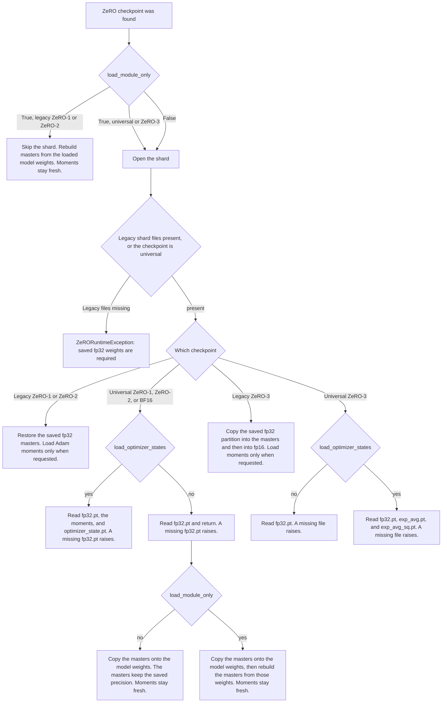

# Keep fp32 masters on ZeRO-1 and ZeRO-2 when a resume skips optimizer state

[Upstream PR](https://github.com/deepspeedai/DeepSpeed/pull/8891) · state: closed · merged: True

## Original PR description

## Summary
- `load_optimizer_states=False` used to skip the ZeRO shard, so a fresh optimizer rebuilt the fp32 master weights from the bf16/fp16 parameters and dropped the precision saved in `SINGLE_PARTITION_OF_FP32_GROUPS` or universal `fp32.pt`.
- `DeepSpeedEngine.load_checkpoint` no longer accepts `load_fp32_weights`. `zero_optimization.load_from_fp32_weights` is deprecated and ignored. A full ZeRO load always restores the saved fp32 masters. `load_optimizer_states=False` with `load_module_only=False` restores those masters and starts Adam with fresh moments. `load_module_only=True` rebuilds ZeRO-1 and ZeRO-2 masters from the loaded model weights. Universal module-only loads read those model weights from `fp32.pt` first. ZeRO-3 still reads its fp32 partition, because the model checkpoint does not hold the partitioned weights.
- A data-parallel size change that requests optimizer state, and a rigid ZeRO-1/2 checkpoint, raise `ZeRORuntimeException`. An elastic ZeRO-1/2 checkpoint can repartition fp32 masters when optimizer state is not loaded. Universal checkpoints keep the masters across a DP size change. ZeRO-3 still rejects a DP size change.
- A legacy checkpoint with no `*_optim_states.pt` files, and a universal folder with no `fp32.pt`, raise `ZeRORuntimeException` on any load that needs the masters. ZeRO-1/2 `load_module_only=True` still succeeds without the shard. A `parameter_alignment` mismatch raises on a full load and on a masters-only load. Module-only remains the warm start for that mismatch.
- Pytest 8 registers each `DistributedFixture` subclass, so a test skips when the machine has fewer GPUs than the fixture world size.
- Further ZeRO-3 and dedicated ZeRO-1 BF16 work is in #8892, stacked on this branch. Follow-ups that do not fail the current unit tests, including ZeRO-3 NVMe `load_module_only=True`, are tracked in #8890.

## Load decision tree

`zero_optimization.load_from_fp32_weights` is ignored. When a universal load has `load_optimizer_states=False`, `load_hp_checkpoint_state_from_checkpoint_dir` reads `fp32.pt` and returns. It does not open `optimizer_state.pt`, and it does not fill Adam steps or moments.

A `parameter_alignment` mismatch raises on every legacy ZeRO-1/2 shard load. Module-only never opens that shard, so it remains the warm start.

AI assistance was used to implement and test this change. This does not duplicate an open DeepSpeed PR.

## Test plan
- [x] `tests/unit/checkpoint/test_fp32_master_only.py`, `tests/unit/checkpoint/test_zero_optimizer.py`, and `TestStage12ParamAlignment` on 4× NVIDIA H200 (driver 580.159.03), torch 2.9.1+cu130, Python 3.12.12, pytest 8.4.1, commit `894a2b72`: 99 passed. Legacy and universal loads keep the saved masters and drop moments. Module-only rebuilds ZeRO-2 masters from bf16. A missing legacy shard raises `ZeRORuntimeException`, and module-only still loads. A legacy DP change from 2 to 1 raises. A universal DP change keeps the masters. An elastic DP change repartitions the masters and drops moments. A parameter-alignment mismatch raises for a masters-only load and a full load, and the module-only warm start matches the saved parameters. The world-size-4 elastic DP cases and both ZeRO++ loads passed.
- [x] `TestUnevenVocabCrossTpResume::test_resume_from_tp2` on the same machine: 2 passed.
- [x] The eight elastic DP cases and both ZeRO++ cases skip when one device is visible: `4 required, 1 available`.
- [ ] Still open: fp16, MoE, and NVMe offload, including ZeRO-3 `load_module_only=True` with NVMe optimizer offload. See #8890.

Validated cells: ZeRO stages 1, 2, and the ZeRO-3 paths in `test_zero_optimizer.py`; same DP and DP 2 to 1; legacy, elastic, and universal checkpoints; bf16; no offload. Open cells: fp16, MoE, NVMe offload.

## Review and discussion

### reviews

- chatgpt-codex-connector[bot] · COMMENTED · 2026-10-22T21:29:18Z · [source](https://github.com/deepspeedai/DeepSpeed/pull/8891#pullrequestreview-5621098386)

<!-- codex-review-receipt:v1 -->

### 💡 Codex Review

Here are some automated review suggestions for this pull request.

**Reviewed commit:** `945aa1c860`
    

 
ℹ️ About Codex in GitHub

 

Codex has been enabled to automatically review pull requests in this repo. Reviews are triggered when you
- Open a pull request for review
- Mark a draft as ready
- Comment "@codex review".

If Codex has suggestions, it will comment; otherwise it will react with 👍.

When you [sign up for Codex through ChatGPT](https://openai.com/codex), Codex can also answer questions or update the PR, like "@codex address that feedback".
            

- stas00 · COMMENTED · 2026-10-22T22:55:07Z · [source](https://github.com/deepspeedai/DeepSpeed/pull/8891#pullrequestreview-5621829106)

(No body; status only.)

- stas00 · APPROVED · 2026-10-26T17:17:53Z · [source](https://github.com/deepspeedai/DeepSpeed/pull/8891#pullrequestreview-5656140344)

(No body; status only.)

### issue_comments

- chatgpt-codex-connector[bot] · comment · 2026-10-22T21:21:06Z · [source](https://github.com/deepspeedai/DeepSpeed/pull/8891#issuecomment-6351580311)

<!-- codex-pull-request-review-summary -->
<!-- codex-review-state:v1 {"code_review":{"commit_sha":"945aa1c860685cb5a7fa5b4e1c29dc0c9b8e4829","has_any_findings":true,"has_unresolved_findings":true,"status":"completed"},"security_review":{"commit_sha":null,"has_any_findings":null,"has_unresolved_findings":null,"status":null}} -->

## Codex Review Summary

This comment shows the latest Codex review activity on this pull request.

| Review | Status | Commit | Review trigger |
| --- | --- | --- | --- |
| 📝 **Code Review** | ✅ **Completed** <relative-time datetime="2026-10-22T21:29:21.730043Z">2026-10-22T21:29:21.730043Z</relative-time> | `945aa1c` | PR opened |

 
ℹ️ About Codex in GitHub

 

[Your team has set up Codex to review pull requests in this repo](https://chatgpt.com/codex/cloud/settings/general). Reviews are triggered when you
- Open a pull request for review
- Mark a draft as ready
- Comment "@codex review" or "@codex security review".

Codex reacts with 👀 while any review is running, comments if it has suggestions, and reacts with 👍 once all reviews finish with no findings.

### inline_comments

- chatgpt-codex-connector[bot] · comment · 2026-10-22T21:29:18Z · [source](https://github.com/deepspeedai/DeepSpeed/pull/8891#discussion_r4353730730)

File: `deepspeed/runtime/engine.py` · line None

**  Check DP fallback before entering pipeline receive chain**

With ZeRO-3 `pipeline_loading_checkpoint=true`, a non-MoE legacy masters-only resume (`load_optimizer_states=False`) from a different DP size deadlocks: nonzero local ranks have already blocked in the `dist.recv` above, while local rank 0 takes this new return and never reaches the notification send in `stage3.load_state_dict`. Perform the DP-size fallback before starting the serial receive chain, or explicitly release the waiting ranks.

Useful? React with 👍 / 👎.

<!-- codex-code-review-finding:v1 -->

- chatgpt-codex-connector[bot] · comment · 2026-10-22T21:29:18Z · [source](https://github.com/deepspeedai/DeepSpeed/pull/8891#discussion_r4353730745)

File: `deepspeed/runtime/engine.py` · line None

**  Honor load_fp32_weights for NVMe optimizer offload**

With ZeRO-3 NVMe optimizer offload, this selection is never consumed because the normal load block is skipped by `not self.zero_nvme_offload_optimizer()`, after which the entire saved swap directory is copied and reset unconditionally. Consequently `load_fp32_weights=False` (and the documented module-only behavior) still restores checkpoint FP32 masters instead of rebuilding them from the loaded bit16 model; the NVMe path needs to apply the same master-state choice rather than always reinstating the saved swap tensors.

Useful? React with 👍 / 👎.

<!-- codex-code-review-finding:v1 -->

- chatgpt-codex-connector[bot] · comment · 2026-10-22T21:29:18Z · [source](https://github.com/deepspeedai/DeepSpeed/pull/8891#discussion_r4353730756)

File: `deepspeed/runtime/zero/stage3.py` · line None

**  Rebuild ZeRO-3 masters before copying saved FP32 partitions**

When a legacy ZeRO-3 resume loads optimizer moments but sets `load_fp32_weights=False`, this refresh runs only after `_rigid_load_state_dict` has copied checkpoint `FP32_FLAT_GROUPS` into both the master and bit16 partitions. It therefore rounds the saved masters back to FP32 instead of rebuilding from the model state loaded by `_load_checkpoint`, and can overwrite custom-loaded or otherwise divergent module values; branch before the saved-FP32 copies, as the ZeRO-1/2 sibling path does, so the new override actually selects the model weights.

AGENTS.md reference: [AGENTS.md:L19-L19](https://github.com/deepspeedai/DeepSpeed/blob/945aa1c860685cb5a7fa5b4e1c29dc0c9b8e4829/AGENTS.md#L19-L19)

Useful? React with 👍 / 👎.

<!-- codex-code-review-finding:v1 -->

- stas00 · comment · 2026-10-22T22:48:45Z · [source](https://github.com/deepspeedai/DeepSpeed/pull/8891#discussion_r4354339834)

File: `deepspeed/runtime/zero/config.py` · line None

what does "one load" mean?

- stas00 · comment · 2026-10-22T22:49:27Z · [source](https://github.com/deepspeedai/DeepSpeed/pull/8891#discussion_r4354344328)

File: `deepspeed/runtime/zero/config.py` · line None

I also don't understand this sentence: ``None`` uses this value.

- stas00 · comment · 2026-10-22T22:54:28Z · [source](https://github.com/deepspeedai/DeepSpeed/pull/8891#discussion_r4354378382)

File: `deepspeed/runtime/base_optimizer.py` · line None

this if and if not logic is hard to parse, if line 376 leads to ignoring everything else before it, why the previous code is even run? for some side-effect? `steps` and `opt_keys` don't get updated anyway if load_optimizer_states is False

should the whole thing above be skipped if not load_optimizer_states?

## Changed files and fixed code

- `deepspeed/checkpoint/universal_checkpoint.py` · modified · additions 18 / deletions 8
  - [head](https://github.com/sfc-gh-truwase/DeepSpeed/blob/f02e7675a29159f3805a24f08e159c74604ef379/deepspeed/checkpoint/universal_checkpoint.py)
  - [base](https://github.com/deepspeedai/DeepSpeed/blob/7501610ee00daa3400368cc06a54f81f12822845/deepspeed/checkpoint/universal_checkpoint.py)
- `deepspeed/runtime/base_optimizer.py` · modified · additions 24 / deletions 9
  - [head](https://github.com/sfc-gh-truwase/DeepSpeed/blob/f02e7675a29159f3805a24f08e159c74604ef379/deepspeed/runtime/base_optimizer.py)
  - [base](https://github.com/deepspeedai/DeepSpeed/blob/7501610ee00daa3400368cc06a54f81f12822845/deepspeed/runtime/base_optimizer.py)
- `deepspeed/runtime/bf16_optimizer.py` · modified · additions 4 / deletions 3
  - [head](https://github.com/sfc-gh-truwase/DeepSpeed/blob/f02e7675a29159f3805a24f08e159c74604ef379/deepspeed/runtime/bf16_optimizer.py)
  - [base](https://github.com/deepspeedai/DeepSpeed/blob/7501610ee00daa3400368cc06a54f81f12822845/deepspeed/runtime/bf16_optimizer.py)
- `deepspeed/runtime/engine.py` · modified · additions 46 / deletions 33
  - [head](https://github.com/sfc-gh-truwase/DeepSpeed/blob/f02e7675a29159f3805a24f08e159c74604ef379/deepspeed/runtime/engine.py)
  - [base](https://github.com/deepspeedai/DeepSpeed/blob/7501610ee00daa3400368cc06a54f81f12822845/deepspeed/runtime/engine.py)
- `deepspeed/runtime/zero/config.py` · modified · additions 5 / deletions 5
  - [head](https://github.com/sfc-gh-truwase/DeepSpeed/blob/f02e7675a29159f3805a24f08e159c74604ef379/deepspeed/runtime/zero/config.py)
  - [base](https://github.com/deepspeedai/DeepSpeed/blob/7501610ee00daa3400368cc06a54f81f12822845/deepspeed/runtime/zero/config.py)
- `deepspeed/runtime/zero/stage3.py` · modified · additions 12 / deletions 6
  - [head](https://github.com/sfc-gh-truwase/DeepSpeed/blob/f02e7675a29159f3805a24f08e159c74604ef379/deepspeed/runtime/zero/stage3.py)
  - [base](https://github.com/deepspeedai/DeepSpeed/blob/7501610ee00daa3400368cc06a54f81f12822845/deepspeed/runtime/zero/stage3.py)
- `deepspeed/runtime/zero/stage_1_and_2.py` · modified · additions 17 / deletions 7
  - [head](https://github.com/sfc-gh-truwase/DeepSpeed/blob/f02e7675a29159f3805a24f08e159c74604ef379/deepspeed/runtime/zero/stage_1_and_2.py)
  - [base](https://github.com/deepspeedai/DeepSpeed/blob/7501610ee00daa3400368cc06a54f81f12822845/deepspeed/runtime/zero/stage_1_and_2.py)
- `docs/_pages/config-json.md` · modified · additions 2 / deletions 2
  - [head](https://github.com/sfc-gh-truwase/DeepSpeed/blob/f02e7675a29159f3805a24f08e159c74604ef379/docs/_pages/config-json.md)
  - [base](https://github.com/deepspeedai/DeepSpeed/blob/7501610ee00daa3400368cc06a54f81f12822845/docs/_pages/config-json.md)
- `tests/conftest.py` · modified · additions 22 / deletions 0
  - [head](https://github.com/sfc-gh-truwase/DeepSpeed/blob/f02e7675a29159f3805a24f08e159c74604ef379/tests/conftest.py)
  - [base](https://github.com/deepspeedai/DeepSpeed/blob/7501610ee00daa3400368cc06a54f81f12822845/tests/conftest.py)
- `tests/unit/checkpoint/test_fp32_master_only.py` · added · additions 319 / deletions 0
  - [head](https://github.com/sfc-gh-truwase/DeepSpeed/blob/f02e7675a29159f3805a24f08e159c74604ef379/tests/unit/checkpoint/test_fp32_master_only.py)
  - [base](https://github.com/deepspeedai/DeepSpeed/blob/7501610ee00daa3400368cc06a54f81f12822845/tests/unit/checkpoint/test_fp32_master_only.py)
- `tests/unit/checkpoint/test_zero_optimizer.py` · modified · additions 2 / deletions 1
  - [head](https://github.com/sfc-gh-truwase/DeepSpeed/blob/f02e7675a29159f3805a24f08e159c74604ef379/tests/unit/checkpoint/test_zero_optimizer.py)
  - [base](https://github.com/deepspeedai/DeepSpeed/blob/7501610ee00daa3400368cc06a54f81f12822845/tests/unit/checkpoint/test_zero_optimizer.py)
- `tests/unit/v1/zero/test_stage2_flatten_on_gpu.py` · modified · additions 8 / deletions 8
  - [head](https://github.com/sfc-gh-truwase/DeepSpeed/blob/f02e7675a29159f3805a24f08e159c74604ef379/tests/unit/v1/zero/test_stage2_flatten_on_gpu.py)
  - [base](https://github.com/deepspeedai/DeepSpeed/blob/7501610ee00daa3400368cc06a54f81f12822845/tests/unit/v1/zero/test_stage2_flatten_on_gpu.py)

## Evidence and interpretation boundary

[Original JSON, discussions and patches](../../../../../../evidence/prs/deepspeedai--DeepSpeed/8891-6841d805836de7c83da66647fce3ad691af0aafeff7345c8b141818358c63d15.json) · SHA-256 `6841d805836de7c83da66647fce3ad691af0aafeff7345c8b141818358c63d15`.

Diff complete: True. Missing/binary/truncated patches require pinned source inspection. This is a source page, not an independently verified optimization case. Open, merged and released are different states; recheck the deployed dependency.
