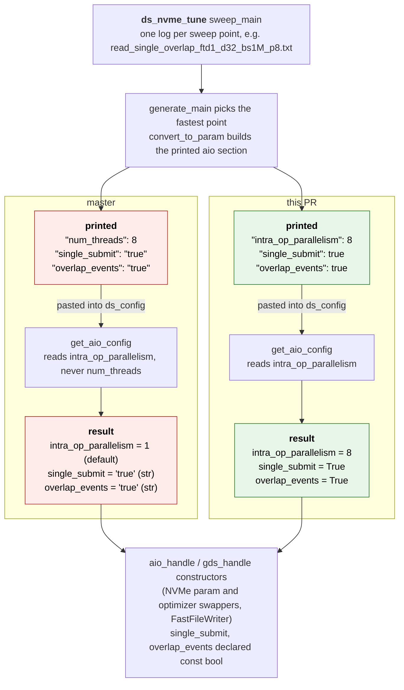

# Emit intra_op_parallelism and JSON booleans from ds_nvme_tune

[Upstream PR](https://github.com/deepspeedai/DeepSpeed/pull/8907) · state: open · merged: False

## Original PR description

`ds_nvme_tune` ends by printing its recommendation as a ds_config `"aio"` section. That section does not survive `get_aio_config`, the parser DeepSpeed uses for the `aio` block:

- the parallelism key is printed as `num_threads`, but `get_aio_config` reads `intra_op_parallelism`, so the tuned value is dropped without a warning and the default `1` is used;
- `single_submit` and `overlap_events` are printed as the JSON strings `"true"` / `"false"`, and `get_aio_config` hands them unchanged to the `aio_handle` / `gds_handle` constructors, which declare both parameters `const bool`.

This PR makes the tuner print the keys and types that the parser reads, replaces the stale `thread_count` key in the config reference, and adds a CPU-only test that feeds the printed section back through `get_aio_config`.

## How the printed section reaches the runtime



## Before and after (captured output)

Both runs use the same input: two synthetic sweep logs in the read and write log folders, `single_overlap_ftd1_d32_bs1M_p8` (read 5.0 GB/s, write 4.0 GB/s) and `block_sequential_ftd1_d128_bs8M_p1` (1.0 GB/s each). A standalone script (not part of this PR) calls `generate_main` on them, which is the step `ds_nvme_tune` runs after its sweep. The script prints the output, passes the printed section to `get_aio_config`, and compares the result with the winning sweep point. It does the same steps as the first case of the new test.

On master (`fc7bc30`), the script exits with code 1:

```text
Best performance (GB/sec): read =  5.00, write =  4.00
{
   "aio": {
      "single_submit": "true",
      "overlap_events": "true",
      "num_threads": 8,
      "queue_depth": 32,
      "block_size": 1048576
   }
}

get_aio_config -> {'block_size': 1048576, 'queue_depth': 32, 'intra_op_parallelism': 1, 'single_submit': 'true', 'overlap_events': 'true', 'use_gds': False}
MISMATCHES (got, expected): {'intra_op_parallelism': (1, 8), 'single_submit': ('true', True), 'overlap_events': ('true', True)}
```

With this PR, the script exits with code 0:

```text
Best performance (GB/sec): read =  5.00, write =  4.00
{
   "aio": {
      "single_submit": true,
      "overlap_events": true,
      "intra_op_parallelism": 8,
      "queue_depth": 32,
      "block_size": 1048576
   }
}

get_aio_config -> {'block_size': 1048576, 'queue_depth': 32, 'intra_op_parallelism': 8, 'single_submit': True, 'overlap_events': True, 'use_gds': False}
MISMATCHES (got, expected): none
```

| Key | Winning sweep point | `get_aio_config` on master | `get_aio_config` with this PR |
|---|---|---|---|
| `intra_op_parallelism` | `p8`, so 8 | `1` (the default; `num_threads` is never read) | `8` |
| `single_submit` | `single`, so true | `'true'` (a str) | `True` |
| `overlap_events` | `overlap`, so true | `'true'` (a str) | `True` |
| `queue_depth` | `d32`, so 32 | `32` | `32` |
| `block_size` | `bs1M`, so 1048576 | `1048576` | `1048576` |

## Root cause

`convert_to_param` in `deepspeed/nvme/perf_generate_param.py` hard-codes its own key names. Since #6560 added it, it has printed `num_threads` and string flags. At that time the runtime key was `thread_count`, and #7056 renamed it to `intra_op_parallelism` in `deepspeed/runtime/swap_tensor/` only, so `get_aio_config` has never read the tuned value. `get_aio_config` reads a fixed set of keys with `get_scalar_param`: an unknown key is ignored and a value of the wrong type is returned as is.

The string flags then reach the `aio_handle` / `gds_handle` constructors, whose pybind11 bindings (`csrc/aio/py_lib/py_ds_aio.cpp`, `csrc/gds/py_lib/py_ds_gds.cpp`) declare `single_submit` and `overlap_events` as `const bool`. pybind11's `bool` caster (in the pybind11 3.1.0 headers bundled with torch 2.14.1) accepts `True`, `False`, `None` and objects whose type defines `__bool__`; `str` does not define `__bool__`. From that source, a `TypeError` is expected when the swapper builds its handle. This was not observed, because the async_io op does not build on the Windows machine used here.

The docs drifted the same way. On master, the sample output in `docs/_tutorials/deepnvme.md` already shows `"intra_op_parallelism": 8`, which is not what the tool prints, together with the string flags. The config reference `docs/_pages/config-json.md` still documents the pre-#7056 name `thread_count`, which is also ignored: `get_aio_config({'aio': {'thread_count': 4}})` returns `'intra_op_parallelism': 1`.

## Change

- `convert_to_param` builds the section from the `AIO_*` constants in `deepspeed/runtime/swap_tensor/constants.py`, the same names `get_aio_config` reads. It returns Python booleans, which `json.dumps` prints as `true` / `false`. `generate_aio_param` uses `AIO` for the section name. The new import is a module with no imports of its own.
- `docs/_pages/config-json.md`: `thread_count` becomes `intra_op_parallelism` in the example and in the field heading.
- `docs/_tutorials/deepnvme.md`: the sample `ds_nvme_tune` output shows `false` / `true` instead of `"false"` / `"true"`.
- New `tests/unit/v1/nvme/test_ds_nvme_tune.py`: it writes synthetic read and write sweep logs, runs `generate_main`, and passes the printed section through `get_aio_config`. Two cases cover both flag values (`single_overlap_ftd1_d32_bs1M_p8` and `block_sequential_ftd1_d128_bs8M_p2`). It fails on master and passes with this change. It needs no op. It is a new file because `test_aio.py` skips at module level when the async_io op is unavailable.

## Testing

Hardware and software: one Intel Core Ultra 9 285H CPU, Windows 11 Home (10.0.26200), Python 3.11.9, torch 2.14.1+cpu (`torch.cuda.is_available()` is `False`). Settings: `DS_ACCELERATOR=cpu`, `DS_BUILD_OPS=0`, DeepSpeed imported from the source tree. No accelerator or accelerator driver was used, and there was no NVMe device or libaio, so the async_io and GDS ops were not built.

For the "before" rows, only `deepspeed/nvme/perf_generate_param.py` was reverted to master (`git checkout master -- deepspeed/nvme/perf_generate_param.py`); the new test file stayed in place.

| Command | Before (master source) | After (this PR) |
|---|---|---|
| reproducer script described above | exit 1, three mismatches | exit 0, no mismatches |
| `pytest -q tests/unit/v1/nvme/test_ds_nvme_tune.py` | 2 failed | not run separately (both cases pass in the next row) |
| `pytest -q tests/unit/v1/nvme` | not run | 2 passed, 11 skipped |
| `yapf --diff` (0.43.0) and `flake8` (5.0.4) on the two changed `.py` files | not run | no output, exit 0 |
| `codespell` (2.1.0) on the changed files and both doc pages | not run | exit 0 |
| `scripts/check-torchdist.py` and `scripts/check-torchcuda.py` on the two changed `.py` files | not run | exit 0 |
| `python ci/tests_fetcher.py --base master` | not run | subset mode, selects `tests/unit/v1/nvme/test_ds_nvme_tune.py` |

The 11 skips are the existing op tests: `test_aio.py`, `test_gds.py`, `test_pinned_manager.py` and `test_fast_file_writer_fd_close.py` skip at module level, and the 7 cases of `test_aio_gil.py` skip individually. All report that async_io or GDS is not compatible on this system. On Windows, `scripts/check-license.py` reports a missing header for any file with CRLF line endings in the working tree, including untouched master files such as `deepspeed/nvme/perf_run_sweep.py`. The committed blobs have LF endings and the standard header, so the `formatting` check in CI is the authoritative run. The full CPU unit suite was not run.

## Compatibility matrix

No GPU, NVMe or ZeRO-offload run was done, so no cell of the matrix (ZeRO stage, offload, precision, parallelism) was validated. The change is limited to the JSON that `ds_nvme_tune` prints, two doc pages and a new unit test. `get_aio_config` and every runtime consumer of the `aio` section are unchanged, so a config that already spells `intra_op_parallelism` with boolean flags parses exactly as before.

Not validated:

- ZeRO-3 with NVMe parameter offload (`offload_param.device: nvme`, `partitioned_param_swapper.py`), in fp32, fp16 or bf16.
- ZeRO-3 with NVMe optimizer offload (`offload_optimizer.device: nvme`, `partitioned_optimizer_swapper.py` and `pipelined_optimizer_swapper.py`). The config reference documents NVMe offload as stage 3 only, so stages 0 to 2 have no NVMe cell.
- GDS (`use_gds`), and `FastFileWriter` checkpoint writing, which builds handles from the same section.
- Data, tensor, pipeline and expert parallelism; any multi-rank run.
- A real `ds_nvme_tune` sweep, which needs Linux, libaio and an NVMe device.
- The `TypeError` expectation for string flags described in Root cause.

## Sibling paths checked and left unchanged

- `csrc/aio/py_test/aio_bench_generate_param.py`, the legacy benchmark, has the same `convert_to_param` pattern: it prints `thread_count` and string flags. It is left out to keep this PR to the shipped `ds_nvme_tune` path and can be folded in if preferred.
- With `--gds`, the sweep runs the GDS operator, but the printed section has no `"use_gds": true`, because `generate_main` receives only the log directory.
- The `--flush_page_cache` help text in `perf_run_sweep.py` describes the behavior without the flag ("Page cache will not be flushed ...").

## Duplicates and related work

Checked on 2026-10-25:

- Open PRs matching `ds_nvme_tune`, `intra_op_parallelism`, `perf_generate_param`, `convert_to_param` or `deepnvme tuning`: only #8344.
- #8344 (open, 1 commit, last updated 2026-08-28) changes one line in each `__main__` block: `generate_main()` becomes `main()` in `perf_generate_param.py`, and `sweep_main()` becomes `main()` in `perf_run_sweep.py`. It does not touch `convert_to_param`, the printed keys, the docs or the tests. A `git merge-tree` of this branch and #8344's head `6d4e2a9`, with its parent `92843ad` as the merge base, completes with no conflicts.
- PRs in any state matching `ds_nvme_tune OR perf_generate_param OR convert_to_param`: #6560 (merged, added the tuner) and #8344.
- Issues: the closest is #998, a 2021 how-to thread on profiling NVMe for the `aio` section with the legacy `csrc/aio/py_test` scripts. None of its comments mention `num_threads` or `intra_op_parallelism`. No issue reports the dropped key or the string flags.


## Review and discussion

### reviews

### issue_comments

- chatgpt-codex-connector[bot] · comment · 2026-10-26T00:47:41Z · [source](https://github.com/deepspeedai/DeepSpeed/pull/8907#issuecomment-6405744196)

<!-- codex-pull-request-review-summary -->
<!-- codex-review-state:v1 {"code_review":{"commit_sha":"395289c8ed8863210ff5c34e967f4fc45b2c1fd9","has_any_findings":null,"has_unresolved_findings":null,"status":"running"},"security_review":{"commit_sha":null,"has_any_findings":null,"has_unresolved_findings":null,"status":null}} -->

## Codex Review Summary

This comment shows the latest Codex review activity on this pull request.

| Review | Status | Commit | Review trigger |
| --- | --- | --- | --- |
| 📝 **Code Review** | 🔄 **Running** since <relative-time datetime="2026-10-26T00:47:38.065204Z">2026-10-26T00:47:38.065204Z</relative-time> | `395289c` | PR opened |


<details> <summary>ℹ️ About Codex in GitHub</summary>
<br/>

[Your team has set up Codex to review pull requests in this repo](https://chatgpt.com/codex/cloud/settings/general). Reviews are triggered when you
- Open a pull request for review
- Mark a draft as ready
- Comment "@codex review" or "@codex security review".

Codex reacts with 👀 while any review is running, comments if it has suggestions, and reacts with 👍 once all reviews finish with no findings.

</details>

### inline_comments

## Changed files and fixed code

- `deepspeed/nvme/perf_generate_param.py` · modified · additions 8 / deletions 6
  - [head](https://github.com/Sonica-B/DeepSpeed/blob/395289c8ed8863210ff5c34e967f4fc45b2c1fd9/deepspeed/nvme/perf_generate_param.py)
  - [base](https://github.com/deepspeedai/DeepSpeed/blob/fc7bc301f8301e72fed37e2caa3c1d40dae3bbb4/deepspeed/nvme/perf_generate_param.py)
- `docs/_pages/config-json.md` · modified · additions 2 / deletions 2
  - [head](https://github.com/Sonica-B/DeepSpeed/blob/395289c8ed8863210ff5c34e967f4fc45b2c1fd9/docs/_pages/config-json.md)
  - [base](https://github.com/deepspeedai/DeepSpeed/blob/fc7bc301f8301e72fed37e2caa3c1d40dae3bbb4/docs/_pages/config-json.md)
- `docs/_tutorials/deepnvme.md` · modified · additions 2 / deletions 2
  - [head](https://github.com/Sonica-B/DeepSpeed/blob/395289c8ed8863210ff5c34e967f4fc45b2c1fd9/docs/_tutorials/deepnvme.md)
  - [base](https://github.com/deepspeedai/DeepSpeed/blob/fc7bc301f8301e72fed37e2caa3c1d40dae3bbb4/docs/_tutorials/deepnvme.md)
- `tests/unit/v1/nvme/test_ds_nvme_tune.py` · added · additions 55 / deletions 0
  - [head](https://github.com/Sonica-B/DeepSpeed/blob/395289c8ed8863210ff5c34e967f4fc45b2c1fd9/tests/unit/v1/nvme/test_ds_nvme_tune.py)
  - [base](https://github.com/deepspeedai/DeepSpeed/blob/fc7bc301f8301e72fed37e2caa3c1d40dae3bbb4/tests/unit/v1/nvme/test_ds_nvme_tune.py)

## Evidence and interpretation boundary

[Original JSON, discussions and patches](../../../../../../evidence/prs/deepspeedai--DeepSpeed/8907-f27f8057e31262ce3f48925a8069211585f8d104a4cd25627e822afa243d34d8.json) · SHA-256 `f27f8057e31262ce3f48925a8069211585f8d104a4cd25627e822afa243d34d8`.

Diff complete: True. Missing/binary/truncated patches require pinned source inspection. This is a source page, not an independently verified optimization case. Open, merged and released are different states; recheck the deployed dependency.
