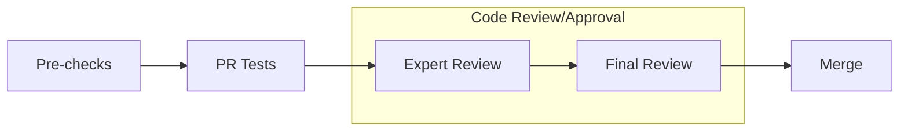

# [llm] feat: support variable-length chunks in ChunkPipe

[Upstream PR](https://github.com/baidu-baige/Loong-Megatron/pull/20) · state: closed · merged: True

## Original PR description

ChunkPipe assumed every chunk of a sequence was `chunksize` tokens wide: the data iterator split each batch into num_chunks equal pieces, and all downstream addressing was `k * chunksize`. That requires seq_length to be an exact multiple of chunksize and prevents uneven splits such as [1536, 512], which are needed to balance the growing per-chunk attention cost across chunk-microbatches (chunk k attends to chunks 0..k).

New `--chunk-sizes` arg takes the per-chunk token counts explicitly. The chunk geometry is resolved once in validate_args into three config fields: `chunk_sizes` (per-chunk widths), `cu_chunks` (their prefix sum, so cu_chunks[k] is chunk k's start token index and cu_chunks[-1] == seq_length), and `max_chunk_size`. Uniform mode is unchanged and simply expands --chunksize into [chunksize] * N, so chunk_sizes[k] == chunksize and cu_chunks[k] == k * chunksize; every rewritten expression reduces to the previous one.

- rerun_state_machine: ChunkDataIterator takes chunk_sizes and splits the sequence dim at prefix-sum boundaries instead of dividing by num_chunks.
- utils: get_batch_on_this_tp_rank / get_next_batch_on_this_tp_rank broadcast this chunk's sequence length before the tensors, so non-src TP ranks allocate correctly sized receive buffers when chunks differ.
- multi_latent_attention: the chunk KV cache keeps a constant-stride slot layout (slot k at k * max_chunk_size) but writes/reads only the chunk's actual length.
- multi_token_prediction: the bridge-extended per-layer input is truncated by the *current* chunk's width rather than the scalar chunksize. With unequal chunks the scalar is max(chunk_sizes), so a short chunk kept its extra bridge tokens (512 -> 513) and the MTP embedding's sequence-parallel reduce_scatter asserted on dim0 % TP != 0.
- training: evaluate() and _get_iterator use chunk_num_per_seq / max_chunk_size instead of the seq_length / chunksize division.

Unequal chunk sizes set args.variable_seq_lengths so P2P negotiates the real activation shape per micro-batch, and are rejected with CUDA graphs (fixed capture shape) and without --calculate-per-token-loss. The latter matters: in the default path schedules.py divides each chunk's loss by that chunk's own token count, giving a token gradient weight of 1/(chunk_tokens * num_microbatches) that is only uniform when all chunks are equal. A [1536, 512] split over-weights the short chunk's tokens 3x and inflates the gradient norm ~15% with a normal-looking loss curve. Sequence parallel additionally requires every chunk length to be divisible by TP.

# What does this PR do ?
<!-- Add a one line overview of what this PR aims to accomplish. -->

:warning: For major changes (either in lines of code or in its impact), please make sure to first share discuss a design-doc with the team.  

## Contribution process

### Pre-checks

- [ ] I want this PR in a versioned release and have added the appropriate Milestone (e.g., `Core 0.8`)
- [ ] I have added relevant unit tests
- [ ] I have added relevant functional tests
- [ ] I have added proper typing to my code [Typing guidelines](https://docs.python.org/3/library/typing.html)
- [ ] I have added relevant documentation
- [ ] I have run the [autoformatter.sh](https://github.com/NVIDIA/Megatron-LM/blob/main/tools/autoformat.sh) on my PR

### Code review

The following process is enforced via the CODEOWNERS file for changes into `megatron/core`. For changes outside of `megatron/core`, it is up to the PR author whether or not to tag the Final Reviewer team.

For MRs into `main` branch

#### (Step 1): Add PR label `Expert Review`

#### (Step 2): Collect the expert reviewers reviews

1. Attach the `Expert Review` label when your PR is ready for review.
2. GitHub auto-assigns expert reviewers based on your changes. They will get notified and pick up your PR soon.

:warning: Only proceed to the next step once all reviewers have approved, merge-conflict are resolved and the CI is passing.  
Final Review might get declined if these requirements are not fulfilled.

#### (Step 3): Final Review

1. Add `Final Review` label
2. GitHub auto-assigns final reviewers based on your changes. They will get notified and pick up your PR soon.

#### (Optional Step 4): Cherry-pick into release branch

If this PR also needs to be merged into `core_r*` release branches, after this PR has been merged, select `Cherry-pick` to open a new PR into the release branch.

For MRs into `dev` branch

The proposed review process for `dev` branch is under active discussion.

MRs are mergable after one approval by either `eharper@nvidia.com` or `zijiey@nvidia.com`.

### Merging your PR

Any member of [core-adlr](https://github.com/orgs/teams/NVIDIA/core-adlr) and [`core-nemo`](https://github.com/orgs/teams/NVIDIA/core-nemo) will be able to merge your PR.

## Review and discussion

### reviews

- gsl322 · APPROVED · 2026-10-14T01:45:46Z · [source](https://github.com/baidu-baige/Loong-Megatron/pull/20#pullrequestreview-5512108291)

OK

### issue_comments

### inline_comments

## Changed files and fixed code

- `megatron/core/rerun_state_machine.py` · modified · additions 28 / deletions 7
  - [head](https://github.com/Yangsx-1/Loong-Megatron/blob/a9c9e2c37a460c2122f04bb5b5532122805485fb/megatron/core/rerun_state_machine.py)
  - [base](https://github.com/baidu-baige/Loong-Megatron/blob/64c279afb879229cff12fb293624e3691990403f/megatron/core/rerun_state_machine.py)
- `megatron/core/transformer/multi_latent_attention.py` · modified · additions 51 / deletions 25
  - [head](https://github.com/Yangsx-1/Loong-Megatron/blob/a9c9e2c37a460c2122f04bb5b5532122805485fb/megatron/core/transformer/multi_latent_attention.py)
  - [base](https://github.com/baidu-baige/Loong-Megatron/blob/64c279afb879229cff12fb293624e3691990403f/megatron/core/transformer/multi_latent_attention.py)
- `megatron/core/transformer/multi_token_prediction.py` · modified · additions 12 / deletions 1
  - [head](https://github.com/Yangsx-1/Loong-Megatron/blob/a9c9e2c37a460c2122f04bb5b5532122805485fb/megatron/core/transformer/multi_token_prediction.py)
  - [base](https://github.com/baidu-baige/Loong-Megatron/blob/64c279afb879229cff12fb293624e3691990403f/megatron/core/transformer/multi_token_prediction.py)
- `megatron/core/transformer/transformer_config.py` · modified · additions 12 / deletions 0
  - [head](https://github.com/Yangsx-1/Loong-Megatron/blob/a9c9e2c37a460c2122f04bb5b5532122805485fb/megatron/core/transformer/transformer_config.py)
  - [base](https://github.com/baidu-baige/Loong-Megatron/blob/64c279afb879229cff12fb293624e3691990403f/megatron/core/transformer/transformer_config.py)
- `megatron/training/arguments.py` · modified · additions 130 / deletions 7
  - [head](https://github.com/Yangsx-1/Loong-Megatron/blob/a9c9e2c37a460c2122f04bb5b5532122805485fb/megatron/training/arguments.py)
  - [base](https://github.com/baidu-baige/Loong-Megatron/blob/64c279afb879229cff12fb293624e3691990403f/megatron/training/arguments.py)
- `megatron/training/training.py` · modified · additions 8 / deletions 4
  - [head](https://github.com/Yangsx-1/Loong-Megatron/blob/a9c9e2c37a460c2122f04bb5b5532122805485fb/megatron/training/training.py)
  - [base](https://github.com/baidu-baige/Loong-Megatron/blob/64c279afb879229cff12fb293624e3691990403f/megatron/training/training.py)
- `megatron/training/utils.py` · modified · additions 27 / deletions 4
  - [head](https://github.com/Yangsx-1/Loong-Megatron/blob/a9c9e2c37a460c2122f04bb5b5532122805485fb/megatron/training/utils.py)
  - [base](https://github.com/baidu-baige/Loong-Megatron/blob/64c279afb879229cff12fb293624e3691990403f/megatron/training/utils.py)

## Evidence and interpretation boundary

[Original JSON, discussions and patches](../../../../../../evidence/prs/baidu-baige--Loong-Megatron/20-1dc7b7937dcfaf64476b7fd2ab21476adeb7ac9b78a4af09cad23f7e30eabbd8.json) · SHA-256 `1dc7b7937dcfaf64476b7fd2ab21476adeb7ac9b78a4af09cad23f7e30eabbd8`.

Diff complete: True. Missing/binary/truncated patches require pinned source inspection. This is a source page, not an independently verified optimization case. Open, merged and released are different states; recheck the deployed dependency.
