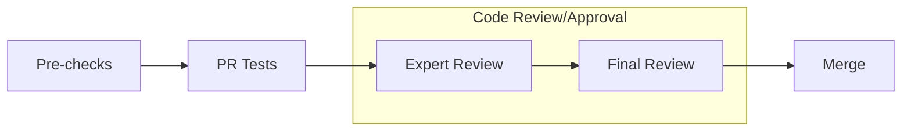

# Skip MSC dependency on Windows

[Upstream PR](https://github.com/NVIDIA/Megatron-LM/pull/2413) · state: closed · merged: False

## Original PR description

# What does this PR do ?

Skip the MSC dependency if the target platform is Windows (MSC does not support Windows).

:warning: For major changes (either in lines of code or in its impact), please make sure to first share discuss a design-doc with the team.  

## Contribution process

### Pre-checks

- [ ] I want this PR in a versioned release and have added the appropriate Milestone (e.g., `Core 0.8`)
- [ ] I have added relevant unit tests
- [ ] I have added relevant functional tests
- [ ] I have added proper typing to my code [Typing guidelines](https://docs.python.org/3/library/typing.html)
- [ ] I have added relevant documentation
- [ ] I have run the [autoformatter.sh](https://github.com/NVIDIA/Megatron-LM/blob/main/tools/autoformat.sh) on my PR

### Code review

The following process is enforced via the CODEOWNERS file for changes into `megatron/core`. For changes outside of `megatron/core`, it is up to the PR author whether or not to tag the Final Reviewer team.

For MRs into `main` branch

#### (Step 1): Add PR label `Expert Review`

#### (Step 2): Collect the expert reviewers reviews

1. Attach the `Expert Review` label when your PR is ready for review.
2. GitHub auto-assigns expert reviewers based on your changes. They will get notified and pick up your PR soon.

:warning: Only proceed to the next step once all reviewers have approved, merge-conflict are resolved and the CI is passing.  
Final Review might get declined if these requirements are not fulfilled.

#### (Step 3): Final Review

1. Add `Final Review` label
2. GitHub auto-assigns final reviewers based on your changes. They will get notified and pick up your PR soon.

#### (Optional Step 4): Cherry-pick into release branch

If this PR also needs to be merged into `core_r*` release branches, after this PR has been merged, select `Cherry-pick` to open a new PR into the release branch.

For MRs into `dev` branch

The proposed review process for `dev` branch is under active discussion.

MRs are mergable after one approval by either `eharper@nvidia.com` or `zijiey@nvidia.com`.

### Merging your PR

Any member of [core-adlr](https://github.com/orgs/teams/NVIDIA/core-adlr) and [`core-nemo`](https://github.com/orgs/teams/NVIDIA/core-nemo) will be able to merge your PR.

## Review and discussion

### reviews

- ko3n1g · APPROVED · 2025-12-10T23:42:20Z · [source](https://github.com/NVIDIA/Megatron-LM/pull/2413#pullrequestreview-3564938604)

(No body; status only.)

### issue_comments

- copy-pr-bot[bot] · comment · 2025-11-26T21:41:08Z · [source](https://github.com/NVIDIA/Megatron-LM/pull/2413#issuecomment-3583295426)

This pull request requires additional validation before any workflows can run on NVIDIA's runners.

Pull request vetters can view their responsibilities [here](https://docs.gha-runners.nvidia.com/cpr/vetters).

Contributors can view more details about this message [here](https://docs.gha-runners.nvidia.com/cpr/contributors).

- Phlip79 · comment · 2026-03-04T22:23:51Z · [source](https://github.com/NVIDIA/Megatron-LM/pull/2413#issuecomment-4000680244)

**We are changing our review process and marking all open, unlabeled PRs as draft. This change will go in effect starting once https://github.com/NVIDIA/Megatron-LM/pull/3659 is merged.**

Moving forward, all PRs will be required to start as draft PRs. If you wish to get your PR merged, mark your PR as “Ready for review”. Read more about the new process at [submit.md](https://github.com/Phlip79/Megatron-LM/blob/d3763629bcdd04acca52477af7eb8795090426ff/docs/developer/submit.md).

### inline_comments

## Changed files and fixed code

- `pyproject.toml` · modified · additions 1 / deletions 1
  - [head](https://github.com/shunjiad/Megatron-LM/blob/546c87b4ff2b7471dc3f356dc629f836f4c799f5/pyproject.toml)
  - [base](https://github.com/NVIDIA/Megatron-LM/blob/cd71d4c3e60e19d39be912c5558ec7b0c8b70051/pyproject.toml)
- `uv.lock` · modified · additions 384 / deletions 287
  - [head](https://github.com/shunjiad/Megatron-LM/blob/546c87b4ff2b7471dc3f356dc629f836f4c799f5/uv.lock)
  - [base](https://github.com/NVIDIA/Megatron-LM/blob/cd71d4c3e60e19d39be912c5558ec7b0c8b70051/uv.lock)

## Evidence and interpretation boundary

[Original JSON, discussions and patches](../../../../../../evidence/prs/NVIDIA--Megatron-LM/2413-60b13ac06fc5ed1c242642c65ddd9c79cb14c7bd1cd0cdff62a703d288436ca8.json) · SHA-256 `60b13ac06fc5ed1c242642c65ddd9c79cb14c7bd1cd0cdff62a703d288436ca8`.

Diff complete: False. Missing/binary/truncated patches require pinned source inspection. This is a source page, not an independently verified optimization case. Open, merged and released are different states; recheck the deployed dependency.
