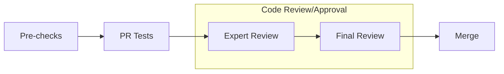

# Bugfix: ensure spawned persistent checkpoint worker sets its CUDA device correctly for CUDA context creation / hypothetical memory allocations

[Upstream PR](https://github.com/NVIDIA/Megatron-LM/pull/2710) · state: closed · merged: True

## Original PR description

…ice correctly for CUDA context creation / hypothetical memory allocations

# What does this PR do ?
<!-- Add a one line overview of what this PR aims to accomplish. -->

:warning: For major changes (either in lines of code or in its impact), please make sure to first share discuss a design-doc with the team.  

## Contribution process

### Pre-checks

- [ ] I want this PR in a versioned release and have added the appropriate Milestone (e.g., `Core 0.8`)
- [x] I have added relevant unit tests
- [x] I have added relevant functional tests
- [x] I have added proper typing to my code [Typing guidelines](https://docs.python.org/3/library/typing.html)
- [x] I have added relevant documentation
- [x] I have run the [autoformatter.sh](https://github.com/NVIDIA/Megatron-LM/blob/main/tools/autoformat.sh) on my PR

### Code review

The following process is enforced via the CODEOWNERS file for changes into `megatron/core`. For changes outside of `megatron/core`, it is up to the PR author whether or not to tag the Final Reviewer team.

For MRs into `main` branch

#### (Step 1): Add PR label `Expert Review`

#### (Step 2): Collect the expert reviewers reviews

1. Attach the `Expert Review` label when your PR is ready for review.
2. GitHub auto-assigns expert reviewers based on your changes. They will get notified and pick up your PR soon.

:warning: Only proceed to the next step once all reviewers have approved, merge-conflict are resolved and the CI is passing.  
Final Review might get declined if these requirements are not fulfilled.

#### (Step 3): Final Review

1. Add `Final Review` label
2. GitHub auto-assigns final reviewers based on your changes. They will get notified and pick up your PR soon.

#### (Optional Step 4): Cherry-pick into release branch

If this PR also needs to be merged into `core_r*` release branches, after this PR has been merged, select `Cherry-pick` to open a new PR into the release branch.

For MRs into `dev` branch

The proposed review process for `dev` branch is under active discussion.

MRs are mergable after one approval by either `eharper@nvidia.com` or `zijiey@nvidia.com`.

### Merging your PR

Any member of [core-adlr](https://github.com/orgs/teams/NVIDIA/core-adlr) and [`core-nemo`](https://github.com/orgs/teams/NVIDIA/core-nemo) will be able to merge your PR.

## Review and discussion

### reviews

- rhewett-nv · APPROVED · 2025-12-18T18:19:45Z · [source](https://github.com/NVIDIA/Megatron-LM/pull/2710#pullrequestreview-3594353179)

(No body; status only.)

- sbak5 · APPROVED · 2025-12-18T18:21:23Z · [source](https://github.com/NVIDIA/Megatron-LM/pull/2710#pullrequestreview-3594364907)

(No body; status only.)

- apaithankar · APPROVED · 2025-12-18T18:22:10Z · [source](https://github.com/NVIDIA/Megatron-LM/pull/2710#pullrequestreview-3594370798)

(No body; status only.)

- deepakn94 · APPROVED · 2026-01-07T00:01:17Z · [source](https://github.com/NVIDIA/Megatron-LM/pull/2710#pullrequestreview-3632889727)

(No body; status only.)

- ericharper · APPROVED · 2026-01-07T00:59:00Z · [source](https://github.com/NVIDIA/Megatron-LM/pull/2710#pullrequestreview-3633003113)

(No body; status only.)

### issue_comments

- copy-pr-bot[bot] · comment · 2025-12-18T18:18:57Z · [source](https://github.com/NVIDIA/Megatron-LM/pull/2710#issuecomment-3671546035)

This pull request requires additional validation before any workflows can run on NVIDIA's runners.

Pull request vetters can view their responsibilities [here](https://docs.gha-runners.nvidia.com/cpr/vetters).

Contributors can view more details about this message [here](https://docs.gha-runners.nvidia.com/cpr/contributors).

- ericharper · comment · 2026-01-07T00:59:35Z · [source](https://github.com/NVIDIA/Megatron-LM/pull/2710#issuecomment-3716909869)

/ok to test 124a705dad8a3f0075e608d4e61cc8e00ea6fe22

### inline_comments

## Changed files and fixed code

- `megatron/core/dist_checkpointing/strategies/async_utils.py` · modified · additions 9 / deletions 0
  - [head](https://github.com/ankurv-nvidia/Megatron-LM/blob/124a705dad8a3f0075e608d4e61cc8e00ea6fe22/megatron/core/dist_checkpointing/strategies/async_utils.py)
  - [base](https://github.com/NVIDIA/Megatron-LM/blob/278be1535da9f6ac9a460ee557678193d60553c7/megatron/core/dist_checkpointing/strategies/async_utils.py)

## Evidence and interpretation boundary

[Original JSON, discussions and patches](../../../../../../evidence/prs/NVIDIA--Megatron-LM/2710-e97ccd3ff6953320d163d7d2e7f4089db3ce722be085a23e228f9e4cde54835f.json) · SHA-256 `e97ccd3ff6953320d163d7d2e7f4089db3ce722be085a23e228f9e4cde54835f`.

Diff complete: True. Missing/binary/truncated patches require pinned source inspection. This is a source page, not an independently verified optimization case. Open, merged and released are different states; recheck the deployed dependency.
