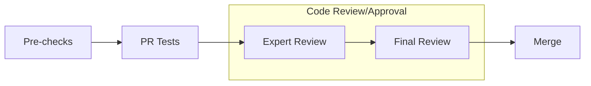

# [MoE]Enable Casting-Free FP8-Flow-MoE Blockwise FP8 Dataflow

[Upstream PR](https://github.com/NVIDIA/Megatron-LM/pull/2764) · state: open · merged: False

## Original PR description

# What does this PR do ?
<!-- Add a one line overview of what this PR aims to accomplish. -->
This PR introduces a set of **FP8-centric MoE dataflow optimizations** that improve FP8 communication performance and reduce CPU overhead through operator fusion, while maintaining numerical stability in existing FP8 training workflows.

This PR is designed to be used in conjunction with PR https://github.com/NVIDIA/TransformerEngine/pull/2544

Further optimizations are introduced via two additional PRs:
- https://github.com/NVIDIA/Megatron-LM/pull/2763
- https://github.com/NVIDIA/TransformerEngine/pull/1921

## Background / Motivation

Detailed optimization points are described in the joint PR https://github.com/NVIDIA/TransformerEngine/pull/2544

## Contribution process



### Pre-checks

- [ ] I want this PR in a versioned release and have added the appropriate Milestone (e.g., `Core 0.8`)
- [ ] I have added relevant unit tests
- [ ] I have added relevant functional tests
- [ ] I have added proper typing to my code [Typing guidelines](https://docs.python.org/3/library/typing.html)
- [ ] I have added relevant documentation
- [x] I have run the [autoformatter.sh](https://github.com/NVIDIA/Megatron-LM/blob/main/tools/autoformat.sh) on my PR

### Code review

The following process is enforced via the CODEOWNERS file for changes into `megatron/core`. For changes outside of `megatron/core`, it is up to the PR author whether or not to tag the Final Reviewer team.

<details>
<summary>For MRs into `main` branch</summary>

#### (Step 1): Add PR label `Expert Review`

#### (Step 2): Collect the expert reviewers reviews

1. Attach the `Expert Review` label when your PR is ready for review.
2. GitHub auto-assigns expert reviewers based on your changes. They will get notified and pick up your PR soon.

:warning: Only proceed to the next step once all reviewers have approved, merge-conflict are resolved and the CI is passing.  
Final Review might get declined if these requirements are not fulfilled.

#### (Step 3): Final Review

1. Add `Final Review` label
2. GitHub auto-assigns final reviewers based on your changes. They will get notified and pick up your PR soon.

#### (Optional Step 4): Cherry-pick into release branch

If this PR also needs to be merged into `core_r*` release branches, after this PR has been merged, select `Cherry-pick` to open a new PR into the release branch.

</details>

<details>
<summary>For MRs into `dev` branch</summary>
The proposed review process for `dev` branch is under active discussion.

MRs are mergable after one approval by either `eharper@nvidia.com` or `zijiey@nvidia.com`.
</details>

### Merging your PR

Any member of [core-adlr](https://github.com/orgs/teams/NVIDIA/core-adlr) and [`core-nemo`](https://github.com/orgs/teams/NVIDIA/core-nemo) will be able to merge your PR.


## Review and discussion

### reviews

- Phlip79 · CHANGES_REQUESTED · 2026-04-10T16:09:38Z · [source](https://github.com/NVIDIA/Megatron-LM/pull/2764#pullrequestreview-4090956104)

Please add tests

- claude[bot] · COMMENTED · 2026-04-29T21:27:54Z · [source](https://github.com/NVIDIA/Megatron-LM/pull/2764#pullrequestreview-4200847664)

(No body; status only.)

- claude[bot] · COMMENTED · 2026-04-29T21:27:56Z · [source](https://github.com/NVIDIA/Megatron-LM/pull/2764#pullrequestreview-4200847779)

(No body; status only.)

- claude[bot] · COMMENTED · 2026-04-29T21:28:03Z · [source](https://github.com/NVIDIA/Megatron-LM/pull/2764#pullrequestreview-4200848411)

Two small issues flagged inline:

1. **Bug in `FusedCombine.forward`** (`fused_a2a.py:201-202`): `ctx.fp8_recipe = config.fp8_recipe` will crash when `config is None` — the preceding line correctly guards against this but this one doesn't.

2. **Typo in error message** (`transformer_config.py:1436`): `"moe_expert recompute_modules is supported fp8 blockwise recipe"` is missing "only" and "with".

- Phlip79 · APPROVED · 2026-04-29T21:28:51Z · [source](https://github.com/NVIDIA/Megatron-LM/pull/2764#pullrequestreview-4200853732)

Please fix Claude's comments

### issue_comments

- copy-pr-bot[bot] · comment · 2025-12-26T09:44:20Z · [source](https://github.com/NVIDIA/Megatron-LM/pull/2764#issuecomment-3692591685)

This pull request requires additional validation before any workflows can run on NVIDIA's runners.

Pull request vetters can view their responsibilities [here](https://docs.gha-runners.nvidia.com/cpr/vetters).

Contributors can view more details about this message [here](https://docs.gha-runners.nvidia.com/cpr/contributors).


- Phlip79 · comment · 2026-04-03T16:09:48Z · [source](https://github.com/NVIDIA/Megatron-LM/pull/2764#issuecomment-4184093720)

Can you please add tests for the new features?

- xiaoxi-wangfj · comment · 2026-04-29T01:03:54Z · [source](https://github.com/NVIDIA/Megatron-LM/pull/2764#issuecomment-4340164757)

@Phlip79 tests are added.

- Phlip79 · comment · 2026-04-29T21:26:13Z · [source](https://github.com/NVIDIA/Megatron-LM/pull/2764#issuecomment-4347622591)

/claude review

- Phlip79 · comment · 2026-04-29T21:28:34Z · [source](https://github.com/NVIDIA/Megatron-LM/pull/2764#issuecomment-4347634788)

/ok to test 2dfcf5c

### inline_comments

- claude[bot] · comment · 2026-04-29T21:27:55Z · [source](https://github.com/NVIDIA/Megatron-LM/pull/2764#discussion_r3164277568)

File: `megatron/core/transformer/moe/fused_a2a.py` · line 202

Bug: `ctx.moe_fp8_flow` is guarded against `config is None`, but the next line accesses `config.fp8_recipe` unconditionally. This will crash with `AttributeError` if `config is None`.

```suggestion
        ctx.moe_fp8_flow = config.moe_fp8_flow if config is not None else False
        ctx.fp8_recipe = config.fp8_recipe if config is not None else None
```

- claude[bot] · comment · 2026-04-29T21:27:56Z · [source](https://github.com/NVIDIA/Megatron-LM/pull/2764#discussion_r3164277678)

File: `megatron/core/transformer/transformer_config.py` · line 1436

Typo: the error message is missing words. As written it reads like a statement rather than a constraint.

```suggestion
                raise ValueError("moe_expert in recompute_modules is only supported with fp8 blockwise recipe")
```

## Changed files and fixed code

- `megatron/core/fp8_utils.py` · modified · additions 75 / deletions 0
  - [head](https://github.com/021ai/Megatron-LM/blob/22b233b0499c3e604019e67a63c6fb535635e700/megatron/core/fp8_utils.py)
  - [base](https://github.com/NVIDIA/Megatron-LM/blob/eba2eaf71d34274c1ca0a59ac5e57a6bf53eb732/megatron/core/fp8_utils.py)
- `megatron/core/fusions/fused_bias_swiglu.py` · modified · additions 29 / deletions 6
  - [head](https://github.com/021ai/Megatron-LM/blob/22b233b0499c3e604019e67a63c6fb535635e700/megatron/core/fusions/fused_bias_swiglu.py)
  - [base](https://github.com/NVIDIA/Megatron-LM/blob/eba2eaf71d34274c1ca0a59ac5e57a6bf53eb732/megatron/core/fusions/fused_bias_swiglu.py)
- `megatron/core/fusions/fused_weighted_swiglu_quant.py` · added · additions 370 / deletions 0
  - [head](https://github.com/021ai/Megatron-LM/blob/22b233b0499c3e604019e67a63c6fb535635e700/megatron/core/fusions/fused_weighted_swiglu_quant.py)
  - [base](https://github.com/NVIDIA/Megatron-LM/blob/eba2eaf71d34274c1ca0a59ac5e57a6bf53eb732/megatron/core/fusions/fused_weighted_swiglu_quant.py)
- `megatron/core/transformer/mlp.py` · modified · additions 1 / deletions 0
  - [head](https://github.com/021ai/Megatron-LM/blob/22b233b0499c3e604019e67a63c6fb535635e700/megatron/core/transformer/mlp.py)
  - [base](https://github.com/NVIDIA/Megatron-LM/blob/eba2eaf71d34274c1ca0a59ac5e57a6bf53eb732/megatron/core/transformer/mlp.py)
- `megatron/core/transformer/moe/experts.py` · modified · additions 1 / deletions 0
  - [head](https://github.com/021ai/Megatron-LM/blob/22b233b0499c3e604019e67a63c6fb535635e700/megatron/core/transformer/moe/experts.py)
  - [base](https://github.com/NVIDIA/Megatron-LM/blob/eba2eaf71d34274c1ca0a59ac5e57a6bf53eb732/megatron/core/transformer/moe/experts.py)
- `megatron/core/transformer/moe/fused_a2a.py` · modified · additions 36 / deletions 7
  - [head](https://github.com/021ai/Megatron-LM/blob/22b233b0499c3e604019e67a63c6fb535635e700/megatron/core/transformer/moe/fused_a2a.py)
  - [base](https://github.com/NVIDIA/Megatron-LM/blob/eba2eaf71d34274c1ca0a59ac5e57a6bf53eb732/megatron/core/transformer/moe/fused_a2a.py)
- `megatron/core/transformer/moe/moe_layer.py` · modified · additions 3 / deletions 0
  - [head](https://github.com/021ai/Megatron-LM/blob/22b233b0499c3e604019e67a63c6fb535635e700/megatron/core/transformer/moe/moe_layer.py)
  - [base](https://github.com/NVIDIA/Megatron-LM/blob/eba2eaf71d34274c1ca0a59ac5e57a6bf53eb732/megatron/core/transformer/moe/moe_layer.py)
- `megatron/core/transformer/moe/token_dispatcher.py` · modified · additions 2 / deletions 0
  - [head](https://github.com/021ai/Megatron-LM/blob/22b233b0499c3e604019e67a63c6fb535635e700/megatron/core/transformer/moe/token_dispatcher.py)
  - [base](https://github.com/NVIDIA/Megatron-LM/blob/eba2eaf71d34274c1ca0a59ac5e57a6bf53eb732/megatron/core/transformer/moe/token_dispatcher.py)
- `megatron/core/transformer/transformer_config.py` · modified · additions 18 / deletions 0
  - [head](https://github.com/021ai/Megatron-LM/blob/22b233b0499c3e604019e67a63c6fb535635e700/megatron/core/transformer/transformer_config.py)
  - [base](https://github.com/NVIDIA/Megatron-LM/blob/eba2eaf71d34274c1ca0a59ac5e57a6bf53eb732/megatron/core/transformer/transformer_config.py)
- `tests/unit_tests/fusions/test_swiglu_fusion.py` · modified · additions 99 / deletions 1
  - [head](https://github.com/021ai/Megatron-LM/blob/22b233b0499c3e604019e67a63c6fb535635e700/tests/unit_tests/fusions/test_swiglu_fusion.py)
  - [base](https://github.com/NVIDIA/Megatron-LM/blob/eba2eaf71d34274c1ca0a59ac5e57a6bf53eb732/tests/unit_tests/fusions/test_swiglu_fusion.py)
- `tests/unit_tests/transformer/moe/test_moe_layer.py` · modified · additions 104 / deletions 0
  - [head](https://github.com/021ai/Megatron-LM/blob/22b233b0499c3e604019e67a63c6fb535635e700/tests/unit_tests/transformer/moe/test_moe_layer.py)
  - [base](https://github.com/NVIDIA/Megatron-LM/blob/eba2eaf71d34274c1ca0a59ac5e57a6bf53eb732/tests/unit_tests/transformer/moe/test_moe_layer.py)

## Evidence and interpretation boundary

[Original JSON, discussions and patches](../../../../../../evidence/prs/NVIDIA--Megatron-LM/2764-59b219b16df6843449785df95ed83ac158839c4dcd066f12a94a3607a7031fcb.json) · SHA-256 `59b219b16df6843449785df95ed83ac158839c4dcd066f12a94a3607a7031fcb`.

Diff complete: True. Missing/binary/truncated patches require pinned source inspection. This is a source page, not an independently verified optimization case. Open, merged and released are different states; recheck the deployed dependency.
