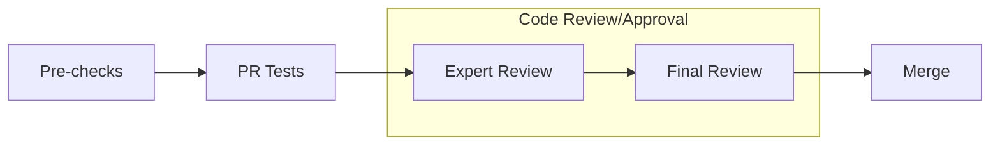

# docs: add Megatron Inference feature documentation

[Upstream PR](https://github.com/NVIDIA/Megatron-LM/pull/3303) · state: closed · merged: False

## Original PR description

# What does this PR do ?
Adds documentation page for Megatron Inference feature under `docs/user-guide/features/`. Clarifies experimental status and performance expectations.

## Contribution process

### Pre-checks

- [ ] I want this PR in a versioned release and have added the appropriate Milestone (e.g., `Core 0.8`)
- [ ] I have added relevant unit tests
- [ ] I have added relevant functional tests
- [ ] I have added proper typing to my code [Typing guidelines](https://docs.python.org/3/library/typing.html)
- [x] I have added relevant documentation
- [ ] I have run the [autoformatter.sh](https://github.com/NVIDIA/Megatron-LM/blob/main/tools/autoformat.sh) on my PR

### Code review

The following process is enforced via the CODEOWNERS file for changes into `megatron/core`. For changes outside of `megatron/core`, it is up to the PR author whether or not to tag the Final Reviewer team.

For MRs into `main` branch

Feel free to message or comment the @mcore-oncall to help accelerate your merge into main. The less complex your PR is, the faster it will be approved and merged!

#### (Step 1): Add PR label `Expert Review`

#### (Step 2): Collect the expert reviewers reviews

1. Attach the `Expert Review` label when your PR is ready for review.
2. GitHub auto-assigns expert reviewers based on your changes. They will get notified and pick up your PR soon.

:warning: Only proceed to the next step once all reviewers have approved, merge-conflict are resolved and the CI is passing.  
Final Review might get declined if these requirements are not fulfilled.

#### (Step 3): Final Review

1. Add `Final Review` label
2. GitHub auto-assigns final reviewers based on your changes. They will get notified and pick up your PR soon.

#### (Optional Step 4): Cherry-pick into release branch

If this PR also needs to be merged into `core_r*` release branches, after this PR has been merged, select `Cherry-pick` to open a new PR into the release branch.

For MRs into `dev` branch

The proposed review process for `dev` branch is under active discussion.

MRs are mergable after one approval by either `eharper@nvidia.com` or `zijiey@nvidia.com`.

### Merging your PR

Any member of [core-adlr](https://github.com/orgs/teams/NVIDIA/core-adlr) and [`core-nemo`](https://github.com/orgs/teams/NVIDIA/core-nemo) will be able to merge your PR.

## Review and discussion

### reviews

- shanmugamr1992 · COMMENTED · 2026-03-11T15:16:43Z · [source](https://github.com/NVIDIA/Megatron-LM/pull/3303#pullrequestreview-3930394350)

(No body; status only.)

- shanmugamr1992 · COMMENTED · 2026-03-11T15:17:58Z · [source](https://github.com/NVIDIA/Megatron-LM/pull/3303#pullrequestreview-3930402758)

(No body; status only.)

- shanmugamr1992 · COMMENTED · 2026-03-11T15:19:22Z · [source](https://github.com/NVIDIA/Megatron-LM/pull/3303#pullrequestreview-3930411579)

(No body; status only.)

- shanmugamr1992 · COMMENTED · 2026-03-11T15:20:35Z · [source](https://github.com/NVIDIA/Megatron-LM/pull/3303#pullrequestreview-3930419262)

(No body; status only.)

- shanmugamr1992 · COMMENTED · 2026-03-11T15:21:17Z · [source](https://github.com/NVIDIA/Megatron-LM/pull/3303#pullrequestreview-3930424119)

(No body; status only.)

- shanmugamr1992 · COMMENTED · 2026-03-11T15:21:46Z · [source](https://github.com/NVIDIA/Megatron-LM/pull/3303#pullrequestreview-3930427398)

(No body; status only.)

- shanmugamr1992 · COMMENTED · 2026-03-11T15:22:22Z · [source](https://github.com/NVIDIA/Megatron-LM/pull/3303#pullrequestreview-3930431502)

(No body; status only.)

- sbhavani · COMMENTED · 2026-03-24T04:50:10Z · [source](https://github.com/NVIDIA/Megatron-LM/pull/3303#pullrequestreview-3996215774)

(No body; status only.)

- sbhavani · COMMENTED · 2026-03-24T04:56:14Z · [source](https://github.com/NVIDIA/Megatron-LM/pull/3303#pullrequestreview-3996232664)

(No body; status only.)

- sbhavani · COMMENTED · 2026-03-24T04:58:34Z · [source](https://github.com/NVIDIA/Megatron-LM/pull/3303#pullrequestreview-3996239236)

(No body; status only.)

- sbhavani · COMMENTED · 2026-03-24T04:58:52Z · [source](https://github.com/NVIDIA/Megatron-LM/pull/3303#pullrequestreview-3996239977)

(No body; status only.)

- sbhavani · COMMENTED · 2026-03-24T04:59:05Z · [source](https://github.com/NVIDIA/Megatron-LM/pull/3303#pullrequestreview-3996240495)

(No body; status only.)

- sbhavani · COMMENTED · 2026-03-24T04:59:16Z · [source](https://github.com/NVIDIA/Megatron-LM/pull/3303#pullrequestreview-3996240983)

(No body; status only.)

- shanmugamr1992 · COMMENTED · 2026-03-31T22:32:08Z · [source](https://github.com/NVIDIA/Megatron-LM/pull/3303#pullrequestreview-4000424682)

(No body; status only.)

- sbhavani · COMMENTED · 2026-04-08T22:14:41Z · [source](https://github.com/NVIDIA/Megatron-LM/pull/3303#pullrequestreview-4078591255)

(No body; status only.)

- shanmugamr1992 · APPROVED · 2026-04-08T23:04:44Z · [source](https://github.com/NVIDIA/Megatron-LM/pull/3303#pullrequestreview-4078810359)

(No body; status only.)

- janEbert · COMMENTED · 2026-05-11T17:17:35Z · [source](https://github.com/NVIDIA/Megatron-LM/pull/3303#pullrequestreview-4265849485)

(No body; status only.)

- janEbert · APPROVED · 2026-05-11T17:18:33Z · [source](https://github.com/NVIDIA/Megatron-LM/pull/3303#pullrequestreview-4265855946)

(No body; status only.)

### issue_comments

- copy-pr-bot[bot] · comment · 2026-02-06T22:31:47Z · [source](https://github.com/NVIDIA/Megatron-LM/pull/3303#issuecomment-3862864015)

This pull request requires additional validation before any workflows can run on NVIDIA's runners.

Pull request vetters can view their responsibilities [here](https://docs.gha-runners.nvidia.com/cpr/vetters).

Contributors can view more details about this message [here](https://docs.gha-runners.nvidia.com/cpr/contributors).

- sbhavani · comment · 2026-05-11T16:59:33Z · [source](https://github.com/NVIDIA/Megatron-LM/pull/3303#issuecomment-4422929136)

@NVIDIA/mcore-oncall please review

### inline_comments

- shanmugamr1992 · comment · 2026-03-11T15:16:43Z · [source](https://github.com/NVIDIA/Megatron-LM/pull/3303#discussion_r2919080670)

File: `docs/user-guide/features/megatron_inference.md` · line 11

Not sure if this is our primary goal. The problem is generally when you try to reduce numerical instability , by using very similar kernals, you loose out on performance. So we do support batch invariant mode for dense models, which produces bitwise exactness, but for moe we will have differences. 

- shanmugamr1992 · comment · 2026-03-11T15:17:58Z · [source](https://github.com/NVIDIA/Megatron-LM/pull/3303#discussion_r2919088567)

File: `docs/user-guide/features/megatron_inference.md` · line 13

In fact with async rl , this numerical instability as long as it its within limits doesnt matter. Megatron rl has done some ablation studies, and we will be doing a few more next week as well)

Out system is designed for production grade deployments only. we are almost there. 

- shanmugamr1992 · comment · 2026-03-11T15:19:22Z · [source](https://github.com/NVIDIA/Megatron-LM/pull/3303#discussion_r2919097035)

File: `docs/user-guide/features/megatron_inference.md` · line None

hybrid models and moe models as well like qwen and nano

- shanmugamr1992 · comment · 2026-03-11T15:20:35Z · [source](https://github.com/NVIDIA/Megatron-LM/pull/3303#discussion_r2919104400)

File: `docs/user-guide/features/megatron_inference.md` · line None

With the dynamic engine, it will only by paged attention (so block memory allocation) , and we also support offloading using torch memory saver or uvm (so that you can switch between training and inference easily in rl use case)

- shanmugamr1992 · comment · 2026-03-11T15:21:17Z · [source](https://github.com/NVIDIA/Megatron-LM/pull/3303#discussion_r2919108633)

File: `docs/user-guide/features/megatron_inference.md` · line 86

Lower throughput for dense models when you enable batch-invariant-mode. Otherwise we match vllm and other frameworks , but our logprobs are similar to them. 

- shanmugamr1992 · comment · 2026-03-11T15:21:46Z · [source](https://github.com/NVIDIA/Megatron-LM/pull/3303#discussion_r2919111837)

File: `docs/user-guide/features/megatron_inference.md` · line None

Onur is doing all of these right now and we have done severl kernal optimizations in the past week. 

- shanmugamr1992 · comment · 2026-03-11T15:22:22Z · [source](https://github.com/NVIDIA/Megatron-LM/pull/3303#discussion_r2919115658)

File: `docs/user-guide/features/megatron_inference.md` · line None

Not sure what you mean here. We are almost on par with vllm on features and performance. (only moe models we are about 15 percent slower) but we are bridging the gap

- sbhavani · comment · 2026-03-24T04:50:10Z · [source](https://github.com/NVIDIA/Megatron-LM/pull/3303#discussion_r2978970774)

File: `docs/user-guide/features/megatron_inference.md` · line 86

I'd rather wait for official perf numbers before updating these claims. Even if it's within 10% of vLLM throughput it would be a very useful feature.

- sbhavani · comment · 2026-03-24T04:56:14Z · [source](https://github.com/NVIDIA/Megatron-LM/pull/3303#discussion_r2978986326)

File: `docs/user-guide/features/megatron_inference.md` · line 13

The numerical instability might be within limits for certain use cases but users still ask for Megatron Inference for RL to address training-inference mismatch. 

I'd like to hold off on stating it's for production until we have perf numbers published.

- sbhavani · comment · 2026-03-24T04:58:34Z · [source](https://github.com/NVIDIA/Megatron-LM/pull/3303#discussion_r2978991978)

File: `docs/user-guide/features/megatron_inference.md` · line None

Updated to mention "kernel optimizations are actively underway"

- sbhavani · comment · 2026-03-24T04:58:52Z · [source](https://github.com/NVIDIA/Megatron-LM/pull/3303#discussion_r2978992739)

File: `docs/user-guide/features/megatron_inference.md` · line None

Updated to mention both components

- sbhavani · comment · 2026-03-24T04:59:04Z · [source](https://github.com/NVIDIA/Megatron-LM/pull/3303#discussion_r2978993257)

File: `docs/user-guide/features/megatron_inference.md` · line None

Added other models

- sbhavani · comment · 2026-03-24T04:59:16Z · [source](https://github.com/NVIDIA/Megatron-LM/pull/3303#discussion_r2978993726)

File: `docs/user-guide/features/megatron_inference.md` · line 11

Added Batch-Invariant Mode as one of the features

- shanmugamr1992 · comment · 2026-03-24T16:01:19Z · [source](https://github.com/NVIDIA/Megatron-LM/pull/3303#discussion_r2982668624)

File: `docs/user-guide/features/megatron_inference.md` · line 13

Hmm, not sure when you will be merging. But here is all that we have done 
1. Run several benchmarks wiht vllm and mcore and getting similar results
2. we ran nano and mcore for 50 steps and got similar results
3. Ultra we are running currently. 

Yeah wwe can leave it as research for now, but soon by next couple of weeks we want to make it available for proper use. 

- shanmugamr1992 · comment · 2026-03-24T16:02:57Z · [source](https://github.com/NVIDIA/Megatron-LM/pull/3303#discussion_r2982678695)

File: `docs/user-guide/features/megatron_inference.md` · line None

@sbhavani . This comment hasn't been addressed. We do have continuous batching. Kernal optimizations are underway. 

- shanmugamr1992 · comment · 2026-03-24T16:03:32Z · [source](https://github.com/NVIDIA/Megatron-LM/pull/3303#discussion_r2982682473)

File: `docs/user-guide/features/megatron_inference.md` · line None

This is wrong. We dont use the same path as traiing. we do use differnt kernals.

- sbhavani · comment · 2026-04-08T22:14:41Z · [source](https://github.com/NVIDIA/Megatron-LM/pull/3303#discussion_r3054471372)

File: `docs/user-guide/features/megatron_inference.md` · line None

Updated

- janEbert · comment · 2026-05-11T17:17:35Z · [source](https://github.com/NVIDIA/Megatron-LM/pull/3303#discussion_r3220804702)

File: `docs/user-guide/features/megatron_inference.md` · line None

Mention TRT-LLM here as well?

## Changed files and fixed code

- `docs/user-guide/features/index.md` · modified · additions 1 / deletions 0
  - [head](https://github.com/sbhavani/Megatron-LM/blob/2289c4e4143e91132de814008b3fe794b9d51f59/docs/user-guide/features/index.md)
  - [base](https://github.com/NVIDIA/Megatron-LM/blob/7da5b2877fddeae58eac256791f17b3cea73fa88/docs/user-guide/features/index.md)
- `docs/user-guide/features/megatron_inference.md` · added · additions 94 / deletions 0
  - [head](https://github.com/sbhavani/Megatron-LM/blob/2289c4e4143e91132de814008b3fe794b9d51f59/docs/user-guide/features/megatron_inference.md)
  - [base](https://github.com/NVIDIA/Megatron-LM/blob/7da5b2877fddeae58eac256791f17b3cea73fa88/docs/user-guide/features/megatron_inference.md)

## Evidence and interpretation boundary

[Original JSON, discussions and patches](../../../../../../evidence/prs/NVIDIA--Megatron-LM/3303-493365209e3542986000ab5a02f7cd10adca40cfa55233b30d201a0f7480f38b.json) · SHA-256 `493365209e3542986000ab5a02f7cd10adca40cfa55233b30d201a0f7480f38b`.

Diff complete: True. Missing/binary/truncated patches require pinned source inspection. This is a source page, not an independently verified optimization case. Open, merged and released are different states; recheck the deployed dependency.
