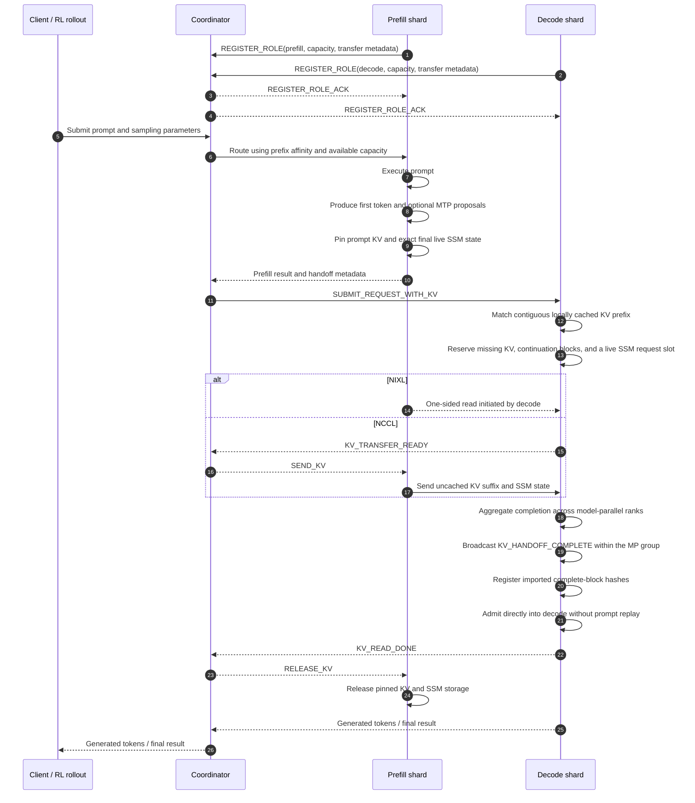

# Disaggregated Inference: End2End

[Upstream PR](https://github.com/NVIDIA/Megatron-LM/pull/6675) · state: closed · merged: True

## Original PR description

This MR completes end-to-end prefill/decode disaggregation for Megatron dynamic inference. Prefill and decode run as dedicated, independently parallelized shards. A coordinator routes requests and manages capacity and ownership, while KV and SSM tensors move directly between GPU workers through NCCL or NIXL. The coordinator carries request metadata and lifecycle messages only; it is not in the tensor data path.

### Native coordinator request flow



### Request lifecycle

1. **Role registration**

   Each engine registers as either a prefill or decode instance. Registration includes its request capacity, transport backend, KV layout, and hybrid SSM layout when present. The coordinator validates that paired engines have compatible model geometry.

2. **Prefill routing**

   The coordinator selects a prefill instance using prefix affinity, available capacity, and current load. The prefill engine executes the prompt and captures everything required to continue decoding.

3. **Source-state retention**

   When prefill finishes, its prompt KV blocks are temporarily retained so the allocator cannot reuse them during transfer. For hybrid models, the exact final live SSM slot is detached from the completed request and retained in the same way.

4. **Decode-side cache reuse**

   The coordinator selects a decode instance using prefix affinity, available capacity, and current load. Decode recomputes the prompt's complete-block hash chain and finds the longest contiguous prefix already present in its local cache. Only the uncached KV suffix is allocated and transferred. Complete blocks are hash-indexed for reuse; a partial final prompt block is transferred but remains request-owned rather than being registered as a reusable prefix. Concurrent imports reserve their hashes so two requests cannot independently import and register the same prefix.

5. **State transfer**

   NIXL performs decode-initiated one-sided reads. NCCL uses matching receives and sends: decode first commits its destination storage and reports `KV_TRANSFER_READY`, after which the coordinator tells prefill to post its sends. Different prefill and decode TP, PP, EP, and expert-TP layouts are supported by the KV and SSM re-sharding planners.

6. **Decode admission**

   Decode waits until every model-parallel rank has completed the transfer, then admits the request directly into the active decode batch. It does not replay any prompt tokens. The handoff includes the sampled first token and any MTP proposals so decoding starts at the exact continuation point. These continuation tokens have not passed through the base model yet, so decode produces their KV locally and allocates continuation blocks only when they cross a block boundary.

7. **Source release**

   Once decode no longer reads prefill storage, it reports `KV_READ_DONE`. The coordinator sends `RELEASE_KV`, allowing prefill to release its temporary KV references and retained SSM slot. NCCL sources remain pinned until their local send handles are also complete.

### Control plane and data plane

The coordinator carries request and control metadata:

- Prompt and sampling parameters
- Source block IDs
- Buffer addresses and shard layouts
- First sampled token and MTP proposals
- Readiness, completion, abort, and release messages

The GPU workers transfer model state directly:

- Uncached KV suffix
- Exact convolution state for hybrid models
- Exact recurrent SSM state for hybrid models

Large KV and SSM tensors are never serialized through the coordinator.

### Key design decisions

- Decode engines never execute prompt prefill.
- Prefix caching is required on both roles because decode admission reuses the prefix-cache allocator.
- Hybrid decode receives the exact live SSM state directly into a live request slot; it does not maintain a durable SSM prefix-snapshot cache.
- For hybrid models with expert parallelism, each disaggregated engine reserves one additional recurrent-state slot outside `max_requests` for EP dummy forwards. Real requests and retained handoffs cannot consume it, so an idle rank can still participate in expert collectives when every request-owned slot is occupied. The slot is reused between dummy steps, and its memory is included when sizing the recurrent-state and KV buffers.
- Transfer completion is aggregated over a CPU control path rather than adding a per-request collective to the compute critical path.
- Ranks in an inference shard receive the same request stream and use deterministic allocators, so corresponding requests receive the same physical block IDs. Rank-specific transfer layouts are exchanged during setup; unexpected allocator divergence is treated as an engine failure rather than adding a collective to every request admission.
- Requests are queued FIFO when request, KV, or live SSM capacity is unavailable.
- Cancellation does not immediately free storage involved in an active transfer. Source state remains pinned and decode destinations may be quarantined until the backend reports that reuse is safe. Reset also refuses to release storage while a transfer can still access it, preferring temporary capacity loss over memory corruption.
- Disaggregated behavior is isolated behind role-tagged inference shards; ordinary inference continues through the existing engine.
- The native coordinator, Dynamo integration, and Megatron RL use the same underlying handoff and transfer mechanisms. Each control plane supplies its own routing and orchestration.

### RL checkpoint loading and refit

Each role-tagged RL inference shard is an independent checkpoint and refit destination. Checkpoint loading therefore uses the shard's process group rather than the global world group. Refit performs one collective pass for each disjoint destination pool: source ranks participate in every pass, while only ranks belonging to that pool materialize the destination weights.

### CUDA graph-aware prefill scheduling

When `--inference-cuda-graph-all-prefills` is enabled, the scheduler treats each captured `(token count, prefill count, decode count)` shape as capacity rather than requiring the real batch to land exactly on its token boundary. For example, a 128-token graph can execute a 100-token chunk with padding, so the scheduler uses the full 100-token budget instead of shrinking the chunk to the next smaller captured size. This reduces the number of prompt chunks and avoids unnecessary eager execution.

The same graph-coverage check applies to both initial and continuation chunks. If the current resident batch prevents a compatible shape, the queue-head request waits while that finite batch drains and changes shape. Hybrid models use strict matching because captured prefill and decode SSM slots are not interchangeable; attention-only models can reuse unused request capacity more flexibly. Graph admission is a local CPU scan and does not add a model-parallel collective.

If an idle engine cannot cover a new request, it reports a configuration error instead of silently ignoring all-prefill graph mode. The only eager fallback is a lone continuation that has already started and cannot match any captured shape; without other resident work, deferring it could never change the batch and would deadlock progress.

### Disaggregation protocol headers

These messages form the control plane. KV and SSM tensors are transferred directly through NCCL or NIXL and are never serialized through the coordinator.

#### Disaggregation-specific headers

| Header | Direction | Purpose |
|---|---|---|
| `REGISTER_ROLE` | Prefill or decode -> coordinator | Registers the engine's role, transport backend, capacity, and transfer metadata. |
| `REGISTER_ROLE_ACK` | Coordinator -> prefill or decode | Confirms successful role registration. |
| `SUBMIT_REQUEST_WITH_KV` | Coordinator -> decode | Starts the decode hop with the request and source transfer metadata. |
| `KV_TRANSFER_READY` | Decode -> coordinator | NCCL only. Indicates that decode has reserved its destinations and prepared the receives. |
| `SEND_KV` | Coordinator -> prefill | NCCL only. Tells prefill to post sends for the uncached suffix. |
| `KV_READ_DONE` | Decode -> coordinator | Indicates that all decode ranks completed the handoff and the source state can be released. |
| `RELEASE_KV` | Coordinator -> prefill | Releases the KV blocks and live SSM slot retained by prefill for the handoff. |
| `KV_HANDOFF_COMPLETE` | Decode MP coordinator -> decode MP ranks | Distributes the aggregated transfer result so all ranks make the same admission or failure decision. |

NIXL does not use `KV_TRANSFER_READY` or `SEND_KV`; decode initiates direct reads after allocating its destination storage.

#### Existing headers reused by disaggregation

| Header | Direction | Purpose |
|---|---|---|
| `CONNECT` / `CONNECT_ACK` | Client <-> coordinator | Establishes the client connection. |
| `SUBMIT_REQUEST` | Client -> coordinator -> prefill | Starts the prefill hop. |
| `ENGINE_REPLY` | Prefill or decode -> coordinator | A prefill reply starts the decode handoff; a decode reply contains the final result. |
| `ENGINE_REPLY_PARTIAL` | Decode -> coordinator -> client | Streams incremental decode output. |
| `ABORT_REQUEST` | Client -> coordinator -> current owner | Cancels the request on whichever engine currently owns it. |
| `REQUEST_ABORTED` | Engine -> coordinator -> client | Confirms that cancellation and associated storage cleanup are safe. |
| `REQUEST_ERROR` | Engine -> coordinator -> client | Reports a terminal failure and whether the source storage is safe to release. |
| `DISCONNECT` | Prefill or decode -> coordinator | Removes the engine from its role and routing pool. |
| `SHUTDOWN` | Client -> coordinator | Stops the coordinator. |
| `TP_BROADCAST` | MP coordinator -> other MP ranks | Frames the existing internal ZMQ broadcast. Disaggregation uses it to carry `KV_HANDOFF_COMPLETE`, but it is not specific to disaggregation. |
| `PAUSE`, `UNPAUSE`, `SUSPEND`, `RESUME`, `SET_GENERATION_EPOCH`, `STOP` | Client -> coordinator -> engines | Existing engine lifecycle controls. |
| `START_CUDA_PROFILER`, `STOP_CUDA_PROFILER` | Client -> coordinator -> engines | Existing profiler controls. |

### Current limitations

- Native disaggregation requires prefix caching on both prefill and decode engines.
- All participating prefill and decode engines must use the same transfer backend and compatible model-state geometry.
- The native coordinator path currently supports text-only requests.
- Prompt log probabilities and top-N token log probabilities are not currently transferred across the handoff.
- Context parallelism is not currently supported for disaggregated RL inference.

### Configuration

A native deployment is described using role-tagged inference shards, for example:

```bash
--inference-shards "tp=1,dp=2,role=prefill+tp=1,dp=2,role=decode"
--disagg-kv-transport-backend nccl
```

Each role can use its own supported TP, PP, DP, EP, and expert-TP configuration.


## Review and discussion

### reviews

- claude[bot] · COMMENTED · 2026-08-19T20:26:36Z · [source](https://github.com/NVIDIA/Megatron-LM/pull/6675#pullrequestreview-4976448916)

(No body; status only.)

- claude[bot] · COMMENTED · 2026-08-19T20:26:58Z · [source](https://github.com/NVIDIA/Megatron-LM/pull/6675#pullrequestreview-4976452111)

(No body; status only.)

- claude[bot] · COMMENTED · 2026-08-19T20:27:18Z · [source](https://github.com/NVIDIA/Megatron-LM/pull/6675#pullrequestreview-4976454983)

(No body; status only.)

- claude[bot] · COMMENTED · 2026-08-19T20:27:35Z · [source](https://github.com/NVIDIA/Megatron-LM/pull/6675#pullrequestreview-4976457654)

(No body; status only.)

- claude[bot] · COMMENTED · 2026-08-19T20:27:45Z · [source](https://github.com/NVIDIA/Megatron-LM/pull/6675#pullrequestreview-4976459087)

(No body; status only.)

- claude[bot] · COMMENTED · 2026-08-19T20:28:03Z · [source](https://github.com/NVIDIA/Megatron-LM/pull/6675#pullrequestreview-4976461421)

(No body; status only.)

- claude[bot] · COMMENTED · 2026-08-19T20:28:26Z · [source](https://github.com/NVIDIA/Megatron-LM/pull/6675#pullrequestreview-4976464465)

(No body; status only.)

- claude[bot] · COMMENTED · 2026-08-19T20:28:40Z · [source](https://github.com/NVIDIA/Megatron-LM/pull/6675#pullrequestreview-4976466145)

(No body; status only.)

- claude[bot] · COMMENTED · 2026-08-19T20:28:49Z · [source](https://github.com/NVIDIA/Megatron-LM/pull/6675#pullrequestreview-4976467271)

(No body; status only.)

- claude[bot] · COMMENTED · 2026-08-19T20:28:58Z · [source](https://github.com/NVIDIA/Megatron-LM/pull/6675#pullrequestreview-4976468366)

(No body; status only.)

- claude[bot] · COMMENTED · 2026-08-19T20:29:12Z · [source](https://github.com/NVIDIA/Megatron-LM/pull/6675#pullrequestreview-4976470139)

(No body; status only.)

- claude[bot] · COMMENTED · 2026-08-19T20:29:24Z · [source](https://github.com/NVIDIA/Megatron-LM/pull/6675#pullrequestreview-4976471498)

(No body; status only.)

- claude[bot] · COMMENTED · 2026-08-19T20:29:34Z · [source](https://github.com/NVIDIA/Megatron-LM/pull/6675#pullrequestreview-4976472619)

(No body; status only.)

- claude[bot] · COMMENTED · 2026-08-19T20:29:57Z · [source](https://github.com/NVIDIA/Megatron-LM/pull/6675#pullrequestreview-4976475489)

(No body; status only.)

- claude[bot] · COMMENTED · 2026-08-19T20:30:09Z · [source](https://github.com/NVIDIA/Megatron-LM/pull/6675#pullrequestreview-4976476874)

(No body; status only.)

- claude[bot] · COMMENTED · 2026-08-19T20:30:23Z · [source](https://github.com/NVIDIA/Megatron-LM/pull/6675#pullrequestreview-4976478584)

(No body; status only.)

- claude[bot] · COMMENTED · 2026-08-19T20:30:36Z · [source](https://github.com/NVIDIA/Megatron-LM/pull/6675#pullrequestreview-4976480198)

(No body; status only.)

- claude[bot] · COMMENTED · 2026-08-19T22:06:46Z · [source](https://github.com/NVIDIA/Megatron-LM/pull/6675#pullrequestreview-4977174886)

(No body; status only.)

- claude[bot] · COMMENTED · 2026-08-19T22:07:02Z · [source](https://github.com/NVIDIA/Megatron-LM/pull/6675#pullrequestreview-4977176319)

(No body; status only.)

- claude[bot] · COMMENTED · 2026-08-19T22:07:16Z · [source](https://github.com/NVIDIA/Megatron-LM/pull/6675#pullrequestreview-4977177597)

(No body; status only.)

- claude[bot] · COMMENTED · 2026-08-19T22:07:25Z · [source](https://github.com/NVIDIA/Megatron-LM/pull/6675#pullrequestreview-4977178460)

(No body; status only.)

- claude[bot] · COMMENTED · 2026-08-19T22:07:37Z · [source](https://github.com/NVIDIA/Megatron-LM/pull/6675#pullrequestreview-4977179558)

(No body; status only.)

- claude[bot] · COMMENTED · 2026-08-19T22:07:46Z · [source](https://github.com/NVIDIA/Megatron-LM/pull/6675#pullrequestreview-4977180448)

(No body; status only.)

- claude[bot] · COMMENTED · 2026-08-19T22:08:22Z · [source](https://github.com/NVIDIA/Megatron-LM/pull/6675#pullrequestreview-4977183821)

(No body; status only.)

- claude[bot] · COMMENTED · 2026-08-19T22:08:34Z · [source](https://github.com/NVIDIA/Megatron-LM/pull/6675#pullrequestreview-4977184835)

(No body; status only.)

- claude[bot] · COMMENTED · 2026-08-19T22:08:44Z · [source](https://github.com/NVIDIA/Megatron-LM/pull/6675#pullrequestreview-4977185671)

(No body; status only.)

- claude[bot] · COMMENTED · 2026-08-19T22:38:40Z · [source](https://github.com/NVIDIA/Megatron-LM/pull/6675#pullrequestreview-4977346219)

(No body; status only.)

- claude[bot] · COMMENTED · 2026-08-19T22:38:50Z · [source](https://github.com/NVIDIA/Megatron-LM/pull/6675#pullrequestreview-4977347494)

(No body; status only.)

- claude[bot] · COMMENTED · 2026-08-19T22:39:01Z · [source](https://github.com/NVIDIA/Megatron-LM/pull/6675#pullrequestreview-4977349010)

(No body; status only.)

- claude[bot] · COMMENTED · 2026-08-19T22:39:09Z · [source](https://github.com/NVIDIA/Megatron-LM/pull/6675#pullrequestreview-4977350217)

(No body; status only.)

- claude[bot] · COMMENTED · 2026-08-19T22:39:18Z · [source](https://github.com/NVIDIA/Megatron-LM/pull/6675#pullrequestreview-4977351386)

(No body; status only.)

- claude[bot] · COMMENTED · 2026-08-19T22:39:27Z · [source](https://github.com/NVIDIA/Megatron-LM/pull/6675#pullrequestreview-4977352628)

(No body; status only.)

- claude[bot] · COMMENTED · 2026-08-19T22:39:39Z · [source](https://github.com/NVIDIA/Megatron-LM/pull/6675#pullrequestreview-4977354118)

(No body; status only.)

- claude[bot] · COMMENTED · 2026-08-19T22:39:53Z · [source](https://github.com/NVIDIA/Megatron-LM/pull/6675#pullrequestreview-4977355577)

(No body; status only.)

- claude[bot] · COMMENTED · 2026-08-19T22:40:05Z · [source](https://github.com/NVIDIA/Megatron-LM/pull/6675#pullrequestreview-4977356976)

(No body; status only.)

- claude[bot] · COMMENTED · 2026-08-19T22:40:20Z · [source](https://github.com/NVIDIA/Megatron-LM/pull/6675#pullrequestreview-4977358513)

(No body; status only.)

- claude[bot] · COMMENTED · 2026-08-19T22:40:32Z · [source](https://github.com/NVIDIA/Megatron-LM/pull/6675#pullrequestreview-4977359852)

(No body; status only.)

- claude[bot] · COMMENTED · 2026-08-19T22:41:01Z · [source](https://github.com/NVIDIA/Megatron-LM/pull/6675#pullrequestreview-4977363183)

(No body; status only.)

- claude[bot] · COMMENTED · 2026-08-19T22:41:21Z · [source](https://github.com/NVIDIA/Megatron-LM/pull/6675#pullrequestreview-4977365623)

(No body; status only.)

- claude[bot] · COMMENTED · 2026-08-19T22:41:30Z · [source](https://github.com/NVIDIA/Megatron-LM/pull/6675#pullrequestreview-4977366681)

(No body; status only.)

- wdykas · COMMENTED · 2026-08-19T23:57:38Z · [source](https://github.com/NVIDIA/Megatron-LM/pull/6675#pullrequestreview-4977817551)

(No body; status only.)

- claude[bot] · COMMENTED · 2026-08-20T00:42:41Z · [source](https://github.com/NVIDIA/Megatron-LM/pull/6675#pullrequestreview-4978015488)

(No body; status only.)

- claude[bot] · COMMENTED · 2026-08-20T00:42:57Z · [source](https://github.com/NVIDIA/Megatron-LM/pull/6675#pullrequestreview-4978016397)

(No body; status only.)

- claude[bot] · COMMENTED · 2026-08-20T00:43:11Z · [source](https://github.com/NVIDIA/Megatron-LM/pull/6675#pullrequestreview-4978017227)

(No body; status only.)

- claude[bot] · COMMENTED · 2026-08-20T00:43:19Z · [source](https://github.com/NVIDIA/Megatron-LM/pull/6675#pullrequestreview-4978017708)

(No body; status only.)

- claude[bot] · COMMENTED · 2026-08-20T00:43:55Z · [source](https://github.com/NVIDIA/Megatron-LM/pull/6675#pullrequestreview-4978020005)

(No body; status only.)

- claude[bot] · COMMENTED · 2026-08-20T00:44:26Z · [source](https://github.com/NVIDIA/Megatron-LM/pull/6675#pullrequestreview-4978022381)

(No body; status only.)

- claude[bot] · COMMENTED · 2026-08-20T00:48:50Z · [source](https://github.com/NVIDIA/Megatron-LM/pull/6675#pullrequestreview-4978044194)

(No body; status only.)

- claude[bot] · COMMENTED · 2026-08-20T00:49:04Z · [source](https://github.com/NVIDIA/Megatron-LM/pull/6675#pullrequestreview-4978045272)

(No body; status only.)

- claude[bot] · COMMENTED · 2026-08-20T00:49:18Z · [source](https://github.com/NVIDIA/Megatron-LM/pull/6675#pullrequestreview-4978046174)

(No body; status only.)

- claude[bot] · COMMENTED · 2026-08-20T00:49:30Z · [source](https://github.com/NVIDIA/Megatron-LM/pull/6675#pullrequestreview-4978047228)

(No body; status only.)

- claude[bot] · COMMENTED · 2026-08-20T00:49:47Z · [source](https://github.com/NVIDIA/Megatron-LM/pull/6675#pullrequestreview-4978049093)

(No body; status only.)

- claude[bot] · COMMENTED · 2026-08-20T00:49:59Z · [source](https://github.com/NVIDIA/Megatron-LM/pull/6675#pullrequestreview-4978050677)

(No body; status only.)

- claude[bot] · COMMENTED · 2026-08-20T00:52:45Z · [source](https://github.com/NVIDIA/Megatron-LM/pull/6675#pullrequestreview-4978062790)

(No body; status only.)

- claude[bot] · COMMENTED · 2026-08-20T00:54:15Z · [source](https://github.com/NVIDIA/Megatron-LM/pull/6675#pullrequestreview-4978069152)

(No body; status only.)

- claude[bot] · COMMENTED · 2026-08-20T00:54:28Z · [source](https://github.com/NVIDIA/Megatron-LM/pull/6675#pullrequestreview-4978070406)

(No body; status only.)

- claude[bot] · COMMENTED · 2026-08-20T00:54:39Z · [source](https://github.com/NVIDIA/Megatron-LM/pull/6675#pullrequestreview-4978071121)

(No body; status only.)

- claude[bot] · COMMENTED · 2026-08-20T00:54:52Z · [source](https://github.com/NVIDIA/Megatron-LM/pull/6675#pullrequestreview-4978071943)

(No body; status only.)

- claude[bot] · COMMENTED · 2026-08-21T14:06:23Z · [source](https://github.com/NVIDIA/Megatron-LM/pull/6675#pullrequestreview-4994106907)

(No body; status only.)

- claude[bot] · COMMENTED · 2026-08-21T14:06:37Z · [source](https://github.com/NVIDIA/Megatron-LM/pull/6675#pullrequestreview-4994109532)

(No body; status only.)

- claude[bot] · COMMENTED · 2026-08-21T14:06:43Z · [source](https://github.com/NVIDIA/Megatron-LM/pull/6675#pullrequestreview-4994110752)

(No body; status only.)

- claude[bot] · COMMENTED · 2026-08-21T14:06:49Z · [source](https://github.com/NVIDIA/Megatron-LM/pull/6675#pullrequestreview-4994111827)

(No body; status only.)

- claude[bot] · COMMENTED · 2026-08-21T14:07:00Z · [source](https://github.com/NVIDIA/Megatron-LM/pull/6675#pullrequestreview-4994114017)

(No body; status only.)

- claude[bot] · COMMENTED · 2026-08-21T14:07:02Z · [source](https://github.com/NVIDIA/Megatron-LM/pull/6675#pullrequestreview-4994114369)

(No body; status only.)

- claude[bot] · COMMENTED · 2026-08-21T14:07:22Z · [source](https://github.com/NVIDIA/Megatron-LM/pull/6675#pullrequestreview-4994118224)

(No body; status only.)

- claude[bot] · COMMENTED · 2026-08-25T15:30:21Z · [source](https://github.com/NVIDIA/Megatron-LM/pull/6675#pullrequestreview-5020803701)

(No body; status only.)

- claude[bot] · COMMENTED · 2026-08-25T15:30:38Z · [source](https://github.com/NVIDIA/Megatron-LM/pull/6675#pullrequestreview-5020806463)

(No body; status only.)

- claude[bot] · COMMENTED · 2026-08-25T15:30:48Z · [source](https://github.com/NVIDIA/Megatron-LM/pull/6675#pullrequestreview-5020808095)

(No body; status only.)

- claude[bot] · COMMENTED · 2026-08-25T15:30:58Z · [source](https://github.com/NVIDIA/Megatron-LM/pull/6675#pullrequestreview-5020809730)

(No body; status only.)

- claude[bot] · COMMENTED · 2026-08-25T15:31:08Z · [source](https://github.com/NVIDIA/Megatron-LM/pull/6675#pullrequestreview-5020811336)

(No body; status only.)

- claude[bot] · APPROVED · 2026-08-26T19:52:57Z · [source](https://github.com/NVIDIA/Megatron-LM/pull/6675#pullrequestreview-5034511801)

LGTM

- jthomson04 · COMMENTED · 2026-09-21T22:16:36Z · [source](https://github.com/NVIDIA/Megatron-LM/pull/6675#pullrequestreview-5272365734)

Two performance findings in the Dynamo adapter for RL use. These findings are based on source inspection; no performance measurements were run.

- jthomson04 · DISMISSED · 2026-09-29T17:23:25Z · [source](https://github.com/NVIDIA/Megatron-LM/pull/6675#pullrequestreview-5356084492)

This seems to transpose the usual launch ownership. For Slurm deployments, other Dynamo backends are launched by the deployment script through `srun` and run on the assigned nodes. Here, the backend itself invokes `srun` and selects the nodes and GPU resources for its engine processes.

Could we move the Slurm-specific launch logic into a deployment script and let the backend accept externally supplied rank and rendezvous settings? That would match the existing Dynamo deployment pattern and let Kubernetes or NeMo-RL/Ray manage placement without adding another launcher inside the backend.

- wdykas · COMMENTED · 2026-09-29T18:53:02Z · [source](https://github.com/NVIDIA/Megatron-LM/pull/6675#pullrequestreview-5356997522)

(No body; status only.)

- wdykas · COMMENTED · 2026-09-29T18:53:11Z · [source](https://github.com/NVIDIA/Megatron-LM/pull/6675#pullrequestreview-5356999094)

(No body; status only.)

- jthomson04 · COMMENTED · 2026-10-02T00:17:09Z · [source](https://github.com/NVIDIA/Megatron-LM/pull/6675#pullrequestreview-5387039654)

Seven source-review findings in the Dynamo integration, covering cancellation, request/response handling, memory retention, health checks, handoff cleanup, and transfer-backend validation. No tests or performance measurements were run.

- wdykas · COMMENTED · 2026-10-02T14:50:27Z · [source](https://github.com/NVIDIA/Megatron-LM/pull/6675#pullrequestreview-5393212294)

(No body; status only.)

- wdykas · COMMENTED · 2026-10-02T14:50:32Z · [source](https://github.com/NVIDIA/Megatron-LM/pull/6675#pullrequestreview-5393213385)

(No body; status only.)

- wdykas · COMMENTED · 2026-10-02T14:50:39Z · [source](https://github.com/NVIDIA/Megatron-LM/pull/6675#pullrequestreview-5393215162)

(No body; status only.)

- wdykas · COMMENTED · 2026-10-02T14:50:45Z · [source](https://github.com/NVIDIA/Megatron-LM/pull/6675#pullrequestreview-5393216508)

(No body; status only.)

- wdykas · COMMENTED · 2026-10-02T14:50:50Z · [source](https://github.com/NVIDIA/Megatron-LM/pull/6675#pullrequestreview-5393217587)

(No body; status only.)

- wdykas · COMMENTED · 2026-10-02T14:50:59Z · [source](https://github.com/NVIDIA/Megatron-LM/pull/6675#pullrequestreview-5393219609)

(No body; status only.)

- wdykas · COMMENTED · 2026-10-02T14:51:05Z · [source](https://github.com/NVIDIA/Megatron-LM/pull/6675#pullrequestreview-5393221058)

(No body; status only.)

- jthomson04 · COMMENTED · 2026-10-02T16:30:11Z · [source](https://github.com/NVIDIA/Megatron-LM/pull/6675#pullrequestreview-5394241192)

(No body; status only.)

- wdykas · COMMENTED · 2026-10-06T14:05:27Z · [source](https://github.com/NVIDIA/Megatron-LM/pull/6675#pullrequestreview-5429575603)

(No body; status only.)

- wdykas · COMMENTED · 2026-10-06T17:15:28Z · [source](https://github.com/NVIDIA/Megatron-LM/pull/6675#pullrequestreview-5432091833)

(No body; status only.)

- wdykas · COMMENTED · 2026-10-06T18:46:36Z · [source](https://github.com/NVIDIA/Megatron-LM/pull/6675#pullrequestreview-5433121384)

(No body; status only.)

- sidsingh-nvidia · CHANGES_REQUESTED · 2026-10-06T19:16:36Z · [source](https://github.com/NVIDIA/Megatron-LM/pull/6675#pullrequestreview-5433423159)

(No body; status only.)

- sidsingh-nvidia · COMMENTED · 2026-10-06T19:17:07Z · [source](https://github.com/NVIDIA/Megatron-LM/pull/6675#pullrequestreview-5433469044)

**Review: coordinator routing (duplicated logic and prompt decoding)**

The disaggregated coordinator adds its own routing path instead of reusing the existing one. The copy has drifted from `main`, and it decodes prompts in the coordinator loop, which that loop is designed never to do.

**1. Crash: `_match_vector` no longer exists** (`coordinator_runtime.py:172`)
#6497 removed `_match_vector`; the coordinator now has `_prefix_depth_vector`. Disaggregation requires prefix caching, and the default policy is `LONGEST_PREFIX`. So the first prompt with at least one full block raises `AttributeError`, and nothing catches it in the message loop, so the coordinator process dies. The unit tests attach a stand-in `_match_vector` to the coordinator, which hides the problem.

**2. Routing duplicates `get_best_data_parallel_rank`, with different semantics**
`_make_routing_score` scores engines with `alpha*match + (1-alpha)*free`. On `main`, the same `--prefix-caching-routing-alpha` setting is a load penalty: `cache_score - alpha*relative_load`. At the default `alpha=1.0`, disaggregated routing ignores load completely. Please extend `get_best_data_parallel_rank` to take a candidate pool (the engines for one role) and a capacity filter, instead of keeping a second scoring path. The scheduler can still own reservations and queues; those are specific to disaggregation.

**3. Hashing ignores the existing logic** (`_request_hashes`)
The existing logic in `handle_submit_request` does three things this copy doesn't:
- it uses the hashes the client sent in `bodies[1]`
- it skips hashing when `routes_on_prefix` is false
- it salts the hashes with the media key

`_request_hashes` always recomputes hashes from the decoded prompt, even under `LOAD_BALANCED`.

**4. Prompt and reply bodies are decoded on the coordinator thread**
`main` forwards these bodies as raw bytes on purpose (see the `handle_submit_request` docstring). This PR decodes or encodes them four times per request:
- `handlers.py:187`: the prompt is always decoded. `:170` also decodes the media frame just to check it's empty; `media_meta` already says that.
- `coordinator_runtime.py:255` and `:328`: the prompt is re-encoded for the prefill hop and again for the decode hop.
- `handlers.py:464`: the whole prefill reply is decoded just to read `disaggregated_params`. The reply repeats the prompt back, so it's the largest frame this loop handles.

Suggested fix:
- Keep the raw `prompt_frame` bytes in `_RequestState` and forward them on both hops.
- Have the prefill engine put the handoff metadata (`kv_meta`, `block_ids`, SSM info) in the metadata frame, so the coordinator never decodes the reply body.


- sidsingh-nvidia · COMMENTED · 2026-10-06T20:57:14Z · [source](https://github.com/NVIDIA/Megatron-LM/pull/6675#pullrequestreview-5434488494)

**Please reuse the existing coordinator code instead of copying it**

`coordinator_runtime.py` and `coordinator_scheduler.py` re-implement about 185 lines of logic that already exists in the main coordinator. Copies drift: when one side changes, the other has to be updated by hand, and that has already happened here. Please route these through the existing code and keep only the disaggregation-specific parts new.

**Examples**

1. **Routing: copy of `get_best_data_parallel_rank`, and it has already drifted**
   ```python
   # coordinator_runtime.py:172
   matches, recencies = self.coordinator._match_vector(block_hashes)
   ...
   combined = alpha * match + (1.0 - alpha) * free_capacity
   ```
   `main` removed `_match_vector` in #6497 and changed `alpha` into a load penalty (`cache_score - alpha * relative_load`). The copy didn't follow. So it crashes with `AttributeError` under the default `LONGEST_PREFIX` policy, and the same CLI flag means opposite things in the two modes.

2. **Hashing: copy of the hash step in `handle_submit_request`**
   ```python
   # coordinator_runtime.py:154
   hashes = self.coordinator.compute_request_hashes(prompt)
   if policy == PrefixCachingCoordinatorPolicy.FIRST_PREFIX_BLOCK:
       return hashes[:1]
   ```
   The original uses the hashes the client sent in `bodies[1]`, checks `routes_on_prefix`, and salts with the media key. The copy has already lost all three.

3. **Load tracking: a second set of counters**
   `DisaggCoordinatorScheduler.select_engine` / `available_fraction` / `_load` re-implement `get_least_loaded_data_parallel_rank` and `_pending_counts`. Disaggregated mode bypasses `_pending_counts`, so the two systems will diverge as either one changes.

4. **Request frames: copies of the submit handlers**
   `_submit_prefill` and the decode payload in `handle_prefill_done` rebuild the `SUBMIT_REQUEST` and `SUBMIT_REQUEST_WITH_KV` frames by hand, instead of reusing `handle_submit_request` / `handle_submit_request_with_kv`.

5. **Error and abort notifications: written twice within this PR**
   ```python
   coordinator.router_socket.send_multipart([client_identity, msgpack.packb(
       [Headers.REQUEST_ERROR.value, client_request_id, reason, source_safe], ...)])
   ```
   This block appears in both `DisaggCoordinatorRuntime.drop_request` and `handlers.handle_request_error`. The `REQUEST_ABORTED` equivalent appears in both `_finish_abort` and `handle_request_aborted`. Please use one shared helper for each.

**Suggestion:**
- Extend `get_best_data_parallel_rank` to take a candidate pool (the engines for one role) and a capacity filter.
- Keep `DisaggCoordinatorScheduler` limited to what's new: reservations, per-role queues and slot accounting.
- Have both paths share the client-notify helpers.

The helper-level reuse (`_send_to_engine`, `_forget_client_request`, `_update_rank_hashes`) is already good; the same approach applied to routing and messaging would remove most of the duplication.


- wdykas · COMMENTED · 2026-10-07T13:30:05Z · [source](https://github.com/NVIDIA/Megatron-LM/pull/6675#pullrequestreview-5443033410)

(No body; status only.)

- sidsingh-nvidia · CHANGES_REQUESTED · 2026-10-07T18:46:45Z · [source](https://github.com/NVIDIA/Megatron-LM/pull/6675#pullrequestreview-5446760632)

(No body; status only.)

- sidsingh-nvidia · APPROVED · 2026-10-12T18:00:30Z · [source](https://github.com/NVIDIA/Megatron-LM/pull/6675#pullrequestreview-5461998599)

(No body; status only.)

- cspades · APPROVED · 2026-10-12T19:12:19Z · [source](https://github.com/NVIDIA/Megatron-LM/pull/6675#pullrequestreview-5495015173)

could use some documentation for how to run this 🙏🏻 

- wdykas · COMMENTED · 2026-10-12T19:27:59Z · [source](https://github.com/NVIDIA/Megatron-LM/pull/6675#pullrequestreview-5495159060)

(No body; status only.)

- wdykas · COMMENTED · 2026-10-12T19:28:04Z · [source](https://github.com/NVIDIA/Megatron-LM/pull/6675#pullrequestreview-5495159690)

(No body; status only.)

- wdykas · COMMENTED · 2026-10-12T19:28:09Z · [source](https://github.com/NVIDIA/Megatron-LM/pull/6675#pullrequestreview-5495160495)

(No body; status only.)

- wdykas · COMMENTED · 2026-10-12T19:28:15Z · [source](https://github.com/NVIDIA/Megatron-LM/pull/6675#pullrequestreview-5495161401)

(No body; status only.)

- santhnm2 · APPROVED · 2026-10-12T19:59:07Z · [source](https://github.com/NVIDIA/Megatron-LM/pull/6675#pullrequestreview-5495407332)

(No body; status only.)

- kvareddy · APPROVED · 2026-10-12T23:10:50Z · [source](https://github.com/NVIDIA/Megatron-LM/pull/6675#pullrequestreview-5496931891)

(No body; status only.)

- jaredcasper · APPROVED · 2026-10-12T23:19:10Z · [source](https://github.com/NVIDIA/Megatron-LM/pull/6675#pullrequestreview-5496955198)

(No body; status only.)

- wdykas · COMMENTED · 2026-10-13T00:11:44Z · [source](https://github.com/NVIDIA/Megatron-LM/pull/6675#pullrequestreview-5497282308)

(No body; status only.)

- tdene · COMMENTED · 2026-10-13T13:43:08Z · [source](https://github.com/NVIDIA/Megatron-LM/pull/6675#pullrequestreview-5497995394)

(No body; status only.)

- wdykas · COMMENTED · 2026-10-13T15:52:44Z · [source](https://github.com/NVIDIA/Megatron-LM/pull/6675#pullrequestreview-5506333950)

(No body; status only.)

- wdykas · COMMENTED · 2026-10-13T15:52:55Z · [source](https://github.com/NVIDIA/Megatron-LM/pull/6675#pullrequestreview-5506336370)

(No body; status only.)

- wdykas · COMMENTED · 2026-10-13T15:53:00Z · [source](https://github.com/NVIDIA/Megatron-LM/pull/6675#pullrequestreview-5506337244)

(No body; status only.)

- wdykas · COMMENTED · 2026-10-13T15:53:04Z · [source](https://github.com/NVIDIA/Megatron-LM/pull/6675#pullrequestreview-5506338071)

(No body; status only.)

- wdykas · COMMENTED · 2026-10-13T15:53:09Z · [source](https://github.com/NVIDIA/Megatron-LM/pull/6675#pullrequestreview-5506339098)

(No body; status only.)

- wdykas · COMMENTED · 2026-10-13T15:53:13Z · [source](https://github.com/NVIDIA/Megatron-LM/pull/6675#pullrequestreview-5506340027)

(No body; status only.)

- wdykas · COMMENTED · 2026-10-13T15:53:18Z · [source](https://github.com/NVIDIA/Megatron-LM/pull/6675#pullrequestreview-5506341006)

(No body; status only.)

- tdene · COMMENTED · 2026-10-13T18:48:02Z · [source](https://github.com/NVIDIA/Megatron-LM/pull/6675#pullrequestreview-5504609575)

(No body; status only.)

- tdene · COMMENTED · 2026-10-13T21:07:11Z · [source](https://github.com/NVIDIA/Megatron-LM/pull/6675#pullrequestreview-5509965168)

(No body; status only.)

- wdykas · COMMENTED · 2026-10-14T00:38:11Z · [source](https://github.com/NVIDIA/Megatron-LM/pull/6675#pullrequestreview-5511720932)

(No body; status only.)

- wdykas · COMMENTED · 2026-10-14T00:38:15Z · [source](https://github.com/NVIDIA/Megatron-LM/pull/6675#pullrequestreview-5511721351)

(No body; status only.)

- wdykas · COMMENTED · 2026-10-14T00:41:45Z · [source](https://github.com/NVIDIA/Megatron-LM/pull/6675#pullrequestreview-5511741405)

(No body; status only.)

- tdene · COMMENTED · 2026-10-14T13:04:34Z · [source](https://github.com/NVIDIA/Megatron-LM/pull/6675#pullrequestreview-5509981277)

(No body; status only.)

- wdykas · COMMENTED · 2026-10-14T17:26:21Z · [source](https://github.com/NVIDIA/Megatron-LM/pull/6675#pullrequestreview-5521929376)

(No body; status only.)

- wdykas · COMMENTED · 2026-10-14T17:26:42Z · [source](https://github.com/NVIDIA/Megatron-LM/pull/6675#pullrequestreview-5521933654)

(No body; status only.)

- wdykas · COMMENTED · 2026-10-14T17:27:41Z · [source](https://github.com/NVIDIA/Megatron-LM/pull/6675#pullrequestreview-5521945405)

(No body; status only.)

- wdykas · COMMENTED · 2026-10-14T17:27:59Z · [source](https://github.com/NVIDIA/Megatron-LM/pull/6675#pullrequestreview-5521948918)

(No body; status only.)

- wdykas · COMMENTED · 2026-10-14T17:28:25Z · [source](https://github.com/NVIDIA/Megatron-LM/pull/6675#pullrequestreview-5521953975)

(No body; status only.)

- wdykas · COMMENTED · 2026-10-14T17:28:37Z · [source](https://github.com/NVIDIA/Megatron-LM/pull/6675#pullrequestreview-5521956253)

(No body; status only.)

- wdykas · COMMENTED · 2026-10-14T17:29:08Z · [source](https://github.com/NVIDIA/Megatron-LM/pull/6675#pullrequestreview-5521962931)

(No body; status only.)

- wdykas · COMMENTED · 2026-10-14T17:29:22Z · [source](https://github.com/NVIDIA/Megatron-LM/pull/6675#pullrequestreview-5521966301)

(No body; status only.)

- wdykas · COMMENTED · 2026-10-14T17:29:33Z · [source](https://github.com/NVIDIA/Megatron-LM/pull/6675#pullrequestreview-5521969104)

(No body; status only.)

- wdykas · COMMENTED · 2026-10-14T17:29:47Z · [source](https://github.com/NVIDIA/Megatron-LM/pull/6675#pullrequestreview-5521972179)

(No body; status only.)

- wdykas · COMMENTED · 2026-10-14T17:30:06Z · [source](https://github.com/NVIDIA/Megatron-LM/pull/6675#pullrequestreview-5521975885)

(No body; status only.)

- wdykas · COMMENTED · 2026-10-14T17:30:40Z · [source](https://github.com/NVIDIA/Megatron-LM/pull/6675#pullrequestreview-5521982447)

(No body; status only.)

- tdene · COMMENTED · 2026-10-14T19:20:42Z · [source](https://github.com/NVIDIA/Megatron-LM/pull/6675#pullrequestreview-5520965451)

(No body; status only.)

- wdykas · COMMENTED · 2026-10-14T19:24:29Z · [source](https://github.com/NVIDIA/Megatron-LM/pull/6675#pullrequestreview-5523464058)

(No body; status only.)

- wdykas · COMMENTED · 2026-10-14T19:25:29Z · [source](https://github.com/NVIDIA/Megatron-LM/pull/6675#pullrequestreview-5523475379)

(No body; status only.)

- wdykas · COMMENTED · 2026-10-14T20:12:02Z · [source](https://github.com/NVIDIA/Megatron-LM/pull/6675#pullrequestreview-5524030689)

(No body; status only.)

- wdykas · COMMENTED · 2026-10-14T20:12:19Z · [source](https://github.com/NVIDIA/Megatron-LM/pull/6675#pullrequestreview-5524034787)

(No body; status only.)

- wdykas · COMMENTED · 2026-10-14T20:12:59Z · [source](https://github.com/NVIDIA/Megatron-LM/pull/6675#pullrequestreview-5524044542)

(No body; status only.)

- wdykas · COMMENTED · 2026-10-14T20:13:14Z · [source](https://github.com/NVIDIA/Megatron-LM/pull/6675#pullrequestreview-5524048151)

(No body; status only.)

- wdykas · COMMENTED · 2026-10-14T20:13:46Z · [source](https://github.com/NVIDIA/Megatron-LM/pull/6675#pullrequestreview-5524055678)

(No body; status only.)

- wdykas · COMMENTED · 2026-10-14T20:13:59Z · [source](https://github.com/NVIDIA/Megatron-LM/pull/6675#pullrequestreview-5524058606)

(No body; status only.)

- wdykas · COMMENTED · 2026-10-14T20:14:21Z · [source](https://github.com/NVIDIA/Megatron-LM/pull/6675#pullrequestreview-5524063369)

(No body; status only.)

- wdykas · COMMENTED · 2026-10-14T20:17:16Z · [source](https://github.com/NVIDIA/Megatron-LM/pull/6675#pullrequestreview-5524100717)

(No body; status only.)

- wdykas · COMMENTED · 2026-10-14T20:18:33Z · [source](https://github.com/NVIDIA/Megatron-LM/pull/6675#pullrequestreview-5524116313)

(No body; status only.)

- tdene · COMMENTED · 2026-10-14T20:36:55Z · [source](https://github.com/NVIDIA/Megatron-LM/pull/6675#pullrequestreview-5524329081)

(No body; status only.)

- tdene · COMMENTED · 2026-10-14T20:38:07Z · [source](https://github.com/NVIDIA/Megatron-LM/pull/6675#pullrequestreview-5524342535)

(No body; status only.)

- tdene · COMMENTED · 2026-10-14T20:49:53Z · [source](https://github.com/NVIDIA/Megatron-LM/pull/6675#pullrequestreview-5524480189)

(No body; status only.)

- wdykas · COMMENTED · 2026-10-14T21:09:15Z · [source](https://github.com/NVIDIA/Megatron-LM/pull/6675#pullrequestreview-5524689557)

(No body; status only.)

- chtruong814 · APPROVED · 2026-10-14T21:20:53Z · [source](https://github.com/NVIDIA/Megatron-LM/pull/6675#pullrequestreview-5524817230)

(No body; status only.)

- tdene · APPROVED · 2026-10-14T21:45:58Z · [source](https://github.com/NVIDIA/Megatron-LM/pull/6675#pullrequestreview-5525101368)

(No body; status only.)

- tdene · COMMENTED · 2026-10-15T02:32:00Z · [source](https://github.com/NVIDIA/Megatron-LM/pull/6675#pullrequestreview-5527350776)

(No body; status only.)

- tdene · COMMENTED · 2026-10-15T03:02:39Z · [source](https://github.com/NVIDIA/Megatron-LM/pull/6675#pullrequestreview-5527543859)

(No body; status only.)

### issue_comments

- copy-pr-bot[bot] · comment · 2026-08-19T19:43:16Z · [source](https://github.com/NVIDIA/Megatron-LM/pull/6675#issuecomment-5347144461)

This pull request requires additional validation before any workflows can run on NVIDIA's runners.

Pull request vetters can view their responsibilities [here](https://docs.gha-runners.nvidia.com/cpr/vetters).

Contributors can view more details about this message [here](https://docs.gha-runners.nvidia.com/cpr/contributors).


- wdykas · comment · 2026-08-19T19:46:45Z · [source](https://github.com/NVIDIA/Megatron-LM/pull/6675#issuecomment-5347179866)

/claude strict-review

- wdykas · comment · 2026-08-19T19:47:20Z · [source](https://github.com/NVIDIA/Megatron-LM/pull/6675#issuecomment-5347185520)

@nvcsathe I am going to try to get it all cleaned up in here. If you could see what the heck is going on for dynamo I will work on the other clean up. Not sure why it added like 2k extra lines in the rebase...

- claude[bot] · comment · 2026-08-19T20:32:10Z · [source](https://github.com/NVIDIA/Megatron-LM/pull/6675#issuecomment-5347657167)

## Strict Review Summary — disaggregated inference integration

Reviewed the full diff (58 files, +4461/-264) against `origin/main` at head SHA `152fb776`, with emphasis on implementation correctness, performance, and backward compatibility.

**Findings: CRITICAL: 3 · IMPORTANT: 4 · SUGGESTION: 8**

### Most impactful

**1. Prefill reservation leak in `DisaggCoordinatorRuntime.drop_request`** (`coordinator_runtime.py:244-253`) — CRITICAL Correctness

`drop_request` releases the decode reservation unconditionally but reaches `flow.release_prefill` only indirectly through `handle_kv_read_done`, which is gated behind `if source_safe:`. `handle_engine_failure` defaults to `source_safe=False` and is driven by the decode engine's `_admit_pending_kv_imports` failure path, so every handoff-import failure permanently consumes one prefill slot (and `slot_cost` weighted SSM capacity) on that engine, and never drains its FIFO queue. The state is unrecoverable — `request_metadata` is already popped, so no later message can release it. Enough failures silently remove a prefill engine from routing. `_finish_abort` releases both reservations correctly; the two paths have diverged.

**2. Quarantined KV imports are unreclaimable after a transfer timeout** (`inference_state_handoff.py:1301-1318`) — CRITICAL Correctness

The release gate is `all(handle.storage_safe)`, but neither backend marks a handle terminal on timeout: `nccl.py` raises `TimeoutError` with `_done` still False, and `nixl.py` raises past `_POLL_TIMEOUT_S` without setting `done`. The `except (RuntimeError, TimeoutError): pass` swallows it, so the import is re-queued forever. Timeout is the *expected* failure mode for a dead peer or an unmatched NCCL send, and the consequences are all permanent: KV blocks plus the recurrent-state slot leak, the client never receives a terminal reply, and `_reset_pending_kv_imports` raises indefinitely — which blocks the RL weight-refit reset path.

**3. Dynamo `build_sampling_params` conflates `logprobs` with `prompt_logprobs`** (`llm_engine.py:61-67`) — CRITICAL Implementation

`top_n_logprobs = max(logprobs, prompt_logprobs)` while `return_log_probs` comes from `logprobs` alone. A valid request carrying only `prompt_logprobs=5` yields `top_n_logprobs=5, return_log_probs=False`, which trips the assertion at `dynamic_engine.py:1297-1300` — a well-formed client request crashes `add_request`. The converse (`logprobs=1, prompt_logprobs=8`) silently returns 8 top-token log probs per generated token.

### Also worth attention

- **`disagg_max_outstanding` is unreachable** (`coordinator.py:108`) — present on the ctor and entrypoint and genuinely used by the runtime, but the engine's coordinator-spawn kwargs omit it and `set_disaggregation_config` has no such parameter. Only the default `32` is achievable in production; the public signature implies otherwise.
- **`InferenceShard.process_group` added with no default** (`shards.py:189`) — public `megatron/core` dataclass; external constructors now raise `TypeError`. The field is already `Optional`, so `= None` is free.
- **`NcclTransferHandle.wait()` contract change** (`nccl.py:70-73`) — was a blocking `w.wait()`, now a 1 ms busy-poll that can raise `TimeoutError` 30 s after *construction* (not first poll). Propagates through `_wait_for_transfer_handles` into an unresettable engine, and the 30 s bound is a non-configurable module constant that a large KV handoff on a congested fabric can legitimately exceed.
- **`checkpoint_group` silently dropped on the legacy `'torch'` path** (`checkpointing.py:2061`) — honoured for `torch_dist`, ignored for LEGACY, with no diagnostic. Under `--inference-shards` that means no group-scoped validation and no signal that the argument had no effect.
- **`DisaggStateFlowControl._prefill_count` is O(n)** (`coordinator_flow_control.py:164-168`) — called from both `try_reserve_prefill` and `prefill_load`, the latter once per candidate engine per routing decision, so each submit is O(n·m) on the single coordinator thread. The sibling `prefill_usage` is already an O(1) dict lookup; `decode_load` has the same inline scan.

Suggestions cover the class-attribute-before-docstring that nulls `DataParallelInferenceCoordinator.__doc__`, three inconsistent reserved-slot accounting styles plus a stale assert message in `dynamic_context.py`, `drop_request`/`_finish_abort` duplication and an O(n) reverse scan, the `lru_cache` keyed on an unresolved `rank`, the `hashes`-vs-`num_blocks` off-by-one boundary, late argument validation in `push_handoff_kv`, the bare `assert N == 1`, and the duplicated launcher branches with the `__SLURM_NODE_RANK__` sentinel.

### Verified and dropped

Three candidate findings did not survive verification and are deliberately not filed: the apparent `_pending_handoff_hash_owners` reserve/release range asymmetry (the ranges provably coincide, since `len(local_blocks) == num_blocks` and Python truncates the reservation slice); `float(request_log_probs[-1])` as a CPU-GPU sync (every producer of `step_result["log_probs"]` already returns Python lists — `dynamic_context.py:4659,4668`, `text_generation_controller.py:2618`); and `request.generated_log_probs = list(...)` as a lost-history overwrite (it runs on a freshly admitted request that `_validate_decode_ready_handoff` constrains to 0 or 1 entries).

**No CLAUDE.md process-group violations.** The new `megatron/core/inference/disaggregation/` code consistently uses `engine.pg_collection.*` with `get_pg_rank`/`get_pg_size` rather than direct `parallel_state.get_*_group()` reads.

### Risk assessment

**High for merge as-is; low as a work-in-progress diff.** The three CRITICAL findings share a shape: failure paths that leak capacity or state permanently rather than degrading. None fires on the happy path, so functional tests over healthy transfers will pass while the system slowly loses throughput under real fault conditions and cannot be reset. The `drop_request` leak and the quarantine dead-end are the two to fix first, and they interact — fixing the handle-terminality question in the backends is a prerequisite for the quarantine loop being able to make progress at all.

Backward-compatibility exposure is narrow but real: one required dataclass field and one silently-ignored checkpoint argument, both cheap to address. Training-path performance is unaffected — everything here is inference-side — and the one hot-path cost (`_prefill_count`) is coordinator-thread work that scales with deployment size rather than model size.

I'm aware this PR is titled *DO NOT MERGE ME* and is a merge-conflict reconciliation in progress; the review is filed for exactly that purpose. The "Verified and dropped" section above may be the most useful part for that goal — those three are the kind of thing conflict resolution tends to leave looking wrong when it is in fact correct.

- wdykas · comment · 2026-08-19T21:04:37Z · [source](https://github.com/NVIDIA/Megatron-LM/pull/6675#issuecomment-5347981362)

/claude strict-review

- wdykas · comment · 2026-08-19T21:23:11Z · [source](https://github.com/NVIDIA/Megatron-LM/pull/6675#issuecomment-5348165085)

/claude strict-review

- claude[bot] · comment · 2026-08-19T22:10:26Z · [source](https://github.com/NVIDIA/Megatron-LM/pull/6675#issuecomment-5348613193)

**Strict Review Summary — PR #6675**

**Findings: CRITICAL: 1, IMPORTANT: 4, SUGGESTION: 4**

Reviewed the full +4749/-278 diff across 57 files (disaggregated inference lifecycle, capacity accounting, coordinator flow control/routing, handoff wire protocol, abort acknowledgement, `checkpoint_group` threading, shard process groups). Loaded `mcore-testing` and `mcore-linting-and-formatting` per the repo skill workflow.

---

**Most impactful**

**1. Missing positivity guard on Mamba capacity (CRITICAL, `dynamic_context.py:584-586`)**
The `mamba_memory_ratio` branch subtracts `reserved_mamba_slots` with no lower bound, while *both* sibling branches added in this PR assert (`mamba_memory_needed < total_memory`, `buffer_size_bytes > 0`). A `0` or negative `mamba_max_requests` flows into `self.max_requests`, survives `// tp_size * tp_size`, and passes `assert self.max_requests % tp_size == 0` — so a small ratio on an EP>1 hybrid model produces a nonsensical engine configuration instead of an actionable error. One-line fix.

**2. Chunked-prefill continuation is now starvable (IMPORTANT, `dynamic_engine.py:2234-2239`)**
Removing `and not is_continuing_chunked_prefill` puts every chunk through the CG admission gate. I verified this is **not** a self-deadlock — `update_requests` zeroes `num_prefill_requests` and step 6.d hides the chunked row out of bounds, so a solitary continuation takes the eager path. But whenever other requests are live, the continuation defers every step while holding KV blocks and (on hybrid) a Mamba slot, with no bound on the window under steady arrivals. The replacement test encodes this new behaviour, yet the deleted comment stated the opposite rationale — please either restore the exemption or add an explicit wait cap plus a comment.

**3. Abort API compatibility (IMPORTANT, `inference_client.py:208-240`)**
Three changes worth pinning down: `abort_request` return type changed `None` -> `asyncio.Future`; the `aborted_request_ids` late-ENGINE_REPLY suppression was removed, so an in-flight reply can complete an aborted request; and `REQUEST_ABORTED` is only produced on disagg paths, so `wait_for_abort` burns its full 30 s default in non-disagg mode — which the in-tree Dynamo caller awaits unconditionally.

**4. Coordinator robustness (IMPORTANT, `coordinator_flow_control.py:199/280` and `:46-66`)**
Unguarded `self._request_capacity[identity]` raises `KeyError` for a removed/stale engine inside the coordinator loop (fleet-wide impact from one engine restart). Separately, `_request_capacity_from_instance_meta` hard-fails on any non-list `instance_meta` with a misattributed message, while its sibling `_capacity_from_instance_meta` returns `None` for the same input.

---

**Suggestions**

Discarded `_send_decode_handoff` bool at `coordinator_runtime.py:193` (checked at `:229`); unchecked `None` from `batch_allocate_slots` on the EP-dummy fallback; `_poll_quarantined_kv_imports` catches only `(RuntimeError, TimeoutError)` where an escape leaks quarantined blocks permanently; missing type annotation on the new public `inference_shards` parameter (`_llm_base.py:269`, `async_llm.py:41`).

One more that could not be anchored inline (the lines fall outside this PR's hunks) — **`MambaMetadata.free_slots`, `mamba_metadata.py:813-818`**: `free_slot` was correctly tightened here to validate `0 <= mamba_idx < self.max_requests`, and `_return_slots` now raises on pool overflow, but the batch path still filters only the `-1` sentinel. If the reserved dummy index at `max_requests` ever reaches `request_to_mamba_state_idx` it is returned to the live pool, and the symptom is a later, unrelated `RuntimeError("Mamba state free-slot pool overflow")` rather than a message pointing at the cause. Suggest `mamba_indices_to_free[(mamba_indices_to_free != -1) & (mamba_indices_to_free < self.max_requests)]`.

---

**Checks that came back clean**

- **Process groups:** no new direct `parallel_state.get_*_group()` reads in `megatron/core` production code.
- **Unused new identifiers:** swept every newly added arg/field/local — `detach_state_slot`, `pinned_handoff_block_count`, `free_slot`, `storage_safe`, `dummy_state_idx`, `_deferred_handoff_releases`, `make_release_kv_message`, `parse_submit_request_with_kv_fields`, `strip_registered_nixl_agent_metadata`, `resume_log_probs`, `cancel_requested`, `checkpoint_group`, `process_group`, `disagg_kv_transport_backend` all have real read paths. No discard placeholders.
- **`_wait_for_transfer_handles` rewrite:** verified against `NixlPullHandle.poll()` — a timeout leaves `done=False`, so quarantine is preserved. This is a genuine fix for the previous `except Exception: pass`.
- **`checkpoint_group` threading:** confirmed `dist_checkpointing.serialization.load()` accepts `process_group`, and the `_maybe_setup_gpt_to_hybrid_load` early return for a checkpoint with no saved argument namespace is correctly reasoned and commented.
- **Handoff wire protocol / routing registry:** all new helpers have consumers; no dead code.

---

**Risk assessment**

**Moderate.** The one CRITICAL is a narrow, one-line configuration guard on a path that already has two correctly-guarded siblings. The genuine review risk is concentrated in the abort-lifecycle changes: the client-side contract change, the removed late-reply suppression, and the disagg-only `REQUEST_ABORTED` emission interact, and the non-disagg 30 s stall is reachable from the in-tree Dynamo integration today. The coordinator `KeyError` sites are low-probability but high-blast-radius. The scheduling change in `dynamic_engine.py` is the one I would want an explicit maintainer decision on, since the PR both changed the policy and deleted the comment that justified the old one.

Given the `DO NOT MERGE ME` title I have assumed this is not merge-ready; the CRITICAL guard and the `wait_for_abort` non-disagg path are the two to fix before it becomes one.

- claude[bot] · comment · 2026-08-19T22:45:06Z · [source](https://github.com/NVIDIA/Megatron-LM/pull/6675#issuecomment-5348896466)

**Strict Review Summary — PR 6675**

**Findings by severity: CRITICAL: 1 · IMPORTANT: 8 · SUGGESTION: 5** (14 inline comments posted)

**Most impactful findings**

**1. CRITICAL — CG-gating exemption removed for in-flight chunked prefill** (`megatron/core/inference/engines/dynamic_engine.py:2234-2241`)

`schedule_chunked_prefill` lost the `and not is_continuing_chunked_prefill` guard, along with its explanatory comment ("*deferring it would deadlock progress*"). The new `_select_cg_chunk_size` (2091-2105) only falls back to the ungraphed size when the engine is fully idle (`not num_prefill_requests and not num_decode_requests`); otherwise it returns `None` and the caller `break`s.

Because the continuing chunked request is deliberately pinned at `waiting_request_ids[0]` (see 1128-1130, 1806-1811, 2341-2343), that `break` stalls the **entire waiting queue**, not just this request. The solitary-request case does recover — `update_requests` zeroes `num_prefill_requests` and hides the chunked request out of bounds (`dynamic_context.py:4374-4378`) so the idle escape hatch fires — but with any co-resident decode the hatch closes and forward progress depends on unrelated requests finishing. Hybrid models make this materially likelier, since `InferenceBatchDimensions` matching is strict for them (`batch_dimensions_utils.py:44-74`).

Compounding this: **`test_no_cg_match_does_not_defer` and the `continuing_chunked_prefill_gating_skipped` parametrization were deleted** rather than updated. Per `skills/mcore-testing/SKILL.md`, an invariant test should be fixed, not removed. The replacement (`test_hybrid_continuation_resumes_after_active_prefills_complete`) demonstrates recovery only by *manually* rewriting `active_token_count` / `num_prefill_requests` / `num_decode_requests` on the context — it asserts the deferral is survivable under hand-set state, not that the engine reaches that state on its own.

**2. IMPORTANT — `MambaMetadata.reset()` no longer rebuilds the free-slot stack** (`attention_context/mamba_metadata.py:154-163`)

The rewrite returns only slots currently mapped in `request_to_mamba_state_idx` and drops the `torch.arange(...)` free-stack rebuild. Slots allocated but not yet mapped are leaked on reset — a reachable window given the alloc-then-map ordering at `dynamic_context.py:2181-2189` and `3414-3419`. `mamba_slot_allocator.py:703-711` still rebuilds its stack, so the two allocators now disagree on reset semantics.

**3. IMPORTANT — Two unguarded dict reads that will `KeyError`** (`disaggregation/coordinator_flow_control.py:199` and `:280`)

`try_reserve_prefill` and `try_reserve` use bare `self._request_capacity[identity]` while every sibling accessor uses `.get(identity, 0)` and `remove_engine:140` `pop`s the key. An engine that drops between routing and reservation raises inside the coordinator loop instead of degrading to "no capacity". Suggestion blocks are attached inline.

**Clean areas**

- **No new process-group violations.** No new `parallel_state.get_*_group()` / `mpu.get_*()` reads in `megatron/core`; the new `ProcessGroupCollection` plumbing (`shards.py`, `megatron/inference/utils.py`) threads groups explicitly, matching CLAUDE.md guidance.
- **No new CPU-GPU sync regressions.** The only added host transfers are `prompt.tolist()` on the CPU-side msgpack path and one test call — nothing in a captured or hot region.
- **Handoff timeout semantics preserved.** The `except TimeoutError` -> `except Exception` widening in `_wait_for_transfer_handles` still yields `safe_to_release = False` on timeout, because `NixlPullHandle.poll()` raises before setting `done` and `storage_safe` returns `done`. Flagged as implicit backend coupling rather than a behavior change.
- `resume_log_probs` is fully plumbed end to end; `InferenceShard.process_group` and the new `Type` import are both genuinely consumed (no dead additions found there).

**Overall risk assessment: HIGH — do not merge in current state**

This matches the PR title and body: a merge-conflict reconciliation branch not yet intended for merge. The dominant risk is not the volume of new code but the **silent removal of a documented liveness invariant** in chunked-prefill admission together with the test that protected it. That combination is exactly the shape of a conflict resolution that made the suite pass by deleting the failing assertion.

Before this leaves draft I would want: the CG exemption restored (or the stall argued away with a test that does not hand-mutate context state), `test_no_cg_match_does_not_defer` reinstated, the two `_request_capacity` reads made defensive, `mamba_metadata.reset()` free-stack behavior reconciled with `MambaSlotAllocator`, and `uv run isort` plus `tools/autoformat.sh` run over the touched files.


- wdykas · comment · 2026-08-19T23:56:30Z · [source](https://github.com/NVIDIA/Megatron-LM/pull/6675#issuecomment-5349442448)

/claude strict-review

- wdykas · comment · 2026-08-20T00:16:13Z · [source](https://github.com/NVIDIA/Megatron-LM/pull/6675#issuecomment-5349581684)

/claude strict-review

- claude[bot] · comment · 2026-08-20T00:46:56Z · [source](https://github.com/NVIDIA/Megatron-LM/pull/6675#issuecomment-5349790639)

**Strict review summary — PR 6675**

**Findings by severity: CRITICAL: 1, IMPORTANT: 2, SUGGESTION: 3**

Reviewed the full 59-file diff (+5446/−359) against `origin/main`, with `skills/mcore-testing/SKILL.md` and `skills/mcore-linting-and-formatting/SKILL.md` loaded first per the repo workflow.

**Most impactful findings**

**1. CRITICAL — prompt log probabilities are silently dropped on the disaggregated path** (`megatron/core/inference/disaggregation/coordinator_runtime.py:233`)

`_submit_prefill` unconditionally sets `prefill_params["skip_prompt_log_probs"] = True`, so the decode-side guard in `inference_state_handoff.py:818` — `raise NotImplementedError("Decode-only handoff does not transfer prompt log probabilities")`, reached only when `return_log_probs and not skip_prompt_log_probs` — can never fire. A client requesting `return_log_probs=True` with `skip_prompt_log_probs=False` (exactly what the Dynamo integration produces via `params.skip_prompt_log_probs = prompt_logprobs is None`) receives a **successful** response with the prompt log probabilities missing and no warning anywhere in the pipeline. The unsupported combination should be rejected at the coordinator boundary instead of mutated away.

**2. IMPORTANT — the chunked-prefill CUDA-graph deferral policy inverted, and its invariant test was deleted in the same commit** (`megatron/core/inference/engines/dynamic_engine.py:2103-2122`, `:2251-2258`)

The PR removes the continuation exemption and the comment that justified it ("the request is already mid-flight, deferring it would deadlock progress"), replacing it with `_select_cg_chunk_size`, which returns `None` — causing the caller to `break` and leave the request at the queue head, blocking all other admissions — whenever no captured graph covers the budget and any request is resident. It simultaneously deletes `test_no_cg_match_does_not_defer`, whose comment stated the invariant being removed: *"when CG gating is active and no graph matches the budget, the chunked-prefill path uses `max_chunk` (eager), never defers."*

Structural fix (too large for an inline suggestion) — either restore the exemption:

```python
if self._cg_admission_gating_active() and not is_continuing_chunked_prefill:
    computed_chunk = self._select_cg_chunk_size(req, computed_budget)
    if computed_chunk is None:
        break
else:
    computed_chunk = computed_budget
```

or, if deferral is genuinely wanted for graph-shape stability, bound it inside `_select_cg_chunk_size` so a continuation cannot wait forever — after `req.cg_wait_iters` exceeds a threshold, fall through to `max_chunk_tokens` unconditionally instead of returning `None`:

```python
if self.context.num_prefill_requests or self.context.num_decode_requests:
    if req.cg_wait_iters < self.max_cg_wait_iters:
        self._register_cg_wait(req)
        return None
req.cg_wait_iters = 0
return max_chunk_tokens
```

Either way, the deleted test should be replaced by one asserting the chosen guarantee, not dropped — otherwise CI stays green through a regression that hangs the engine.

**3. IMPORTANT — one stray message can kill the coordinator for every client** (`data_parallel_inference_coordinator/handlers.py:64, 263, 272`)

Three new disagg-only handlers raise bare `RuntimeError` inside the dispatch loop at `coordinator.py:454-458`, which has no `try`. Sibling handlers in the same file (`handle_connect`, `handle_submit_request`, `handle_engine_reply`) warn-and-return for unexpected state. A misconfigured *engine* should not take down the coordinator and all correctly-configured clients with it.

**Suggestions (non-blocking)**

- `coordinator_runtime.py:100` — `transport not in set(self.engine_transport.values())` is a roundabout single-transport assertion; compare against one recorded value.
- `dynamic_context.py:624-628` — the reserved-dummy-slot subtraction over-charges by roughly one KV block (the reservation needs a state, not state+block), and `paused_buffer_size_bytes` is left unreduced while `buffer_size_bytes` is; also prefer `raise ValueError` over `assert` for this user-facing capacity check.
- `test_cg_admission_gating.py:527` — `test_cg_match_resets_wait_counter` assigns `req.cg_wait_iters = 0` itself and then asserts it, so it passes even if the engine reset is deleted.

**Verification performed**

- **Mandatory new-identifier check:** every newly added argument/field/local has a verified producer-to-consumer path — `ssm_handoff_max_slots`, `ssm_slot_capacity`, `reserve_recurrent_state_dummy_slot`, `reserve_dummy_state_slot`, `--disagg-kv-transport-backend`, `InferenceShard.process_group`, `resume_log_probs`, `NcclTransferHandle.storage_safe`, `TransferStartError.resources`, and the new `source_safe` field in the `"!qi??"` completion report. No placeholder discards found.
- **Process-group guidance (CLAUDE.md):** no new direct `parallel_state.get_*_group()` reads anywhere in the diff — the new code threads `ProcessGroupCollection` / explicit `ProcessGroup` objects through (`build_inference_pg_collections_for_shards`, `set_disaggregation_config(..., coordinator_group=...)`). No finding.
- **Test recipe coverage:** `tests/test_utils/recipes/h100/unit-tests.yaml:153` uses the recursive glob `tests/unit_tests/inference/**/*.py`, so the new `inference/dynamo/` directory is already collected — no recipe entry needed. `tests/unit_tests/inference/dynamo/test_telemetry.py` imports only `logging`/`queue`/`threading`/`msgpack`/`zmq` transitively, so it needs no `importorskip`.
- Checked and dismissed: `DisaggRouting._pick` tie-breaking (`min()` returns the first minimum, so rotation is the tie-break — correct); `_drain_prefill_queue` / `_send_decode_handoff` direct `self.requests[...]` indexing (all removal paths pop queue and dict together, so `KeyError` is unreachable); `handle_prefill_done` nulling `prompt`/`sampling_params` before the capacity gate (nothing reads them after `drop_request` — ordering hygiene only); one-at-a-time reservation in `pop_next_prefill` / `pop_next_admissible` (documented as intentional).

**Overall risk assessment**

**Medium-high.** The lifecycle hardening across the handoff, flow-control, and transfer-backend layers is coherent and well covered by new tests, and the two-phase `prepare_*` + `start_prepared` split with `storage_safe` quarantining is a genuine correctness improvement over the previous one-shot path. The risk concentrates in two places: a **silent data-loss path** for prompt log probabilities that an existing guard was written specifically to prevent, and a **liveness policy change** in chunked-prefill CUDA-graph admission that landed together with the deletion of the test asserting the old guarantee. Both are fixable without restructuring; the log-prob one should block merge, since it degrades RL rollout and evaluation signal without surfacing any error. (Noting the PR is marked DO NOT MERGE ME and exists for conflict reconciliation — these apply to whichever branch the changes ultimately land on.)

- claude[bot] · comment · 2026-08-20T01:00:27Z · [source](https://github.com/NVIDIA/Megatron-LM/pull/6675#issuecomment-5349875194)

Strict review summary — PR 6675

**Scope reviewed:** 59 files, +5430/-359. Prioritized `megatron/core/inference/**` (disaggregation, coordinator, client, dynamic engine/context) over the new Dynamo integration package and tests, per the >50-file guidance. Read full files at the PR head for `inference_state_handoff.py`, `coordinator_{flow_control,routing,runtime,setup}.py`, `handoff_completion_tracker.py`, `transfer_backends/{base,nccl}.py`, `headers.py`, `inference_client.py`, `shards.py`, `disaggregation/engine.py`, `handlers.py`, plus targeted regions of `dynamic_engine.py`, `dynamic_context.py`, `mamba_metadata.py`, `checkpointing.py`, and `dist_checkpointing/serialization.py`.

**Findings by severity**

- **CRITICAL: 2**
- **IMPORTANT: 7**
- **SUGGESTION: 2**

**Most impactful**

1. **`_unsafe_kv_push_resources` is append-only** (`inference_state_handoff.py:485`). Appended when `start_prepared` raises `TransferStartError(storage_safe=False)`, read only as a truthiness guard in `_reset_pending_kv_imports:221`, never cleared or polled. One transient `batch_isend_irecv` failure makes `engine.reset()` raise `RuntimeError` forever, and the retained `NcclTransferPlan.keepalive` pins the source tensors permanently. The import side already has the reclaim path this needs (`_poll_quarantined_kv_imports`); the push side has none.

2. **`abort_request()` before `start()` raises `AttributeError`** (`inference_client.py:229`). `self._loop` is `None` until `start()`; `_new_abort_future` dereferences it unconditionally while the sibling `_submit_request` uses `asyncio.get_running_loop()`. The Dynamo callers await this from `finally:` / `abort()` teardown handlers — exactly where the client may already be stopped — so the `AttributeError` masks the original failure.

3. **Two unhandled-exception paths take down the whole coordinator process.** The dispatch loop in `DataParallelInferenceCoordinator.run()` has no try/except, so (a) `handle_register_role` propagating a `ValueError` from `register_engine` — role/transport change, mixed transports, incompatible geometry, malformed `instance_meta` — and (b) `handle_prefill_done` indexing `handoff["kv_meta"]` / `handoff["block_ids"]` after only a `not handoff` check both kill every in-flight request on every engine instead of rejecting one. Note the contrast with `slot_cost_from_handoff`, which already guards with `isinstance(handoff, dict)`.

4. **Unbounded deferral of *continuing* chunked prefills** (`dynamic_engine.py:2103`). Removing `and not is_continuing_chunked_prefill` means a mid-flight chunk is now gated on graph coverage; `_select_cg_chunk_size` escapes to eager only when `num_prefill_requests == 0 and num_decode_requests == 0`. Resident decode requests keep the batch non-empty, so a continuation holding KV blocks (and a Mamba slot) at the queue head can stall with only a periodic warning. The new test covers the prefill-drains direction, not the decode-persists one.

5. **Reconnect keeps stale reservations** (`coordinator_flow_control.py:137-138`). Capacities are reset but `usage` / `counts` are `setdefault`-ed, so a re-registering identity that skips `remove_engine` inherits phantom load. `available_fraction` then returns `0.0` permanently and the engine is starved, since no `release_*` will decrement counters whose requests are gone.

**Verified clean (candidate findings dropped)**

`InferenceShard.process_group` (consumed at `examples/inference/launch_inference_server.py:71`), `checkpoint_group` (fully plumbed to `dist_checkpointing.load(process_group=)` then `determine_global_metadata`), and `reserve_recurrent_state_dummy_slot` / `dummy_state_idx` all have real runtime use paths — no unused-new-identifier findings survive the mandatory sweep. The new wire values in `headers.py` are collision-checked by `_build_tables()`. The `_rl_inference_model_alloc_ctx` to `rl_utils.inference_model_alloc_context` extraction is behavior-preserving.

**Risk assessment**

**High** for the disaggregated inference path as it stands, and the risk profile is unusual: none of the CRITICAL/IMPORTANT findings are in the happy path. They are all in *failure-recovery* code — the paths that only execute after a transport error, a peer failure, an engine reconnect, or a malformed message. Bugs there do not show up in functional tests and do not degrade gracefully: they escalate a single recoverable fault into a permanently unresettable engine (1), a dead coordinator (3), or a starved engine (5). Under NCCL transport, the `KV_TRANSFER_READY` ordering finding escalates a decode-side `batch_isend_irecv` failure into a watchdog abort of the *prefill* process, because unmatched sends have no cancellation hop.

Low risk outside disaggregation: the `megatron/training` changes are narrow, and the `not vars(ckpt_args)` early return in `checkpointing.py` is the only one that changes existing behavior (it trades an explicit GPT/hybrid `RuntimeError` for a later opaque key mismatch — worth narrowing).

Noting for the record that this PR is titled **DO NOT MERGE ME** and its description asks reviewers to ignore it while merge conflicts are reconciled — so these are offered as input to that reconciliation, not as merge blockers. The recovery-path clustering is the signal I would act on: it is the kind of thing that survives a conflict resolution unnoticed precisely because no test exercises it.

- wdykas · comment · 2026-08-20T17:41:56Z · [source](https://github.com/NVIDIA/Megatron-LM/pull/6675#issuecomment-5359559022)

/claude strict-review

- wdykas · comment · 2026-08-20T20:40:43Z · [source](https://github.com/NVIDIA/Megatron-LM/pull/6675#issuecomment-5361416487)

/ok to test [519e7c0](https://github.com/NVIDIA/Megatron-LM/pull/6675/commits/519e7c09a715adbbfe8839dcfa47b0ec7f0d3bc4)

- wdykas · comment · 2026-08-21T13:29:48Z · [source](https://github.com/NVIDIA/Megatron-LM/pull/6675#issuecomment-5370400080)

/claude strict-review

- claude[bot] · comment · 2026-08-21T14:08:30Z · [source](https://github.com/NVIDIA/Megatron-LM/pull/6675#issuecomment-5370918585)

**Strict review summary**

Reviewed the full +5800/-444 diff across 64 files, focused on implementation correctness, training/inference performance, and backward compatibility. Full files were read at the head SHA for every significant change; CI recipes were checked against `recipe_parser.py` and `launch_jet_workload.py` resolution logic.

**Noted:** the PR body asks readers to ignore this MR while merge conflicts are being reconciled. Findings are posted anyway since they all concern code currently in the branch — treat them as input to that reconciliation rather than gating review comments.

**Findings by severity**

- **CRITICAL: 1**
- **IMPORTANT: 1**
- **SUGGESTION: 5**

**Most impactful**

1. **CRITICAL — chunked-prefill CUDA-graph gating can hard-raise mid-request** (`dynamic_engine.py:2105-2111`). The new `_select_cg_chunk_size` decides "engine is empty, so graph coverage is incomplete, so RuntimeError" using `num_prefill_requests or num_decode_requests`. But `DynamicInferenceContext.update_requests` deliberately hides a continuing chunked prefill from both counters (`num_prefill_requests = 0`, plus the out-of-bounds swap that decrements `active_request_count`/`total_request_count`), so both read 0 while `chunked_prefill_request_id >= 0`. Combined with this PR removing the `not is_continuing_chunked_prefill` gating exemption **and** the eager fallback, a CG miss on an in-flight continuation now either deadlocks on a batch that cannot drain, or kills the engine — where it previously degraded to eager. The deleted `test_no_cg_match_does_not_defer` asserted exactly the invariant that is now gone, and no surviving test covers the both-counters-zero state. Mitigated only by `cuda_graph_all_prefills` defaulting to `False`, and `serve_smoke.py` does not pass the flag, so CI cannot catch it.

2. **IMPORTANT — recurrent-state slot leak plus free-list corruption** (`mamba_metadata.py:157-166`). `reset()` changed from a full pool reclaim to reclaiming only slots still referenced by a request row, but `detach_state_slot()` clears that row while keeping the state allocated for handoff. Since `reset_mamba_state()` runs on every drain-to-empty (including the async-compaction fast path), detached slots become permanently unreclaimable and `mamba_state_free_slot_count` shrinks monotonically across handoffs. Separately, `reset()` filters `(>= 0) & (< max_requests)` while `free_slots()` filters only `!= -1`, so a row holding the reserved EP dummy slot (equal to `max_requests`) can push an out-of-range index onto the free stack.

**Suggestions**

- isort violation in `dynamo/llm_engine.py:31-32` (`headers` sorts before `inference_client`).
- `gb200/gpt-inference-server-smoke.yaml` names a `test_case` with no matching `model_config.yaml` directory, so `test_type` resolves to `"unit_test"`.
- Orphan abort future in `inference_client.py` suppresses a later `ABORT_REQUEST`, putting the decode release behind the full `drain_timeout`.
- The `num_dst_pools` return value of `refit_inference_model` is discarded at both `training.py` call sites.
- Nulling `request_state.prompt`/`sampling_params` after serialization is safe today but silently couples correctness to decode-queue internals.

**Backward compatibility**

No compatibility regressions found. The `swap_model_weights(..., num_dst_pools=1, dst_pool_index=0)` defaults preserve prior behavior; `cuda_graph_all_prefills` and `reserve_recurrent_state_dummy_slot` default to `False`; `--disagg-kv-transport-backend` defaults to the prior `nixl`; the `torch_memory_saver`/`create_unified_mempool` removal from `training.py` leaves no dangling references (the logic moved intact into `rl_utils.inference_model_alloc_context`). No new direct `parallel_state.get_*_group()` reads in `megatron/core` production code — the `dist.group.WORLD` use in `coordinator_setup.py` is correct, since shard groups are disjoint and the coordinator address must cross them.

**Risk assessment**

**Medium-high.** The surface area is large and mostly additive (new disaggregation runtime, Dynamo integration, coordinator routing), which limits exposure for existing users. The concentrated risk is in the two shared-path changes above: the CG gating change converts a graceful eager fallback into a fatal error on a reachable state, and the Mamba slot-reclaim change trades a masked bug for a monotonic resource leak in hybrid-model handoff. Both sit behind opt-in flags or hybrid/EP configurations, but neither is exercised by CI. Recommend fixing the CRITICAL before merge, adding tests for the hidden-chunked-prefill state and the detached-slot reclaim path, and attaching `Run functional tests` (scope=mr-github, n_repeat=5, lightweight=false) since the PR adds new functional test cases.

- wdykas · comment · 2026-08-21T22:31:05Z · [source](https://github.com/NVIDIA/Megatron-LM/pull/6675#issuecomment-5376072582)

/ok to test [b0a1727](https://github.com/NVIDIA/Megatron-LM/pull/6675/commits/b0a17275cd58700ecb2d57ae1d43035d02d8e749)

- wdykas · comment · 2026-08-25T14:38:17Z · [source](https://github.com/NVIDIA/Megatron-LM/pull/6675#issuecomment-5412047063)

/claude strict-review

- claude[bot] · comment · 2026-08-25T15:32:54Z · [source](https://github.com/NVIDIA/Megatron-LM/pull/6675#issuecomment-5412805977)

**Strict review summary — Disaggregated Inference: End2End**

Reviewed the full 8992-line diff across all 65 files, prioritising `megatron/core/inference/**` source over tests and recipes. Traced the KV/SSM handoff lifecycle (reserve → transfer → admit → release), the CUDA-graph admission path, the coordinator control plane, and the `checkpoint_group` plumbing through `megatron/training/checkpointing.py`.

**Findings by severity**

| Severity | Count |
|---|---|
| CRITICAL | 1 |
| IMPORTANT | 1 |
| SUGGESTION | 3 |

**Most impactful**

*1. CRITICAL — chunked-prefill CG gating can raise mid-flight* (`megatron/core/inference/engines/dynamic_engine.py` ~2472)

The diff drops `and not is_continuing_chunked_prefill` from the gating condition, along with the comment explaining why continuations were exempt and the eager `computed_chunk = snapped_chunk if snapped_chunk is not None else computed_budget` fallback. Continuations now route through `_select_cg_chunk_size`, which raises `RuntimeError` when no graph matches *and* the engine looks empty. That "engine is empty" test is unreliable for a continuation: `update_requests` zeroes `num_prefill_requests` and hides the chunked request out of bounds, so a lone in-flight chunked prefill presents as `0 P + 0 D` and falls through to the raise — aborting the engine for a request whose prompt is already partly committed to the KV cache. Reachable whenever `--inference-cuda-graph-all-prefills` is set with chunked prefill enabled (`use_cuda_graphs_for_non_decode_steps` defaults to `True`). The deleted `test_no_cg_match_does_not_defer` was the guard for exactly this invariant, and the replacement `test_hybrid_continuation_retries_after_batch_shape_changes` keeps other requests resident, so the lone-continuation case is now uncovered.

*2. IMPORTANT — unguarded fourth field on `KV_HANDOFF_COMPLETE`* (`dynamic_engine.py:3275-3278`)

`data[3]` is indexed unconditionally where the sibling `SEND_KV` handler eleven lines up guards with `if len(data) > 3`. `HandoffCompletionTracker._REPORT_FORMAT` widened `"!qi?"` to `"!qi??"` in the same change, and neither the msgpack payload nor the struct carries a version marker. Under version skew an old peer's 3-field message becomes an `IndexError` inside the lockstep-collective `schedule_requests` (or a `struct.error` on the tracker path), i.e. a hard abort rather than a legible protocol error. Defaulting a missing `source_safe` to `False` keeps the source pinned, which is the safe direction.

**Verified and cleared**

Several plausible-looking issues did not survive tracing, and are called out so they aren't re-raised:

- *SSM slot leak on cancelled imports* — `admit_prefilled_decode` records `PendingSSMImport.live_slot` into `request_to_mamba_state_idx` (`decode_admission.py:138-140`), and `_release_pending_kv_import` frees it on every cancel/quarantine path. `_reset_pending_kv_imports` raises rather than resetting while anything is unsafe. No leak.
- *Un-snapped chunk sizes escaping graph coverage* — `is_applicable_for_batch_dim` matches on `cg.token_count >= candidate.token_count`, so any chunk inside a graph's token budget is covered; `_find_cg_chunk_size` returning a non-boundary value is correct.
- *Duplicate failure notification from `drain_completed`* — intentional; `_record_handoff_completion_notification` implements the matching two-phase protocol via `_failed_handoff_requests`.
- *`InferenceShard.process_group` unused* — consumed at `examples/inference/launch_inference_server.py:67` as `checkpoint_group`.
- *`request_log_probs is not None` to truthiness change* (line 1957) — behaviour-preserving; an empty list previously only initialised empty accumulators.
- *`resume_log_probs` / `cancel_requested`* (`pending_handoff_imports.py`) — both have real runtime paths, including validation in `_validate_decode_ready_handoff` and the `NotImplementedError` for prompt log probs at `inference_state_handoff.py:811`, matched by the coordinator's `drop_request` at `coordinator_runtime.py:207`.
- *Per-shard `build_inference_pg_collection` in `megatron/rl/inference/disagg.py`* — builds for every shard on every rank and keeps only `mine`; this is the documented world-collective pattern, not redundant work.
- *Process-group policy* — new core code threads `ProcessGroupCollection` / explicit `dist.ProcessGroup` through rather than reading `parallel_state.get_*_group()`. `coordinator_setup.py` passing `dist.group.WORLD` is bootstrap code. No policy violations found.
- *New header wire values* (`REGISTER_ROLE_ACK=2`, 27–31) — all inside their category ranges, and `_build_tables()` asserts no collisions at import.

**Risk assessment**

Medium-high, concentrated in one place. The bulk of the change is additive: new modules under `disaggregation/`, the Dynamo integration, and new recipes — none of which alter existing aggregated-inference or training paths. The `checkpoint_group` threading is a defaulted-`None` optional parameter terminating at `dist_checkpointing.load(..., process_group=...)`, and the two `rank0=True` call sites return before any collective, so checkpoint backward compatibility is intact. Nothing touches numerics: no changes to attention, normalisation, optimizer, gradient clipping, or MoE routing, and the loss/dtype paths are untouched.

The risk is the CUDA-graph gating change, which is a behavioural regression on a pre-existing path (`schedule_chunked_prefill`) rather than new-feature surface, and which converts a previously-served case into an engine abort. It also removes the test that pinned the old invariant. I'd want that resolved before merge; the rest is fine to land.

CI label: `Run functional tests` is the right label here — the PR adds brand-new functional test cases (`gpt_grpo_disagg_nccl_1node`, `gpt-inference-server-smoke`) with no golden values yet, so golden values need generating from a full run.

- wdykas · comment · 2026-08-25T15:57:51Z · [source](https://github.com/NVIDIA/Megatron-LM/pull/6675#issuecomment-5413115412)

/claude strict-review

- wdykas · comment · 2026-08-25T16:10:10Z · [source](https://github.com/NVIDIA/Megatron-LM/pull/6675#issuecomment-5413267359)

/ok to test [1c2623f](https://github.com/NVIDIA/Megatron-LM/pull/6675/commits/1c2623f1c0afb841720bccebfafdb5ea589946d6)

- wdykas · comment · 2026-08-26T19:38:16Z · [source](https://github.com/NVIDIA/Megatron-LM/pull/6675#issuecomment-5430196201)

/claude review

- wdykas · comment · 2026-08-31T13:08:23Z · [source](https://github.com/NVIDIA/Megatron-LM/pull/6675#issuecomment-5478817740)

/claude review

- claude[bot] · comment · 2026-08-31T13:43:43Z · [source](https://github.com/NVIDIA/Megatron-LM/pull/6675#issuecomment-5479247711)

Light review — the disaggregation core looks well covered (new `coordinator_runtime`, `coordinator_scheduler`, `engine_endpoint`, `engine_factory`, dynamo adapter, shard `process_group`, multi-pool refit validation, and the `_maybe_setup_gpt_to_hybrid_load(None)` path all have dedicated unit tests). Two things on the RL glue:

**1. `megatron/rl/inference/disagg.py` has no unit tests.**

`disagg_refit_pools()` is a pure function whose return value directly selects which destination pool a rank refits into — a wrong `dst_pool_index` silently copies weights to the wrong inference shard, which the `gpt_grpo_disagg_nccl_1node` functional test would only catch as a loss regression (and that test has `METRICS: []`). It is trivially testable without distributed init since `rank` is injectable. Suggested as `tests/unit_tests/rl/test_disagg.py`:

```python
import pytest
from megatron.rl.inference.disagg import disagg_refit_pools


def test_non_disagg_spec_is_single_pool():
    assert disagg_refit_pools("tp=2,dp=2", world_size=4, rank=0) == (1, 0)
    assert disagg_refit_pools(None, world_size=4, rank=0) == (1, 0)


@pytest.mark.parametrize(
    "rank,expected",
    [(0, (2, 0)), (1, (2, 0)), (2, (2, 1)), (3, (2, 1))],
)
def test_disagg_spec_maps_rank_to_pool(rank, expected):
    spec = "tp=2,role=prefill+tp=1,dp=2,role=decode"
    assert disagg_refit_pools(spec, world_size=4, rank=rank) == expected
```

`is_disagg_rollout()` is a one-line delegation and needs nothing; `build_disagg_inference_model()` needs a real distributed world, so its two `raise` guards (`"disaggregated RL rollouts require prefix caching"` and the `len(local_shards) != 1` check) are the only cheap parts to cover if you want more.

**2. `--rl-verify-model-weights-swap` is silently ignored for multi-pool refits.**

`megatron/rl/rl_utils.py:835` gates verification on `num_dst_pools == 1`, so on a disaggregated run a user who explicitly asked for weight-swap verification gets neither verification nor any indication it was skipped. Skipping is the right call (the local target model only participates in its own pool's pass), but it is worth saying so once:

```python
        num_dst_pools = refit_inference_model(model, inference_model, args)
        if args.rl_verify_model_weights_swap and num_dst_pools > 1:
            log_single_rank(
                logger,
                logging.WARNING,
                f"Skipping --rl-verify-model-weights-swap: verification is not supported "
                f"across {num_dst_pools} disaggregated destination pools.",
            )
        if args.rl_verify_model_weights_swap and num_dst_pools == 1:
            verify_model_weights_swap(...)
```

Neither is blocking. Everything else I checked held up: the SSM buffer sizing agrees between `dynamic_context.py:1031` (`max_requests + int(reserve_recurrent_state_dummy_slot)`) and the `state_slot_count >= max_requests` guard in `inference_state_handoff.py:338`, the reserved dummy slot stays out of the request free-slot pool, the `HandoffCompletionTracker` two-phase failure notification matches its tests, the `torch_memory_saver` extraction into `inference_model_alloc_context` leaves no dangling references in `training.py`, and the PR adds no new direct `parallel_state.get_*_group()` reads in `megatron/core`. The `Run functional tests` label is already set, which is what the new test cases require.

- tdene · comment · 2026-09-02T11:31:06Z · [source](https://github.com/NVIDIA/Megatron-LM/pull/6675#issuecomment-5508843057)

Can you please resolve the conflicts with `main` before I review?

- wdykas · comment · 2026-09-02T17:33:43Z · [source](https://github.com/NVIDIA/Megatron-LM/pull/6675#issuecomment-5513707352)

/ok to test 122899dcc5f586d9b70ad85867288d7ffe693fa1

- wdykas · comment · 2026-09-02T18:17:39Z · [source](https://github.com/NVIDIA/Megatron-LM/pull/6675#issuecomment-5514268356)

/ok to test f7087f0a041e6af4adc122dff4309ff7bf545ef7

- wdykas · comment · 2026-09-02T18:25:18Z · [source](https://github.com/NVIDIA/Megatron-LM/pull/6675#issuecomment-5514363577)

/ok to test e239b9976738e4d770a7bc7a35294a97a6f23ee2

- wdykas · comment · 2026-09-03T19:56:43Z · [source](https://github.com/NVIDIA/Megatron-LM/pull/6675#issuecomment-5531335236)

> Can you please resolve the conflicts with `main` before I review?

I have tried and then the next day there are conflicts because it touches so much

- wdykas · comment · 2026-09-29T18:53:34Z · [source](https://github.com/NVIDIA/Megatron-LM/pull/6675#issuecomment-5896600065)

Addressed in a1d287f8 and retained through the main merge in a7b6f8ee:

- The backend now has explicit `local` and `external` engine launch modes. External mode only attaches to a fixed parent-event address; it does not invoke `srun`, choose nodes, or allocate GPU resources.
- `examples/inference/run_dynamo_slurm.sh` owns the Slurm deployment: `srun`, node/rank placement, and torchrun rendezvous settings are all supplied outside the backend.
- The same external mode is usable by Kubernetes or NeMo-RL/Ray placement, while local mode remains a single-node torchrun convenience path.

Validation after merging current `main`: 25/25 Dynamo adapter tests, 172 broader disaggregation/coordinator/endpoint/transport tests, the 8-rank TP2/PP2/EP2 lifecycle, and the targeted Transformer Engine dynamic-engine cases passed.

- jthomson04 · comment · 2026-10-02T19:26:41Z · [source](https://github.com/NVIDIA/Megatron-LM/pull/6675#issuecomment-5959847442)

**[P1] Recover retained prefill state after a decode replica fails during handoff**

Restarting a decode replica after a handoff failure restores serving but leaves the failed request's KV and SSM state pinned on prefill, reducing available capacity.

Reproduction and result:

1. Start separate prefill/decode replicas with NIXL, TP=1, PP=2, EP=2, expert TP=1, on one four-GPU GB200 node per role. Enable chunked prefill, prefix caching and decode-only graphs; disable speculation.
2. Submit a request. Once decode has a pending import, hold completion acknowledgement/admission with a diagnostic hook and kill decode rank 0.
3. The request returns a 503 error. Restart only decode: a fresh request matches the original 32-token greedy result, and discovery replaces the old worker entry.
4. Prefill ranks 0 and 2 still retain the failed request's KV blocks and SSM slot 373 seconds after the error.

Tested with Nano BF16, Megatron `a7b6f8ee894b468fa8090e504502b990468f7c52` plus the prefill-finish-reason, stable-PP-buffer and empty-admission EP patches, and Dynamo `2c0145a3b7d0db236fcf22151ece604b3edae17f`.

Source inspection at [`f297887f`](https://github.com/NVIDIA/Megatron-LM/blob/f297887f673a2a359a4716a9892d5666f82cf6b9/megatron/inference/integrations/dynamo/llm_engine.py#L398-L424) shows that decode cleanup still depends on the original request path establishing `source_safe` before releasing prefill. When that replica dies, its replacement does not recover ownership of the retained state.

Please retain cleanup ownership across replica failure and release source KV/SSM state once transfer termination is established. The recovery test should verify that restarting decode restores both request correctness and prefill capacity.


- jthomson04 · comment · 2026-10-02T21:37:33Z · [source](https://github.com/NVIDIA/Megatron-LM/pull/6675#issuecomment-5961876515)

**[P1] Re-register handoff release connections after prefill replacement**

Replacing a prefill worker at the same coordinator address leaves new requests’ KV and SSM state pinned, even when generation succeeds.

Reproduced with Nano BF16 in a 2p2d deployment:

1. Serve requests through both decode replicas to establish their release connections to prefill `p0`.
2. Drain requests, stop `p0`, and start its replacement at the same coordinator address. Keep both decode replicas running.
3. Send requests through the replacement prefill, using each decode replica.

Both requests returned all eight requested tokens, but their KV blocks and live SSM slots remained pinned on prefill for at least 261 seconds. The replacement coordinator logged:

```text
Coordinator: ignoring RELEASE_KV from unknown client.
```

`_release_remote_handoff()` caches sockets by coordinator address and sends `CONNECT` only when creating a socket. After the coordinator restarts, decode reuses the old socket without registering with the new process. The coordinator rejects its release messages, while the adapter treats a successful send as a successful release and does not retry.

A fresh connection that completed `CONNECT`/`CONNECT_ACK` immediately released both retained requests. Discovery and generation through the replacement worked; cleanup failed.

Repeated failures can consume prefill capacity while requests continue to report success. Please renew and register release connections after coordinator replacement, and confirm release acceptance before marking cleanup complete.

Tested on Megatron `a7b6f8ee894b` with the recorded compatibility fixes and Dynamo `2c0145a3b7d0`.


- wdykas · comment · 2026-10-06T14:05:36Z · [source](https://github.com/NVIDIA/Megatron-LM/pull/6675#issuecomment-6018014041)

Pushed 366e08b6 addressing the successful-prefill finish reason and the [same-address prefill replacement report](https://github.com/NVIDIA/Megatron-LM/pull/6675#issuecomment-5961876515).

Release connections now perform CONNECT/CONNECT_ACK on every use, and cleanup waits for RELEASE_KV_ACK rather than treating a send as acceptance. A timed-out or failed socket is discarded and retried once. The coordinator advertises a fresh instance ID, which travels in handoff/release metadata and prevents delayed cleanup from freeing a reused request ID in a replacement coordinator. The real-ZMQ regression keeps two decode clients alive across source replacement and checks reconnects, repeated registration, stale releases, and acknowledgement timeouts. Prefill and decode must be upgraded together for the instance-ID protocol.

Validation: 115 focused adapter, client, handoff-lifecycle, and coordinator tests passed; formatting, import ordering, Ruff, Pylint, and whitespace checks passed. This did not rerun the full two-node Nano reproduction.

The [decode-rank failure recovery report](https://github.com/NVIDIA/Megatron-LM/pull/6675#issuecomment-5959847442) remains open. Reconnecting and acknowledging releases does not recover ownership after the decode owner dies. That needs cleanup state retained outside the failed replica plus confirmation that every old decode rank has stopped accessing the source. A rank-zero failure or timeout alone is not that confirmation; the termination contract must be connected to the deployment supervisor before automatic reclamation is safe.

- wdykas · comment · 2026-10-06T14:26:06Z · [source](https://github.com/NVIDIA/Megatron-LM/pull/6675#issuecomment-6018418892)

Follow-up to https://github.com/NVIDIA/Megatron-LM/pull/6675#issuecomment-5959847442: the deployment was confirmed to use externally managed engines.

Pushed signed commit 12495777637ff8b7373fa98711dc04a859bc3758 with the adapter-side recovery path:

- Persist source identity and cleanup ownership before submitting a decode import. External decode now requires `--handoff-journal` on persistent storage and a unique `--handoff-owner` for every launch attempt.
- Keep interrupted imports pinned until the deployment supervisor confirms that the old adapter AND all TP/PP/EP decode ranks have exited and cannot restart. Rank-zero death, discovery removal, timeouts, or replacement readiness are not treated as proof.
- Expose `HandoffJournal.confirm_terminated(owner)` and a CLI hook. Replacement workers replay safe entries from the same journal; source outages preserve entries for retry, and entries are removed only after fenced source-release acknowledgement.
- Handle cancellation during journal writes without submitting decode or losing ownership of the unused prefill state.
- The Slurm example generates an attempt ID and prints the confirmation command; it deliberately does not assert remote termination merely because its local srun client exited. Ray/Kubernetes controllers can call the same hook after their own complete termination barrier.

Validation: 122 focused adapter/client/Core-handoff tests passed under torch.distributed.run with GPU access. Added real process-SIGKILL/journal/ZMQ regression coverage with Core handoff fixtures that verifies KV reference and SSM-slot capacity recovery after confirmation, isolation from a live replacement, retry persistence, and cancellation/disk-write failures. Black, isort, Ruff, Pylint (10/10), shell syntax, and whitespace checks passed.

Deployment integration and the full reported two-node Nemotron/NIXL failure reproduction remain to be validated: this node has four GPUs, not the eight used in the report. The supervisor must actually invoke the confirmation hook; restarting decode without it intentionally does not reclaim unsafe source memory. This commit does not merge current main or resolve the PR's existing main conflicts.

- sidsingh-nvidia · comment · 2026-10-06T19:26:53Z · [source](https://github.com/NVIDIA/Megatron-LM/pull/6675#issuecomment-6023856176)

@wdykas In general, we need to keep the coordinator loop fast (since it is single threaded). For example, in #6497 I removed pack/unpack of prompts on the coordinator since they can become really large in SWE. 

Some slower codepaths can be offloaded to the frontends (which are run over all nodes and are multi processed). For example, in #6497 I moved hash calculation and tokenization/detokenization to the frontend. 


- wdykas · comment · 2026-10-06T19:28:20Z · [source](https://github.com/NVIDIA/Megatron-LM/pull/6675#issuecomment-6023879985)

> @wdykas In general, we need to keep the coordinator loop fast (since it is single threaded). For example, in #6497 I removed pack/unpack of prompts on the coordinator since they can become really large in SWE.
> 
> Some slower codepaths can be offloaded to the frontends (which are run over all nodes and are multi processed). For example, in #6497 I moved hash calculation and tokenization/detokenization to the frontend.

yeah this predates most of that let me go through again to make sure I dont make it worse again

- wdykas · comment · 2026-10-06T20:05:00Z · [source](https://github.com/NVIDIA/Megatron-LM/pull/6675#issuecomment-6024462360)

/ok to test d6ac033b082f88c490898f4511be6758602d4e8b

- wdykas · comment · 2026-10-06T20:22:20Z · [source](https://github.com/NVIDIA/Megatron-LM/pull/6675#issuecomment-6024745790)

/ok to test ab6418b90683a3b20773fe72301d15390e904cf7

- wdykas · comment · 2026-10-06T21:19:17Z · [source](https://github.com/NVIDIA/Megatron-LM/pull/6675#issuecomment-6025650736)

/ok to test 72b28938b53db3feae62185811cb492107b496f4

- wdykas · comment · 2026-10-07T13:29:27Z · [source](https://github.com/NVIDIA/Megatron-LM/pull/6675#issuecomment-6038985570)

> **Please reuse the existing coordinator code instead of copying it**
> 
> `coordinator_runtime.py` and `coordinator_scheduler.py` re-implement about 185 lines of logic that already exists in the main coordinator. Copies drift: when one side changes, the other has to be updated by hand, and that has already happened here. Please route these through the existing code and keep only the disaggregation-specific parts new.
> 
> **Examples**
> 
> 1. **Routing: copy of `get_best_data_parallel_rank`, and it has already drifted**
>    ```python
>    # coordinator_runtime.py:172
>    matches, recencies = self.coordinator._match_vector(block_hashes)
>    ...
>    combined = alpha * match + (1.0 - alpha) * free_capacity
>    ```
>    
>    
>        
>          
>        
>    
>          
>        
>    
>        
>      
>    `main` removed `_match_vector` in #6497 and changed `alpha` into a load penalty (`cache_score - alpha * relative_load`). The copy didn't follow. So it crashes with `AttributeError` under the default `LONGEST_PREFIX` policy, and the same CLI flag means opposite things in the two modes.
> 2. **Hashing: copy of the hash step in `handle_submit_request`**
>    ```python
>    # coordinator_runtime.py:154
>    hashes = self.coordinator.compute_request_hashes(prompt)
>    if policy == PrefixCachingCoordinatorPolicy.FIRST_PREFIX_BLOCK:
>        return hashes[:1]
>    ```
>    
>    
>        
>          
>        
>    
>          
>        
>    
>        
>      
>    The original uses the hashes the client sent in `bodies[1]`, checks `routes_on_prefix`, and salts with the media key. The copy has already lost all three.
> 3. **Load tracking: a second set of counters**
>    `DisaggCoordinatorScheduler.select_engine` / `available_fraction` / `_load` re-implement `get_least_loaded_data_parallel_rank` and `_pending_counts`. Disaggregated mode bypasses `_pending_counts`, so the two systems will diverge as either one changes.
> 4. **Request frames: copies of the submit handlers**
>    `_submit_prefill` and the decode payload in `handle_prefill_done` rebuild the `SUBMIT_REQUEST` and `SUBMIT_REQUEST_WITH_KV` frames by hand, instead of reusing `handle_submit_request` / `handle_submit_request_with_kv`.
> 5. **Error and abort notifications: written twice within this PR**
>    ```python
>    coordinator.router_socket.send_multipart([client_identity, msgpack.packb(
>        [Headers.REQUEST_ERROR.value, client_request_id, reason, source_safe], ...)])
>    ```
>    
>    
>        
>          
>        
>    
>          
>        
>    
>        
>      
>    This block appears in both `DisaggCoordinatorRuntime.drop_request` and `handlers.handle_request_error`. The `REQUEST_ABORTED` equivalent appears in both `_finish_abort` and `handle_request_aborted`. Please use one shared helper for each.
> 
> **Suggestion:**
> 
> * Extend `get_best_data_parallel_rank` to take a candidate pool (the engines for one role) and a capacity filter.
> * Keep `DisaggCoordinatorScheduler` limited to what's new: reservations, per-role queues and slot accounting.
> * Have both paths share the client-notify helpers.
> 
> The helper-level reuse (`_send_to_engine`, `_forget_client_request`, `_update_rank_hashes`) is already good; the same approach applied to routing and messaging would remove most of the duplication.

tried to address

- sidsingh-nvidia · comment · 2026-10-07T19:06:00Z · [source](https://github.com/NVIDIA/Megatron-LM/pull/6675#issuecomment-6044872357)

Am I correct here ->

1. SUBMIT_REQUEST is the header to be used by the client to submit a request, regardless of whether we are disagg or not. For both disagg and non disagg, this uses kv-aware routing.
2. SUBMIT_REQUEST_WITH_KV is a disagg specific header for submitting a request to a decode group. The routing in here is simple least loaded round robin and is not kv-aware. 
If I am correct about 2, then is this a bug - https://github.com/wdykas/Megatron-LM/blob/240d6d0d9824533a796379b7b099786cad08e9d0/megatron/core/inference/data_parallel_inference_coordinator/handlers.py#L331? Shouldn't we filter for engine instances that are decode only instead of considering all instances?

- wdykas · comment · 2026-10-08T18:44:05Z · [source](https://github.com/NVIDIA/Megatron-LM/pull/6675#issuecomment-6066700749)

> Am I correct here ->
> 
> 1. SUBMIT_REQUEST is the header to be used by the client to submit a request, regardless of whether we are disagg or not. For both disagg and non disagg, this uses kv-aware routing.
> 2. SUBMIT_REQUEST_WITH_KV is a disagg specific header for submitting a request to a decode group. The routing in here is simple least loaded round robin and is not kv-aware.
>    If I am correct about 2, then is this a bug - https://github.com/wdykas/Megatron-LM/blob/240d6d0d9824533a796379b7b099786cad08e9d0/megatron/core/inference/data_parallel_inference_coordinator/handlers.py#L331? Shouldn't we filter for engine instances that are decode only instead of considering all instances?

addressed

- wdykas · comment · 2026-10-13T16:38:42Z · [source](https://github.com/NVIDIA/Megatron-LM/pull/6675#issuecomment-6150416783)

/ok to test 151f72e303ecb48ae48eb145733ed2c6187b8866

- wdykas · comment · 2026-10-13T20:59:01Z · [source](https://github.com/NVIDIA/Megatron-LM/pull/6675#issuecomment-6155076082)

/ok to test 6d2a8487cb09d6f1a4cd67ef45808466be21a109

- wdykas · comment · 2026-10-14T00:42:01Z · [source](https://github.com/NVIDIA/Megatron-LM/pull/6675#issuecomment-6158277811)

/ok to test d1437f2d91db4411fe9c1e0569a335a8f7e7a2bf

- wdykas · comment · 2026-10-14T13:50:14Z · [source](https://github.com/NVIDIA/Megatron-LM/pull/6675#issuecomment-6169926154)

/ok to test a2e94025d5df12b2d0fb5b6c6409ede1dc3dcbda

- wdykas · comment · 2026-10-14T16:32:41Z · [source](https://github.com/NVIDIA/Megatron-LM/pull/6675#issuecomment-6173219693)

/ok to test 098fafb0306877b82cc71c313f6768e2fa076829

- wdykas · comment · 2026-10-14T17:31:06Z · [source](https://github.com/NVIDIA/Megatron-LM/pull/6675#issuecomment-6174343325)

thanks for the feedback @tdene !

- wdykas · comment · 2026-10-14T20:14:37Z · [source](https://github.com/NVIDIA/Megatron-LM/pull/6675#issuecomment-6177439913)

/ok to test f192b9440f257fc6e298380c76147db705d28381

- wdykas · comment · 2026-10-14T21:08:46Z · [source](https://github.com/NVIDIA/Megatron-LM/pull/6675#issuecomment-6178551032)

/ok to test 5458fb37b929ac826af60a585b8623c34e5e6096

- wdykas · comment · 2026-10-14T21:55:50Z · [source](https://github.com/NVIDIA/Megatron-LM/pull/6675#issuecomment-6179361876)

/ok to test https://github.com/NVIDIA/Megatron-LM/commit/5458fb37b929ac826af60a585b8623c34e5e6096

- nemo-automation-bot[bot] · comment · 2026-10-15T15:05:54Z · [source](https://github.com/NVIDIA/Megatron-LM/pull/6675#issuecomment-6195297032)

🔄 Merge queue validation started!

You can track the progress here: https://github.com/NVIDIA/Megatron-LM/actions/runs/38757286826

- wdykas · comment · 2026-10-15T18:27:39Z · [source](https://github.com/NVIDIA/Megatron-LM/pull/6675#issuecomment-6199330995)

/ok to test e962afe7fc8bc0537b0a8eb4eeb134da01780067

- wdykas · comment · 2026-10-16T11:01:25Z · [source](https://github.com/NVIDIA/Megatron-LM/pull/6675#issuecomment-6214055307)

/ok to test https://github.com/NVIDIA/Megatron-LM/commit/e962afe7fc8bc0537b0a8eb4eeb134da01780067

- nemo-automation-bot[bot] · comment · 2026-10-16T19:33:32Z · [source](https://github.com/NVIDIA/Megatron-LM/pull/6675#issuecomment-6223191033)

🔄 Merge queue validation started!

You can track the progress here: https://github.com/NVIDIA/Megatron-LM/actions/runs/38955783253

### inline_comments

- claude[bot] · comment · 2026-08-19T20:26:36Z · [source](https://github.com/NVIDIA/Megatron-LM/pull/6675#discussion_r3816464099)

File: `megatron/core/inference/disaggregation/coordinator_runtime.py` · line None

**[CRITICAL Correctness]** `drop_request` permanently leaks the prefill reservation on the `source_safe=False` path.

**What:** This method releases the *decode* reservation unconditionally (`release_decode` + `_drain_decode_queue`), but the *prefill* reservation is only released indirectly, via `handle_kv_read_done(request_id)` at line 253 — which is guarded by `if source_safe:`. Compare `_finish_abort` (line 294), which correctly releases both:

```python
decode_id = self.flow.release_decode(request_id)
if decode_id is not None:
    self._drain_decode_queue(decode_id)
prefill_id = self.flow.release_prefill(request_id)
if prefill_id is not None:
    self._drain_prefill_queue(prefill_id)
```

**Why it matters:** `handle_engine_failure` (line 262) defaults to `source_safe=False`, and it is called from the decode engine's `_admit_pending_kv_imports` failure path (`inference_state_handoff.py:1358-1390`) whenever a handoff import fails while the source may still be reading its buffers. On that path:
- the prefill engine's slot reservation in `DisaggStateFlowControl._prefill_reservations` / `_prefill_usage` is never returned, and
- `_drain_prefill_queue(prefill_id)` is never called, so any request already sitting in that engine's FIFO queue stays queued.

Each such failure permanently reduces that prefill engine's usable capacity by one request (and by `slot_cost` in weighted SSM slots). After enough failures the engine's `try_reserve_prefill` always returns `False` and the engine is silently removed from routing consideration — a capacity leak that only a coordinator restart clears. It is also unrecoverable: the request state is gone from `request_metadata`, so no later message can trigger the release.

**Fix:** release the prefill reservation directly rather than relying on `handle_kv_read_done`, keeping the `RELEASE_KV` notification conditional on `source_safe`:

```python
    self.flow.remove_queued(request_id)
    decode_id = self.flow.release_decode(request_id)
    if decode_id is not None:
        self._drain_decode_queue(decode_id)
    self.router.forget(request_id)
    self.request_metadata.pop(request_id, None)
    self.hop1_request_ids.discard(request_id)
    self.cancelled_request_ids.discard(request_id)
    if source_safe:
        # Source buffers are quiesced: tell the prefill engine to free them.
        self.handle_kv_read_done(request_id)
    else:
        # Source may still be reading; withhold RELEASE_KV but never leak the
        # coordinator-side capacity reservation. The prefill engine reclaims its
        # own blocks when its transfer handles become storage-safe.
        prefill_id = self.flow.release_prefill(request_id)
        if prefill_id is not None:
            self._drain_prefill_queue(prefill_id)
```

Given how much of this method now duplicates `_finish_abort`, factoring the shared teardown into one helper parameterized by the terminal header (`REQUEST_ERROR` vs `REQUEST_ABORTED`) would also remove the class of bug where one path is updated and the other is not.

- claude[bot] · comment · 2026-08-19T20:26:59Z · [source](https://github.com/NVIDIA/Megatron-LM/pull/6675#discussion_r3816466483)

File: `megatron/core/inference/disaggregation/inference_state_handoff.py` · line 1497

**[CRITICAL Correctness]** A quarantined import whose transfer handle timed out can never be reclaimed — its KV blocks and SSM slot leak for the process lifetime.

**What:** The release gate is `all(handle.storage_safe for handle in handles)`, and both backends set their terminal flag only on *successful* completion or on an explicit error status — never on timeout:

- `nixl.py`: `storage_safe` returns `self.done`; `poll()` sets `done = True` before raising on `ERR`, but the `_POLL_TIMEOUT_S` path raises without touching `done`.
- `nccl.py:58-66`: `storage_safe` returns `self._done`; `poll()` raises `TimeoutError` after `_TRANSFER_TIMEOUT_S` while leaving `_done` False, and `_finish()` (the only place `_done` becomes True) is unreachable because `all(w.is_completed())` is still False.

So for a timed-out handle, the `except (RuntimeError, TimeoutError): pass` at line 1310-1311 swallows the exception, `storage_safe` stays False forever, and `pending` is appended to `remaining` on every subsequent poll indefinitely.

**Why it matters:** Timeout is the *expected* failure mode here, not an exotic one — a dead peer, a lost NIXL notification, or an unmatched NCCL send all surface as a timeout rather than an error status. Consequences, all permanent:
- the import's KV blocks and its reserved recurrent-state slot are never returned to the allocator, shrinking the decode engine's effective capacity on every such failure;
- the client never gets a terminal reply, because `_notify_kv_read_done` / `_notify_request_aborted` (lines 1314-1315) only fire inside the release branch — the request hangs;
- `_reset_pending_kv_imports` will raise `RuntimeError("Cannot reset while KV handoff transfers may still access cache storage")` forever, so the engine can no longer be reset (this blocks RL weight-refit cycles, which reset between rollouts).

**Fix:** the loop needs a give-up path. Distinguish "still in flight" from "terminally stuck", and after a bounded grace period escalate rather than retaining silently. Two parts:

1. Make the handles honest about timeout — a timed-out transfer is dead, so mark it terminal before raising. In `nccl.py`:

```python
        if not all(w.is_completed() for w in self._works):
            if time.perf_counter() - self._submitted_at > _TRANSFER_TIMEOUT_S:
                # The transfer will never settle; mark terminal so callers can
                # reclaim the buffers instead of polling forever.
                self._done = True
                raise TimeoutError(f"NCCL transfer timed out after {_TRANSFER_TIMEOUT_S}s")
            return False
```
and the equivalent `self.done = True` on the NIXL timeout path.

Note this makes the buffers reclaimable, not provably idle — NCCL cannot cancel a posted work — so if that trade-off is unacceptable, use (2) alone and accept the leak as an explicit, logged decision.

2. Bound the quarantine and surface it. Track a first-quarantine timestamp per pending import, and once it exceeds a deadline, log at `error` with the request id and handle states and take the documented action (reclaim-and-warn, or fail the engine loudly) instead of accumulating entries in `_quarantined_kv_imports` where nothing observes them.

At minimum, `except (RuntimeError, TimeoutError): pass` should be `logging.exception(...)`-style rather than a bare `pass` — right now the only signal that an engine is losing capacity is silence.

- claude[bot] · comment · 2026-08-19T20:27:18Z · [source](https://github.com/NVIDIA/Megatron-LM/pull/6675#discussion_r3816468737)

File: `megatron/inference/integrations/dynamo/llm_engine.py` · line None

**[CRITICAL Implementation]** `logprobs` and `prompt_logprobs` are conflated into `top_n_logprobs`, producing a config that trips an engine assertion.

**What:** `top_n_logprobs` is set from `max(logprobs, prompt_logprobs)`, while `return_log_probs` is derived from `logprobs` alone. The two Dynamo fields mean different things — `logprobs` = how many top-token log probs to return for *generated* tokens, `prompt_logprobs` = whether/how many to return for *prompt* tokens — but they collapse into one Megatron field here.

**Why it matters:** A valid client request `{"prompt_logprobs": 5}` (no `logprobs`) yields:
```
top_n_logprobs   = 5
return_log_probs = False
```
which hits the assertion at `megatron/core/inference/engines/dynamo_engine.py`… specifically `dynamic_engine.py:1297-1300`:
```python
if request.sampling_params.top_n_logprobs > 0:
    assert (
        request.sampling_params.return_log_probs
    ), "top_n_logprobs requires sampling_params.return_log_probs to be True"
```
So a well-formed request crashes the engine's `add_request` with an `AssertionError` rather than being served or rejected with a clear client-facing error. The converse is also wrong in a quieter way: `{"logprobs": 1, "prompt_logprobs": 8}` silently returns 8 top-token log probs per *generated* token, which the client never asked for.

**Fix:** derive `top_n_logprobs` from `logprobs` only, and let `prompt_logprobs` control just the prompt-side flag — with an explicit error if the caller asks for more prompt top-n than the engine can express:

```python
    output = request.get("output_options") or {}
    token_logprobs = output.get("logprobs")
    prompt_logprobs = output.get("prompt_logprobs")
    # `top_n_logprobs` is a single Megatron field covering generated tokens only.
    params.top_n_logprobs = int(token_logprobs or 0)
    params.skip_prompt_log_probs = prompt_logprobs is None
    # Log probs must be enabled whenever either side is requested, both because
    # prompt log probs need it and because top_n_logprobs asserts on it.
    params.return_log_probs = token_logprobs is not None or prompt_logprobs is not None
```

If per-prompt-token top-n really is meant to be supported, that needs its own field rather than sharing `top_n_logprobs`; a `logger.warning` plus dropping the value would at least be honest in the interim.

- claude[bot] · comment · 2026-08-19T20:27:35Z · [source](https://github.com/NVIDIA/Megatron-LM/pull/6675#discussion_r3816470733)

File: `megatron/core/inference/data_parallel_inference_coordinator/coordinator.py` · line None

**[IMPORTANT Compatibility]** `disagg_max_outstanding` is unreachable from any production caller — only the default 32 can ever take effect.

**What:** The new argument exists on both `__init__` (line 108) and `entrypoint` (line 510), and is threaded into `DisaggCoordinatorRuntime(self, disagg_router, disagg_max_outstanding)` (line 238) where it does gate real behaviour (`coordinator_runtime.py:88`, `:111`). But nothing outside this file ever passes it:

```
$ grep -rn 'disagg_max_outstanding' --include=*.py .
megatron/core/inference/data_parallel_inference_coordinator/coordinator.py:108
megatron/core/inference/data_parallel_inference_coordinator/coordinator.py:238
megatron/core/inference/data_parallel_inference_coordinator/coordinator.py:510
megatron/core/inference/data_parallel_inference_coordinator/coordinator.py:547
```

The coordinator process is spawned from `dynamic_engine.py:806-835`, whose kwargs dict passes `disaggregated` and `disagg_router` but omits `disagg_max_outstanding`; and `set_disaggregation_config` (`disaggregation/engine.py:19-40`) has no such parameter either. So the prefill in-flight cap is hard-wired to 32 for every real deployment.

**Why it matters:** This is the knob that bounds how many prefill requests the coordinator will have outstanding before queueing. 32 is a reasonable default but not a universal one — it interacts directly with per-engine SSM slot capacity and with `--inference-shards` topology, and a user who needs to change it has no way to do so. It also reads as configurable in the public signature, so a caller could reasonably believe they had set it.

**Fix:** either wire it end to end — add a `disagg_max_outstanding` parameter to `set_disaggregation_config`, carry it on `disagg_config`, and add `"disagg_max_outstanding": disagg_config["disagg_max_outstanding"] if disagg_config is not None else 32` to the spawn kwargs alongside `disagg_router` — or, if tuning it is deliberately deferred, drop the parameter and make the constant explicit in `DisaggCoordinatorRuntime` with a TODO naming what would need to change to expose it. Keeping a plumbed-but-unreachable argument in a public `megatron/core` signature is the worst of the three.

- claude[bot] · comment · 2026-08-19T20:27:45Z · [source](https://github.com/NVIDIA/Megatron-LM/pull/6675#discussion_r3816471890)

File: `megatron/core/inference/shards.py` · line None

**[IMPORTANT Compatibility]** New required field on a public dataclass breaks external constructors.

`InferenceShard` is a public `megatron/core` dataclass, and `process_group` is added with no default while the preceding `pg_collection` field has `Optional[...]` but also no default. In-repo this is fine — `shards.py:244` is the only construction site and it passes every field — but any downstream code that builds an `InferenceShard` positionally or by keyword now raises `TypeError: __init__() missing 1 required positional argument: 'process_group'`.

Since the field is already `Optional`, giving it a `None` default costs nothing and keeps existing constructors working:

```suggestion
    process_group: Optional[dist.ProcessGroup] = None
```

(Note this requires `pg_collection` above it to also carry a default, since a defaulted field cannot precede a non-defaulted one — `pg_collection: Optional[ProcessGroupCollection] = None` is the natural pairing and is equally harmless.) If both are intended to be mandatory going forward, that is a defensible call, but it should be called out as a breaking change in the PR description.

- claude[bot] · comment · 2026-08-19T20:28:03Z · [source](https://github.com/NVIDIA/Megatron-LM/pull/6675#discussion_r3816473892)

File: `megatron/core/inference/disaggregation/transfer_backends/nccl.py` · line None

**[IMPORTANT Compatibility]** `wait()` changed from a blocking wait to a busy-poll that can now raise.

**What:** The previous implementation delegated to the NCCL works (`for w in self._works: w.wait()`), which blocks until completion and never times out on its own. The new body is `while not self.poll(): time.sleep(_POLL_INTERVAL_S)`, and `poll()` raises `TimeoutError` once `_TRANSFER_TIMEOUT_S` (30 s) has elapsed since handle *construction*. So `wait()` acquired a new exception in its contract, and every existing caller must now handle it.

**Why it matters:** two concrete consequences.

1. `_wait_for_transfer_handles` (`inference_state_handoff.py:1240-1254`) catches the exception but then checks `if not handle.storage_safe: safe_to_release = False` — and a timed-out NCCL handle never sets `_done`, so `storage_safe` is permanently False. That result propagates to `_reset_pending_kv_imports`, which raises `RuntimeError("Cannot reset while KV handoff transfers may still access cache storage")`. A single slow transfer therefore makes the engine unresettable rather than merely slow.

2. The 30 s clock starts at `__init__` (`self._submitted_at = time.perf_counter()`, line 50), not at first `poll()`. A handle that sits in `_pending_kv_pushes` for a while before anyone waits on it can time out having barely been polled — the deadline measures wall time since submission, which is the right *intent* for a liveness check but makes the threshold sensitive to scheduler latency under load. A large multi-block prefill handoff on a congested fabric can legitimately exceed 30 s.

**Fix:** make the new behaviour explicit and tunable rather than an implicit contract change:
- document the `TimeoutError` in the `wait()` docstring so callers know it is now a possibility;
- make `_TRANSFER_TIMEOUT_S` configurable (it is currently a module constant) — 30 s is not a safe universal bound for large KV handoffs;
- pair this with marking the handle terminal on timeout (see the quarantine comment on `inference_state_handoff.py`), otherwise the timeout converts a recoverable stall into a permanent unresettable engine.

Also worth noting: `wait()` is now a spin at 1 ms granularity holding the calling thread, where it previously parked in NCCL. On the engine's event-loop thread that is 1000 wakeups/second of pure overhead during a handoff.

- claude[bot] · comment · 2026-08-19T20:28:26Z · [source](https://github.com/NVIDIA/Megatron-LM/pull/6675#discussion_r3816476280)

File: `megatron/training/checkpointing.py` · line 2301

**[IMPORTANT Compatibility]** `checkpoint_group` is silently ignored on the legacy `'torch'` checkpoint path.

**What:** `_load_base_checkpoint` accepts the new `checkpoint_group` and forwards it here for `ckpt_format == 'torch_dist'`, but the `elif ckpt_format == 'torch'` branch immediately below (line 2063 onward) never references it — the LEGACY path loads per-rank files with no group-scoped validation at all.

**Why it matters:** the point of threading `checkpoint_group` through from `get_model_for_inference` (`megatron/inference/utils.py:94-160`) is that under `--inference-shards` a shard spans only a subset of world ranks, so checkpoint metadata validation must be scoped to that subset rather than to the default group. On `torch_dist` that now works. On `'torch'` the argument is accepted and discarded, so a user running heterogeneous inference shards against a legacy checkpoint gets no group scoping and no indication that the argument they passed had no effect — a silent-wrong-behaviour shape rather than a failure.

**Fix:** decide explicitly and encode the decision. If legacy checkpoints are not supported under sharded inference, fail fast in the `'torch'` branch:

```python
    elif ckpt_format == 'torch':
        if checkpoint_group is not None:
            raise NotImplementedError(
                "checkpoint_group is only supported for the 'torch_dist' checkpoint format; "
                "legacy 'torch' checkpoints load per-rank and cannot be group-scoped."
            )
        ckpt_type = CheckpointType.LEGACY
```

If they are meant to work, the group needs to reach whatever collective the legacy path uses. Either way, an accepted-and-dropped argument is the outcome to avoid.

- claude[bot] · comment · 2026-08-19T20:28:40Z · [source](https://github.com/NVIDIA/Megatron-LM/pull/6675#discussion_r3816477769)

File: `megatron/core/inference/disaggregation/coordinator_flow_control.py` · line None

**[IMPORTANT Performance]** `_prefill_count` is an O(n) scan on the routing hot path, making each submit O(n·m).

**What:** `_prefill_count` linearly scans every entry in `_prefill_reservations` to count matches for one identity. It has two callers, both hot:
- `try_reserve_prefill` (line 179) — once per admission attempt;
- `prefill_load` (line 146) — which the router calls **once per candidate engine** for every routing decision (`coordinator_routing.py` scores each engine in the rotated pool).

So a single `route_submit` costs O(n·m) where n = outstanding prefill reservations and m = number of prefill engines. Note the sibling `prefill_usage` right above it is already an O(1) dict lookup into `_prefill_usage`, and `decode_load` has the same scan pattern via its inline `sum(...)`.

**Why it matters:** this is coordinator-thread work in the request-admission path, and the coordinator is a single process serving all engines. With `disagg_max_outstanding` at 32 the constant is small today, but that cap exists precisely so it can be raised, and the cost grows quadratically with the deployment size the feature is built for. Every microsecond here is added latency on every request, serialized across all clients.

**Fix:** maintain a per-identity counter alongside the existing `_prefill_usage` dict, updated in the same places, and make `_prefill_count` a dict lookup:

```python
    def _prefill_count(self, identity) -> int:
        return self._prefill_counts.get(identity, 0)
```

with `self._prefill_counts[identity] = self._prefill_counts.get(identity, 0) + 1` on reserve and the symmetric decrement in `release_prefill` (which already raises on accounting underflow, so it is the right place to keep the two in sync). The same treatment applies to the `sum(...)` inside `decode_load`.

- claude[bot] · comment · 2026-08-19T20:28:49Z · [source](https://github.com/NVIDIA/Megatron-LM/pull/6675#discussion_r3816478664)

File: `megatron/core/inference/data_parallel_inference_coordinator/coordinator.py` · line None

**[SUGGESTION Simplification]** This assignment demotes the class docstring to a dead expression — `DataParallelInferenceCoordinator.__doc__` is now `None`.

A string literal is only a docstring when it is the *first* statement in the class body. Placing `disagg = None` above it turns the entire block below into a no-op expression statement, so `help()`, IDE hovers, and any doc tooling lose the class documentation entirely.

Move the attribute below the docstring:

```python
class DataParallelInferenceCoordinator:
    """
    Coordinates inference requests between clients and distributed model engines.
    ...
    """

    disagg = None
```

A type annotation would also be clearer about intent than a bare `None` — `disagg: Optional[DisaggCoordinatorRuntime] = None` documents that this is the disaggregation runtime slot, populated at line 238 only when disaggregation is enabled.

- claude[bot] · comment · 2026-08-19T20:28:58Z · [source](https://github.com/NVIDIA/Megatron-LM/pull/6675#discussion_r3816479641)

File: `megatron/core/inference/contexts/dynamic_context.py` · line None

**[SUGGESTION]** Stale assert message: it now understates the memory being demanded.

`mamba_memory_needed` was just changed to include `reserved_mamba_slots`, but the message still attributes the whole figure to `inference_config.max_requests` mamba requests. When the reserved EP dummy slot is active, a user reading this sees a byte count that does not match the request count named in the same sentence, which is exactly the wrong signal when they are trying to size their buffers.

```suggestion
                f"Not enough memory for {inference_config.max_requests} mamba requests "
                f"plus {reserved_mamba_slots} reserved EP dummy slot(s). "
```

- claude[bot] · comment · 2026-08-19T20:29:13Z · [source](https://github.com/NVIDIA/Megatron-LM/pull/6675#discussion_r3816481219)

File: `megatron/core/inference/contexts/dynamic_context.py` · line None

**[SUGGESTION Simplification]** The reserved dummy slot is accounted for three different ways across the three branches of this `if`, which makes it hard to confirm the reservation is actually honoured everywhere.

The three styles:
1. **ratio branch** (line 583): subtracts the slot from the derived *request count* — `int(mamba_memory_bytes // per_request) - reserved_mamba_slots`. Memory is unchanged; the cap shrinks.
2. **max_requests branch** (line 598): adds the slot to the *bytes needed* — `(max_requests + reserved_mamba_slots) * per_request`. The cap stays at `max_requests`.
3. **this branch**: subtracts raw bytes from `buffer_size_bytes` *before* the block-count division, and only when `is_hybrid_model and reserve_recurrent_state_dummy_slot` — but `reserve_recurrent_state_dummy_slot` already includes `is_hybrid_model` in its own definition at line 569, so the extra conjunct is dead.

All three arrive at "one extra state slot exists", but through different quantities (requests vs. bytes) on different sides of the division, so verifying correctness means re-deriving each independently. Branch 3 additionally shrinks the KV pool by a full per-request state allocation while the divisor is `block_size_bytes + mamba_states_memory_per_request`, so the slot is effectively charged partly twice.

Suggested shape — compute the reservation once, in bytes, and express each branch against it:

```python
reserved_mamba_slots = int(self.reserve_recurrent_state_dummy_slot)
reserved_mamba_bytes = reserved_mamba_slots * mamba_states_memory_per_request
```

then use `reserved_mamba_bytes` uniformly, and drop the redundant `self.is_hybrid_model and` from this branch's guard. Also worth an inline comment naming *why* the slot is needed here (EP dummy forwards need a recurrent-state slot that no live request owns) — the connection to `add_dummy_requests_for_expert_parallel_step` is not discoverable from this site.

- claude[bot] · comment · 2026-08-19T20:29:24Z · [source](https://github.com/NVIDIA/Megatron-LM/pull/6675#discussion_r3816482306)

File: `megatron/core/inference/contexts/dynamic_context.py` · line None

**[SUGGESTION]** Bare `assert N == 1` in the reserved-slot branch while the `else` branch handles arbitrary `N`.

Today the only caller is `initialize_attention_state(..., is_expert_parallel_dummy_cuda_graph_step=True)` with `decode_req_count=1`, so `N == 1` holds. But the asymmetry is a trap: the reserved-slot path fundamentally *cannot* support `N > 1` (there is exactly one `dummy_state_idx`, and the reservation sizes the buffers for exactly one extra slot at lines 893/1008), whereas the `else` path scales fine. A future caller that raises the dummy batch size will hit a bare assertion with no explanation of which of the two constraints it violated.

Give the assertion a message that names the invariant and where it comes from:

```suggestion
            if self.mamba_metadata.dummy_state_idx is not None:
                assert N == 1, (
                    "Only one reserved recurrent-state dummy slot is allocated "
                    f"(see reserve_recurrent_state_dummy_slot), but {N} dummy requests "
                    "were requested for the expert-parallel step."
                )
                self.mamba_metadata.request_to_mamba_state_idx[0] = (
                    self.mamba_metadata.dummy_state_idx
                )
```

- claude[bot] · comment · 2026-08-19T20:29:34Z · [source](https://github.com/NVIDIA/Megatron-LM/pull/6675#discussion_r3816483219)

File: `megatron/core/inference/disaggregation/inference_state_handoff.py` · line None

**[SUGGESTION Simplification]** Validate `cached_prefix_blocks` before doing the SSM work, not after.

This bounds check runs after the loop above has already built `ssm_pushes` — which resolves transfer agents and per-slot peer metadata, and can itself raise. On a bad `cached_prefix_blocks` (which arrives off the wire, from `schedule_requests`' `int(data[3]) if len(data) > 3 else 0`) that work is wasted, and worse, if the SSM loop raises first the caller sees an SSM error rather than the actual "malformed request" cause.

Argument validation belongs at the top of the function, immediately after `block_ids` is known:

```python
        if not 0 <= cached_prefix_blocks <= len(block_ids):
            raise ValueError(
                f"Invalid cached prefix length {cached_prefix_blocks} for "
                f"{len(block_ids)} handoff blocks"
            )
```

Since the value is remote-supplied, hoisting it also makes the failure attributable to the sender rather than to local SSM state.

- claude[bot] · comment · 2026-08-19T20:29:57Z · [source](https://github.com/NVIDIA/Megatron-LM/pull/6675#discussion_r3816485712)

File: `megatron/core/inference/disaggregation/inference_state_handoff.py` · line 867

**[SUGGESTION]** `hashes` and `num_blocks` (computed just below this check) count different things — this boundary deserves an explicit note.

`compute_block_hashes_batched` at line 788 produces one hash per *complete* block, so `len(hashes) == len(prompt) // block_size_tokens`. `expected_blocks` at line 790 is the *ceiling* division, i.e. it includes the partial tail block. The check at 792 therefore requires `num_blocks == len(hashes) + 1` whenever the prompt does not divide evenly, and `== len(hashes)` when it does.

That asymmetry is load-bearing downstream: `_finalize_kv_handoff_import` clamps with `registration_end = min(len(local_blocks), len(pending.hashes))` precisely because `local_blocks` can be one longer than `hashes`, and `_try_start_kv_handoff_import`'s reservation slice `handoff.hashes[len(cached_blocks):handoff.num_blocks]` relies on Python truncating past the end. It works, but it works for a reason a reader has to reconstruct from three separate call sites.

Worth stating once, here at the boundary where both quantities are in scope:

```python
        # `hashes` covers complete blocks only (prefix-cache keys), while the KV
        # transfer covers every block including the partial tail — so
        # num_blocks == len(hashes) + 1 for prompts that do not divide evenly.
        # Downstream registration clamps to len(hashes) for exactly this reason.
        assert len(hashes) <= expected_blocks <= len(hashes) + 1
```

An assertion at a wire boundary like this is cheap and would catch a future change to either helper's definition immediately, rather than as a mis-sliced hash range much later.

- claude[bot] · comment · 2026-08-19T20:30:09Z · [source](https://github.com/NVIDIA/Megatron-LM/pull/6675#discussion_r3816486922)

File: `megatron/core/inference/disaggregation/coordinator_runtime.py` · line None

**[SUGGESTION Simplification]** Shadowed variable plus an O(n) reverse scan in this cleanup block.

Two things:

1. `client_request_id` is bound at line 233 (via `.get`) and rebound here at line 256 (via `.pop`). Both hold the same value, so the rebinding is redundant and makes the reader check whether the second value could differ from the one already sent to the client above. Reuse the first binding and let the `pop` be a bare statement:

```python
    coordinator.request_id_to_client_id.pop(request_id, None)
    coordinator.request_id_to_client_request_id.pop(request_id, None)
    if client_identity is not None and client_request_id is not None:
        coordinator.client_request_to_request_id.pop((client_identity, client_request_id), None)
```

2. That rewrite also removes the linear scan. The loop below builds a full `list(...)` copy of `client_request_to_request_id` and walks every entry to find keys mapping to this `request_id` — but the key structure is `(client_identity, client_request_id)`, and both components are already in hand, so the lookup is a direct `pop`. `_finish_abort` (line 313) already does exactly this:

```python
coordinator.client_request_to_request_id.pop((client_identity, client_request_id), None)
```

Matching it here removes an O(n) scan from every dropped request and makes the two teardown paths textually comparable — which matters given they are supposed to stay in sync (see the prefill-reservation leak comment above).

- claude[bot] · comment · 2026-08-19T20:30:23Z · [source](https://github.com/NVIDIA/Megatron-LM/pull/6675#discussion_r3816488285)

File: `megatron/rl/inference/disagg.py` · line None

**[SUGGESTION]** `lru_cache` on a function that resolves `rank` internally caches a rank-dependent result under a rank-independent key.

`rank` defaults to `None` and is filled in from `dist.get_rank()` inside the body, but it is also part of the cache key. All three in-repo call sites pass only two arguments, so every call keys on `(inference_shards, world_size, None)` while the *returned* `dst_pool_index` depends on the resolved rank. That is correct today only because a process has one fixed rank for its lifetime — the cache is accidentally, not structurally, sound.

It becomes wrong the moment anyone calls this with an explicit `rank` and then without one (or vice versa) in the same process: the `None` key returns a pool index for whichever rank asked first. Since the return value selects which weight-refit pool a rank writes to (`swap_model_weights(num_dst_pools=, dst_pool_index=)`), a stale index means weights land in the wrong pool — a silent correctness failure, not a crash.

Resolve the rank before caching so the key always matches the answer:

```python
def disagg_refit_pools(inference_shards, world_size: int, rank: int = None) -> tuple[int, int]:
    """Return the refit pool count and this rank's pool index."""
    if rank is None:
        rank = dist.get_rank()
    return _disagg_refit_pools(inference_shards, world_size, rank)


@functools.lru_cache(maxsize=None)
def _disagg_refit_pools(inference_shards, world_size: int, rank: int) -> tuple[int, int]:
    ...
```

Also note `maxsize=None` on a function keyed by `inference_shards` grows unboundedly if that string ever varies; `maxsize=32` would be ample here.

- claude[bot] · comment · 2026-08-19T20:30:36Z · [source](https://github.com/NVIDIA/Megatron-LM/pull/6675#discussion_r3816489671)

File: `megatron/inference/integrations/dynamo/llm_engine.py` · line None

**[SUGGESTION Simplification]** Two separate `if self.config.launcher == "local"` blocks, plus a string placeholder that only one launcher substitutes.

Two related readability issues in `_engine_command`:

1. Lines 204 and 216 test the same condition, with unrelated code between them. Merging them (or restructuring as a single `if/else` on `launcher`) makes the two command shapes — local `torch.distributed.run` vs. `srun` — legible side by side instead of interleaved.

2. `"--node-rank=__SLURM_NODE_RANK__"` (line 211) is a sentinel that survives into the argument list and is then textually replaced at line 239 via `shlex.join(command).replace("__SLURM_NODE_RANK__", '"${SLURM_NODEID}"')`, and only when `launcher == "slurm"`. So for any other launcher the literal string `__SLURM_NODE_RANK__` would be passed to `--node-rank` as-is. It is unreachable today given `choices=["local", "slurm"]` in `dynamo/args.py`, but it is a latent footgun for whoever adds a third launcher — the failure mode is an opaque argparse error deep in a spawned child process.

Building the shell-quoted value at construction time removes the sentinel and the post-hoc `.replace()` together:

```python
        if self.config.launcher == "slurm":
            # SLURM sets SLURM_NODEID per node; defer expansion to the remote shell.
            command += ["--node-rank=${SLURM_NODEID}"]
```

with the surrounding join adjusted so that one element is passed through unquoted, rather than quoting everything and then un-quoting one token by string surgery.

- claude[bot] · comment · 2026-08-19T22:06:46Z · [source](https://github.com/NVIDIA/Megatron-LM/pull/6675#discussion_r3817073700)

File: `megatron/core/inference/contexts/dynamic_context.py` · line 651

**[CRITICAL Correctness]** The reserved-slot subtraction here has no positivity guard, unlike both sibling branches.

**Issue:** `mamba_max_requests` is computed as `int(mamba_memory_bytes // mamba_states_memory_per_request) - reserved_mamba_slots` with no check that the result is still `>= 1`. The other two branches added in this PR both assert:
- the `max_requests` branch asserts `mamba_memory_needed < total_memory`,
- the `else` branch asserts `buffer_size_bytes > 0` after subtracting `reserved_mamba_bytes`.

Only the `mamba_memory_ratio` path can silently produce `0` or a negative value.

**Why it matters:** the value flows straight into `self.max_requests` at the consumption site (`if self.is_hybrid_model and mamba_max_requests < self.max_requests: self.max_requests = int(mamba_max_requests)`), and the downstream sanitization does not catch it — `self.max_requests // tp_size * tp_size` preserves `0` and preserves negative multiples of `tp_size`, and `assert self.max_requests % tp_size == 0` passes for those values (`-8 % 8 == 0`). With a small `mamba_memory_ratio` on an EP>1 hybrid model, the engine then constructs buffers from a non-positive request capacity instead of failing with an actionable message — the failure surfaces much later as a confusing allocation or indexing error.

**Fix:** guard the branch symmetrically with the other two, e.g.

```python
            mamba_max_requests = (
                int(mamba_memory_bytes // mamba_states_memory_per_request) - reserved_mamba_slots
            )
            assert mamba_max_requests >= 1, (
                f"mamba_memory_ratio {mamba_memory_ratio} leaves room for "
                f"{mamba_max_requests} request(s) after reserving "
                f"{reserved_mamba_slots} EP dummy state slot(s); increase the ratio "
                f"or the inference buffer size."
            )
```


- claude[bot] · comment · 2026-08-19T22:07:02Z · [source](https://github.com/NVIDIA/Megatron-LM/pull/6675#discussion_r3817074920)

File: `megatron/core/inference/engines/dynamic_engine.py` · line 3877

**[IMPORTANT Correctness]** Dropping the `and not is_continuing_chunked_prefill` exemption makes an already in-flight chunked prefill starvable.

**Issue:** previously the CG admission gate was explicitly bypassed for a continuation, with the rationale in the deleted comment ("the request is already mid-flight, deferring it would deadlock progress"). Now every chunk of a chunked prefill goes through `_select_cg_chunk_size`, which returns `None` (→ `break`) whenever no captured CG shape fits the budget **and** `self.context.num_prefill_requests or self.context.num_decode_requests` is non-zero.

**Why it matters:** a mid-flight chunked prefill already holds KV blocks — and, on a hybrid model, a Mamba state slot — for the whole deferral window. `update_requests` sets `num_prefill_requests = 0` and step 6.d hides the chunked row out of bounds (`active_request_count -= 1; self.total_request_count -= 1`), so a *solitary* continuation still takes the eager `return max_chunk_tokens` path and does not self-deadlock. But as soon as any other request is live, the continuation is deferred every step until that traffic drains, while its resources stay pinned. Under steady arrivals that window is not bounded by anything in the engine, so it is a tail-latency/head-of-line hazard, not just a scheduling nicety. The replacement test encodes exactly this behaviour (deferral at `num_prefill=2, num_decode=29`, resumption only after the test manually zeroes `num_prefill_requests`), so the regression is intentional-looking but the old comment says the opposite.

**Fix:** either restore the exemption for continuations, or bound the wait explicitly so a continuation cannot be deferred indefinitely — e.g. fall through to `max_chunk_tokens` once `req.cg_wait_iters` exceeds a cap:

```python
                if self._cg_admission_gating_active() and not is_continuing_chunked_prefill:
                    # Snap the COMPUTED chunk size to the largest captured-CG boundary
                    # within budget (skipped tokens don't affect the CG batch shape).
                    computed_chunk = self._select_cg_chunk_size(req, computed_budget)
                    if computed_chunk is None:
                        break
                else:
                    computed_chunk = computed_budget
```

If the deferral *is* the intended new policy, please say so in a comment where the old one was removed, and add the wait cap — otherwise the next reader will restore the exemption based on the deleted rationale.

- claude[bot] · comment · 2026-08-19T22:07:16Z · [source](https://github.com/NVIDIA/Megatron-LM/pull/6675#discussion_r3817076088)

File: `megatron/core/inference/inference_client.py` · line None

**[IMPORTANT Compatibility]** Two behaviour changes on the public abort API that non-disagg callers can hit.

**Issue 1 — return type.** `abort_request` changed from returning `None` to returning an `asyncio.Future`. It is a public method on `InferenceClient`; any external caller that treats it as fire-and-forget now creates a future that is never awaited and never resolved, which produces "Future exception was never retrieved" noise at teardown (mitigated only because `stop()` cancels and clears `abort_futures`). Worth a note in the docstring that the future is optional to await, plus a CHANGELOG/deprecation mention.

**Issue 2 — removed late-reply suppression.** The `self.aborted_request_ids` set is gone, and with it the ENGINE_REPLY filter that dropped replies for a request the client had already aborted. Replies that were in flight at abort time now resolve the original request future as if the abort had never happened, so a caller that aborts and then reads its result can observe a completed generation for a cancelled request.

**Issue 3 — `wait_for_abort` never resolves outside disagg.** `REQUEST_ABORTED` is only emitted on the disaggregated paths (`coordinator_runtime._finish_abort`, and the handoff quarantine paths). In non-disagg mode `handle_abort_request` just forwards ABORT_REQUEST to the engine and nothing produces `REQUEST_ABORTED`, so `await wait_for_abort(request_id)` burns the full 30 s default timeout before returning. The only in-tree caller (`megatron/inference/integrations/dynamo/llm_engine.py`) awaits it unconditionally, so a non-disagg Dynamo deployment pays 30 s per aborted request.

**Fix:** for (3), either emit `REQUEST_ABORTED` from the non-disagg abort path in `handlers.handle_abort_request`, or have `wait_for_abort` resolve immediately when the client is not in disaggregated mode and document that the ack is disagg-only. For (2), restore the aborted-id suppression (or resolve the request future with `InferenceRequestError` on abort) so an aborted request cannot complete successfully.

- claude[bot] · comment · 2026-08-19T22:07:25Z · [source](https://github.com/NVIDIA/Megatron-LM/pull/6675#discussion_r3817076961)

File: `megatron/core/inference/disaggregation/coordinator_flow_control.py` · line None

**[IMPORTANT Correctness]** Unguarded dict index on `_request_capacity` (same pattern at line 280).

**Issue:** `if count >= self._request_capacity[identity]:` raises `KeyError` for any identity not present in `_request_capacity`. That map is populated only in `add_engine`/registration, so an engine removed by `remove_engine` (or a stale identity from a re-registering engine) that still has queued work reaches this line and throws.

**Why it matters:** this runs inside the coordinator's reservation path. An unhandled `KeyError` here takes down the coordinator loop for the whole cluster, not just the one request — a single engine restart becomes a fleet-wide outage. The sibling capacity maps in this file are read defensively; these two sites are the exception.

**Fix:** treat a missing identity as "no capacity" and refuse the reservation rather than raising:

```suggestion
        if count >= self._request_capacity.get(identity, 0):
```

Apply the same change at line 280.

- claude[bot] · comment · 2026-08-19T22:07:37Z · [source](https://github.com/NVIDIA/Megatron-LM/pull/6675#discussion_r3817078005)

File: `megatron/core/inference/disaggregation/coordinator_flow_control.py` · line None

**[IMPORTANT Correctness]** `_request_capacity_from_instance_meta` raises for *any* non-list `instance_meta`, unlike its sibling.

**Issue:** when `instance_meta` is not a list, `entries` becomes `[]`, `capacities` becomes `[]`, and the `if not capacities or ...` check raises `ValueError("Request capacity is missing from part of an engine's model-parallel metadata")`. The immediately following `_capacity_from_instance_meta` starts with `if not isinstance(instance_meta, list): return None`, i.e. it treats the same input as "capacity unknown".

**Why it matters:** the two helpers disagree on what a non-list payload means, so a single-rank or legacy engine that reports a dict (or `None`) instead of a per-rank list is rejected at registration with a message that misattributes the cause — it says the field is *missing from part of* the metadata when in fact the metadata shape is different. That is a confusing hard failure at cluster bring-up, and it silently makes `request_capacity` a stricter wire requirement than `ssm_slot_capacity`.

**Fix:** make the shape check explicit and distinct from the missing-field check:

```python
    @staticmethod
    def _request_capacity_from_instance_meta(instance_meta) -> int:
        """Return the conservative request capacity across model-parallel ranks."""

        if not isinstance(instance_meta, list):
            raise ValueError(
                "Engine transfer metadata must be a per-model-parallel-rank list, got "
                f"{type(instance_meta).__name__}"
            )
        entries = [entry for entry in instance_meta if isinstance(entry, dict)]
        ...
```

If a non-list payload is actually expected to be tolerated (to match `_capacity_from_instance_meta`), return a sentinel instead and let the caller decide.

- claude[bot] · comment · 2026-08-19T22:07:46Z · [source](https://github.com/NVIDIA/Megatron-LM/pull/6675#discussion_r3817078814)

File: `megatron/core/inference/disaggregation/coordinator_runtime.py` · line 357

**[SUGGESTION Simplification]** Return value of `_send_decode_handoff` is discarded here but checked elsewhere.

**Issue:** `_send_decode_handoff` returns `bool` to signal "could not send, requeue", and `_drain_decode_queue` (line 229) relies on that: `if not self._send_decode_handoff(...)`. This call site ignores it, so a handoff that fails to send on the `handle_prefill_done` path is dropped rather than queued.

**Why it matters:** the request's KV blocks stay pinned on the prefill engine while the decode side never learns about the handoff — it becomes a leak that only a client-side timeout resolves. The inconsistency between the two call sites also makes it easy to read `_send_decode_handoff` as infallible.

**Fix:** handle the failure the same way the drain path does — enqueue for retry rather than dropping:

```python
        if not self._send_decode_handoff(decode_id, request_id, payload):
            self._decode_queue.append(_DecodeHandoff(decode_id, request_id, payload))
```

(adjust to whatever the queue's actual element type is). If dropping really is correct here, a one-line comment saying why would prevent the next reader from "fixing" it.

- claude[bot] · comment · 2026-08-19T22:08:22Z · [source](https://github.com/NVIDIA/Megatron-LM/pull/6675#discussion_r3817081884)

File: `megatron/core/inference/contexts/dynamic_context.py` · line None

**[SUGGESTION Other]** `None` return from `batch_allocate_slots` is not checked on the fallback path.

**Issue:** when the reserved EP dummy slot is unavailable, this branch falls back to `self.mamba_metadata.batch_allocate_slots(N)` and uses the result without checking for `None`. `allocate_slot`/`batch_allocate_slots` return `None` on exhaustion — the handoff code added in this PR does check it (`if live_slot is None: raise RuntimeError("Live SSM slot capacity changed during handoff admission")`).

**Why it matters:** dummy requests for the expert-parallel step exist to keep CUDA-graph shapes uniform across EP ranks. If allocation fails, the failure surfaces as a `TypeError`/`None` subscript deep in the metadata code rather than as a capacity error, and — worse — it can diverge across EP ranks, which turns a capacity problem into a hang on the next collective.

**Fix:** assert with an actionable message, matching the handoff path:

```python
                    dummy_slots = self.mamba_metadata.batch_allocate_slots(N)
                    assert dummy_slots is not None, (
                        f"No free Mamba state slots for {N} expert-parallel dummy request(s); "
                        "enable reserve_recurrent_state_dummy_slot or raise max_requests."
                    )
```

- claude[bot] · comment · 2026-08-19T22:08:34Z · [source](https://github.com/NVIDIA/Megatron-LM/pull/6675#discussion_r3817082804)

File: `megatron/core/inference/disaggregation/inference_state_handoff.py` · line None

**[SUGGESTION Other]** Narrower exception set here than on the sibling poll path.

**Issue:** `_poll_quarantined_kv_imports` catches only `(RuntimeError, TimeoutError)` around `handle.poll()`, while `_poll_pending_kv_pushes` catches `Exception`. Quarantine is the last-resort path: its whole job is to keep polling until every handle reports `storage_safe`, then reclaim the blocks.

**Why it matters:** any other exception type out of a transport `poll()` (`ValueError` from a backend, an `nixl` wrapper exception, `OSError` from a socket) escapes this loop. Because the escape happens before `self._quarantined_kv_imports = remaining` is assigned, the list is left holding entries that were already processed and the exception propagates into the engine step. The quarantined blocks are then never reclaimed — a permanent KV-cache leak on the decode engine.

**Fix:** match the sibling path and log rather than swallow, so the reason is diagnosable:

```python
            try:
                for handle in handles:
                    handle.poll()
            except Exception:
                logging.exception(
                    "Polling quarantined KV import handles failed for request_id=%d",
                    pending.request_id,
                )
```

Per the repo's linting guidance a bare `except:` is disallowed, but `except Exception` with a log is the established pattern in this file.

- claude[bot] · comment · 2026-08-19T22:08:44Z · [source](https://github.com/NVIDIA/Megatron-LM/pull/6675#discussion_r3817083578)

File: `megatron/core/inference/apis/_llm_base.py` · line None

**[SUGGESTION Other]** Missing type annotation on a new public constructor parameter.

**Issue:** `inference_shards=None` has no type annotation, while the other two parameters added alongside it are annotated (`disagg_router: str = "round_robin"`, `kv_transport_backend: str = "nixl"`). The same omission is present in `async_llm.py` (line 41). The repo's style rules require type hints on all public API functions and prefer `X | None` over `Optional[X]`.

**Why it matters:** this is the entry point users pass shard specs through, and the accepted shape is non-obvious — it is forwarded to `normalize_shard_specs(inference_shards, dist.get_world_size())`, so the annotation is the only place a caller can learn what a valid value looks like without reading the disagg internals. It also fails the `mypy` step in `tools/autoformat.sh` for annotated call chains.

**Fix:** annotate with the accepted spec type, e.g.

```suggestion
        inference_shards: Sequence[InferenceShardSpec] | None = None,
```

(use whatever `normalize_shard_specs` actually accepts) and mirror it in `async_llm.py:41`. A one-line docstring entry describing the expected shape would help too.

- claude[bot] · comment · 2026-08-19T22:38:41Z · [source](https://github.com/NVIDIA/Megatron-LM/pull/6675#discussion_r3817228379)

File: `megatron/core/inference/engines/dynamic_engine.py` · line 3879

**[CRITICAL Correctness]** Removing the `and not is_continuing_chunked_prefill` exemption re-introduces the head-of-queue stall the deleted comment warned about ("*the request is already mid-flight, deferring it would deadlock progress*").

**What happens.** `_select_cg_chunk_size` only returns an eager fallback when the batch is completely idle:
```python
if self.context.num_prefill_requests or self.context.num_decode_requests:
    self._register_cg_wait(req)
    return None
```
On a continuation chunk, `update_requests` has already zeroed `num_prefill_requests` and hidden the chunked request out of bounds (`total_request_count -= 1`, `dynamic_context.py:4374-4378`), so a *solitary* chunked prefill does take the escape hatch. But `num_decode_requests` is `total_request_count - paused_request_count - num_prefill_requests` — as soon as any other decode request is resident, the escape hatch is closed, `computed_chunk is None`, and the `break` exits the whole `while self.waiting_request_ids and can_schedule` loop.

**Why it matters.** The continuing chunked-prefill request is deliberately pinned at `waiting_request_ids[0]` (`dynamic_engine.py:1128-1130`, `1806-1811`, `2341-2343`). So the `break` doesn't just defer that one request — it stalls the entire waiting queue behind it for as long as no captured graph covers `(active_tok + chunk, active_p + 1, active_d)`. On a hybrid model `strict=True` requires `token_count >=` **and** `prefill_req_count >=` **and** `decode_req_count >=` simultaneously (`batch_dimensions_utils.py:44-74`), which is exactly the case where geometric CG buckets fail to cover an intermediate shape. Progress then depends on unrelated decodes draining, and the only signal is the `_register_cg_wait` starvation warning.

The new test `test_hybrid_continuation_resumes_after_active_prefills_complete` documents this by *manually* rewriting `active_token_count`/`num_prefill_requests`/`num_decode_requests` to simulate recovery — it asserts the deferral, not that the engine can actually reach that state on its own.

**Suggested fix.** Keep an unconditional liveness guarantee for a mid-flight chunk. Either restore the original exemption, or make the escape hatch trigger on "this request is the in-flight chunked prefill" rather than only on a fully idle batch:
```python
if self._cg_admission_gating_active():
    # An in-flight chunked prefill must never be deferred: it sits at the head of
    # waiting_request_ids, so breaking here stalls the whole queue behind it.
    if is_continuing_chunked_prefill:
        snapped = self._find_cg_chunk_size(computed_budget)
        computed_chunk = snapped if snapped is not None else computed_budget
        req.cg_wait_iters = 0
    else:
        computed_chunk = self._select_cg_chunk_size(req, computed_budget)
        if computed_chunk is None:
            break
else:
    computed_chunk = computed_budget
```
If the deferral is intentional, it needs a bounded fallback (e.g. force eager once `req.cg_wait_iters` crosses `_cg_admission_warn_after`) plus `continue`-past-the-head instead of `break`.

- claude[bot] · comment · 2026-08-19T22:38:50Z · [source](https://github.com/NVIDIA/Megatron-LM/pull/6675#discussion_r3817229318)

File: `tests/unit_tests/inference/engines/test_cg_admission_gating.py` · line 476

**[IMPORTANT Correctness]** This PR deletes `test_no_cg_match_does_not_defer` and the `continuing_chunked_prefill_gating_skipped` parametrization. Both encoded the invariant that a mid-flight chunked prefill never gets deferred — the same invariant the production change in `dynamic_engine.py:2234` drops. Removing the test alongside the behavior means the regression has no guard at all.

Per `skills/mcore-testing/SKILL.md`: "*Do not delete the test case or recipe entry when the goal is discoverability and easy re-enable.*" If the invariant is genuinely being retired, that's a deliberate semantic change and should be argued for in the PR description; if it still holds (see the `dynamic_engine.py:2234` comment), the test should stay and pass.

Suggestion: restore `test_no_cg_match_does_not_defer` (or replace it with an equivalent that asserts a continuing chunk is never returned as `None`), rather than removing coverage.

- claude[bot] · comment · 2026-08-19T22:39:01Z · [source](https://github.com/NVIDIA/Megatron-LM/pull/6675#discussion_r3817230426)

File: `megatron/core/inference/disaggregation/coordinator_flow_control.py` · line None

**[IMPORTANT Correctness]** `self._request_capacity[identity]` uses bare subscript indexing while every other capacity lookup in this class uses `.get(identity, ...)` (`_capacity.get`, `_prefill_counts.get`, `_prefill_usage.get`, …).

`remove_engine` does `self._request_capacity.pop(identity, None)` (line 140), so any call that races engine removal raises `KeyError` instead of returning `False`. The reachable path is `_release_prefill` → `_drain_prefill_queue` → `pop_next_prefill` → `try_reserve_prefill` on an identity whose queue was popped but whose reservation release is still unwinding; a `KeyError` there escapes into the coordinator's ZMQ poll loop rather than degrading gracefully.

Same issue at line 280 in `try_reserve`.

```suggestion
        if count >= self._request_capacity.get(identity, 0):
```

- claude[bot] · comment · 2026-08-19T22:39:10Z · [source](https://github.com/NVIDIA/Megatron-LM/pull/6675#discussion_r3817231269)

File: `megatron/core/inference/disaggregation/coordinator_flow_control.py` · line None

**[IMPORTANT Correctness]** Same bare-subscript issue as line 199. `remove_engine` pops `_request_capacity`, so this raises `KeyError` for a removed identity instead of returning `False`. Reachable via `drop_request`/`_finish_abort`/`handle_decode_done` → `_drain_decode_queue` → `pop_next_admissible` → `try_reserve`.

```suggestion
        if count >= self._request_capacity.get(identity, 0):
```

- claude[bot] · comment · 2026-08-19T22:39:18Z · [source](https://github.com/NVIDIA/Megatron-LM/pull/6675#discussion_r3817232073)

File: `megatron/core/inference/disaggregation/coordinator_runtime.py` · line None

**[SUGGESTION Simplification]** `request_id` is accepted but never read — the body is a bare passthrough to `coordinator._send_to_engine(decode_id, payload)`. Both call sites (line 193 and line 229) thread a request ID through only to have it discarded.

Either use it (a `logging.debug`/`logging.info` of which request was dispatched to which decode engine would make the two-hop routing traceable, which is the plausible intent) or drop the parameter and call `self.coordinator._send_to_engine(...)` directly at the two call sites. As written it's an unused argument that suggests a logging or bookkeeping step was dropped during the merge.

- claude[bot] · comment · 2026-08-19T22:39:27Z · [source](https://github.com/NVIDIA/Megatron-LM/pull/6675#discussion_r3817233002)

File: `megatron/core/inference/disaggregation/coordinator_runtime.py` · line None

**[SUGGESTION Simplification]** `self.request_metadata[request.request_id]` is the only bare-subscript read of `request_metadata` in this class — `handle_prefill_done` (line 140) uses `.get(...)` and handles `None`, and `drop_request`/`_finish_abort`/`handle_decode_done` all `pop(..., None)`.

The ordering in `drop_request` (`remove_queued` before `request_metadata.pop`) currently protects this, but that's an implicit invariant across three call sites. A `KeyError` here escapes into the coordinator poll loop and takes down routing for every request. Consider:

```python
metadata = self.request_metadata.get(request.request_id)
if metadata is None:
    self.flow.release_prefill(request.request_id)
    continue
prompt, sampling_params = metadata
```
so a stale queue entry is skipped rather than fatal.

- claude[bot] · comment · 2026-08-19T22:39:39Z · [source](https://github.com/NVIDIA/Megatron-LM/pull/6675#discussion_r3817234188)

File: `megatron/core/inference/disaggregation/coordinator_flow_control.py` · line None

**[SUGGESTION Other]** These two sibling parsers disagree on how they handle the same malformed input. For a non-list `instance_meta`:

- `_request_capacity_from_instance_meta` → `entries = []` → `capacities = []` → `not capacities` → **raises `ValueError`**
- `_capacity_from_instance_meta` (line 69) → `if not isinstance(instance_meta, list): return None` → **returns `None`**
- `_prefill_slot_cost_from_instance_meta` (line 90) → **returns `0`**

`register_engine` calls all three on the same object (lines 117-118, 126), so a malformed registration payload produces a `ValueError` from one parser and silent defaults from the others. The raise is the more defensible behavior — but the error message ("*missing from part of an engine's model-parallel metadata*") is misleading when the real problem is that `instance_meta` wasn't a list at all.

Suggestion: add an explicit type check with its own message so the three parsers agree on what "malformed" means:
```python
if not isinstance(instance_meta, list):
    raise ValueError(f"instance_meta must be a list of per-rank dicts, got {type(instance_meta).__name__}")
```
and decide deliberately whether the other two should raise or default.

- claude[bot] · comment · 2026-08-19T22:39:53Z · [source](https://github.com/NVIDIA/Megatron-LM/pull/6675#discussion_r3817235452)

File: `megatron/core/inference/contexts/attention_context/mamba_metadata.py` · line 204

**[IMPORTANT Correctness]** The rewrite drops the free-stack rebuild:
```python
torch.arange(self.max_requests, out=self.mamba_state_free_slots)
self.mamba_state_free_slot_count = self.max_requests
```
Preserving slots detached via `detach_state_slot` for handoff is clearly the intent (and `test_reset_preserves_detached_live_slot` pins it), so the change is right in spirit. But it also means `reset()` is no longer a hard resynchronization point: it now only reclaims slots that are *currently recorded in* `request_to_mamba_state_idx`. Any slot that was allocated but never written into that map is permanently lost from the pool.

That gap is reachable. `add_dummy_requests_parallel` (`dynamic_context.py:2183-2189`) and `add_request` (`dynamic_context.py:3416-3419`) both do `allocate_slot()` → append to `_pending_mamba_zeros` → *then* write `request_to_mamba_state_idx`. A `ContextOverflowError` (or any exception) raised between those steps for a *later* request in the same batch leaves earlier slots allocated-but-unmapped; the engine's `reset()` → `reset_metadata` → `reset_mamba_state` path then never reclaims them, and each occurrence permanently shrinks `mamba_state_free_slot_count`. Under hybrid + disagg that eventually turns into "No Mamba slots available" on a pool that is actually empty.

Suggestion: reconcile against the detached/pinned set rather than against the request map, so unmapped slots are still reclaimed. Something like: rebuild the stack to the full range minus the slots the handoff layer reports as pinned (`_pinned_handoff_ssm_slots` / `PendingKvImport.ssm.live_slot`), and assert the resulting count matches. Failing that, add an explicit comment on `reset()` stating that unmapped allocations are *not* reclaimed and that every `allocate_slot()` caller is responsible for `free_slot()` on its own error paths.

- claude[bot] · comment · 2026-08-19T22:40:06Z · [source](https://github.com/NVIDIA/Megatron-LM/pull/6675#discussion_r3817236659)

File: `megatron/core/inference/disaggregation/inference_state_handoff.py` · line 1406

**[IMPORTANT Correctness]** Two concerns with this rewrite.

**1. The `TimeoutError` semantics changed.** Previously `except TimeoutError: safe_to_release = False` — a timed-out transfer was unconditionally treated as still-active. Now the decision routes through `handle.storage_safe`. For `NixlPullHandle` that's `self.done`, and `poll()` raises `TimeoutError` *before* setting `done` (`transfer_backends/nixl.py:170-174`), so a timeout still yields `storage_safe == False` and the old behavior holds. But this is now an implicit coupling to a backend's internal ordering rather than an explicit rule, and `NcclTransferHandle.wait()` has no timeout path at all. Worth a comment stating the contract: *`storage_safe` must be False for any handle whose buffers may still be in flight, including on timeout.*

**2. Bare `except Exception`.** `skills/mcore-linting-and-formatting/SKILL.md` requires specific exception types. This is also inconsistent with the sibling added in the same PR — `_poll_quarantined_kv_imports` (line 1314) catches only `(RuntimeError, TimeoutError)`. Since both wrap the same handle protocol, they should catch the same set. Pick one and apply it to `_wait_for_transfer_handles`, `_poll_pending_kv_pushes` (line 477), and `_poll_quarantined_kv_imports`.

The narrow catch in `_poll_quarantined_kv_imports` is the riskier of the two: an unexpected exception type there escapes into the engine step loop instead of leaving the import quarantined for the next poll.

- claude[bot] · comment · 2026-08-19T22:40:20Z · [source](https://github.com/NVIDIA/Megatron-LM/pull/6675#discussion_r3817238117)

File: `megatron/core/inference/contexts/dynamic_context.py` · line None

**[IMPORTANT Correctness]** The `assert N == 1` here is load-bearing but the guarantee lives two call frames away and isn't documented at either end.

The only production caller is `initialize_attention_state` (line 2376), which hard-codes `prefill_req_count=0, decode_req_count=1` — so `N == 1` holds today. But `add_dummy_requests_for_expert_parallel_step` takes an arbitrary `InferenceBatchDimensions`, and the new test `test_hybrid_ep_dummy_uses_reserved_state_when_request_slots_are_retained` passes a `min(...)` selection from `cuda_graph_batch_dimensions_list` rather than the fixed dimensions — i.e. the test exercises a call shape the assert doesn't guarantee. Any future EP-dummy shape with `decode_req_count > 1` turns this into an assertion failure on a path that only fires when handoff has slots pinned (hybrid + disagg), which is the hardest configuration to reproduce.

Also note the `else` branch is now the only remaining user of `batch_allocate_slots` on this path, and it will still fail (returning `None`, then a broadcast-assign of `None`) if the pool is exhausted — the reserved-slot branch exists precisely to avoid that. Consider making the reservation cover the dummy shape rather than assuming a single request:

```python
if self.mamba_metadata.dummy_state_idx is not None:
    # The reserved slot is a single scratch state shared by all dummy requests:
    # an EP dummy step produces no real output, so aliasing is harmless.
    self.mamba_metadata.request_to_mamba_state_idx[0:N] = self.mamba_metadata.dummy_state_idx
```
If aliasing across dummy requests is *not* acceptable, then reserve `N_max` slots at construction instead of one, and document why one is sufficient for the current caller.

- claude[bot] · comment · 2026-08-19T22:40:32Z · [source](https://github.com/NVIDIA/Megatron-LM/pull/6675#discussion_r3817239255)

File: `megatron/core/inference/inference_client.py` · line None

**[IMPORTANT Compatibility]** `abort_request` changes its return type from `None` to `asyncio.Future`. This is a public method on `InferenceClient` in `megatron/core/`, so any existing caller that did `client.abort_request(rid)` without awaiting now silently creates a future that is never retired.

Two consequences worth handling explicitly:

1. **Unbounded growth of `abort_futures`.** The dict is only pruned by `forget_abort`, and the only callers of `forget_abort` are the new Dynamo `llm_engine.py` paths (lines 398, 487). Every abort issued by a caller that predates this PR leaks one entry per request for the client's lifetime. Consider self-pruning when the acknowledgement resolves, or documenting `forget_abort` as mandatory.

2. **No deprecation note.** The docstring says "*return its safety acknowledgement*" but doesn't state that the caller now owns retiring it. Worth a `Returns:` block spelling out: awaiting is optional, but `forget_abort` (or `wait_for_abort`, which shields) must be called to release the entry.

Given the CLAUDE.md guidance on API contract changes in `megatron/core/` needing a shim or a documented migration, please note this change in the PR description at minimum.

- claude[bot] · comment · 2026-08-19T22:41:01Z · [source](https://github.com/NVIDIA/Megatron-LM/pull/6675#discussion_r3817242121)

File: `megatron/core/inference/data_parallel_inference_coordinator/handlers.py` · line None

**[IMPORTANT Compatibility]** `handle_submit_request_with_kv` switches from `get_least_loaded_data_parallel_rank()` to prefix-cache-aware `get_best_data_parallel_rank(request_hashes)`. That's a behavior change on an existing wire path, not just new disagg code.

For `SUBMIT_REQUEST_WITH_KV` the destination's *local* prefix cache matters much less than its free capacity: the blocks arrive over the transport regardless of what the target already has. Scoring `alpha * match + (1 - alpha) * free_capacity` therefore biases handoffs toward an engine that happens to hold a matching prefix even when it is *more* loaded than the previous pure load-balanced pick — for a KV-handoff request that trades away capacity headroom for an affinity benefit that's largely already paid for.

If the affinity is intentional (the `_update_rank_hashes` call at line 395 suggests it's meant to help the *next* request), please add a short comment saying so. Otherwise this looks like drift from the merge and `get_least_loaded_data_parallel_rank()` is the better fit for this header.

- claude[bot] · comment · 2026-08-19T22:41:21Z · [source](https://github.com/NVIDIA/Megatron-LM/pull/6675#discussion_r3817244200)

File: `megatron/training/training.py` · line None

**[SUGGESTION Other]** `is_disagg_rollout` is imported inside the `try: from megatron.rl import rl_utils … except ImportError: has_rl_utils = False` block (lines ~197-206), but it's called here without a `has_rl_utils` guard. If `megatron.rl` is unavailable this raises `NameError` rather than the intended `ImportError` diagnostic.

Mitigating factor: the neighboring `rl_utils.inference_model_alloc_context(args)` calls (lines 1849, 1895) are equally unguarded, so the surrounding code already assumes `args.perform_rl_step` implies RL is importable. So this is consistency-with-existing-pattern rather than a new break — flagging it only because the new import widens the set of names that fail in the same way. If the assumption is intentional, an `assert has_rl_utils, "--perform-rl-step requires megatron.rl"` at the top of this branch would make it explicit and give a readable error.

- claude[bot] · comment · 2026-08-19T22:41:30Z · [source](https://github.com/NVIDIA/Megatron-LM/pull/6675#discussion_r3817245073)

File: `megatron/inference/utils.py` · line None

**[SUGGESTION Other]** Per CLAUDE.md: "*After editing imports in any Python files, always run `uv run isort` on those files to fix import order before committing.*" This file's typing import changed in this PR, so please run `uv run isort megatron/inference/utils.py` (and the other files whose imports this PR touches — `megatron/training/training.py`, `megatron/rl/rl_utils.py`, `megatron/core/inference/inference_client.py`, and the new `megatron/inference/integrations/dynamo/*` and `megatron/core/inference/disaggregation/coordinator_*.py` files) before the PR leaves draft.

For the broader check: `BASE_REF=main CHECK_ONLY=true SKIP_DOCS=false bash tools/autoformat.sh` per `skills/mcore-linting-and-formatting/SKILL.md`.

- wdykas · comment · 2026-08-19T23:57:38Z · [source](https://github.com/NVIDIA/Megatron-LM/pull/6675#discussion_r3817627122)

File: `megatron/core/inference/contexts/dynamic_context.py` · line 634

gotta add comment here, this is a weird thing

- claude[bot] · comment · 2026-08-20T00:42:41Z · [source](https://github.com/NVIDIA/Megatron-LM/pull/6675#discussion_r3817800630)

File: `megatron/core/inference/disaggregation/coordinator_runtime.py` · line 250

**[CRITICAL Correctness]** The coordinator unconditionally forces `skip_prompt_log_probs = True` on the prefill submit, which silently defeats the decode-side guard and returns wrong data instead of an error.

`inference_state_handoff.py` deliberately refuses handoffs that would need prompt log probabilities:

```python
if sampling_params.return_log_probs and not sampling_params.skip_prompt_log_probs:
    raise NotImplementedError("Decode-only handoff does not transfer prompt log probabilities")
```

Because this line rewrites the flag before the prefill engine ever builds its `SamplingParams`, that check can never fire on the disaggregated path. A client that asks for `return_log_probs=True` with `skip_prompt_log_probs=False` — which is exactly what the Dynamo integration produces when `prompt_logprobs` is requested (`params.skip_prompt_log_probs = prompt_logprobs is None`) — gets a **successful** response whose prompt log probabilities are missing, with no warning anywhere in the pipeline.

Why it matters: silently dropping requested output is worse than failing. Downstream consumers (RL rollouts computing importance ratios, evaluation harnesses scoring prompts) cannot distinguish "prompt log probs are absent because unsupported" from "prompt log probs are legitimately empty," so the failure propagates into training signal.

Fix: reject the unsupported combination at the coordinator boundary rather than mutating it away. Before overriding, check the client's request and drop it with an explicit error:

```python
if sampling_params.get("return_log_probs") and not sampling_params.get("skip_prompt_log_probs"):
    # Decode-only handoff cannot carry prompt log probabilities.
    self.drop_request(request_id, reason="prompt log probabilities are not supported with disaggregated inference")
    return
prefill_params["skip_prompt_log_probs"] = True
```

If forcing the flag is intended to be lossless for some subset of callers, the override needs a comment stating exactly which sampling-param combinations are safe, and the unsafe ones still need to fail loudly.

- claude[bot] · comment · 2026-08-20T00:42:57Z · [source](https://github.com/NVIDIA/Megatron-LM/pull/6675#discussion_r3817801489)

File: `megatron/core/inference/engines/dynamic_engine.py` · line None

**[IMPORTANT Correctness]** This changes the chunked-prefill CG policy from "never defer a continuation" to "defer whenever anything is resident and no graph matches," and the PR deletes both the code comment and the unit test that pinned the old invariant.

Removed in this PR:

```python
-  # Skip CG gating for the continuation of an in-flight chunked prefill:
-  # the request is already mid-flight, deferring it would deadlock progress.
-  if self._cg_admission_gating_active() and not is_continuing_chunked_prefill:
```

and from `tests/unit_tests/inference/engines/test_cg_admission_gating.py`, `test_no_cg_match_does_not_defer`, whose comment read: *"Core invariant: when CG gating is active and no graph matches the budget, the chunked-prefill path uses `max_chunk` (eager), never defers."*

The new behaviour: if `_find_cg_chunk_size` misses and `num_prefill_requests or num_decode_requests` is non-zero, `_select_cg_chunk_size` returns `None`, the caller `break`s out of the admission loop, and the request stays at the queue head — so no other request is admitted behind it either. The docstring's justification ("The finite resident batch can therefore drain") only holds if every resident request can complete without needing an admission slot. That is true for pure-decode residents, but a *second* chunked prefill that is itself mid-flight is counted in `num_prefill_requests` only on the step where `add_request` re-adds it; between steps both continuations can be waiting on each other's residency to clear, and neither is at the queue head. The deleted comment ("deferring it would deadlock progress") was guarding precisely this.

Why it matters: a stall here is not a slow path — it is a hung engine, and the test that would have caught the regression was deleted in the same commit, so CI will stay green.

Fix (structural, described in the top-level comment): either (a) restore the continuation exemption so a mid-flight chunked prefill always makes eager progress, or (b) if deferral is genuinely wanted for graph-shape stability, bound it — after `cg_wait_iters` exceeds a threshold, fall through to `max_chunk_tokens` unconditionally — and replace the deleted test with one that asserts the bound is respected rather than deleting the invariant outright.

- claude[bot] · comment · 2026-08-20T00:43:11Z · [source](https://github.com/NVIDIA/Megatron-LM/pull/6675#discussion_r3817802269)

File: `megatron/core/inference/data_parallel_inference_coordinator/handlers.py` · line None

**[IMPORTANT Correctness]** These three disagg-only handlers raise a bare `RuntimeError` (also lines 263 and 272) inside a dispatch loop that has no exception handling, so a single stray or misrouted message kills the coordinator for every client.

The dispatch site in `coordinator.py`:

```python
handler = self._handlers.get(header)
if handler is None:
    raise UnknownHeaderError(header)
if handler(self, sender_identity, deserialized_payload):
    break
```

There is no `try` around the call — the exception unwinds out of the run loop and terminates the coordinator process. Every neighbouring handler in this same file takes the opposite approach and warns-and-returns for unexpected state (`handle_connect`, `handle_submit_request`, `handle_engine_reply`). The asymmetry is not justified by the situation: a non-disaggregated coordinator receiving `REGISTER_ROLE` means one *engine* is misconfigured, which is not a reason to take down the coordinator and all the correctly-configured clients with it.

Why it matters: the coordinator is a single point of failure for the whole DP inference group. Turning a per-message configuration error into a whole-cluster outage is a large blast-radius increase, and the file's pre-existing `# Todo [Siddharth]: Make this more robust to handle invalid messages.` shows robustness here is already known to be thin.

Fix: match the sibling handlers — log an error naming the sender identity and return, so the offending engine is diagnosable without stopping service:

```python
if coordinator.disagg is None:
    logger.error("Ignoring REGISTER_ROLE from %r: coordinator is not disaggregated", sender_identity)
    return
```

If a hard failure really is wanted (e.g. this can only happen from a programming error, never from the wire), wrap the dispatch loop in `coordinator.py` so the coordinator can log and continue, and say so in a comment here.

- claude[bot] · comment · 2026-08-20T00:43:19Z · [source](https://github.com/NVIDIA/Megatron-LM/pull/6675#discussion_r3817802722)

File: `megatron/core/inference/disaggregation/coordinator_runtime.py` · line None

**[SUGGESTION Simplification]** Building a `set` of all recorded transports to check membership is a roundabout way of asserting "all engines share one transport." Since the invariant guarantees the set is a singleton whenever it is non-empty, comparing against any single recorded value is equivalent and reads directly:

```suggestion
        if self.engine_transport and transport != next(iter(self.engine_transport.values())):
```

This also drops a per-registration set allocation over the full engine map.

- claude[bot] · comment · 2026-08-20T00:43:55Z · [source](https://github.com/NVIDIA/Megatron-LM/pull/6675#discussion_r3817804963)

File: `megatron/core/inference/contexts/dynamic_context.py` · line None

**[SUGGESTION Correctness]** Two asymmetries in the reserved-dummy-slot accounting on this branch:

1. `reserved_mamba_bytes` is subtracted from `buffer_size_bytes` *before* the division by `(self.block_size_bytes + mamba_states_memory_per_request)` just below. The reserved slot needs one recurrent *state*, not a state plus a KV block, so charging it against a denominator that includes `block_size_bytes` over-charges by roughly a full block on top of the state. Where `block_size_bytes` dominates the per-request cost, that silently costs about one extra request's worth of KV capacity.

2. `paused_buffer_size_bytes` is not reduced, while `buffer_size_bytes` is — yet `paused_block_count` uses the same `(block + state)` denominator, so the paused pool still budgets a state per block. If the reservation is a real allocation from the same pool, the paused pool should be charged its share; if it deliberately is not, the asymmetry deserves a one-line comment.

Suggested direction: decrement `block_count` by the number of blocks the reservation actually displaces after the division, rather than shrinking the numerator — or subtract only in units the reservation consumes. Either way make the paused-pool treatment explicit.

Separately, `assert buffer_size_bytes > 0` guards a user-facing capacity condition reachable from ordinary small-memory configs, so `raise ValueError` is a better fit — the assert vanishes under `python -O` and the failure then surfaces as a negative `block_count`.

- claude[bot] · comment · 2026-08-20T00:44:26Z · [source](https://github.com/NVIDIA/Megatron-LM/pull/6675#discussion_r3817806744)

File: `tests/unit_tests/inference/engines/test_cg_admission_gating.py` · line None

**[SUGGESTION Other]** Now that `test_no_cg_match_does_not_defer` and the `is_continuing` parametrization are gone, this is one of the few remaining tests around `cg_wait_iters` — and it never exercises production code. It sets the field itself and then asserts the value it just wrote:

```python
req.cg_wait_iters = 0  # as the engine does on a hit
assert req.cg_wait_iters == 0
```

The comment "as the engine does on a hit" is the tell: the behaviour under test is `_select_cg_chunk_size` resetting the counter, but the test calls `_find_cg_chunk_size` and then performs the reset by hand. It would pass unchanged if the reset were deleted from the engine.

Fix — call the method that owns the behaviour and drop the manual assignment:

```python
req = _make_request(cg_wait_iters=7)
chunk = engine._select_cg_chunk_size(req, max_chunk_tokens=300)
assert chunk is not None  # CG hit
assert req.cg_wait_iters == 0
```

- claude[bot] · comment · 2026-08-20T00:48:50Z · [source](https://github.com/NVIDIA/Megatron-LM/pull/6675#discussion_r3817823971)

File: `megatron/core/inference/disaggregation/inference_state_handoff.py` · line None

**[CRITICAL Implementation]** `_unsafe_kv_push_resources` is append-only — one unsafe push start permanently poisons every future `reset()`.

**What:** This is the only site that appends to `_unsafe_kv_push_resources`, and the only site that *reads* it is the guard in `_reset_pending_kv_imports`:

```python
if unsafe_pushes or self._unsafe_kv_push_resources or unsafe or quarantined:
    raise RuntimeError(
        "Cannot reset while KV handoff transfers may still access cache storage"
    )
```

Nothing ever pops, clears, or polls the list. Compare with the import-side equivalent: `_quarantined_kv_imports` has `_poll_quarantined_kv_imports()`, which re-polls the retained handles and calls `_release_pending_kv_import(pending)` once `destinations_safe and all(handle.storage_safe ...)`. There is no push-side counterpart.

**Why it matters:** `DynamicInferenceEngine.reset()` calls `_reset_pending_kv_imports()` unconditionally, and `reset()` runs on engine setup and on suspend/resume. After a single `TransferStartError(storage_safe=False)` from `NcclTransferBackend.start_prepared` (which raises with `resources=plans`, i.e. exactly the branch taken here), the entry is retained forever and *every subsequent* `reset()` raises `RuntimeError`. The engine is then permanently unresettable even after the transport has long since gone quiet — a single transient `batch_isend_irecv` failure becomes an unrecoverable engine. The retained `plans` also keep the source KV/SSM tensors alive via `NcclTransferPlan.keepalive`, so the memory is never reclaimed either.

**Fix:** give the push side the same reclaim path the import side has — e.g. store `(request_id, plans)` and add a `_poll_unsafe_kv_pushes()` called from `_poll_pending_kv_pushes()` that drops entries once the retained plans' works/handles report `storage_safe`, and drop the surviving entries at the top of `_reset_pending_kv_imports`. If the intent really is "unrecoverable, operator must restart," say so in the guard's message and in a comment here, because the current phrasing ("may still access cache storage") reads as transient.

- claude[bot] · comment · 2026-08-20T00:49:04Z · [source](https://github.com/NVIDIA/Megatron-LM/pull/6675#discussion_r3817824857)

File: `megatron/core/inference/inference_client.py` · line None

**[CRITICAL Correctness]** `abort_request()` raises `AttributeError` when the client was never `start()`ed.

**What:** `self._loop` is initialized to `None` in `__init__` and only assigned in `start()` (`self._loop = get_asyncio_loop(loop)`). `_new_abort_future` dereferences it unconditionally, so any `abort_request()` on a client that hasn't been started — or one that has been `stop()`ped — fails with `AttributeError: 'NoneType' object has no attribute 'create_future'` rather than a meaningful error. The sibling path is inconsistent: `_submit_request` uses `asyncio.get_running_loop().create_future()`.

**Why it matters:** `abort_request` used to be a pure fire-and-forget `socket.send` that worked regardless of `_loop`, so this is a behavior regression for any caller aborting on the teardown/error path. In `megatron/inference/integrations/dynamo/llm_engine.py` the abort is awaited inside `finally:`/`abort()` handlers — precisely the places where the client may already be torn down — and the `AttributeError` there masks the original failure.

**Fix:** use the running loop consistently (`asyncio.get_running_loop().create_future()`), or guard explicitly:

```python
def _new_abort_future(self, request_id: int) -> asyncio.Future:
    if self._loop is None:
        raise RuntimeError("InferenceClient.abort_request requires a started client")
    future = self._loop.create_future()
```

- claude[bot] · comment · 2026-08-20T00:49:18Z · [source](https://github.com/NVIDIA/Megatron-LM/pull/6675#discussion_r3817825760)

File: `megatron/core/inference/disaggregation/coordinator_flow_control.py` · line None

**[IMPORTANT Correctness]** Reconnect resets capacity but keeps stale `usage`/`counts`, so a restarted engine inherits phantom load.

**What:** The comment says "A reconnect may reuse an identity with new limits," and the code duly clears `_capacity` / `_request_capacity` / `_prefill_slot_cost`. But `state.usage` and `state.counts` are only `setdefault`-ed, so whatever reservation totals the *previous* incarnation of this identity left behind survive the re-registration. `remove_engine()` does clear them — but a reconnect that arrives without an intervening `remove_engine` (the common case: engine process restarts and re-sends `REGISTER_ROLE`, while `DisaggCoordinatorRuntime.register_engine` explicitly permits re-registration of a known identity) skips that cleanup entirely.

**Why it matters:** the stale counters feed both admission and routing. `_try_reserve` gates on `count >= self._request_capacity.get(identity, 0)` and `usage + slot_cost > capacity`, and `available_fraction` subtracts `state.counts`/`state.usage` from the fresh capacities. A reconnecting engine that was previously at or near capacity is therefore permanently scored as full (`available_fraction == 0.0`) and can be starved of new work forever, since the requests that owned those reservations are gone and no `release_*` call will ever decrement them.

**Fix:** zero the role-state counters on re-registration rather than `setdefault`, e.g.

```python
        # A reconnect starts with no in-flight work; drop the prior incarnation's
        # reservations along with its capacities.
        state.usage[identity] = 0
        state.counts[identity] = 0
        state.queues.pop(identity, None)
        for request_id, (reserved_identity, _) in list(state.reservations.items()):
            if reserved_identity == identity:
                state.reservations.pop(request_id)
```

(or have the runtime call `remove_engine(identity)` before re-registering a known identity, so there is one cleanup path instead of two).

- claude[bot] · comment · 2026-08-20T00:49:30Z · [source](https://github.com/NVIDIA/Megatron-LM/pull/6675#discussion_r3817826457)

File: `megatron/core/inference/disaggregation/coordinator_runtime.py` · line None

**[IMPORTANT Correctness]** Unvalidated dict indexing on the engine reply path can kill the coordinator process.

**What:** After the `if request_state is None or not handoff:` guard, `handoff["kv_meta"]` and `handoff["block_ids"]` are indexed directly. A non-empty `disaggregated_params` that is missing either key (or is not a dict at all) raises `KeyError`/`TypeError` here. Every other malformed-input case in this method is handled by `drop_request(...)` — including the sibling NIXL-metadata failure a few lines below.

**Why it matters:** this runs inside `handle_engine_reply` → `DataParallelInferenceCoordinator.run()`, whose dispatch loop has no exception handling (`if handler(self, sender_identity, deserialized_payload): break`). An unexpected exception therefore terminates the coordinator, taking down *every* in-flight request on *every* prefill and decode engine — not just the malformed one. The same defensive care is already applied elsewhere in this file: `slot_cost_from_handoff` deliberately uses `handoff.get("kv_meta") if isinstance(handoff, dict) else None`.

**Fix:** validate before use and drop the single request instead:

```python
        kv_meta = handoff.get("kv_meta") if isinstance(handoff, dict) else None
        block_ids = handoff.get("block_ids") if isinstance(handoff, dict) else None
        if kv_meta is None or not block_ids:
            self.drop_request(
                request_id, "prefill handoff metadata is incomplete", source_safe=True
            )
            return
```

and use `block_ids` in the `make_submit_request_with_kv_message(...)` call.

- claude[bot] · comment · 2026-08-20T00:49:47Z · [source](https://github.com/NVIDIA/Megatron-LM/pull/6675#discussion_r3817827659)

File: `megatron/core/inference/engines/dynamic_engine.py` · line None

**[IMPORTANT Performance]** Extending CG gating to *continuation* chunks can stall an in-flight chunked prefill indefinitely under sustained decode load.

**What:** the removed guard (`and not is_continuing_chunked_prefill`) existed specifically because "the request is already mid-flight, deferring it would deadlock progress." The new `_select_cg_chunk_size` only escapes to the eager path when `num_prefill_requests == 0 and num_decode_requests == 0`. The docstring's premise — "A deferred request remains at the queue head, so no new work is admitted behind it. The finite resident batch can therefore drain" — holds for the *prefill* population but not for decode: with `enable_prefix_caching`, `schedule_chunked_prefill` pops requests with conflicting hashes and re-prepends them, and decode requests already resident keep generating for up to `num_tokens_to_generate` steps. If no captured graph covers `(active_p + 1, active_d)` for any chunk in budget while `num_decode_requests > 0`, the continuation is deferred every step until the entire decode population finishes.

**Why it matters:** a mid-flight chunked prefill holds KV blocks (and, on hybrid models, a Mamba state slot) for the whole stall, and the request is stuck at the queue head so nothing behind it is admitted either. The only signal is the periodic `_register_cg_wait` warning at `_cg_admission_warn_after` — no bound, no escape. Under disaggregated prefill this also holds a flow-control reservation on the coordinator side for the duration. The new test (`test_hybrid_continuation_resumes_after_active_prefills_complete`) only exercises the case where the *prefills* drain to zero, which is the easy direction.

**Fix:** bound the wait so a continuation cannot stall unboundedly — e.g. fall back to `max_chunk_tokens` (eager) once `req.cg_wait_iters` exceeds a threshold, and reserve the unconditional deferral for the first chunk of a request that is not yet resident:

```python
        if self.context.num_prefill_requests or self.context.num_decode_requests:
            self._register_cg_wait(req)
            # A mid-flight chunk holds KV (and Mamba) state at the queue head;
            # never stall it on graph coverage indefinitely.
            if req.cg_wait_iters < self._cg_admission_max_wait:
                return None
```

If unbounded deferral of continuations really is intended, please state the argument for why decode cannot starve one, and add a test that keeps `num_decode_requests > 0` across the wait.

- claude[bot] · comment · 2026-08-20T00:50:00Z · [source](https://github.com/NVIDIA/Megatron-LM/pull/6675#discussion_r3817828884)

File: `megatron/core/inference/inference_client.py` · line None

**[IMPORTANT Compatibility]** `abort_request` return type changed from `None` to `asyncio.Future` on a public `megatron/core` API without a note.

**What:** on `main` this is `def abort_request(self, request_id: int) -> None` — a fire-and-forget send. It now returns a Future that resolves to the source-safety boolean. `InferenceClient` is public `megatron/core` surface, so external callers that invoke it as a plain statement now create a Future nobody retrieves.

**Why it matters:** the Future is resolved from `_recv_task` on `REQUEST_ERROR` / `REQUEST_ABORTED`, and `stop()` cancels the outstanding ones. An ignored Future that is cancelled at `stop()` (or garbage-collected while pending) surfaces as `asyncio` "Future exception was never retrieved" / pending-task warnings in existing user code that was correct before this change. There is also no longer any fire-and-forget spelling available — the abort *always* allocates a tracked future keyed by `request_id`, so a caller that aborts many requests without awaiting accumulates entries in `self.abort_futures` until the coordinator replies.

**Fix:** call this out in the docstring as a behavior change (the current one-liner does not say the return value is new), and consider keeping the old contract available — e.g. `abort_request(request_id, *, wait: bool = False)` returning `None` unless `wait=True`, so existing callers are unaffected. At minimum add a release-note entry: this lands in `megatron/core` and the in-repo callers (`dynamo/llm_engine.py`) were updated, but out-of-tree ones cannot be.

- claude[bot] · comment · 2026-08-20T00:52:45Z · [source](https://github.com/NVIDIA/Megatron-LM/pull/6675#discussion_r3817839456)

File: `megatron/core/inference/disaggregation/inference_state_handoff.py` · line None

**[IMPORTANT Correctness]** On the two-sided path, a `start_prepared` failure after `KV_TRANSFER_READY` leaves the prefill peer with unmatched sends and no cancellation path.

**What:** `_notify_kv_transfer_ready` is (correctly) sent after `prepare_pull_blocks` has validated the local geometry — but `start_prepared` still runs *after* the notification, and `NcclTransferBackend.start_prepared` raises `TransferStartError(storage_safe=False)` whenever `dist.batch_isend_irecv(ops)` itself fails. By then the coordinator has already sent `SEND_KV` to prefill, and `push_handoff_kv` has posted its `isend`s.

**Why it matters:** those `isend`s have no matching `irecv`. Tracing the recovery path: decode reports `REQUEST_ERROR` with `source_safe=False` → `handle_engine_failure` → `drop_request(..., source_safe=False)`, which deliberately skips `_release_prefill`. Nothing sends `ABORT_REQUEST` to the prefill engine (`abort_request` only fires on an explicit client abort). So the prefill side keeps unmatched in-flight NCCL ops: `_poll_pending_kv_pushes` never reaps them, `_pending_kv_pushes` never drains (which also permanently blocks `reset()` — see the `_unsafe_kv_push_resources` comment), and the NCCL communicator eventually hits its watchdog timeout and aborts the prefill process. One failed `batch_isend_irecv` on a decode rank thus takes down a prefill engine.

**Fix:** give the coordinator a cancellation hop for this case — when a decode import fails with `source_safe=False` on the `nccl` transport, send the assigned prefill an explicit abort/`RELEASE_KV`-with-cancel so `push_handoff_kv` can drop or abort its posted plans, rather than relying on the request state alone. Alternatively, have decode post its `irecv`s (`start_prepared`) *before* notifying readiness and let the notification carry the outcome — the peer then never posts sends for a transfer decode could not start.

- claude[bot] · comment · 2026-08-20T00:54:15Z · [source](https://github.com/NVIDIA/Megatron-LM/pull/6675#discussion_r3817844866)

File: `megatron/core/inference/data_parallel_inference_coordinator/handlers.py` · line None

**[IMPORTANT Correctness]** A bad `REGISTER_ROLE` payload kills the whole coordinator, not just the offending engine.

**What:** both the explicit `RuntimeError` and everything `register_engine` can raise propagate straight out of the handler. The dispatch loop in `DataParallelInferenceCoordinator.run()` has no exception handling (`if handler(self, sender_identity, deserialized_payload): break`), so the exception terminates the coordinator process. `register_engine` raises `ValueError` on quite a few engine-supplied conditions — role/transport change, mixed transports, incompatible transfer geometry — and `_instance_transfer_signature` / `DisaggStateFlowControl._metadata_entries` raise on any malformed `instance_meta`. The `_, role, transport, instance_meta = payload` unpack also raises `ValueError` on a wrong-arity payload.

**Why it matters:** these are exactly the conditions you hit during a rolling bring-up — a decode engine started with the wrong `--disagg-kv-transport-backend`, or a shard whose KV geometry doesn't match. One misconfigured engine then takes down the coordinator and with it every already-healthy prefill/decode instance and all in-flight requests, instead of being rejected on its own. Other handlers in this file already take the survivable route for untrusted senders (`handle_abort_request`, `handle_connect`, `handle_submit_request_with_kv` all log and return).

**Fix:** catch and reject the individual engine rather than aborting the process:

```python
    try:
        _, role, transport, instance_meta = payload
        coordinator.disagg.register_engine(sender_identity, role, transport, instance_meta)
    except (ValueError, KeyError, TypeError) as error:
        logging.error("Coordinator: rejecting REGISTER_ROLE from %r: %s", sender_identity, error)
        return
```

(and NACK the sender so it fails its own handshake instead of hanging on the 30s `REGISTER_ROLE_ACK` poll timeout). Same argument applies to the general lack of a try/except around `handler(...)` in `run()` — the pre-existing `# Todo [Siddharth]: Make this more robust to handle invalid messages.` note becomes materially more load-bearing now that engine registration is on this path.

- claude[bot] · comment · 2026-08-20T00:54:28Z · [source](https://github.com/NVIDIA/Megatron-LM/pull/6675#discussion_r3817846382)

File: `megatron/core/inference/engines/dynamic_engine.py` · line 2717

**[SUGGESTION Simplification]** This loop re-zips `request_id_list` against `log_probs` a second time; the value is already available in the main loop.

**What:** the main per-request loop below already iterates `zip(request_id_list, sample.tolist(), accepted_tokens_iter, log_probs_iter)`, and `_prepare_handoff_metadata_batch` needs the last log prob only for finished handoff requests. Extracting it in a separate pre-pass duplicates the zip and re-derives `request_id in finished_request_ids`.

More substantively, the two passes use *different* values: this pre-pass takes `request_log_probs[-1]` from the raw tensor, while the main loop trims trailing entries when a step overshoots `num_tokens_to_generate` (`request_log_probs = request_log_probs[:-num_dropped]`) before appending `request_log_probs[-1]` to `generated_log_probs`. For a handoff request the prefill submits `num_tokens_to_generate=0`, so a request that finishes on the same step it is trimmed hands decode a *different* "first sampled token log prob" than the one the prefill engine itself recorded — and `_prepare_handoff_metadata_batch` validates only the count (`len(resume_log_probs) != 1`), not the value, so a mismatch is silent.

**Fix:** either derive the handoff log prob from the same trimmed `request_log_probs` the main loop uses (collect into a dict inside that loop and prepare handoff metadata after it), or add a comment here explaining why the untrimmed last entry is the correct one for resume. As written the relationship between the two is easy to break in future edits.

- claude[bot] · comment · 2026-08-20T00:54:39Z · [source](https://github.com/NVIDIA/Megatron-LM/pull/6675#discussion_r3817847086)

File: `megatron/core/inference/shards.py` · line 249

**[SUGGESTION Simplification]** `dist.new_group` here duplicates a group `build_inference_pg_collection` already created for this rank window.

**What:** `build_inference_pg_collection(world_size=shard_world, ..., rank_offset=offset)` builds the shard's `HyperCommGrid`s over exactly `[offset, offset + shard_world)`, which already includes a group spanning the full shard (`tp_dp_cp` for the non-expert grid). This adds a second, separate NCCL communicator over the identical rank set.

**Why it matters:** each `dist.new_group` costs a communicator on every rank (a few hundred MB of NCCL buffers at scale) and an extra world-collective barrier during setup, multiplied by the number of shards. The only consumer is `examples/inference/launch_inference_server.py:71` (`checkpoint_group=local_shard.process_group`), which uses it for `dist_checkpointing.load` metadata validation — a job the existing full-shard group can do.

**Fix:** if `pgc.tp_dp_cp` (or whichever collection member spans the shard) is already the full rank window, set `process_group=pgc.tp_dp_cp` and drop the extra `new_group`. If a distinct group is deliberate — e.g. because the collection's spanning group has a different rank *ordering* than checkpoint sharding expects — please note that in the docstring, since "group spanning every rank in this shard" reads as though it were interchangeable with the collection's.

- claude[bot] · comment · 2026-08-20T00:54:52Z · [source](https://github.com/NVIDIA/Megatron-LM/pull/6675#discussion_r3817847862)

File: `megatron/training/checkpointing.py` · line None

**[IMPORTANT Compatibility]** `not vars(ckpt_args)` silently disables GPT→hybrid interop for any checkpoint with an *empty* args namespace, including non-inference ones.

**What:** the caller does `ckpt_args = state_dict.get('args') or types.SimpleNamespace()`, so `vars(ckpt_args)` is empty both when the key is absent and when a checkpoint legitimately saved an empty namespace. The comment scopes the intent to "model-only inference checkpoints," but the check cannot distinguish that case from a training checkpoint whose args failed to serialize.

**Why it matters:** the early return is a silent behavior change — a hybrid run loading a GPT checkpoint that lacks args metadata now takes the normal load path and fails later with an opaque key-mismatch from `dist_checkpointing`, instead of the current explicit `RuntimeError` naming the GPT/hybrid mismatch. That is a strictly worse diagnostic for the case this function exists to detect.

**Fix:** narrow the condition and say so out loud, e.g. only skip when the caller signals a model-only load, and `print_rank_0` a warning otherwise:

```python
    if not vars(ckpt_args):
        print_rank_0(
            'WARNING: checkpoint has no saved argument namespace; skipping GPT-to-hybrid '
            'interop detection. A GPT checkpoint loaded into a hybrid run will fail with a '
            'state-dict key mismatch.'
        )
        return None, False
```

so the failure downstream is at least traceable to this decision.

- claude[bot] · comment · 2026-08-21T14:06:23Z · [source](https://github.com/NVIDIA/Megatron-LM/pull/6675#discussion_r3830870537)

File: `megatron/core/inference/engines/dynamic_engine.py` · line 3743

**[CRITICAL Correctness]** The `raise RuntimeError` is reachable while a chunked prefill is genuinely in flight, turning what used to be a perf fallback into an engine crash.

**What.** The "empty engine" test is `num_prefill_requests or num_decode_requests`, but a continuing chunked prefill is *deliberately hidden* from both counters. In `DynamicInferenceContext.update_requests`:

- `self.num_prefill_requests = 0` ("all turns to decode"), and
- the continuing chunked prefill is swapped out of bounds with `active_request_count -= 1; self.total_request_count -= 1`,

and `num_decode_requests = total_request_count - paused_request_count - num_prefill_requests` (dynamic_context.py:2261). So for a lone in-flight chunked prefill, **both counters read 0** while `chunked_prefill_request_id >= 0`. `_select_cg_chunk_size` then skips the defer branch and raises.

**Why it matters.** This PR also removes the continuation exemption in `schedule_chunked_prefill`:

```python
-  if self._cg_admission_gating_active() and not is_continuing_chunked_prefill:
+  if self._cg_admission_gating_active():
```

and removes the eager fallback (`snapped_chunk if snapped_chunk is not None else computed_budget`). Previously a CG miss on a continuation degraded to eager execution; now it either defers (deadlock risk for a request already mid-flight, since the resident batch is empty and cannot drain further) or hard-raises and kills the engine mid-request. The deleted test `test_no_cg_match_does_not_defer` asserted exactly the invariant that is now gone ("uses max_chunk (eager), never defers"), and neither surviving test in `TestChunkedPrefillCgGating` exercises the both-counters-zero + live-chunked-prefill state.

Blast radius is limited because `cuda_graph_all_prefills` defaults to `False` and `serve_smoke.py` does not pass `--inference-cuda-graph-all-prefills`, so CI never reaches this path — which is also why it will not be caught before a user enables the flag.

**Fix.** Treat a live chunked prefill as resident work, and keep a non-fatal path for continuations. For example, defer only when there is other work that can drain, and fall back to eager (`max_chunk_tokens`) for a continuation instead of raising:

```python
has_resident_work = (
    self.context.num_prefill_requests
    or self.context.num_decode_requests
    or self.context.chunked_prefill_request_id >= 0
)
if has_resident_work:
    self._register_cg_wait(req)
    return None
```

and, at the call site, keep the eager fallback for `is_continuing_chunked_prefill` so an in-flight request can always make progress. Please also add a unit test covering `num_prefill_requests == num_decode_requests == 0` with `chunked_prefill_request_id >= 0`.

- claude[bot] · comment · 2026-08-21T14:06:37Z · [source](https://github.com/NVIDIA/Megatron-LM/pull/6675#discussion_r3830872413)

File: `megatron/core/inference/contexts/attention_context/mamba_metadata.py` · line 204

**[IMPORTANT Correctness]** The new partial `reset()` leaks recurrent-state slots and can inject an out-of-range slot into the live pool.

**Leak.** This used to be a full pool reclaim (`fill_(-1)` + `torch.arange(max_requests, out=free_slots)` + free-count reset). It now only returns slots still referenced by a request row. But `detach_state_slot()` (line 759) sets `request_to_mamba_state_idx[request_idx] = -1` while keeping the state allocated for handoff — precisely the case this docstring describes. Once the row is cleared, `reset()` can no longer see the slot, so any detached slot that isn't explicitly `free_slot`-ed is unreclaimable. `reset()` runs via `DynamicInferenceContext.reset_mamba_state()` on every drain-to-empty (including the async-compaction fast path at dynamic_context.py:~4066), so `mamba_state_free_slot_count` shrinks monotonically across handoffs until the engine can no longer admit hybrid requests. The old full reclaim masked missing `free_slot` calls; this change makes them permanent leaks.

**Filter asymmetry.** `reset()` filters `(>= 0) & (< self.max_requests)`, but `free_slots()` (line 809) filters only `!= -1`. Since `dummy_state_idx == max_requests`, a request row still holding the reserved EP dummy slot passes `free_slots`' filter and pushes `max_requests` — an index outside the live pool — onto the free stack, where a later allocation hands it out as if it were a real slot. The two paths should use the same predicate.

**Fix.** Either track detached-for-handoff slots explicitly (e.g. a `pending_handoff_slots` set that `reset()` retains and the handoff-completion path frees) so the reclaim is complete by construction, or make `reset()` reclaim everything not in that set. And tighten `free_slots` to the same `(>= 0) & (< self.max_requests)` predicate used here.

- claude[bot] · comment · 2026-08-21T14:06:44Z · [source](https://github.com/NVIDIA/Megatron-LM/pull/6675#discussion_r3830873282)

File: `megatron/inference/integrations/dynamo/llm_engine.py` · line None

**[SUGGESTION Lint]** Import order violation — `headers` sorts before `inference_client`, so isort will reorder these. CLAUDE.md requires `uv run isort` on any file whose imports were edited.

```suggestion
from megatron.core.inference.headers import Headers
from megatron.core.inference.inference_client import InferenceClient, InferenceRequestError
```

- claude[bot] · comment · 2026-08-21T14:06:49Z · [source](https://github.com/NVIDIA/Megatron-LM/pull/6675#discussion_r3830874079)

File: `megatron/core/inference/inference_client.py` · line None

**[SUGGESTION Robustness]** An orphan abort future can suppress the `ABORT_REQUEST` send entirely.

The early return on an existing future is correct for genuine double-abort, but `_recv_task`'s `REQUEST_ERROR` branch (line ~362) also creates a future nobody is awaiting when the error is not source-safe:

```python
elif abort_future is None:
    self._new_abort_future(request_id)
```

If a client then calls `abort_request_and_wait` for that request, it finds the placeholder, returns it, and **never sends `ABORT_REQUEST`**. Nothing resolves the future, so `llm_engine.py:390-395` blocks until `asyncio.wait_for(..., timeout=self.config.drain_timeout)` expires — the decode-side release is delayed by the full drain timeout on every non-source-safe error.

Suggest distinguishing the two future origins (e.g. a flag on the placeholder, or a separate `pending_error_aborts` map) so an explicit abort still sends the message even when a placeholder exists.

- claude[bot] · comment · 2026-08-21T14:07:00Z · [source](https://github.com/NVIDIA/Megatron-LM/pull/6675#discussion_r3830875695)

File: `tests/test_utils/recipes/gb200/gpt-inference-server-smoke.yaml` · line None

**[SUGGESTION CI]** `test_case` here names a directory that doesn't exist, so the workload is classified as a unit test.

`launch_jet_workload.py:447-464` resolves `test_type` by looking for `tests/functional_tests/test_cases/gpt/<test_case>/model_config.yaml`. There is no `gpt_inference_server_disagg_nccl_tp1_dp2_1node` directory (only `gpt_grpo_disagg_nccl_1node` and `gpt_inference_server_smoke_tp1_pp1_dp8_583m`), so it falls through to `test_type = "unit_test"` — the job still runs the hardcoded `serve_smoke.py` from `spec.script`, but reporting/handling is wrong for a functional test.

Note the `spec.script` already hardcodes `gpt_inference_server_smoke_tp1_pp1_dp8_583m/serve_smoke.py`, so `test_case` is only used for the name and the type lookup. Either rename the product to the existing directory (as the h100 sibling recipe does) or add the `gpt_inference_server_disagg_nccl_tp1_dp2_1node/model_config.yaml` test case.

Per the CI skill, this PR adds new functional test cases/recipes, so it wants the `Run functional tests` label (`scope=mr-github`, `n_repeat=5`, `lightweight=false`).

- claude[bot] · comment · 2026-08-21T14:07:02Z · [source](https://github.com/NVIDIA/Megatron-LM/pull/6675#discussion_r3830875932)

File: `megatron/rl/rl_utils.py` · line 156

**[SUGGESTION Simplification]** `refit_inference_model` returns `num_dst_pools`, but both call sites in `megatron/training/training.py` (lines 2067 and 4877) discard it. Either drop the return value or document what a caller is expected to do with it.

- claude[bot] · comment · 2026-08-21T14:07:23Z · [source](https://github.com/NVIDIA/Megatron-LM/pull/6675#discussion_r3830878698)

File: `megatron/core/inference/disaggregation/coordinator_runtime.py` · line None

**[SUGGESTION Robustness]** Nulling `prompt`/`sampling_params` after serialization is correct today but silently couples this to queue internals.

It works because the decode side carries the serialized `payload` (`flow.enqueue(decode_id, request_id, payload, slot_cost)`, and `_drain_decode_queue` sends `handoff.payload`), while `_drain_prefill_queue` only re-reads `state.prompt`/`state.sampling_params` for requests that have not yet reached prefill-done. But nothing enforces that invariant: any future retry, re-route, or re-enqueue path that reconstructs the request from `request_state` will silently see an empty prompt and `{}` sampling params rather than failing loudly.

Suggest either asserting on read (`assert state.prompt is not None, "request already handed off"` in the prefill-drain path) or leaving the fields intact and dropping them only when the request is fully retired — the memory saved here is small relative to the failure mode.

- claude[bot] · comment · 2026-08-25T15:30:21Z · [source](https://github.com/NVIDIA/Megatron-LM/pull/6675#discussion_r3854574817)

File: `megatron/core/inference/engines/dynamic_engine.py` · line 3877

**[CRITICAL Correctness]** Removing the `and not is_continuing_chunked_prefill` exemption makes a mid-flight chunked prefill able to crash the engine.

**What.** The previous code read `if self._cg_admission_gating_active() and not is_continuing_chunked_prefill:` and carried the comment *"Skip CG gating for the continuation of an in-flight chunked prefill: the request is already mid-flight, deferring it would deadlock progress"*, with an eager fallback (`snapped_chunk if snapped_chunk is not None else computed_budget`). Now continuations go through `_select_cg_chunk_size`, whose miss path (line 2334-2343) is:

```python
if self.context.num_prefill_requests or self.context.num_decode_requests:
    self._register_cg_wait(req)
    return None
raise RuntimeError(f"No captured CUDA graph can admit a {max_chunk_tokens}-token chunked prefill")
```

The "engine is non-empty, so defer and retry" guard is not reliable for a continuation. `update_requests` sets `self.num_prefill_requests = 0  # all turns to decode` (`dynamic_context.py:4230`) and then hides the chunked request out of bounds by decrementing both counts (`dynamic_context.py:4457-4461`). Since `num_decode_requests` is derived as `total_request_count - paused_request_count - num_prefill_requests` (`dynamic_context.py:2326`), a step where the chunked request is the *only* resident request leaves `num_prefill_requests == 0` and `num_decode_requests == 0` on the next scheduler pass. If no captured graph covers the remaining budget for that chunk, the branch falls straight through to the `raise`.

**Why it matters.** This is an unrecoverable `RuntimeError` on the scheduling path of a request that has already had part of its prompt committed to the KV cache — not a deferral, not a degraded chunk size. It kills the engine (and, in a disaggregated deployment, the shard) for a workload that the old code served correctly by falling back to the eager chunk. The new test `test_hybrid_continuation_retries_after_batch_shape_changes` only covers the case where other requests are resident (`num_prefill=2, num_decode=29`), so the lone-continuation case is untested; the deleted `test_no_cg_match_does_not_defer` was exactly the invariant that guarded it.

**Fix.** Keep the raise for fresh admissions only, and let a continuation proceed eagerly. E.g. in `_select_cg_chunk_size`, treat an in-flight chunked prefill as "engine not drainable":

```python
is_continuing = self.context.chunked_prefill_request_id == req.request_id
if self.context.num_prefill_requests or self.context.num_decode_requests or is_continuing:
    self._register_cg_wait(req)
    return None
```

— but note that returning `None` for a lone continuation still stalls forever (nothing else is resident to drain), so the continuation really wants the old eager fallback: return `max_chunk_tokens` when `is_continuing` and no graph matches. Alternatively restore `and not is_continuing_chunked_prefill` at this call site.

- claude[bot] · comment · 2026-08-25T15:30:38Z · [source](https://github.com/NVIDIA/Megatron-LM/pull/6675#discussion_r3854577148)

File: `megatron/core/inference/engines/dynamic_engine.py` · line None

**[IMPORTANT Compatibility]** `KV_HANDOFF_COMPLETE` gained a fourth payload field with no length guard, unlike its sibling handler three lines above.

**What.** `data[3]` (`source_safe`) is indexed unconditionally. The `SEND_KV` handler at line 3264 in the same `elif` chain does defend against a short payload:

```python
cached_prefix_blocks = int(data[3]) if len(data) > 3 else 0
```

A 3-element `KV_HANDOFF_COMPLETE` message raises `IndexError` inside `schedule_requests`, which is a collective called in lockstep by every MP rank — so the failure is a hard engine abort, not a dropped message.

**Why it matters.** The producer at line 3172 and this consumer are updated together, and both live in this file, so a same-version deployment is fine. The exposure is version skew: `HandoffCompletionTracker._REPORT_FORMAT` also widened `"!qi?"` → `"!qi??"` in this PR, and neither the ZMQ payload nor the struct carries a version marker. A rank running the old build (rolling restart of a multi-node disaggregated deployment, or an old prefill shard talking to a new decode shard) sends the 3-field form and takes down the receiver with an `IndexError` whose traceback points at msgpack indexing rather than at a protocol mismatch. The `struct.unpack` side fails the same way, with `struct.error`, since the widened format also changed the fixed message size.

**Fix.** Mirror the `SEND_KV` guard so a short payload degrades to the conservative value instead of aborting:

```python
elif header == Headers.KV_HANDOFF_COMPLETE:
    source_safe = bool(data[3]) if len(data) > 3 else False
    self._record_handoff_completion_notification(int(data[1]), bool(data[2]), source_safe)
```

Defaulting to `False` is the safe direction — it keeps the source pinned rather than letting an old peer's message be read as "safe to recycle". Separately, consider rejecting a wrong-size `HandoffCompletionTracker` report with an explicit "handoff protocol version mismatch" error rather than letting `struct.error` surface, since that path has no equivalent recovery.

- claude[bot] · comment · 2026-08-25T15:30:48Z · [source](https://github.com/NVIDIA/Megatron-LM/pull/6675#discussion_r3854578499)

File: `tests/test_utils/recipes/gb200/gpt-inference-server-smoke.yaml` · line 12

**[SUGGESTION]** This new recipe omits `time_limit`, so it silently inherits the 1800 s default from `recipe_parser.py:366`.

The repo's testing guidance lists `time_limit` among the required fields when adding a functional recipe, and the GB200 perf recipes set it explicitly (`gpt-perf.yaml`, `hybrid-perf.yaml` use `3600`). Several existing GB200 recipes also omit it, so this isn't a hard gate — but for a *new* disaggregated server smoke test it's worth pinning: this test brings up a coordinator plus prefill and decode shards over ZMQ before any generation happens, so its startup cost is much less predictable than a plain training recipe, and an unpinned default turns a slow bring-up into a timeout that reads as a test failure.

```suggestion
  platforms: dgx_gb200
  time_limit: 1800
```

- claude[bot] · comment · 2026-08-25T15:30:58Z · [source](https://github.com/NVIDIA/Megatron-LM/pull/6675#discussion_r3854579964)

File: `megatron/core/inference/disaggregation/coordinator_scheduler.py` · line None

**[SUGGESTION Simplification]** `decode_usage` and `prefill_usage` have no production callers — the only references anywhere are three asserts in `tests/unit_tests/inference/test_disagg_coordinator_scheduler.py`.

The sibling accessors added alongside them (`capacity`, `available_fraction`, `prefill_slot_cost`, `can_ever_fit`) are all consumed by `coordinator_runtime.py`; these two aren't. That makes them test-only reach-ins into `_decode.usage` / `_prefill.usage`, which is a mild coupling problem: the accessors read as public scheduler API, so a future change to the usage bookkeeping looks like a breaking API change when it is really only test-visible.

Either drop them and have the tests assert against the reservation behaviour they actually care about (`try_reserve` / `release_prefill` return values, or `available_fraction`), or keep them and note in the docstring that they exist for introspection/testing. No behavioural impact either way.

- claude[bot] · comment · 2026-08-25T15:31:08Z · [source](https://github.com/NVIDIA/Megatron-LM/pull/6675#discussion_r3854581300)

File: `megatron/core/inference/disaggregation/coordinator_setup.py` · line None

**[SUGGESTION Naming]** Single-letter loop names obscure what is being scanned in the one place that establishes each rank's shard identity.

`s` is an `InferenceShardSpec` and `i` becomes the shard index baked into the coordinator identity string at line 59 (`f"{my_spec.role}_s{my_index}_dp{dp_rank}"`), so both names carry real meaning for anyone debugging a mis-routed shard. `_validate_disagg_specs` above uses `s` too, in a comprehension where it's less costly, but here the variables span a loop with an offset accumulator.

```suggestion
    for shard_index, spec in enumerate(specs):
        if offset <= rank < offset + spec.world_size:
            my_index, my_spec = shard_index, spec
            break
        offset += spec.world_size
```

The same applies to `_iter_shard_windows` in `megatron/rl/inference/disagg.py`.

- jthomson04 · comment · 2026-09-21T22:16:37Z · [source](https://github.com/NVIDIA/Megatron-LM/pull/6675#discussion_r4066877235)

File: `megatron/inference/integrations/dynamo/engine_service.py` · line None

**[P1] Keep last-token-only prefill logits enabled for RL**

Unless the launch command supplies `--skip-prompt-log-probs`, setting only `args.return_log_probs = True` leaves `args.skip_prompt_log_probs = False`. [The engine configuration](https://github.com/NVIDIA/Megatron-LM/blob/e239b9976738e4d770a7bc7a35294a97a6f23ee2/megatron/training/config/inference_config.py#L380-L382) therefore sets `materialize_only_last_token_logits=False`, so [the output layer](https://github.com/NVIDIA/Megatron-LM/blob/e239b9976738e4d770a7bc7a35294a97a6f23ee2/megatron/core/models/gpt/gpt_model.py#L795-L820) projects every prompt token to vocabulary logits. Long prompts then require extra GPU compute and temporary memory, although this adapter rejects prompt logprobs and RL needs only generated-token logprobs.

Please also set `args.skip_prompt_log_probs = True` before constructing the engine, as [native Megatron RL does](https://github.com/NVIDIA/Megatron-LM/blob/e239b9976738e4d770a7bc7a35294a97a6f23ee2/megatron/rl/inference/megatron.py#L107-L111). The per-request setting in `build_sampling_params()` does not change the engine configuration created at startup. This preserves generated-token logprobs while avoiding the full prompt-logit path.

- jthomson04 · comment · 2026-09-21T22:16:37Z · [source](https://github.com/NVIDIA/Megatron-LM/pull/6675#discussion_r4066877246)

File: `megatron/inference/integrations/dynamo/llm_engine.py` · line 103

**[P2] Disable unused coordinator detokenization**

Please set `params.detokenize_generations = False` for these token requests. [The default is `True`](https://github.com/NVIDIA/Megatron-LM/blob/e239b9976738e4d770a7bc7a35294a97a6f23ee2/megatron/core/inference/sampling_params.py#L41-L45), so [the Megatron coordinator](https://github.com/NVIDIA/Megatron-LM/blob/e239b9976738e4d770a7bc7a35294a97a6f23ee2/megatron/core/inference/data_parallel_inference_coordinator/coordinator.py#L553-L578) detokenizes the complete generated sequence before sending its final reply. This adapter's `_stream_chunks()` consumes token IDs and logprobs and discards `generated_text`; Dynamo handles output detokenization separately.

For RL with long outputs or high concurrency, that unused work occupies the same coordinator process that handles request submissions and streaming replies. [Native Megatron's chat endpoint already disables it](https://github.com/NVIDIA/Megatron-LM/blob/e239b9976738e4d770a7bc7a35294a97a6f23ee2/megatron/core/inference/text_generation_server/dynamic_text_gen_server/endpoints/chat_completions.py#L1012-L1015).

- wdykas · comment · 2026-09-29T18:53:01Z · [source](https://github.com/NVIDIA/Megatron-LM/pull/6675#discussion_r4137150397)

File: `megatron/inference/integrations/dynamo/llm_engine.py` · line 103

Addressed in a1d287f8: Dynamo sampling now sets `detokenize_generations = False`; the adapter continues to consume token IDs/logprobs and leaves output detokenization to Dynamo.

- wdykas · comment · 2026-09-29T18:53:11Z · [source](https://github.com/NVIDIA/Megatron-LM/pull/6675#discussion_r4137151693)

File: `megatron/inference/integrations/dynamo/engine_service.py` · line None

Addressed in a1d287f8: the engine service now sets `args.skip_prompt_log_probs = True` before engine construction, preserving generated-token logprobs while keeping last-token-only prompt-logit materialization.

- jthomson04 · comment · 2026-10-02T00:17:09Z · [source](https://github.com/NVIDIA/Megatron-LM/pull/6675#discussion_r4161748432)

File: `megatron/inference/integrations/dynamo/llm_engine.py` · line 420

**[P1] Release retained handoff state when prefill is cancelled**

If a client cancels an active prefill, `stream.aclose()` sends an abort and removes the local response stream. The [engine abort path](https://github.com/NVIDIA/Megatron-LM/blob/a7b6f8ee894b468fa8090e504502b990468f7c52/megatron/core/inference/engines/dynamic_engine.py#L4534-L4553) forces completion but leaves `do_kv_handoff=True`, so completion still pins the KV blocks and any SSM slot. [InferenceClient](https://github.com/NVIDIA/Megatron-LM/blob/a7b6f8ee894b468fa8090e504502b990468f7c52/megatron/core/inference/inference_client.py#L556-L560) then discards the aborted request's final reply. No decode request receives its release metadata, and no `RELEASE_KV` is sent. Repeated cancellations reduce cache capacity; retained handoffs also prevent engine reset.

Please keep ownership of cancelled prefill handoffs until the engine has finished and their state can be released safely. The native disaggregation coordinator handles this lifecycle, but the Dynamo path uses the generic coordinator.

- jthomson04 · comment · 2026-10-02T00:17:09Z · [source](https://github.com/NVIDIA/Megatron-LM/pull/6675#discussion_r4161748439)

File: `megatron/inference/integrations/dynamo/llm_engine.py` · line 500

**[P2] Propagate failed engine results instead of returning success**

Megatron reports some admission failures through a normal final reply with `status="FAILED"`; [the failure path](https://github.com/NVIDIA/Megatron-LM/blob/a7b6f8ee894b468fa8090e504502b990468f7c52/megatron/core/inference/engines/dynamic_engine.py#L1836-L1846) sends `ENGINE_REPLY`, not `REQUEST_ERROR`. For example, a prompt can fit the model context but exceed the engine's token budget when chunked prefill is disabled. This code ignores the status and returns an empty completion with `finish_reason="stop"`, which an RL caller can accept as a valid rollout.

Please check the final status and propagate the engine error before constructing a success response. The prefill final-result path above needs the same check before constructing handoff metadata.

- jthomson04 · comment · 2026-10-02T00:17:09Z · [source](https://github.com/NVIDIA/Megatron-LM/pull/6675#discussion_r4161748445)

File: `megatron/inference/integrations/dynamo/llm_engine.py` · line 88

**[P2] Preserve requested stop behavior or reject unsupported options**

This mapping drops `sampling_options.include_stop_str_in_output`. [NeMo-RL requests it explicitly](https://github.com/NVIDIA-NeMo/RL/blob/1a6828e8c6dc74afa7580abb1e1932875c92524f/nemo_rl/models/generation/dynamo/dynamo_generation.py#L398-L414), but Megatron's `detokenize_stop_sequence` remains false. When a stop string matches, [the engine removes its tokens and scores](https://github.com/NVIDIA/Megatron-LM/blob/a7b6f8ee894b468fa8090e504502b990468f7c52/megatron/core/inference/engines/dynamic_engine.py#L3219-L3240), changing the requested training sequence. Please map this flag to `detokenize_stop_sequence`.

The mapping also ignores `stop_conditions.min_tokens`: an EOS before the minimum ends the Megatron request even though Dynamo's frontend would continue. Please implement this minimum or reject a nonzero value rather than silently returning a shorter completion.

- jthomson04 · comment · 2026-10-02T00:17:09Z · [source](https://github.com/NVIDIA/Megatron-LM/pull/6675#discussion_r4161748451)

File: `megatron/inference/integrations/dynamo/llm_engine.py` · line 855

**[P2] Do not buffer KV events for decode workers without a publisher**

`kv_event_sources()` returns an empty list for decode workers, so their `_publisher` stays `None` and `_set_publisher()` never drains this queue. However, the engine service starts the event reporter for every role. Decode cache evictions emit removal events, and each one is retained here for the process lifetime. Long serving or RL jobs with distinct prompts therefore accumulate event payloads without a limit.

Please disable event reporting for roles that do not publish, or discard their events in the parent. Startup buffering should apply only to workers that will receive a publisher.

- jthomson04 · comment · 2026-10-02T00:17:09Z · [source](https://github.com/NVIDIA/Megatron-LM/pull/6675#discussion_r4161748454)

File: `megatron/inference/integrations/dynamo/llm_engine.py` · line 363

**[P2] Check decode engine health before passing the canary**

This probe returns success without contacting Megatron. In external launch mode there is also no child-process monitor: `_process_monitor` is only started when `self._process` exists. If an external decode engine stops or stalls while the Dynamo parent remains alive, these probes continue to succeed and report a healthy worker while real requests cannot complete.

Please make probe success depend on a bounded engine-side health or progress check. Bypassing prefill coordination is appropriate, but the probe still needs to check the decode engine.

- jthomson04 · comment · 2026-10-02T00:17:09Z · [source](https://github.com/NVIDIA/Megatron-LM/pull/6675#discussion_r4161748460)

File: `megatron/inference/integrations/dynamo/llm_engine.py` · line None

**[P2] Keep source-release failures from interrupting valid decode output**

After the first output chunk, generation waits here for source cleanup before sending more tokens. `_release_remote_handoff()` can wait up to 30 seconds for a new source connection while holding the single `_release_lock`. If that source coordinator fails after KV transfer, decode already has the state it needs, but the release timeout escapes from `generate()` and fails the request. Concurrent releases to healthy sources also wait behind the same lock.

Please keep source cleanup outside the token-delivery path, with bounded failure handling, and avoid holding a lock shared by all sources during connection setup. A release failure after successful import should not fail the decode request.

- jthomson04 · comment · 2026-10-02T00:17:09Z · [source](https://github.com/NVIDIA/Megatron-LM/pull/6675#discussion_r4161748466)

File: `megatron/inference/integrations/dynamo/engine_service.py` · line None

**[P2] Reject unsupported NCCL handoff mode at Dynamo startup**

The shared CLI accepts `--disagg-kv-transport-backend nccl`, but this Dynamo engine inherits the [empty transfer-ready callback](https://github.com/NVIDIA/Megatron-LM/blob/a7b6f8ee894b468fa8090e504502b990468f7c52/megatron/core/inference/disaggregation/inference_state_handoff.py#L105-L109). Decode therefore cannot trigger the matching prefill send. The [NCCL handoff backend](https://github.com/NVIDIA/Megatron-LM/blob/a7b6f8ee894b468fa8090e504502b990468f7c52/megatron/core/inference/disaggregation/transfer_backends/nccl.py#L113-L118) also uses the default process group, while separately launched Dynamo workers have independent groups; a source rank number does not identify the remote worker in the decode group. The first handoff that needs remote state can fail or hang.

Please reject NCCL for Dynamo disaggregated roles and require NIXL until both the send/receive coordination and the cross-worker communication group are supported. This check should apply only to KV/SSM handoff, not ordinary TP/PP collectives or RL weight transfer.

- wdykas · comment · 2026-10-02T14:50:27Z · [source](https://github.com/NVIDIA/Megatron-LM/pull/6675#discussion_r4166857447)

File: `megatron/inference/integrations/dynamo/llm_engine.py` · line 420

Addressed in f297887f. Prefill now has a protected result task: client cancellation (including the explicit abort API and the completed-result race) cancels only the consumer. Cleanup retains the final metadata and sends RELEASE_KV using the engine request ID once prefill finishes. Shutdown drains that cleanup before stopping the engine. Regression tests cover both cancellation paths, the completion race, and release-before-shutdown ordering.

- wdykas · comment · 2026-10-02T14:50:32Z · [source](https://github.com/NVIDIA/Megatron-LM/pull/6675#discussion_r4166858390)

File: `megatron/inference/integrations/dynamo/llm_engine.py` · line 500

Addressed in f297887f. Both prefill and decode/aggregated final-result paths check status=FAILED and raise InferenceRequestError with the serialized engine error events before constructing success output or handoff metadata. The regression test exercises all three roles.

- wdykas · comment · 2026-10-02T14:50:39Z · [source](https://github.com/NVIDIA/Megatron-LM/pull/6675#discussion_r4166859576)

File: `megatron/inference/integrations/dynamo/llm_engine.py` · line 88

Addressed in f297887f. sampling_options.include_stop_str_in_output now maps to detokenize_stop_sequence. A nonzero stop_conditions.min_tokens is rejected with a clear ValueError; zero remains supported. The sampling regression checks both behaviors.

- wdykas · comment · 2026-10-02T14:50:45Z · [source](https://github.com/NVIDIA/Megatron-LM/pull/6675#discussion_r4166860511)

File: `megatron/inference/integrations/dynamo/llm_engine.py` · line 855

Addressed in f297887f. Decode parents discard stored/removed/cleared events instead of buffering them. Readiness and scheduling-progress events still work. The regression test checks decode has no queued KV events while prefill and aggregated workers retain and flush their startup events to the publisher.

- wdykas · comment · 2026-10-02T14:50:50Z · [source](https://github.com/NVIDIA/Megatron-LM/pull/6675#discussion_r4166861330)

File: `megatron/inference/integrations/dynamo/llm_engine.py` · line 363

Addressed in f297887f. The decode canary now waits up to five seconds for a new scheduling-progress event from the engine. The event is emitted only after schedule_requests returns while the engine is RUNNING, not by an independent timer or parent-process monitor. This works in external launch mode and preserves the Core restriction against prompt-only requests on decode engines. Tests cover fresh progress, a stalled engine with only an old heartbeat, paused engines, and failed scheduling.

- wdykas · comment · 2026-10-02T14:50:58Z · [source](https://github.com/NVIDIA/Megatron-LM/pull/6675#discussion_r4166862740)

File: `megatron/inference/integrations/dynamo/llm_engine.py` · line None

Addressed in f297887f. Source release is now a tracked background cleanup task scheduled after the first post-import chunk. Connection/release attempts have a five-second deadline; failures are logged and do not interrupt token delivery. Locks are scoped per source coordinator, so a stalled source does not block healthy sources. Tests exercise continued decode output on cleanup failure, independent source connections, socket reuse, and timeout cleanup.

- wdykas · comment · 2026-10-02T14:51:05Z · [source](https://github.com/NVIDIA/Megatron-LM/pull/6675#discussion_r4166863636)

File: `megatron/inference/integrations/dynamo/engine_service.py` · line None

Addressed in f297887f. The engine service rejects non-NIXL KV/SSM handoff for prefill/decode roles before constructing the model engine. Aggregated workers can still use NCCL settings, and ordinary TP/PP collectives and RL weight transfers are unaffected. Startup tests cover both disaggregated roles with NCCL and NIXL, plus aggregated NCCL.

- jthomson04 · comment · 2026-10-02T16:30:11Z · [source](https://github.com/NVIDIA/Megatron-LM/pull/6675#discussion_r4167711440)

File: `megatron/inference/integrations/dynamo/llm_engine.py` · line None

**[P1] Keep a successful prefill handoff non-terminal**

[Dynamo's prefill router](https://github.com/ai-dynamo/dynamo/blob/2c0145a3b7d0db236fcf22151ece604b3edae17f/lib/llm/src/kv_router/prefill_router/admission.rs#L93-L118) treats any present finish reason other than `Length` as terminal, before reading `disaggregated_params`. This response contains no output tokens and sets `"stop"`, so Dynamo ends the request with zero generated tokens instead of dispatching decode, even though the handoff metadata is present.

Please return `"length"` for the successful prefill handoff here:

```suggestion
                    "finish_reason": "length",
```


- wdykas · comment · 2026-10-06T14:05:27Z · [source](https://github.com/NVIDIA/Megatron-LM/pull/6675#discussion_r4196254564)

File: `megatron/inference/integrations/dynamo/llm_engine.py` · line None

Addressed in 366e08b6. Successful prefill handoffs now return finish_reason="length", preserving Dynamo's Handoff path instead of ending with an empty terminal completion. Verified against the linked PrefillRouter source and extended the existing prefill adapter regression. The focused adapter/client/handoff suite passed 115 tests.

- wdykas · comment · 2026-10-06T17:15:28Z · [source](https://github.com/NVIDIA/Megatron-LM/pull/6675#discussion_r4198316876)

File: `megatron/inference/integrations/dynamo/handoff_journal.py` · line None

this all needs review for certain

- wdykas · comment · 2026-10-06T18:46:36Z · [source](https://github.com/NVIDIA/Megatron-LM/pull/6675#discussion_r4199194070)

File: `examples/inference/run_dynamo_slurm.sh` · line None

do we need to use the sqlite probably use something else

- sidsingh-nvidia · comment · 2026-10-06T19:13:44Z · [source](https://github.com/NVIDIA/Megatron-LM/pull/6675#discussion_r4199451838)

File: `megatron/core/inference/disaggregation/coordinator_runtime.py` · line None

This function does not exist in main after #6497. 


- wdykas · comment · 2026-10-07T13:30:05Z · [source](https://github.com/NVIDIA/Megatron-LM/pull/6675#discussion_r4207490946)

File: `megatron/core/inference/disaggregation/coordinator_runtime.py` · line None

addressed

- sidsingh-nvidia · comment · 2026-10-07T18:41:41Z · [source](https://github.com/NVIDIA/Megatron-LM/pull/6675#discussion_r4210625101)

File: `megatron/core/inference/data_parallel_inference_coordinator/handlers.py` · line None

Nit: suggest leaving a comment here that this blob of code is for an unhandled request (VLM in this case)

- sidsingh-nvidia · comment · 2026-10-07T18:42:30Z · [source](https://github.com/NVIDIA/Megatron-LM/pull/6675#discussion_r4210633020)

File: `megatron/core/inference/data_parallel_inference_coordinator/handlers.py` · line None

Nit: Can be replaced with a method `self.is_disaggregated_inference()`?

- sidsingh-nvidia · comment · 2026-10-07T18:43:25Z · [source](https://github.com/NVIDIA/Megatron-LM/pull/6675#discussion_r4210643442)

File: `megatron/core/inference/data_parallel_inference_coordinator/handlers.py` · line None

Nit: Suggest renaming this to disaggregated_runtime

- sidsingh-nvidia · comment · 2026-10-07T18:45:26Z · [source](https://github.com/NVIDIA/Megatron-LM/pull/6675#discussion_r4210663442)

File: `megatron/core/inference/data_parallel_inference_coordinator/handlers.py` · line 404

Can we write a comment here explaining the various if else conditions?

- sidsingh-nvidia · comment · 2026-10-08T19:43:05Z · [source](https://github.com/NVIDIA/Megatron-LM/pull/6675#discussion_r4223404065)

File: `megatron/core/inference/data_parallel_inference_coordinator/handlers.py` · line None

What is the "legacy" handoff and client?

- sidsingh-nvidia · comment · 2026-10-08T19:43:43Z · [source](https://github.com/NVIDIA/Megatron-LM/pull/6675#discussion_r4223409720)

File: `megatron/core/inference/data_parallel_inference_coordinator/handlers.py` · line 290

Nit: Should we have the word "external" in this header? Your call, I am fine either way. 

- wdykas · comment · 2026-10-12T19:27:59Z · [source](https://github.com/NVIDIA/Megatron-LM/pull/6675#discussion_r4251617410)

File: `megatron/core/inference/data_parallel_inference_coordinator/handlers.py` · line 404

Addressed in c5780f9c. The comment now spells out all three cases: two-field releases are unfenced/fire-and-forget; matching instance IDs release and receive an ACK; stale instance IDs receive an ACK without releasing anything. The existing comments also explain source-targeted versus untracked/broadcast delivery and why failed source delivery receives no ACK.

- wdykas · comment · 2026-10-12T19:28:04Z · [source](https://github.com/NVIDIA/Megatron-LM/pull/6675#discussion_r4251617969)

File: `megatron/core/inference/data_parallel_inference_coordinator/handlers.py` · line None

Clarified in 1b478a0f and c5780f9c. This is the current InferenceClient.release_handoff() two-field message, not a separate legacy client. Replaced the legacy wording with two-field/untracked terminology and corrected the client docstring to describe targeted source release with broadcast fallback.

- wdykas · comment · 2026-10-12T19:28:09Z · [source](https://github.com/NVIDIA/Megatron-LM/pull/6675#discussion_r4251618565)

File: `megatron/core/inference/data_parallel_inference_coordinator/handlers.py` · line 290

Kept the shared header name and clarified the handler docstring in c5780f9c. SUBMIT_REQUEST_WITH_KV is also sent internally by DisaggCoordinatorRuntime directly to its reserved decode engine. Only this client-facing coordinator handler is restricted to externally orchestrated handoffs, so naming the header EXTERNAL would misdescribe its native use.

- wdykas · comment · 2026-10-12T19:28:15Z · [source](https://github.com/NVIDIA/Megatron-LM/pull/6675#discussion_r4251619345)

File: `megatron/inference/integrations/dynamo/handoff_journal.py` · line None

Rechecked the replacement recovery path in this pass. handoff_journal.py and SQLite are no longer present. Source ownership lives in Core HandoffOwnership; adapter cleanup retries only source-safe releases, and externally managed decode recovery requires the supervisor to confirm all old ranks have terminated. The current regression suite, including killed-owner recovery, instance fencing, and cancellation during claim, passes. This merge also fixes the Dynamo service bootstrap to initialize the new run config before initialize_megatron().

- jaredcasper · comment · 2026-10-12T23:14:50Z · [source](https://github.com/NVIDIA/Megatron-LM/pull/6675#discussion_r4253155007)

File: `megatron/training/config/inference_config.py` · line None

Maybe some description of what the string should be? Or at least a "see user guide".

- wdykas · comment · 2026-10-13T00:11:44Z · [source](https://github.com/NVIDIA/Megatron-LM/pull/6675#discussion_r4253451017)

File: `megatron/training/config/inference_config.py` · line None

Addressed in 57d0a4a6. The inference_shards field now documents the comma-separated key=value syntax, shard separators, supported keys, a four-rank prefill/decode example, and the world-size/role/prefix-caching requirements. It also points to the Disaggregated Prefill and Decode section of docs/mcore-inference-user-guide.md for the frontend launch example. Documentation-only change; Black, Ruff, and whitespace checks pass.

- tdene · comment · 2026-10-13T02:07:40Z · [source](https://github.com/NVIDIA/Megatron-LM/pull/6675#discussion_r4254016485)

File: `megatron/core/inference/disaggregation/inference_state_handoff.py` · line 877

I tried to anchor this comment on line 827, but it wouldn't let me.

Since #6497, a weights update must make the old prefix cache entries unmatchable. This is done by salting the prefix cache entries. This `hashes = compute_block_hashes_batched(prompt_tensor, self.context.block_size_tokens)` computes the block hashes without the salt. This means that the old prefix cache entries continue to get used.

This line should change to something like
```
hashes = compute_block_hashes_batched(
        prompt_tensor, self.context.block_size_tokens, cache_salt=kv_meta.get("block_hash_salt")
)
```
and `_capture_handoff_meta` should get a line like
```
if request.block_hash_salt is not None:
    kv_meta["block_hash_salt"] = request.block_hash_salt
```

This should be also be checked by a unit test.

- tdene · comment · 2026-10-13T02:35:57Z · [source](https://github.com/NVIDIA/Megatron-LM/pull/6675#discussion_r4254143646)

File: `megatron/core/inference/disaggregation/coordinator_runtime.py` · line None

There's an error here that serves to exemplify a wider point: materializing `SamplingParams` from an over-the-wire dict is inherently unsafe because `__post_init__` modifies the sampling params object. Perhaps this be tackled at the root in a follow-up cleanup PR.

Here, specifically, any request with `top_n_logprobs` specified will kill the whole system.

If a request has something like `SamplingParams(top_n_logprobs=8)`, the `__post_init__` will set `return_prompt_top_n_logprobs`. Another part of `__post_init__` will validate that `skip_prompt_log_probs` is `False`.

When we are materializing `SamplingParams` from an over-the-wire dict here, we set `skip_prompt_log_probs` to `True`. We then fail the `__post_init__` assert and the whole system crashes.

A suggested fix is
```
if sampling_params.get("top_n_logprobs") or (
    sampling_params.get("return_log_probs")
    and not sampling_params.get("skip_prompt_log_probs", False)
):
```

- tdene · comment · 2026-10-13T04:14:58Z · [source](https://github.com/NVIDIA/Megatron-LM/pull/6675#discussion_r4254668474)

File: `megatron/core/inference/data_parallel_inference_coordinator/handlers.py` · line None

There's a huge problem here. The coordinator dies whenever it tries to reply to a disconnected client. And now, we are constantly connecting and reconnecting new clients every time there is a 5s timeout (or any other failure at all).

- tdene · comment · 2026-10-13T04:25:15Z · [source](https://github.com/NVIDIA/Megatron-LM/pull/6675#discussion_r4254718267)

File: `megatron/core/inference/data_parallel_inference_coordinator/handlers.py` · line None

You can add something like this to the coordinator to start resolving this:
```
def _send_to_client(self, identity, frames):    
    try:    
        self.router_socket.send_multipart([identity, *frames])    
    except zmq.error.ZMQError as e:    
        if e.errno != zmq.EHOSTUNREACH:    
            raise    
        logging.warning("warning")                                    
        self.known_clients.discard(identity)
```

- tdene · comment · 2026-10-13T12:27:03Z · [source](https://github.com/NVIDIA/Megatron-LM/pull/6675#discussion_r4258594272)

File: `megatron/core/inference/disaggregation/handoff_ownership.py` · line None

The docstring on L3 says "no timeouts, only completion". So there's two ways the handoff can complete: `release()` (which means the decode side completed the exchange), and `confirm_terminated()` (the user-code decides that the handoff has failed; but how can the user know?).

There is no way for a handoff to complete if the prefill engine registers the handoff but the decode engine never claims it, which results in permanently-reserved KV (leak).

There's a few ways we can end up in a scenario. Most of them are less interesting: decode engine dies, claim times out (which leads to a retry, which could potentially make the problem even worse), bad shutdown order. The README only acknowledges one of these less interesting ones ("frontend failure before delivery to decode").

One of them is actually interesting to me; it happens for handoffs that were successfully claimed. `abort_request_and_wait` itself has a 30s timeout. But the NIXL `_POLL_TIMEOUT_S` itself is 30s as well! So if there is a NIXL timeout, it is guaranteed that `abort_request_and_wait` will also fail. That's probably not the only case - I'm not saying we should decrease the NIXL timeout - but it's the most obvious right now.

The same `abort_request_and_wait` case can also die in a different way. `llm_engine.py` L693-695 does a `wait_for` on the exact same call. And it also uses a 30s timeout. But asyncio's `wait_for` cancels the future it's waiting on once the timeout is met. `generate` tries to catch this on `llm_engine.py` L457, but it catches with `except Exception`, and a `CancelledError` is not an `Exception` (it's a `BaseException` on purpose so that it doesn't get caught).
So this second spot in the code that's waiting on the same result will timeout first and cancel the future altogether.

- tdene · comment · 2026-10-13T12:44:54Z · [source](https://github.com/NVIDIA/Megatron-LM/pull/6675#discussion_r4258769730)

File: `megatron/core/inference/disaggregation/handoff_ownership.py` · line None

A suggested fix could be to separate the release from the response-time bound. For example, change `abort` to something like:
```
request_id = self._request_ids.pop(str(context.id()), None)        
if request_id is not None and self.client is not None:        
    waiter = asyncio.ensure_future(self.client.abort_request_and_wait(request_id))        
    done, _pending = await asyncio.wait({waiter}, timeout=self.config.drain_timeout)        
    if not done:        
        self._handle_cleanup_task(waiter)
```
This kind of fix would have to be applied to every problem area, and it's not comprehensive.

- tdene · comment · 2026-10-13T12:55:00Z · [source](https://github.com/NVIDIA/Megatron-LM/pull/6675#discussion_r4258875847)

File: `megatron/core/inference/disaggregation/inference_state_handoff.py` · line 295

I don't have a better place to anchor this comment, but if I'm readying the code correctly this is really serious.

The transfer backends only bind the KV and SSM buffers once, right below these lines. At startup.

But there is no guarantee that the buffers will persist in the same physical or virtual location. Every suspend/resume iteration can rebind them. In `recompute` mode it's guaranteed. In `offload`, I haven't  fully dug in and grokked how it interacts with TMS, but I'm pretty sure it doesn't work - and this is the important interaction.

For TMS + offload, I think the problem is specifically that the disaggregated system is not aware of when the engine is paused/resumed. If you could just fix that, you can mark `recompute` as unsupported, and it'd be good-enough for now (would still need a future fix for `recompute`). This way you don't have to wrory about rebinding.

Alternatively you can fully fix this now by rebinding.

- tdene · comment · 2026-10-13T13:04:54Z · [source](https://github.com/NVIDIA/Megatron-LM/pull/6675#discussion_r4258979518)

File: `megatron/core/inference/disaggregation/inference_state_handoff.py` · line None

Again, I have no good place to anchor this comment, but this seems critical to me.

When the decode KV$ fills up, requests are paused. When the paused $ fills up, requests are evicted. By default, the paused $ is 0 bytes, so requests are immediately evicted. And we will fill up the decode KV$.

Eviction adds the id to the waiting queue. The disaggregated logic sees a non-empty waiting queue and immediately raises. The whole system crashes.

- tdene · comment · 2026-10-13T13:07:14Z · [source](https://github.com/NVIDIA/Megatron-LM/pull/6675#discussion_r4259003430)

File: `megatron/core/inference/disaggregation/inference_state_handoff.py` · line None

The naive fix is to fail any such requests:
```
if self._kv_transfer_role == "decode":        
    while self.waiting_request_ids:        
        request_id = self.waiting_request_ids.popleft()    
        error = RuntimeError("Disaggregated engines do not tolerate memory pressure.")                                                                          
        self.get_request(request_id).add_event_error_transient(error)    
        self._handle_failed_request(request_id)
```

But that's a bad idea.

- tdene · comment · 2026-10-13T13:13:56Z · [source](https://github.com/NVIDIA/Megatron-LM/pull/6675#discussion_r4259072861)

File: `megatron/core/inference/disaggregation/inference_state_handoff.py` · line None

Looking at it, I think to implement the correct solution we need a new coordinator packet label, `EVICT`, so that the decode engines can route evicted requests back to the prefill engines.

- tdene · comment · 2026-10-13T13:27:20Z · [source](https://github.com/NVIDIA/Megatron-LM/pull/6675#discussion_r4259217925)

File: `megatron/inference/utils.py` · line None

Maybe I'm missing something, but I don't understand how `--inference-shards` doesn't break the parallelism options.

The builder uses `args`, which has different parallelism options than the model. So all the initialization is done incorrectly?

I think the fix is to update `get_model_builder` to take a `pg_collection` arg, and then `builder = get_model_builder(args, pg_collection=pg_collection)`.

- tdene · comment · 2026-10-13T13:30:25Z · [source](https://github.com/NVIDIA/Megatron-LM/pull/6675#discussion_r4259251893)

File: `megatron/inference/utils.py` · line None

Is this not being covered by CI right now?

Also, just beware. I'm pretty sure RL and normal-serving-inference are going to act differently here. Normal inference builds the model from scratch. RL uses the refit logic, which among other things, overrides the config's parallelism options before building the model in `disagg.py`.

So right now there seem to be 2 different ways of building the model to me, which means they both need functional tests.

- tdene · comment · 2026-10-13T13:41:49Z · [source](https://github.com/NVIDIA/Megatron-LM/pull/6675#discussion_r4259377310)

File: `megatron/core/inference/disaggregation/inference_state_handoff.py` · line 295

In the short-term you could also just assert `persist` mode only.

- tdene · comment · 2026-10-13T13:43:01Z · [source](https://github.com/NVIDIA/Megatron-LM/pull/6675#discussion_r4259390691)

File: `megatron/core/inference/disaggregation/handoff_ownership.py` · line None

A comprehensive fix could be to stamp each entry in `offer()` with a timestamp, and time it out after a certain amount of time.

- tdene · comment · 2026-10-13T13:53:15Z · [source](https://github.com/NVIDIA/Megatron-LM/pull/6675#discussion_r4259509353)

File: `megatron/core/inference/disaggregation/coordinator_runtime.py` · line None

This is a 500 error, right? It's a 400 error on the aggregated path. Can we keep this consistent?

- wdykas · comment · 2026-10-13T15:52:44Z · [source](https://github.com/NVIDIA/Megatron-LM/pull/6675#discussion_r4260899455)

File: `megatron/core/inference/disaggregation/inference_state_handoff.py` · line 877

Addressed in a0122318. `_capture_handoff_meta` now carries `block_hash_salt`, decode cache lookup uses it, and the imported request retains it when extending hashes after eviction. Added regression coverage for avoiding stale unsalted cache hits and preserving the salt through checkpoint/hash extension.

- wdykas · comment · 2026-10-13T15:52:55Z · [source](https://github.com/NVIDIA/Megatron-LM/pull/6675#discussion_r4260901700)

File: `megatron/core/inference/disaggregation/coordinator_runtime.py` · line None

Addressed in a0122318 using the suggested guard. Native disaggregation rejects unsupported prompt/top-N log-prob requests before dispatch, including serialized `SamplingParams(top_n_logprobs=8)` and the missing `skip_prompt_log_probs` case. Tests verify the error stays request-local and the next request succeeds. The broader SamplingParams wire-format cleanup remains a follow-up.

- wdykas · comment · 2026-10-13T15:53:00Z · [source](https://github.com/NVIDIA/Megatron-LM/pull/6675#discussion_r4260902412)

File: `megatron/core/inference/data_parallel_inference_coordinator/handlers.py` · line None

Addressed in a0122318. Client reply paths now share `_send_to_client`, which catches only `EHOSTUNREACH`, discards the disconnected client identity, and lets request bookkeeping finish. Other transport errors still propagate. Regression coverage checks request-error cleanup and pending counts after an unreachable reply, plus propagation of unrelated ZMQ errors.

- wdykas · comment · 2026-10-13T15:53:04Z · [source](https://github.com/NVIDIA/Megatron-LM/pull/6675#discussion_r4260903140)

File: `megatron/core/inference/disaggregation/handoff_ownership.py` · line None

Addressed in a0122318. Dynamo now opts into claim-before-read enforcement with `setup_kv_transfer(..., require_handoff_claim=True)`. Unclaimed offers expire after five minutes; claims are fenced by the same deadline even before the sweep, and failed release sends remain queued for retry. Claimed readers never expire based on elapsed time. Generic Core consumers retain explicit-release lifetimes unless they opt into the same claim-before-read contract, since otherwise an apparently unclaimed offer could already be in use.

Cancellation cleanup is now independent of the response deadline. `abort` shields the shared acknowledgement future, and `generate` schedules background cleanup that releases only after a source-safe ACK. Tests cover offer expiry/late-claim rejection, retained claimed readers, and a delayed safe ACK arriving after the response timeout and releasing exactly once. Unsafe transfers still require the external supervisor to confirm all old decode ranks have terminated; a timeout alone is not permission to free source memory.

- wdykas · comment · 2026-10-13T15:53:09Z · [source](https://github.com/NVIDIA/Megatron-LM/pull/6675#discussion_r4260904040)

File: `megatron/core/inference/disaggregation/inference_state_handoff.py` · line 295

Addressed with the suggested short-term restriction in a0122318. `setup_kv_transfer` now rejects both `offload` and `recompute` before constructing/registering the transfer backend; both roles require `persist`. Tests cover both unsupported modes for both roles, and the native/Dynamo docs state the limitation. This does not implement buffer re-registration or offload support.

- wdykas · comment · 2026-10-13T15:53:13Z · [source](https://github.com/NVIDIA/Megatron-LM/pull/6675#discussion_r4260904805)

File: `megatron/core/inference/disaggregation/inference_state_handoff.py` · line None

Fixed the crash in a0122318 by reusing the base engine's local eviction/recomputation path for both native and external/Dynamo engines. Only already-evicted requests may enter that path; fresh prompt submissions still belong on prefill. Incoming KV imports wait while recovery is prefilling, and import finalization preserves existing eviction waiters.

This deliberately does not add an `EVICT` coordinator round trip: it uses the existing checkpointed prompt/output and recovery bookkeeping. Routing recovery back to the prefill pool remains a possible optimization.

Local small-model GPU tests under forced decode-memory pressure passed for GPT with NCCL and NIXL, including token/log-prob comparison and shutdown cleanup; an early-eviction hybrid test also passed. A longer 300-token BF16 hybrid run completed recovery but diverged from uninterrupted output at token 284; the same first divergence reproduced in ordinary non-disaggregated eviction recovery. Batch-invariant comparison was blocked by the installed TransformerEngine version. These are not full Nemotron Nano validation results.

- wdykas · comment · 2026-10-13T15:53:18Z · [source](https://github.com/NVIDIA/Megatron-LM/pull/6675#discussion_r4260905653)

File: `megatron/inference/utils.py` · line None

Addressed in 5a16d790. `get_model_builder` now accepts `pg_collection` and derives TP/PP/CP/EP/expert-TP sizes before constructing/validating the config, using copied arguments rather than mutating global training args. `get_model_for_inference` passes the shard groups through.

Added a CUDA regression that exercises both serving and RL model construction and forward passes with global TP=2/PP=2 arguments and actual TP=1/PP=1 groups. Checkpoint I/O and RL shard-group construction are mocked, so this is not a full checkpoint-refit/deployment test. The final targeted suite, including this test and native/Dynamo recovery coverage, passed: 303 tests, with the eight-GPU control lifecycle test excluded on this four-GPU node.

- tdene · comment · 2026-10-13T18:47:16Z · [source](https://github.com/NVIDIA/Megatron-LM/pull/6675#discussion_r4262663022)

File: `megatron/core/inference/disaggregation/engine.py` · line 63

This should be anchored to L1791, but that's outside the diff.

The engine has "ledger"/"stager" functionality, where a request's metadata is not sent over the OpenAI API wire, but instead put into an alternate database. There's parallel mechanisms for Megatron RL and NeMo RL, and they must work in order to support modern Gym.

In general, the disaggregated design does not seem to account for this. There are some bugs around the edges, there are some places where bugs are accidentally avoided, but in general the design just needs to account for this.

Examples:
 * The prefill engines have ledger/stager functionality that does nothing.
 * Staleness data is written on the prefill engines, and then thrown away and not transferred to the decode engines.
 * The only reason the prefill engines don't pollute the stager data is due to a 

- tdene · comment · 2026-10-13T21:07:10Z · [source](https://github.com/NVIDIA/Megatron-LM/pull/6675#discussion_r4264024875)

File: `megatron/core/inference/disaggregation/inference_state_handoff.py` · line 295

I'm okay with this, but this limitation needs to be tracked somewhere other than the docs.

I suggest a master-issue on the Megatron-LM repo that lists out all the unaddressed issues with disaggregated inference.

- wdykas · comment · 2026-10-14T00:38:11Z · [source](https://github.com/NVIDIA/Megatron-LM/pull/6675#discussion_r4265566922)

File: `megatron/core/inference/disaggregation/inference_state_handoff.py` · line 295

Created #8200 as the master tracker. Its first item covers transfer registration lifetime across suspend/resume, offload/recompute, and TMS/buffer relocation, including draining remote reads before rebinding. It also collects the remaining capability gaps and deployment/validation follow-ups, with current supported behavior called out separately. Both roles remain explicitly restricted to persist in this PR.

- wdykas · comment · 2026-10-14T00:38:15Z · [source](https://github.com/NVIDIA/Megatron-LM/pull/6675#discussion_r4265567363)

File: `megatron/core/inference/disaggregation/engine.py` · line 63

Addressed in f4031647. Intermediate prefill completions bypass ledger/stager writes; the final decode completion writes once. The handoff preserves the original request UID, policy/KV epoch history, and prefill eviction events, and decode adds its epoch boundary when continuation crosses a generation epoch. This covers native and external/Dynamo handoffs, including requests already completed by the transferred first token. MoE routing replay is explicitly rejected because prompt routing buffers are not transferred; that remaining capability is tracked in #8200. Regression tests cover metadata restoration and final-only persistence, but this is not a claim of full checkpoint-backed modern Gym/Nemotron validation, which is also listed in the tracker.

- wdykas · comment · 2026-10-14T00:41:45Z · [source](https://github.com/NVIDIA/Megatron-LM/pull/6675#discussion_r4265586284)

File: `megatron/core/inference/disaggregation/coordinator_runtime.py` · line None

You are right. Fixed in d1437f2d: a prefill result with status=FAILED now falls through to the ordinary ENGINE_REPLY forwarding/cleanup path instead of being replaced by a missing-handoff REQUEST_ERROR. This preserves the original error events, so nontransient errors remain HTTP 400 and transient errors remain HTTP 500, including the existing context-length message expected by NeMo-RL. Cancellation still takes precedence and acknowledges source safety; malformed successful handoffs remain internal errors. Added one parameterized regression covering both error types, cancellation races, reservation release, and queued-request progress. It reproduced the bug before the fix; all 371 coordinator/scheduler and HTTP endpoint tests passed afterward.

- tdene · comment · 2026-10-14T02:21:36Z · [source](https://github.com/NVIDIA/Megatron-LM/pull/6675#discussion_r4266110281)

File: `megatron/core/inference/disaggregation/inference_state_handoff.py` · line None

I strongly disagree with this solution.

But it is documented in the issue, and it doesn't cause any errors, so I understand merging it as-is. We must fix it in a follow-up though.

- tdene · comment · 2026-10-14T04:41:45Z · [source](https://github.com/NVIDIA/Megatron-LM/pull/6675#discussion_r4266855613)

File: `megatron/core/inference/disaggregation/coordinator_runtime.py` · line None

Confirming this is being tracked by the issue

- tdene · comment · 2026-10-14T05:45:18Z · [source](https://github.com/NVIDIA/Megatron-LM/pull/6675#discussion_r4267212780)

File: `megatron/inference/integrations/dynamo/llm_engine.py` · line 664

Related to the unclaimed offer expiration change: there's a new type of failure here.

Prior to that change, a false `CLAIM_KV_ACK` always meant "there's no recovery, we have to raise." But now, there is one case where a false `CLAIM_KV_ACK` is actually recoverable by design in Dynamo itself: when an unclaimed offer expires.

The correct fix here is to make `CLAIM_KV_ACK` an enum instead of a boolean, so that recoverable errors can be recovered from. If an unclaimed offer expires, we can just re-offer instead of raising an error to the user.

- tdene · comment · 2026-10-14T05:55:23Z · [source](https://github.com/NVIDIA/Megatron-LM/pull/6675#discussion_r4267274517)

File: `megatron/core/inference/disaggregation/engine.py` · line 63

Perfect!

- tdene · comment · 2026-10-14T11:55:10Z · [source](https://github.com/NVIDIA/Megatron-LM/pull/6675#discussion_r4270409539)

File: `megatron/core/inference/disaggregation/inference_state_handoff.py` · line None

There's a bug affecting two case here: when an import is quarantined, its hash reservations in `_pending_handoff_hash_owners` are retained until the quarantine settles. But the quarantined import will never publish a block, so these reservations protect nothing; they could be released on quarantine.

The first case is that the next handoff that shares any of those reserved hashes is deferred. That's fine... but `_drain_deferred_kv_handoffs` is a FIFO queue so this causes ALL deferred handoffs to be stuck behind this one.

The second case was introduced by the earlier fix that allowed decode engines to also run prefills. Such re-prefills correctly check against `_pending_handoff_hash_owners`. But this means that a quarantined import prevents any re-prefills that share any of those reserved hashes.

To elaborate, a quarantine locks down two separate things: the storage (which correctly must be locked down until the transfer is guaranteed dead), and the reservation. As mentioned earlier, the reservation should not wait at all.

And this is particularly bad because, for NIXL for example, `_poll_quarantined_kv_imports` does not accept that a transfer is dead until `NixlPullHandle.poll()` says that particular transfer is dead. That does not time out. So an actual hung transfer will block the reservation forever.

The fix is to release reservations at the quarantine entry.

- tdene · comment · 2026-10-14T12:05:32Z · [source](https://github.com/NVIDIA/Megatron-LM/pull/6675#discussion_r4270505585)

File: `megatron/core/inference/disaggregation/inference_state_handoff.py` · line None

There's a serious problem, but it's only for PP>1, which as we discussed offline is likely broken anyway.

A hybrid model whose KV blocks are already cached on the decode engine causes an empty transfer, which causes an `IndexError`.

For hybrid models, a fully-cached import will still enter this branch because the mamba state still needs to transfer. So the KV cache will be empty.

The NIXL protocol has an early-exit for empty transfers... but it's disabled for PP>1. `if not isinstance(peer_meta, dict) or "pp_metas" not in peer_meta:` in `nixl.py`.

The solution seems to be easy to me though: gate the KV transfer and the mamba state transfer separately. A simple `if imported_blocks:` should do the trick.

- tdene · comment · 2026-10-14T12:12:23Z · [source](https://github.com/NVIDIA/Megatron-LM/pull/6675#discussion_r4270578112)

File: `megatron/core/inference/disaggregation/coordinator_scheduler.py` · line 73

There was an earlier issue with mismatched parallelism options.

Can we please just put an assert in here to prevent any future issues?
```
assignment = resolve_inference_shard(specs, dist.get_world_size(), rank)    
spec = assignment.spec                           
pgc = engine.pg_collection
model_config = engine.controller.inference_wrapped_model.model.config    
built = tuple(get_pg_size(group) for group in (pgc.tp, pgc.pp, pgc.dp, pgc.ep)) 
configured = (
    model_config.pipeline_model_parallel_size,
    model_config.context_parallel_size,
    model_config.expert_model_parallel_size,
)
expected_built = (spec.tp, spec.pp, spec.dp, spec.ep)
expected_configured = (spec.pp, spec.cp, spec.ep)
assert built == expected_built or configured == expected_configured
```

- tdene · comment · 2026-10-14T12:23:01Z · [source](https://github.com/NVIDIA/Megatron-LM/pull/6675#discussion_r4270685196)

File: `megatron/core/inference/data_parallel_inference_coordinator/handlers.py` · line 409

So for a native disaggregation setup (not a priority, right?), we don't use `REGISTER_KV`. But we don't reject it either. If someone makes a mistake in the code in the future and passes through `REGISTER_KV` packages in native disag, it will break things. Can we please assert that this should not happen?

- tdene · comment · 2026-10-14T12:25:35Z · [source](https://github.com/NVIDIA/Megatron-LM/pull/6675#discussion_r4270711818)

File: `megatron/core/inference/engines/dynamic_engine.py` · line 1348

So for a native disaggregation setup (not a priority, right?), this ignores `launch_inference_coordinator=False`.

Can we please assert `launch_inference_coordinator or not disagg_config` during config validation?

- tdene · comment · 2026-10-14T12:35:13Z · [source](https://github.com/NVIDIA/Megatron-LM/pull/6675#discussion_r4270812531)

File: `megatron/training/checkpointing.py` · line 2697

There's problems with this implementation.

Legacy `torch` checkpoints don't actually work with this fix to `--inference-shards`, so the disag issue remains there. But this is likely low-priority because legacy checkpoints are not going to be used; still could use an assert though (not necessarily here, just somewhere, assert that `--inference-shards` is incompatible with legacy checkpoints).

- tdene · comment · 2026-10-14T12:36:36Z · [source](https://github.com/NVIDIA/Megatron-LM/pull/6675#discussion_r4270828249)

File: `megatron/training/checkpointing.py` · line None

I don't understand why this and L2816 are necessary; L2628's `if not vars(ckpt_args):` should already handle this.

- tdene · comment · 2026-10-14T12:40:44Z · [source](https://github.com/NVIDIA/Megatron-LM/pull/6675#discussion_r4270870445)

File: `megatron/training/training.py` · line 1980

This ignores the `--rl-inference-*-model-parallel-size` parameters.

Also, does disag RL ignore `--rl-verify-model-weights-swap`?

- tdene · comment · 2026-10-14T12:52:36Z · [source](https://github.com/NVIDIA/Megatron-LM/pull/6675#discussion_r4270995177)

File: `megatron/core/resharding/refit.py` · line 1

The nixl copy service says
```
recv_descs = {op.task_id: self._mem_desc(op.tensor) for op in remote_recvs}
if self._gathered is None:
    self._handshake(recv_descs)
elif recv_descs != self._recv_descs:
    raise RuntimeError("NixlCopyService: recv tensor addresses changed after setup; ...")
```

So I don't understand how the nixl copy service can work with refit in a disag setup. We'll have `num_dst_pools > 1`. Isn't this broken?

- tdene · comment · 2026-10-14T13:04:01Z · [source](https://github.com/NVIDIA/Megatron-LM/pull/6675#discussion_r4271120546)

File: `megatron/rl/inference/megatron.py` · line 1

`resolve_generation_lag` and `concurrency_limit` are both autotuned from the local engine. In disag, they will be completely wrong.

Note that we have to derive these numbers from built engines. I think we need #7138 for this.

At the very least, please add a clause inside `resolve_generation_lag` mentioning that it is inaccurate with disag.

- tdene · comment · 2026-10-14T16:09:17Z · [source](https://github.com/NVIDIA/Megatron-LM/pull/6675#discussion_r4273274598)

File: `megatron/inference/integrations/dynamo/llm_engine.py` · line None

Looking at this, I assume it predates #7747. It needs to be updated now that PR is merged in.

How about this whole code-block becomes
```
    stop_token_ids = sorted({int(t) for t in (stop.get("stop_token_ids") or [])})
    if stop.get("ignore_eos"):
        params.termination_id = -1
    params.stop_token_ids = stop_token_ids or None
```

- tdene · comment · 2026-10-14T16:13:30Z · [source](https://github.com/NVIDIA/Megatron-LM/pull/6675#discussion_r4273319396)

File: `megatron/inference/integrations/dynamo/llm_engine.py` · line None

I accidentally ran into this when I asked Claude to stress-test another part of the PR; surprised to see this failure.

`readline()` has a limit of 64kB per line by default.

This happens in our flow. `tqdm` redraws with `\r` not `\n`. We use `tqdm` for CG builds.

- tdene · comment · 2026-10-14T16:20:01Z · [source](https://github.com/NVIDIA/Megatron-LM/pull/6675#discussion_r4273385565)

File: `megatron/inference/integrations/dynamo/llm_engine.py` · line None

I guess there's no way to test this until the CI dependencies get updated. Can we please put this CI dependency ask near the top of #8200?

- tdene · comment · 2026-10-14T16:20:53Z · [source](https://github.com/NVIDIA/Megatron-LM/pull/6675#discussion_r4273394669)

File: `megatron/inference/integrations/dynamo/llm_engine.py` · line None

To fix this, I think the best solution is to stop using `readline()` and just manually `stream.read()`.

- tdene · comment · 2026-10-14T16:25:10Z · [source](https://github.com/NVIDIA/Megatron-LM/pull/6675#discussion_r4273439063)

File: `megatron/inference/integrations/dynamo/llm_engine.py` · line None

In the process of me asking Claude "build me an execution graph of the code" and digging around, it eventually came here and said:

> publish_all_cleared() doesn't exist on Dynamo's publisher. The method exists at no Dynamo version.

I haven't checked this fact myself.

- tdene · comment · 2026-10-14T16:38:03Z · [source](https://github.com/NVIDIA/Megatron-LM/pull/6675#discussion_r4273574881)

File: `megatron/inference/integrations/dynamo/llm_engine.py` · line None

Earlier, we separate errors into transient (400) and non-transient (500). But here we just flatten them all into a `InferenceRequestError` that is a `RuntimeError`, so it becomes a 500 error.

We need an error that subclasses both `RuntimeError` and `ValueError`. We can't use `InferenceRequestError` for it, because that's used elsewhere. So I suggest
```
class InferenceRequestRejected(InferenceRequestError, ValueError):
```

- tdene · comment · 2026-10-14T16:38:58Z · [source](https://github.com/NVIDIA/Megatron-LM/pull/6675#discussion_r4273584406)

File: `megatron/inference/integrations/dynamo/llm_engine.py` · line None

Another reporting issue is that intentionally-aborted requests raise a 500. That's wrong; they should instead return a 200 with `"finish_reason": "cancelled"`.

- tdene · comment · 2026-10-14T16:40:57Z · [source](https://github.com/NVIDIA/Megatron-LM/pull/6675#discussion_r4273603894)

File: `megatron/inference/integrations/dynamo/llm_engine.py` · line None

And also, requests that try to enter an engine as it is in the process of shutting down will return 500 as well. They should be retried instead, because the requests are fine, it's just that they happened to try entering an engine that's shutting down.

- tdene · comment · 2026-10-14T17:13:38Z · [source](https://github.com/NVIDIA/Megatron-LM/pull/6675#discussion_r4273941061)

File: `megatron/inference/integrations/dynamo/args.py` · line None

I think this is a dangerous default. People load up a container with a different copy of the Megatron codebase commonly.

This will definitely trip me up. Can we make the root be the root of the Python package this file finds itself in?

- wdykas · comment · 2026-10-14T17:26:21Z · [source](https://github.com/NVIDIA/Megatron-LM/pull/6675#discussion_r4274067794)

File: `megatron/inference/integrations/dynamo/llm_engine.py` · line 664

Changed the ACK to accepted/expired/rejected.

- wdykas · comment · 2026-10-14T17:26:42Z · [source](https://github.com/NVIDIA/Megatron-LM/pull/6675#discussion_r4274071121)

File: `megatron/core/inference/disaggregation/inference_state_handoff.py` · line None

Fixed. Quarantine now releases the hash reservations immediately, while keeping the storage pinned until the transfer is safe.

- tdene · comment · 2026-10-14T17:27:29Z · [source](https://github.com/NVIDIA/Megatron-LM/pull/6675#discussion_r4274078690)

File: `megatron/inference/integrations/dynamo/engine_service.py` · line 91

Here you do `set_run_config`. But then `_serve()` changes that config with `args.return_log_probs = True; args.skip_prompt_log_probs = True`. The concept of `args` is going to go away soon, so that will stop working.

For now, and to make it easier for the args-refactor writers, can you remove those arg-modifications from `_serve` and put them right before `set_run_config`?

- wdykas · comment · 2026-10-14T17:27:40Z · [source](https://github.com/NVIDIA/Megatron-LM/pull/6675#discussion_r4274080604)

File: `megatron/core/inference/disaggregation/inference_state_handoff.py` · line None

 skip KV transfer when there are no imported blocks, but still transfer the Mamba state.  I think for PP we are just going to have to come back when regular PP is fixed. I have note for it

- wdykas · comment · 2026-10-14T17:27:59Z · [source](https://github.com/NVIDIA/Megatron-LM/pull/6675#discussion_r4274083539)

File: `megatron/core/inference/disaggregation/coordinator_scheduler.py` · line 73

added a check

- wdykas · comment · 2026-10-14T17:28:24Z · [source](https://github.com/NVIDIA/Megatron-LM/pull/6675#discussion_r4274087661)

File: `megatron/core/inference/data_parallel_inference_coordinator/handlers.py` · line 409

assert added

- tdene · comment · 2026-10-14T17:28:33Z · [source](https://github.com/NVIDIA/Megatron-LM/pull/6675#discussion_r4274088968)

File: `megatron/core/inference/engine_endpoint.py` · line None

This is not true? The dummy block is at `size-1`, not `0`.

- wdykas · comment · 2026-10-14T17:28:36Z · [source](https://github.com/NVIDIA/Megatron-LM/pull/6675#discussion_r4274089483)

File: `megatron/core/inference/engines/dynamic_engine.py` · line 1348

addressed

- wdykas · comment · 2026-10-14T17:29:07Z · [source](https://github.com/NVIDIA/Megatron-LM/pull/6675#discussion_r4274094740)

File: `megatron/training/checkpointing.py` · line 2697

guarding against legacy. I am not really interested in making legacy work. no one should be using it

- wdykas · comment · 2026-10-14T17:29:21Z · [source](https://github.com/NVIDIA/Megatron-LM/pull/6675#discussion_r4274097492)

File: `megatron/training/checkpointing.py` · line None

removed redundancy

- wdykas · comment · 2026-10-14T17:29:33Z · [source](https://github.com/NVIDIA/Megatron-LM/pull/6675#discussion_r4274099725)

File: `megatron/training/training.py` · line 1980

the now raise

- wdykas · comment · 2026-10-14T17:29:47Z · [source](https://github.com/NVIDIA/Megatron-LM/pull/6675#discussion_r4274102459)

File: `megatron/core/resharding/refit.py` · line 1

rejecting nixl now

- wdykas · comment · 2026-10-14T17:30:05Z · [source](https://github.com/NVIDIA/Megatron-LM/pull/6675#discussion_r4274105430)

File: `megatron/rl/inference/megatron.py` · line 1

 Added the caveat in resolve_generation_lag and a startup warning

- wdykas · comment · 2026-10-14T17:30:39Z · [source](https://github.com/NVIDIA/Megatron-LM/pull/6675#discussion_r4274110834)

File: `megatron/core/inference/disaggregation/inference_state_handoff.py` · line None

yeah its in 8200

- tdene · comment · 2026-10-14T18:53:47Z · [source](https://github.com/NVIDIA/Megatron-LM/pull/6675#discussion_r4274948386)

File: `megatron/core/inference/engines/dynamic_engine.py` · line 3719

Just nothing that this fixes what I consider to be a bug with `cuda_graph_all_prefills`, where it was gating full prefills but not gating chunks.

- tdene · comment · 2026-10-14T18:57:55Z · [source](https://github.com/NVIDIA/Megatron-LM/pull/6675#discussion_r4274989919)

File: `megatron/core/inference/engines/dynamic_engine.py` · line 3628

Now that decode engines can do prefill, they are incompatible with `--inference-cuda-graph-all-prefills`. That needs to be asserted somewhere.

- wdykas · comment · 2026-10-14T19:24:28Z · [source](https://github.com/NVIDIA/Megatron-LM/pull/6675#discussion_r4275266784)

File: `megatron/inference/integrations/dynamo/llm_engine.py` · line None

https://docs.nvidia.com/dynamo/v-0-9-0/integrations/kv-events-for-custom-engines#part-2-zmq-publisher-pure-python its here for zmq integrations??

- wdykas · comment · 2026-10-14T19:25:28Z · [source](https://github.com/NVIDIA/Megatron-LM/pull/6675#discussion_r4275276783)

File: `megatron/inference/integrations/dynamo/llm_engine.py` · line None

woah, Ill take a look

- wdykas · comment · 2026-10-14T20:12:02Z · [source](https://github.com/NVIDIA/Megatron-LM/pull/6675#discussion_r4275740599)

File: `megatron/inference/integrations/dynamo/llm_engine.py` · line None

Updated to use stop_token_ids

- wdykas · comment · 2026-10-14T20:12:19Z · [source](https://github.com/NVIDIA/Megatron-LM/pull/6675#discussion_r4275743768)

File: `megatron/inference/integrations/dynamo/llm_engine.py` · line None

replaced with readline

- wdykas · comment · 2026-10-14T20:12:58Z · [source](https://github.com/NVIDIA/Megatron-LM/pull/6675#discussion_r4275751146)

File: `megatron/inference/integrations/dynamo/llm_engine.py` · line None

Added InferenceRequestRejected.

- wdykas · comment · 2026-10-14T20:13:14Z · [source](https://github.com/NVIDIA/Megatron-LM/pull/6675#discussion_r4275754043)

File: `megatron/inference/integrations/dynamo/llm_engine.py` · line None

transien t failures are still 500

- wdykas · comment · 2026-10-14T20:13:45Z · [source](https://github.com/NVIDIA/Megatron-LM/pull/6675#discussion_r4275759487)

File: `megatron/inference/integrations/dynamo/args.py` · line None

Changed the default to the root containing the imported Megatron package. The explicit override still works.

- wdykas · comment · 2026-10-14T20:13:59Z · [source](https://github.com/NVIDIA/Megatron-LM/pull/6675#discussion_r4275761690)

File: `megatron/inference/integrations/dynamo/engine_service.py` · line 91

done

- wdykas · comment · 2026-10-14T20:14:20Z · [source](https://github.com/NVIDIA/Megatron-LM/pull/6675#discussion_r4275765314)

File: `megatron/core/inference/engine_endpoint.py` · line None

dummy block is last block yup fixed

- wdykas · comment · 2026-10-14T20:17:16Z · [source](https://github.com/NVIDIA/Megatron-LM/pull/6675#discussion_r4275793394)

File: `megatron/core/inference/engines/dynamic_engine.py` · line 3719

huh?

- wdykas · comment · 2026-10-14T20:18:33Z · [source](https://github.com/NVIDIA/Megatron-LM/pull/6675#discussion_r4275806153)

File: `megatron/core/inference/engines/dynamic_engine.py` · line 3628

added

- tdene · comment · 2026-10-14T20:36:54Z · [source](https://github.com/NVIDIA/Megatron-LM/pull/6675#discussion_r4275991558)

File: `megatron/inference/integrations/dynamo/llm_engine.py` · line None

Yeah, it was probably a hallucination. Resolving.

- tdene · comment · 2026-10-14T20:38:07Z · [source](https://github.com/NVIDIA/Megatron-LM/pull/6675#discussion_r4276003236)

File: `megatron/core/inference/engines/dynamic_engine.py` · line 3719

Sorry, typo.

Just noting* that this fixes what I consider to be a bug with `cuda_graph_all_prefills`, where it was gating full prefills but not gating chunks.

I wanted to write this down because it's an unexpected, undocumented change. But it's a good change. And I wanted to make sure that future revisions on this PR do not undo this good change.

- tdene · comment · 2026-10-14T20:49:53Z · [source](https://github.com/NVIDIA/Megatron-LM/pull/6675#discussion_r4276114059)

File: `megatron/core/inference/engines/dynamic_engine.py` · line 3628

`gpt_grpo_disagg_nccl_1node` sets it to True, so it will fail with an assert.

But to clarify, we should absolutely not disable `--inference-cuda-graph-all-prefills` for all inference workers; I'd call it critical for the prefill engines (~10x speed-up on nano iirc). It just needs to be disabled on decode engines.

Your current solution fails with assert because it is currently impossible from the args to have this be on for prefill engines but not decode engines. The right solution is to just manually turned it off on all decode engines. That's an ugly hack, but I see no other way, because decode engines are allowed to do prefill rn.

- wdykas · comment · 2026-10-14T21:09:15Z · [source](https://github.com/NVIDIA/Megatron-LM/pull/6675#discussion_r4276289906)

File: `megatron/core/inference/engines/dynamic_engine.py` · line 3628

missed the shared-args case. Changed it to disable the admission gate only on decode workers.

- tdene · comment · 2026-10-15T02:32:00Z · [source](https://github.com/NVIDIA/Megatron-LM/pull/6675#discussion_r4278417027)

File: `megatron/training/checkpointing.py` · line 2697

Agreed

- tdene · comment · 2026-10-15T03:02:39Z · [source](https://github.com/NVIDIA/Megatron-LM/pull/6675#discussion_r4278578744)

File: `megatron/training/checkpointing.py` · line None

@wdykas we actually went too far here. The deletion of
```
    # Model-only inference checkpoints may omit the saved argument namespace.
    if ckpt_args is None:
        return None, False
```
breaks MBridge, which never uses `args`, so your `ckpt_args = state_dict.get('args') or types.SimpleNamespace()` doesn't help.

I think the best way to fix this is to change L2624 to `if ckpt_args is None or not vars(ckpt_args):` instead of the current `if not vars(ckpt_args):`.

## Changed files and fixed code

- `docs/mcore-inference-user-guide.md` · modified · additions 79 / deletions 26
  - [head](https://github.com/wdykas/Megatron-LM/blob/e962afe7fc8bc0537b0a8eb4eeb134da01780067/docs/mcore-inference-user-guide.md)
  - [base](https://github.com/NVIDIA/Megatron-LM/blob/3914483fd325e053797aff3fa431d4a3141139aa/docs/mcore-inference-user-guide.md)
- `examples/inference/launch_inference_server.py` · modified · additions 24 / deletions 2
  - [head](https://github.com/wdykas/Megatron-LM/blob/e962afe7fc8bc0537b0a8eb4eeb134da01780067/examples/inference/launch_inference_server.py)
  - [base](https://github.com/NVIDIA/Megatron-LM/blob/3914483fd325e053797aff3fa431d4a3141139aa/examples/inference/launch_inference_server.py)
- `examples/inference/run_dynamo_slurm.sh` · added · additions 185 / deletions 0
  - [head](https://github.com/wdykas/Megatron-LM/blob/e962afe7fc8bc0537b0a8eb4eeb134da01780067/examples/inference/run_dynamo_slurm.sh)
  - [base](https://github.com/NVIDIA/Megatron-LM/blob/3914483fd325e053797aff3fa431d4a3141139aa/examples/inference/run_dynamo_slurm.sh)
- `megatron/core/inference/apis/_llm_base.py` · modified · additions 27 / deletions 13
  - [head](https://github.com/wdykas/Megatron-LM/blob/e962afe7fc8bc0537b0a8eb4eeb134da01780067/megatron/core/inference/apis/_llm_base.py)
  - [base](https://github.com/NVIDIA/Megatron-LM/blob/3914483fd325e053797aff3fa431d4a3141139aa/megatron/core/inference/apis/_llm_base.py)
- `megatron/core/inference/config.py` · modified · additions 22 / deletions 1
  - [head](https://github.com/wdykas/Megatron-LM/blob/e962afe7fc8bc0537b0a8eb4eeb134da01780067/megatron/core/inference/config.py)
  - [base](https://github.com/NVIDIA/Megatron-LM/blob/3914483fd325e053797aff3fa431d4a3141139aa/megatron/core/inference/config.py)
- `megatron/core/inference/contexts/attention_context/mamba_metadata.py` · modified · additions 18 / deletions 9
  - [head](https://github.com/wdykas/Megatron-LM/blob/e962afe7fc8bc0537b0a8eb4eeb134da01780067/megatron/core/inference/contexts/attention_context/mamba_metadata.py)
  - [base](https://github.com/NVIDIA/Megatron-LM/blob/3914483fd325e053797aff3fa431d4a3141139aa/megatron/core/inference/contexts/attention_context/mamba_metadata.py)
- `megatron/core/inference/contexts/dynamic_context.py` · modified · additions 55 / deletions 17
  - [head](https://github.com/wdykas/Megatron-LM/blob/e962afe7fc8bc0537b0a8eb4eeb134da01780067/megatron/core/inference/contexts/dynamic_context.py)
  - [base](https://github.com/NVIDIA/Megatron-LM/blob/3914483fd325e053797aff3fa431d4a3141139aa/megatron/core/inference/contexts/dynamic_context.py)
- `megatron/core/inference/data_parallel_inference_coordinator/coordinator.py` · modified · additions 104 / deletions 43
  - [head](https://github.com/wdykas/Megatron-LM/blob/e962afe7fc8bc0537b0a8eb4eeb134da01780067/megatron/core/inference/data_parallel_inference_coordinator/coordinator.py)
  - [base](https://github.com/NVIDIA/Megatron-LM/blob/3914483fd325e053797aff3fa431d4a3141139aa/megatron/core/inference/data_parallel_inference_coordinator/coordinator.py)
- `megatron/core/inference/data_parallel_inference_coordinator/handlers.py` · modified · additions 302 / deletions 25
  - [head](https://github.com/wdykas/Megatron-LM/blob/e962afe7fc8bc0537b0a8eb4eeb134da01780067/megatron/core/inference/data_parallel_inference_coordinator/handlers.py)
  - [base](https://github.com/NVIDIA/Megatron-LM/blob/3914483fd325e053797aff3fa431d4a3141139aa/megatron/core/inference/data_parallel_inference_coordinator/handlers.py)
- `megatron/core/inference/disaggregation/coordinator_runtime.py` · added · additions 533 / deletions 0
  - [head](https://github.com/wdykas/Megatron-LM/blob/e962afe7fc8bc0537b0a8eb4eeb134da01780067/megatron/core/inference/disaggregation/coordinator_runtime.py)
  - [base](https://github.com/NVIDIA/Megatron-LM/blob/3914483fd325e053797aff3fa431d4a3141139aa/megatron/core/inference/disaggregation/coordinator_runtime.py)
- `megatron/core/inference/disaggregation/coordinator_scheduler.py` · added · additions 418 / deletions 0
  - [head](https://github.com/wdykas/Megatron-LM/blob/e962afe7fc8bc0537b0a8eb4eeb134da01780067/megatron/core/inference/disaggregation/coordinator_scheduler.py)
  - [base](https://github.com/NVIDIA/Megatron-LM/blob/3914483fd325e053797aff3fa431d4a3141139aa/megatron/core/inference/disaggregation/coordinator_scheduler.py)
- `megatron/core/inference/disaggregation/coordinator_setup.py` · added · additions 103 / deletions 0
  - [head](https://github.com/wdykas/Megatron-LM/blob/e962afe7fc8bc0537b0a8eb4eeb134da01780067/megatron/core/inference/disaggregation/coordinator_setup.py)
  - [base](https://github.com/NVIDIA/Megatron-LM/blob/3914483fd325e053797aff3fa431d4a3141139aa/megatron/core/inference/disaggregation/coordinator_setup.py)
- `megatron/core/inference/disaggregation/decode_admission.py` · modified · additions 3 / deletions 1
  - [head](https://github.com/wdykas/Megatron-LM/blob/e962afe7fc8bc0537b0a8eb4eeb134da01780067/megatron/core/inference/disaggregation/decode_admission.py)
  - [base](https://github.com/NVIDIA/Megatron-LM/blob/3914483fd325e053797aff3fa431d4a3141139aa/megatron/core/inference/disaggregation/decode_admission.py)
- `megatron/core/inference/disaggregation/engine.py` · modified · additions 125 / deletions 3
  - [head](https://github.com/wdykas/Megatron-LM/blob/e962afe7fc8bc0537b0a8eb4eeb134da01780067/megatron/core/inference/disaggregation/engine.py)
  - [base](https://github.com/NVIDIA/Megatron-LM/blob/3914483fd325e053797aff3fa431d4a3141139aa/megatron/core/inference/disaggregation/engine.py)
- `megatron/core/inference/disaggregation/handoff_completion_tracker.py` · modified · additions 32 / deletions 17
  - [head](https://github.com/wdykas/Megatron-LM/blob/e962afe7fc8bc0537b0a8eb4eeb134da01780067/megatron/core/inference/disaggregation/handoff_completion_tracker.py)
  - [base](https://github.com/NVIDIA/Megatron-LM/blob/3914483fd325e053797aff3fa431d4a3141139aa/megatron/core/inference/disaggregation/handoff_completion_tracker.py)
- `megatron/core/inference/disaggregation/handoff_ownership.py` · added · additions 120 / deletions 0
  - [head](https://github.com/wdykas/Megatron-LM/blob/e962afe7fc8bc0537b0a8eb4eeb134da01780067/megatron/core/inference/disaggregation/handoff_ownership.py)
  - [base](https://github.com/NVIDIA/Megatron-LM/blob/3914483fd325e053797aff3fa431d4a3141139aa/megatron/core/inference/disaggregation/handoff_ownership.py)
- `megatron/core/inference/disaggregation/handoff_wire_protocol.py` · added · additions 80 / deletions 0
  - [head](https://github.com/wdykas/Megatron-LM/blob/e962afe7fc8bc0537b0a8eb4eeb134da01780067/megatron/core/inference/disaggregation/handoff_wire_protocol.py)
  - [base](https://github.com/NVIDIA/Megatron-LM/blob/3914483fd325e053797aff3fa431d4a3141139aa/megatron/core/inference/disaggregation/handoff_wire_protocol.py)
- `megatron/core/inference/disaggregation/inference_state_handoff.py` · modified · additions 468 / deletions 96
  - [head](https://github.com/wdykas/Megatron-LM/blob/e962afe7fc8bc0537b0a8eb4eeb134da01780067/megatron/core/inference/disaggregation/inference_state_handoff.py)
  - [base](https://github.com/NVIDIA/Megatron-LM/blob/3914483fd325e053797aff3fa431d4a3141139aa/megatron/core/inference/disaggregation/inference_state_handoff.py)
- `megatron/core/inference/disaggregation/pending_handoff_imports.py` · modified · additions 54 / deletions 0
  - [head](https://github.com/wdykas/Megatron-LM/blob/e962afe7fc8bc0537b0a8eb4eeb134da01780067/megatron/core/inference/disaggregation/pending_handoff_imports.py)
  - [base](https://github.com/NVIDIA/Megatron-LM/blob/3914483fd325e053797aff3fa431d4a3141139aa/megatron/core/inference/disaggregation/pending_handoff_imports.py)
- `megatron/core/inference/disaggregation/transfer_backends/base.py` · modified · additions 31 / deletions 0
  - [head](https://github.com/wdykas/Megatron-LM/blob/e962afe7fc8bc0537b0a8eb4eeb134da01780067/megatron/core/inference/disaggregation/transfer_backends/base.py)
  - [base](https://github.com/NVIDIA/Megatron-LM/blob/3914483fd325e053797aff3fa431d4a3141139aa/megatron/core/inference/disaggregation/transfer_backends/base.py)
- `megatron/core/inference/disaggregation/transfer_backends/nccl.py` · modified · additions 48 / deletions 6
  - [head](https://github.com/wdykas/Megatron-LM/blob/e962afe7fc8bc0537b0a8eb4eeb134da01780067/megatron/core/inference/disaggregation/transfer_backends/nccl.py)
  - [base](https://github.com/NVIDIA/Megatron-LM/blob/3914483fd325e053797aff3fa431d4a3141139aa/megatron/core/inference/disaggregation/transfer_backends/nccl.py)
- `megatron/core/inference/disaggregation/transfer_backends/nixl.py` · modified · additions 35 / deletions 4
  - [head](https://github.com/wdykas/Megatron-LM/blob/e962afe7fc8bc0537b0a8eb4eeb134da01780067/megatron/core/inference/disaggregation/transfer_backends/nixl.py)
  - [base](https://github.com/NVIDIA/Megatron-LM/blob/3914483fd325e053797aff3fa431d4a3141139aa/megatron/core/inference/disaggregation/transfer_backends/nixl.py)
- `megatron/core/inference/engine_endpoint.py` · added · additions 177 / deletions 0
  - [head](https://github.com/wdykas/Megatron-LM/blob/e962afe7fc8bc0537b0a8eb4eeb134da01780067/megatron/core/inference/engine_endpoint.py)
  - [base](https://github.com/NVIDIA/Megatron-LM/blob/3914483fd325e053797aff3fa431d4a3141139aa/megatron/core/inference/engine_endpoint.py)
- `megatron/core/inference/engine_factory.py` · added · additions 78 / deletions 0
  - [head](https://github.com/wdykas/Megatron-LM/blob/e962afe7fc8bc0537b0a8eb4eeb134da01780067/megatron/core/inference/engine_factory.py)
  - [base](https://github.com/NVIDIA/Megatron-LM/blob/3914483fd325e053797aff3fa431d4a3141139aa/megatron/core/inference/engine_factory.py)
- `megatron/core/inference/engines/dynamic_engine.py` · modified · additions 239 / deletions 63
  - [head](https://github.com/wdykas/Megatron-LM/blob/e962afe7fc8bc0537b0a8eb4eeb134da01780067/megatron/core/inference/engines/dynamic_engine.py)
  - [base](https://github.com/NVIDIA/Megatron-LM/blob/3914483fd325e053797aff3fa431d4a3141139aa/megatron/core/inference/engines/dynamic_engine.py)
- `megatron/core/inference/headers.py` · modified · additions 12 / deletions 0
  - [head](https://github.com/wdykas/Megatron-LM/blob/e962afe7fc8bc0537b0a8eb4eeb134da01780067/megatron/core/inference/headers.py)
  - [base](https://github.com/NVIDIA/Megatron-LM/blob/3914483fd325e053797aff3fa431d4a3141139aa/megatron/core/inference/headers.py)
- `megatron/core/inference/inference_client.py` · modified · additions 103 / deletions 7
  - [head](https://github.com/wdykas/Megatron-LM/blob/e962afe7fc8bc0537b0a8eb4eeb134da01780067/megatron/core/inference/inference_client.py)
  - [base](https://github.com/NVIDIA/Megatron-LM/blob/3914483fd325e053797aff3fa431d4a3141139aa/megatron/core/inference/inference_client.py)
- `megatron/core/inference/routing.py` · added · additions 38 / deletions 0
  - [head](https://github.com/wdykas/Megatron-LM/blob/e962afe7fc8bc0537b0a8eb4eeb134da01780067/megatron/core/inference/routing.py)
  - [base](https://github.com/NVIDIA/Megatron-LM/blob/3914483fd325e053797aff3fa431d4a3141139aa/megatron/core/inference/routing.py)
- `megatron/core/inference/shards.py` · modified · additions 5 / deletions 0
  - [head](https://github.com/wdykas/Megatron-LM/blob/e962afe7fc8bc0537b0a8eb4eeb134da01780067/megatron/core/inference/shards.py)
  - [base](https://github.com/NVIDIA/Megatron-LM/blob/3914483fd325e053797aff3fa431d4a3141139aa/megatron/core/inference/shards.py)
- `megatron/core/inference/shards_spec.py` · modified · additions 52 / deletions 2
  - [head](https://github.com/wdykas/Megatron-LM/blob/e962afe7fc8bc0537b0a8eb4eeb134da01780067/megatron/core/inference/shards_spec.py)
  - [base](https://github.com/NVIDIA/Megatron-LM/blob/3914483fd325e053797aff3fa431d4a3141139aa/megatron/core/inference/shards_spec.py)
- `megatron/core/resharding/README.md` · modified · additions 24 / deletions 0
  - [head](https://github.com/wdykas/Megatron-LM/blob/e962afe7fc8bc0537b0a8eb4eeb134da01780067/megatron/core/resharding/README.md)
  - [base](https://github.com/NVIDIA/Megatron-LM/blob/3914483fd325e053797aff3fa431d4a3141139aa/megatron/core/resharding/README.md)
- `megatron/core/resharding/__init__.py` · modified · additions 2 / deletions 0
  - [head](https://github.com/wdykas/Megatron-LM/blob/e962afe7fc8bc0537b0a8eb4eeb134da01780067/megatron/core/resharding/__init__.py)
  - [base](https://github.com/NVIDIA/Megatron-LM/blob/3914483fd325e053797aff3fa431d4a3141139aa/megatron/core/resharding/__init__.py)
- `megatron/core/resharding/copy_services/base.py` · modified · additions 3 / deletions 0
  - [head](https://github.com/wdykas/Megatron-LM/blob/e962afe7fc8bc0537b0a8eb4eeb134da01780067/megatron/core/resharding/copy_services/base.py)
  - [base](https://github.com/NVIDIA/Megatron-LM/blob/3914483fd325e053797aff3fa431d4a3141139aa/megatron/core/resharding/copy_services/base.py)
- `megatron/core/resharding/copy_services/nixl_copy_service.py` · modified · additions 1 / deletions 0
  - [head](https://github.com/wdykas/Megatron-LM/blob/e962afe7fc8bc0537b0a8eb4eeb134da01780067/megatron/core/resharding/copy_services/nixl_copy_service.py)
  - [base](https://github.com/NVIDIA/Megatron-LM/blob/3914483fd325e053797aff3fa431d4a3141139aa/megatron/core/resharding/copy_services/nixl_copy_service.py)
- `megatron/core/resharding/refit.py` · modified · additions 45 / deletions 23
  - [head](https://github.com/wdykas/Megatron-LM/blob/e962afe7fc8bc0537b0a8eb4eeb134da01780067/megatron/core/resharding/refit.py)
  - [base](https://github.com/NVIDIA/Megatron-LM/blob/3914483fd325e053797aff3fa431d4a3141139aa/megatron/core/resharding/refit.py)
- `megatron/inference/integrations/__init__.py` · added · additions 3 / deletions 0
  - [head](https://github.com/wdykas/Megatron-LM/blob/e962afe7fc8bc0537b0a8eb4eeb134da01780067/megatron/inference/integrations/__init__.py)
  - [base](https://github.com/NVIDIA/Megatron-LM/blob/3914483fd325e053797aff3fa431d4a3141139aa/megatron/inference/integrations/__init__.py)
- `megatron/inference/integrations/dynamo/README.md` · added · additions 248 / deletions 0
  - [head](https://github.com/wdykas/Megatron-LM/blob/e962afe7fc8bc0537b0a8eb4eeb134da01780067/megatron/inference/integrations/dynamo/README.md)
  - [base](https://github.com/NVIDIA/Megatron-LM/blob/3914483fd325e053797aff3fa431d4a3141139aa/megatron/inference/integrations/dynamo/README.md)
- `megatron/inference/integrations/dynamo/__init__.py` · added · additions 3 / deletions 0
  - [head](https://github.com/wdykas/Megatron-LM/blob/e962afe7fc8bc0537b0a8eb4eeb134da01780067/megatron/inference/integrations/dynamo/__init__.py)
  - [base](https://github.com/NVIDIA/Megatron-LM/blob/3914483fd325e053797aff3fa431d4a3141139aa/megatron/inference/integrations/dynamo/__init__.py)
- `megatron/inference/integrations/dynamo/__main__.py` · added · additions 7 / deletions 0
  - [head](https://github.com/wdykas/Megatron-LM/blob/e962afe7fc8bc0537b0a8eb4eeb134da01780067/megatron/inference/integrations/dynamo/__main__.py)
  - [base](https://github.com/NVIDIA/Megatron-LM/blob/3914483fd325e053797aff3fa431d4a3141139aa/megatron/inference/integrations/dynamo/__main__.py)
- `megatron/inference/integrations/dynamo/args.py` · added · additions 163 / deletions 0
  - [head](https://github.com/wdykas/Megatron-LM/blob/e962afe7fc8bc0537b0a8eb4eeb134da01780067/megatron/inference/integrations/dynamo/args.py)
  - [base](https://github.com/NVIDIA/Megatron-LM/blob/3914483fd325e053797aff3fa431d4a3141139aa/megatron/inference/integrations/dynamo/args.py)
- `megatron/inference/integrations/dynamo/dynamic_engine.py` · added · additions 35 / deletions 0
  - [head](https://github.com/wdykas/Megatron-LM/blob/e962afe7fc8bc0537b0a8eb4eeb134da01780067/megatron/inference/integrations/dynamo/dynamic_engine.py)
  - [base](https://github.com/NVIDIA/Megatron-LM/blob/3914483fd325e053797aff3fa431d4a3141139aa/megatron/inference/integrations/dynamo/dynamic_engine.py)
- `megatron/inference/integrations/dynamo/engine_service.py` · added · additions 98 / deletions 0
  - [head](https://github.com/wdykas/Megatron-LM/blob/e962afe7fc8bc0537b0a8eb4eeb134da01780067/megatron/inference/integrations/dynamo/engine_service.py)
  - [base](https://github.com/NVIDIA/Megatron-LM/blob/3914483fd325e053797aff3fa431d4a3141139aa/megatron/inference/integrations/dynamo/engine_service.py)
- `megatron/inference/integrations/dynamo/handoff_recovery.py` · added · additions 92 / deletions 0
  - [head](https://github.com/wdykas/Megatron-LM/blob/e962afe7fc8bc0537b0a8eb4eeb134da01780067/megatron/inference/integrations/dynamo/handoff_recovery.py)
  - [base](https://github.com/NVIDIA/Megatron-LM/blob/3914483fd325e053797aff3fa431d4a3141139aa/megatron/inference/integrations/dynamo/handoff_recovery.py)
- `megatron/inference/integrations/dynamo/llm_engine.py` · added · additions 886 / deletions 0
  - [head](https://github.com/wdykas/Megatron-LM/blob/e962afe7fc8bc0537b0a8eb4eeb134da01780067/megatron/inference/integrations/dynamo/llm_engine.py)
  - [base](https://github.com/NVIDIA/Megatron-LM/blob/3914483fd325e053797aff3fa431d4a3141139aa/megatron/inference/integrations/dynamo/llm_engine.py)
- `megatron/inference/integrations/dynamo/main.py` · added · additions 16 / deletions 0
  - [head](https://github.com/wdykas/Megatron-LM/blob/e962afe7fc8bc0537b0a8eb4eeb134da01780067/megatron/inference/integrations/dynamo/main.py)
  - [base](https://github.com/NVIDIA/Megatron-LM/blob/3914483fd325e053797aff3fa431d4a3141139aa/megatron/inference/integrations/dynamo/main.py)
- `megatron/inference/integrations/dynamo/telemetry.py` · added · additions 140 / deletions 0
  - [head](https://github.com/wdykas/Megatron-LM/blob/e962afe7fc8bc0537b0a8eb4eeb134da01780067/megatron/inference/integrations/dynamo/telemetry.py)
  - [base](https://github.com/NVIDIA/Megatron-LM/blob/3914483fd325e053797aff3fa431d4a3141139aa/megatron/inference/integrations/dynamo/telemetry.py)
- `megatron/inference/utils.py` · modified · additions 75 / deletions 30
  - [head](https://github.com/wdykas/Megatron-LM/blob/e962afe7fc8bc0537b0a8eb4eeb134da01780067/megatron/inference/utils.py)
  - [base](https://github.com/NVIDIA/Megatron-LM/blob/3914483fd325e053797aff3fa431d4a3141139aa/megatron/inference/utils.py)
- `megatron/rl/inference/disagg.py` · added · additions 84 / deletions 0
  - [head](https://github.com/wdykas/Megatron-LM/blob/e962afe7fc8bc0537b0a8eb4eeb134da01780067/megatron/rl/inference/disagg.py)
  - [base](https://github.com/NVIDIA/Megatron-LM/blob/3914483fd325e053797aff3fa431d4a3141139aa/megatron/rl/inference/disagg.py)
- `megatron/rl/inference/megatron.py` · modified · additions 17 / deletions 2
  - [head](https://github.com/wdykas/Megatron-LM/blob/e962afe7fc8bc0537b0a8eb4eeb134da01780067/megatron/rl/inference/megatron.py)
  - [base](https://github.com/NVIDIA/Megatron-LM/blob/3914483fd325e053797aff3fa431d4a3141139aa/megatron/rl/inference/megatron.py)
- `megatron/rl/rl_utils.py` · modified · additions 39 / deletions 8
  - [head](https://github.com/wdykas/Megatron-LM/blob/e962afe7fc8bc0537b0a8eb4eeb134da01780067/megatron/rl/rl_utils.py)
  - [base](https://github.com/NVIDIA/Megatron-LM/blob/3914483fd325e053797aff3fa431d4a3141139aa/megatron/rl/rl_utils.py)
- `megatron/training/arguments.py` · modified · additions 4 / deletions 0
  - [head](https://github.com/wdykas/Megatron-LM/blob/e962afe7fc8bc0537b0a8eb4eeb134da01780067/megatron/training/arguments.py)
  - [base](https://github.com/NVIDIA/Megatron-LM/blob/3914483fd325e053797aff3fa431d4a3141139aa/megatron/training/arguments.py)
- `megatron/training/checkpointing.py` · modified · additions 18 / deletions 1
  - [head](https://github.com/wdykas/Megatron-LM/blob/e962afe7fc8bc0537b0a8eb4eeb134da01780067/megatron/training/checkpointing.py)
  - [base](https://github.com/NVIDIA/Megatron-LM/blob/3914483fd325e053797aff3fa431d4a3141139aa/megatron/training/checkpointing.py)
- `megatron/training/config/inference_config.py` · modified · additions 21 / deletions 0
  - [head](https://github.com/wdykas/Megatron-LM/blob/e962afe7fc8bc0537b0a8eb4eeb134da01780067/megatron/training/config/inference_config.py)
  - [base](https://github.com/NVIDIA/Megatron-LM/blob/3914483fd325e053797aff3fa431d4a3141139aa/megatron/training/config/inference_config.py)
- `megatron/training/training.py` · modified · additions 18 / deletions 52
  - [head](https://github.com/wdykas/Megatron-LM/blob/e962afe7fc8bc0537b0a8eb4eeb134da01780067/megatron/training/training.py)
  - [base](https://github.com/NVIDIA/Megatron-LM/blob/3914483fd325e053797aff3fa431d4a3141139aa/megatron/training/training.py)
- `tests/functional_tests/test_cases/gpt/gpt_grpo_disagg_nccl_1node/model_config.yaml` · added · additions 103 / deletions 0
  - [head](https://github.com/wdykas/Megatron-LM/blob/e962afe7fc8bc0537b0a8eb4eeb134da01780067/tests/functional_tests/test_cases/gpt/gpt_grpo_disagg_nccl_1node/model_config.yaml)
  - [base](https://github.com/NVIDIA/Megatron-LM/blob/3914483fd325e053797aff3fa431d4a3141139aa/tests/functional_tests/test_cases/gpt/gpt_grpo_disagg_nccl_1node/model_config.yaml)
- `tests/functional_tests/test_cases/gpt/gpt_inference_server_smoke_tp1_pp1_dp8_583m/serve_smoke.py` · modified · additions 39 / deletions 11
  - [head](https://github.com/wdykas/Megatron-LM/blob/e962afe7fc8bc0537b0a8eb4eeb134da01780067/tests/functional_tests/test_cases/gpt/gpt_inference_server_smoke_tp1_pp1_dp8_583m/serve_smoke.py)
  - [base](https://github.com/NVIDIA/Megatron-LM/blob/3914483fd325e053797aff3fa431d4a3141139aa/tests/functional_tests/test_cases/gpt/gpt_inference_server_smoke_tp1_pp1_dp8_583m/serve_smoke.py)
- `tests/test_utils/recipes/gb200/gpt-1node.yaml` · modified · additions 12 / deletions 1
  - [head](https://github.com/wdykas/Megatron-LM/blob/e962afe7fc8bc0537b0a8eb4eeb134da01780067/tests/test_utils/recipes/gb200/gpt-1node.yaml)
  - [base](https://github.com/NVIDIA/Megatron-LM/blob/3914483fd325e053797aff3fa431d4a3141139aa/tests/test_utils/recipes/gb200/gpt-1node.yaml)
- `tests/test_utils/recipes/gb200/gpt-inference-server-smoke.yaml` · added · additions 49 / deletions 0
  - [head](https://github.com/wdykas/Megatron-LM/blob/e962afe7fc8bc0537b0a8eb4eeb134da01780067/tests/test_utils/recipes/gb200/gpt-inference-server-smoke.yaml)
  - [base](https://github.com/NVIDIA/Megatron-LM/blob/3914483fd325e053797aff3fa431d4a3141139aa/tests/test_utils/recipes/gb200/gpt-inference-server-smoke.yaml)
- `tests/unit_tests/inference/contexts/attention_metadata/test_mamba_metadata.py` · modified · additions 29 / deletions 6
  - [head](https://github.com/wdykas/Megatron-LM/blob/e962afe7fc8bc0537b0a8eb4eeb134da01780067/tests/unit_tests/inference/contexts/attention_metadata/test_mamba_metadata.py)
  - [base](https://github.com/NVIDIA/Megatron-LM/blob/3914483fd325e053797aff3fa431d4a3141139aa/tests/unit_tests/inference/contexts/attention_metadata/test_mamba_metadata.py)
- `tests/unit_tests/inference/contexts/test_dynamic_context.py` · modified · additions 69 / deletions 0
  - [head](https://github.com/wdykas/Megatron-LM/blob/e962afe7fc8bc0537b0a8eb4eeb134da01780067/tests/unit_tests/inference/contexts/test_dynamic_context.py)
  - [base](https://github.com/NVIDIA/Megatron-LM/blob/3914483fd325e053797aff3fa431d4a3141139aa/tests/unit_tests/inference/contexts/test_dynamic_context.py)
- `tests/unit_tests/inference/coordinator_test_utils.py` · modified · additions 2 / deletions 0
  - [head](https://github.com/wdykas/Megatron-LM/blob/e962afe7fc8bc0537b0a8eb4eeb134da01780067/tests/unit_tests/inference/coordinator_test_utils.py)
  - [base](https://github.com/NVIDIA/Megatron-LM/blob/3914483fd325e053797aff3fa431d4a3141139aa/tests/unit_tests/inference/coordinator_test_utils.py)
- `tests/unit_tests/inference/dynamo/__init__.py` · added · additions 1 / deletions 0
  - [head](https://github.com/wdykas/Megatron-LM/blob/e962afe7fc8bc0537b0a8eb4eeb134da01780067/tests/unit_tests/inference/dynamo/__init__.py)
  - [base](https://github.com/NVIDIA/Megatron-LM/blob/3914483fd325e053797aff3fa431d4a3141139aa/tests/unit_tests/inference/dynamo/__init__.py)
- `tests/unit_tests/inference/dynamo/test_handoff_recovery.py` · added · additions 229 / deletions 0
  - [head](https://github.com/wdykas/Megatron-LM/blob/e962afe7fc8bc0537b0a8eb4eeb134da01780067/tests/unit_tests/inference/dynamo/test_handoff_recovery.py)
  - [base](https://github.com/NVIDIA/Megatron-LM/blob/3914483fd325e053797aff3fa431d4a3141139aa/tests/unit_tests/inference/dynamo/test_handoff_recovery.py)
- `tests/unit_tests/inference/dynamo/test_launcher.py` · added · additions 252 / deletions 0
  - [head](https://github.com/wdykas/Megatron-LM/blob/e962afe7fc8bc0537b0a8eb4eeb134da01780067/tests/unit_tests/inference/dynamo/test_launcher.py)
  - [base](https://github.com/NVIDIA/Megatron-LM/blob/3914483fd325e053797aff3fa431d4a3141139aa/tests/unit_tests/inference/dynamo/test_launcher.py)
- `tests/unit_tests/inference/dynamo/test_llm_engine.py` · added · additions 833 / deletions 0
  - [head](https://github.com/wdykas/Megatron-LM/blob/e962afe7fc8bc0537b0a8eb4eeb134da01780067/tests/unit_tests/inference/dynamo/test_llm_engine.py)
  - [base](https://github.com/NVIDIA/Megatron-LM/blob/3914483fd325e053797aff3fa431d4a3141139aa/tests/unit_tests/inference/dynamo/test_llm_engine.py)
- `tests/unit_tests/inference/dynamo/test_telemetry.py` · added · additions 36 / deletions 0
  - [head](https://github.com/wdykas/Megatron-LM/blob/e962afe7fc8bc0537b0a8eb4eeb134da01780067/tests/unit_tests/inference/dynamo/test_telemetry.py)
  - [base](https://github.com/NVIDIA/Megatron-LM/blob/3914483fd325e053797aff3fa431d4a3141139aa/tests/unit_tests/inference/dynamo/test_telemetry.py)
- `tests/unit_tests/inference/engines/test_cg_admission_gating.py` · modified · additions 52 / deletions 105
  - [head](https://github.com/wdykas/Megatron-LM/blob/e962afe7fc8bc0537b0a8eb4eeb134da01780067/tests/unit_tests/inference/engines/test_cg_admission_gating.py)
  - [base](https://github.com/NVIDIA/Megatron-LM/blob/3914483fd325e053797aff3fa431d4a3141139aa/tests/unit_tests/inference/engines/test_cg_admission_gating.py)
- `tests/unit_tests/inference/engines/test_dynamic_engine.py` · modified · additions 86 / deletions 1
  - [head](https://github.com/wdykas/Megatron-LM/blob/e962afe7fc8bc0537b0a8eb4eeb134da01780067/tests/unit_tests/inference/engines/test_dynamic_engine.py)
  - [base](https://github.com/NVIDIA/Megatron-LM/blob/3914483fd325e053797aff3fa431d4a3141139aa/tests/unit_tests/inference/engines/test_dynamic_engine.py)
- `tests/unit_tests/inference/engines/test_dynamic_engine_async_sched.py` · modified · additions 13 / deletions 12
  - [head](https://github.com/wdykas/Megatron-LM/blob/e962afe7fc8bc0537b0a8eb4eeb134da01780067/tests/unit_tests/inference/engines/test_dynamic_engine_async_sched.py)
  - [base](https://github.com/NVIDIA/Megatron-LM/blob/3914483fd325e053797aff3fa431d4a3141139aa/tests/unit_tests/inference/engines/test_dynamic_engine_async_sched.py)
- `tests/unit_tests/inference/high_level_api/test_apis.py` · modified · additions 5 / deletions 6
  - [head](https://github.com/wdykas/Megatron-LM/blob/e962afe7fc8bc0537b0a8eb4eeb134da01780067/tests/unit_tests/inference/high_level_api/test_apis.py)
  - [base](https://github.com/NVIDIA/Megatron-LM/blob/3914483fd325e053797aff3fa431d4a3141139aa/tests/unit_tests/inference/high_level_api/test_apis.py)
- `tests/unit_tests/inference/test_data_parallel_inference_coordinator.py` · modified · additions 280 / deletions 3
  - [head](https://github.com/wdykas/Megatron-LM/blob/e962afe7fc8bc0537b0a8eb4eeb134da01780067/tests/unit_tests/inference/test_data_parallel_inference_coordinator.py)
  - [base](https://github.com/NVIDIA/Megatron-LM/blob/3914483fd325e053797aff3fa431d4a3141139aa/tests/unit_tests/inference/test_data_parallel_inference_coordinator.py)
- `tests/unit_tests/inference/test_disagg_coordinator_runtime.py` · added · additions 568 / deletions 0
  - [head](https://github.com/wdykas/Megatron-LM/blob/e962afe7fc8bc0537b0a8eb4eeb134da01780067/tests/unit_tests/inference/test_disagg_coordinator_runtime.py)
  - [base](https://github.com/NVIDIA/Megatron-LM/blob/3914483fd325e053797aff3fa431d4a3141139aa/tests/unit_tests/inference/test_disagg_coordinator_runtime.py)
- `tests/unit_tests/inference/test_disagg_coordinator_scheduler.py` · added · additions 142 / deletions 0
  - [head](https://github.com/wdykas/Megatron-LM/blob/e962afe7fc8bc0537b0a8eb4eeb134da01780067/tests/unit_tests/inference/test_disagg_coordinator_scheduler.py)
  - [base](https://github.com/NVIDIA/Megatron-LM/blob/3914483fd325e053797aff3fa431d4a3141139aa/tests/unit_tests/inference/test_disagg_coordinator_scheduler.py)
- `tests/unit_tests/inference/test_disagg_handoff_lifecycle.py` · modified · additions 707 / deletions 50
  - [head](https://github.com/wdykas/Megatron-LM/blob/e962afe7fc8bc0537b0a8eb4eeb134da01780067/tests/unit_tests/inference/test_disagg_handoff_lifecycle.py)
  - [base](https://github.com/NVIDIA/Megatron-LM/blob/3914483fd325e053797aff3fa431d4a3141139aa/tests/unit_tests/inference/test_disagg_handoff_lifecycle.py)
- `tests/unit_tests/inference/test_engine_endpoint.py` · added · additions 76 / deletions 0
  - [head](https://github.com/wdykas/Megatron-LM/blob/e962afe7fc8bc0537b0a8eb4eeb134da01780067/tests/unit_tests/inference/test_engine_endpoint.py)
  - [base](https://github.com/NVIDIA/Megatron-LM/blob/3914483fd325e053797aff3fa431d4a3141139aa/tests/unit_tests/inference/test_engine_endpoint.py)
- `tests/unit_tests/inference/test_engine_factory.py` · added · additions 150 / deletions 0
  - [head](https://github.com/wdykas/Megatron-LM/blob/e962afe7fc8bc0537b0a8eb4eeb134da01780067/tests/unit_tests/inference/test_engine_factory.py)
  - [base](https://github.com/NVIDIA/Megatron-LM/blob/3914483fd325e053797aff3fa431d4a3141139aa/tests/unit_tests/inference/test_engine_factory.py)
- `tests/unit_tests/inference/test_hybrid_moe.py` · modified · additions 7 / deletions 1
  - [head](https://github.com/wdykas/Megatron-LM/blob/e962afe7fc8bc0537b0a8eb4eeb134da01780067/tests/unit_tests/inference/test_hybrid_moe.py)
  - [base](https://github.com/NVIDIA/Megatron-LM/blob/3914483fd325e053797aff3fa431d4a3141139aa/tests/unit_tests/inference/test_hybrid_moe.py)
- `tests/unit_tests/inference/test_inference_client.py` · modified · additions 124 / deletions 2
  - [head](https://github.com/wdykas/Megatron-LM/blob/e962afe7fc8bc0537b0a8eb4eeb134da01780067/tests/unit_tests/inference/test_inference_client.py)
  - [base](https://github.com/NVIDIA/Megatron-LM/blob/3914483fd325e053797aff3fa431d4a3141139aa/tests/unit_tests/inference/test_inference_client.py)
- `tests/unit_tests/inference/test_inference_client_streaming.py` · modified · additions 5 / deletions 3
  - [head](https://github.com/wdykas/Megatron-LM/blob/e962afe7fc8bc0537b0a8eb4eeb134da01780067/tests/unit_tests/inference/test_inference_client_streaming.py)
  - [base](https://github.com/NVIDIA/Megatron-LM/blob/3914483fd325e053797aff3fa431d4a3141139aa/tests/unit_tests/inference/test_inference_client_streaming.py)
- `tests/unit_tests/inference/test_inference_config.py` · modified · additions 22 / deletions 0
  - [head](https://github.com/wdykas/Megatron-LM/blob/e962afe7fc8bc0537b0a8eb4eeb134da01780067/tests/unit_tests/inference/test_inference_config.py)
  - [base](https://github.com/NVIDIA/Megatron-LM/blob/3914483fd325e053797aff3fa431d4a3141139aa/tests/unit_tests/inference/test_inference_config.py)
- `tests/unit_tests/inference/test_inference_shards.py` · modified · additions 231 / deletions 1
  - [head](https://github.com/wdykas/Megatron-LM/blob/e962afe7fc8bc0537b0a8eb4eeb134da01780067/tests/unit_tests/inference/test_inference_shards.py)
  - [base](https://github.com/NVIDIA/Megatron-LM/blob/3914483fd325e053797aff3fa431d4a3141139aa/tests/unit_tests/inference/test_inference_shards.py)
- `tests/unit_tests/inference/test_kv_transfer_backends.py` · modified · additions 35 / deletions 0
  - [head](https://github.com/wdykas/Megatron-LM/blob/e962afe7fc8bc0537b0a8eb4eeb134da01780067/tests/unit_tests/inference/test_kv_transfer_backends.py)
  - [base](https://github.com/NVIDIA/Megatron-LM/blob/3914483fd325e053797aff3fa431d4a3141139aa/tests/unit_tests/inference/test_kv_transfer_backends.py)
- `tests/unit_tests/inference/test_nccl_transfer_backend.py` · modified · additions 26 / deletions 16
  - [head](https://github.com/wdykas/Megatron-LM/blob/e962afe7fc8bc0537b0a8eb4eeb134da01780067/tests/unit_tests/inference/test_nccl_transfer_backend.py)
  - [base](https://github.com/NVIDIA/Megatron-LM/blob/3914483fd325e053797aff3fa431d4a3141139aa/tests/unit_tests/inference/test_nccl_transfer_backend.py)
- `tests/unit_tests/resharding/test_refit_cache.py` · modified · additions 63 / deletions 1
  - [head](https://github.com/wdykas/Megatron-LM/blob/e962afe7fc8bc0537b0a8eb4eeb134da01780067/tests/unit_tests/resharding/test_refit_cache.py)
  - [base](https://github.com/NVIDIA/Megatron-LM/blob/3914483fd325e053797aff3fa431d4a3141139aa/tests/unit_tests/resharding/test_refit_cache.py)
- `tests/unit_tests/rl/test_rl_utils.py` · modified · additions 32 / deletions 0
  - [head](https://github.com/wdykas/Megatron-LM/blob/e962afe7fc8bc0537b0a8eb4eeb134da01780067/tests/unit_tests/rl/test_rl_utils.py)
  - [base](https://github.com/NVIDIA/Megatron-LM/blob/3914483fd325e053797aff3fa431d4a3141139aa/tests/unit_tests/rl/test_rl_utils.py)
- `tests/unit_tests/test_checkpointing.py` · modified · additions 28 / deletions 0
  - [head](https://github.com/wdykas/Megatron-LM/blob/e962afe7fc8bc0537b0a8eb4eeb134da01780067/tests/unit_tests/test_checkpointing.py)
  - [base](https://github.com/NVIDIA/Megatron-LM/blob/3914483fd325e053797aff3fa431d4a3141139aa/tests/unit_tests/test_checkpointing.py)

## Evidence and interpretation boundary

[Original JSON, discussions and patches](../../../../../../evidence/prs/NVIDIA--Megatron-LM/6675-c0b78af9d9205a3fff1e4eeb1b625dbebef7355b8340be7e16ab479bf75b3655.json) · SHA-256 `c0b78af9d9205a3fff1e4eeb1b625dbebef7355b8340be7e16ab479bf75b3655`.

Diff complete: True. Missing/binary/truncated patches require pinned source inspection. This is a source page, not an independently verified optimization case. Open, merged and released are different states; recheck the deployed dependency.
