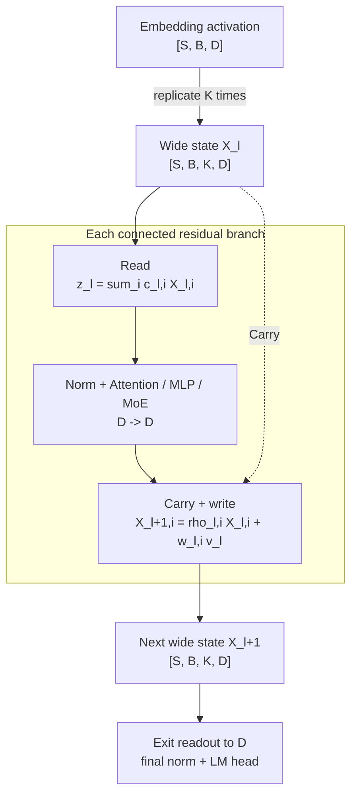

# [1/4] Integrate streamwise wide residuals with HybridStack

[Upstream PR](https://github.com/NVIDIA/Megatron-LM/pull/6716) · state: closed · merged: True

## Original PR description

## Port correspondence (for tracking)

| `nv-mistralai-megatron` source | Adapted upstream destination(s) | Coverage |
| --- | --- | --- |
| [`528c1052`](https://github.com/NVIDIA-NeMo/nv-mistralai-megatron/commit/528c1052746a7d12c55a2492aa13302774f6aaa5) Add streamwise wide-residual connections | [#7579 `b27f5fce`](https://github.com/NVIDIA/Megatron-LM/pull/7579/commits/b27f5fce1e9366de218d53304b0ecb3ec80d39df), [#7599 `1551e32e`](https://github.com/NVIDIA/Megatron-LM/pull/7599/commits/1551e32ed07b18fd19b5abd92111ea3b6967add2), [#7599 `fb424436`](https://github.com/NVIDIA/Megatron-LM/pull/7599/commits/fb424436f19b3bcafdb411c8cb6eb2d80de1d308), and [this PR, `b219432d`](https://github.com/NVIDIA/Megatron-LM/pull/6716/commits/b219432d818287b337658fee6b60972e97545a9c) | Split by responsibility: #7579 provides the generic residual protocol and structured operators; #7599 provides the dedicated configuration and concrete connection modules; this PR provides explicit Transformer/Mamba layers, HybridStack construction, branch wiring, and model-boundary integration. |
| [`d58c2e4f`](https://github.com/NVIDIA-NeMo/nv-mistralai-megatron/commit/d58c2e4f0b0384b62a9e859d3a1623145d548eed) Add WideResidual CLI and checkpoint restoration | [This PR, `11fc5f19`](https://github.com/NVIDIA/Megatron-LM/pull/6716/commits/11fc5f191b55becfc38d14933a8f1499c7db88a9) | Full port, adapted to upstream nested `TransformerConfig`, argument parsing, HybridStack model construction, and checkpoint restoration. |

Commit [`b219432d`](https://github.com/NVIDIA/Megatron-LM/pull/6716/commits/b219432d818287b337658fee6b60972e97545a9c) is an upstream-native architecture adaptation rather than a line-for-line port. It uses explicit `WideResidualTransformerLayer` and `WideResidualMambaLayer` classes with static HybridStack specs.

Retention weight-decay and optimizer-marker ports are now tracked in prerequisite PR #7599. FP32 kernel and eager-execution ports are tracked in #7579 and the dedicated FP32 follow-up, respectively.


## 


- [x] I, the PR author, have personally reviewed every line of this PR.

## What does this PR do?

Adds a residual-connection read/write map and narrow hooks to `TransformerLayer`, then implements streamwise wide residuals in an explicit `WideResidualTransformerLayer` subclass. The model carries `K` contiguous residual streams of width `D` between branches, while attention, dense MLP, and MoE computations continue to operate at the original hidden size `D`.

This is the foundational PR in a **four-part series**. It intentionally limits review to the core connection contract, streamwise implementation, `TransformerBlock` integration, and model boundaries. Higher-level model integrations and memory optimizations will be adapted in separate follow-up PRs.

## Issue tracking

N/A


## Motivation and algorithm

### Overview

A standard residual branch carries one hidden state of width `D`:

$$
x_{\ell+1} = x_\ell + v_\ell,
\qquad
v_\ell = \mathrm{Dropout}\left(
    F_\ell\left(\mathrm{Norm}_\ell(x_\ell)\right) + b_\ell
\right).
$$

Here, $F_\ell$ is one residual branch, such as self-attention, a dense MLP, or an MoE block.  

**Streamwise wide residuals** replace the single carried state with `K` streams, each still of
width `D`. Conceptually,

$$
X_\ell = [X_{\ell,1}, \ldots, X_{\ell,K}]
\in \mathbb{R}^{S \times B \times K \times D}.
$$

Only the residual state is widened. The embedding table, attention projections, MLP weights, MoE router and experts, final normalization, and LM head retain their ordinary width `D`.

Each connected branch performs three operations:

1. **Read:** combine the `K` streams into a single width-`D` branch input.
2. **Branch:** run the existing normalization and attention, MLP, or MoE computation at `D`.
3. **Carry and write:** optionally retain/discount each old stream and write the common branch update back with a stream-specific coefficient.

The equations are:

$$
z_\ell = \sum_{i=1}^{K} c_{\ell,i} X_{\ell,i},
$$

$$
v_\ell = \mathrm{Dropout}\left(
    F_\ell\left(\mathrm{Norm}_\ell(z_\ell)\right) + b_\ell
\right),
$$

$$
X_{\ell+1,i} = \rho_{\ell,i} X_{\ell,i} + w_{\ell,i} v_\ell,
\qquad i = 1, \ldots, K.
$$

The coefficients are token-independent learned scalars owned by each connected branch:

$$
c_{\ell,i} = \sigma(\alpha_{\ell,i}),
\qquad
w_{\ell,i} = 2\sigma(\beta_{\ell,i}),
$$

and, when learned discounting/retention is enabled,

$$
\rho_{\ell,i}
= 1 - \mathrm{max\_forget}\,\sigma(-\gamma_{\ell,i}).
$$

Without learned discounting/retention, $\rho_{\ell,i}=1$. Thus the read coefficients are positive, the write coefficients lie in `(0, 2)`, and optional retention lies in `(1 - max_forget, 1)`. The read coefficients are initialized to sum to one.



### Model boundaries

The embedding module still produces an activation of width `D`. At the entrance to the first Transformer block, that activation is copied into the `K` streams:

$$
X_{0,i} = x_0 \qquad \text{for all } i.
$$

After the last Transformer block, a learned streamwise readout applies the same positive read-map parameterization to contract `K * D` back to `D` before the existing final normalization and LM head:

$$
x_{\mathrm{out}} = \sum_{i=1}^{K} c_{\mathrm{exit},i} X_{L,i}.
$$

 

### Initialization and relation to the ordinary residual path

The maps are initialized as follows:

- every read factor is exactly `1 / K`
- write logits are initialized as $\beta_i \in \mathrm{linspace}(-s, s, K)$, where  $s$ is `streamwise_sigmoid_init_scale`. Mirrored logits satisfy $\beta_{K+1-i}=-\beta_i$, and therefore $2\sigma(\beta_i)+2\sigma(-\beta_i)=2$. Each mirrored pair of write factors has mean one; when `K` is odd, the center logit is zero and its write factor is also exactly one. Thus $K^{-1}\sum_i w_i=1$.
- the exit readout also starts as an exact average
- retention is disabled by default. If enabled, it starts at the configured value, `0.999` by default.

When retention is disabled and the maps remain at initialization, the wide model preserves the ordinary residual computation exactly at every connected branch. The read is the stream mean, and

$$
\frac{1}{K}\sum_{i=1}^{K} X_{\ell+1,i}
= \frac{1}{K}\sum_{i=1}^{K} X_{\ell,i} + \left(\frac{1}{K}\sum_{i=1}^{K} w_{\ell,i}\right)v_\ell
= z_\ell + v_\ell.
$$

This is the standard residual update because the mean write coefficient is one. The slightly different write coefficients nevertheless send different updates to the individual streams, so they can diversify during the training while their mean follows the baseline computation.

Learned retention uses the same replicated input and read/write initialization, but
$\rho_{\ell,i}<1$ makes the initial function only approximately baseline-equivalent. Choosing an initial retention close to one makes this perturbation small while allowing the model to learn bounded forgetting.

## PR series and downstream reference

The planned series is:

1. **Transformer core (this PR):** the residual-connection runtime protocol, explicit `WideResidualTransformerLayer`, static GPT `ModuleSpec` selection, streamwise equations and kernels, `TransformerBlock` integration, and model-boundary expansion and readout.
2. **Hybrid replay:** HybridStack and Mamba integration, followed by selective output-discard
   replay of residual reads, connected-branch norms, and writes, including coordination with fine-grained activation-offload ownership.
3. **MTP and MIMO boundaries:** keep shifted-token and externally composed multimodal activations at backbone width `D`, then expand exactly once where the main decoder begins carrying `K * D`.
4. **Shortcut MoE:** compose independent routed, compute, and MoE residual reads with serial/overlapped Shortcut MoE execution and atomic selective replay.
 
 
## Design

### Transformer-layer ownership and residual-connection seam

`ResidualConnection` defines a runtime contract for reading a branch input from a residual stream and writing the branch update back. Calls use `apply_module`, so normal module hooks used by DDP and fine-grained FSDP run before connection parameters are accessed.

The ordinary `TransformerLayer` exposes two protected hooks for obtaining optional self-attention and MLP residual connections. Their default implementations return `None`, preserving the ordinary bias-dropout-add path.

`WideResidualTransformerLayer` subclasses `TransformerLayer`, constructs its self-attention and MLP connections as child modules, and returns them through those hooks. It inherits the existing forward implementation rather than duplicating attention, dense MLP, MoE, recomputation, or offload logic. Connections are created after the existing branch modules, preserving baseline parameter-initialization order.

### Static model construction

Canonical GPT factories now have wide-residual variants whose `ModuleSpec` explicitly names `WideResidualTransformerLayer` while reusing the existing branch submodules.

GPT builders choose the ordinary or wide factory from `TransformerConfig.wide_residual`. `TransformerBlock` validates that a wide configuration received an explicit `WideResidualTransformerLayer` spec and then constructs that spec unchanged. 

Each active self-attention and MLP/MoE branch receives an independent `D' -> D -> D'` connection. For MoE, the outer connection reduces the activation to `D` before the existing router, experts, and optional shared experts run.

At the model boundary, the ordinary-width embedding activation is copied into `K` streams. A learned readout contracts the final `K * D` activation to `D` before final normalization, so embedding and LM-head parameter shapes remain unchanged.

### Efficient streamwise operations

The implementation provides native PyTorch reference/fallback operations and dedicated Triton
training kernels for supported contiguous BF16/FP16 CUDA shapes.

The Triton path:

- forms sigmoid read, write, and retention factors in registers instead of constructing dense
  maps;
- computes activation gradients and tile-local controller-gradient partials in the same pass;
- reduces those partials deterministically without rereading the full activations through a
  separate map-gradient GEMM/BMM;
- writes directly into the single full-width output allocation, without expanding the branch
  update into an intermediate `K * D` tensor;
- avoids saving the residual input solely for writeback backward when retention is disabled.

The controller vectors are padded to a small minimum storage size for distributed-optimizer
sharding, but only the first `K` values participate in the computation and the padded suffix
receives zero gradient. Controllers are replicated across tensor-parallel ranks, carry explicit
TP gradient-reduction metadata, and follow scalar optimizer routing. Read/write map controllers
also set `use_muon = False` explicitly.

Although retention logits are stored as 1-D vectors, they are excluded from Megatron's generic zero-weight-decay override for 1-D parameters and therefore inherit the run's configured weight decay. If the configured weight decay is zero, they receive none. No retention-specific weight-decay option is introduced.


## Configuration

This core PR adds a configuration API rather than training-script CLI arguments. The feature is
enabled through `TransformerConfig`:

```python
from megatron.core.transformer import WideResidualConfig

transformer_config.wide_residual = WideResidualConfig(
    num_streams=3,
    learned_retention=False,
)
```

Optional bounded retention can be enabled with:

```python
transformer_config.wide_residual = WideResidualConfig(
    num_streams=3,
    learned_retention=True,
    retention_init=0.999,
    retention_max_forget=0.10,
)
```
  

## File guide

- `megatron/core/transformer/residual_connection.py`: architecture-neutral runtime read/write protocol.
- `megatron/core/transformer/wide_residual_layer.py`: streamwise controllers, explicit `WideResidualTransformerLayer`, readout, and model-boundary expansion.
- `megatron/core/transformer/transformer_layer.py`: neutral opt-in hooks and shared branch read/write execution.
- `megatron/core/transformer/transformer_block.py`: explicit wide-layer spec validation, input expansion, and final readout.
- `megatron/core/models/gpt/gpt_layer_specs.py`: static ordinary and wide GPT layer factories.
- `megatron/training/models/gpt.py` and `gpt_builders.py`: ordinary-versus-wide factory selection and unsupported spec-producer guardrails.
-  `megatron/core/optimizer/__init__.py`: keeps learned-retention logits on the run's configured weight-decay policy instead of the generic zero-WD policy for 1-D parameters.


## Contribution process

### Pre-checks

- [x] I have added relevant unit tests
- [x] I have added relevant functional tests
- [x] I have added proper typing to my code [Typing guidelines](https://docs.python.org/3/library/typing.html)
- [x] I have added relevant documentation
- [x] I have run the [autoformatter.sh](https://github.com/NVIDIA/Megatron-LM/blob/main/tools/autoformat.sh) on my PR

### Code review

Feel free to message or comment @NVIDIA/mcore-oncall to help accelerate your merge into main. The less complex your PR is, the faster it will be approved and merged!

All PRs start as **draft**. If you open a non-draft PR, it will be automatically converted to draft.

#### Step 1: Mark PR as "Ready for Review"

1. When your PR is ready, click **Ready for Review**.
2. An oncall reviewer is auto-assigned and expert reviewers are notified based on your changes.
   - Some PRs may jump straight to step 2. This is determined by `.github/CODEOWNERS`.

:warning: Only mark as ready once merge-conflicts are resolved and the CI is passing.
Final Review might get declined if these requirements are not fulfilled.

#### Step 2: Final Review

For PRs that change `megatron/core`, once all expert reviewers have approved, the `Final Review` label is applied **automatically** and final reviewers are assigned.

For PRs outside `megatron/core`, this step is skipped.

#### Step 3: Approved

Once all required reviewers have approved, the `Approved` label is applied **automatically**.

### Merge

Any member of [mcore-engineers](https://github.com/orgs/NVIDIA/teams/mcore-engineers) will be able to merge your PR.


## Review and discussion

### reviews

- deepakn94 · APPROVED · 2026-08-24T22:02:41Z · [source](https://github.com/NVIDIA/Megatron-LM/pull/6716#pullrequestreview-5012975150)

(No body; status only.)

- jaredcasper · COMMENTED · 2026-08-25T16:34:59Z · [source](https://github.com/NVIDIA/Megatron-LM/pull/6716#pullrequestreview-5021431003)

(No body; status only.)

- jaredcasper · COMMENTED · 2026-08-25T16:40:30Z · [source](https://github.com/NVIDIA/Megatron-LM/pull/6716#pullrequestreview-5021478942)

(No body; status only.)

- kwangjunahn · COMMENTED · 2026-08-26T18:18:09Z · [source](https://github.com/NVIDIA/Megatron-LM/pull/6716#pullrequestreview-5033743525)

(No body; status only.)

- zhongbozhu · APPROVED · 2026-09-01T23:33:55Z · [source](https://github.com/NVIDIA/Megatron-LM/pull/6716#pullrequestreview-5084141835)

(No body; status only.)

- kwangjunahn · COMMENTED · 2026-09-02T00:09:22Z · [source](https://github.com/NVIDIA/Megatron-LM/pull/6716#pullrequestreview-5084352122)

(No body; status only.)

- zhongbozhu · COMMENTED · 2026-09-02T01:18:12Z · [source](https://github.com/NVIDIA/Megatron-LM/pull/6716#pullrequestreview-5084673198)

(No body; status only.)

- zhongbozhu · COMMENTED · 2026-09-02T01:18:38Z · [source](https://github.com/NVIDIA/Megatron-LM/pull/6716#pullrequestreview-5084675063)

(No body; status only.)

- kwangjunahn · COMMENTED · 2026-09-02T12:20:49Z · [source](https://github.com/NVIDIA/Megatron-LM/pull/6716#pullrequestreview-5089517937)

(No body; status only.)

- kwangjunahn · COMMENTED · 2026-09-02T12:24:21Z · [source](https://github.com/NVIDIA/Megatron-LM/pull/6716#pullrequestreview-5089550562)

(No body; status only.)

- jaredcasper · APPROVED · 2026-09-18T16:52:36Z · [source](https://github.com/NVIDIA/Megatron-LM/pull/6716#pullrequestreview-5250331375)

(No body; status only.)

- guihong-nv · APPROVED · 2026-09-18T17:15:13Z · [source](https://github.com/NVIDIA/Megatron-LM/pull/6716#pullrequestreview-5250571655)

(No body; status only.)

- Phlip79 · APPROVED · 2026-09-23T03:21:33Z · [source](https://github.com/NVIDIA/Megatron-LM/pull/6716#pullrequestreview-5286547059)

(No body; status only.)

### issue_comments

- copy-pr-bot[bot] · comment · 2026-08-20T20:33:20Z · [source](https://github.com/NVIDIA/Megatron-LM/pull/6716#issuecomment-5361342288)

This pull request requires additional validation before any workflows can run on NVIDIA's runners.

Pull request vetters can view their responsibilities [here](https://docs.gha-runners.nvidia.com/cpr/vetters).

Contributors can view more details about this message [here](https://docs.gha-runners.nvidia.com/cpr/contributors).


- github-actions[bot] · comment · 2026-08-20T20:33:27Z · [source](https://github.com/NVIDIA/Megatron-LM/pull/6716#issuecomment-5361343455)

This PR has been automatically converted to **draft** because all PRs must start as drafts.

When you are ready for review, click **Ready for Review** to begin the review process. This will:
1. Add the oncall reviewer (optional reviewer)
2. Add required review teams based on your changes

See the [contribution guide](https://github.com/NVIDIA/Megatron-LM/blob/main/docs/developer/submit.md) for more details.

- kwangjunahn · comment · 2026-09-15T17:31:52Z · [source](https://github.com/NVIDIA/Megatron-LM/pull/6716#issuecomment-5684960375)

/ok to test 682e8210b92dc62be728fbcb4f662f6609e545d1

- kwangjunahn · comment · 2026-09-15T18:42:19Z · [source](https://github.com/NVIDIA/Megatron-LM/pull/6716#issuecomment-5686053678)

/ok to test 89ec8182c27e87833a9e6ef073573d88f6d5d9b1

- kwangjunahn · comment · 2026-09-15T21:54:07Z · [source](https://github.com/NVIDIA/Megatron-LM/pull/6716#issuecomment-5688614118)

/ok to test a0b5bbe1b7fc0ed5475032d5465b8c668def5b9b

- kwangjunahn · comment · 2026-09-15T23:11:36Z · [source](https://github.com/NVIDIA/Megatron-LM/pull/6716#issuecomment-5689355375)

/ok to test 544369bcf9a51e5a1e0e1116f2036f604922d21f

- kwangjunahn · comment · 2026-09-16T14:20:51Z · [source](https://github.com/NVIDIA/Megatron-LM/pull/6716#issuecomment-5699040333)

/ok to test ca0f87211deca77015e3d2a66d922bca7dae81dc

- kwangjunahn · comment · 2026-09-18T23:51:28Z · [source](https://github.com/NVIDIA/Megatron-LM/pull/6716#issuecomment-5737563991)

/ok to test d47df49f6080bc898f2ff700da26a5c526eebbbe

- kwangjunahn · comment · 2026-09-19T19:31:30Z · [source](https://github.com/NVIDIA/Megatron-LM/pull/6716#issuecomment-5744722383)

/ok to test d47df49f6080bc898f2ff700da26a5c526eebbbe

- Phlip79 · comment · 2026-09-22T00:35:09Z · [source](https://github.com/NVIDIA/Megatron-LM/pull/6716#issuecomment-5769574384)

If this is for nemotron, why are there so many changes to GPTModel logic?

- kwangjunahn · comment · 2026-09-22T02:25:27Z · [source](https://github.com/NVIDIA/Megatron-LM/pull/6716#issuecomment-5770337693)

> If this is for nemotron, why are there so many changes to GPTModel logic?

Wide residual are used in Nemotron, but the current implementation is not Nemotron-specific.
Wide residual also supports standalone GPT models. This PR does not change `GPTModel.forward()`. The GPT-related changes only select `WideResidualTransformerLayer` in the existing GPT spec/building paths and reject unsupported spec producers explicitly.

Also, the diff in `megatron/training/models/gpt.py` appears larger than the semantic change because running the repository autoformatter reformatted unrelated lines...

- kwangjunahn · comment · 2026-09-22T21:44:47Z · [source](https://github.com/NVIDIA/Megatron-LM/pull/6716#issuecomment-5784683262)

/ok to test 19884866285b0e0ef19c05d5ef3fe6d7184528f2

- kwangjunahn · comment · 2026-09-23T14:47:35Z · [source](https://github.com/NVIDIA/Megatron-LM/pull/6716#issuecomment-5797003565)

/ok to test 7a2b6d241a2acd0df89682ef6722e5d969bfd277

- kwangjunahn · comment · 2026-09-24T13:55:07Z · [source](https://github.com/NVIDIA/Megatron-LM/pull/6716#issuecomment-5815477325)

/ok to test 11fc5f191b55becfc38d14933a8f1499c7db88a9

- kwangjunahn · comment · 2026-09-24T20:06:43Z · [source](https://github.com/NVIDIA/Megatron-LM/pull/6716#issuecomment-5821399097)

/ok to test fea8df0f8e7b1349a720788b4c189044204123f3

- nemo-automation-bot[bot] · comment · 2026-09-24T22:19:04Z · [source](https://github.com/NVIDIA/Megatron-LM/pull/6716#issuecomment-5823163706)

🔄 Merge queue validation started!

You can track the progress here: https://github.com/NVIDIA/Megatron-LM/actions/runs/36066725655

- nemo-automation-bot[bot] · comment · 2026-09-24T23:50:28Z · [source](https://github.com/NVIDIA/Megatron-LM/pull/6716#issuecomment-5824211120)

🔄 Merge queue validation started!

You can track the progress here: https://github.com/NVIDIA/Megatron-LM/actions/runs/36074705399

### inline_comments

- jaredcasper · comment · 2026-08-25T16:34:59Z · [source](https://github.com/NVIDIA/Megatron-LM/pull/6716#discussion_r3855124515)

File: `megatron/core/transformer/wide_residual_layer.py` · line None

I REALLY don't like modifying the spec dynamically after the fact like this. This needs to be implemented in a cleaner way. The spec should be simple, static, and not depend on the configuration. The spec is used to say "if you want an X use module Y", not to change the math or architecture of the model.

The types of connection should be determined in the init function and be up front and clear, not hidden in the spec. If the actual modules use for a given type of connection "X" (i.e. if there is a PyTorch only version of something and a fused kernel version of something) that can use the spec to decide which one to use, but that doesn't seem to be the case here. Each type of connection only has one module that implements it.

- jaredcasper · comment · 2026-08-25T16:40:30Z · [source](https://github.com/NVIDIA/Megatron-LM/pull/6716#discussion_r3855166692)

File: `megatron/core/transformer/transformer_layer.py` · line None

Can these be implemented by wrapping layers, similar to how mHC is implemented? Feels like that would be cleaner. https://github.com/NVIDIA/Megatron-LM/pull/6401

That way these connections will work on any layer.

- kwangjunahn · comment · 2026-08-26T18:18:08Z · [source](https://github.com/NVIDIA/Megatron-LM/pull/6716#discussion_r3865543236)

File: `megatron/core/transformer/transformer_layer.py` · line None

Thank you for the comment! I actually considered the wrapper approach, but intentionally used branch-level connections because a wrapper does not uniformly receive an incremental branch update.

The mHC Hybrid wrapper handles this by computing [layer_output - aggregated](https://github.com/NVIDIA/Megatron-LM/blob/ae73f0b41aed07ff8955a0289baac2109f694b4c/megatron/core/models/hybrid/layers/hybrid_hyper_connection.py#L168-L184) for Mamba-like layers and other cases that cannot use its [split attention-only/MLP-only fast path](https://github.com/NVIDIA/Megatron-LM/blob/ae73f0b41aed07ff8955a0289baac2109f694b4c/megatron/core/models/hybrid/layers/hybrid_hyper_connection.py#L84-L141). 

The current implementation seam intercepts raw branch outputs before residual addition, avoiding this delta reconstruction and preserving separate attention and MLP connections. 

With all that said, I can also align with the mHC wrapper pattern if that is the preferred direction! Please let me know what you think.

- kwangjunahn · comment · 2026-09-02T00:09:22Z · [source](https://github.com/NVIDIA/Megatron-LM/pull/6716#discussion_r3909573150)

File: `megatron/core/transformer/wide_residual_layer.py` · line None

Thank you for the comment! 
I refactored the implementation such that it no longer mutates or specializes an existing `ModuleSpec`. The GPT builder now uses wide_residual only to select between two static declarations:
- `ModuleSpec(module=TransformerLayer, ...)`
- `ModuleSpec(module=WideResidualTransformerLayer, ...)`

`TransformerBlock` validates and constructs the selected spec. The new subclass owns its residual-connection modules while reusing the inherited Transformer forward path through two narrow hooks (which are default None).

I removed the residual-connection fields from `TransformerLayerSubmodules` along with `ResidualConnectionSpec` and its builder. `WideResidualTransformerLayer.__init__()` now directly constructs  `StreamwiseSigmoidWideResidualConnection`.

- zhongbozhu · comment · 2026-09-02T01:18:12Z · [source](https://github.com/NVIDIA/Megatron-LM/pull/6716#discussion_r3909882233)

File: `megatron/core/transformer/transformer_config.py` · line 1646

this will be resolved in https://github.com/NVIDIA/Megatron-LM/pull/6855 right?

- zhongbozhu · comment · 2026-09-02T01:18:38Z · [source](https://github.com/NVIDIA/Megatron-LM/pull/6716#discussion_r3909883927)

File: `megatron/core/transformer/transformer_config.py` · line 1637

what's the plan to fix this?

- kwangjunahn · comment · 2026-09-02T12:20:49Z · [source](https://github.com/NVIDIA/Megatron-LM/pull/6716#discussion_r3913994132)

File: `megatron/core/transformer/transformer_config.py` · line 1646

Yes. #6855 is the intended follow-up that removes this guard

- kwangjunahn · comment · 2026-09-02T12:24:21Z · [source](https://github.com/NVIDIA/Megatron-LM/pull/6716#discussion_r3914022963)

File: `megatron/core/transformer/transformer_config.py` · line 1637

I'm planning to support the CUDA-graph in a follow-up. Concretely, `WideResidualTransformerLayer` will provide K * D static capture inputs and include its residual-connection modules in CUDA-graph registration, following the extension points already used by `HyperConnectionTransformerLayer`.

## Changed files and fixed code

- `megatron/core/models/hybrid/hybrid_block.py` · modified · additions 28 / deletions 0
  - [head](https://github.com/kwangjunahn/Megatron-LM/blob/fea8df0f8e7b1349a720788b4c189044204123f3/megatron/core/models/hybrid/hybrid_block.py)
  - [base](https://github.com/NVIDIA/Megatron-LM/blob/ec806b20a0a976924c1668486c3554ffb90c000e/megatron/core/models/hybrid/hybrid_block.py)
- `megatron/core/models/hybrid/hybrid_layer_specs.py` · modified · additions 52 / deletions 0
  - [head](https://github.com/kwangjunahn/Megatron-LM/blob/fea8df0f8e7b1349a720788b4c189044204123f3/megatron/core/models/hybrid/hybrid_layer_specs.py)
  - [base](https://github.com/NVIDIA/Megatron-LM/blob/ec806b20a0a976924c1668486c3554ffb90c000e/megatron/core/models/hybrid/hybrid_layer_specs.py)
- `megatron/core/ssm/mamba_layer.py` · modified · additions 52 / deletions 11
  - [head](https://github.com/kwangjunahn/Megatron-LM/blob/fea8df0f8e7b1349a720788b4c189044204123f3/megatron/core/ssm/mamba_layer.py)
  - [base](https://github.com/NVIDIA/Megatron-LM/blob/ec806b20a0a976924c1668486c3554ffb90c000e/megatron/core/ssm/mamba_layer.py)
- `megatron/core/ssm/wide_residual_mamba_layer.py` · added · additions 67 / deletions 0
  - [head](https://github.com/kwangjunahn/Megatron-LM/blob/fea8df0f8e7b1349a720788b4c189044204123f3/megatron/core/ssm/wide_residual_mamba_layer.py)
  - [base](https://github.com/NVIDIA/Megatron-LM/blob/ec806b20a0a976924c1668486c3554ffb90c000e/megatron/core/ssm/wide_residual_mamba_layer.py)
- `megatron/core/transformer/__init__.py` · modified · additions 1 / deletions 0
  - [head](https://github.com/kwangjunahn/Megatron-LM/blob/fea8df0f8e7b1349a720788b4c189044204123f3/megatron/core/transformer/__init__.py)
  - [base](https://github.com/NVIDIA/Megatron-LM/blob/ec806b20a0a976924c1668486c3554ffb90c000e/megatron/core/transformer/__init__.py)
- `megatron/core/transformer/transformer_config.py` · modified · additions 40 / deletions 0
  - [head](https://github.com/kwangjunahn/Megatron-LM/blob/fea8df0f8e7b1349a720788b4c189044204123f3/megatron/core/transformer/transformer_config.py)
  - [base](https://github.com/NVIDIA/Megatron-LM/blob/ec806b20a0a976924c1668486c3554ffb90c000e/megatron/core/transformer/transformer_config.py)
- `megatron/core/transformer/transformer_layer.py` · modified · additions 89 / deletions 18
  - [head](https://github.com/kwangjunahn/Megatron-LM/blob/fea8df0f8e7b1349a720788b4c189044204123f3/megatron/core/transformer/transformer_layer.py)
  - [base](https://github.com/NVIDIA/Megatron-LM/blob/ec806b20a0a976924c1668486c3554ffb90c000e/megatron/core/transformer/transformer_layer.py)
- `megatron/core/transformer/wide_residual_layer.py` · modified · additions 115 / deletions 1
  - [head](https://github.com/kwangjunahn/Megatron-LM/blob/fea8df0f8e7b1349a720788b4c189044204123f3/megatron/core/transformer/wide_residual_layer.py)
  - [base](https://github.com/NVIDIA/Megatron-LM/blob/ec806b20a0a976924c1668486c3554ffb90c000e/megatron/core/transformer/wide_residual_layer.py)
- `megatron/training/argument_utils.py` · modified · additions 37 / deletions 1
  - [head](https://github.com/kwangjunahn/Megatron-LM/blob/fea8df0f8e7b1349a720788b4c189044204123f3/megatron/training/argument_utils.py)
  - [base](https://github.com/NVIDIA/Megatron-LM/blob/ec806b20a0a976924c1668486c3554ffb90c000e/megatron/training/argument_utils.py)
- `megatron/training/arguments.py` · modified · additions 46 / deletions 0
  - [head](https://github.com/kwangjunahn/Megatron-LM/blob/fea8df0f8e7b1349a720788b4c189044204123f3/megatron/training/arguments.py)
  - [base](https://github.com/NVIDIA/Megatron-LM/blob/ec806b20a0a976924c1668486c3554ffb90c000e/megatron/training/arguments.py)
- `megatron/training/checkpointing.py` · modified · additions 26 / deletions 0
  - [head](https://github.com/kwangjunahn/Megatron-LM/blob/fea8df0f8e7b1349a720788b4c189044204123f3/megatron/training/checkpointing.py)
  - [base](https://github.com/NVIDIA/Megatron-LM/blob/ec806b20a0a976924c1668486c3554ffb90c000e/megatron/training/checkpointing.py)
- `megatron/training/models/hybrid.py` · modified · additions 38 / deletions 15
  - [head](https://github.com/kwangjunahn/Megatron-LM/blob/fea8df0f8e7b1349a720788b4c189044204123f3/megatron/training/models/hybrid.py)
  - [base](https://github.com/NVIDIA/Megatron-LM/blob/ec806b20a0a976924c1668486c3554ffb90c000e/megatron/training/models/hybrid.py)
- `tests/unit_tests/models/test_hybrid_moe_model.py` · modified · additions 1 / deletions 0
  - [head](https://github.com/kwangjunahn/Megatron-LM/blob/fea8df0f8e7b1349a720788b4c189044204123f3/tests/unit_tests/models/test_hybrid_moe_model.py)
  - [base](https://github.com/NVIDIA/Megatron-LM/blob/ec806b20a0a976924c1668486c3554ffb90c000e/tests/unit_tests/models/test_hybrid_moe_model.py)
- `tests/unit_tests/ssm/test_hybrid_block.py` · modified · additions 58 / deletions 0
  - [head](https://github.com/kwangjunahn/Megatron-LM/blob/fea8df0f8e7b1349a720788b4c189044204123f3/tests/unit_tests/ssm/test_hybrid_block.py)
  - [base](https://github.com/NVIDIA/Megatron-LM/blob/ec806b20a0a976924c1668486c3554ffb90c000e/tests/unit_tests/ssm/test_hybrid_block.py)
- `tests/unit_tests/test_argument_utils.py` · modified · additions 70 / deletions 1
  - [head](https://github.com/kwangjunahn/Megatron-LM/blob/fea8df0f8e7b1349a720788b4c189044204123f3/tests/unit_tests/test_argument_utils.py)
  - [base](https://github.com/NVIDIA/Megatron-LM/blob/ec806b20a0a976924c1668486c3554ffb90c000e/tests/unit_tests/test_argument_utils.py)
- `tests/unit_tests/test_checkpointing.py` · modified · additions 64 / deletions 0
  - [head](https://github.com/kwangjunahn/Megatron-LM/blob/fea8df0f8e7b1349a720788b4c189044204123f3/tests/unit_tests/test_checkpointing.py)
  - [base](https://github.com/NVIDIA/Megatron-LM/blob/ec806b20a0a976924c1668486c3554ffb90c000e/tests/unit_tests/test_checkpointing.py)
- `tests/unit_tests/training/models/test_hybrid_builder.py` · modified · additions 22 / deletions 0
  - [head](https://github.com/kwangjunahn/Megatron-LM/blob/fea8df0f8e7b1349a720788b4c189044204123f3/tests/unit_tests/training/models/test_hybrid_builder.py)
  - [base](https://github.com/NVIDIA/Megatron-LM/blob/ec806b20a0a976924c1668486c3554ffb90c000e/tests/unit_tests/training/models/test_hybrid_builder.py)
- `tests/unit_tests/transformer/moe/test_wide_residual_branchwise.py` · added · additions 162 / deletions 0
  - [head](https://github.com/kwangjunahn/Megatron-LM/blob/fea8df0f8e7b1349a720788b4c189044204123f3/tests/unit_tests/transformer/moe/test_wide_residual_branchwise.py)
  - [base](https://github.com/NVIDIA/Megatron-LM/blob/ec806b20a0a976924c1668486c3554ffb90c000e/tests/unit_tests/transformer/moe/test_wide_residual_branchwise.py)
- `tests/unit_tests/transformer/test_wide_residual_connection.py` · modified · additions 428 / deletions 0
  - [head](https://github.com/kwangjunahn/Megatron-LM/blob/fea8df0f8e7b1349a720788b4c189044204123f3/tests/unit_tests/transformer/test_wide_residual_connection.py)
  - [base](https://github.com/NVIDIA/Megatron-LM/blob/ec806b20a0a976924c1668486c3554ffb90c000e/tests/unit_tests/transformer/test_wide_residual_connection.py)

## Evidence and interpretation boundary

[Original JSON, discussions and patches](../../../../../../evidence/prs/NVIDIA--Megatron-LM/6716-8f0abc583e4d51da3f216dc7a59e68fe51ef60761eb055d2c418b6c75637cde5.json) · SHA-256 `8f0abc583e4d51da3f216dc7a59e68fe51ef60761eb055d2c418b6c75637cde5`.

Diff complete: True. Missing/binary/truncated patches require pinned source inspection. This is a source page, not an independently verified optimization case. Open, merged and released are different states; recheck the deployed dependency.
