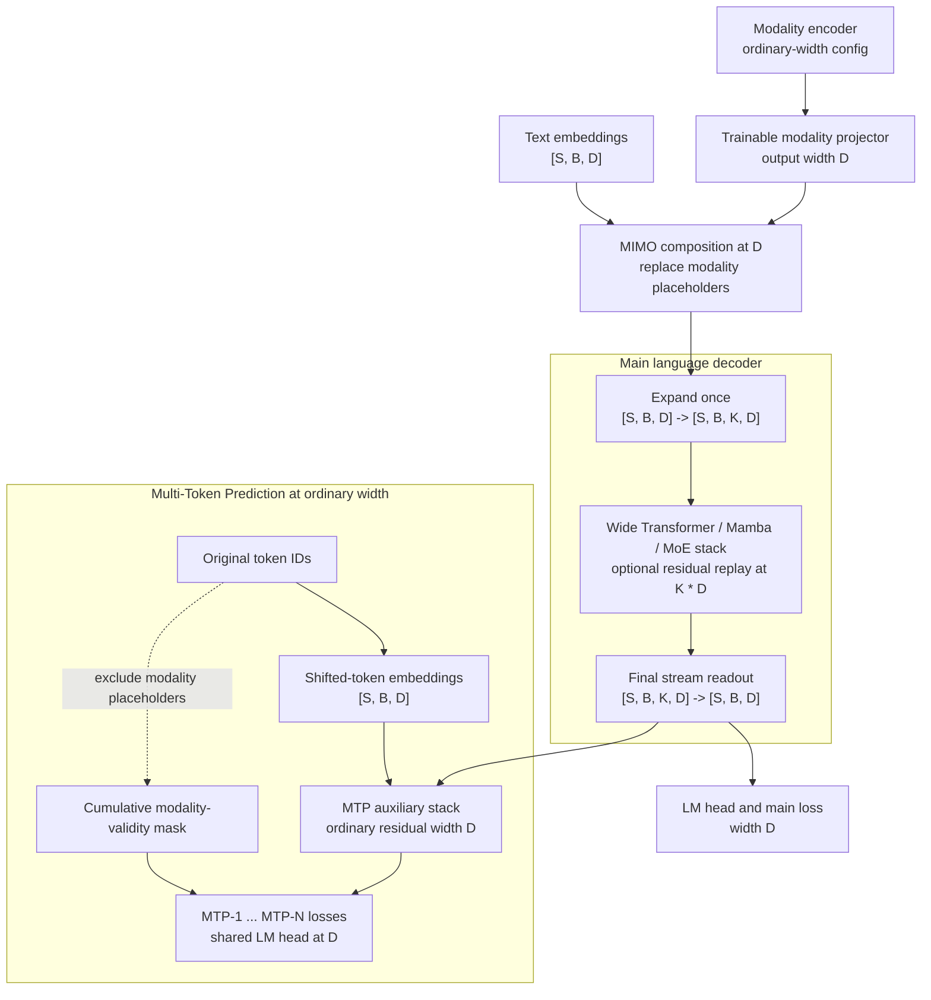

# [3/4] Support wide residual streams with MTP and MIMO

[Upstream PR](https://github.com/NVIDIA/Megatron-LM/pull/6855) · state: closed · merged: True

## Original PR description

## Port correspondence (for tracking)

| `nv-mistralai-megatron` source | Adapted commit in this PR | Coverage |
| --- | --- | --- |
| [`76d333f84`](https://github.com/NVIDIA-NeMo/nv-mistralai-megatron/commit/76d333f8414f3db5c81090b88f13223d0bab4408) Support wide residuals with MTP and MIMO | [`7b1dba62a9`](https://github.com/NVIDIA/Megatron-LM/pull/6855/commits/7b1dba62a9ff83bc1d62feb543976c28e1eff671) | Full feature port, adapted to the upstream wide-layer subclasses and static `HybridStack` specs. |
| [`35bc58149`](https://github.com/NVIDIA-NeMo/nv-mistralai-megatron/commit/35bc58149b8eefb54063cc3acf0411b84faa0345) Fix FP32-residual dtype coverage for MTP and MIMO tests | [`5b4f54d6ea`](https://github.com/NVIDIA/Megatron-LM/pull/6855/commits/5b4f54d6ea7dc1a39d6d7350292fb23a8e00af9f) | MTP/MIMO portion. Combined ShortcutMoE coverage belongs to [4/4, PR #7440](https://github.com/NVIDIA/Megatron-LM/pull/7440). |
| [`092ff0acb`](https://github.com/NVIDIA-NeMo/nv-mistralai-megatron/commit/092ff0acb1ffe32f0c3345b5a56f321c253d9592) FP32 Residual + WideResidual/ShortcutMoE fixes | [`5b4f54d6ea`](https://github.com/NVIDIA/Megatron-LM/pull/6855/commits/5b4f54d6ea7dc1a39d6d7350292fb23a8e00af9f) | Partial, test-scenario lineage only: ports the FP32 variants of the GPT+MTP, Hybrid+MTP/replay, and MIMO+wide integration tests. The corresponding ordinary-Transformer and MTP dtype handling is an upstream-specific adaptation rather than a direct code port. Inference dispatch is handled by 1/4, kernel/config support by 2/4, MIMO bridge precision by PR #7480, and ShortcutMoE integration by 4/4. |

##

- [x] I, the PR author, have personally reviewed every line of this PR.

# What does this PR do?

Adds the MTP and MIMO composition boundaries for the streamwise wide-residual series.


The main language decoder may carry a `K * hidden_size` residual stream, while:

- MTP shifted-token embeddings and auxiliary layers remain at the ordinary hidden size `D`
- text and projected modality activations are composed at `D` before entering the decoder
- the combined MIMO activation is expanded exactly once at the main decoder boundary and
- the vision tower and projector remain ordinary-width modules.


> This is PR 3 of a four-part series and is stacked on [2/4] PR #6805. The [2/4]-to-[3/4] diff contains two commits and 16 files.

## Issue tracking

Linked issue: Related to #6716


## Motivation

MTP and MIMO both create boundaries at which a decoder activation cannot simply be assumed to have the main decoder's carried width.

MTP combines the completed decoder state with a shifted-token embedding. The decoder state must therefore be read out from `K * D` to `D`, and the MTP embedding and auxiliary stack must also operate at `D`.

MIMO first constructs one language-model input by replacing modality placeholder positions with projected image or other modality embeddings. Text embeddings, projector outputs, and the combined tensor all use the language model's ordinary hidden size `D`. Expanding any input before this composition would give the wrapper incompatible widths.

The intended lifecycle is:





## Design

### Main decoder and MTP use different stream contracts

`HybridStack` now distinguishes the main decoder from an MTP auxiliary stack through `is_mtp_layer`:

- the main decoder specializes its branch specs with wide-residual connections, expands its input to `K * D`, optionally performs residual-stream replay, and reads the final state back  to `D`;
- an MTP stack does not specialize its layers, expand its input, construct a wide readout, or participate in residual-stream replay; and
- the MTP marker is propagated to layer construction so every auxiliary-layer form consistently accepts ordinary-width residual states.

`TransformerLayer` and `MambaLayer` retain their ordinary residual-size contract when this marker is set. The previous `wide_residual + MTP` rejection is therefore removed.

This design deliberately keeps MTP at `D`; it does not create a second wide stream inside each prediction head. MTP and selective residual replay can be enabled together because replay owns only the main decoder's wide boundaries.

### MIMO composes at `D` and expands once

MIMO continues to pass its combined activation as `decoder_input`, bypassing the language model's main embedding lookup. The language decoder's `HybridStack` receives that ordinary-width tensor and performs the same single input expansion used by a text-only model.

Megatron's checked-in Nemotron MIMO provider derives its language, RADIO vision, and projector configs from the same CLI-populated base config. Its `_make_dense_non_hybrid` helper clears language-only MoE, Mamba, wide-residual, and residual-replay settings from both the vision and projector copies. ViT freezing remains controlled separately by `--freeze-vit`, and the projector config separately sets its output to the language hidden size `D`. Consequently, only the language decoder expands the composed activation to `K * D`.


## Second commit: FP32 residual precision boundaries

The second commit, `be43960031`, keeps ordinary Transformer and MTP computation in `params_dtype` while preserving FP32 residual carries, and strengthens BF16-backed FP32 tests.

## Configuration

This PR adds no new wide-residual CLI or configuration surface. It makes the existing options from the first two PRs compose with the existing MTP and MIMO configuration.

For example:

```python
from megatron.core.transformer import WideResidualConfig

transformer_config.wide_residual = WideResidualConfig(
    num_streams=3,
    learned_retention=True,
    retention_init=0.999,
    retention_max_forget=0.10,
)
transformer_config.mtp_num_layers = 2
```

Selective replay from PR 2 remains optional:

```text
--recompute-granularity selective
--recompute-modules residual_stream
--residual-stream-recompute-num-layers 4
```

In a MIMO model, the wide-residual configuration belongs to the language decoder. The dense vision provider strips it from the modality encoder configuration.

 


## Contribution process

### Pre-checks

- [x] I have added relevant unit tests
- [x] I have added relevant functional tests
- [x] I have added proper typing to my code [Typing guidelines](https://docs.python.org/3/library/typing.html)
- [x] I have added relevant documentation
- [x] I have run the [autoformatter.sh](https://github.com/NVIDIA/Megatron-LM/blob/main/tools/autoformat.sh) on my PR

### Code review

Feel free to message or comment @NVIDIA/mcore-oncall to help accelerate your merge into main. The less complex your PR is, the faster it will be approved and merged!

All PRs start as **draft**. If you open a non-draft PR, it will be automatically converted to draft.

#### Step 1: Mark PR as "Ready for Review"

1. When your PR is ready, click **Ready for Review**.
2. An oncall reviewer is auto-assigned and expert reviewers are notified based on your changes.
   - Some PRs may jump straight to step 2. This is determined by `.github/CODEOWNERS`.

:warning: Only mark as ready once merge-conflicts are resolved and the CI is passing.
Final Review might get declined if these requirements are not fulfilled.

#### Step 2: Final Review

For PRs that change `megatron/core`, once all expert reviewers have approved, the `Final Review` label is applied **automatically** and final reviewers are assigned.

For PRs outside `megatron/core`, this step is skipped.

#### Step 3: Approved

Once all required reviewers have approved, the `Approved` label is applied **automatically**.

### Merge

Any member of [mcore-engineers](https://github.com/orgs/NVIDIA/teams/mcore-engineers) will be able to merge your PR.

## Review and discussion

### reviews

- kwangjunahn · COMMENTED · 2026-09-29T17:46:54Z · [source](https://github.com/NVIDIA/Megatron-LM/pull/6855#pullrequestreview-5356321843)

@dcoapp recheck

- jaredcasper · APPROVED · 2026-09-30T17:32:25Z · [source](https://github.com/NVIDIA/Megatron-LM/pull/6855#pullrequestreview-5369764393)

(No body; status only.)

- zhongbozhu · APPROVED · 2026-09-30T17:32:40Z · [source](https://github.com/NVIDIA/Megatron-LM/pull/6855#pullrequestreview-5369766950)

(No body; status only.)

- mathemakitten · APPROVED · 2026-09-30T19:13:33Z · [source](https://github.com/NVIDIA/Megatron-LM/pull/6855#pullrequestreview-5370835131)

(No body; status only.)

- ericharper · APPROVED · 2026-10-01T01:48:11Z · [source](https://github.com/NVIDIA/Megatron-LM/pull/6855#pullrequestreview-5374012169)

(No body; status only.)

### issue_comments

- copy-pr-bot[bot] · comment · 2026-08-25T18:34:00Z · [source](https://github.com/NVIDIA/Megatron-LM/pull/6855#issuecomment-5414967405)

This pull request requires additional validation before any workflows can run on NVIDIA's runners.

Pull request vetters can view their responsibilities [here](https://docs.gha-runners.nvidia.com/cpr/vetters).

Contributors can view more details about this message [here](https://docs.gha-runners.nvidia.com/cpr/contributors).


- kwangjunahn · comment · 2026-09-16T18:47:36Z · [source](https://github.com/NVIDIA/Megatron-LM/pull/6855#issuecomment-5702785449)

/ok to test 6fcb97ba4ecf64857e707f1fdd51b167165456f7

- kwangjunahn · comment · 2026-09-16T19:43:44Z · [source](https://github.com/NVIDIA/Megatron-LM/pull/6855#issuecomment-5703506434)

/ok to test 36e25ef40ae1221ebb1e746a9b9872fd1ef41866

- kwangjunahn · comment · 2026-09-16T22:55:42Z · [source](https://github.com/NVIDIA/Megatron-LM/pull/6855#issuecomment-5705708415)

/ok to test bd7d65d25ca25f901370d03cbefc6ae4403b8631

- kwangjunahn · comment · 2026-09-17T02:47:16Z · [source](https://github.com/NVIDIA/Megatron-LM/pull/6855#issuecomment-5707699392)

/ok to test a5fa89ff6dc22103e471ddafa526a4ab84da1d30

- kwangjunahn · comment · 2026-09-19T01:06:00Z · [source](https://github.com/NVIDIA/Megatron-LM/pull/6855#issuecomment-5738102704)

/ok to test 5b4f54d6ea7dc1a39d6d7350292fb23a8e00af9f

- kwangjunahn · comment · 2026-09-23T15:26:22Z · [source](https://github.com/NVIDIA/Megatron-LM/pull/6855#issuecomment-5797637909)

/ok to test 4da91d49e90e2a9f5c57bf26d229a7a62974e7de

- kwangjunahn · comment · 2026-09-29T17:45:12Z · [source](https://github.com/NVIDIA/Megatron-LM/pull/6855#issuecomment-5895533081)

/ok to test 5fc19fcee899ac399f7ac835260e39d1d23bfbfa

- kwangjunahn · comment · 2026-09-29T22:20:31Z · [source](https://github.com/NVIDIA/Megatron-LM/pull/6855#issuecomment-5900199765)

/ok to test 98c0c41893d5147a977f481272f11d97ebfe50f8

- kwangjunahn · comment · 2026-09-30T13:12:36Z · [source](https://github.com/NVIDIA/Megatron-LM/pull/6855#issuecomment-5912012089)

/ok to test 941fc5dbd7a229dd642847ad331505917e253762

- kwangjunahn · comment · 2026-09-30T17:50:02Z · [source](https://github.com/NVIDIA/Megatron-LM/pull/6855#issuecomment-5916658376)

/ok to test c0b1789fc01473b3370b587e15fe3df62209eedc

- kwangjunahn · comment · 2026-09-30T19:09:57Z · [source](https://github.com/NVIDIA/Megatron-LM/pull/6855#issuecomment-5917906435)

/ok to test d3a6a1cd0addec2169cf0bc680ae2c47143c8b18

- nemo-automation-bot[bot] · comment · 2026-10-01T03:13:45Z · [source](https://github.com/NVIDIA/Megatron-LM/pull/6855#issuecomment-5923985012)

🔄 Merge queue validation started!

You can track the progress here: https://github.com/NVIDIA/Megatron-LM/actions/runs/36809527414

- nemo-automation-bot[bot] · comment · 2026-10-01T12:48:01Z · [source](https://github.com/NVIDIA/Megatron-LM/pull/6855#issuecomment-5931791849)

🔄 Merge queue validation started!

You can track the progress here: https://github.com/NVIDIA/Megatron-LM/actions/runs/36864178254

### inline_comments

## Changed files and fixed code

- `examples/mimo/model_providers/nemotron_moe_vlm.py` · modified · additions 12 / deletions 3
  - [head](https://github.com/kwangjunahn/Megatron-LM/blob/d3a6a1cd0addec2169cf0bc680ae2c47143c8b18/examples/mimo/model_providers/nemotron_moe_vlm.py)
  - [base](https://github.com/NVIDIA/Megatron-LM/blob/2cc240ebf74663f3e94180882821f4c52b154939/examples/mimo/model_providers/nemotron_moe_vlm.py)
- `examples/mimo/model_providers/radio_encoder.py` · modified · additions 8 / deletions 4
  - [head](https://github.com/kwangjunahn/Megatron-LM/blob/d3a6a1cd0addec2169cf0bc680ae2c47143c8b18/examples/mimo/model_providers/radio_encoder.py)
  - [base](https://github.com/NVIDIA/Megatron-LM/blob/2cc240ebf74663f3e94180882821f4c52b154939/examples/mimo/model_providers/radio_encoder.py)
- `megatron/core/models/hybrid/hybrid_block.py` · modified · additions 7 / deletions 1
  - [head](https://github.com/kwangjunahn/Megatron-LM/blob/d3a6a1cd0addec2169cf0bc680ae2c47143c8b18/megatron/core/models/hybrid/hybrid_block.py)
  - [base](https://github.com/NVIDIA/Megatron-LM/blob/2cc240ebf74663f3e94180882821f4c52b154939/megatron/core/models/hybrid/hybrid_block.py)
- `megatron/core/models/hybrid/hybrid_layer_specs.py` · modified · additions 3 / deletions 0
  - [head](https://github.com/kwangjunahn/Megatron-LM/blob/d3a6a1cd0addec2169cf0bc680ae2c47143c8b18/megatron/core/models/hybrid/hybrid_layer_specs.py)
  - [base](https://github.com/NVIDIA/Megatron-LM/blob/2cc240ebf74663f3e94180882821f4c52b154939/megatron/core/models/hybrid/hybrid_layer_specs.py)
- `megatron/core/models/hybrid/hybrid_model.py` · modified · additions 9 / deletions 3
  - [head](https://github.com/kwangjunahn/Megatron-LM/blob/d3a6a1cd0addec2169cf0bc680ae2c47143c8b18/megatron/core/models/hybrid/hybrid_model.py)
  - [base](https://github.com/NVIDIA/Megatron-LM/blob/2cc240ebf74663f3e94180882821f4c52b154939/megatron/core/models/hybrid/hybrid_model.py)
- `megatron/core/ssm/mamba_layer.py` · modified · additions 7 / deletions 1
  - [head](https://github.com/kwangjunahn/Megatron-LM/blob/d3a6a1cd0addec2169cf0bc680ae2c47143c8b18/megatron/core/ssm/mamba_layer.py)
  - [base](https://github.com/NVIDIA/Megatron-LM/blob/2cc240ebf74663f3e94180882821f4c52b154939/megatron/core/ssm/mamba_layer.py)
- `megatron/core/ssm/mlp_layer.py` · modified · additions 2 / deletions 0
  - [head](https://github.com/kwangjunahn/Megatron-LM/blob/d3a6a1cd0addec2169cf0bc680ae2c47143c8b18/megatron/core/ssm/mlp_layer.py)
  - [base](https://github.com/NVIDIA/Megatron-LM/blob/2cc240ebf74663f3e94180882821f4c52b154939/megatron/core/ssm/mlp_layer.py)
- `megatron/core/ssm/wide_residual_mamba_layer.py` · modified · additions 7 / deletions 0
  - [head](https://github.com/kwangjunahn/Megatron-LM/blob/d3a6a1cd0addec2169cf0bc680ae2c47143c8b18/megatron/core/ssm/wide_residual_mamba_layer.py)
  - [base](https://github.com/NVIDIA/Megatron-LM/blob/2cc240ebf74663f3e94180882821f4c52b154939/megatron/core/ssm/wide_residual_mamba_layer.py)
- `megatron/core/transformer/transformer_config.py` · modified · additions 0 / deletions 4
  - [head](https://github.com/kwangjunahn/Megatron-LM/blob/d3a6a1cd0addec2169cf0bc680ae2c47143c8b18/megatron/core/transformer/transformer_config.py)
  - [base](https://github.com/NVIDIA/Megatron-LM/blob/2cc240ebf74663f3e94180882821f4c52b154939/megatron/core/transformer/transformer_config.py)
- `megatron/core/transformer/transformer_layer.py` · modified · additions 5 / deletions 1
  - [head](https://github.com/kwangjunahn/Megatron-LM/blob/d3a6a1cd0addec2169cf0bc680ae2c47143c8b18/megatron/core/transformer/transformer_layer.py)
  - [base](https://github.com/NVIDIA/Megatron-LM/blob/2cc240ebf74663f3e94180882821f4c52b154939/megatron/core/transformer/transformer_layer.py)
- `megatron/core/transformer/wide_residual_layer.py` · modified · additions 7 / deletions 0
  - [head](https://github.com/kwangjunahn/Megatron-LM/blob/d3a6a1cd0addec2169cf0bc680ae2c47143c8b18/megatron/core/transformer/wide_residual_layer.py)
  - [base](https://github.com/NVIDIA/Megatron-LM/blob/2cc240ebf74663f3e94180882821f4c52b154939/megatron/core/transformer/wide_residual_layer.py)
- `tests/unit_tests/models/mimo/test_nemotron_moe_vlm_provider.py` · modified · additions 19 / deletions 1
  - [head](https://github.com/kwangjunahn/Megatron-LM/blob/d3a6a1cd0addec2169cf0bc680ae2c47143c8b18/tests/unit_tests/models/mimo/test_nemotron_moe_vlm_provider.py)
  - [base](https://github.com/NVIDIA/Megatron-LM/blob/2cc240ebf74663f3e94180882821f4c52b154939/tests/unit_tests/models/mimo/test_nemotron_moe_vlm_provider.py)
- `tests/unit_tests/models/test_wide_residual_mtp_mimo.py` · added · additions 266 / deletions 0
  - [head](https://github.com/kwangjunahn/Megatron-LM/blob/d3a6a1cd0addec2169cf0bc680ae2c47143c8b18/tests/unit_tests/models/test_wide_residual_mtp_mimo.py)
  - [base](https://github.com/NVIDIA/Megatron-LM/blob/2cc240ebf74663f3e94180882821f4c52b154939/tests/unit_tests/models/test_wide_residual_mtp_mimo.py)
- `tests/unit_tests/transformer/test_residual_recompute.py` · modified · additions 40 / deletions 1
  - [head](https://github.com/kwangjunahn/Megatron-LM/blob/d3a6a1cd0addec2169cf0bc680ae2c47143c8b18/tests/unit_tests/transformer/test_residual_recompute.py)
  - [base](https://github.com/NVIDIA/Megatron-LM/blob/2cc240ebf74663f3e94180882821f4c52b154939/tests/unit_tests/transformer/test_residual_recompute.py)
- `tests/unit_tests/transformer/test_wide_residual_connection.py` · modified · additions 28 / deletions 1
  - [head](https://github.com/kwangjunahn/Megatron-LM/blob/d3a6a1cd0addec2169cf0bc680ae2c47143c8b18/tests/unit_tests/transformer/test_wide_residual_connection.py)
  - [base](https://github.com/NVIDIA/Megatron-LM/blob/2cc240ebf74663f3e94180882821f4c52b154939/tests/unit_tests/transformer/test_wide_residual_connection.py)
- `tests/unit_tests/transformer/test_wide_residual_tp_sync.py` · modified · additions 62 / deletions 1
  - [head](https://github.com/kwangjunahn/Megatron-LM/blob/d3a6a1cd0addec2169cf0bc680ae2c47143c8b18/tests/unit_tests/transformer/test_wide_residual_tp_sync.py)
  - [base](https://github.com/NVIDIA/Megatron-LM/blob/2cc240ebf74663f3e94180882821f4c52b154939/tests/unit_tests/transformer/test_wide_residual_tp_sync.py)

## Evidence and interpretation boundary

[Original JSON, discussions and patches](../../../../../../evidence/prs/NVIDIA--Megatron-LM/6855-bf02ba36eae36e5029476a0be0801c41a4bc488bdbb1b2b6722e7fc68fc90b49.json) · SHA-256 `bf02ba36eae36e5029476a0be0801c41a4bc488bdbb1b2b6722e7fc68fc90b49`.

Diff complete: True. Missing/binary/truncated patches require pinned source inspection. This is a source page, not an independently verified optimization case. Open, merged and released are different states; recheck the deployed dependency.
