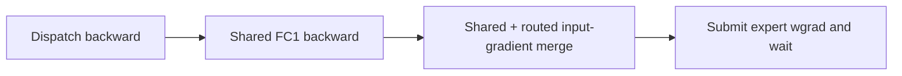
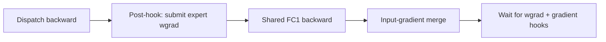

# [dev] Restore expert wgrad overlap with shared experts

[Upstream PR](https://github.com/NVIDIA/Megatron-LM/pull/7390) · state: open · merged: False

## Original PR description

- [x] I, the PR author, have personally reviewed every line of this PR.

# What does this PR do?
**Keep expert wgrad launch independent of the shared-expert input-gradient merge.** When shared-expert overlap and independent-wgrad overlap are enabled together, Flex currently launches wgrad after that merge—even though expert dgrad is already ready. This loses an available communication-overlap window.

### Before

### After

*Arrows show backward submission order, not GPU execution duration. Expert wgrad runs on its existing CUDA stream after expert dgrad is ready.*

A post-hook on the dispatch autograd node submits expert wgrad before shared FC1 backward and the input-gradient merge. Per-forward state prevents duplicate launches; the original input node still waits for completion and runs gradient hooks. This uses the common Flex path when both overlap options are enabled, with no backend-specific scheduling or additional sequence-number adjustment. Regular all-to-all retains its existing schedule.

## Why this matters

**Restore an overlap opportunity lost when both options are enabled.** Compared with the unmodified pre-PR scheduling implementation (`bb5dfd08`), the post-hook implementation reduces single-layer MoE forward/backward latency on the larger tested shape:

| Precision | Original, ms | This PR, ms | Latency reduction, 95% CI |
|---|---:|---:|---:|
| BF16 | 12.339 | 11.960 | **3.07% [2.90%, 3.24%]** |
| FP8 blockwise | 14.296 | 14.013 | **1.97% [1.84%, 2.11%]** |

8 H200 GPUs, EP8/TP1, DeepEP V2, 16,384 tokens/rank, H1536, expert/shared FFN512, 128 experts, top-8. Four independent runs and 7,680 unprofiled samples per implementation and shape. These are single-layer latencies, not full-model training throughput.

Measurement method and smaller-shape result

Both implementations use the same layer, weights, inputs and backend settings, with shared and independent-wgrad overlap enabled. The baseline loads the original dispatch methods and delayed-wgrad autograd Function from `bb5dfd08`; it does not merely disable the new callback. Frozen methods are loaded once per process.

Each sample measures forward, backward and CUDA completion, taking the maximum wall time across eight ranks. Gradient clearing and the entry barrier are excluded. Each run has 96 paired blocks of 20 adjacent samples per implementation, with balanced A/B order. All samples are retained. Confidence intervals use paired-block bootstrap stratified by run; percentages use geometric mean paired ratios, while displayed latencies are arithmetic means. Same-code A/A calibration is within the prespecified ±1% band.

The smaller BF16 shape (4,096 tokens/rank, H/FFN2048, 16 experts, top-2) measures 6.457 → 6.489 ms: **0.48% slower [0.15%, 0.80%]**. Thus the improvement is workload-dependent. All runs pass output, input-gradient and parameter-gradient comparisons, plus GPU-ownership checks. `CUDA_DEVICE_MAX_CONNECTIONS=1`; backend resource settings are identical across conditions.

## Validation

- **DeepEP V1, V2 and regular all-to-all: 25 cases each, passing on all 8 ranks using backend-default communication settings.** Ordering, BF16/FP8, recomputation, pending forwards, accumulation and DDP updates.
- **Official autoformat: pass;** mypy diagnostics unchanged from the pre-simplification commit.

<!-- Template guidance: For major changes, share a design doc with the team first. -->

## Issue tracking

Fixes https://github.com/NVIDIA/Megatron-LM/issues/7389.

## Contribution process

### Pre-checks

- [x] I have added relevant unit tests
- [ ] I have added relevant functional tests <!-- Existing targeted training tests pass; no new functional recipe. -->
- [x] I have added proper typing to my code [Typing guidelines](https://docs.python.org/3/library/typing.html)
- [x] I have added relevant documentation
- [x] I have run the [autoformatter.sh](https://github.com/NVIDIA/Megatron-LM/blob/main/tools/autoformat.sh) on my PR

Code review and merge process (repository template)

### Code review

Feel free to message or comment @NVIDIA/mcore-oncall to help accelerate your merge into main. The less complex your PR is, the faster it will be approved and merged!

All PRs start as **draft**. If you open a non-draft PR, it will be automatically converted to draft.

#### Step 1: Mark PR as "Ready for Review"

1. When your PR is ready, click **Ready for Review**.
2. An oncall reviewer is auto-assigned and expert reviewers are notified based on your changes.
   - Some PRs may jump straight to step 2. This is determined by `.github/CODEOWNERS`.

:warning: Only mark as ready once merge-conflicts are resolved and the CI is passing.
Final Review might get declined if these requirements are not fulfilled.

#### Step 2: Final Review

For PRs that change `megatron/core`, once all expert reviewers have approved, the `Final Review` label is applied **automatically** and final reviewers are assigned.

For PRs outside `megatron/core`, this step is skipped.

#### Step 3: Approved

Once all required reviewers have approved, the `Approved` label is applied **automatically**.

### Merge

Any member of [mcore-engineers](https://github.com/orgs/NVIDIA/teams/mcore-engineers) will be able to merge your PR.

## Review and discussion

### reviews

### issue_comments

- copy-pr-bot[bot] · comment · 2026-09-16T03:39:03Z · [source](https://github.com/NVIDIA/Megatron-LM/pull/7390#issuecomment-5691674314)

This pull request requires additional validation before any workflows can run on NVIDIA's runners.

Pull request vetters can view their responsibilities [here](https://docs.gha-runners.nvidia.com/cpr/vetters).

Contributors can view more details about this message [here](https://docs.gha-runners.nvidia.com/cpr/contributors).

- fkuner · comment · 2026-09-16T06:42:55Z · [source](https://github.com/NVIDIA/Megatron-LM/pull/7390#issuecomment-5693194698)

@fanshiqing  Could you take a look at this PR? It fixes the interaction between shared-expert overlap and independent expert wgrad. Thanks very much!

### inline_comments

## Changed files and fixed code

- `megatron/core/transformer/moe/moe_layer.py` · modified · additions 54 / deletions 31
  - [head](https://github.com/fkuner/Megatron-LM/blob/e007b545599bf3afabf730a6beaa02373c549d40/megatron/core/transformer/moe/moe_layer.py)
  - [base](https://github.com/NVIDIA/Megatron-LM/blob/bb5dfd08f09ce06c5925af453fef06b3129f199d/megatron/core/transformer/moe/moe_layer.py)
- `megatron/core/transformer/moe/token_dispatcher.py` · modified · additions 11 / deletions 1
  - [head](https://github.com/fkuner/Megatron-LM/blob/e007b545599bf3afabf730a6beaa02373c549d40/megatron/core/transformer/moe/token_dispatcher.py)
  - [base](https://github.com/NVIDIA/Megatron-LM/blob/bb5dfd08f09ce06c5925af453fef06b3129f199d/megatron/core/transformer/moe/token_dispatcher.py)
- `tests/unit_tests/transformer/moe/test_early_wgrad.py` · added · additions 376 / deletions 0
  - [head](https://github.com/fkuner/Megatron-LM/blob/e007b545599bf3afabf730a6beaa02373c549d40/tests/unit_tests/transformer/moe/test_early_wgrad.py)
  - [base](https://github.com/NVIDIA/Megatron-LM/blob/bb5dfd08f09ce06c5925af453fef06b3129f199d/tests/unit_tests/transformer/moe/test_early_wgrad.py)

## Evidence and interpretation boundary

[Original JSON, discussions and patches](../../../../../../evidence/prs/NVIDIA--Megatron-LM/7390-4750ca3ce79bcfcfeb5a4a99ebf3456122213aa68cadd907f94474cab7d17520.json) · SHA-256 `4750ca3ce79bcfcfeb5a4a99ebf3456122213aa68cadd907f94474cab7d17520`.

Diff complete: True. Missing/binary/truncated patches require pinned source inspection. This is a source page, not an independently verified optimization case. Open, merged and released are different states; recheck the deployed dependency.
