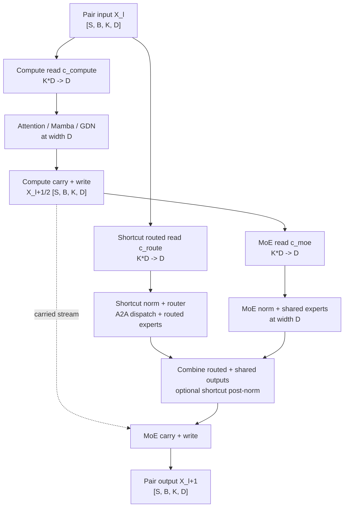

# [4/4] Support wide residual streams with Shortcut MoE

[Upstream PR](https://github.com/NVIDIA/Megatron-LM/pull/7440) · state: closed · merged: True

## Original PR description


## Port correspondence (just for tracking purposes)


| Downstream source | Adapted commit in this PR | Coverage |
| --- | --- | --- |
| [`8c5f5145`](https://github.com/NVIDIA-NeMo/nv-mistralai-megatron/commit/8c5f5145f137be10b44805965cbfcfba5c3f659e) Making wide residual compatible with ShortcutMoE | [`a061fb32e2`](https://github.com/NVIDIA/Megatron-LM/pull/7440/commits/a061fb32e20c9417db6c77dbbf2c05e1c1ddf072) | Feature port adapted to upstream ShortcutMoE and `HybridStack`. |
| [`092ff0acb`](https://github.com/NVIDIA-NeMo/nv-mistralai-megatron/commit/092ff0acb1ffe32f0c3345b5a56f321c253d9592) FP32 Residual + WideResidual/ShortcutMoE fixes | [`a061fb32e2`](https://github.com/NVIDIA/Megatron-LM/pull/7440/commits/a061fb32e20c9417db6c77dbbf2c05e1c1ddf072) | Relevant ShortcutMoE composition and combined FP32 Wide Residual, MTP/MIMO, and ShortcutMoE coverage. Inference-mode dispatch is in [#7579](https://github.com/NVIDIA/Megatron-LM/pull/7579), FP32 kernels in [#7600](https://github.com/NVIDIA/Megatron-LM/pull/7600), residual replay in [#6805](https://github.com/NVIDIA/Megatron-LM/pull/6805), MTP/MIMO precision in [#6855](https://github.com/NVIDIA/Megatron-LM/pull/6855), and modality bridge precision in [#7480](https://github.com/NVIDIA/Megatron-LM/pull/7480). |

##

- [x] I, the PR author, have personally reviewed every line of this PR.

# What does this PR do?

Makes the streamwise wide-residual connections from #7599 and HybridStack integration from #6716 compose with Megatron-LM's ShortcutMoE execution introduced by #6959. It uses the FP32 support from #7600, selective replay from #6805, and MTP/MIMO integration from #6855.

A ShortcutMoE block groups two physical layers: a supported compute predecessor (attention, Mamba, or Gated DeltaNet) and the following MoE layer. This PR keeps that pair's existing serial or communication-overlapped schedule, while giving each logical consumer the correct ordinary-width read from the carried wide residual stream. It also keeps the physical pair atomic during selective residual-stream replay.

> This is the last PR of the wide-residual series. Its prerequisites, including #6855, have merged.

## Issue tracking

Linked issue: Related to #6716


## Algorithm description
 


 
## Design

### Independent routed-path read

`StreamwiseSigmoidWideResidualRead` is a read-only child module that maps `K * D` to `D` with the same streamwise-sigmoid controller and optimized read operation used by the full residual connection. 


`ShortcutMoEBlock` owns one such module for the routed shortcut path. The already constructed wide compute and MoE layers continue to own their ordinary branch connections through the architecture-specific classes introduced by the earlier PRs. The block validates that both physical layers agree on MTP and wide-stream participation and that all three consumers agree on the carried width.

This keeps model construction explicit: the ShortcutMoE block does not rewrite `ModuleSpec`s or replace layer classes after construction. It only owns the additional read required by the ShortcutMoE dataflow.

All parameterized reads are invoked through `apply_module`, so normal module pre-hooks run before controller parameters are accessed.
 

### Atomic selective replay

Residual-stream replay operates on physical layers, whereas `ShortcutMoEBlock` presents a compute/MoE pair as one grouped runtime module. Ending a replay block after the first physical layer would discard or reconstruct state while the shortcut path still depends on the pair input.

`build_residual_stream_recompute_plan` therefore accepts adjacent `atomic_layer_pairs`.
`HybridStack` reports registered ShortcutMoE pairs and gives the two physical layers separate contexts backed by the same replay manager. The planner packs whole layers or pairs in forward order, closing the current block before a pair that would exceed the target size. It never splits a pair. Runtime validation also requires:

- both physical layers to receive replay contexts together;
- both contexts to share one manager; and
- the compute half not to be a replay-block endpoint.

Within the pair:

- the routed read and shortcut pre-MLP norm join the predecessor layer's replay context;
- the compute read, branch norm, and write use that same first context;
- the MoE read, pre-MLP norm, optional shortcut post-norm, and write use the second context; and
- block finalization runs after the complete pair returns, and only when the MoE context is a replay-block endpoint.

When residual replay owns one of these tensors, fine-grained activation offloading is prevented from also owning it. Other ShortcutMoE offload behavior remains unchanged.

### Transformer, Mamba, MTP, and HybridStack plumbing

The two-stage Transformer entry points forward the call-local residual replay context. Mamba shares its one-stage and two-stage schedules through residual-state and update hooks. `WideResidualMambaLayer` owns the wide read/write and replay policy, including explicit post-core dispatch; ordinary `MambaLayer` retains its ordinary normalization and bias-dropout-add helpers.

`HybridStack` retains physical layer indices after grouping layers into ShortcutMoE blocks and uses those indices to select the two replay contexts and CP-layout transitions belonging to the pair.

MTP auxiliary stacks remain ordinary-width as established by #6855. A ShortcutMoE pair validates that both physical layers agree on MTP status and does not construct a wide routed read inside an MTP auxiliary stack.

## Configuration

This PR adds no new CLI or configuration fields. It allows the existing wide-residual and ShortcutMoE options to compose:

```text
--wide-residual 3
--moe-shortcut-connection
```

The existing communication-overlap schedule remains optional:

```text
--moe-shortcut-parallel
```

Selective wide-residual replay from #6805 also remains optional:

```text
--recompute-granularity selective
--recompute-modules residual_stream
--residual-stream-recompute-num-layers 4
```

The replay block size is a target physical-layer count. For example, size 3 with pairs `(0, 1)` and `(2, 3)` produces blocks `[0, 1]` and `[2, 3]`. Size 1 still keeps each two-layer pair intact.

## Scope and guardrails

- Ordinary ShortcutMoE and non-shortcut wide-residual execution retain their existing paths.
- The branch computations, router, routed/shared experts, and collective implementations remain ordinary width `D`.
- No Triton or CUDA kernel is added or modified; the new read-only module reuses the streamwise read operation from #7579.
- Existing ShortcutMoE restrictions, including inference, CUDA-graph, and FSDP guardrails, remain in force.
- This PR does not add a separate pathwise-MoE wide-residual architecture.
 
## Validation

Distributed unit tests compare outputs, input gradients, and finalized parameter gradients at fixed weights:

- attention+MoE and Mamba+MoE with real EP=2 All-to-All, serial/overlapped scheduling, and eager/replay execution;
- BF16 and FP32 residuals with TP and CP coverage; and
- GTP/EGTP=1 versus 2 with FP32 residuals.

These are forward/backward parity checks, not optimizer-step training comparisons.

## File guide

- `megatron/core/transformer/wide_residual_layer.py`: read-only streamwise routed-path module.
- `megatron/core/models/hybrid/shortcut_block.py`: wide routed read, serial/parallel execution, and replay/offload ownership inside a ShortcutMoE pair.
- `megatron/core/models/hybrid/hybrid_block.py`: physical-layer context routing and atomic-pair discovery after ShortcutMoE grouping.
- `megatron/core/transformer/residual_recompute.py`: atomic replay-plan boundaries.
- `megatron/core/transformer/transformer_layer.py`: replay context through two-stage attention.
- `megatron/core/ssm/mamba_layer.py`: shared forward schedules and residual-state/update hooks; ordinary helpers remain unchanged.
- `megatron/core/ssm/wide_residual_mamba_layer.py`: wide read/write and replay policy, with explicit post-core dispatch.
- `megatron/core/transformer/transformer_config.py`: removes the former wide+ShortcutMoE incompatibility guard.
- `docs/user-guide/features/fine_grained_activation_offloading.md`: documents replay ownership of ShortcutMoE post-norm activations.
- `tests/unit_tests/...`: construction, atomic replay planning, scheduling, and distributed forward/backward parity across EP, TP, CP, and GTP/EGTP.

## Contribution process
 
### Code review

Feel free to message or comment @NVIDIA/mcore-oncall to help accelerate your merge into main. The less complex your PR is, the faster it will be approved and merged!

All PRs start as **draft**. If you open a non-draft PR, it will be automatically converted to draft.

#### Step 1: Mark PR as "Ready for Review"

1. When your PR is ready, click **Ready for Review**.
2. An oncall reviewer is auto-assigned and expert reviewers are notified based on your changes.
   - Some PRs may jump straight to step 2. This is determined by `.github/CODEOWNERS`.

:warning: Only mark as ready once merge-conflicts are resolved and the CI is passing.
Final Review might get declined if these requirements are not fulfilled.

#### Step 2: Final Review

For PRs that change `megatron/core`, once all expert reviewers have approved, the `Final Review` label is applied **automatically** and final reviewers are assigned.

For PRs outside `megatron/core`, this step is skipped.

#### Step 3: Approved

Once all required reviewers have approved, the `Approved` label is applied **automatically**.

### Merge

Any member of [mcore-engineers](https://github.com/orgs/NVIDIA/teams/mcore-engineers) will be able to merge your PR.


## Review and discussion

### reviews

- kwangjunahn · COMMENTED · 2026-09-29T17:47:42Z · [source](https://github.com/NVIDIA/Megatron-LM/pull/7440#pullrequestreview-5356329637)

@dcoapp recheck

- jaredcasper · APPROVED · 2026-09-30T23:23:32Z · [source](https://github.com/NVIDIA/Megatron-LM/pull/7440#pullrequestreview-5373081897)

(No body; status only.)

- mathemakitten · APPROVED · 2026-10-01T15:40:54Z · [source](https://github.com/NVIDIA/Megatron-LM/pull/7440#pullrequestreview-5381741382)

(No body; status only.)

- jaredcasper · APPROVED · 2026-10-01T19:01:50Z · [source](https://github.com/NVIDIA/Megatron-LM/pull/7440#pullrequestreview-5384142515)

(No body; status only.)

- ericharper · APPROVED · 2026-10-01T22:26:59Z · [source](https://github.com/NVIDIA/Megatron-LM/pull/7440#pullrequestreview-5386353144)

(No body; status only.)

### issue_comments

- copy-pr-bot[bot] · comment · 2026-09-17T17:33:11Z · [source](https://github.com/NVIDIA/Megatron-LM/pull/7440#issuecomment-5718632634)

This pull request requires additional validation before any workflows can run on NVIDIA's runners.

Pull request vetters can view their responsibilities [here](https://docs.gha-runners.nvidia.com/cpr/vetters).

Contributors can view more details about this message [here](https://docs.gha-runners.nvidia.com/cpr/contributors).


- kwangjunahn · comment · 2026-09-19T01:09:53Z · [source](https://github.com/NVIDIA/Megatron-LM/pull/7440#issuecomment-5738128312)

/ok to test cdf4f3e013219c2a097a1cf39947c168346a3d0b

- kwangjunahn · comment · 2026-09-23T15:41:43Z · [source](https://github.com/NVIDIA/Megatron-LM/pull/7440#issuecomment-5797884656)

/ok to test 0e3750dada37860f802a88cc64e13209c5f1bf89

- kwangjunahn · comment · 2026-09-29T17:48:01Z · [source](https://github.com/NVIDIA/Megatron-LM/pull/7440#issuecomment-5895576983)

/ok to test 6347da064ca589f3036257b7104d26899eea3dc8

- kwangjunahn · comment · 2026-09-30T20:01:59Z · [source](https://github.com/NVIDIA/Megatron-LM/pull/7440#issuecomment-5918689921)

/ok to test 5dcefb8af95752e5fb36d680e29969a4792863d7

- kwangjunahn · comment · 2026-10-01T13:26:49Z · [source](https://github.com/NVIDIA/Megatron-LM/pull/7440#issuecomment-5932421763)

/ok to test 0d68a33e94ed71e5915780854d7db3df7ca2e9e6

- kwangjunahn · comment · 2026-10-01T15:15:04Z · [source](https://github.com/NVIDIA/Megatron-LM/pull/7440#issuecomment-5934382827)

/ok to test e1f6c2a5b79e9e92d60c550ced449fef4a1e8ca7

- nemo-automation-bot[bot] · comment · 2026-10-01T23:51:40Z · [source](https://github.com/NVIDIA/Megatron-LM/pull/7440#issuecomment-5942904893)

🔄 Merge queue validation started!

You can track the progress here: https://github.com/NVIDIA/Megatron-LM/actions/runs/36943012443

- nemo-automation-bot[bot] · comment · 2026-10-02T00:22:09Z · [source](https://github.com/NVIDIA/Megatron-LM/pull/7440#issuecomment-5943218601)

🔄 Merge queue validation started!

You can track the progress here: https://github.com/NVIDIA/Megatron-LM/actions/runs/36945614598

### inline_comments

## Changed files and fixed code

- `docs/user-guide/features/fine_grained_activation_offloading.md` · modified · additions 4 / deletions 0
  - [head](https://github.com/kwangjunahn/Megatron-LM/blob/e1f6c2a5b79e9e92d60c550ced449fef4a1e8ca7/docs/user-guide/features/fine_grained_activation_offloading.md)
  - [base](https://github.com/NVIDIA/Megatron-LM/blob/e6a93b1909e21c5f45a67067da9b303867b43ebf/docs/user-guide/features/fine_grained_activation_offloading.md)
- `megatron/core/models/hybrid/hybrid_block.py` · modified · additions 29 / deletions 6
  - [head](https://github.com/kwangjunahn/Megatron-LM/blob/e1f6c2a5b79e9e92d60c550ced449fef4a1e8ca7/megatron/core/models/hybrid/hybrid_block.py)
  - [base](https://github.com/NVIDIA/Megatron-LM/blob/e6a93b1909e21c5f45a67067da9b303867b43ebf/megatron/core/models/hybrid/hybrid_block.py)
- `megatron/core/models/hybrid/shortcut_block.py` · modified · additions 155 / deletions 21
  - [head](https://github.com/kwangjunahn/Megatron-LM/blob/e1f6c2a5b79e9e92d60c550ced449fef4a1e8ca7/megatron/core/models/hybrid/shortcut_block.py)
  - [base](https://github.com/NVIDIA/Megatron-LM/blob/e6a93b1909e21c5f45a67067da9b303867b43ebf/megatron/core/models/hybrid/shortcut_block.py)
- `megatron/core/ssm/mamba_layer.py` · modified · additions 45 / deletions 63
  - [head](https://github.com/kwangjunahn/Megatron-LM/blob/e1f6c2a5b79e9e92d60c550ced449fef4a1e8ca7/megatron/core/ssm/mamba_layer.py)
  - [base](https://github.com/NVIDIA/Megatron-LM/blob/e6a93b1909e21c5f45a67067da9b303867b43ebf/megatron/core/ssm/mamba_layer.py)
- `megatron/core/ssm/wide_residual_mamba_layer.py` · modified · additions 89 / deletions 0
  - [head](https://github.com/kwangjunahn/Megatron-LM/blob/e1f6c2a5b79e9e92d60c550ced449fef4a1e8ca7/megatron/core/ssm/wide_residual_mamba_layer.py)
  - [base](https://github.com/NVIDIA/Megatron-LM/blob/e6a93b1909e21c5f45a67067da9b303867b43ebf/megatron/core/ssm/wide_residual_mamba_layer.py)
- `megatron/core/transformer/residual_recompute.py` · modified · additions 67 / deletions 6
  - [head](https://github.com/kwangjunahn/Megatron-LM/blob/e1f6c2a5b79e9e92d60c550ced449fef4a1e8ca7/megatron/core/transformer/residual_recompute.py)
  - [base](https://github.com/NVIDIA/Megatron-LM/blob/e6a93b1909e21c5f45a67067da9b303867b43ebf/megatron/core/transformer/residual_recompute.py)
- `megatron/core/transformer/transformer_config.py` · modified · additions 0 / deletions 6
  - [head](https://github.com/kwangjunahn/Megatron-LM/blob/e1f6c2a5b79e9e92d60c550ced449fef4a1e8ca7/megatron/core/transformer/transformer_config.py)
  - [base](https://github.com/NVIDIA/Megatron-LM/blob/e6a93b1909e21c5f45a67067da9b303867b43ebf/megatron/core/transformer/transformer_config.py)
- `megatron/core/transformer/transformer_layer.py` · modified · additions 6 / deletions 1
  - [head](https://github.com/kwangjunahn/Megatron-LM/blob/e1f6c2a5b79e9e92d60c550ced449fef4a1e8ca7/megatron/core/transformer/transformer_layer.py)
  - [base](https://github.com/NVIDIA/Megatron-LM/blob/e6a93b1909e21c5f45a67067da9b303867b43ebf/megatron/core/transformer/transformer_layer.py)
- `megatron/core/transformer/wide_residual_layer.py` · modified · additions 32 / deletions 0
  - [head](https://github.com/kwangjunahn/Megatron-LM/blob/e1f6c2a5b79e9e92d60c550ced449fef4a1e8ca7/megatron/core/transformer/wide_residual_layer.py)
  - [base](https://github.com/NVIDIA/Megatron-LM/blob/e6a93b1909e21c5f45a67067da9b303867b43ebf/megatron/core/transformer/wide_residual_layer.py)
- `tests/unit_tests/generalized_tensor_parallel/test_wide_shortcut_parallel.py` · added · additions 22 / deletions 0
  - [head](https://github.com/kwangjunahn/Megatron-LM/blob/e1f6c2a5b79e9e92d60c550ced449fef4a1e8ca7/tests/unit_tests/generalized_tensor_parallel/test_wide_shortcut_parallel.py)
  - [base](https://github.com/NVIDIA/Megatron-LM/blob/e6a93b1909e21c5f45a67067da9b303867b43ebf/tests/unit_tests/generalized_tensor_parallel/test_wide_shortcut_parallel.py)
- `tests/unit_tests/models/test_shortcut_block.py` · modified · additions 102 / deletions 7
  - [head](https://github.com/kwangjunahn/Megatron-LM/blob/e1f6c2a5b79e9e92d60c550ced449fef4a1e8ca7/tests/unit_tests/models/test_shortcut_block.py)
  - [base](https://github.com/NVIDIA/Megatron-LM/blob/e6a93b1909e21c5f45a67067da9b303867b43ebf/tests/unit_tests/models/test_shortcut_block.py)
- `tests/unit_tests/models/test_wide_residual_mtp_mimo.py` · modified · additions 103 / deletions 4
  - [head](https://github.com/kwangjunahn/Megatron-LM/blob/e1f6c2a5b79e9e92d60c550ced449fef4a1e8ca7/tests/unit_tests/models/test_wide_residual_mtp_mimo.py)
  - [base](https://github.com/NVIDIA/Megatron-LM/blob/e6a93b1909e21c5f45a67067da9b303867b43ebf/tests/unit_tests/models/test_wide_residual_mtp_mimo.py)
- `tests/unit_tests/ssm/test_hybrid_block.py` · modified · additions 290 / deletions 0
  - [head](https://github.com/kwangjunahn/Megatron-LM/blob/e1f6c2a5b79e9e92d60c550ced449fef4a1e8ca7/tests/unit_tests/ssm/test_hybrid_block.py)
  - [base](https://github.com/NVIDIA/Megatron-LM/blob/e6a93b1909e21c5f45a67067da9b303867b43ebf/tests/unit_tests/ssm/test_hybrid_block.py)
- `tests/unit_tests/ssm/test_mamba_layer.py` · modified · additions 146 / deletions 0
  - [head](https://github.com/kwangjunahn/Megatron-LM/blob/e1f6c2a5b79e9e92d60c550ced449fef4a1e8ca7/tests/unit_tests/ssm/test_mamba_layer.py)
  - [base](https://github.com/NVIDIA/Megatron-LM/blob/e6a93b1909e21c5f45a67067da9b303867b43ebf/tests/unit_tests/ssm/test_mamba_layer.py)
- `tests/unit_tests/ssm/test_wide_shortcut_parallel.py` · added · additions 418 / deletions 0
  - [head](https://github.com/kwangjunahn/Megatron-LM/blob/e1f6c2a5b79e9e92d60c550ced449fef4a1e8ca7/tests/unit_tests/ssm/test_wide_shortcut_parallel.py)
  - [base](https://github.com/NVIDIA/Megatron-LM/blob/e6a93b1909e21c5f45a67067da9b303867b43ebf/tests/unit_tests/ssm/test_wide_shortcut_parallel.py)
- `tests/unit_tests/transformer/test_residual_recompute.py` · modified · additions 29 / deletions 0
  - [head](https://github.com/kwangjunahn/Megatron-LM/blob/e1f6c2a5b79e9e92d60c550ced449fef4a1e8ca7/tests/unit_tests/transformer/test_residual_recompute.py)
  - [base](https://github.com/NVIDIA/Megatron-LM/blob/e6a93b1909e21c5f45a67067da9b303867b43ebf/tests/unit_tests/transformer/test_residual_recompute.py)
- `tests/unit_tests/transformer/test_wide_residual_connection.py` · modified · additions 70 / deletions 1
  - [head](https://github.com/kwangjunahn/Megatron-LM/blob/e1f6c2a5b79e9e92d60c550ced449fef4a1e8ca7/tests/unit_tests/transformer/test_wide_residual_connection.py)
  - [base](https://github.com/NVIDIA/Megatron-LM/blob/e6a93b1909e21c5f45a67067da9b303867b43ebf/tests/unit_tests/transformer/test_wide_residual_connection.py)

## Evidence and interpretation boundary

[Original JSON, discussions and patches](../../../../../../evidence/prs/NVIDIA--Megatron-LM/7440-3fc9f7440b65bc7185ea99614d4fa8109a5dea2a8295c74f410229845fc41069.json) · SHA-256 `3fc9f7440b65bc7185ea99614d4fa8109a5dea2a8295c74f410229845fc41069`.

Diff complete: True. Missing/binary/truncated patches require pinned source inspection. This is a source page, not an independently verified optimization case. Open, merged and released are different states; recheck the deployed dependency.
