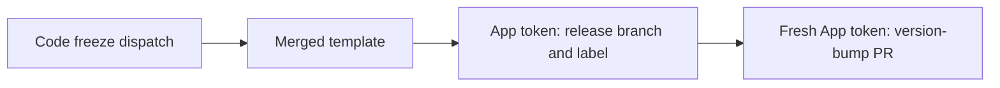

# ci(code-freeze): AUT-2500 use merged GitHub App authentication

[Upstream PR](https://github.com/NVIDIA/Megatron-LM/pull/7945) · state: closed · merged: False

## Original PR description

## Background

Integrate the merged implementation from [FW-CI-templates #592](https://github.com/NVIDIA-NeMo/FW-CI-templates/pull/592), following the caller migration in #7935 without modifying that PR.

## What changed

Pin `_code_freeze.yml` to `61445a177938967f70c94094b98402e979452151`. Pass `vars.BOT_ID` and `secrets.BOT_KEY`, replace the caller's PAT mapping, preserve the `main` environment, and limit GITHUB_TOKEN to contents: read.

## Details

Dispatch inputs, version settings, `core_` branch prefix, dry-run guards, and Slack mappings are unchanged. Other workflows' PAT secrets remain untouched.

## Tested

- Exact-head detached worktree validation against synchronized upstream: pre-commit completed; Python hooks correctly skipped this YAML-only change.
- Unique-key YAML parsing, authentication/preservation assertions, and git diff --check passed.
- Signature and matching DCO verified; live fork head confirmed.
- Actionlint unavailable: binary downloads denied. Product/GPU tests excluded because product code and dependencies are unchanged. Full GitHub checks pending; no production freeze or protected-branch smoke test dispatched.

## Review and discussion

### reviews

### issue_comments

- copy-pr-bot[bot] · comment · 2026-10-07T19:01:15Z · [source](https://github.com/NVIDIA/Megatron-LM/pull/7945#issuecomment-6044785140)

This pull request requires additional validation before any workflows can run on NVIDIA's runners.

Pull request vetters can view their responsibilities [here](https://docs.gha-runners.nvidia.com/cpr/vetters).

Contributors can view more details about this message [here](https://docs.gha-runners.nvidia.com/cpr/contributors).

- github-actions[bot] · comment · 2026-10-07T19:01:29Z · [source](https://github.com/NVIDIA/Megatron-LM/pull/7945#issuecomment-6044788776)

This PR has been automatically converted to **draft** because all PRs must start as drafts.

When you are ready for review, click **Ready for Review** to begin the review process. This will:
1. Add the oncall reviewer (optional reviewer)
2. Add required review teams based on your changes

See the [contribution guide](https://github.com/NVIDIA/Megatron-LM/blob/main/docs/developer/submit.md) for more details.

### inline_comments

## Changed files and fixed code

- `.github/workflows/release-freeze.yml` · modified · additions 7 / deletions 3
  - [head](https://github.com/svcnemo-autobot/Megatron-LM/blob/4afacead361a8110860fb61804f04d6e735c7b52/.github/workflows/release-freeze.yml)
  - [base](https://github.com/NVIDIA/Megatron-LM/blob/5052ce8c48d999a9422ad5ef02954089639db832/.github/workflows/release-freeze.yml)

## Evidence and interpretation boundary

[Original JSON, discussions and patches](../../../../../../evidence/prs/NVIDIA--Megatron-LM/7945-788b7eb1909f6616ff2245d561a4518a106005c819b3dfefea54a42a8f6d69c2.json) · SHA-256 `788b7eb1909f6616ff2245d561a4518a106005c819b3dfefea54a42a8f6d69c2`.

Diff complete: True. Missing/binary/truncated patches require pinned source inspection. This is a source page, not an independently verified optimization case. Open, merged and released are different states; recheck the deployed dependency.
