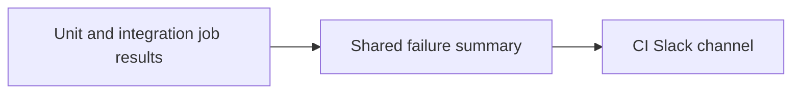

# ci: AUT-2497 notify cicd-main testing failures with shared action

[Upstream PR](https://github.com/NVIDIA/Megatron-LM/pull/7946) · state: closed · merged: False

## Original PR description

## Background

Consume the shared notifier merged in NVIDIA-NeMo/FW-CI-templates#593 for MLM's cicd-main testing jobs, correcting the earlier cache-workflow scope.

## What changed

Notify failures from the four H100/GB200 unit and integration testing jobs. Leave populate-build-cache.yml unchanged. Add dependency-free wiring tests to the existing CPU lint job.

## Details

Keep existing triggers and other jobs unchanged. Restrict alerts to uncancelled schedule/dispatch runs on the canonical default branch. Pin notify-ci-failure to `631c404d00a9e60afc591cd071d35d2e18f82fc6` and use the requester-confirmed `SLACK_WEBHOOK`. No failed-run checkout or token permissions.

## Tested

Candidate merge against main `4592edb5`: four stdlib notification tests, YAML dependency/unchanged-job invariants and whitespace checks passed. Scoped Black/isort passed. Confirmed populate-build-cache.yml unchanged and all four testing-job dependencies retained. Python 3.12 diagnostics do not replace the full hosted lint/CI gate. Current-head CI and real Slack delivery remain pending; GPU execution inputs are unchanged.

## Review and discussion

### reviews

- ko3n1g · APPROVED · 2026-10-08T18:30:46Z · [source](https://github.com/NVIDIA/Megatron-LM/pull/7946#pullrequestreview-5461187239)

(No body; status only.)

### issue_comments

- copy-pr-bot[bot] · comment · 2026-10-07T19:06:18Z · [source](https://github.com/NVIDIA/Megatron-LM/pull/7946#issuecomment-6044877288)

This pull request requires additional validation before any workflows can run on NVIDIA's runners.

Pull request vetters can view their responsibilities [here](https://docs.gha-runners.nvidia.com/cpr/vetters).

Contributors can view more details about this message [here](https://docs.gha-runners.nvidia.com/cpr/contributors).

- github-actions[bot] · comment · 2026-10-07T19:06:27Z · [source](https://github.com/NVIDIA/Megatron-LM/pull/7946#issuecomment-6044880075)

This PR has been automatically converted to **draft** because all PRs must start as drafts.

When you are ready for review, click **Ready for Review** to begin the review process. This will:
1. Add the oncall reviewer (optional reviewer)
2. Add required review teams based on your changes

See the [contribution guide](https://github.com/NVIDIA/Megatron-LM/blob/main/docs/developer/submit.md) for more details.

- ko3n1g · comment · 2026-10-08T18:31:00Z · [source](https://github.com/NVIDIA/Megatron-LM/pull/7946#issuecomment-6066481145)

/ok to test https://github.com/NVIDIA/Megatron-LM/pull/7946/commits/547fb48571c23f5f0b3e8dc614b820464f23dc77

### inline_comments

## Changed files and fixed code

- `.github/scripts/test_ci_notifications.py` · added · additions 82 / deletions 0
  - [head](https://github.com/svcnemo-autobot/Megatron-LM/blob/547fb48571c23f5f0b3e8dc614b820464f23dc77/.github/scripts/test_ci_notifications.py)
  - [base](https://github.com/NVIDIA/Megatron-LM/blob/5052ce8c48d999a9422ad5ef02954089639db832/.github/scripts/test_ci_notifications.py)
- `.github/workflows/cicd-main.yml` · modified · additions 22 / deletions 0
  - [head](https://github.com/svcnemo-autobot/Megatron-LM/blob/547fb48571c23f5f0b3e8dc614b820464f23dc77/.github/workflows/cicd-main.yml)
  - [base](https://github.com/NVIDIA/Megatron-LM/blob/5052ce8c48d999a9422ad5ef02954089639db832/.github/workflows/cicd-main.yml)

## Evidence and interpretation boundary

[Original JSON, discussions and patches](../../../../../../evidence/prs/NVIDIA--Megatron-LM/7946-8616bc46d49e67570f58024fe0b17097204d6d205bae969d307b4e61f87d88b2.json) · SHA-256 `8616bc46d49e67570f58024fe0b17097204d6d205bae969d307b4e61f87d88b2`.

Diff complete: True. Missing/binary/truncated patches require pinned source inspection. This is a source page, not an independently verified optimization case. Open, merged and released are different states; recheck the deployed dependency.
