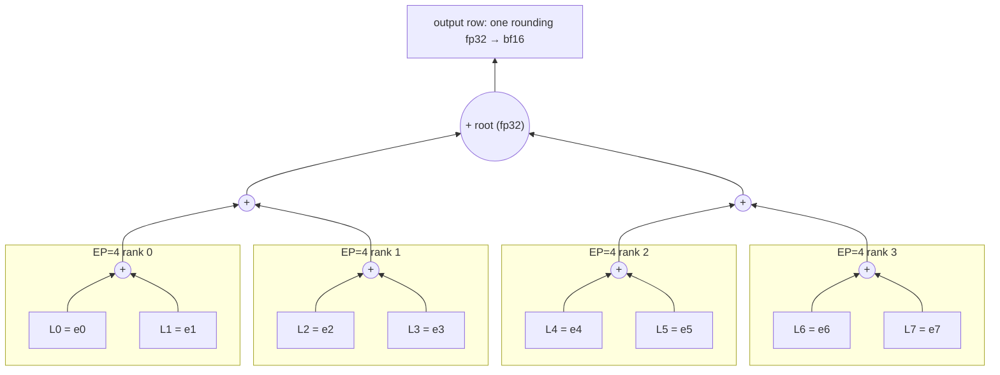
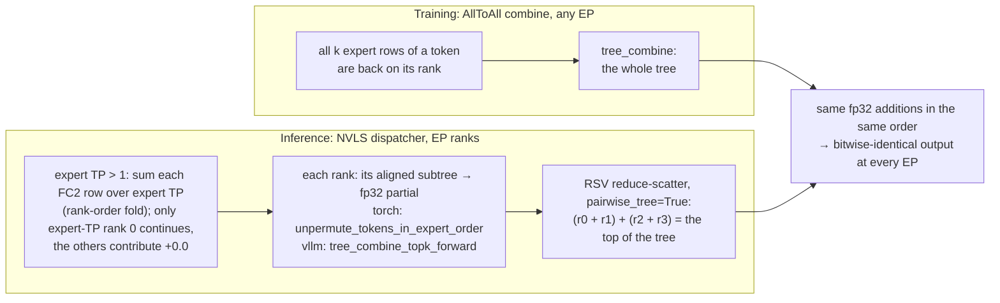

# [MoE] Opt-in EP-size-invariant expert combine (fixed fp32 reduction tree)

[Upstream PR](https://github.com/NVIDIA/Megatron-LM/pull/8261) · state: open · merged: False

## Original PR description

## Summary

Adds an opt-in flag, `moe_ep_invariant_combine` (default `False`), that makes batch-invariant MoE outputs bitwise identical at every power-of-two expert-parallel size that divides the number of experts. Batch-invariant RL can then train and generate at different EP sizes, for example training at EP8 while generating at EP4. With the flag off nothing changes.

## Problem

Under `batch_invariant_mode`, the MoE combine sums a token's local expert outputs on each EP rank, rounds that partial to fp32, and then adds the rank partials in rank order. Where the fp32 roundings happen depends on the EP size, so the same token gets different bits at EP 1, 2, and 4, and batch-invariant training and inference only agree when they use the same EP layout.

Measured on Nemotron-3-Nano (128 experts, top-6, hidden 2688) with the combine used in our RL setup:
- One MoE layer at EP2 vs. EP1: 98% of tokens differ, by about 1 ulp per element.
- Over 8 layers, greedy-decode log-probs differ by up to 0.28 between an EP1 and an EP2 engine.
- In an RL run that trained at EP2 and generated at EP1, sampled-token log-probs differed by up to 0.89.

## Approach: one fixed fp32 reduction tree over expert ids

With the flag on, every EP size evaluates the same tree:
- The E experts form G leaves of m = E / G consecutive experts, where G is the largest power of two dividing E (G = E = 128 for Nano; E = 96 gives 32 leaves of 3 experts).
- A leaf is the fp32 sum of the token's rows from its experts, added in expert order starting from +0.0.
- The output is a pairwise fp32 tree over the leaves by leaf id: `((l0 + l1) + (l2 + l3)) + ...`.

**Why this is EP-invariant.** With a power-of-two EP size that divides E, rank r owns experts `[r*E/EP, (r+1)*E/EP)`, which is an aligned subtree. Each rank evaluates its subtree to an fp32 partial, and the cross-rank combine finishes the tree over the rank partials in the same pairwise order, so every EP size performs exactly the same fp32 additions.

**The tree for E = 8** (one expert per leaf). The boxes show what each rank owns at EP 4; at EP 2 rank 0 owns L0–L3 and rank 1 owns L4–L7; at EP 1 one rank owns the whole tree. Every split cuts the same tree, so the fp32 additions are the same.



**Where each part of the tree is evaluated.**



**Properties.**
- Leaves start from +0.0 and no node is ever -0.0, so `x + 0.0 == x` bit for bit: empty subtrees are free and a token only pays for the experts it is routed to.
- Accuracy is that of an ordinary fp32 pairwise sum of k terms (median relative error vs. the exact sum 1.7e-8 in simulation, against 1.5e-8 for the current combine).
- The combine moves the same 4 bytes per element as today, with no fp64 and no larger buffers. This replaces the first version of this PR, which converted values into two fp64 integer limbs (16 bytes per element) to make the sum exact.

## Implementation

**Kernels.** Three Triton kernels evaluate the tree, one per row layout. All of them share one leaf step (`_add_to_leaf`): when leaf b follows leaf a, the two subtrees meet at height `bit_length(a ^ b)`, so at most log2(G) pending subtrees stay in registers. They give the same bits on the same rows (tested), and their work scales with the routed rows, like the existing expert-order unpermute.
- `_tree_combine_kernel` (torch inference backend): a dense `[tokens, local experts]` map of permuted row ids (-1 = none); it walks the routed columns with a 64-column occupancy bitmask and `ffs`.
- `_tree_combine_routes_kernel` (training): each token's top-k routes as a `[tokens, k]` list sorted by expert. All k rows of a token are present, so their loads are independent and all in flight together; no dense `[tokens, experts]` map is built.
- `_tree_combine_topk_kernel` (vLLM inference backend): rows laid out per top-k slot; it reads the `[tokens, k]` routing map and visits the token's local routes in expert order inside the kernel, so there is no host-side sort.

Router probabilities, where the combine applies them (training), are multiplied with `mul_rn`, so they are never fused into an FMA.

**Training (AllToAll dispatcher).** All k rows of a token already return to its rank, so the batch-invariant unpermute evaluates the whole tree (`ep_invariant_combine.tree_combine`, with autograd). No extra communication. AllToAll is the only dispatcher batch-invariant training allows, and `TransformerConfig` asserts it. The backward is one Triton kernel per token: each slot's row gets `grad * prob` and its probability gets `<grad, row>`, reading `grad` and each row once. It adds no communication.

**Inference (NVLS dispatcher).**
- With expert tensor parallelism, the ranks of an expert-TP group hold partial sums of the same expert rows. Each rank first sums its FC2 rows over expert TP the way training's expert-TP reduction does (all-gather, then a rank-order fold in fp32 with one rounding; fp64 when `batch_invariant_collective='multimem'` and expert TP >= 3). Only expert-TP rank 0 then contributes its subtree; the others contribute +0.0, which is exact, so the reduce-scatter over the tp_ep ranks gives the same result for any rank order. At expert TP 2 the fold is bitwise the stock NCCL bf16 reduce-scatter training uses; at expert TP >= 3, matching training bitwise needs the ordered TP reductions of #8421 on the training side.
- Each rank writes its subtree partial (fp32) into the existing RSV symmetric buffer: the `torch` backend in `unpermute_tokens_in_expert_order`, the `vllm` backend in place of its top-k sum. At EP 1 that is already the final row.
- `ordered_reduce_scatter_v(pairwise_tree=True)` adds the peer partials as a pairwise tree in rank order instead of a chain. The flag selects this ordered path whatever `batch_invariant_collective` is set to.
- Buffer sizes are unchanged and the path is CUDA-graph safe.

**Configuration.** The flag requires `batch_invariant_mode` and an `expert_model_parallel_size` that is a power of two dividing `num_moe_experts`. For inference-optimized MoE it requires `inference_grouped_gemm_backend` `'torch'` or `'vllm'`; any expert-tensor-parallel size is supported. FlashInfer is rejected: its kernel sums a token's routes internally, so the tree never sees the separate rows. The NCCL inference dispatcher is not covered (batch-invariant mode at EP > 1 already requires NVLS). The flag is only needed when training and inference use different EP sizes; with the same EP the existing combine is already batch-invariant. `docs/mcore-inference-user-guide.md` explains when to set it.

## Cost

GB200. Unless noted, 128 experts, top-6, hidden 2688.

Inference per-layer combine (local unpermute plus NVLS reduce-scatter), `torch` backend at EP4, eager launches, median of 7 x 50 back-to-back calls:

| tokens per rank | current combine | this PR (tree) | previous version (fp64 limbs) |
|---|---|---|---|
| 128 (decode) | 38 µs | 42-44 µs | 52 µs |
| 4096 (prefill) | 356 µs | 371 µs | 1078 µs |

The decode gap is host launch overhead from the extra Python wrapper and disappears under CUDA graphs, which is how decode runs. The pairwise reduce-scatter costs the same as the chain (23.5 µs vs. 23.7 µs at 128 tokens per rank).

Local reduction GPU time, 100 calls replayed in one CUDA graph, 16384 tokens, this PR vs. the current batch-invariant kernel:

| backend, shape | EP1 | EP4 | EP8 |
|---|---|---|---|
| torch, 128 experts / top-6 / 2688 | 429 vs 443 µs (0.97x) | 115 vs 127 µs (0.90x) | 70 vs 68 µs (1.03x) |
| torch, 512 experts / top-22 / 8192 | 4879 vs 3854 µs (1.27x) | 1066 vs 993 µs (1.07x) | 571 vs 514 µs (1.11x) |
| vllm, 128 experts / top-6 / 2688 | 408 vs 1266 µs (0.32x) | 126 vs 483 µs (0.26x) | 77 vs 325 µs (0.24x) |
| vllm, 512 experts / top-22 / 8192 | 4184 vs 10781 µs (0.39x) | 948 vs 3673 µs (0.26x) | 528 vs 2398 µs (0.22x) |

The vLLM tree is faster than vLLM's current batch-invariant top-k sum, which accumulates in fp64.

Training, batch-invariant AllToAll unpermute with probs (single GPU, EP 4 emulated for the current combine, eager wall time):

| shape, tokens | current (fwd / bwd) | this PR (fwd / bwd) |
|---|---|---|
| 128 experts / top-6 / 2688, 4096 | 4.9 / 7.3 ms | 0.41 / 0.28 ms |
| 128 experts / top-6 / 2688, 16384 | 12.0 / 27.4 ms | 0.51 / 0.49 ms |
| 512 experts / top-22 / 8192, 16384 | 121 / 595 ms | 5.2 / 4.9 ms |

## Tests

`tests/unit_tests/transformer/moe/test_moe_ep_invariant_combine.py`, one case per code path, run at world size 1 and 4 on GB200 (all pass):
- **Kernels against a plain-torch tree:** the dense kernel is bit-exact against the reference (power-of-two leaves, and 3-expert leaves with probs), including exact cancellations and -0.0 rows (which give +0.0). The training route kernel and the vLLM top-k kernel give the dense kernel's bits on the same rows, with shuffled slot order, unused slots and large top-k.
- **Emulated EP:** rank subtree partials plus the pairwise rank tree give the same bits at every EP from 1 to 32 that divides E.
- **Training unpermute:** the same bits at EP 1/2/4/8; with the flag off it is unchanged and still EP-dependent; its gradients match the plain sum (row gradients exactly, probability gradients against fp64).
- **Inference unpermute:** the EP partials summed in the pairwise rank tree equal the EP1 result and the training unpermute; the vLLM layout matches at every EP and rank.
- **`check_ep_size` and config validation**, including the backend check and expert TP > 1 at inference.
- **Expert TP:** the rank-order fold is bit-exact against a reference (fp32 and fp64); an emulated combine at expert TP 4, EP 2 equals the training tree over expert-TP-reduced rows for both tp_ep rank orders; on a real expert-TP group (4 GPUs), `expert_tp_fold` matches the fold and, at expert TP 2, the stock bf16 reduce-scatter.
- **Real AllToAll dispatch and combine** at EP = world size are bit-identical to the single-rank tree.
- **Real NVLS RSV reduce-scatter** with `pairwise_tree=True` (uneven token counts) is bit-identical to the single-rank tree.

`tests/unit_tests/inference/test_moe_dispatching_and_routing.py` gains flag-on cases:
- `test_ep_invariant_combine_moe_matches_training[torch-bf16, torch-mxfp8, vllm-bf16]` runs a real inference-optimized MoE layer (NVLS dispatcher) and the training AllToAll layer with the flag on, asserts the outputs are bitwise equal, and asserts the engine ran the tree kernel (sums of a few bf16 rows are often exact in fp32 in any order, so equality alone could pass on the default combine). Together with the dispatcher test above, this gives inference at EP N = training at EP N = training at EP 1.
- `test_cuda_graph_batch_invariant_moe_layer_uses_ordered_rsv[True]` captures and replays that layer in a CUDA graph with the flag on, and checks that it uses the pairwise RSV combine.

`tests/unit_tests/models/test_hybrid_moe_model.py`: the new field is in the golden config.


## Review and discussion

### reviews

- svcnvidia-nemo-ci · COMMENTED · 2026-10-20T14:16:23Z · [source](https://github.com/NVIDIA/Megatron-LM/pull/8261#pullrequestreview-5586335449)

<!-- nemo-ci-review-impact:v1 ceiling=moderate -->

One required kernel-determinism coverage issue needs addressing. Static review only; no tests were executed.

For the inline finding, a corresponding addition in the [manifest’s MoE section](https://github.com/NVIDIA/Megatron-LM/blob/d05cf750262a8b394cbf146f989c0e11f21bef8e/tests/unit_tests/determinism/kernels/manifest.py#L319-L377) would be:

```python
KernelEntry(
    name="moe_ep_invariant_combine",
    sources=("megatron/core/transformer/moe/ep_invariant_combine.py",),
    tests=(K + "test_moe_kernels.py",),
    kind="triton",
    notes="Fixed-tree combine; replay outputs and row/probability gradients.",
),
```

This requires adding matching replay tests that directly import the new module, plus the dependent test updates described inline; registration alone is insufficient. Please verify the suggested addition before adopting it.

> **Note:** formal approval is not available for this request, so this review is posted as a comment only.

*Review generated by codex*

<!-- nemo-ci-review-rendering:inline-v1 -->
<!-- nemo-ci-formal-review:61aeb324c215c5c18dfffcfda11c13232a2a6e0d08c527582e6e384960d97a31:907ffa6876b25c778427fab8ca6e75fa7e8a7389aa498572434257019a4345d6 -->

- yaox12 · APPROVED · 2026-10-21T05:50:08Z · [source](https://github.com/NVIDIA/Megatron-LM/pull/8261#pullrequestreview-5595467180)

(No body; status only.)

- wdykas · COMMENTED · 2026-10-23T19:42:05Z · [source](https://github.com/NVIDIA/Megatron-LM/pull/8261#pullrequestreview-5633591463)

(No body; status only.)

- wdykas · COMMENTED · 2026-10-23T19:51:50Z · [source](https://github.com/NVIDIA/Megatron-LM/pull/8261#pullrequestreview-5633690578)

(No body; status only.)

- wdykas · COMMENTED · 2026-10-23T19:52:19Z · [source](https://github.com/NVIDIA/Megatron-LM/pull/8261#pullrequestreview-5633696602)

(No body; status only.)

- wdykas · COMMENTED · 2026-10-23T19:55:59Z · [source](https://github.com/NVIDIA/Megatron-LM/pull/8261#pullrequestreview-5633734349)

(No body; status only.)

- YigongQin · APPROVED · 2026-10-28T17:59:07Z · [source](https://github.com/NVIDIA/Megatron-LM/pull/8261#pullrequestreview-5687331317)

(No body; status only.)

- wdykas · COMMENTED · 2026-11-02T21:32:31Z · [source](https://github.com/NVIDIA/Megatron-LM/pull/8261#pullrequestreview-5743655937)

(No body; status only.)

### issue_comments

- copy-pr-bot[bot] · comment · 2026-10-15T16:10:41Z · [source](https://github.com/NVIDIA/Megatron-LM/pull/8261#issuecomment-6196655849)

This pull request requires additional validation before any workflows can run on NVIDIA's runners.

Pull request vetters can view their responsibilities [here](https://docs.gha-runners.nvidia.com/cpr/vetters).

Contributors can view more details about this message [here](https://docs.gha-runners.nvidia.com/cpr/contributors).


- wdykas · comment · 2026-10-19T19:56:33Z · [source](https://github.com/NVIDIA/Megatron-LM/pull/8261#issuecomment-6276012342)

/ok to test [d05cf75](https://github.com/NVIDIA/Megatron-LM/pull/8261/commits/d05cf750262a8b394cbf146f989c0e11f21bef8e)

- wdykas · comment · 2026-10-20T14:03:40Z · [source](https://github.com/NVIDIA/Megatron-LM/pull/8261#issuecomment-6292710717)

/review

- wdykas · comment · 2026-10-20T16:11:27Z · [source](https://github.com/NVIDIA/Megatron-LM/pull/8261#issuecomment-6295460032)

/ok to test [43065df](https://github.com/NVIDIA/Megatron-LM/pull/8261/commits/43065df717901891a902227bebd8ee1088a4ced4)

- wdykas · comment · 2026-11-01T15:11:18Z · [source](https://github.com/NVIDIA/Megatron-LM/pull/8261#issuecomment-6559780912)

/ok to test a72d4a7c7bdce52625ae2b7a29b8842e16394de0

- wdykas · comment · 2026-11-01T15:29:53Z · [source](https://github.com/NVIDIA/Megatron-LM/pull/8261#issuecomment-6559999364)

/ok to test da7e10f453d74768f2a49b3965405640c9ce7630

- wdykas · comment · 2026-11-01T15:30:36Z · [source](https://github.com/NVIDIA/Megatron-LM/pull/8261#issuecomment-6560007380)

/ok to test 5a5664cbb86161ccd844baedc8debcbb7d3f2089

- wdykas · comment · 2026-11-03T14:15:25Z · [source](https://github.com/NVIDIA/Megatron-LM/pull/8261#issuecomment-6606131336)

/ok to test fe30b9282bc123aa001aa3f8494ac3ca57a2c4d4

- wdykas · comment · 2026-11-03T14:31:03Z · [source](https://github.com/NVIDIA/Megatron-LM/pull/8261#issuecomment-6606499152)

/ok to test 8e6878f901a66d9177ad2db8bac2a18951265a22

- wdykas · comment · 2026-11-03T14:33:32Z · [source](https://github.com/NVIDIA/Megatron-LM/pull/8261#issuecomment-6606557086)

/ok to test 9407c0d0a5c34a39abb9a1403c350f7e92209746

- wdykas · comment · 2026-11-03T15:05:01Z · [source](https://github.com/NVIDIA/Megatron-LM/pull/8261#issuecomment-6607305747)

/ok to test 2d844c4a42f0ec69949807a501aa7e83a7197cac

- wdykas · comment · 2026-11-03T15:08:56Z · [source](https://github.com/NVIDIA/Megatron-LM/pull/8261#issuecomment-6607399045)

/ok to test 6ac2c0db11f8a7765b9f92d4ea4ae22988926038

### inline_comments

- svcnvidia-nemo-ci · comment · 2026-10-20T14:16:23Z · [source](https://github.com/NVIDIA/Megatron-LM/pull/8261#discussion_r4326015433)

File: `megatron/core/transformer/moe/ep_invariant_combine.py` · line 114

**Register this kernel and add the required determinism replay coverage.**

**Failure:** This new Triton module has no manifest entry. Consequently, `test_every_kernel_bearing_file_is_registered` and the [PR coverage gate](https://github.com/NVIDIA/Megatron-LM/blob/d05cf750262a8b394cbf146f989c0e11f21bef8e/tools/check_kernel_determinism_coverage.py#L151-L183) reject the current tree; the exemption label cannot bypass missing registration. The changed, already-registered MoE/inference sources also have none of their registered test files updated. The new reference-tree and EP-parity tests are useful correctness checks, but do not replay identical inputs and compare outputs and gradients byte-for-byte.

**Correction:** Register this source and add a direct-import replay test using `assert_replays_bit_exact` in [test_moe_kernels.py](https://github.com/NVIDIA/Megatron-LM/blob/d05cf750262a8b394cbf146f989c0e11f21bef8e/tests/unit_tests/determinism/kernels/test_moe_kernels.py). Exercise flag-on training with and without probabilities, checking row gradients and probability gradients when present. Update [test_inference_kernels.py](https://github.com/NVIDIA/Megatron-LM/blob/d05cf750262a8b394cbf146f989c0e11f21bef8e/tests/unit_tests/determinism/kernels/test_inference_kernels.py#L460-L472) to replay the new subtree-unpermute branch. The training batch-invariant helper’s registered test is [test_moe_batch_invariant.py](https://github.com/NVIDIA/Megatron-LM/blob/d05cf750262a8b394cbf146f989c0e11f21bef8e/tests/unit_tests/transformer/moe/test_moe_batch_invariant.py), so revisit its coverage too, or explicitly associate an appropriate updated replay test in the manifest. Cover the changed pairwise RSV branch with repeated identical multi-rank inputs, or document its hardware-specific coverage treatment explicitly. The invariant is that every changed kernel path has registered, meaningful determinism coverage—not merely a registry entry.

**Preservation and acceptance (proposed checks, not executed):** Retain the existing flag-off fp64-local/rank-chain checks; do not replace them with tree expectations. Keep the new 96-expert, three-expert-leaf reference case, exact cancellation/+0 checks, EP-parity assertions, and `valid_tokens` zero-tail assertion. Add at least three identical-input replays for flag-on outputs/gradients, including an empty local subtree, and require byte equality. Finally, run the manifest tests and `python3 tools/check_kernel_determinism_coverage.py --base-ref e8a302ac5bfeb98c6701020cc6cba977d05ab1d4`; both should pass without a numerical-change exemption.

- wdykas · comment · 2026-10-23T19:42:05Z · [source](https://github.com/NVIDIA/Megatron-LM/pull/8261#discussion_r4363566622)

File: `megatron/core/transformer/moe/batch_invariant.py` · line None

this import as is weird just make the whole thing typed out

- wdykas · comment · 2026-10-23T19:51:51Z · [source](https://github.com/NVIDIA/Megatron-LM/pull/8261#discussion_r4363642717)

File: `megatron/core/transformer/moe/ep_invariant_combine.py` · line 56

I hate this crap in code but I guess its the fastest way...

- wdykas · comment · 2026-10-23T19:52:19Z · [source](https://github.com/NVIDIA/Megatron-LM/pull/8261#discussion_r4363647157)

File: `megatron/core/transformer/moe/ep_invariant_combine.py` · line 56

gonna look for a more readable way

- wdykas · comment · 2026-10-23T19:56:00Z · [source](https://github.com/NVIDIA/Megatron-LM/pull/8261#discussion_r4363678268)

File: `megatron/core/transformer/moe/ep_invariant_combine.py` · line None

If this is only used for tests lets get it out of the main code

- YigongQin · comment · 2026-10-28T17:58:12Z · [source](https://github.com/NVIDIA/Megatron-LM/pull/8261#discussion_r4404212481)

File: `megatron/core/transformer/moe/ep_invariant_combine.py` · line None

_TreeCombine.forward saves rows (the [T·k, H] combine AllToAll output) unconditionally, but backward only reads its values for d_probs. The batch-invariant AllToAll combine never passes probs (they're applied inside the experts). Suggest saving rows only when probs is not None, and storing its row count and dtype on ctx for the gradient shape. 
`ctx.save_for_backward(
    rows if probs is not None else None, slot_row, expert_of_slot.clamp(0, num_experts - 1), probs
)
ctx.num_rows, ctx.rows_dtype = rows.shape[0], rows.dtype`

- wdykas · comment · 2026-11-02T21:32:31Z · [source](https://github.com/NVIDIA/Megatron-LM/pull/8261#discussion_r4447993957)

File: `megatron/core/transformer/moe/ep_invariant_combine.py` · line None

fixed

## Changed files and fixed code

- `docs/mcore-inference-user-guide.md` · modified · additions 10 / deletions 0
  - [head](https://github.com/wdykas/Megatron-LM/blob/6ac2c0db11f8a7765b9f92d4ea4ae22988926038/docs/mcore-inference-user-guide.md)
  - [base](https://github.com/NVIDIA/Megatron-LM/blob/037b883c9e7996b361943d27342ebd9757a5417a/docs/mcore-inference-user-guide.md)
- `megatron/core/inference/contexts/dynamic_context.py` · modified · additions 1 / deletions 0
  - [head](https://github.com/wdykas/Megatron-LM/blob/6ac2c0db11f8a7765b9f92d4ea4ae22988926038/megatron/core/inference/contexts/dynamic_context.py)
  - [base](https://github.com/NVIDIA/Megatron-LM/blob/037b883c9e7996b361943d27342ebd9757a5417a/megatron/core/inference/contexts/dynamic_context.py)
- `megatron/core/inference/moe/batch_invariant.py` · modified · additions 61 / deletions 11
  - [head](https://github.com/wdykas/Megatron-LM/blob/6ac2c0db11f8a7765b9f92d4ea4ae22988926038/megatron/core/inference/moe/batch_invariant.py)
  - [base](https://github.com/NVIDIA/Megatron-LM/blob/037b883c9e7996b361943d27342ebd9757a5417a/megatron/core/inference/moe/batch_invariant.py)
- `megatron/core/inference/moe/fused_moe.py` · modified · additions 21 / deletions 1
  - [head](https://github.com/wdykas/Megatron-LM/blob/6ac2c0db11f8a7765b9f92d4ea4ae22988926038/megatron/core/inference/moe/fused_moe.py)
  - [base](https://github.com/NVIDIA/Megatron-LM/blob/037b883c9e7996b361943d27342ebd9757a5417a/megatron/core/inference/moe/fused_moe.py)
- `megatron/core/inference/moe/permute.py` · modified · additions 7 / deletions 1
  - [head](https://github.com/wdykas/Megatron-LM/blob/6ac2c0db11f8a7765b9f92d4ea4ae22988926038/megatron/core/inference/moe/permute.py)
  - [base](https://github.com/NVIDIA/Megatron-LM/blob/037b883c9e7996b361943d27342ebd9757a5417a/megatron/core/inference/moe/permute.py)
- `megatron/core/inference/moe/vllm_fused_moe.py` · modified · additions 33 / deletions 0
  - [head](https://github.com/wdykas/Megatron-LM/blob/6ac2c0db11f8a7765b9f92d4ea4ae22988926038/megatron/core/inference/moe/vllm_fused_moe.py)
  - [base](https://github.com/NVIDIA/Megatron-LM/blob/037b883c9e7996b361943d27342ebd9757a5417a/megatron/core/inference/moe/vllm_fused_moe.py)
- `megatron/core/transformer/moe/batch_invariant.py` · modified · additions 9 / deletions 0
  - [head](https://github.com/wdykas/Megatron-LM/blob/6ac2c0db11f8a7765b9f92d4ea4ae22988926038/megatron/core/transformer/moe/batch_invariant.py)
  - [base](https://github.com/NVIDIA/Megatron-LM/blob/037b883c9e7996b361943d27342ebd9757a5417a/megatron/core/transformer/moe/batch_invariant.py)
- `megatron/core/transformer/moe/ep_invariant_combine.py` · added · additions 552 / deletions 0
  - [head](https://github.com/wdykas/Megatron-LM/blob/6ac2c0db11f8a7765b9f92d4ea4ae22988926038/megatron/core/transformer/moe/ep_invariant_combine.py)
  - [base](https://github.com/NVIDIA/Megatron-LM/blob/037b883c9e7996b361943d27342ebd9757a5417a/megatron/core/transformer/moe/ep_invariant_combine.py)
- `megatron/core/transformer/moe/experts.py` · modified · additions 17 / deletions 0
  - [head](https://github.com/wdykas/Megatron-LM/blob/6ac2c0db11f8a7765b9f92d4ea4ae22988926038/megatron/core/transformer/moe/experts.py)
  - [base](https://github.com/NVIDIA/Megatron-LM/blob/037b883c9e7996b361943d27342ebd9757a5417a/megatron/core/transformer/moe/experts.py)
- `megatron/core/transformer/moe/moe_utils.py` · modified · additions 6 / deletions 0
  - [head](https://github.com/wdykas/Megatron-LM/blob/6ac2c0db11f8a7765b9f92d4ea4ae22988926038/megatron/core/transformer/moe/moe_utils.py)
  - [base](https://github.com/NVIDIA/Megatron-LM/blob/037b883c9e7996b361943d27342ebd9757a5417a/megatron/core/transformer/moe/moe_utils.py)
- `megatron/core/transformer/moe/token_dispatcher.py` · modified · additions 1 / deletions 0
  - [head](https://github.com/wdykas/Megatron-LM/blob/6ac2c0db11f8a7765b9f92d4ea4ae22988926038/megatron/core/transformer/moe/token_dispatcher.py)
  - [base](https://github.com/NVIDIA/Megatron-LM/blob/037b883c9e7996b361943d27342ebd9757a5417a/megatron/core/transformer/moe/token_dispatcher.py)
- `megatron/core/transformer/moe/token_dispatcher_inference.py` · modified · additions 15 / deletions 1
  - [head](https://github.com/wdykas/Megatron-LM/blob/6ac2c0db11f8a7765b9f92d4ea4ae22988926038/megatron/core/transformer/moe/token_dispatcher_inference.py)
  - [base](https://github.com/NVIDIA/Megatron-LM/blob/037b883c9e7996b361943d27342ebd9757a5417a/megatron/core/transformer/moe/token_dispatcher_inference.py)
- `megatron/core/transformer/transformer_config.py` · modified · additions 27 / deletions 0
  - [head](https://github.com/wdykas/Megatron-LM/blob/6ac2c0db11f8a7765b9f92d4ea4ae22988926038/megatron/core/transformer/transformer_config.py)
  - [base](https://github.com/NVIDIA/Megatron-LM/blob/037b883c9e7996b361943d27342ebd9757a5417a/megatron/core/transformer/transformer_config.py)
- `tests/unit_tests/determinism/kernels/manifest.py` · modified · additions 23 / deletions 3
  - [head](https://github.com/wdykas/Megatron-LM/blob/6ac2c0db11f8a7765b9f92d4ea4ae22988926038/tests/unit_tests/determinism/kernels/manifest.py)
  - [base](https://github.com/NVIDIA/Megatron-LM/blob/037b883c9e7996b361943d27342ebd9757a5417a/tests/unit_tests/determinism/kernels/manifest.py)
- `tests/unit_tests/inference/test_batch_invariant_nvls.py` · modified · additions 1 / deletions 1
  - [head](https://github.com/wdykas/Megatron-LM/blob/6ac2c0db11f8a7765b9f92d4ea4ae22988926038/tests/unit_tests/inference/test_batch_invariant_nvls.py)
  - [base](https://github.com/NVIDIA/Megatron-LM/blob/037b883c9e7996b361943d27342ebd9757a5417a/tests/unit_tests/inference/test_batch_invariant_nvls.py)
- `tests/unit_tests/inference/test_moe_dispatching_and_routing.py` · modified · additions 62 / deletions 2
  - [head](https://github.com/wdykas/Megatron-LM/blob/6ac2c0db11f8a7765b9f92d4ea4ae22988926038/tests/unit_tests/inference/test_moe_dispatching_and_routing.py)
  - [base](https://github.com/NVIDIA/Megatron-LM/blob/037b883c9e7996b361943d27342ebd9757a5417a/tests/unit_tests/inference/test_moe_dispatching_and_routing.py)
- `tests/unit_tests/models/test_hybrid_moe_model.py` · modified · additions 1 / deletions 0
  - [head](https://github.com/wdykas/Megatron-LM/blob/6ac2c0db11f8a7765b9f92d4ea4ae22988926038/tests/unit_tests/models/test_hybrid_moe_model.py)
  - [base](https://github.com/NVIDIA/Megatron-LM/blob/037b883c9e7996b361943d27342ebd9757a5417a/tests/unit_tests/models/test_hybrid_moe_model.py)
- `tests/unit_tests/transformer/moe/test_moe_ep_invariant_combine.py` · added · additions 598 / deletions 0
  - [head](https://github.com/wdykas/Megatron-LM/blob/6ac2c0db11f8a7765b9f92d4ea4ae22988926038/tests/unit_tests/transformer/moe/test_moe_ep_invariant_combine.py)
  - [base](https://github.com/NVIDIA/Megatron-LM/blob/037b883c9e7996b361943d27342ebd9757a5417a/tests/unit_tests/transformer/moe/test_moe_ep_invariant_combine.py)

## Evidence and interpretation boundary

[Original JSON, discussions and patches](../../../../../../evidence/prs/NVIDIA--Megatron-LM/8261-b90127d0826a0372180d2bc1fbfd61356af4879450a70f473632c7ffc58c1d00.json) · SHA-256 `b90127d0826a0372180d2bc1fbfd61356af4879450a70f473632c7ffc58c1d00`.

Diff complete: True. Missing/binary/truncated patches require pinned source inspection. This is a source page, not an independently verified optimization case. Open, merged and released are different states; recheck the deployed dependency.
