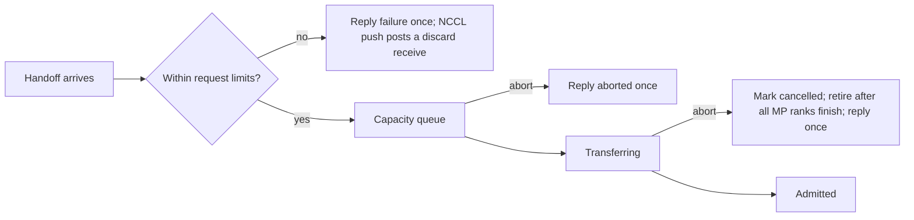

# fix(inference): AUT-2539 fail impossible KV handoffs on arrival and honor aborts

[Upstream PR](https://github.com/NVIDIA/Megatron-LM/pull/8267) · state: closed · merged: False

## Original PR description

## Background

In disaggregated inference, a decode-side KV handoff that exceeded a fixed limit (the KV pool or the maximum sequence length) waited at the head of the capacity queue forever and blocked every later handoff. An `ABORT_REQUEST` for a handoff that was still queued or transferring was dropped, so the client never got a reply.

## What changed

- `dynamic_engine.py`: a shared `_request_limit_errors` helper checks each handoff against the `add_request` limits before it reserves cache state or joins the queue. A rejected handoff replies once through `_fail_submission`.
- An `ABORT_REQUEST` with no engine entry goes to `_abort_kv_handoff`:
  - A queued handoff replies at once.
  - A transferring import is marked cancelled. It is retired (released or quarantined) after every model-parallel rank reports its transfer terminal, and then it replies once.
- NCCL push path (`transfer_backends/nccl.py`): a rejected or aborted push handoff keeps its FIFO position as a discard. `begin_discard_blocks` posts matching receives into scratch buffers.
- Tests: new `test_disagg_handoff_lifecycle.py` and `test_nccl_transfer_backend.py`, new cases in `test_dynamic_engine.py`, and one updated test in `test_dynamic_engine_async_sched.py`.
- Merges main `ee6baa2e` (#8263). It seeds the models in `test_checkpoint_load_without_microbatch_calculator`, which hung the H100 unit job on `e638ce6a` in an NCCL barrier.

## Details

This fixes two review findings: impossible handoffs (F4) and aborts during a handoff (F5). A rejected or aborted handoff drains its transfer instead of cancelling it mid-flight.

## Tested

- black, isort, pylint, ruff and py_compile pass on the changed files.
- On 8×H100 with the CI image `sha256:7b4e22a3`, `tests/unit_tests/**/*.py` ran on this head merged with the main tip (`ce8ee4cb`): 3424 passed, 142 skipped, 0 failed. A second pass ran 24 more tests, all passed. The exit code was 0, and `test_checkpoint_load_without_microbatch_calculator` finished.
- GitHub CI on this head has not reported yet.
- No functional test case covers the disaggregated KV handoff path.

## Review and discussion

### reviews

### issue_comments

- copy-pr-bot[bot] · comment · 2026-10-15T19:30:03Z · [source](https://github.com/NVIDIA/Megatron-LM/pull/8267#issuecomment-6200555935)

This pull request requires additional validation before any workflows can run on NVIDIA's runners.

Pull request vetters can view their responsibilities [here](https://docs.gha-runners.nvidia.com/cpr/vetters).

Contributors can view more details about this message [here](https://docs.gha-runners.nvidia.com/cpr/contributors).

- github-actions[bot] · comment · 2026-10-15T19:30:12Z · [source](https://github.com/NVIDIA/Megatron-LM/pull/8267#issuecomment-6200558803)

This PR has been automatically converted to **draft** because all PRs must start as drafts.

When you are ready for review, click **Ready for Review** to begin the review process. This will:
1. Add the oncall reviewer (optional reviewer)
2. Add required review teams based on your changes

See the [contribution guide](https://github.com/NVIDIA/Megatron-LM/blob/main/docs/developer/submit.md) for more details.

- svcnvidia-nemo-ci · comment · 2026-10-15T19:30:33Z · [source](https://github.com/NVIDIA/Megatron-LM/pull/8267#issuecomment-6200565220)

/ok to test 5dcd02858c999b3f736ed7644ee401b6db9073f9

- svcnvidia-nemo-ci · comment · 2026-10-15T20:35:39Z · [source](https://github.com/NVIDIA/Megatron-LM/pull/8267#issuecomment-6201742890)

/ok to test e638ce6a94b858be79853eb4578e440261f32408

- svcnvidia-nemo-ci · comment · 2026-10-16T05:00:45Z · [source](https://github.com/NVIDIA/Megatron-LM/pull/8267#issuecomment-6208451626)

/ok to test a5b70b0137bc93d210d898e8bbcb8141840760c8

### inline_comments

## Changed files and fixed code

- `megatron/core/inference/disaggregation/inference_state_handoff.py` · modified · additions 233 / deletions 28
  - [head](https://github.com/svcnemo-autobot/Megatron-LM/blob/a5b70b0137bc93d210d898e8bbcb8141840760c8/megatron/core/inference/disaggregation/inference_state_handoff.py)
  - [base](https://github.com/NVIDIA/Megatron-LM/blob/ee6baa2e31671c3c23eca482d8728be1d4e33d35/megatron/core/inference/disaggregation/inference_state_handoff.py)
- `megatron/core/inference/disaggregation/pending_handoff_imports.py` · modified · additions 7 / deletions 1
  - [head](https://github.com/svcnemo-autobot/Megatron-LM/blob/a5b70b0137bc93d210d898e8bbcb8141840760c8/megatron/core/inference/disaggregation/pending_handoff_imports.py)
  - [base](https://github.com/NVIDIA/Megatron-LM/blob/ee6baa2e31671c3c23eca482d8728be1d4e33d35/megatron/core/inference/disaggregation/pending_handoff_imports.py)
- `megatron/core/inference/disaggregation/transfer_backends/nccl.py` · modified · additions 43 / deletions 0
  - [head](https://github.com/svcnemo-autobot/Megatron-LM/blob/a5b70b0137bc93d210d898e8bbcb8141840760c8/megatron/core/inference/disaggregation/transfer_backends/nccl.py)
  - [base](https://github.com/NVIDIA/Megatron-LM/blob/ee6baa2e31671c3c23eca482d8728be1d4e33d35/megatron/core/inference/disaggregation/transfer_backends/nccl.py)
- `megatron/core/inference/engines/dynamic_engine.py` · modified · additions 81 / deletions 30
  - [head](https://github.com/svcnemo-autobot/Megatron-LM/blob/a5b70b0137bc93d210d898e8bbcb8141840760c8/megatron/core/inference/engines/dynamic_engine.py)
  - [base](https://github.com/NVIDIA/Megatron-LM/blob/ee6baa2e31671c3c23eca482d8728be1d4e33d35/megatron/core/inference/engines/dynamic_engine.py)
- `tests/unit_tests/inference/engines/test_dynamic_engine.py` · modified · additions 24 / deletions 0
  - [head](https://github.com/svcnemo-autobot/Megatron-LM/blob/a5b70b0137bc93d210d898e8bbcb8141840760c8/tests/unit_tests/inference/engines/test_dynamic_engine.py)
  - [base](https://github.com/NVIDIA/Megatron-LM/blob/ee6baa2e31671c3c23eca482d8728be1d4e33d35/tests/unit_tests/inference/engines/test_dynamic_engine.py)
- `tests/unit_tests/inference/engines/test_dynamic_engine_async_sched.py` · modified · additions 4 / deletions 1
  - [head](https://github.com/svcnemo-autobot/Megatron-LM/blob/a5b70b0137bc93d210d898e8bbcb8141840760c8/tests/unit_tests/inference/engines/test_dynamic_engine_async_sched.py)
  - [base](https://github.com/NVIDIA/Megatron-LM/blob/ee6baa2e31671c3c23eca482d8728be1d4e33d35/tests/unit_tests/inference/engines/test_dynamic_engine_async_sched.py)
- `tests/unit_tests/inference/test_disagg_handoff_lifecycle.py` · modified · additions 205 / deletions 0
  - [head](https://github.com/svcnemo-autobot/Megatron-LM/blob/a5b70b0137bc93d210d898e8bbcb8141840760c8/tests/unit_tests/inference/test_disagg_handoff_lifecycle.py)
  - [base](https://github.com/NVIDIA/Megatron-LM/blob/ee6baa2e31671c3c23eca482d8728be1d4e33d35/tests/unit_tests/inference/test_disagg_handoff_lifecycle.py)
- `tests/unit_tests/inference/test_nccl_transfer_backend.py` · modified · additions 54 / deletions 0
  - [head](https://github.com/svcnemo-autobot/Megatron-LM/blob/a5b70b0137bc93d210d898e8bbcb8141840760c8/tests/unit_tests/inference/test_nccl_transfer_backend.py)
  - [base](https://github.com/NVIDIA/Megatron-LM/blob/ee6baa2e31671c3c23eca482d8728be1d4e33d35/tests/unit_tests/inference/test_nccl_transfer_backend.py)

## Evidence and interpretation boundary

[Original JSON, discussions and patches](../../../../../../evidence/prs/NVIDIA--Megatron-LM/8267-15bd5a3458ba61799e46d869ccfd41780ff31772636626b1843bdfadece513e1.json) · SHA-256 `15bd5a3458ba61799e46d869ccfd41780ff31772636626b1843bdfadece513e1`.

Diff complete: True. Missing/binary/truncated patches require pinned source inspection. This is a source page, not an independently verified optimization case. Open, merged and released are different states; recheck the deployed dependency.
