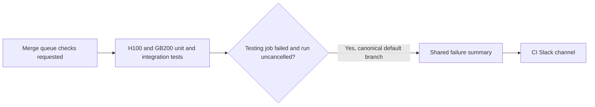

# ci(notifications): alert on merge-group testing failures

[Upstream PR](https://github.com/NVIDIA/Megatron-LM/pull/8289) · state: closed · merged: False

## Original PR description

## Background

Report failures from Megatron-LM's merge-queue testing jobs to the CI Slack channel using the shared notifier from NVIDIA-NeMo/FW-CI-templates#593.

## What changed

Add `notify-merge-group-failure` to `cicd-main.yml`, covering the four H100/GB200 unit and integration testing jobs. Alerts run only for uncancelled `merge_group` runs in `NVIDIA/Megatron-LM` targeting the repository's default branch, when at least one testing job fails. Scheduled and manually dispatched runs do not send these alerts.

## Details

Check `github.event.merge_group.base_ref` against `refs/heads/<default_branch>` so synthetic queue head refs are accepted. Keep existing workflow triggers and testing jobs unchanged. Pin `notify-ci-failure` to `631c404d00a9e60afc591cd071d35d2e18f82fc6`, use `environment: main` for `SLACK_WEBHOOK`, and give the notification job no token permissions or failed-run checkout. Add dependency-free wiring tests to the existing CPU lint job. `populate-build-cache.yml` is unchanged.

## Tested

Validated commit `57f8bf2d22` after merging upstream `main` at `adcd90f4b2`:

- `python3 .github/scripts/test_ci_notifications.py`: all four tests passed.
- `node /tmp/mlm-pr8289-merge-group/verify-condition.mjs`: 4,200 cases passed using `@actions/expressions` 0.3.61, including every testing-job failure, cancellation, alternate targets, fork repositories, synthetic queue refs, schedule, dispatch, push, and pull-request events.
- Parsed YAML comparison against upstream `main`: existing triggers and jobs unchanged after removing the notifier and its lint test step; cache workflow unchanged.
- `actionlint -format '{{json .}}' -stdin-filename .github/workflows/cicd-main.yml -`: candidate and upstream have the same 42 diagnostics; no new findings.
- `uvx --from black==26.3.0 black --check .github/scripts/test_ci_notifications.py` and `uvx --from isort==5.13.2 isort --check-only .github/scripts/test_ci_notifications.py`: passed.
- `BASE_REF=main CHECK_ONLY=true SKIP_DOCS=false bash tools/autoformat.sh`: passed; no applicable changes under its `megatron/core` and `tests` scope.
- `git diff --check`: passed.
- GitHub API: the `main` environment currently has no deployment branch restrictions or protection rules, so queue refs can use its secret.

Hosted CI and real Slack delivery remain unverified; no test Slack messages were sent.

## Review and discussion

### reviews

### issue_comments

- copy-pr-bot[bot] · comment · 2026-10-16T11:41:29Z · [source](https://github.com/NVIDIA/Megatron-LM/pull/8289#issuecomment-6214705192)

This pull request requires additional validation before any workflows can run on NVIDIA's runners.

Pull request vetters can view their responsibilities [here](https://docs.gha-runners.nvidia.com/cpr/vetters).

Contributors can view more details about this message [here](https://docs.gha-runners.nvidia.com/cpr/contributors).

- chtruong814 · comment · 2026-10-16T19:47:26Z · [source](https://github.com/NVIDIA/Megatron-LM/pull/8289#issuecomment-6223417295)

@ko3n1g Do we care about all failures in merge queue?  Originally when this was running on a schedule, it was largely unnecessary because the merge queue guards against unwanted failures.  Unlike other repos that do not do merge queues, MLM maybe does not need an alert unless we want one for flaky tests or infra failures, which is a different and larger challenge.

### inline_comments

## Changed files and fixed code

- `.github/scripts/test_ci_notifications.py` · added · additions 88 / deletions 0
  - [head](https://github.com/ko3n1g/Megatron-LM/blob/57f8bf2d22a1e2cea0bf6b7bcd4d513fea56ca2b/.github/scripts/test_ci_notifications.py)
  - [base](https://github.com/NVIDIA/Megatron-LM/blob/adcd90f4b2a7f693c88b289ef29a0fc7c2980d57/.github/scripts/test_ci_notifications.py)
- `.github/workflows/cicd-main.yml` · modified · additions 23 / deletions 0
  - [head](https://github.com/ko3n1g/Megatron-LM/blob/57f8bf2d22a1e2cea0bf6b7bcd4d513fea56ca2b/.github/workflows/cicd-main.yml)
  - [base](https://github.com/NVIDIA/Megatron-LM/blob/adcd90f4b2a7f693c88b289ef29a0fc7c2980d57/.github/workflows/cicd-main.yml)

## Evidence and interpretation boundary

[Original JSON, discussions and patches](../../../../../../evidence/prs/NVIDIA--Megatron-LM/8289-72819e138a92315fb1a8d8c74ed98ab67fdebbcfe8e692c1b7e635c2294ec320.json) · SHA-256 `72819e138a92315fb1a8d8c74ed98ab67fdebbcfe8e692c1b7e635c2294ec320`.

Diff complete: True. Missing/binary/truncated patches require pinned source inspection. This is a source page, not an independently verified optimization case. Open, merged and released are different states; recheck the deployed dependency.
