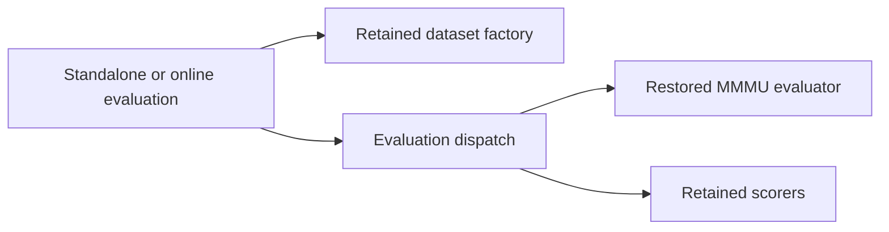

# revert(multimodal): AUT-2553 remove obsolete VLM evaluation benchmarks

[Upstream PR](https://github.com/NVIDIA/Megatron-LM/pull/8311) · state: open · merged: False

## Original PR description

## Background

Revert 2aa29fa8da18f879826b31be2b1ed9bb97882192, “Add more eval benchmarks for VLMs,” because it is no longer needed.

## What changed

- Remove the added benchmark datasets, evaluators and bundled MMMU utilities.
- Adjust newer evaluation dispatches to avoid deleted-module imports.
- Preserve later inference support and evaluator call contracts.
- Add the seven copyright headers required by CI.

## Details

Conflict resolution preserves the later inference example, factory signature, package imports, VQA annotations, COCO return value and MMMU syntax fix. MMMU scores retain their fractional scale.

## Tested

On head `b6a663e8` against main `8442db19`:
- Exact CI copyright checker passed after reproducing the missing-header failure.
- Syntax, import sorting, scope checks and repository lint payload passed.
- 10 isolated CPU compatibility checks passed with external scoring/model dependencies mocked.
- Header-only fixup is AST-equivalent to the previous head.
- Full dataset scoring and GPU suites were not run. GitHub required-check results remain unverified.

## Review and discussion

### reviews

### issue_comments

- copy-pr-bot[bot] · comment · 2026-10-17T15:19:21Z · [source](https://github.com/NVIDIA/Megatron-LM/pull/8311#issuecomment-6235630866)

This pull request requires additional validation before any workflows can run on NVIDIA's runners.

Pull request vetters can view their responsibilities [here](https://docs.gha-runners.nvidia.com/cpr/vetters).

Contributors can view more details about this message [here](https://docs.gha-runners.nvidia.com/cpr/contributors).

- github-actions[bot] · comment · 2026-10-17T15:19:27Z · [source](https://github.com/NVIDIA/Megatron-LM/pull/8311#issuecomment-6235632262)

This PR has been automatically converted to **draft** because all PRs must start as drafts.

When you are ready for review, click **Ready for Review** to begin the review process. This will:
1. Add the oncall reviewer (optional reviewer)
2. Add required review teams based on your changes

See the [contribution guide](https://github.com/NVIDIA/Megatron-LM/blob/main/docs/developer/submit.md) for more details.

- svcnvidia-nemo-ci · comment · 2026-10-17T15:20:00Z · [source](https://github.com/NVIDIA/Megatron-LM/pull/8311#issuecomment-6235639542)

/ok to test 7e25303dfa6ece8ebe955b70bda3e35131b23b3c

- svcnvidia-nemo-ci · comment · 2026-10-17T15:33:37Z · [source](https://github.com/NVIDIA/Megatron-LM/pull/8311#issuecomment-6235833272)

/ok to test b6a663e8eb3f5828c93100192050558e1d8c1bb3

### inline_comments

## Changed files and fixed code

- `examples/multimodal/evaluation/evaluate_ai2d.py` · modified · additions 2 / deletions 1
  - [head](https://github.com/svcnemo-autobot/Megatron-LM/blob/b6a663e8eb3f5828c93100192050558e1d8c1bb3/examples/multimodal/evaluation/evaluate_ai2d.py)
  - [base](https://github.com/NVIDIA/Megatron-LM/blob/8442db193ced81584c2e94faa352ec7307d18d83/examples/multimodal/evaluation/evaluate_ai2d.py)
- `examples/multimodal/evaluation/evaluate_chartqa.py` · modified · additions 2 / deletions 1
  - [head](https://github.com/svcnemo-autobot/Megatron-LM/blob/b6a663e8eb3f5828c93100192050558e1d8c1bb3/examples/multimodal/evaluation/evaluate_chartqa.py)
  - [base](https://github.com/NVIDIA/Megatron-LM/blob/8442db193ced81584c2e94faa352ec7307d18d83/examples/multimodal/evaluation/evaluate_chartqa.py)
- `examples/multimodal/evaluation/evaluate_coco.py` · modified · additions 1 / deletions 1
  - [head](https://github.com/svcnemo-autobot/Megatron-LM/blob/b6a663e8eb3f5828c93100192050558e1d8c1bb3/examples/multimodal/evaluation/evaluate_coco.py)
  - [base](https://github.com/NVIDIA/Megatron-LM/blob/8442db193ced81584c2e94faa352ec7307d18d83/examples/multimodal/evaluation/evaluate_coco.py)
- `examples/multimodal/evaluation/evaluate_mathvista.py` · modified · additions 5 / deletions 3
  - [head](https://github.com/svcnemo-autobot/Megatron-LM/blob/b6a663e8eb3f5828c93100192050558e1d8c1bb3/examples/multimodal/evaluation/evaluate_mathvista.py)
  - [base](https://github.com/NVIDIA/Megatron-LM/blob/8442db193ced81584c2e94faa352ec7307d18d83/examples/multimodal/evaluation/evaluate_mathvista.py)
- `examples/multimodal/evaluation/evaluate_mmmu.py` · modified · additions 9 / deletions 26
  - [head](https://github.com/svcnemo-autobot/Megatron-LM/blob/b6a663e8eb3f5828c93100192050558e1d8c1bb3/examples/multimodal/evaluation/evaluate_mmmu.py)
  - [base](https://github.com/NVIDIA/Megatron-LM/blob/8442db193ced81584c2e94faa352ec7307d18d83/examples/multimodal/evaluation/evaluate_mmmu.py)
- `examples/multimodal/evaluation/evaluate_ocrbench.py` · modified · additions 2 / deletions 1
  - [head](https://github.com/svcnemo-autobot/Megatron-LM/blob/b6a663e8eb3f5828c93100192050558e1d8c1bb3/examples/multimodal/evaluation/evaluate_ocrbench.py)
  - [base](https://github.com/NVIDIA/Megatron-LM/blob/8442db193ced81584c2e94faa352ec7307d18d83/examples/multimodal/evaluation/evaluate_ocrbench.py)
- `examples/multimodal/evaluation/evaluate_ocrbench_v2.py` · modified · additions 7 / deletions 0
  - [head](https://github.com/svcnemo-autobot/Megatron-LM/blob/b6a663e8eb3f5828c93100192050558e1d8c1bb3/examples/multimodal/evaluation/evaluate_ocrbench_v2.py)
  - [base](https://github.com/NVIDIA/Megatron-LM/blob/8442db193ced81584c2e94faa352ec7307d18d83/examples/multimodal/evaluation/evaluate_ocrbench_v2.py)
- `examples/multimodal/evaluation/evaluate_realworldqa.py` · removed · additions 0 / deletions 45
  - [head](https://github.com/svcnemo-autobot/Megatron-LM/blob/b6a663e8eb3f5828c93100192050558e1d8c1bb3/examples/multimodal/evaluation/evaluate_realworldqa.py)
  - [base](https://github.com/NVIDIA/Megatron-LM/blob/8442db193ced81584c2e94faa352ec7307d18d83/examples/multimodal/evaluation/evaluate_realworldqa.py)
- `examples/multimodal/evaluation/evaluate_textvqa.py` · modified · additions 2 / deletions 1
  - [head](https://github.com/svcnemo-autobot/Megatron-LM/blob/b6a663e8eb3f5828c93100192050558e1d8c1bb3/examples/multimodal/evaluation/evaluate_textvqa.py)
  - [base](https://github.com/NVIDIA/Megatron-LM/blob/8442db193ced81584c2e94faa352ec7307d18d83/examples/multimodal/evaluation/evaluate_textvqa.py)
- `examples/multimodal/evaluation/evaluate_video_motionbench.py` · removed · additions 0 / deletions 45
  - [head](https://github.com/svcnemo-autobot/Megatron-LM/blob/b6a663e8eb3f5828c93100192050558e1d8c1bb3/examples/multimodal/evaluation/evaluate_video_motionbench.py)
  - [base](https://github.com/NVIDIA/Megatron-LM/blob/8442db193ced81584c2e94faa352ec7307d18d83/examples/multimodal/evaluation/evaluate_video_motionbench.py)
- `examples/multimodal/evaluation/evaluate_video_mvbench.py` · removed · additions 0 / deletions 117
  - [head](https://github.com/svcnemo-autobot/Megatron-LM/blob/b6a663e8eb3f5828c93100192050558e1d8c1bb3/examples/multimodal/evaluation/evaluate_video_mvbench.py)
  - [base](https://github.com/NVIDIA/Megatron-LM/blob/8442db193ced81584c2e94faa352ec7307d18d83/examples/multimodal/evaluation/evaluate_video_mvbench.py)
- `examples/multimodal/evaluation/evaluate_video_phys_game_bench.py` · removed · additions 0 / deletions 98
  - [head](https://github.com/svcnemo-autobot/Megatron-LM/blob/b6a663e8eb3f5828c93100192050558e1d8c1bb3/examples/multimodal/evaluation/evaluate_video_phys_game_bench.py)
  - [base](https://github.com/NVIDIA/Megatron-LM/blob/8442db193ced81584c2e94faa352ec7307d18d83/examples/multimodal/evaluation/evaluate_video_phys_game_bench.py)
- `examples/multimodal/evaluation/evaluate_vqav2.py` · modified · additions 6 / deletions 3
  - [head](https://github.com/svcnemo-autobot/Megatron-LM/blob/b6a663e8eb3f5828c93100192050558e1d8c1bb3/examples/multimodal/evaluation/evaluate_vqav2.py)
  - [base](https://github.com/NVIDIA/Megatron-LM/blob/8442db193ced81584c2e94faa352ec7307d18d83/examples/multimodal/evaluation/evaluate_vqav2.py)
- `examples/multimodal/evaluation/evaluation_datasets.py` · modified · additions 25 / deletions 614
  - [head](https://github.com/svcnemo-autobot/Megatron-LM/blob/b6a663e8eb3f5828c93100192050558e1d8c1bb3/examples/multimodal/evaluation/evaluation_datasets.py)
  - [base](https://github.com/NVIDIA/Megatron-LM/blob/8442db193ced81584c2e94faa352ec7307d18d83/examples/multimodal/evaluation/evaluation_datasets.py)
- `examples/multimodal/evaluation/mmmu_utils.py` · removed · additions 0 / deletions 535
  - [head](https://github.com/svcnemo-autobot/Megatron-LM/blob/b6a663e8eb3f5828c93100192050558e1d8c1bb3/examples/multimodal/evaluation/mmmu_utils.py)
  - [base](https://github.com/NVIDIA/Megatron-LM/blob/8442db193ced81584c2e94faa352ec7307d18d83/examples/multimodal/evaluation/mmmu_utils.py)
- `examples/multimodal/run_text_generation.py` · modified · additions 17 / deletions 54
  - [head](https://github.com/svcnemo-autobot/Megatron-LM/blob/b6a663e8eb3f5828c93100192050558e1d8c1bb3/examples/multimodal/run_text_generation.py)
  - [base](https://github.com/NVIDIA/Megatron-LM/blob/8442db193ced81584c2e94faa352ec7307d18d83/examples/multimodal/run_text_generation.py)

## Evidence and interpretation boundary

[Original JSON, discussions and patches](../../../../../../evidence/prs/NVIDIA--Megatron-LM/8311-fa4a158f53d4a6ace0a9f30c5f1565aa93bfd54c38a66e1b80576b13457bc447.json) · SHA-256 `fa4a158f53d4a6ace0a9f30c5f1565aa93bfd54c38a66e1b80576b13457bc447`.

Diff complete: True. Missing/binary/truncated patches require pinned source inspection. This is a source page, not an independently verified optimization case. Open, merged and released are different states; recheck the deployed dependency.
