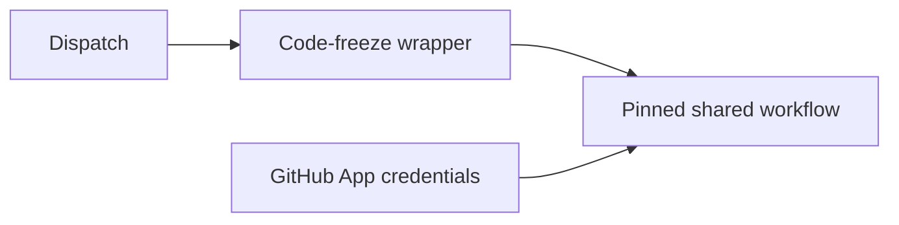

# cp: use GitHub App authentication for code freeze

[Upstream PR](https://github.com/NVIDIA/Megatron-LM/pull/8323) · state: closed · merged: True

## Original PR description

## Background

Copy #7935 at source head `750744dbcb205272acbb6e46f6ae79d913b21f6f` onto `main`.

## What changed

Switch code-freeze authentication from PAT to the GitHub App and pin the shared workflow to `61445a177938967f70c94094b98402e979452151`.

## Details

All three source commits retain cherry-pick provenance. The source synchronization merge is an empty signed commit, preserving newer target-main changes. Only `.github/workflows/release-freeze.yml` differs; its final blob matches the pinned source.

## Tested

- Native changed-file pre-commit completed; Python-only hooks skipped by their own filters.
- Diff whitespace, source-blob identity, signatures, and signoffs verified.
- ML/GPU tests excluded: product and dependency inputs unchanged.
- actionlint unavailable due denied asset access. Full required CI pending.

## Review and discussion

### reviews

- ko3n1g · APPROVED · 2026-10-19T08:49:30Z · [source](https://github.com/NVIDIA/Megatron-LM/pull/8323#pullrequestreview-5569032034)

(No body; status only.)

### issue_comments

- copy-pr-bot[bot] · comment · 2026-10-18T18:35:06Z · [source](https://github.com/NVIDIA/Megatron-LM/pull/8323#issuecomment-6253601630)

This pull request requires additional validation before any workflows can run on NVIDIA's runners.

Pull request vetters can view their responsibilities [here](https://docs.gha-runners.nvidia.com/cpr/vetters).

Contributors can view more details about this message [here](https://docs.gha-runners.nvidia.com/cpr/contributors).

- github-actions[bot] · comment · 2026-10-18T18:35:12Z · [source](https://github.com/NVIDIA/Megatron-LM/pull/8323#issuecomment-6253602707)

This PR has been automatically converted to **draft** because all PRs must start as drafts.

When you are ready for review, click **Ready for Review** to begin the review process. This will:
1. Add the oncall reviewer (optional reviewer)
2. Add required review teams based on your changes

See the [contribution guide](https://github.com/NVIDIA/Megatron-LM/blob/main/docs/developer/submit.md) for more details.

- ko3n1g · comment · 2026-10-19T08:57:30Z · [source](https://github.com/NVIDIA/Megatron-LM/pull/8323#issuecomment-6263505092)

/ok to test 8179eaa29777566660cd1a7056e74f9a9b7a0cfd

- nemo-automation-bot[bot] · comment · 2026-10-19T13:03:05Z · [source](https://github.com/NVIDIA/Megatron-LM/pull/8323#issuecomment-6267859750)

🔄 Merge queue validation started!

You can track the progress here: https://github.com/NVIDIA/Megatron-LM/actions/runs/39256864477

### inline_comments

## Changed files and fixed code

- `.github/workflows/release-freeze.yml` · modified · additions 7 / deletions 3
  - [head](https://github.com/svcnemo-autobot/Megatron-LM/blob/8179eaa29777566660cd1a7056e74f9a9b7a0cfd/.github/workflows/release-freeze.yml)
  - [base](https://github.com/NVIDIA/Megatron-LM/blob/b607c1b7f564f47dbb9f1b962e9c91f40abd8c59/.github/workflows/release-freeze.yml)

## Evidence and interpretation boundary

[Original JSON, discussions and patches](../../../../../../evidence/prs/NVIDIA--Megatron-LM/8323-ee1e3e709a7fce52e3e13763c771f103fbccbfac1ab102c267b9906476542595.json) · SHA-256 `ee1e3e709a7fce52e3e13763c771f103fbccbfac1ab102c267b9906476542595`.

Diff complete: True. Missing/binary/truncated patches require pinned source inspection. This is a source page, not an independently verified optimization case. Open, merged and released are different states; recheck the deployed dependency.
