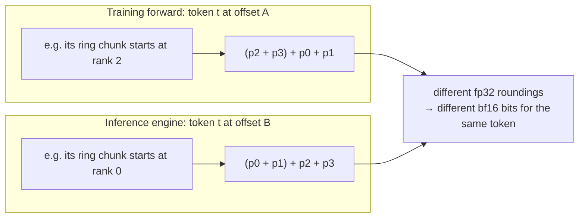
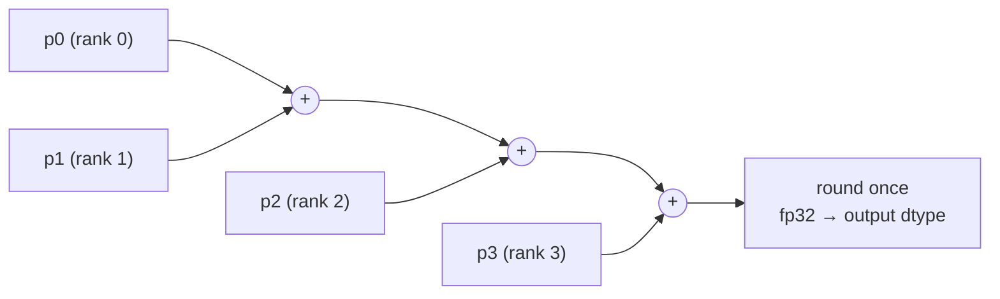
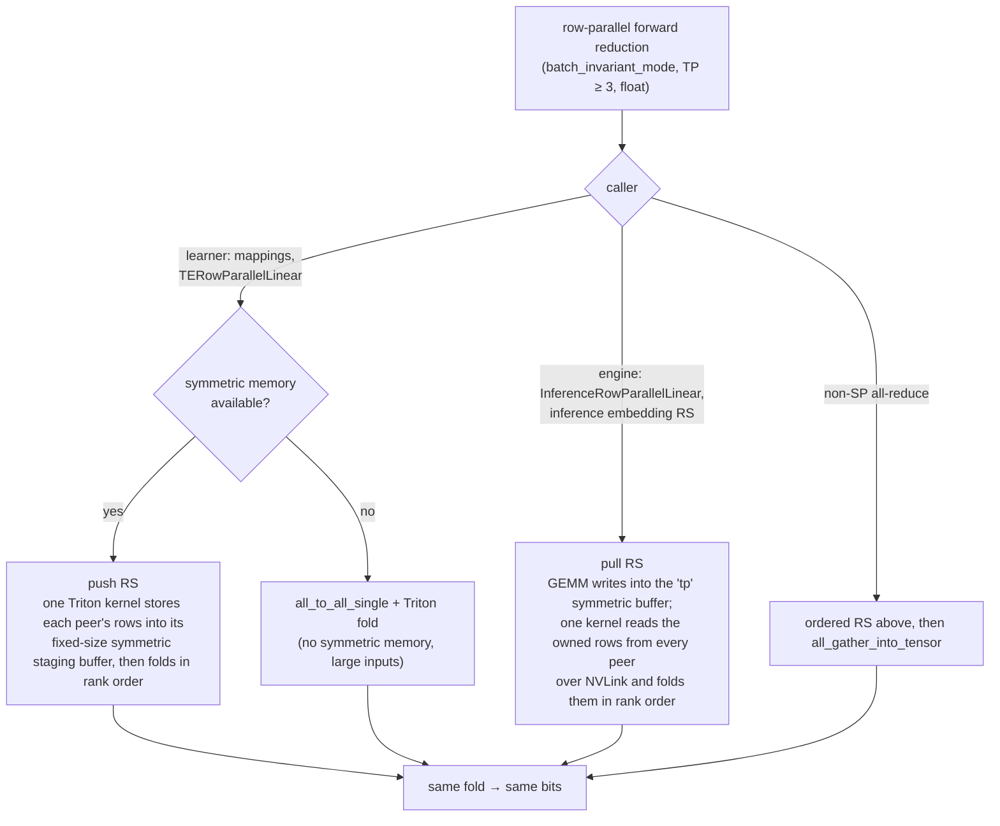
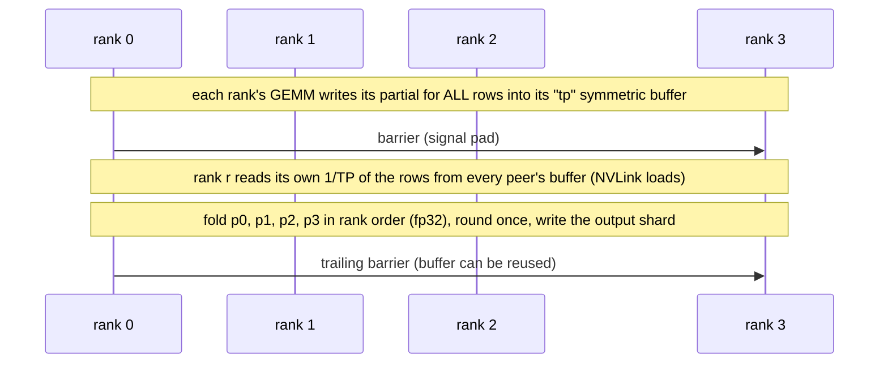
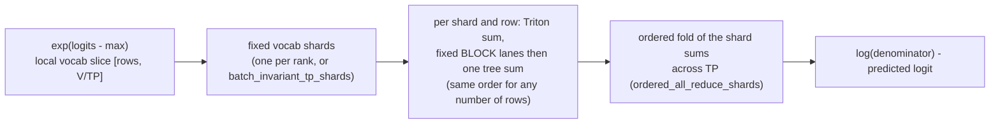
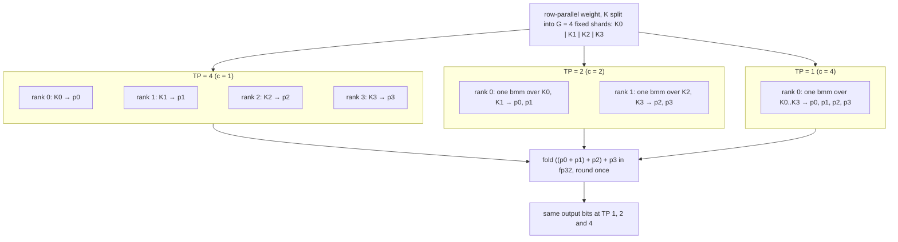

# Batch-invariant ordered TP reductions for TP>=3

[Upstream PR](https://github.com/NVIDIA/Megatron-LM/pull/8421) · state: open · merged: False

## Original PR description

## Summary

Two related changes for `batch_invariant_mode`, both forward-only (the backward keeps the stock collectives):

1. **Ordered TP reductions for TP >= 3.** Every tensor-parallel forward reduction (row-parallel all-reduce / reduce-scatter) adds the TP partials in rank order with an fp32 accumulator and one final rounding, so a token's bits no longer depend on where it sits in the message. Training and the inference engine then agree bitwise at TP >= 3. No new flag: `batch_invariant_mode` turns it on. **TP = 2 is unchanged** (a single addition is already order-free).
2. **Batch-invariant vocab-parallel cross entropy.** The softmax denominator uses the same definition: a fixed-order sum per vocab shard, folded in shard order across TP.
3. **TP-size-invariant forward (`batch_invariant_tp_shards = G`, opt-in).** The row-parallel reduction is split into G fixed shards, so any TP that divides G gives the same forward bits. Training and inference can run at different TP sizes (for example a TP4 learner with a TP1 or TP2 engine) and still produce identical log-probs.

## Problem

A row-parallel layer computes each output as the sum of TP partials, one per rank. NCCL's summation order for an element depends on where that element sits in the message: ring rotation, chunking, and the algorithm it picks for the message size. The training forward (`[s, b]` rows) and the inference engine (flat decode rows) place the same token at different offsets, so they add the same partials in different orders and get different bits.



Measured on Ultra-L8 TP4 x EP4 with the stock reduce: 576/576 tokens differed (max 1.3e-2). With the ordered reduce, all 576/576 were bitwise equal.

## Ordered TP reduction

New module `megatron/core/tensor_parallel/ordered_reduce.py`. Each output element is

```
cast( ((p0 + p1) + p2) + ... + p_{TP-1} )      fp32 accumulator, one rounding
```

The bits depend only on the partials, never on the element's position, the message size or which code path ran. That is what lets every path below (and any size threshold between them) give the same result.



`batch_invariant_collective="multimem"` (the EP combine's exact-sum setting) switches every TP path to an fp64 accumulator with one rounding to fp32. Engine and learner stay bitwise identical to each other in both settings.

### Paths

`use_ordered_tp_reduce(group, dtype)` selects the ordered path: batch-invariant mode, TP >= 3, floating-point dtype. All paths compute the same fold and give the same bits (tested pairwise). The symmetric-memory paths run at any TP from 2 to 8, including TP 3.



| Path | Used by | Per-rank cost |
|---|---|---|
| symmetric-memory **push** RS | learner (`mappings`), any message size; staging allocated when the layer is built, never during CUDA-graph capture | One Triton kernel stores each peer's rows into that peer's fixed-size symmetric staging buffer over NVLink, barriers per chunk through the signal pad, and pushes the next chunk while folding the current one. Staging is 2 x 128 blocks x TP x 32 KiB per rank (32 MiB at TP4, 64 MiB at TP8), independent of the message size. No receive buffer, no NCCL, CUDA-graph capturable. |
| **all-to-all + fold** | learner fallback when the group has no symmetric memory (e.g. TP across NVLink domains); one or several partials per rank | One `all_to_all_single` ((TP-1)/TP of the input, the same bytes as a ring RS), a transient receive buffer of the input's size, one Triton fold pass. |
| ordered **AR** | non-SP all-reduce | The ordered RS (flattened, zero-padded to TP x 16 B), then `all_gather_into_tensor`. |
| symmetric-memory **pull** RS | inference engine | The GEMM writes straight into the existing `"tp"` symmetric buffer; one kernel barriers, reads the owned rows from every peer with 16-byte NVLink loads, folds them, and a trailing barrier makes buffer reuse safe. CUDA-graph capturable. |

How the engine's pull works, per call:



### Integration

- **Peer addressing:** the push and pull kernels read peer base addresses from the symmetric handle's device pointer array (`tl.multiple_of` keeps 16-byte vector loads when aligned), so they work at any TP within an NVLink domain.
- **`mappings`:** the forward of `_ReduceFromModelParallelRegion`, `_ReduceScatterToSequenceParallelRegion` and `_ReduceScatterToTensorParallelRegion` takes the ordered path when `use_ordered_tp_reduce` holds. `use_global_buffer` is honored; uneven `input_split_sizes` on the ordered path assert (not built yet).
- **`TERowParallelLinear`** (not expert): at TP >= 3 TE runs only the local GEMM (`parallel_mode=None` on the `1/TP` input shard, no userbuffer RS, no symmetric AR); Megatron then does the ordered RS/AR and adds the bias. The row-parallel parameter metadata (`partition_dim=1`, bias `sequence_parallel`) is kept, including across `reset_parameters`.
- **Shared-expert overlap** runs fc2's TP reduction itself (`post_forward_comm`, which takes the ordered path); it sets `TELinear.bi_tp_reduce_by_caller` so the layer returns its partial instead of reducing twice.
- **`InferenceRowParallelLinear`** and `inference_reduce_scatter_to_sequence_parallel_region`: the pull at TP >= 3, with the all-to-all path as fallback. The NVLS multimem path stays disabled under batch-invariant mode, as before.

## Vocab-parallel cross entropy

The loss is `log(sum_v exp(logit_v - max)) - (logit_target - max)`. Under batch-invariant mode, the max all-reduce and the predicted-logit all-reduce are already exact: max is order-free, and only one rank holds a nonzero predicted logit. The denominator is not: torch's local `exp_logits.sum(-1)` changes its blocking with the number of rows, and NCCL's TP sum depends on position at TP >= 3. Both native implementations (unfused and fused) now compute it with `batch_invariant_vocab_sum`:



With `batch_invariant_tp_shards = G`, the vocab is cut into the same G shards at every TP that divides G, so the loss bits do not depend on the TP size either. TE's fused cross entropy sums each rank's vocab slice, so `TransformerConfig` requires the native implementation when `batch_invariant_tp_shards` is set.

## TP-size-invariant forward: `batch_invariant_tp_shards`

**What depends on TP.** Under batch-invariant mode the same weights and tokens through a TE GPT at TP 1/2/4 give identical embedding, QKV (layernorm + column-parallel), attention, fc1 and logits outputs: the column-parallel cuBLASLt GEMM (workspace 0) does not change its bits with N. The only TP-dependent op is the row-parallel reduction, where each rank's partial sums over K/TP.

**Definition.** `batch_invariant_tp_shards = G` splits the row-parallel reduction dim K into G fixed shards. Each shard's GEMM output is one partial, and the G partials are folded in shard order with the same accumulator and single rounding as above. TP rank r owns shards `r*c .. r*c + c - 1` (`c = G / TP`), so every TP that divides G folds the same G partials in the same order:



| Rank holds | Forward | Backward |
|---|---|---|
| one shard (TP = G) | exactly the ordered TP reduction above, no extra cost | TE's, unchanged |
| c > 1 shards (TP < G) | one strided cuBLAS `bmm` over the rank's shards (no copies; bitwise equal to TE / `torch.matmul`), then the push (training) or pull (inference) kernel folding c partials per peer; all-to-all + fold fallback | stock row-parallel (all-gather under SP, full local-K GEMMs, `main_grad` accumulation) |

A rank with c shards sends c partials (c x a reduce-scatter's bytes): the left fold cannot be pre-combined per rank without changing the bits. All GEMMs stay cuBLAS. Routed experts (`is_expert`) keep their reduction. When a rank holds several shards the forward is a batched cuBLAS GEMM outside TE's linear, so `TransformerConfig` rejects the options that path does not implement yet: fp8/fp4 and `quant_recipe` (an MXFP8 GEMM per K-shard is not built yet; per-tensor-scaled recipes would also need one scale per shard), `delay_wgrad_compute`, `tp_comm_overlap` and `moe_shared_expert_overlap`.

## Exactness of the two settings

- **`"ordered"` (default):** exact by construction on any data: one fixed left fold, one rounding.
- **`"multimem"`:** fp64 accumulator on every TP path, one rounding to fp32. This mirrors NVLS fp32 in-switch reduction, which returns the correctly rounded exact sum of 4 partials up to a large exponent spread. The two agree while the partials' exponent spread stays well below 2^53 and there is no large-magnitude cancellation (property test below); "ordered" has no such condition. bf16 NVLS (`ld_reduce.bf16x2`) does not equal the fp32-accumulated sum, so it cannot be mirrored.

<details><summary>Property test (TP4, 65,536 elements per case, fp32 partials; counts are elements that are not bitwise equal)</summary>

| case | NVLS f32 vs exact RN32 | NVLS vs fp64 fold | fp64 fold vs exact | fp32 fold vs exact |
|---|---|---|---|---|
| random, exponent spread 2^8 / 2^20 / 2^29 / 2^40 | 0 / 0 / 0 / 0 | 0 / 0 / 0 / 0 | 0 / 0 / 0 / 0 | 20482 / 18370 / 17231 / 14120 |
| random, spread 2^60 | 0 | 6 | 6 | 8950 |
| random, spread 2^120 | 34 | 174 | 208 | 3292 |
| cancellation a+b-a+c, \|a\|~2^24 / 2^30 / 2^40 | 0 / 0 / 0 | 11687 / 25131 / 46190 | same as left | ~48800 |
| cancellation, \|a\|~2^60 / 2^100 | 8202 / 65536 | 50174 / 32762 | 48851 / 48774 | ~48800 |
| ties (half-ulp, single / split / negative) | 0 / 0 / 0 | 0 / 0 / 0 | 0 / 0 / 0 | 0 / 32807 / 32807 |
| denormals, normal boundary | 0, 0 | 0, 0 | 0, 0 | 9730, 0 |
| inf / nan / overflow | 0 | 0 | 0 | 14515 |

Speed: bf16 activations need an upcast into an fp32 symmetric buffer for NVLS. Decode 1 x 2688 RS: NVLS 10.5 µs vs pull 11.7 µs; prefill 32k x 8192: NVLS 2257 µs vs pull 650 µs. The fp64 pull/fold costs the same as fp32 (32k x 8192: 650 µs). With fp32 partials, NVLS f32 RS is the fastest decode option (about 6.7 µs vs 13-15 µs). In `"multimem"` mode the engine currently uses the fp64 pull, not the hardware NVLS reduce.
</details>

## Benchmarks

GB200 NVL, 4 GPUs, TP4; CUDA-graph replay, µs per call, median of 30 replays x 10 calls, max over ranks. Every row was checked bitwise: pull, push and all-to-all + fold give identical bits. `learner` is what `mappings` ran when this table was taken (push up to 64 MiB of input, all-to-all + fold above, rows marked "a2a"); the size cap has since been removed and the push runs at every size, see the push size sweep below.

Reduce-scatter, bf16 (input rows = tokens; the inference engine is always SP, so it uses RS):

| tokens x hidden | stock NCCL | pull (engine) | ratio | a2a+fold | ratio | learner | ratio |
|---|---|---|---|---|---|---|---|
| 1 x 2688 | 15.3 | 11.8 | 0.77 | 14.4 | 0.94 | 11.7 | 0.76 |
| 16 x 4096 | 15.5 | 12.1 | 0.78 | 18.3 | 1.18 | 12.9 | 0.83 |
| 32 x 4096 | 15.6 | 14.0 | 0.90 | 19.7 | 1.26 | 14.6 | 0.93 |
| 128 x 8192 | 19.0 | 17.5 | 0.92 | 21.4 | 1.12 | 18.9 | 0.99 |
| 512 x 8192 | 51.9 | 25.5 | 0.49 | 35.3 | 0.68 | 29.1 | 0.56 |
| 4096 x 4096 | 73.4 | 58.3 | 0.79 | 79.9 | 1.09 | 73.5 | 1.00 |
| 8192 x 8192 | 208.1 | 189.7 | 0.91 | 253.0 | 1.22 | 252.7 (a2a) | 1.21 |
| 32768 x 8192 | 735.7 | 701.8 | 0.95 | 910.4 | 1.24 | 909.7 (a2a) | 1.24 |

Reduce-scatter, fp32 partials: 1 x 4096: stock 15.6, pull 12.5 (0.80), learner push 12.9 (0.83). 32768 x 8192: stock 1334, pull 1393 (1.04), learner (a2a) 1662 (1.25).

All-reduce, bf16 (non-SP):

| tokens x hidden | stock | a2a+fold+AG | ratio | learner (RS above + AG) | ratio |
|---|---|---|---|---|---|
| 1 x 4096 | 20.6 | 29.0 | 1.41 | 25.7 | 1.25 |
| 128 x 4096 | 24.5 | 38.4 | 1.57 | 34.0 | 1.39 |
| 512 x 8192 | 47.7 | 90.6 | 1.90 | 81.9 | 1.72 |
| 8192 x 8192 | 351.6 | 456.1 | 1.30 | 455.5 | 1.30 |
| 32768 x 8192 | 1298.7 | 1626.2 | 1.25 | 1626.3 | 1.25 |

- **Engine (pull RS):** 0.49-0.95x stock for bf16; 1.04x for fp32 partials at 32k x 8192. At 32k x 8192 bf16 it reads 384 MB from peers in 702 µs, about 550 GB/s of NVLink per GPU.
- **Learner RS:** the push brings decode and medium sizes to 0.56-1.00x stock, and runs at every message size. Above about 64 MiB of input both the push and all-to-all + fold are 1.2-1.6x stock (one barrier per 32 KiB staging chunk per block for the push); which of the two is faster depends on the TP size (sweep below), so there is no size threshold.

Push size sweep (one partial per rank, bf16 `[rows, 8192]`, GB200, CUDA-graph replay, max over ranks; push and all-to-all + fold bitwise identical at every size):

| input | TP4 push / NCCL | TP4 a2a / NCCL | TP4 push / a2a | TP3 push / NCCL | TP3 a2a / NCCL | TP3 push / a2a |
|---|---|---|---|---|---|---|
| 1 MiB | 1.04 | 1.40 | 0.74 | 0.76 | 1.02 | 0.74 |
| 16 MiB | 0.74 | 0.91 | 0.82 | 0.96 | 1.10 | 0.87 |
| 64 MiB | 1.21 | 1.26 | 0.96 | 1.28 | 1.44 | 0.89 |
| 128 MiB | 1.23 | 1.21 | 1.02 | 1.32 | 1.49 | 0.88 |
| 256 MiB | 1.26 | 1.19 | 1.05 | 1.32 | 1.59 | 0.83 |
| 768 MiB | 1.38 | 1.19 | 1.16 | 1.26 | 1.54 | 0.82 |
- **Learner non-SP AR** is ordered RS + NCCL all-gather, 1.25-1.7x stock. The engine and SP training use RS, so this only affects non-SP training.

`batch_invariant_tp_shards` cost (8 layers, hidden 4096, FFN 14336, G = 4, vs the same TP without the option):

| | TP1 | TP2 | TP4 (= G) |
|---|---|---|---|
| training fwd + bwd, 8k tokens | +1.2% | -1.6% | same path |
| engine decode step (CUDA graphs) | +0.1% | -2.6% | same path |
| engine prefill | +5.8% | +0.4% | same path |

Row-parallel layer alone (GEMM + reduce): 1.00x at TP = G; inference TP2 0.76-1.16x (the pull beats NCCL at decode sizes); training TP2 1.01-1.29x at 4k-16k tokens. TP1 prefill pays for writing c partials and folding them; a GEMM epilogue that rounds and accumulates per K-chunk would remove it.

## Validation

- **Ordered reduction** (`tests/unit_tests/tensor_parallel/test_ordered_reduce.py`, TP4 plus TP2 and TP3): ordered RS / AR (odd shapes) equal a reference left fold for both settings; a row gets the same bits at any position and batch size through `mappings`; backward uses the stock collectives; push, pull and all-to-all paths are bitwise equal, including at TP 3; CUDA-graph capture and replay of every path; fold offsets past 2^31; an unaligned symmetric input (scalar-load path); the push staging is allocated at layer construction; `TERowParallelLinear` at TP4 (SP on and off) equals the fold of the TE partials plus bias, and returns its partial when the caller reduces; TP = 2 gives the stock NCCL bits.
- **TP shards and cross entropy** (`tests/unit_tests/tensor_parallel/test_ordered_reduce_shards.py`): shard reductions equal the canonical value at every TP; cross entropy (unfused and fused) gives the same loss bits at TP 1, 2 and 4 with 4 shards, and for a token in a smaller batch; the config rejections.
- **Determinism coverage** (registered in the manifest): the fold, push, pull, all-to-all and shard kernels, `TERowParallelLinear` on the batch-invariant paths, and both cross entropies under batch-invariant mode replay bit-exactly.
- **Last run** (GB200, 4 GPUs): the two suites above pass on every rank (TP3 and TP4 paths included), and the determinism replays pass (39 passed; the skips need apex).
- **End to end** (GB200, 4 GPUs, TE 2.18): Megatron dynamic engine (`inference_optimized`, prefill + decode) at TP_e in {1, 2, 4} vs TE training forward at TP_t in {1, 2, 4}, G = 4, 12 requests: **9/9 pairs bitwise** for a dense GPT and for a Nemotron-Nano-like hybrid (Mamba + attention + squared-ReLU MoE with a shared expert), with and without grad. Chunked prefill: 6/6 (GPT), 4/4 (hybrid). Without the option: 0/12 requests match.
- **Gradients** (TP < G vs TE at TP = G, same forward bits): rel. L2 6e-3, below the stock TP1-vs-TP4 difference (7-8e-3).

## Not in this PR

- NVLS f32 decode path for fp32 partials in `"multimem"` mode.
- TP8 measurements (only 4 local GPUs).
- Learner RS/AR above about 64 MiB of input (1.2-1.4x stock): have the TE GEMM write its output into symmetric memory (then the pull applies, 0.95x), or larger push staging chunks; the non-SP learner AR could fuse the all-gather into the push kernel.
- `batch_invariant_tp_shards`: MXFP8 with several shards per rank (not built yet); routed experts with expert TP > 1; both sides must use the same padded vocab size.
- Log-probs computed outside Megatron's cross entropy (for example an RL framework's own vocab-parallel log-prob, or the engine's `log_softmax`) keep their own reductions.


## Review and discussion

### reviews

### issue_comments

- copy-pr-bot[bot] · comment · 2026-10-21T20:03:06Z · [source](https://github.com/NVIDIA/Megatron-LM/pull/8421#issuecomment-6325342316)

This pull request requires additional validation before any workflows can run on NVIDIA's runners.

Pull request vetters can view their responsibilities [here](https://docs.gha-runners.nvidia.com/cpr/vetters).

Contributors can view more details about this message [here](https://docs.gha-runners.nvidia.com/cpr/contributors).


- wdykas · comment · 2026-10-26T18:27:01Z · [source](https://github.com/NVIDIA/Megatron-LM/pull/8421#issuecomment-6424101064)

/ok to test [f42a596](https://github.com/NVIDIA/Megatron-LM/pull/8421/commits/f42a596dd4f7f87ded55f0aeb61a72934732482a)

- wdykas · comment · 2026-10-29T20:40:56Z · [source](https://github.com/NVIDIA/Megatron-LM/pull/8421#issuecomment-6507826512)

/review

- wdykas · comment · 2026-11-03T16:06:19Z · [source](https://github.com/NVIDIA/Megatron-LM/pull/8421#issuecomment-6608951748)

/ok to test 76d70b5e6a49bab2f975bd21e062861eb581ecd1

- wdykas · comment · 2026-11-03T16:15:46Z · [source](https://github.com/NVIDIA/Megatron-LM/pull/8421#issuecomment-6609240853)

/ok to test 7392c9009729d06a5d08fc7c3e2fd3554d709eba

- wdykas · comment · 2026-11-03T16:36:33Z · [source](https://github.com/NVIDIA/Megatron-LM/pull/8421#issuecomment-6609741753)

/ok to test 09ad5181be7c51c10e9f500654110977323f0f7f

- balasaajay · comment · 2026-11-04T06:43:59Z · [source](https://github.com/NVIDIA/Megatron-LM/pull/8421#issuecomment-6624495666)

/ok to test 2f8e240be83f6606ead4020c8ffd10c494f27de5

### inline_comments

## Changed files and fixed code

- `megatron/core/extensions/transformer_engine.py` · modified · additions 120 / deletions 2
  - [head](https://github.com/wdykas/Megatron-LM/blob/be3d9a2a69701a2e59e2a0ec73ceb2bc8736d17f/megatron/core/extensions/transformer_engine.py)
  - [base](https://github.com/NVIDIA/Megatron-LM/blob/362cff32df01197938d1c7473f1787ded591b6fa/megatron/core/extensions/transformer_engine.py)
- `megatron/core/fusions/fused_cross_entropy.py` · modified · additions 41 / deletions 14
  - [head](https://github.com/wdykas/Megatron-LM/blob/be3d9a2a69701a2e59e2a0ec73ceb2bc8736d17f/megatron/core/fusions/fused_cross_entropy.py)
  - [base](https://github.com/NVIDIA/Megatron-LM/blob/362cff32df01197938d1c7473f1787ded591b6fa/megatron/core/fusions/fused_cross_entropy.py)
- `megatron/core/inference/communication/torch_symm_triton/barrier.py` · modified · additions 7 / deletions 2
  - [head](https://github.com/wdykas/Megatron-LM/blob/be3d9a2a69701a2e59e2a0ec73ceb2bc8736d17f/megatron/core/inference/communication/torch_symm_triton/barrier.py)
  - [base](https://github.com/NVIDIA/Megatron-LM/blob/362cff32df01197938d1c7473f1787ded591b6fa/megatron/core/inference/communication/torch_symm_triton/barrier.py)
- `megatron/core/models/common/language_module/language_module.py` · modified · additions 8 / deletions 5
  - [head](https://github.com/wdykas/Megatron-LM/blob/be3d9a2a69701a2e59e2a0ec73ceb2bc8736d17f/megatron/core/models/common/language_module/language_module.py)
  - [base](https://github.com/NVIDIA/Megatron-LM/blob/362cff32df01197938d1c7473f1787ded591b6fa/megatron/core/models/common/language_module/language_module.py)
- `megatron/core/tensor_parallel/cross_entropy.py` · modified · additions 87 / deletions 16
  - [head](https://github.com/wdykas/Megatron-LM/blob/be3d9a2a69701a2e59e2a0ec73ceb2bc8736d17f/megatron/core/tensor_parallel/cross_entropy.py)
  - [base](https://github.com/NVIDIA/Megatron-LM/blob/362cff32df01197938d1c7473f1787ded591b6fa/megatron/core/tensor_parallel/cross_entropy.py)
- `megatron/core/tensor_parallel/inference_layers.py` · modified · additions 76 / deletions 3
  - [head](https://github.com/wdykas/Megatron-LM/blob/be3d9a2a69701a2e59e2a0ec73ceb2bc8736d17f/megatron/core/tensor_parallel/inference_layers.py)
  - [base](https://github.com/NVIDIA/Megatron-LM/blob/362cff32df01197938d1c7473f1787ded591b6fa/megatron/core/tensor_parallel/inference_layers.py)
- `megatron/core/tensor_parallel/layers.py` · modified · additions 4 / deletions 2
  - [head](https://github.com/wdykas/Megatron-LM/blob/be3d9a2a69701a2e59e2a0ec73ceb2bc8736d17f/megatron/core/tensor_parallel/layers.py)
  - [base](https://github.com/NVIDIA/Megatron-LM/blob/362cff32df01197938d1c7473f1787ded591b6fa/megatron/core/tensor_parallel/layers.py)
- `megatron/core/tensor_parallel/mappings.py` · modified · additions 30 / deletions 5
  - [head](https://github.com/wdykas/Megatron-LM/blob/be3d9a2a69701a2e59e2a0ec73ceb2bc8736d17f/megatron/core/tensor_parallel/mappings.py)
  - [base](https://github.com/NVIDIA/Megatron-LM/blob/362cff32df01197938d1c7473f1787ded591b6fa/megatron/core/tensor_parallel/mappings.py)
- `megatron/core/tensor_parallel/ordered_reduce.py` · added · additions 897 / deletions 0
  - [head](https://github.com/wdykas/Megatron-LM/blob/be3d9a2a69701a2e59e2a0ec73ceb2bc8736d17f/megatron/core/tensor_parallel/ordered_reduce.py)
  - [base](https://github.com/NVIDIA/Megatron-LM/blob/362cff32df01197938d1c7473f1787ded591b6fa/megatron/core/tensor_parallel/ordered_reduce.py)
- `megatron/core/transformer/custom_layers/batch_invariant_kernels.py` · modified · additions 30 / deletions 4
  - [head](https://github.com/wdykas/Megatron-LM/blob/be3d9a2a69701a2e59e2a0ec73ceb2bc8736d17f/megatron/core/transformer/custom_layers/batch_invariant_kernels.py)
  - [base](https://github.com/NVIDIA/Megatron-LM/blob/362cff32df01197938d1c7473f1787ded591b6fa/megatron/core/transformer/custom_layers/batch_invariant_kernels.py)
- `megatron/core/transformer/moe/shared_experts.py` · modified · additions 3 / deletions 0
  - [head](https://github.com/wdykas/Megatron-LM/blob/be3d9a2a69701a2e59e2a0ec73ceb2bc8736d17f/megatron/core/transformer/moe/shared_experts.py)
  - [base](https://github.com/NVIDIA/Megatron-LM/blob/362cff32df01197938d1c7473f1787ded591b6fa/megatron/core/transformer/moe/shared_experts.py)
- `megatron/core/transformer/transformer_config.py` · modified · additions 61 / deletions 1
  - [head](https://github.com/wdykas/Megatron-LM/blob/be3d9a2a69701a2e59e2a0ec73ceb2bc8736d17f/megatron/core/transformer/transformer_config.py)
  - [base](https://github.com/NVIDIA/Megatron-LM/blob/362cff32df01197938d1c7473f1787ded591b6fa/megatron/core/transformer/transformer_config.py)
- `tests/unit_tests/determinism/kernels/manifest.py` · modified · additions 13 / deletions 1
  - [head](https://github.com/wdykas/Megatron-LM/blob/be3d9a2a69701a2e59e2a0ec73ceb2bc8736d17f/tests/unit_tests/determinism/kernels/manifest.py)
  - [base](https://github.com/NVIDIA/Megatron-LM/blob/362cff32df01197938d1c7473f1787ded591b6fa/tests/unit_tests/determinism/kernels/manifest.py)
- `tests/unit_tests/determinism/kernels/test_fused_activations.py` · modified · additions 15 / deletions 0
  - [head](https://github.com/wdykas/Megatron-LM/blob/be3d9a2a69701a2e59e2a0ec73ceb2bc8736d17f/tests/unit_tests/determinism/kernels/test_fused_activations.py)
  - [base](https://github.com/NVIDIA/Megatron-LM/blob/362cff32df01197938d1c7473f1787ded591b6fa/tests/unit_tests/determinism/kernels/test_fused_activations.py)
- `tests/unit_tests/determinism/kernels/test_ordered_reduce_kernels.py` · added · additions 182 / deletions 0
  - [head](https://github.com/wdykas/Megatron-LM/blob/be3d9a2a69701a2e59e2a0ec73ceb2bc8736d17f/tests/unit_tests/determinism/kernels/test_ordered_reduce_kernels.py)
  - [base](https://github.com/NVIDIA/Megatron-LM/blob/362cff32df01197938d1c7473f1787ded591b6fa/tests/unit_tests/determinism/kernels/test_ordered_reduce_kernels.py)
- `tests/unit_tests/determinism/kernels/test_te_wrappers.py` · modified · additions 51 / deletions 1
  - [head](https://github.com/wdykas/Megatron-LM/blob/be3d9a2a69701a2e59e2a0ec73ceb2bc8736d17f/tests/unit_tests/determinism/kernels/test_te_wrappers.py)
  - [base](https://github.com/NVIDIA/Megatron-LM/blob/362cff32df01197938d1c7473f1787ded591b6fa/tests/unit_tests/determinism/kernels/test_te_wrappers.py)
- `tests/unit_tests/determinism/kernels/test_tensor_parallel_kernels.py` · modified · additions 11 / deletions 7
  - [head](https://github.com/wdykas/Megatron-LM/blob/be3d9a2a69701a2e59e2a0ec73ceb2bc8736d17f/tests/unit_tests/determinism/kernels/test_tensor_parallel_kernels.py)
  - [base](https://github.com/NVIDIA/Megatron-LM/blob/362cff32df01197938d1c7473f1787ded591b6fa/tests/unit_tests/determinism/kernels/test_tensor_parallel_kernels.py)
- `tests/unit_tests/tensor_parallel/test_ordered_reduce.py` · added · additions 372 / deletions 0
  - [head](https://github.com/wdykas/Megatron-LM/blob/be3d9a2a69701a2e59e2a0ec73ceb2bc8736d17f/tests/unit_tests/tensor_parallel/test_ordered_reduce.py)
  - [base](https://github.com/NVIDIA/Megatron-LM/blob/362cff32df01197938d1c7473f1787ded591b6fa/tests/unit_tests/tensor_parallel/test_ordered_reduce.py)
- `tests/unit_tests/tensor_parallel/test_ordered_reduce_shards.py` · added · additions 279 / deletions 0
  - [head](https://github.com/wdykas/Megatron-LM/blob/be3d9a2a69701a2e59e2a0ec73ceb2bc8736d17f/tests/unit_tests/tensor_parallel/test_ordered_reduce_shards.py)
  - [base](https://github.com/NVIDIA/Megatron-LM/blob/362cff32df01197938d1c7473f1787ded591b6fa/tests/unit_tests/tensor_parallel/test_ordered_reduce_shards.py)
- `tests/unit_tests/transformer/test_te_layers_batch_invariant.py` · modified · additions 18 / deletions 0
  - [head](https://github.com/wdykas/Megatron-LM/blob/be3d9a2a69701a2e59e2a0ec73ceb2bc8736d17f/tests/unit_tests/transformer/test_te_layers_batch_invariant.py)
  - [base](https://github.com/NVIDIA/Megatron-LM/blob/362cff32df01197938d1c7473f1787ded591b6fa/tests/unit_tests/transformer/test_te_layers_batch_invariant.py)

## Evidence and interpretation boundary

[Original JSON, discussions and patches](../../../../../../evidence/prs/NVIDIA--Megatron-LM/8421-652cbbaf9527a8a3fb8fd2959316eb226aaff801c1f01e89c0ee6ba7b00c4390.json) · SHA-256 `652cbbaf9527a8a3fb8fd2959316eb226aaff801c1f01e89c0ee6ba7b00c4390`.

Diff complete: True. Missing/binary/truncated patches require pinned source inspection. This is a source page, not an independently verified optimization case. Open, merged and released are different states; recheck the deployed dependency.
