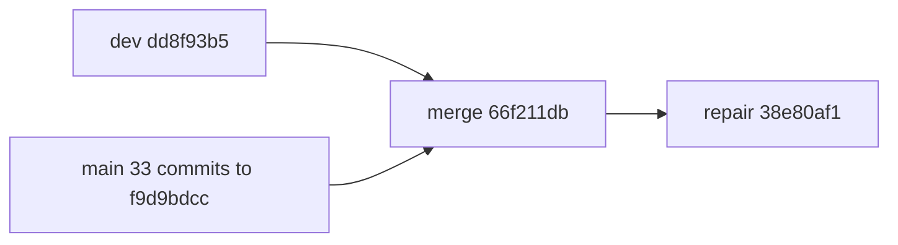

# chore: AUT-2616 nightly sync main into dev (2026-10-23)

[Upstream PR](https://github.com/NVIDIA/Megatron-LM/pull/8461) · state: closed · merged: True

## Original PR description

## Background

Syncs the oldest 33 commits of `dev..main` into `dev` (N=33, approved by the requester). Fewer than 100 commits were available. Dev base: `dd8f93b57cdd09a87fd0c1a10cb46b7ff1610a9a`. Slice tip: `f9d9bdcc6e09ab432df12394059c8101a33a4440`.

## What changed

- 33 main commits, imported unchanged and in order: 91d774de fce1e205 2e8ca837 29e1a7b6 b73446c5 89b28875 d14b6997 d11b2c1a 45b68f91 6c956376 e4eb89b3 728ef141 ede2c586 4b9d4f14 aa46a572 77232c38 50f94464 d61d8d44 8a2e36b5 964b1dee 9e5aad0c 85bf0a66 6e594649 a747bac2 55561e5e 888887d3 d51b424c 92641a42 da2c0ec6 b2912350 3630e44a 38a47abb f9d9bdcc
- Merge `66f211db` (parents dd8f93b5 + f9d9bdcc). Conflicts were resolved file by file, and dev-only work was kept (MTP CP roll, MoE experts, DSA, distillation, quantile balancing). The merge message lists each conflict.
- Repair `38e80af1` (one squashed commit):
  - `experts.py`: fixes the init order.
  - `router.py`: restores the #7394 global-batch QB branch.
  - `multi_token_prediction.py`: black only.
  - Two dev tests: follow the new #7478/#8211 APIs.
  - `dsa_gqa.py`: `DSGQACoreAttention` sets `logs_dsa_indexer_loss = True`, so the DSA metric tracker counts it as a writer (review 5637315542). Two new tests cover tracker setup followed by a GQA forward.
- `pyproject.toml`, `uv.lock`, `Dockerfile.ci.dev` and `CODEOWNERS` stay as on dev, so #8387, #8303 and #8216 are not in this PR.

## Details

- Graph: 35 commits (33 imports, 1 merge, 1 repair).
- Remerge-diff: 35 files differ from the automatic merge, either as resolutions or as files kept as dev.
- Dev-feature audit: each flagged dev line comes from an intentional main removal (#8211, #5482, #7478, #7394) or from the repair commit.
- `determinism-exempt` is set for the kernel-determinism flags on `dsa_dispatch` (#7156) and `mtp_packed_cp1_roll` (#7478, #8389).

## Tested

- Local H100 runs, image `agent-sandbox@sha256:cbed68adbc350e0f…`: 144/144 selected rows passed (61 unit, 83 functional), with 0 upstream skips.
- After the review fix, the transformer unit row ran again on `38e80af1`: 1738 passed, 63 skipped, 0 failed. Other passes were reused only after an input-equivalence check.
- CI on `38e80af1`: CICD Megatron-LM run 40122256800 passed (201 jobs passed, 73 skipped). DCO gate run 40122256252 failed before the DCO App was approved by hand and needs a rerun. MBridge tests have not run, because the `Run MBridge tests` label is not set.
- Caveats:
  - Lint was not run locally; this PR's lint check decides.
  - The GRPO and SSE rows log tracebacks at shutdown.
  - The gdn_no_nvrx_async row is expected to fail; it passes as an xpass.

## Review and discussion

### reviews

- FDecaYed · CHANGES_REQUESTED · 2026-10-24T07:20:40Z · [source](https://github.com/NVIDIA/Megatron-LM/pull/8461#pullrequestreview-5637315542)

`DSGQACoreAttention` is missing `logs_dsa_indexer_loss = True`, which dev’s fixed-capacity metric tracker uses to discover writers. In the standard training setup with only GQA writers, the scan fixes capacity at zero; the first indexer-loss write then raises `DSA metric tracker fixed capacity is too small`. Please register this writer as DSAttention/CSA do and add coverage for tracker initialization followed by a GQA forward. This is based on the source call chain; I have not reproduced it at runtime.

- FDecaYed · APPROVED · 2026-10-26T07:43:05Z · [source](https://github.com/NVIDIA/Megatron-LM/pull/8461#pullrequestreview-5648795338)

Re-reviewed at 38e80af1. Compared with 071bb3b4, the tree only changes in two places: the `logs_dsa_indexer_loss` marker on `DSGQACoreAttention` and two new tests. The merge and the earlier repairs are unchanged: experts init order, router global-batch QB, the MTP formatting and the test adaptations.

The writer issue from my earlier review is fixed. The setup scan now counts GQA writers, and every GQA write path only runs when the coefficient is positive. CICD run 40122256800 passed on this head. The two new tracker-lifecycle tests ran and passed in the transformer GPU job (1738 passed, 63 skipped).

Not covered: MBridge was skipped because the label isn't set, so downstream Bridge compatibility isn't validated here. The determinism replays for `dsa_dispatch` and `mtp_packed_cp1_roll` are exempted rather than updated.

### issue_comments

- copy-pr-bot[bot] · comment · 2026-10-23T21:04:15Z · [source](https://github.com/NVIDIA/Megatron-LM/pull/8461#issuecomment-6374702875)

This pull request requires additional validation before any workflows can run on NVIDIA's runners.

Pull request vetters can view their responsibilities [here](https://docs.gha-runners.nvidia.com/cpr/vetters).

Contributors can view more details about this message [here](https://docs.gha-runners.nvidia.com/cpr/contributors).

- svcnvidia-nemo-ci · comment · 2026-10-23T21:09:44Z · [source](https://github.com/NVIDIA/Megatron-LM/pull/8461#issuecomment-6374793470)

/ok to test 071bb3b424156799a81641ebc54aea06369429c2

- svcnemo-autobot · comment · 2026-10-23T21:10:34Z · [source](https://github.com/NVIDIA/Megatron-LM/pull/8461#issuecomment-6374806663)

Maintainer actions needed for this main→dev sync. The bot cannot do these itself.

1. **Vetting:** copy-pr-bot says this PR must be vetted before any workflow can run on head `071bb3b4`.
2. **Labels:** please add `Run functional tests` and `Run MBridge tests`. The main→dev sync procedure requires both, so that the full functional and MBridge suites run.
3. **DCO:** the DCO App flags 17 commits. Every flagged commit is one of the 33 main commits imported unchanged. The sync must keep their original SHAs, so they cannot be re-signed. My local scan:
   - In 13 of them, the `Signed-off-by` email does not match the author email (for example, GitHub noreply vs. @nvidia.com).
   - `d11b2c1a` (github-actions[bot], "rotate oncall schedule") has no sign-off.
   - The merge commit `66f211db` and the repair commit `071bb3b4` are both signed off.

   If you agree, please set DCO to pass on the DCO App check. `DCO gate` (`.github/scripts/dco_gate.py`) uses that App verdict. Open sync PR #8434 has the same DCO result.
4. **Kernel-determinism coverage:** main changed `dsa_dispatch` (#7156) and `mtp_packed_cp1_roll` (#7478, #8389) without changing their determinism tests. Please add `determinism-exempt`, or tell me to update those tests in the repair commit.

Local H100 validation for this head's inputs: 144 of 144 selected rows passed (61 unit, 83 functional). The PR description has the details.

- svcnvidia-nemo-ci · comment · 2026-10-24T18:46:32Z · [source](https://github.com/NVIDIA/Megatron-LM/pull/8461#issuecomment-6388119027)

/ok to test 38e80af1ded7a9f8df8a2f9ef89202c13a72e492

- svcnemo-autobot · comment · 2026-10-26T07:51:26Z · [source](https://github.com/NVIDIA/Megatron-LM/pull/8461#issuecomment-6410948528)

Thanks for the re-review. Two maintainer actions remain on head `38e80af1`. The bot cannot do them itself.

1. **MBridge:** please add the `Run MBridge tests` label. The main→dev sync procedure requires it, and downstream Bridge compatibility is not validated yet. CI must then run again on this head.
2. **DCO gate:** please rerun DCO gate run 40122256252. Its only attempt failed at 2026-10-24 18:46 UTC, before the DCO App was approved by hand.

All other checks on this head passed or were skipped.

### inline_comments

## Changed files and fixed code

- `.github/autobot/review-config.yml` · added · additions 6 / deletions 0
  - [head](https://github.com/svcnemo-autobot/Megatron-LM/blob/38e80af1ded7a9f8df8a2f9ef89202c13a72e492/.github/autobot/review-config.yml)
  - [base](https://github.com/NVIDIA/Megatron-LM/blob/dd8f93b57cdd09a87fd0c1a10cb46b7ff1610a9a/.github/autobot/review-config.yml)
- `.github/oncall_schedule.json` · modified · additions 4 / deletions 4
  - [head](https://github.com/svcnemo-autobot/Megatron-LM/blob/38e80af1ded7a9f8df8a2f9ef89202c13a72e492/.github/oncall_schedule.json)
  - [base](https://github.com/NVIDIA/Megatron-LM/blob/dd8f93b57cdd09a87fd0c1a10cb46b7ff1610a9a/.github/oncall_schedule.json)
- `.github/pull_request_template.md` · modified · additions 2 / deletions 2
  - [head](https://github.com/svcnemo-autobot/Megatron-LM/blob/38e80af1ded7a9f8df8a2f9ef89202c13a72e492/.github/pull_request_template.md)
  - [base](https://github.com/NVIDIA/Megatron-LM/blob/dd8f93b57cdd09a87fd0c1a10cb46b7ff1610a9a/.github/pull_request_template.md)
- `docs/api-guide/core/generalized_tensor_parallel.md` · modified · additions 9 / deletions 9
  - [head](https://github.com/svcnemo-autobot/Megatron-LM/blob/38e80af1ded7a9f8df8a2f9ef89202c13a72e492/docs/api-guide/core/generalized_tensor_parallel.md)
  - [base](https://github.com/NVIDIA/Megatron-LM/blob/dd8f93b57cdd09a87fd0c1a10cb46b7ff1610a9a/docs/api-guide/core/generalized_tensor_parallel.md)
- `docs/user-guide/features/index.md` · modified · additions 1 / deletions 0
  - [head](https://github.com/svcnemo-autobot/Megatron-LM/blob/38e80af1ded7a9f8df8a2f9ef89202c13a72e492/docs/user-guide/features/index.md)
  - [base](https://github.com/NVIDIA/Megatron-LM/blob/dd8f93b57cdd09a87fd0c1a10cb46b7ff1610a9a/docs/user-guide/features/index.md)
- `docs/user-guide/features/offline_logits_distillation.md` · added · additions 139 / deletions 0
  - [head](https://github.com/svcnemo-autobot/Megatron-LM/blob/38e80af1ded7a9f8df8a2f9ef89202c13a72e492/docs/user-guide/features/offline_logits_distillation.md)
  - [base](https://github.com/NVIDIA/Megatron-LM/blob/dd8f93b57cdd09a87fd0c1a10cb46b7ff1610a9a/docs/user-guide/features/offline_logits_distillation.md)
- `examples/mimo/model_providers/nemotron_moe_vlm.py` · modified · additions 5 / deletions 2
  - [head](https://github.com/svcnemo-autobot/Megatron-LM/blob/38e80af1ded7a9f8df8a2f9ef89202c13a72e492/examples/mimo/model_providers/nemotron_moe_vlm.py)
  - [base](https://github.com/NVIDIA/Megatron-LM/blob/dd8f93b57cdd09a87fd0c1a10cb46b7ff1610a9a/examples/mimo/model_providers/nemotron_moe_vlm.py)
- `megatron/core/distributed/finalize_model_grads.py` · modified · additions 18 / deletions 10
  - [head](https://github.com/svcnemo-autobot/Megatron-LM/blob/38e80af1ded7a9f8df8a2f9ef89202c13a72e492/megatron/core/distributed/finalize_model_grads.py)
  - [base](https://github.com/NVIDIA/Megatron-LM/blob/dd8f93b57cdd09a87fd0c1a10cb46b7ff1610a9a/megatron/core/distributed/finalize_model_grads.py)
- `megatron/core/distributed/fsdp/src/megatron_fsdp/experimental/muon.py` · added · additions 261 / deletions 0
  - [head](https://github.com/svcnemo-autobot/Megatron-LM/blob/38e80af1ded7a9f8df8a2f9ef89202c13a72e492/megatron/core/distributed/fsdp/src/megatron_fsdp/experimental/muon.py)
  - [base](https://github.com/NVIDIA/Megatron-LM/blob/dd8f93b57cdd09a87fd0c1a10cb46b7ff1610a9a/megatron/core/distributed/fsdp/src/megatron_fsdp/experimental/muon.py)
- `megatron/core/distributed/fsdp/src/megatron_fsdp/package_info.py` · modified · additions 1 / deletions 1
  - [head](https://github.com/svcnemo-autobot/Megatron-LM/blob/38e80af1ded7a9f8df8a2f9ef89202c13a72e492/megatron/core/distributed/fsdp/src/megatron_fsdp/package_info.py)
  - [base](https://github.com/NVIDIA/Megatron-LM/blob/dd8f93b57cdd09a87fd0c1a10cb46b7ff1610a9a/megatron/core/distributed/fsdp/src/megatron_fsdp/package_info.py)
- `megatron/core/distributed/fsdp/src/pyproject.toml` · modified · additions 3 / deletions 0
  - [head](https://github.com/svcnemo-autobot/Megatron-LM/blob/38e80af1ded7a9f8df8a2f9ef89202c13a72e492/megatron/core/distributed/fsdp/src/pyproject.toml)
  - [base](https://github.com/NVIDIA/Megatron-LM/blob/dd8f93b57cdd09a87fd0c1a10cb46b7ff1610a9a/megatron/core/distributed/fsdp/src/pyproject.toml)
- `megatron/core/extensions/transformer_engine.py` · modified · additions 17 / deletions 0
  - [head](https://github.com/svcnemo-autobot/Megatron-LM/blob/38e80af1ded7a9f8df8a2f9ef89202c13a72e492/megatron/core/extensions/transformer_engine.py)
  - [base](https://github.com/NVIDIA/Megatron-LM/blob/dd8f93b57cdd09a87fd0c1a10cb46b7ff1610a9a/megatron/core/extensions/transformer_engine.py)
- `megatron/core/fusions/fused_cross_entropy.py` · modified · additions 29 / deletions 10
  - [head](https://github.com/svcnemo-autobot/Megatron-LM/blob/38e80af1ded7a9f8df8a2f9ef89202c13a72e492/megatron/core/fusions/fused_cross_entropy.py)
  - [base](https://github.com/NVIDIA/Megatron-LM/blob/dd8f93b57cdd09a87fd0c1a10cb46b7ff1610a9a/megatron/core/fusions/fused_cross_entropy.py)
- `megatron/core/inference/config.py` · modified · additions 2 / deletions 2
  - [head](https://github.com/svcnemo-autobot/Megatron-LM/blob/38e80af1ded7a9f8df8a2f9ef89202c13a72e492/megatron/core/inference/config.py)
  - [base](https://github.com/NVIDIA/Megatron-LM/blob/dd8f93b57cdd09a87fd0c1a10cb46b7ff1610a9a/megatron/core/inference/config.py)
- `megatron/core/inference/contexts/dynamic_context.py` · modified · additions 23 / deletions 0
  - [head](https://github.com/svcnemo-autobot/Megatron-LM/blob/38e80af1ded7a9f8df8a2f9ef89202c13a72e492/megatron/core/inference/contexts/dynamic_context.py)
  - [base](https://github.com/NVIDIA/Megatron-LM/blob/dd8f93b57cdd09a87fd0c1a10cb46b7ff1610a9a/megatron/core/inference/contexts/dynamic_context.py)
- `megatron/core/inference/contexts/mamba_slot_allocator.py` · modified · additions 3 / deletions 3
  - [head](https://github.com/svcnemo-autobot/Megatron-LM/blob/38e80af1ded7a9f8df8a2f9ef89202c13a72e492/megatron/core/inference/contexts/mamba_slot_allocator.py)
  - [base](https://github.com/NVIDIA/Megatron-LM/blob/dd8f93b57cdd09a87fd0c1a10cb46b7ff1610a9a/megatron/core/inference/contexts/mamba_slot_allocator.py)
- `megatron/core/inference/contexts/zero_padding_rows_kernel.py` · added · additions 94 / deletions 0
  - [head](https://github.com/svcnemo-autobot/Megatron-LM/blob/38e80af1ded7a9f8df8a2f9ef89202c13a72e492/megatron/core/inference/contexts/zero_padding_rows_kernel.py)
  - [base](https://github.com/NVIDIA/Megatron-LM/blob/dd8f93b57cdd09a87fd0c1a10cb46b7ff1610a9a/megatron/core/inference/contexts/zero_padding_rows_kernel.py)
- `megatron/core/inference/moe/batch_invariant.py` · modified · additions 17 / deletions 8
  - [head](https://github.com/svcnemo-autobot/Megatron-LM/blob/38e80af1ded7a9f8df8a2f9ef89202c13a72e492/megatron/core/inference/moe/batch_invariant.py)
  - [base](https://github.com/NVIDIA/Megatron-LM/blob/dd8f93b57cdd09a87fd0c1a10cb46b7ff1610a9a/megatron/core/inference/moe/batch_invariant.py)
- `megatron/core/inference/moe/fused_moe.py` · modified · additions 28 / deletions 4
  - [head](https://github.com/svcnemo-autobot/Megatron-LM/blob/38e80af1ded7a9f8df8a2f9ef89202c13a72e492/megatron/core/inference/moe/fused_moe.py)
  - [base](https://github.com/NVIDIA/Megatron-LM/blob/dd8f93b57cdd09a87fd0c1a10cb46b7ff1610a9a/megatron/core/inference/moe/fused_moe.py)
- `megatron/core/inference/moe/permute.py` · modified · additions 19 / deletions 11
  - [head](https://github.com/svcnemo-autobot/Megatron-LM/blob/38e80af1ded7a9f8df8a2f9ef89202c13a72e492/megatron/core/inference/moe/permute.py)
  - [base](https://github.com/NVIDIA/Megatron-LM/blob/dd8f93b57cdd09a87fd0c1a10cb46b7ff1610a9a/megatron/core/inference/moe/permute.py)
- `megatron/core/inference/quantization/mxfp8_quantize.py` · modified · additions 150 / deletions 59
  - [head](https://github.com/svcnemo-autobot/Megatron-LM/blob/38e80af1ded7a9f8df8a2f9ef89202c13a72e492/megatron/core/inference/quantization/mxfp8_quantize.py)
  - [base](https://github.com/NVIDIA/Megatron-LM/blob/dd8f93b57cdd09a87fd0c1a10cb46b7ff1610a9a/megatron/core/inference/quantization/mxfp8_quantize.py)
- `megatron/core/models/common/model_chunk_schedule_plan.py` · modified · additions 45 / deletions 6
  - [head](https://github.com/svcnemo-autobot/Megatron-LM/blob/38e80af1ded7a9f8df8a2f9ef89202c13a72e492/megatron/core/models/common/model_chunk_schedule_plan.py)
  - [base](https://github.com/NVIDIA/Megatron-LM/blob/dd8f93b57cdd09a87fd0c1a10cb46b7ff1610a9a/megatron/core/models/common/model_chunk_schedule_plan.py)
- `megatron/core/models/common/utils.py` · modified · additions 17 / deletions 1
  - [head](https://github.com/svcnemo-autobot/Megatron-LM/blob/38e80af1ded7a9f8df8a2f9ef89202c13a72e492/megatron/core/models/common/utils.py)
  - [base](https://github.com/NVIDIA/Megatron-LM/blob/dd8f93b57cdd09a87fd0c1a10cb46b7ff1610a9a/megatron/core/models/common/utils.py)
- `megatron/core/models/gpt/gpt_model.py` · modified · additions 14 / deletions 5
  - [head](https://github.com/svcnemo-autobot/Megatron-LM/blob/38e80af1ded7a9f8df8a2f9ef89202c13a72e492/megatron/core/models/gpt/gpt_model.py)
  - [base](https://github.com/NVIDIA/Megatron-LM/blob/dd8f93b57cdd09a87fd0c1a10cb46b7ff1610a9a/megatron/core/models/gpt/gpt_model.py)
- `megatron/core/models/hybrid/hybrid_model.py` · modified · additions 15 / deletions 8
  - [head](https://github.com/svcnemo-autobot/Megatron-LM/blob/38e80af1ded7a9f8df8a2f9ef89202c13a72e492/megatron/core/models/hybrid/hybrid_model.py)
  - [base](https://github.com/NVIDIA/Megatron-LM/blob/dd8f93b57cdd09a87fd0c1a10cb46b7ff1610a9a/megatron/core/models/hybrid/hybrid_model.py)
- `megatron/core/optimizer/layer_sharded_muon.py` · modified · additions 38 / deletions 36
  - [head](https://github.com/svcnemo-autobot/Megatron-LM/blob/38e80af1ded7a9f8df8a2f9ef89202c13a72e492/megatron/core/optimizer/layer_sharded_muon.py)
  - [base](https://github.com/NVIDIA/Megatron-LM/blob/dd8f93b57cdd09a87fd0c1a10cb46b7ff1610a9a/megatron/core/optimizer/layer_sharded_muon.py)
- `megatron/core/optimizer/optimizer_config.py` · modified · additions 9 / deletions 7
  - [head](https://github.com/svcnemo-autobot/Megatron-LM/blob/38e80af1ded7a9f8df8a2f9ef89202c13a72e492/megatron/core/optimizer/optimizer_config.py)
  - [base](https://github.com/NVIDIA/Megatron-LM/blob/dd8f93b57cdd09a87fd0c1a10cb46b7ff1610a9a/megatron/core/optimizer/optimizer_config.py)
- `megatron/core/package_info.py` · modified · additions 1 / deletions 1
  - [head](https://github.com/svcnemo-autobot/Megatron-LM/blob/38e80af1ded7a9f8df8a2f9ef89202c13a72e492/megatron/core/package_info.py)
  - [base](https://github.com/NVIDIA/Megatron-LM/blob/dd8f93b57cdd09a87fd0c1a10cb46b7ff1610a9a/megatron/core/package_info.py)
- `megatron/core/parallel_state.py` · modified · additions 8 / deletions 2
  - [head](https://github.com/svcnemo-autobot/Megatron-LM/blob/38e80af1ded7a9f8df8a2f9ef89202c13a72e492/megatron/core/parallel_state.py)
  - [base](https://github.com/NVIDIA/Megatron-LM/blob/dd8f93b57cdd09a87fd0c1a10cb46b7ff1610a9a/megatron/core/parallel_state.py)
- `megatron/core/pipeline_parallel/schedules.py` · modified · additions 24 / deletions 10
  - [head](https://github.com/svcnemo-autobot/Megatron-LM/blob/38e80af1ded7a9f8df8a2f9ef89202c13a72e492/megatron/core/pipeline_parallel/schedules.py)
  - [base](https://github.com/NVIDIA/Megatron-LM/blob/dd8f93b57cdd09a87fd0c1a10cb46b7ff1610a9a/megatron/core/pipeline_parallel/schedules.py)
- `megatron/core/pipeline_parallel/utils.py` · modified · additions 11 / deletions 0
  - [head](https://github.com/svcnemo-autobot/Megatron-LM/blob/38e80af1ded7a9f8df8a2f9ef89202c13a72e492/megatron/core/pipeline_parallel/utils.py)
  - [base](https://github.com/NVIDIA/Megatron-LM/blob/dd8f93b57cdd09a87fd0c1a10cb46b7ff1610a9a/megatron/core/pipeline_parallel/utils.py)
- `megatron/core/ssm/gated_delta_net/gdn.py` · modified · additions 50 / deletions 16
  - [head](https://github.com/svcnemo-autobot/Megatron-LM/blob/38e80af1ded7a9f8df8a2f9ef89202c13a72e492/megatron/core/ssm/gated_delta_net/gdn.py)
  - [base](https://github.com/NVIDIA/Megatron-LM/blob/dd8f93b57cdd09a87fd0c1a10cb46b7ff1610a9a/megatron/core/ssm/gated_delta_net/gdn.py)
- `megatron/core/ssm/gated_delta_product.py` · modified · additions 90 / deletions 94
  - [head](https://github.com/svcnemo-autobot/Megatron-LM/blob/38e80af1ded7a9f8df8a2f9ef89202c13a72e492/megatron/core/ssm/gated_delta_product.py)
  - [base](https://github.com/NVIDIA/Megatron-LM/blob/dd8f93b57cdd09a87fd0c1a10cb46b7ff1610a9a/megatron/core/ssm/gated_delta_product.py)
- `megatron/core/ssm/mamba_layer.py` · modified · additions 26 / deletions 22
  - [head](https://github.com/svcnemo-autobot/Megatron-LM/blob/38e80af1ded7a9f8df8a2f9ef89202c13a72e492/megatron/core/ssm/mamba_layer.py)
  - [base](https://github.com/NVIDIA/Megatron-LM/blob/dd8f93b57cdd09a87fd0c1a10cb46b7ff1610a9a/megatron/core/ssm/mamba_layer.py)
- `megatron/core/ssm/mamba_mixer.py` · modified · additions 1 / deletions 8
  - [head](https://github.com/svcnemo-autobot/Megatron-LM/blob/38e80af1ded7a9f8df8a2f9ef89202c13a72e492/megatron/core/ssm/mamba_mixer.py)
  - [base](https://github.com/NVIDIA/Megatron-LM/blob/dd8f93b57cdd09a87fd0c1a10cb46b7ff1610a9a/megatron/core/ssm/mamba_mixer.py)
- `megatron/core/ssm/ops/gdp/__init__.py` · modified · additions 3 / deletions 1
  - [head](https://github.com/svcnemo-autobot/Megatron-LM/blob/38e80af1ded7a9f8df8a2f9ef89202c13a72e492/megatron/core/ssm/ops/gdp/__init__.py)
  - [base](https://github.com/NVIDIA/Megatron-LM/blob/dd8f93b57cdd09a87fd0c1a10cb46b7ff1610a9a/megatron/core/ssm/ops/gdp/__init__.py)
- `megatron/core/ssm/ops/gdp/decode_prepare.py` · removed · additions 0 / deletions 232
  - [head](https://github.com/svcnemo-autobot/Megatron-LM/blob/38e80af1ded7a9f8df8a2f9ef89202c13a72e492/megatron/core/ssm/ops/gdp/decode_prepare.py)
  - [base](https://github.com/NVIDIA/Megatron-LM/blob/dd8f93b57cdd09a87fd0c1a10cb46b7ff1610a9a/megatron/core/ssm/ops/gdp/decode_prepare.py)
- `megatron/core/ssm/ops/gdp/prepare.py` · added · additions 339 / deletions 0
  - [head](https://github.com/svcnemo-autobot/Megatron-LM/blob/38e80af1ded7a9f8df8a2f9ef89202c13a72e492/megatron/core/ssm/ops/gdp/prepare.py)
  - [base](https://github.com/NVIDIA/Megatron-LM/blob/dd8f93b57cdd09a87fd0c1a10cb46b7ff1610a9a/megatron/core/ssm/ops/gdp/prepare.py)
- `megatron/core/ssm/ops/mamba2/batch_invariant_decode.py` · modified · additions 154 / deletions 35
  - [head](https://github.com/svcnemo-autobot/Megatron-LM/blob/38e80af1ded7a9f8df8a2f9ef89202c13a72e492/megatron/core/ssm/ops/mamba2/batch_invariant_decode.py)
  - [base](https://github.com/NVIDIA/Megatron-LM/blob/dd8f93b57cdd09a87fd0c1a10cb46b7ff1610a9a/megatron/core/ssm/ops/mamba2/batch_invariant_decode.py)
- `megatron/core/ssm/ops/mamba2/batch_invariant_decode_rows.py` · added · additions 625 / deletions 0
  - [head](https://github.com/svcnemo-autobot/Megatron-LM/blob/38e80af1ded7a9f8df8a2f9ef89202c13a72e492/megatron/core/ssm/ops/mamba2/batch_invariant_decode_rows.py)
  - [base](https://github.com/NVIDIA/Megatron-LM/blob/dd8f93b57cdd09a87fd0c1a10cb46b7ff1610a9a/megatron/core/ssm/ops/mamba2/batch_invariant_decode_rows.py)
- `megatron/core/ssm/ops/mamba2/ssd_chunk_scan.py` · modified · additions 18 / deletions 5
  - [head](https://github.com/svcnemo-autobot/Megatron-LM/blob/38e80af1ded7a9f8df8a2f9ef89202c13a72e492/megatron/core/ssm/ops/mamba2/ssd_chunk_scan.py)
  - [base](https://github.com/NVIDIA/Megatron-LM/blob/dd8f93b57cdd09a87fd0c1a10cb46b7ff1610a9a/megatron/core/ssm/ops/mamba2/ssd_chunk_scan.py)
- `megatron/core/ssm/ssm_inference.py` · modified · additions 4 / deletions 4
  - [head](https://github.com/svcnemo-autobot/Megatron-LM/blob/38e80af1ded7a9f8df8a2f9ef89202c13a72e492/megatron/core/ssm/ssm_inference.py)
  - [base](https://github.com/NVIDIA/Megatron-LM/blob/dd8f93b57cdd09a87fd0c1a10cb46b7ff1610a9a/megatron/core/ssm/ssm_inference.py)
- `megatron/core/ssm/wide_residual_mamba_layer.py` · modified · additions 19 / deletions 10
  - [head](https://github.com/svcnemo-autobot/Megatron-LM/blob/38e80af1ded7a9f8df8a2f9ef89202c13a72e492/megatron/core/ssm/wide_residual_mamba_layer.py)
  - [base](https://github.com/NVIDIA/Megatron-LM/blob/dd8f93b57cdd09a87fd0c1a10cb46b7ff1610a9a/megatron/core/ssm/wide_residual_mamba_layer.py)
- `megatron/core/tensor_parallel/cross_entropy.py` · modified · additions 47 / deletions 9
  - [head](https://github.com/svcnemo-autobot/Megatron-LM/blob/38e80af1ded7a9f8df8a2f9ef89202c13a72e492/megatron/core/tensor_parallel/cross_entropy.py)
  - [base](https://github.com/NVIDIA/Megatron-LM/blob/dd8f93b57cdd09a87fd0c1a10cb46b7ff1610a9a/megatron/core/tensor_parallel/cross_entropy.py)
- `megatron/core/tensor_parallel/generalized_tensor_parallelism.py` · modified · additions 51 / deletions 25
  - [head](https://github.com/svcnemo-autobot/Megatron-LM/blob/38e80af1ded7a9f8df8a2f9ef89202c13a72e492/megatron/core/tensor_parallel/generalized_tensor_parallelism.py)
  - [base](https://github.com/NVIDIA/Megatron-LM/blob/dd8f93b57cdd09a87fd0c1a10cb46b7ff1610a9a/megatron/core/tensor_parallel/generalized_tensor_parallelism.py)
- `megatron/core/tensor_parallel/gtp_api.py` · modified · additions 8 / deletions 0
  - [head](https://github.com/svcnemo-autobot/Megatron-LM/blob/38e80af1ded7a9f8df8a2f9ef89202c13a72e492/megatron/core/tensor_parallel/gtp_api.py)
  - [base](https://github.com/NVIDIA/Megatron-LM/blob/dd8f93b57cdd09a87fd0c1a10cb46b7ff1610a9a/megatron/core/tensor_parallel/gtp_api.py)
- `megatron/core/tensor_parallel/gtp_cuda_graphs.py` · modified · additions 11 / deletions 3
  - [head](https://github.com/svcnemo-autobot/Megatron-LM/blob/38e80af1ded7a9f8df8a2f9ef89202c13a72e492/megatron/core/tensor_parallel/gtp_cuda_graphs.py)
  - [base](https://github.com/NVIDIA/Megatron-LM/blob/dd8f93b57cdd09a87fd0c1a10cb46b7ff1610a9a/megatron/core/tensor_parallel/gtp_cuda_graphs.py)
- `megatron/core/transformer/attention.py` · modified · additions 92 / deletions 22
  - [head](https://github.com/svcnemo-autobot/Megatron-LM/blob/38e80af1ded7a9f8df8a2f9ef89202c13a72e492/megatron/core/transformer/attention.py)
  - [base](https://github.com/NVIDIA/Megatron-LM/blob/dd8f93b57cdd09a87fd0c1a10cb46b7ff1610a9a/megatron/core/transformer/attention.py)
- `megatron/core/transformer/cuda_graphs.py` · modified · additions 33 / deletions 24
  - [head](https://github.com/svcnemo-autobot/Megatron-LM/blob/38e80af1ded7a9f8df8a2f9ef89202c13a72e492/megatron/core/transformer/cuda_graphs.py)
  - [base](https://github.com/NVIDIA/Megatron-LM/blob/dd8f93b57cdd09a87fd0c1a10cb46b7ff1610a9a/megatron/core/transformer/cuda_graphs.py)
- `megatron/core/transformer/custom_layers/batch_invariant_kernels.py` · modified · additions 1 / deletions 1
  - [head](https://github.com/svcnemo-autobot/Megatron-LM/blob/38e80af1ded7a9f8df8a2f9ef89202c13a72e492/megatron/core/transformer/custom_layers/batch_invariant_kernels.py)
  - [base](https://github.com/NVIDIA/Megatron-LM/blob/dd8f93b57cdd09a87fd0c1a10cb46b7ff1610a9a/megatron/core/transformer/custom_layers/batch_invariant_kernels.py)
- `megatron/core/transformer/experimental_attention_variant/dsa.py` · modified · additions 64 / deletions 0
  - [head](https://github.com/svcnemo-autobot/Megatron-LM/blob/38e80af1ded7a9f8df8a2f9ef89202c13a72e492/megatron/core/transformer/experimental_attention_variant/dsa.py)
  - [base](https://github.com/NVIDIA/Megatron-LM/blob/dd8f93b57cdd09a87fd0c1a10cb46b7ff1610a9a/megatron/core/transformer/experimental_attention_variant/dsa.py)
- `megatron/core/transformer/experimental_attention_variant/dsa_gqa.py` · added · additions 892 / deletions 0
  - [head](https://github.com/svcnemo-autobot/Megatron-LM/blob/38e80af1ded7a9f8df8a2f9ef89202c13a72e492/megatron/core/transformer/experimental_attention_variant/dsa_gqa.py)
  - [base](https://github.com/NVIDIA/Megatron-LM/blob/dd8f93b57cdd09a87fd0c1a10cb46b7ff1610a9a/megatron/core/transformer/experimental_attention_variant/dsa_gqa.py)
- `megatron/core/transformer/experimental_attention_variant/dsa_kernels.py` · modified · additions 13 / deletions 5
  - [head](https://github.com/svcnemo-autobot/Megatron-LM/blob/38e80af1ded7a9f8df8a2f9ef89202c13a72e492/megatron/core/transformer/experimental_attention_variant/dsa_kernels.py)
  - [base](https://github.com/NVIDIA/Megatron-LM/blob/dd8f93b57cdd09a87fd0c1a10cb46b7ff1610a9a/megatron/core/transformer/experimental_attention_variant/dsa_kernels.py)
- `megatron/core/transformer/experimental_attention_variant/dsa_layer_specs.py` · added · additions 92 / deletions 0
  - [head](https://github.com/svcnemo-autobot/Megatron-LM/blob/38e80af1ded7a9f8df8a2f9ef89202c13a72e492/megatron/core/transformer/experimental_attention_variant/dsa_layer_specs.py)
  - [base](https://github.com/NVIDIA/Megatron-LM/blob/dd8f93b57cdd09a87fd0c1a10cb46b7ff1610a9a/megatron/core/transformer/experimental_attention_variant/dsa_layer_specs.py)
- `megatron/core/transformer/experimental_attention_variant/dsa_logging.py` · modified · additions 117 / deletions 21
  - [head](https://github.com/svcnemo-autobot/Megatron-LM/blob/38e80af1ded7a9f8df8a2f9ef89202c13a72e492/megatron/core/transformer/experimental_attention_variant/dsa_logging.py)
  - [base](https://github.com/NVIDIA/Megatron-LM/blob/dd8f93b57cdd09a87fd0c1a10cb46b7ff1610a9a/megatron/core/transformer/experimental_attention_variant/dsa_logging.py)
- `megatron/core/transformer/moe/README.md` · modified · additions 3 / deletions 3
  - [head](https://github.com/svcnemo-autobot/Megatron-LM/blob/38e80af1ded7a9f8df8a2f9ef89202c13a72e492/megatron/core/transformer/moe/README.md)
  - [base](https://github.com/NVIDIA/Megatron-LM/blob/dd8f93b57cdd09a87fd0c1a10cb46b7ff1610a9a/megatron/core/transformer/moe/README.md)
- `megatron/core/transformer/moe/experts.py` · modified · additions 117 / deletions 62
  - [head](https://github.com/svcnemo-autobot/Megatron-LM/blob/38e80af1ded7a9f8df8a2f9ef89202c13a72e492/megatron/core/transformer/moe/experts.py)
  - [base](https://github.com/NVIDIA/Megatron-LM/blob/dd8f93b57cdd09a87fd0c1a10cb46b7ff1610a9a/megatron/core/transformer/moe/experts.py)
- `megatron/core/transformer/moe/moe_utils.py` · modified · additions 8 / deletions 3
  - [head](https://github.com/svcnemo-autobot/Megatron-LM/blob/38e80af1ded7a9f8df8a2f9ef89202c13a72e492/megatron/core/transformer/moe/moe_utils.py)
  - [base](https://github.com/NVIDIA/Megatron-LM/blob/dd8f93b57cdd09a87fd0c1a10cb46b7ff1610a9a/megatron/core/transformer/moe/moe_utils.py)
- `megatron/core/transformer/moe/router.py` · modified · additions 24 / deletions 3
  - [head](https://github.com/svcnemo-autobot/Megatron-LM/blob/38e80af1ded7a9f8df8a2f9ef89202c13a72e492/megatron/core/transformer/moe/router.py)
  - [base](https://github.com/NVIDIA/Megatron-LM/blob/dd8f93b57cdd09a87fd0c1a10cb46b7ff1610a9a/megatron/core/transformer/moe/router.py)
- `megatron/core/transformer/moe/shared_experts.py` · modified · additions 19 / deletions 1
  - [head](https://github.com/svcnemo-autobot/Megatron-LM/blob/38e80af1ded7a9f8df8a2f9ef89202c13a72e492/megatron/core/transformer/moe/shared_experts.py)
  - [base](https://github.com/NVIDIA/Megatron-LM/blob/dd8f93b57cdd09a87fd0c1a10cb46b7ff1610a9a/megatron/core/transformer/moe/shared_experts.py)
- `megatron/core/transformer/moe/token_dispatcher.py` · modified · additions 3 / deletions 9
  - [head](https://github.com/svcnemo-autobot/Megatron-LM/blob/38e80af1ded7a9f8df8a2f9ef89202c13a72e492/megatron/core/transformer/moe/token_dispatcher.py)
  - [base](https://github.com/NVIDIA/Megatron-LM/blob/dd8f93b57cdd09a87fd0c1a10cb46b7ff1610a9a/megatron/core/transformer/moe/token_dispatcher.py)
- `megatron/core/transformer/multi_token_prediction.py` · modified · additions 224 / deletions 178
  - [head](https://github.com/svcnemo-autobot/Megatron-LM/blob/38e80af1ded7a9f8df8a2f9ef89202c13a72e492/megatron/core/transformer/multi_token_prediction.py)
  - [base](https://github.com/NVIDIA/Megatron-LM/blob/dd8f93b57cdd09a87fd0c1a10cb46b7ff1610a9a/megatron/core/transformer/multi_token_prediction.py)
- `megatron/core/transformer/residual_connection.py` · modified · additions 24 / deletions 1
  - [head](https://github.com/svcnemo-autobot/Megatron-LM/blob/38e80af1ded7a9f8df8a2f9ef89202c13a72e492/megatron/core/transformer/residual_connection.py)
  - [base](https://github.com/NVIDIA/Megatron-LM/blob/dd8f93b57cdd09a87fd0c1a10cb46b7ff1610a9a/megatron/core/transformer/residual_connection.py)
- `megatron/core/transformer/transformer_config.py` · modified · additions 237 / deletions 13
  - [head](https://github.com/svcnemo-autobot/Megatron-LM/blob/38e80af1ded7a9f8df8a2f9ef89202c13a72e492/megatron/core/transformer/transformer_config.py)
  - [base](https://github.com/NVIDIA/Megatron-LM/blob/dd8f93b57cdd09a87fd0c1a10cb46b7ff1610a9a/megatron/core/transformer/transformer_config.py)
- `megatron/core/utils.py` · modified · additions 7 / deletions 2
  - [head](https://github.com/svcnemo-autobot/Megatron-LM/blob/38e80af1ded7a9f8df8a2f9ef89202c13a72e492/megatron/core/utils.py)
  - [base](https://github.com/NVIDIA/Megatron-LM/blob/dd8f93b57cdd09a87fd0c1a10cb46b7ff1610a9a/megatron/core/utils.py)
- `megatron/training/arguments.py` · modified · additions 19 / deletions 72
  - [head](https://github.com/svcnemo-autobot/Megatron-LM/blob/38e80af1ded7a9f8df8a2f9ef89202c13a72e492/megatron/training/arguments.py)
  - [base](https://github.com/NVIDIA/Megatron-LM/blob/dd8f93b57cdd09a87fd0c1a10cb46b7ff1610a9a/megatron/training/arguments.py)
- `megatron/training/checkpointing.py` · modified · additions 17 / deletions 7
  - [head](https://github.com/svcnemo-autobot/Megatron-LM/blob/38e80af1ded7a9f8df8a2f9ef89202c13a72e492/megatron/training/checkpointing.py)
  - [base](https://github.com/NVIDIA/Megatron-LM/blob/dd8f93b57cdd09a87fd0c1a10cb46b7ff1610a9a/megatron/training/checkpointing.py)
- `megatron/training/config/container.py` · modified · additions 76 / deletions 0
  - [head](https://github.com/svcnemo-autobot/Megatron-LM/blob/38e80af1ded7a9f8df8a2f9ef89202c13a72e492/megatron/training/config/container.py)
  - [base](https://github.com/NVIDIA/Megatron-LM/blob/dd8f93b57cdd09a87fd0c1a10cb46b7ff1610a9a/megatron/training/config/container.py)
- `megatron/training/config/training_config.py` · modified · additions 51 / deletions 6
  - [head](https://github.com/svcnemo-autobot/Megatron-LM/blob/38e80af1ded7a9f8df8a2f9ef89202c13a72e492/megatron/training/config/training_config.py)
  - [base](https://github.com/NVIDIA/Megatron-LM/blob/dd8f93b57cdd09a87fd0c1a10cb46b7ff1610a9a/megatron/training/config/training_config.py)
- `megatron/training/distillation/__init__.py` · modified · additions 12 / deletions 2
  - [head](https://github.com/svcnemo-autobot/Megatron-LM/blob/38e80af1ded7a9f8df8a2f9ef89202c13a72e492/megatron/training/distillation/__init__.py)
  - [base](https://github.com/NVIDIA/Megatron-LM/blob/dd8f93b57cdd09a87fd0c1a10cb46b7ff1610a9a/megatron/training/distillation/__init__.py)
- `megatron/training/distillation/cached_logits_loss.py` · modified · additions 931 / deletions 313
  - [head](https://github.com/svcnemo-autobot/Megatron-LM/blob/38e80af1ded7a9f8df8a2f9ef89202c13a72e492/megatron/training/distillation/cached_logits_loss.py)
  - [base](https://github.com/NVIDIA/Megatron-LM/blob/dd8f93b57cdd09a87fd0c1a10cb46b7ff1610a9a/megatron/training/distillation/cached_logits_loss.py)
- `megatron/training/distillation/logits_saver.py` · modified · additions 446 / deletions 106
  - [head](https://github.com/svcnemo-autobot/Megatron-LM/blob/38e80af1ded7a9f8df8a2f9ef89202c13a72e492/megatron/training/distillation/logits_saver.py)
  - [base](https://github.com/NVIDIA/Megatron-LM/blob/dd8f93b57cdd09a87fd0c1a10cb46b7ff1610a9a/megatron/training/distillation/logits_saver.py)
- `megatron/training/distillation/utils.py` · added · additions 1207 / deletions 0
  - [head](https://github.com/svcnemo-autobot/Megatron-LM/blob/38e80af1ded7a9f8df8a2f9ef89202c13a72e492/megatron/training/distillation/utils.py)
  - [base](https://github.com/NVIDIA/Megatron-LM/blob/dd8f93b57cdd09a87fd0c1a10cb46b7ff1610a9a/megatron/training/distillation/utils.py)
- `megatron/training/distillation/utils_logits.py` · removed · additions 0 / deletions 445
  - [head](https://github.com/svcnemo-autobot/Megatron-LM/blob/38e80af1ded7a9f8df8a2f9ef89202c13a72e492/megatron/training/distillation/utils_logits.py)
  - [base](https://github.com/NVIDIA/Megatron-LM/blob/dd8f93b57cdd09a87fd0c1a10cb46b7ff1610a9a/megatron/training/distillation/utils_logits.py)
- `megatron/training/training.py` · modified · additions 30 / deletions 66
  - [head](https://github.com/svcnemo-autobot/Megatron-LM/blob/38e80af1ded7a9f8df8a2f9ef89202c13a72e492/megatron/training/training.py)
  - [base](https://github.com/NVIDIA/Megatron-LM/blob/dd8f93b57cdd09a87fd0c1a10cb46b7ff1610a9a/megatron/training/training.py)
- `pretrain_gpt.py` · modified · additions 27 / deletions 3
  - [head](https://github.com/svcnemo-autobot/Megatron-LM/blob/38e80af1ded7a9f8df8a2f9ef89202c13a72e492/pretrain_gpt.py)
  - [base](https://github.com/NVIDIA/Megatron-LM/blob/dd8f93b57cdd09a87fd0c1a10cb46b7ff1610a9a/pretrain_gpt.py)
- `pretrain_hybrid.py` · modified · additions 22 / deletions 3
  - [head](https://github.com/svcnemo-autobot/Megatron-LM/blob/38e80af1ded7a9f8df8a2f9ef89202c13a72e492/pretrain_hybrid.py)
  - [base](https://github.com/NVIDIA/Megatron-LM/blob/dd8f93b57cdd09a87fd0c1a10cb46b7ff1610a9a/pretrain_hybrid.py)
- `tests/README.md` · modified · additions 17 / deletions 0
  - [head](https://github.com/svcnemo-autobot/Megatron-LM/blob/38e80af1ded7a9f8df8a2f9ef89202c13a72e492/tests/README.md)
  - [base](https://github.com/NVIDIA/Megatron-LM/blob/dd8f93b57cdd09a87fd0c1a10cb46b7ff1610a9a/tests/README.md)
- `tests/functional_tests/shell_test_utils/_run_training.sh` · modified · additions 6 / deletions 0
  - [head](https://github.com/svcnemo-autobot/Megatron-LM/blob/38e80af1ded7a9f8df8a2f9ef89202c13a72e492/tests/functional_tests/shell_test_utils/_run_training.sh)
  - [base](https://github.com/NVIDIA/Megatron-LM/blob/dd8f93b57cdd09a87fd0c1a10cb46b7ff1610a9a/tests/functional_tests/shell_test_utils/_run_training.sh)
- `tests/functional_tests/test_cases/gpt/gpt3_mcore_te_tp1_pp1_frozen_resume_torch_dist_dist_optimizer/golden_values_dev_dgx_h100.json` · removed · additions 0 / deletions 1
  - [head](https://github.com/svcnemo-autobot/Megatron-LM/blob/38e80af1ded7a9f8df8a2f9ef89202c13a72e492/tests/functional_tests/test_cases/gpt/gpt3_mcore_te_tp1_pp1_frozen_resume_torch_dist_dist_optimizer/golden_values_dev_dgx_h100.json)
  - [base](https://github.com/NVIDIA/Megatron-LM/blob/dd8f93b57cdd09a87fd0c1a10cb46b7ff1610a9a/tests/functional_tests/test_cases/gpt/gpt3_mcore_te_tp1_pp1_frozen_resume_torch_dist_dist_optimizer/golden_values_dev_dgx_h100.json)
- `tests/functional_tests/test_cases/gpt/gpt3_mcore_te_tp1_pp1_frozen_resume_torch_dist_dist_optimizer/model_config.yaml` · removed · additions 0 / deletions 57
  - [head](https://github.com/svcnemo-autobot/Megatron-LM/blob/38e80af1ded7a9f8df8a2f9ef89202c13a72e492/tests/functional_tests/test_cases/gpt/gpt3_mcore_te_tp1_pp1_frozen_resume_torch_dist_dist_optimizer/model_config.yaml)
  - [base](https://github.com/NVIDIA/Megatron-LM/blob/dd8f93b57cdd09a87fd0c1a10cb46b7ff1610a9a/tests/functional_tests/test_cases/gpt/gpt3_mcore_te_tp1_pp1_frozen_resume_torch_dist_dist_optimizer/model_config.yaml)
- `tests/functional_tests/test_cases/gpt/gpt3_mcore_te_tp1_pp1_resume_torch_dist_dist_optimizer_no_mmap_bin_files/model_config.yaml` · removed · additions 0 / deletions 58
  - [head](https://github.com/svcnemo-autobot/Megatron-LM/blob/38e80af1ded7a9f8df8a2f9ef89202c13a72e492/tests/functional_tests/test_cases/gpt/gpt3_mcore_te_tp1_pp1_resume_torch_dist_dist_optimizer_no_mmap_bin_files/model_config.yaml)
  - [base](https://github.com/NVIDIA/Megatron-LM/blob/dd8f93b57cdd09a87fd0c1a10cb46b7ff1610a9a/tests/functional_tests/test_cases/gpt/gpt3_mcore_te_tp1_pp1_resume_torch_dist_dist_optimizer_no_mmap_bin_files/model_config.yaml)
- `tests/functional_tests/test_cases/gpt/gpt3_mcore_te_tp1_pp4_frozen_resume_torch_dist_swiglu/golden_values_dev_dgx_h100.json` · removed · additions 0 / deletions 1
  - [head](https://github.com/svcnemo-autobot/Megatron-LM/blob/38e80af1ded7a9f8df8a2f9ef89202c13a72e492/tests/functional_tests/test_cases/gpt/gpt3_mcore_te_tp1_pp4_frozen_resume_torch_dist_swiglu/golden_values_dev_dgx_h100.json)
  - [base](https://github.com/NVIDIA/Megatron-LM/blob/dd8f93b57cdd09a87fd0c1a10cb46b7ff1610a9a/tests/functional_tests/test_cases/gpt/gpt3_mcore_te_tp1_pp4_frozen_resume_torch_dist_swiglu/golden_values_dev_dgx_h100.json)
- `tests/functional_tests/test_cases/gpt/gpt3_mcore_te_tp1_pp4_frozen_resume_torch_dist_swiglu/model_config.yaml` · removed · additions 0 / deletions 58
  - [head](https://github.com/svcnemo-autobot/Megatron-LM/blob/38e80af1ded7a9f8df8a2f9ef89202c13a72e492/tests/functional_tests/test_cases/gpt/gpt3_mcore_te_tp1_pp4_frozen_resume_torch_dist_swiglu/model_config.yaml)
  - [base](https://github.com/NVIDIA/Megatron-LM/blob/dd8f93b57cdd09a87fd0c1a10cb46b7ff1610a9a/tests/functional_tests/test_cases/gpt/gpt3_mcore_te_tp1_pp4_frozen_resume_torch_dist_swiglu/model_config.yaml)
- `tests/functional_tests/test_cases/gpt/gpt3_mcore_te_tp1_pp4_resume_torch_dist_sequence_parallel/model_config.yaml` · removed · additions 0 / deletions 57
  - [head](https://github.com/svcnemo-autobot/Megatron-LM/blob/38e80af1ded7a9f8df8a2f9ef89202c13a72e492/tests/functional_tests/test_cases/gpt/gpt3_mcore_te_tp1_pp4_resume_torch_dist_sequence_parallel/model_config.yaml)
  - [base](https://github.com/NVIDIA/Megatron-LM/blob/dd8f93b57cdd09a87fd0c1a10cb46b7ff1610a9a/tests/functional_tests/test_cases/gpt/gpt3_mcore_te_tp1_pp4_resume_torch_dist_sequence_parallel/model_config.yaml)
- `tests/functional_tests/test_cases/gpt/gpt3_mcore_te_tp2_pp1_frozen_resume_torch_dist_cp2_nondeterministic/golden_values_dev_dgx_h100.json` · removed · additions 0 / deletions 1
  - [head](https://github.com/svcnemo-autobot/Megatron-LM/blob/38e80af1ded7a9f8df8a2f9ef89202c13a72e492/tests/functional_tests/test_cases/gpt/gpt3_mcore_te_tp2_pp1_frozen_resume_torch_dist_cp2_nondeterministic/golden_values_dev_dgx_h100.json)
  - [base](https://github.com/NVIDIA/Megatron-LM/blob/dd8f93b57cdd09a87fd0c1a10cb46b7ff1610a9a/tests/functional_tests/test_cases/gpt/gpt3_mcore_te_tp2_pp1_frozen_resume_torch_dist_cp2_nondeterministic/golden_values_dev_dgx_h100.json)
- `tests/functional_tests/test_cases/gpt/gpt3_mcore_te_tp2_pp1_frozen_resume_torch_dist_cp2_nondeterministic/model_config.yaml` · removed · additions 0 / deletions 57
  - [head](https://github.com/svcnemo-autobot/Megatron-LM/blob/38e80af1ded7a9f8df8a2f9ef89202c13a72e492/tests/functional_tests/test_cases/gpt/gpt3_mcore_te_tp2_pp1_frozen_resume_torch_dist_cp2_nondeterministic/model_config.yaml)
  - [base](https://github.com/NVIDIA/Megatron-LM/blob/dd8f93b57cdd09a87fd0c1a10cb46b7ff1610a9a/tests/functional_tests/test_cases/gpt/gpt3_mcore_te_tp2_pp1_frozen_resume_torch_dist_cp2_nondeterministic/model_config.yaml)
- `tests/functional_tests/test_cases/gpt/gpt3_mcore_te_tp2_pp2_resume_torch_dist_no_mmap_bin_files/model_config.yaml` · removed · additions 0 / deletions 56
  - [head](https://github.com/svcnemo-autobot/Megatron-LM/blob/38e80af1ded7a9f8df8a2f9ef89202c13a72e492/tests/functional_tests/test_cases/gpt/gpt3_mcore_te_tp2_pp2_resume_torch_dist_no_mmap_bin_files/model_config.yaml)
  - [base](https://github.com/NVIDIA/Megatron-LM/blob/dd8f93b57cdd09a87fd0c1a10cb46b7ff1610a9a/tests/functional_tests/test_cases/gpt/gpt3_mcore_te_tp2_pp2_resume_torch_dist_no_mmap_bin_files/model_config.yaml)
- `tests/functional_tests/test_cases/gpt/gpt3_mcore_te_tp4_pp2_frozen_resume_torch_dist_reshard_8x1xNone/golden_values_dev_dgx_h100.json` · removed · additions 0 / deletions 1
  - [head](https://github.com/svcnemo-autobot/Megatron-LM/blob/38e80af1ded7a9f8df8a2f9ef89202c13a72e492/tests/functional_tests/test_cases/gpt/gpt3_mcore_te_tp4_pp2_frozen_resume_torch_dist_reshard_8x1xNone/golden_values_dev_dgx_h100.json)
  - [base](https://github.com/NVIDIA/Megatron-LM/blob/dd8f93b57cdd09a87fd0c1a10cb46b7ff1610a9a/tests/functional_tests/test_cases/gpt/gpt3_mcore_te_tp4_pp2_frozen_resume_torch_dist_reshard_8x1xNone/golden_values_dev_dgx_h100.json)
- `tests/functional_tests/test_cases/gpt/gpt3_mcore_te_tp4_pp2_frozen_resume_torch_dist_reshard_8x1xNone/model_config.yaml` · removed · additions 0 / deletions 54
  - [head](https://github.com/svcnemo-autobot/Megatron-LM/blob/38e80af1ded7a9f8df8a2f9ef89202c13a72e492/tests/functional_tests/test_cases/gpt/gpt3_mcore_te_tp4_pp2_frozen_resume_torch_dist_reshard_8x1xNone/model_config.yaml)
  - [base](https://github.com/NVIDIA/Megatron-LM/blob/dd8f93b57cdd09a87fd0c1a10cb46b7ff1610a9a/tests/functional_tests/test_cases/gpt/gpt3_mcore_te_tp4_pp2_frozen_resume_torch_dist_reshard_8x1xNone/model_config.yaml)
- `tests/functional_tests/test_cases/gpt/gpt3_mcore_tp1_pp1_fsdp2_resume_torch_dist_te/model_config.yaml` · removed · additions 0 / deletions 57
  - [head](https://github.com/svcnemo-autobot/Megatron-LM/blob/38e80af1ded7a9f8df8a2f9ef89202c13a72e492/tests/functional_tests/test_cases/gpt/gpt3_mcore_tp1_pp1_fsdp2_resume_torch_dist_te/model_config.yaml)
  - [base](https://github.com/NVIDIA/Megatron-LM/blob/dd8f93b57cdd09a87fd0c1a10cb46b7ff1610a9a/tests/functional_tests/test_cases/gpt/gpt3_mcore_tp1_pp1_fsdp2_resume_torch_dist_te/model_config.yaml)
- `tests/functional_tests/test_cases/nemotron/nemotron3_5_lightning_nightly_tp1_pp1_cp1_ep8_dgx_gb200/golden_values_dev_dgx_gb200.json` · modified · additions 147 / deletions 140
  - [head](https://github.com/svcnemo-autobot/Megatron-LM/blob/38e80af1ded7a9f8df8a2f9ef89202c13a72e492/tests/functional_tests/test_cases/nemotron/nemotron3_5_lightning_nightly_tp1_pp1_cp1_ep8_dgx_gb200/golden_values_dev_dgx_gb200.json)
  - [base](https://github.com/NVIDIA/Megatron-LM/blob/dd8f93b57cdd09a87fd0c1a10cb46b7ff1610a9a/tests/functional_tests/test_cases/nemotron/nemotron3_5_lightning_nightly_tp1_pp1_cp1_ep8_dgx_gb200/golden_values_dev_dgx_gb200.json)
- `tests/functional_tests/test_cases/nemotron/nemotron3_5_lightning_nightly_tp1_pp1_cp1_ep8_dgx_gb200/golden_values_dev_dgx_gb300.json` · modified · additions 139 / deletions 139
  - [head](https://github.com/svcnemo-autobot/Megatron-LM/blob/38e80af1ded7a9f8df8a2f9ef89202c13a72e492/tests/functional_tests/test_cases/nemotron/nemotron3_5_lightning_nightly_tp1_pp1_cp1_ep8_dgx_gb200/golden_values_dev_dgx_gb300.json)
  - [base](https://github.com/NVIDIA/Megatron-LM/blob/dd8f93b57cdd09a87fd0c1a10cb46b7ff1610a9a/tests/functional_tests/test_cases/nemotron/nemotron3_5_lightning_nightly_tp1_pp1_cp1_ep8_dgx_gb200/golden_values_dev_dgx_gb300.json)
- `tests/functional_tests/test_cases/nemotron/nemotron3_5_lightning_nightly_tp1_pp1_cp1_ep8_dgx_gb200/model_config.yaml` · modified · additions 5 / deletions 5
  - [head](https://github.com/svcnemo-autobot/Megatron-LM/blob/38e80af1ded7a9f8df8a2f9ef89202c13a72e492/tests/functional_tests/test_cases/nemotron/nemotron3_5_lightning_nightly_tp1_pp1_cp1_ep8_dgx_gb200/model_config.yaml)
  - [base](https://github.com/NVIDIA/Megatron-LM/blob/dd8f93b57cdd09a87fd0c1a10cb46b7ff1610a9a/tests/functional_tests/test_cases/nemotron/nemotron3_5_lightning_nightly_tp1_pp1_cp1_ep8_dgx_gb200/model_config.yaml)
- `tests/functional_tests/test_cases/nemotron/nemotron3_5_lightning_no_load_optim_tp1_pp1_cp1_ep4_dgx_gb200_1N4G/golden_values_dev_dgx_gb200.json` · modified · additions 136 / deletions 129
  - [head](https://github.com/svcnemo-autobot/Megatron-LM/blob/38e80af1ded7a9f8df8a2f9ef89202c13a72e492/tests/functional_tests/test_cases/nemotron/nemotron3_5_lightning_no_load_optim_tp1_pp1_cp1_ep4_dgx_gb200_1N4G/golden_values_dev_dgx_gb200.json)
  - [base](https://github.com/NVIDIA/Megatron-LM/blob/dd8f93b57cdd09a87fd0c1a10cb46b7ff1610a9a/tests/functional_tests/test_cases/nemotron/nemotron3_5_lightning_no_load_optim_tp1_pp1_cp1_ep4_dgx_gb200_1N4G/golden_values_dev_dgx_gb200.json)
- `tests/functional_tests/test_cases/nemotron/nemotron3_5_lightning_no_load_optim_tp1_pp1_cp1_ep4_dgx_gb200_1N4G/model_config.yaml` · modified · additions 5 / deletions 5
  - [head](https://github.com/svcnemo-autobot/Megatron-LM/blob/38e80af1ded7a9f8df8a2f9ef89202c13a72e492/tests/functional_tests/test_cases/nemotron/nemotron3_5_lightning_no_load_optim_tp1_pp1_cp1_ep4_dgx_gb200_1N4G/model_config.yaml)
  - [base](https://github.com/NVIDIA/Megatron-LM/blob/dd8f93b57cdd09a87fd0c1a10cb46b7ff1610a9a/tests/functional_tests/test_cases/nemotron/nemotron3_5_lightning_no_load_optim_tp1_pp1_cp1_ep4_dgx_gb200_1N4G/model_config.yaml)
- `tests/functional_tests/test_cases/nemotron/nemotron3_super_release_gb200/model_config.yaml` · modified · additions 5 / deletions 3
  - [head](https://github.com/svcnemo-autobot/Megatron-LM/blob/38e80af1ded7a9f8df8a2f9ef89202c13a72e492/tests/functional_tests/test_cases/nemotron/nemotron3_super_release_gb200/model_config.yaml)
  - [base](https://github.com/NVIDIA/Megatron-LM/blob/dd8f93b57cdd09a87fd0c1a10cb46b7ff1610a9a/tests/functional_tests/test_cases/nemotron/nemotron3_super_release_gb200/model_config.yaml)
- `tests/functional_tests/test_cases/nemotron/nemotron3_super_release_gb200_sm/model_config.yaml` · modified · additions 5 / deletions 3
  - [head](https://github.com/svcnemo-autobot/Megatron-LM/blob/38e80af1ded7a9f8df8a2f9ef89202c13a72e492/tests/functional_tests/test_cases/nemotron/nemotron3_super_release_gb200_sm/model_config.yaml)
  - [base](https://github.com/NVIDIA/Megatron-LM/blob/dd8f93b57cdd09a87fd0c1a10cb46b7ff1610a9a/tests/functional_tests/test_cases/nemotron/nemotron3_super_release_gb200_sm/model_config.yaml)
- `tests/test_utils/test_unit_testmon_mandatory.py` · modified · additions 1 / deletions 1
  - [head](https://github.com/svcnemo-autobot/Megatron-LM/blob/38e80af1ded7a9f8df8a2f9ef89202c13a72e492/tests/test_utils/test_unit_testmon_mandatory.py)
  - [base](https://github.com/NVIDIA/Megatron-LM/blob/dd8f93b57cdd09a87fd0c1a10cb46b7ff1610a9a/tests/test_utils/test_unit_testmon_mandatory.py)
- `tests/unit_tests/a2a_overlap/test_schedule_chunk_1f1b.py` · modified · additions 467 / deletions 6
  - [head](https://github.com/svcnemo-autobot/Megatron-LM/blob/38e80af1ded7a9f8df8a2f9ef89202c13a72e492/tests/unit_tests/a2a_overlap/test_schedule_chunk_1f1b.py)
  - [base](https://github.com/NVIDIA/Megatron-LM/blob/dd8f93b57cdd09a87fd0c1a10cb46b7ff1610a9a/tests/unit_tests/a2a_overlap/test_schedule_chunk_1f1b.py)
- `tests/unit_tests/data/test_get_batch.py` · modified · additions 45 / deletions 0
  - [head](https://github.com/svcnemo-autobot/Megatron-LM/blob/38e80af1ded7a9f8df8a2f9ef89202c13a72e492/tests/unit_tests/data/test_get_batch.py)
  - [base](https://github.com/NVIDIA/Megatron-LM/blob/dd8f93b57cdd09a87fd0c1a10cb46b7ff1610a9a/tests/unit_tests/data/test_get_batch.py)
- `tests/unit_tests/determinism/kernels/manifest.py` · modified · additions 32 / deletions 8
  - [head](https://github.com/svcnemo-autobot/Megatron-LM/blob/38e80af1ded7a9f8df8a2f9ef89202c13a72e492/tests/unit_tests/determinism/kernels/manifest.py)
  - [base](https://github.com/NVIDIA/Megatron-LM/blob/dd8f93b57cdd09a87fd0c1a10cb46b7ff1610a9a/tests/unit_tests/determinism/kernels/manifest.py)
- `tests/unit_tests/determinism/kernels/test_fused_activations.py` · modified · additions 36 / deletions 0
  - [head](https://github.com/svcnemo-autobot/Megatron-LM/blob/38e80af1ded7a9f8df8a2f9ef89202c13a72e492/tests/unit_tests/determinism/kernels/test_fused_activations.py)
  - [base](https://github.com/NVIDIA/Megatron-LM/blob/dd8f93b57cdd09a87fd0c1a10cb46b7ff1610a9a/tests/unit_tests/determinism/kernels/test_fused_activations.py)
- `tests/unit_tests/determinism/kernels/test_inference_kernels.py` · modified · additions 76 / deletions 2
  - [head](https://github.com/svcnemo-autobot/Megatron-LM/blob/38e80af1ded7a9f8df8a2f9ef89202c13a72e492/tests/unit_tests/determinism/kernels/test_inference_kernels.py)
  - [base](https://github.com/NVIDIA/Megatron-LM/blob/dd8f93b57cdd09a87fd0c1a10cb46b7ff1610a9a/tests/unit_tests/determinism/kernels/test_inference_kernels.py)
- `tests/unit_tests/determinism/kernels/test_moe_kernels.py` · modified · additions 182 / deletions 0
  - [head](https://github.com/svcnemo-autobot/Megatron-LM/blob/38e80af1ded7a9f8df8a2f9ef89202c13a72e492/tests/unit_tests/determinism/kernels/test_moe_kernels.py)
  - [base](https://github.com/NVIDIA/Megatron-LM/blob/dd8f93b57cdd09a87fd0c1a10cb46b7ff1610a9a/tests/unit_tests/determinism/kernels/test_moe_kernels.py)
- `tests/unit_tests/determinism/kernels/test_ssm_kernels.py` · modified · additions 84 / deletions 6
  - [head](https://github.com/svcnemo-autobot/Megatron-LM/blob/38e80af1ded7a9f8df8a2f9ef89202c13a72e492/tests/unit_tests/determinism/kernels/test_ssm_kernels.py)
  - [base](https://github.com/NVIDIA/Megatron-LM/blob/dd8f93b57cdd09a87fd0c1a10cb46b7ff1610a9a/tests/unit_tests/determinism/kernels/test_ssm_kernels.py)
- `tests/unit_tests/determinism/kernels/test_te_wrappers.py` · modified · additions 50 / deletions 0
  - [head](https://github.com/svcnemo-autobot/Megatron-LM/blob/38e80af1ded7a9f8df8a2f9ef89202c13a72e492/tests/unit_tests/determinism/kernels/test_te_wrappers.py)
  - [base](https://github.com/NVIDIA/Megatron-LM/blob/dd8f93b57cdd09a87fd0c1a10cb46b7ff1610a9a/tests/unit_tests/determinism/kernels/test_te_wrappers.py)
- `tests/unit_tests/determinism/kernels/test_tensor_parallel_kernels.py` · modified · additions 56 / deletions 1
  - [head](https://github.com/svcnemo-autobot/Megatron-LM/blob/38e80af1ded7a9f8df8a2f9ef89202c13a72e492/tests/unit_tests/determinism/kernels/test_tensor_parallel_kernels.py)
  - [base](https://github.com/NVIDIA/Megatron-LM/blob/dd8f93b57cdd09a87fd0c1a10cb46b7ff1610a9a/tests/unit_tests/determinism/kernels/test_tensor_parallel_kernels.py)
- `tests/unit_tests/distributed/mfsdp_v2/mcore_utils.py` · added · additions 26 / deletions 0
  - [head](https://github.com/svcnemo-autobot/Megatron-LM/blob/38e80af1ded7a9f8df8a2f9ef89202c13a72e492/tests/unit_tests/distributed/mfsdp_v2/mcore_utils.py)
  - [base](https://github.com/NVIDIA/Megatron-LM/blob/dd8f93b57cdd09a87fd0c1a10cb46b7ff1610a9a/tests/unit_tests/distributed/mfsdp_v2/mcore_utils.py)
- `tests/unit_tests/distributed/mfsdp_v2/test_mcore_adapter.py` · removed · additions 0 / deletions 1286
  - [head](https://github.com/svcnemo-autobot/Megatron-LM/blob/38e80af1ded7a9f8df8a2f9ef89202c13a72e492/tests/unit_tests/distributed/mfsdp_v2/test_mcore_adapter.py)
  - [base](https://github.com/NVIDIA/Megatron-LM/blob/dd8f93b57cdd09a87fd0c1a10cb46b7ff1610a9a/tests/unit_tests/distributed/mfsdp_v2/test_mcore_adapter.py)
- `tests/unit_tests/distributed/mfsdp_v2/test_mcore_cuda_graph.py` · added · additions 185 / deletions 0
  - [head](https://github.com/svcnemo-autobot/Megatron-LM/blob/38e80af1ded7a9f8df8a2f9ef89202c13a72e492/tests/unit_tests/distributed/mfsdp_v2/test_mcore_cuda_graph.py)
  - [base](https://github.com/NVIDIA/Megatron-LM/blob/dd8f93b57cdd09a87fd0c1a10cb46b7ff1610a9a/tests/unit_tests/distributed/mfsdp_v2/test_mcore_cuda_graph.py)
- `tests/unit_tests/distributed/mfsdp_v2/test_mcore_dense.py` · added · additions 650 / deletions 0
  - [head](https://github.com/svcnemo-autobot/Megatron-LM/blob/38e80af1ded7a9f8df8a2f9ef89202c13a72e492/tests/unit_tests/distributed/mfsdp_v2/test_mcore_dense.py)
  - [base](https://github.com/NVIDIA/Megatron-LM/blob/dd8f93b57cdd09a87fd0c1a10cb46b7ff1610a9a/tests/unit_tests/distributed/mfsdp_v2/test_mcore_dense.py)
- `tests/unit_tests/distributed/mfsdp_v2/test_mcore_hybrid.py` · added · additions 307 / deletions 0
  - [head](https://github.com/svcnemo-autobot/Megatron-LM/blob/38e80af1ded7a9f8df8a2f9ef89202c13a72e492/tests/unit_tests/distributed/mfsdp_v2/test_mcore_hybrid.py)
  - [base](https://github.com/NVIDIA/Megatron-LM/blob/dd8f93b57cdd09a87fd0c1a10cb46b7ff1610a9a/tests/unit_tests/distributed/mfsdp_v2/test_mcore_hybrid.py)
- `tests/unit_tests/distributed/mfsdp_v2/test_mcore_moe.py` · added · additions 198 / deletions 0
  - [head](https://github.com/svcnemo-autobot/Megatron-LM/blob/38e80af1ded7a9f8df8a2f9ef89202c13a72e492/tests/unit_tests/distributed/mfsdp_v2/test_mcore_moe.py)
  - [base](https://github.com/NVIDIA/Megatron-LM/blob/dd8f93b57cdd09a87fd0c1a10cb46b7ff1610a9a/tests/unit_tests/distributed/mfsdp_v2/test_mcore_moe.py)
- `tests/unit_tests/distributed/mfsdp_v2/test_muon.py` · added · additions 126 / deletions 0
  - [head](https://github.com/svcnemo-autobot/Megatron-LM/blob/38e80af1ded7a9f8df8a2f9ef89202c13a72e492/tests/unit_tests/distributed/mfsdp_v2/test_muon.py)
  - [base](https://github.com/NVIDIA/Megatron-LM/blob/dd8f93b57cdd09a87fd0c1a10cb46b7ff1610a9a/tests/unit_tests/distributed/mfsdp_v2/test_muon.py)
- `tests/unit_tests/distributed/mfsdp_v2/test_optimizer_checkpoint.py` · modified · additions 2 / deletions 2
  - [head](https://github.com/svcnemo-autobot/Megatron-LM/blob/38e80af1ded7a9f8df8a2f9ef89202c13a72e492/tests/unit_tests/distributed/mfsdp_v2/test_optimizer_checkpoint.py)
  - [base](https://github.com/NVIDIA/Megatron-LM/blob/dd8f93b57cdd09a87fd0c1a10cb46b7ff1610a9a/tests/unit_tests/distributed/mfsdp_v2/test_optimizer_checkpoint.py)
- `tests/unit_tests/generalized_tensor_parallel/test_gtp_basics.py` · modified · additions 58 / deletions 21
  - [head](https://github.com/svcnemo-autobot/Megatron-LM/blob/38e80af1ded7a9f8df8a2f9ef89202c13a72e492/tests/unit_tests/generalized_tensor_parallel/test_gtp_basics.py)
  - [base](https://github.com/NVIDIA/Megatron-LM/blob/dd8f93b57cdd09a87fd0c1a10cb46b7ff1610a9a/tests/unit_tests/generalized_tensor_parallel/test_gtp_basics.py)
- `tests/unit_tests/generalized_tensor_parallel/test_gtp_grouped_cg.py` · added · additions 433 / deletions 0
  - [head](https://github.com/svcnemo-autobot/Megatron-LM/blob/38e80af1ded7a9f8df8a2f9ef89202c13a72e492/tests/unit_tests/generalized_tensor_parallel/test_gtp_grouped_cg.py)
  - [base](https://github.com/NVIDIA/Megatron-LM/blob/dd8f93b57cdd09a87fd0c1a10cb46b7ff1610a9a/tests/unit_tests/generalized_tensor_parallel/test_gtp_grouped_cg.py)
- `tests/unit_tests/inference/contexts/test_dynamic_context.py` · modified · additions 173 / deletions 0
  - [head](https://github.com/svcnemo-autobot/Megatron-LM/blob/38e80af1ded7a9f8df8a2f9ef89202c13a72e492/tests/unit_tests/inference/contexts/test_dynamic_context.py)
  - [base](https://github.com/NVIDIA/Megatron-LM/blob/dd8f93b57cdd09a87fd0c1a10cb46b7ff1610a9a/tests/unit_tests/inference/contexts/test_dynamic_context.py)
- `tests/unit_tests/inference/engines/test_dynamic_engine.py` · modified · additions 1 / deletions 1
  - [head](https://github.com/svcnemo-autobot/Megatron-LM/blob/38e80af1ded7a9f8df8a2f9ef89202c13a72e492/tests/unit_tests/inference/engines/test_dynamic_engine.py)
  - [base](https://github.com/NVIDIA/Megatron-LM/blob/dd8f93b57cdd09a87fd0c1a10cb46b7ff1610a9a/tests/unit_tests/inference/engines/test_dynamic_engine.py)
- `tests/unit_tests/inference/test_batch_invariant_live_rows.py` · added · additions 92 / deletions 0
  - [head](https://github.com/svcnemo-autobot/Megatron-LM/blob/38e80af1ded7a9f8df8a2f9ef89202c13a72e492/tests/unit_tests/inference/test_batch_invariant_live_rows.py)
  - [base](https://github.com/NVIDIA/Megatron-LM/blob/dd8f93b57cdd09a87fd0c1a10cb46b7ff1610a9a/tests/unit_tests/inference/test_batch_invariant_live_rows.py)
- `tests/unit_tests/models/mimo/test_nemotron_moe_vlm_provider.py` · modified · additions 29 / deletions 0
  - [head](https://github.com/svcnemo-autobot/Megatron-LM/blob/38e80af1ded7a9f8df8a2f9ef89202c13a72e492/tests/unit_tests/models/mimo/test_nemotron_moe_vlm_provider.py)
  - [base](https://github.com/NVIDIA/Megatron-LM/blob/dd8f93b57cdd09a87fd0c1a10cb46b7ff1610a9a/tests/unit_tests/models/mimo/test_nemotron_moe_vlm_provider.py)
- `tests/unit_tests/models/test_gpt_model.py` · modified · additions 136 / deletions 0
  - [head](https://github.com/svcnemo-autobot/Megatron-LM/blob/38e80af1ded7a9f8df8a2f9ef89202c13a72e492/tests/unit_tests/models/test_gpt_model.py)
  - [base](https://github.com/NVIDIA/Megatron-LM/blob/dd8f93b57cdd09a87fd0c1a10cb46b7ff1610a9a/tests/unit_tests/models/test_gpt_model.py)
- `tests/unit_tests/models/test_hybrid_hash_routing.py` · modified · additions 72 / deletions 0
  - [head](https://github.com/svcnemo-autobot/Megatron-LM/blob/38e80af1ded7a9f8df8a2f9ef89202c13a72e492/tests/unit_tests/models/test_hybrid_hash_routing.py)
  - [base](https://github.com/NVIDIA/Megatron-LM/blob/dd8f93b57cdd09a87fd0c1a10cb46b7ff1610a9a/tests/unit_tests/models/test_hybrid_hash_routing.py)
- `tests/unit_tests/models/test_hybrid_moe_model.py` · modified · additions 4 / deletions 0
  - [head](https://github.com/svcnemo-autobot/Megatron-LM/blob/38e80af1ded7a9f8df8a2f9ef89202c13a72e492/tests/unit_tests/models/test_hybrid_moe_model.py)
  - [base](https://github.com/NVIDIA/Megatron-LM/blob/dd8f93b57cdd09a87fd0c1a10cb46b7ff1610a9a/tests/unit_tests/models/test_hybrid_moe_model.py)
- `tests/unit_tests/optimizer/test_layer_sharded_muon.py` · modified · additions 123 / deletions 0
  - [head](https://github.com/svcnemo-autobot/Megatron-LM/blob/38e80af1ded7a9f8df8a2f9ef89202c13a72e492/tests/unit_tests/optimizer/test_layer_sharded_muon.py)
  - [base](https://github.com/NVIDIA/Megatron-LM/blob/dd8f93b57cdd09a87fd0c1a10cb46b7ff1610a9a/tests/unit_tests/optimizer/test_layer_sharded_muon.py)
- `tests/unit_tests/pipeline_parallel/test_fine_grained_activation_offloading.py` · modified · additions 22 / deletions 3
  - [head](https://github.com/svcnemo-autobot/Megatron-LM/blob/38e80af1ded7a9f8df8a2f9ef89202c13a72e492/tests/unit_tests/pipeline_parallel/test_fine_grained_activation_offloading.py)
  - [base](https://github.com/NVIDIA/Megatron-LM/blob/dd8f93b57cdd09a87fd0c1a10cb46b7ff1610a9a/tests/unit_tests/pipeline_parallel/test_fine_grained_activation_offloading.py)
- `tests/unit_tests/ssm/ops/gdp/test_decode_prepare.py` · modified · additions 1 / deletions 1
  - [head](https://github.com/svcnemo-autobot/Megatron-LM/blob/38e80af1ded7a9f8df8a2f9ef89202c13a72e492/tests/unit_tests/ssm/ops/gdp/test_decode_prepare.py)
  - [base](https://github.com/NVIDIA/Megatron-LM/blob/dd8f93b57cdd09a87fd0c1a10cb46b7ff1610a9a/tests/unit_tests/ssm/ops/gdp/test_decode_prepare.py)
- `tests/unit_tests/ssm/ops/gdp/test_prefill_prepare.py` · added · additions 130 / deletions 0
  - [head](https://github.com/svcnemo-autobot/Megatron-LM/blob/38e80af1ded7a9f8df8a2f9ef89202c13a72e492/tests/unit_tests/ssm/ops/gdp/test_prefill_prepare.py)
  - [base](https://github.com/NVIDIA/Megatron-LM/blob/dd8f93b57cdd09a87fd0c1a10cb46b7ff1610a9a/tests/unit_tests/ssm/ops/gdp/test_prefill_prepare.py)
- `tests/unit_tests/ssm/ops/mamba2/test_batch_invariant_decode.py` · modified · additions 388 / deletions 14
  - [head](https://github.com/svcnemo-autobot/Megatron-LM/blob/38e80af1ded7a9f8df8a2f9ef89202c13a72e492/tests/unit_tests/ssm/ops/mamba2/test_batch_invariant_decode.py)
  - [base](https://github.com/NVIDIA/Megatron-LM/blob/dd8f93b57cdd09a87fd0c1a10cb46b7ff1610a9a/tests/unit_tests/ssm/ops/mamba2/test_batch_invariant_decode.py)
- `tests/unit_tests/ssm/test_gated_delta_net_inference.py` · modified · additions 73 / deletions 5
  - [head](https://github.com/svcnemo-autobot/Megatron-LM/blob/38e80af1ded7a9f8df8a2f9ef89202c13a72e492/tests/unit_tests/ssm/test_gated_delta_net_inference.py)
  - [base](https://github.com/NVIDIA/Megatron-LM/blob/dd8f93b57cdd09a87fd0c1a10cb46b7ff1610a9a/tests/unit_tests/ssm/test_gated_delta_net_inference.py)
- `tests/unit_tests/ssm/test_gdp_dynamic_inference.py` · modified · additions 50 / deletions 0
  - [head](https://github.com/svcnemo-autobot/Megatron-LM/blob/38e80af1ded7a9f8df8a2f9ef89202c13a72e492/tests/unit_tests/ssm/test_gdp_dynamic_inference.py)
  - [base](https://github.com/NVIDIA/Megatron-LM/blob/dd8f93b57cdd09a87fd0c1a10cb46b7ff1610a9a/tests/unit_tests/ssm/test_gdp_dynamic_inference.py)
- `tests/unit_tests/ssm/test_mamba_layer.py` · modified · additions 4 / deletions 7
  - [head](https://github.com/svcnemo-autobot/Megatron-LM/blob/38e80af1ded7a9f8df8a2f9ef89202c13a72e492/tests/unit_tests/ssm/test_mamba_layer.py)
  - [base](https://github.com/NVIDIA/Megatron-LM/blob/dd8f93b57cdd09a87fd0c1a10cb46b7ff1610a9a/tests/unit_tests/ssm/test_mamba_layer.py)
- `tests/unit_tests/ssm/test_mamba_residual_state.py` · added · additions 338 / deletions 0
  - [head](https://github.com/svcnemo-autobot/Megatron-LM/blob/38e80af1ded7a9f8df8a2f9ef89202c13a72e492/tests/unit_tests/ssm/test_mamba_residual_state.py)
  - [base](https://github.com/NVIDIA/Megatron-LM/blob/dd8f93b57cdd09a87fd0c1a10cb46b7ff1610a9a/tests/unit_tests/ssm/test_mamba_residual_state.py)
- `tests/unit_tests/test_checkpointing.py` · modified · additions 2 / deletions 2
  - [head](https://github.com/svcnemo-autobot/Megatron-LM/blob/38e80af1ded7a9f8df8a2f9ef89202c13a72e492/tests/unit_tests/test_checkpointing.py)
  - [base](https://github.com/NVIDIA/Megatron-LM/blob/dd8f93b57cdd09a87fd0c1a10cb46b7ff1610a9a/tests/unit_tests/test_checkpointing.py)
- `tests/unit_tests/test_fp4_param.py` · modified · additions 4 / deletions 1
  - [head](https://github.com/svcnemo-autobot/Megatron-LM/blob/38e80af1ded7a9f8df8a2f9ef89202c13a72e492/tests/unit_tests/test_fp4_param.py)
  - [base](https://github.com/NVIDIA/Megatron-LM/blob/dd8f93b57cdd09a87fd0c1a10cb46b7ff1610a9a/tests/unit_tests/test_fp4_param.py)
- `tests/unit_tests/test_fp8_param.py` · modified · additions 3 / deletions 1
  - [head](https://github.com/svcnemo-autobot/Megatron-LM/blob/38e80af1ded7a9f8df8a2f9ef89202c13a72e492/tests/unit_tests/test_fp8_param.py)
  - [base](https://github.com/NVIDIA/Megatron-LM/blob/dd8f93b57cdd09a87fd0c1a10cb46b7ff1610a9a/tests/unit_tests/test_fp8_param.py)
- `tests/unit_tests/test_parallel_state.py` · modified · additions 19 / deletions 1
  - [head](https://github.com/svcnemo-autobot/Megatron-LM/blob/38e80af1ded7a9f8df8a2f9ef89202c13a72e492/tests/unit_tests/test_parallel_state.py)
  - [base](https://github.com/NVIDIA/Megatron-LM/blob/dd8f93b57cdd09a87fd0c1a10cb46b7ff1610a9a/tests/unit_tests/test_parallel_state.py)
- `tests/unit_tests/tools/checkpoint/test_loader_mixtral_hf.py` · added · additions 102 / deletions 0
  - [head](https://github.com/svcnemo-autobot/Megatron-LM/blob/38e80af1ded7a9f8df8a2f9ef89202c13a72e492/tests/unit_tests/tools/checkpoint/test_loader_mixtral_hf.py)
  - [base](https://github.com/NVIDIA/Megatron-LM/blob/dd8f93b57cdd09a87fd0c1a10cb46b7ff1610a9a/tests/unit_tests/tools/checkpoint/test_loader_mixtral_hf.py)
- `tests/unit_tests/training/distillation/test_cached_logits_cu_seqlens.py` · added · additions 310 / deletions 0
  - [head](https://github.com/svcnemo-autobot/Megatron-LM/blob/38e80af1ded7a9f8df8a2f9ef89202c13a72e492/tests/unit_tests/training/distillation/test_cached_logits_cu_seqlens.py)
  - [base](https://github.com/NVIDIA/Megatron-LM/blob/dd8f93b57cdd09a87fd0c1a10cb46b7ff1610a9a/tests/unit_tests/training/distillation/test_cached_logits_cu_seqlens.py)
- `tests/unit_tests/training/distillation/test_cached_logits_resharding.py` · added · additions 516 / deletions 0
  - [head](https://github.com/svcnemo-autobot/Megatron-LM/blob/38e80af1ded7a9f8df8a2f9ef89202c13a72e492/tests/unit_tests/training/distillation/test_cached_logits_resharding.py)
  - [base](https://github.com/NVIDIA/Megatron-LM/blob/dd8f93b57cdd09a87fd0c1a10cb46b7ff1610a9a/tests/unit_tests/training/distillation/test_cached_logits_resharding.py)
- `tests/unit_tests/training/distillation/test_logits_quarantine.py` · added · additions 170 / deletions 0
  - [head](https://github.com/svcnemo-autobot/Megatron-LM/blob/38e80af1ded7a9f8df8a2f9ef89202c13a72e492/tests/unit_tests/training/distillation/test_logits_quarantine.py)
  - [base](https://github.com/NVIDIA/Megatron-LM/blob/dd8f93b57cdd09a87fd0c1a10cb46b7ff1610a9a/tests/unit_tests/training/distillation/test_logits_quarantine.py)
- `tests/unit_tests/training/distillation/test_logits_saver_cu_seqlens.py` · added · additions 228 / deletions 0
  - [head](https://github.com/svcnemo-autobot/Megatron-LM/blob/38e80af1ded7a9f8df8a2f9ef89202c13a72e492/tests/unit_tests/training/distillation/test_logits_saver_cu_seqlens.py)
  - [base](https://github.com/NVIDIA/Megatron-LM/blob/dd8f93b57cdd09a87fd0c1a10cb46b7ff1610a9a/tests/unit_tests/training/distillation/test_logits_saver_cu_seqlens.py)
- `tests/unit_tests/training/distillation/test_logits_saver_failure_event.py` · added · additions 93 / deletions 0
  - [head](https://github.com/svcnemo-autobot/Megatron-LM/blob/38e80af1ded7a9f8df8a2f9ef89202c13a72e492/tests/unit_tests/training/distillation/test_logits_saver_failure_event.py)
  - [base](https://github.com/NVIDIA/Megatron-LM/blob/dd8f93b57cdd09a87fd0c1a10cb46b7ff1610a9a/tests/unit_tests/training/distillation/test_logits_saver_failure_event.py)
- `tests/unit_tests/training/distillation/test_logits_utils_packing.py` · added · additions 236 / deletions 0
  - [head](https://github.com/svcnemo-autobot/Megatron-LM/blob/38e80af1ded7a9f8df8a2f9ef89202c13a72e492/tests/unit_tests/training/distillation/test_logits_utils_packing.py)
  - [base](https://github.com/NVIDIA/Megatron-LM/blob/dd8f93b57cdd09a87fd0c1a10cb46b7ff1610a9a/tests/unit_tests/training/distillation/test_logits_utils_packing.py)
- `tests/unit_tests/training/test_hybrid_distillation_entry.py` · modified · additions 2 / deletions 2
  - [head](https://github.com/svcnemo-autobot/Megatron-LM/blob/38e80af1ded7a9f8df8a2f9ef89202c13a72e492/tests/unit_tests/training/test_hybrid_distillation_entry.py)
  - [base](https://github.com/NVIDIA/Megatron-LM/blob/dd8f93b57cdd09a87fd0c1a10cb46b7ff1610a9a/tests/unit_tests/training/test_hybrid_distillation_entry.py)
- `tests/unit_tests/training/test_rng_ownership.py` · modified · additions 6 / deletions 6
  - [head](https://github.com/svcnemo-autobot/Megatron-LM/blob/38e80af1ded7a9f8df8a2f9ef89202c13a72e492/tests/unit_tests/training/test_rng_ownership.py)
  - [base](https://github.com/NVIDIA/Megatron-LM/blob/dd8f93b57cdd09a87fd0c1a10cb46b7ff1610a9a/tests/unit_tests/training/test_rng_ownership.py)
- `tests/unit_tests/training/test_scheduler_ownership.py` · added · additions 314 / deletions 0
  - [head](https://github.com/svcnemo-autobot/Megatron-LM/blob/38e80af1ded7a9f8df8a2f9ef89202c13a72e492/tests/unit_tests/training/test_scheduler_ownership.py)
  - [base](https://github.com/NVIDIA/Megatron-LM/blob/dd8f93b57cdd09a87fd0c1a10cb46b7ff1610a9a/tests/unit_tests/training/test_scheduler_ownership.py)
- `tests/unit_tests/transformer/experimental_attention_variant/test_attention_variant_dsa.py` · modified · additions 7 / deletions 0
  - [head](https://github.com/svcnemo-autobot/Megatron-LM/blob/38e80af1ded7a9f8df8a2f9ef89202c13a72e492/tests/unit_tests/transformer/experimental_attention_variant/test_attention_variant_dsa.py)
  - [base](https://github.com/NVIDIA/Megatron-LM/blob/dd8f93b57cdd09a87fd0c1a10cb46b7ff1610a9a/tests/unit_tests/transformer/experimental_attention_variant/test_attention_variant_dsa.py)
- `tests/unit_tests/transformer/moe/test_grouped_mlp.py` · modified · additions 199 / deletions 0
  - [head](https://github.com/svcnemo-autobot/Megatron-LM/blob/38e80af1ded7a9f8df8a2f9ef89202c13a72e492/tests/unit_tests/transformer/moe/test_grouped_mlp.py)
  - [base](https://github.com/NVIDIA/Megatron-LM/blob/dd8f93b57cdd09a87fd0c1a10cb46b7ff1610a9a/tests/unit_tests/transformer/moe/test_grouped_mlp.py)
- `tests/unit_tests/transformer/moe/test_moe_single_grouped_weight_numerics.py` · modified · additions 3 / deletions 1
  - [head](https://github.com/svcnemo-autobot/Megatron-LM/blob/38e80af1ded7a9f8df8a2f9ef89202c13a72e492/tests/unit_tests/transformer/moe/test_moe_single_grouped_weight_numerics.py)
  - [base](https://github.com/NVIDIA/Megatron-LM/blob/dd8f93b57cdd09a87fd0c1a10cb46b7ff1610a9a/tests/unit_tests/transformer/moe/test_moe_single_grouped_weight_numerics.py)
- `tests/unit_tests/transformer/moe/test_paged_stashing.py` · modified · additions 49 / deletions 0
  - [head](https://github.com/svcnemo-autobot/Megatron-LM/blob/38e80af1ded7a9f8df8a2f9ef89202c13a72e492/tests/unit_tests/transformer/moe/test_paged_stashing.py)
  - [base](https://github.com/NVIDIA/Megatron-LM/blob/dd8f93b57cdd09a87fd0c1a10cb46b7ff1610a9a/tests/unit_tests/transformer/moe/test_paged_stashing.py)
- `tests/unit_tests/transformer/moe/test_qb_modes_cpu.py` · modified · additions 1 / deletions 1
  - [head](https://github.com/svcnemo-autobot/Megatron-LM/blob/38e80af1ded7a9f8df8a2f9ef89202c13a72e492/tests/unit_tests/transformer/moe/test_qb_modes_cpu.py)
  - [base](https://github.com/NVIDIA/Megatron-LM/blob/dd8f93b57cdd09a87fd0c1a10cb46b7ff1610a9a/tests/unit_tests/transformer/moe/test_qb_modes_cpu.py)
- `tests/unit_tests/transformer/moe/test_quantile_balancing.py` · modified · additions 39 / deletions 3
  - [head](https://github.com/svcnemo-autobot/Megatron-LM/blob/38e80af1ded7a9f8df8a2f9ef89202c13a72e492/tests/unit_tests/transformer/moe/test_quantile_balancing.py)
  - [base](https://github.com/NVIDIA/Megatron-LM/blob/dd8f93b57cdd09a87fd0c1a10cb46b7ff1610a9a/tests/unit_tests/transformer/moe/test_quantile_balancing.py)
- `tests/unit_tests/transformer/moe/test_shared_experts.py` · modified · additions 96 / deletions 3
  - [head](https://github.com/svcnemo-autobot/Megatron-LM/blob/38e80af1ded7a9f8df8a2f9ef89202c13a72e492/tests/unit_tests/transformer/moe/test_shared_experts.py)
  - [base](https://github.com/NVIDIA/Megatron-LM/blob/dd8f93b57cdd09a87fd0c1a10cb46b7ff1610a9a/tests/unit_tests/transformer/moe/test_shared_experts.py)
- `tests/unit_tests/transformer/moe/test_upcycling.py` · modified · additions 3 / deletions 1
  - [head](https://github.com/svcnemo-autobot/Megatron-LM/blob/38e80af1ded7a9f8df8a2f9ef89202c13a72e492/tests/unit_tests/transformer/moe/test_upcycling.py)
  - [base](https://github.com/NVIDIA/Megatron-LM/blob/dd8f93b57cdd09a87fd0c1a10cb46b7ff1610a9a/tests/unit_tests/transformer/moe/test_upcycling.py)
- `tests/unit_tests/transformer/test_attention_variant_dsa_gqa.py` · added · additions 1167 / deletions 0
  - [head](https://github.com/svcnemo-autobot/Megatron-LM/blob/38e80af1ded7a9f8df8a2f9ef89202c13a72e492/tests/unit_tests/transformer/test_attention_variant_dsa_gqa.py)
  - [base](https://github.com/NVIDIA/Megatron-LM/blob/dd8f93b57cdd09a87fd0c1a10cb46b7ff1610a9a/tests/unit_tests/transformer/test_attention_variant_dsa_gqa.py)
- `tests/unit_tests/transformer/test_cuda_graphs.py` · modified · additions 83 / deletions 2
  - [head](https://github.com/svcnemo-autobot/Megatron-LM/blob/38e80af1ded7a9f8df8a2f9ef89202c13a72e492/tests/unit_tests/transformer/test_cuda_graphs.py)
  - [base](https://github.com/NVIDIA/Megatron-LM/blob/dd8f93b57cdd09a87fd0c1a10cb46b7ff1610a9a/tests/unit_tests/transformer/test_cuda_graphs.py)
- `tests/unit_tests/transformer/test_multi_token_prediction.py` · modified · additions 373 / deletions 12
  - [head](https://github.com/svcnemo-autobot/Megatron-LM/blob/38e80af1ded7a9f8df8a2f9ef89202c13a72e492/tests/unit_tests/transformer/test_multi_token_prediction.py)
  - [base](https://github.com/NVIDIA/Megatron-LM/blob/dd8f93b57cdd09a87fd0c1a10cb46b7ff1610a9a/tests/unit_tests/transformer/test_multi_token_prediction.py)
- `tests/unit_tests/transformer/test_te_fused_mlp_with_grouped_linear_spec.py` · modified · additions 61 / deletions 4
  - [head](https://github.com/svcnemo-autobot/Megatron-LM/blob/38e80af1ded7a9f8df8a2f9ef89202c13a72e492/tests/unit_tests/transformer/test_te_fused_mlp_with_grouped_linear_spec.py)
  - [base](https://github.com/NVIDIA/Megatron-LM/blob/dd8f93b57cdd09a87fd0c1a10cb46b7ff1610a9a/tests/unit_tests/transformer/test_te_fused_mlp_with_grouped_linear_spec.py)
- `tests/unit_tests/transformer/test_transformer_config.py` · modified · additions 18 / deletions 0
  - [head](https://github.com/svcnemo-autobot/Megatron-LM/blob/38e80af1ded7a9f8df8a2f9ef89202c13a72e492/tests/unit_tests/transformer/test_transformer_config.py)
  - [base](https://github.com/NVIDIA/Megatron-LM/blob/dd8f93b57cdd09a87fd0c1a10cb46b7ff1610a9a/tests/unit_tests/transformer/test_transformer_config.py)
- `tools/checkpoint/loader_mixtral_hf.py` · modified · additions 26 / deletions 9
  - [head](https://github.com/svcnemo-autobot/Megatron-LM/blob/38e80af1ded7a9f8df8a2f9ef89202c13a72e492/tools/checkpoint/loader_mixtral_hf.py)
  - [base](https://github.com/NVIDIA/Megatron-LM/blob/dd8f93b57cdd09a87fd0c1a10cb46b7ff1610a9a/tools/checkpoint/loader_mixtral_hf.py)

## Evidence and interpretation boundary

[Original JSON, discussions and patches](../../../../../../evidence/prs/NVIDIA--Megatron-LM/8461-94f2a04d232b4e423c28e590463f89411a9027dcddb88879571437e34d922b16.json) · SHA-256 `94f2a04d232b4e423c28e590463f89411a9027dcddb88879571437e34d922b16`.

Diff complete: True. Missing/binary/truncated patches require pinned source inspection. This is a source page, not an independently verified optimization case. Open, merged and released are different states; recheck the deployed dependency.
