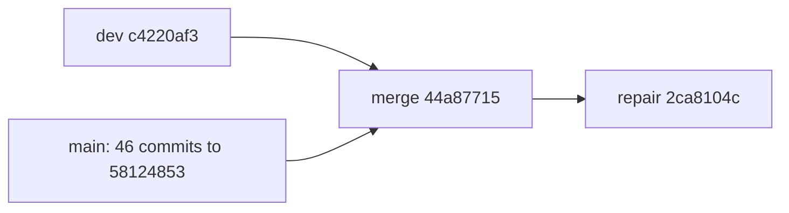

# chore: AUT-2689 nightly sync main into dev (2026-10-30)

[Upstream PR](https://github.com/NVIDIA/Megatron-LM/pull/8813) · state: closed · merged: True

## Original PR description

## Background

Nightly sync of `main` into `dev` for 2026-10-30. The slice has N=46 commits, which were all of `dev..main` at selection time, oldest first. Dev base: `c4220af3`. Slice tip (main): `58124853`. Merge base: `364eef70`.

## What changed

- These 46 original `main` commits are included unchanged and in this order: 53015a0d 57018e45 8e134118 31c72300 47715bb0 4a55e6fe d1eec51b a2965235 73f17bc6 dc36b1a8 2723d2f6 2cfbc2ca 6463d382 3e47f31e a153d5d3 f77f360c e4a643d8 51039e52 a7147091 79f55941 26020f4e d5cc5e6d 57103cf0 babb33e4 b9d4e2b2 01ac4e83 928fe9d1 ccea6622 5de526f2 0a513268 92e1d6a5 53944a33 128d0970 7d6895ac 6dca79cf 7196f838 bc9a10e9 1ac85e91 579f7108 f677840c 0f3e582f a77288b1 952fdb71 90e40493 902feb8e 58124853
- One merge commit, `44a87715`. Its parents are `c4220af3` (dev) and `58124853` (main).
- One signed repair commit, `2ca8104c`. It fixes the main/dev API mismatches that validation found. It keeps dev's `kda_safe_gate` (#6556), restores dev's `distribute_saved_activations=False`, and refreshes 4 mHC golden-value files that #7521 changed. It also fixes two CI failures from the previous head, `08b2dcef`:
  - **MoK:** the `mok-wheel` stage in `docker/Dockerfile.ci.dev` now pins MoK `7a8cfb7f`, as main does. Dev's pin, `a2ad2d0c`, does not accept the `shared_output_gate_weight` argument that `runtime.py:128` passes. That is why GB200 `test_real_mok_ddp_numerics` failed. `7a8cfb7f` already contains `docker/patches/mok.patch`, so the patch file and its install step are removed. Only the ARM64 image builds MoK.
  - **NeMo RL:** NVIDIA-NeMo/RL #4253 renamed `L1_Functional_Tests_Megatron_4.sh` to `L1_Functional_Tests_Megatron_Generation.sh`. `cicd-main.yml` now selects the new name. Dev and main still use the old pattern.



## Details

- Relative to dev, the graph has 48 commits: 46 imports, 1 merge and 1 repair.
- 64 files had conflicts. Each was resolved individually, and no dev files needed to be restored. This PR accepts main's deletion of `nightly-sync-main-to-dev.yml` (#8603). CODEOWNERS is identical to dev.
- Remerge-diff: 491,938 bytes across 71 files.
- Dependencies: `pyproject.toml` and `uv.lock` are identical to dev. `Dockerfile.ci.dev` differs from dev only in the MoK pin. The #8013 change (FlashInfer 0.7.2, cuDNN frontend 1.32) is deferred. On dev, FlashInfer with a clamped `squared_relu` raises a `RuntimeError`. The `torch` and `vllm` backends still work.
- Open advisories for reviewers: the graphed split of mHC `packed_seq_params`; `report_theoretical_memory` (a bug already in main); KDA with CP>1; `deepseek_proxy` golden values kept from dev. `determinism-exempt` covers 6 kernel-coverage findings from imported commits.

## Tested

Local H100 runs used image `766267172432.dkr.ecr.us-east-1.amazonaws.com/nemo-autobot/agent-sandbox@sha256:6a14e041d26a8ebc12e1add41d331ab7e90f01be06262b0245b543f0c6cdc28a`. No CI results were reused for local rows.
- Unit: 71 rows. 69 passed. 2 were skipped upstream (`test_batch_invariant_handoff.py` and `test_disagg_coordinator_pairwise.py`), because NIXL is not installed. Upstream run 40846739249 skips them the same way.
- Functional: 84 of 84 passed.
- These results still apply to `2ca8104c`. Since `08b2dcef`, the repair changes no Python, test or lock file, and the AMD64 H100 image does not build MoK. The lint mirror passed on `08b2dcef`.
- GitHub CICD run 41299281492 on `08b2dcef` had 4 failures and 1 cancelled job. This head fixes the MoK and NeMo RL failures. `test_virtual_expert_planner_graph_replay[dtype1-8]` looks flaky: its test and source are unchanged from dev, and it passes on dev, on main and locally. `a2a_overlap/test_schedule_chunk_1f1b.py` passed 189 tests and was then cancelled at the job time limit. CI on `2ca8104c` is pending.
- Still needed: the `Run MBridge tests` label and a DCO resolution for 18 imported `main` commits.

## Review and discussion

### reviews

- FDecaYed · CHANGES_REQUESTED · 2026-11-01T11:26:08Z · [source](https://github.com/NVIDIA/Megatron-LM/pull/8813#pullrequestreview-5727833582)

Please reconcile the dependency requirements of #8013 before merging this sync.

The imported clamped squared-ReLU FlashInfer path needs `ActivationType.ClampedRelu2` and `clamped_relu2_limit` ([resolver](https://github.com/NVIDIA/Megatron-LM/blob/08b2dcefb412d65731dfdbbaf3c3e966b5977939/megatron/core/transformer/moe/experts.py#L1614-L1628)). Main brought that feature in with FlashInfer >=0.7.2, but this PR still requires `<0.7.0` and locks 0.6.18.post1. That version lacks both APIs, so selecting FlashInfer + squared_relu + a positive tanh clamp fails during model construction. The explicit RuntimeError prevents silent corruption, but does not preserve the incoming main capability.

Please reconcile the compatible dependency pins, lockfile and image inputs, checking the accompanying cuDNN frontend requirement too; or explicitly defer this feature with its supported configuration boundary. A note that the dependency triple matches dev does not resolve this mismatch.

Separately, this head's CICD stopped at the determinism-coverage gate, so the unit, functional and downstream jobs were skipped. Those are validation gaps, not observed training failures. The local H100 results and refreshed mHC goldens still need accessible source/environment-bound evidence before approval.


- FDecaYed · COMMENTED · 2026-11-01T11:48:22Z · [source](https://github.com/NVIDIA/Megatron-LM/pull/8813#pullrequestreview-5727899237)

Thanks, the explicit deferral addresses my dependency finding. For clamped squared-ReLU, the documented torch/vLLM alternatives retain the clamp, while the locked FlashInfer version rejects that combination at construction rather than silently changing behavior. I’m no longer requesting a dependency upgrade in this sync.

Approval is still pending the validation evidence noted in my earlier review: accessible runtime results tied to this source and environment, and the generation logs/inputs for the four refreshed mHC goldens. The current CICD attempt stopped before unit, functional and downstream tests; skipped jobs are not runtime failures. Existing local artifacts or appropriately scoped CI evidence can address the gap—this clarification alone does not require another full matrix.


- FDecaYed · COMMENTED · 2026-11-01T12:08:59Z · [source](https://github.com/NVIDIA/Megatron-LM/pull/8813#pullrequestreview-5727959735)

Thanks, this clarifies the environment and how the four mHC goldens were generated. Could you post the existing log excerpts (or accessible artifact links) for those runs: source/image and executed recipe, training completion, and the DETERMINISTIC/APPROXIMATE results? Please include the generated-file hashes so we can match them to the committed goldens.

I couldn't resolve `f583febb` in the fork. Please include its full SHA and the source diff to `08b2dcef`, or an accessible source snapshot if that commit is no longer published. The result summaries for the previously reported unit/functional runs would also help close the runtime evidence gap. No new test matrix requested here—just the existing evidence.


- FDecaYed · APPROVED · 2026-11-01T13:04:04Z · [source](https://github.com/NVIDIA/Megatron-LM/pull/8813#pullrequestreview-5728195615)

Thanks for the logs and source mapping. The mHC golden hashes, recipes and reported values match, and the affected test rows support carrying the reviewed local results to `08b2dcef`. This addresses the remaining evidence request; the explicit FlashInfer deferral remains accepted.

Approving based on the author-provided H100 results and our source checks. GitHub runtime CI has not passed: the determinism-coverage gate still needs to be addressed before merge. The two NIXL rows were skipped; Blackwell MoK and external MBridge coverage are not implied.


- FDecaYed · APPROVED · 2026-11-02T20:46:33Z · [source](https://github.com/NVIDIA/Megatron-LM/pull/8813#pullrequestreview-5743090683)

Approved for `2ca8104c`. The rebuilt GB200 image uses MoK `7a8cfb7f`, and all four gate/main-gradient numerical cases passed on all four ranks. The current run also passes the previously failing VE case on all eight ranks, completes the A2A job, and validates the four mHC golden recipes. The earlier VE failure remains unexplained; this pass does not establish a root-cause fix.

The remaining NeMo-RL failure is in its Git checkout step (`shallow file has changed since we read it`), before Generation tests. NeMo-RL Generation, MBridge and the skipped NIXL paths remain unvalidated; this approval does not imply a fully green CI run. The explicit FlashInfer deferral remains accepted.


### issue_comments

- copy-pr-bot[bot] · comment · 2026-11-01T10:43:48Z · [source](https://github.com/NVIDIA/Megatron-LM/pull/8813#issuecomment-6556877462)

This pull request requires additional validation before any workflows can run on NVIDIA's runners.

Pull request vetters can view their responsibilities [here](https://docs.gha-runners.nvidia.com/cpr/vetters).

Contributors can view more details about this message [here](https://docs.gha-runners.nvidia.com/cpr/contributors).


- svcnvidia-nemo-ci · comment · 2026-11-01T10:51:02Z · [source](https://github.com/NVIDIA/Megatron-LM/pull/8813#issuecomment-6556947862)

/ok to test 08b2dcefb412d65731dfdbbaf3c3e966b5977939

- svcnemo-autobot · comment · 2026-11-01T11:02:40Z · [source](https://github.com/NVIDIA/Megatron-LM/pull/8813#issuecomment-6557061510)

CI status for head `08b2dcef`. This head needs no code change. All three CI failures need a maintainer action.

- **linting:** The only failure is `check_kernel_determinism_coverage`. Its 6 findings come from kernel changes imported from main (#8426, #7054, #8399, #7555, #7521). The earlier sync PRs #8643, #8461 and #8402 used the `determinism-exempt` label for this check.
- **Nemo_CICD_Test:** This failed only because linting failed. In CICD run 41299281492 the unit, integration, MBridge and NeMo-RL jobs were skipped.
- **DCO / DCO gate:** These fail on 18 commits imported from main, for example 6463d382, 128d0970 and 0f3e582f. In each one, the sign-off name or email does not match the commit author. The sync must keep the original main commit SHAs, so these commits cannot be rewritten. #8461 passed DCO after an override. #8643 was merged with the same DCO result.

Requested maintainer actions:
1. Review the 6 determinism findings. If you accept them, add `determinism-exempt`.
2. Add `Run MBridge tests`.
3. Resolve DCO for the imported commits.
4. Rerun CICD on this head.

Local H100 validation of this head: 84 of 84 functional rows passed. Of the 71 unit rows, 69 passed and 2 were skipped upstream because NIXL is not installed.

- svcnemo-autobot · comment · 2026-11-01T11:33:42Z · [source](https://github.com/NVIDIA/Megatron-LM/pull/8813#issuecomment-6557377142)

@FDecaYed, thank you for the review. This reply is for head `08b2dcef`.

**1. #8013 dependencies**

I confirmed the finding. #8013 (`a7147091`) changes three dependency files on `main`:
- `pyproject.toml`: `flashinfer-python>=0.7.2,<0.8.0` and `nvidia-cudnn-frontend[cutedsl]==1.32.0`.
- `uv.lock`: FlashInfer 0.7.2.post1 and cuDNN frontend 1.32.0.
- `docker/Dockerfile.ci.dev`: a new uv cache id, so that TE rebuilds against the cuDNN frontend 1.32 headers.

The sync rule keeps these three files identical to dev. So this head locks FlashInfer 0.6.18.post1 and cuDNN frontend 1.29.0. Dev was already behind main here: dev pins `<0.7.0` (#4760), and main pinned `<0.8.0` before #8013.

I took the deferral option and did not change the dependency files. I asked for this boundary to be added to the PR description:
- Supported on dev: the tanh clamp with `inference_grouped_gemm_backend` `torch` or `vllm`, and FlashInfer with unclamped `squared_relu`.
- Not supported on dev: FlashInfer with `squared_relu` and a tanh clamp. Model construction stops with the `RuntimeError` in `_resolve_flashinfer_activation_type`. There is no silent fallback.
- The #8013 code is identical to main. A later dev dependency change enables this path without a code change.

The local H100 unit run covered the error path: `test_flashinfer_clamped_relu2_backend_capability` passed for `supported`, `missing-enum` and `missing-keyword`.

If you want dev to adopt FlashInfer 0.7.2 and cuDNN frontend 1.32 in this PR, reply with that decision. That change goes outside the sync rule for the dependency files. It needs a regenerated `uv.lock`, a new CI image with a TE rebuild, and a new full validation run.

**2. CI evidence on this head**

I agree. The local H100 results do not replace CICD on this head. CICD run 41299281492 stopped at linting, and the only linting failure is the 6 kernel-determinism-coverage findings. So the unit, functional, MBridge and NeMo-RL jobs were skipped.

To get CI evidence on `08b2dcef`, a maintainer must:
1. Review the 6 findings and apply `determinism-exempt` if they are acceptable.
2. Add the `Run MBridge tests` label.
3. Resolve DCO for the 18 imported `main` commits.
4. Rerun CICD.

The functional jobs will then check the 4 refreshed mHC golden-value files in `08b2dcef` on this exact head. I will diagnose any failure from that run.

- svcnemo-autobot · comment · 2026-11-01T11:58:01Z · [source](https://github.com/NVIDIA/Megatron-LM/pull/8813#issuecomment-6557613849)

@FDecaYed Thank you for the second review. This reply answers the open item: runtime results, and the inputs and logs for the 4 refreshed mHC golden files. It does not change code. The PR head is still `08b2dcef`.

**Runtime environment (all local runs)**
- Hardware: 1 node with 8×H100.
- Image: `766267172432.dkr.ecr.us-east-1.amazonaws.com/nemo-autobot/agent-sandbox@sha256:6a14e041d26a8ebc12e1add41d331ab7e90f01be06262b0245b543f0c6cdc28a`.
- Test-launcher profile digest: `1828fd871eee24c95b1f6815c7b8fe364b39560fcfbb97435ecc59a3a4308e9a`.
- Each run log prints its source revision as `Megatron-Core version 0.21.0+<sha>`.

**How the 4 golden files were made**
1. On merge commit `44a87715`, before any repair, each test ran with its own `model_config.yaml`. The inputs include `--deterministic-mode true`, `--train-iters 50`, `--enable-hyper-connections true`, `--mhc-sinkhorn-iterations 20`, `--recompute-modules [mhc]` and `--mhc-recompute-layer-num 2`. `gpt3_mcore_te_tp2_pp2_mhc` is a `ckpt-resume` test. The other 3 are `regular` tests.
2. Training finished in each run. Then the DETERMINISTIC comparison against the old dev golden values failed.
3. Each run wrote `mlm/golden_values_dev_dgx_h100.json` from its TensorBoard log. Each committed file is byte-identical to the file from its run.

| Test case (`gpt/`) | Generation run on `44a87715` | Verification run on `f583febb` |
|---|---|---|
| `gpt3_mcore_te_tp2_pp2_ep4_mhc_overlap_attn_cudagraph` | `80c51021` / `0441297f` | `ac9213dd`: passed |
| `..._ep4_mhc_overlap_attn_cudagraph_nosplit` | `c323c461` / `fb35ae3f` | `6e74959e`: passed |
| `gpt3_mcore_te_tp2_pp2_mhc` | `f0e98266` / `3fce929a` | `d399e739`: passed |
| `gpt3_mcore_te_tp2_pp2_mhc_attn_cudagraph` | `26daa41e` / `722e1198` | `4c18b23c`: passed |

**Verification of the new files**
Commit `f583febb` is the repair commit that carries the refreshed files. Each of the 4 tests ran again on it. In all 4 runs, the DETERMINISTIC and APPROXIMATE checks passed for `lm loss` and for `num-zeros`, and pytest reported `1 passed`. `git diff f583febb..08b2dcef` changes only `megatron/core/ssm/gated_delta_net/kda.py`, `megatron/core/ssm/kda_layer_config.py` and 3 unit-test files. The golden files and `hyper_connection.py` did not change.

**Why the values changed**
#7521 (`8e134118`) changes the mHC arithmetic in `hyper_connection.py`:
- The Sinkhorn forward now runs on a detached input.
- `h_aggregate` now casts back to the input dtype.
- The `h_post` bmm now runs in FP32 with autocast off.

In #7521, main refreshed its own mHC golden values. These 4 test cases exist only on dev.

| Test case | `lm loss` max abs diff (50 steps) | `num-zeros` max diff | `mem-max-allocated-bytes` |
|---|---|---|---|
| `ep4_mhc_overlap_attn_cudagraph` | 5.1e-4 | 290 | 309 MB lower |
| `..._nosplit` | 6.6e-4 | 332 | 309 MB lower |
| `tp2_pp2_mhc` | 5.9e-5 (47 of 50 steps changed) | 140 | 204 MB lower |
| `mhc_attn_cudagraph` | 5.5e-5 | 226 | 204 MB lower |

**Access**
The new values are in this PR diff, and the old values are on `dev`. The full run logs are stored in this automation's artifact store, not on GitHub. On request, I can post any log section here.

**GitHub CI**
GitHub CICD on `08b2dcef` stopped at the linting job. Only the determinism-coverage check failed. So GitHub has no runtime results for this head yet. To get them, a maintainer must do these steps:
1. Decide about `determinism-exempt`.
2. Add the `Run MBridge tests` label.
3. Resolve DCO for the 18 imported `main` commits.
4. Run CICD again.

- svcnemo-autobot · comment · 2026-11-01T12:45:02Z · [source](https://github.com/NVIDIA/Megatron-LM/pull/8813#issuecomment-6558117125)

@FDecaYed, this comment answers review 5727959735 with evidence that I already have. I did not run new tests.

GitHub cannot read the session storage that holds the run logs. So I copied the relevant log lines into this comment. All runs used one node with 8 H100 GPUs, the same test profile, and this image:
`766267172432.dkr.ecr.us-east-1.amazonaws.com/nemo-autobot/agent-sandbox@sha256:6a14e041d26a8ebc12e1add41d331ab7e90f01be06262b0245b543f0c6cdc28a`

The run IDs are short workload IDs. The line numbers in the excerpts are from the rank-0 `stdout.log` of each run.

## 1. mHC golden-value runs (R3)

I did these steps for each of the 4 test cases:

1. I ran the test case on the merge commit `44a87715` (log: `Megatron-Core version .......... 0.21.0+44a877155`). Training completed 50 of 50 iterations, with `skipped: 0` and `nan: 0`.
2. The test compared the run with the old dev golden file. The DETERMINISTIC check failed. The APPROXIMATE check passed: 0 of 50 samples were outside tolerance (rtol 0.05 for lm loss, rtol 0.2 for num-zeros). So pytest reported `1 failed`.
3. I committed the golden file that the run generated, without changes. Its sha256 is equal to the committed file on `f583febb` and on `08b2dcef`.
4. I ran the test case again on `f583febb`, which contains the new golden files (log: `0.21.0+f583febbd`). pytest passed. The final lm loss and num-zeros values are equal to the values of the generation run.

| Test case | Generation run on `44a87715` | Comparison with the old dev golden file | Verification run on `f583febb` |
|---|---|---|---|
| `tp2_pp2_ep4_mhc_overlap_attn_cudagraph` | `80c51021`: iteration 50/50, lm loss 1.077237E+01, num zeros 11535. pytest: `1 failed` | DETERMINISTIC failed (lm loss 50/50, num-zeros 50/50 samples); APPROXIMATE passed (0/50) | `ac9213dd`: iteration 50/50, lm loss 1.077237E+01, num zeros 11535. pytest: `1 passed` |
| `tp2_pp2_ep4_mhc_overlap_attn_cudagraph_nosplit` | `c323c461`: iteration 50/50, lm loss 1.077225E+01, num zeros 11821. pytest: `1 failed` | DETERMINISTIC failed (lm loss 50/50, num-zeros 50/50 samples); APPROXIMATE passed (0/50) | `6e74959e`: iteration 50/50, lm loss 1.077225E+01, num zeros 11821. pytest: `1 passed` |
| `tp2_pp2_mhc` | `f0e98266`: iteration 50/50, lm loss 9.866622E+00, num zeros 2445; lm loss 9.866622E+00, num zeros 2445. pytest: `1 failed` | DETERMINISTIC failed (lm loss 47/50, num-zeros 50/50 samples); APPROXIMATE passed (0/50) | `d399e739`: iteration 50/50, lm loss 9.866622E+00, num zeros 2445; lm loss 9.866622E+00, num zeros 2445. pytest: `1 passed; 1 passed` |
| `tp2_pp2_mhc_attn_cudagraph` | `26daa41e`: iteration 50/50, lm loss 1.065367E+01, num zeros 2584. pytest: `1 failed` | DETERMINISTIC failed (lm loss 50/50, num-zeros 50/50 samples); APPROXIMATE passed (0/50) | `4c18b23c`: iteration 50/50, lm loss 1.065367E+01, num zeros 2584. pytest: `1 passed` |

The `tp2_pp2_mhc` log has two training passes, so it shows two `iteration 50/50` lines. Its verification run ran pytest two times.

**Recipe and command.** Each run used the `model_config.yaml` of its test case. This file has the same Git blob on `c4220af3` (dev), `44a87715`, `f583febb` and `08b2dcef`. For each test case, the generation run and the verification run used the same launch command. I compared the sha256 of the normalized command line.

| Test case | `model_config.yaml` blob | Normalized command sha256 (first 16 hex digits) |
|---|---|---|
| `tp2_pp2_ep4_mhc_overlap_attn_cudagraph` | `9a7d0a89b522` | `81638c2896e04279` |
| `tp2_pp2_ep4_mhc_overlap_attn_cudagraph_nosplit` | `eba1c28e4f7e` | `f8df4513dd162899` |
| `tp2_pp2_mhc` | `686c8bdbb59d` | `0255f97c15559748`, `6d02609f09e045fa` |
| `tp2_pp2_mhc_attn_cudagraph` | `dfd22d2da653` | `571c1eb46cc3af3d` |

**Golden-file hashes.** These are sha256 values of `golden_values_dev_dgx_h100.json` (`git show <sha>:<path> | sha256sum` for committed files):
```
tp2_pp2_ep4_mhc_overlap_attn_cudagraph
  old dev golden (c4220af3):          04aeea4728dcc2165d899c16b4a2b7b5b7a6d010b0e4fa42046295a54e221b45
  generated by 80c51021 (44a87715):  1860318b24ef2096d8d67a58ba5859631ea26e98c9d57cc771e47b6a25b6d957
  committed on f583febb and 08b2dcef: 1860318b24ef2096d8d67a58ba5859631ea26e98c9d57cc771e47b6a25b6d957
tp2_pp2_ep4_mhc_overlap_attn_cudagraph_nosplit
  old dev golden (c4220af3):          bfeb17d161c53c861a611d663540304f71eacdf36fa87cac3ce69234610f8a27
  generated by c323c461 (44a87715):  4d8ce5b52b95e1a549bfde664552447d8a0357681103160b47233baf35c73dbf
  committed on f583febb and 08b2dcef: 4d8ce5b52b95e1a549bfde664552447d8a0357681103160b47233baf35c73dbf
tp2_pp2_mhc
  old dev golden (c4220af3):          a1646d2b4f2a8319edd3770a57371b1dba508f77dca27aa14aa0f6c3d37c78d0
  generated by f0e98266 (44a87715):  629ece714108f15da534914f01d5686502c231dfd34af998447cdf6b41efa44e
  committed on f583febb and 08b2dcef: 629ece714108f15da534914f01d5686502c231dfd34af998447cdf6b41efa44e
tp2_pp2_mhc_attn_cudagraph
  old dev golden (c4220af3):          42bb1fde087adf90c71f29acb267233c125ddeb7ee39a2be38b2c769373d5c6d
  generated by 26daa41e (44a87715):  4de5088aefd5e577c08fc248395251ce89f7274bfb5c43433d007cdf374f0292
  committed on f583febb and 08b2dcef: 4de5088aefd5e577c08fc248395251ce89f7274bfb5c43433d007cdf374f0292
```

The verification runs also wrote a golden file. Compared with the committed file, it is different only in `iteration-time`, and for 3 test cases also in `mem-allocated-bytes` and `mem-max-allocated-bytes`. All other metrics, including lm loss and num-zeros, are equal.

<details><summary>Log excerpts (8 runs)</summary>

#### `tp2_pp2_ep4_mhc_overlap_attn_cudagraph`
Generation run `80c51021` on `44a87715`:
```
 1522: [default0]:> Megatron-Core version .......... 0.21.0+44a877155
 2704: [default7]: [2026-10-31 11:18:36.625988] iteration 50/50 | lm loss: 1.077237E+01 | num zeros: 11535.0 | skipped: 0 | nan: 0
 2769: + pytest test_pretraining_regular_pipeline.py --golden-values-path .../gpt3_mcore_te_tp2_pp2_ep4_mhc_overlap_attn_cudagraph/golden_values_dev_dgx_h100.json --actual-values-path /mnt/artifacts/mlm/golden_values_dev_dgx_h100.json
 2781: Golden comparison for lm loss [DETERMINISTIC]: FAILED; 50/50 samples outside tolerance; atol=0, rtol=0, precision=full
 2787: Golden comparison for lm loss [APPROXIMATE]: PASSED; 0/50 samples outside tolerance; atol=0, rtol=0.05, precision=rounded_5_decimal_places
 2790: Golden comparison for num-zeros [DETERMINISTIC]: FAILED; 50/50 samples outside tolerance; atol=0, rtol=0, precision=full
 2796: Golden comparison for num-zeros [APPROXIMATE]: PASSED; 0/50 samples outside tolerance; atol=0, rtol=0.2, precision=rounded_5_decimal_places
 3035: ============================== 1 failed in 0.10s ===============================
```
Verification run `ac9213dd` on `f583febb`:
```
 1522: [default0]:> Megatron-Core version .......... 0.21.0+f583febbd
 2706: [default7]: [2026-10-31 18:39:39.692561] iteration 50/50 | lm loss: 1.077237E+01 | num zeros: 11535.0 | skipped: 0 | nan: 0
 2799: ============================== 1 passed in 0.03s ===============================
```
#### `tp2_pp2_ep4_mhc_overlap_attn_cudagraph_nosplit`
Generation run `c323c461` on `44a87715`:
```
 1511: [default0]:> Megatron-Core version .......... 0.21.0+44a877155
 2691: [default7]: [2026-10-31 11:29:09.648897] iteration 50/50 | lm loss: 1.077225E+01 | num zeros: 11821.0 | skipped: 0 | nan: 0
 2756: + pytest test_pretraining_regular_pipeline.py --golden-values-path .../gpt3_mcore_te_tp2_pp2_ep4_mhc_overlap_attn_cudagraph_nosplit/golden_values_dev_dgx_h100.json --actual-values-path /mnt/artifacts/mlm/golden_values_dev_dgx_h100.json
 2768: Golden comparison for lm loss [DETERMINISTIC]: FAILED; 50/50 samples outside tolerance; atol=0, rtol=0, precision=full
 2774: Golden comparison for lm loss [APPROXIMATE]: PASSED; 0/50 samples outside tolerance; atol=0, rtol=0.05, precision=rounded_5_decimal_places
 2777: Golden comparison for num-zeros [DETERMINISTIC]: FAILED; 50/50 samples outside tolerance; atol=0, rtol=0, precision=full
 2784: Golden comparison for num-zeros [APPROXIMATE]: PASSED; 0/50 samples outside tolerance; atol=0, rtol=0.2, precision=rounded_5_decimal_places
 3026: ============================== 1 failed in 0.10s ===============================
```
Verification run `6e74959e` on `f583febb`:
```
 1509: [default0]:> Megatron-Core version .......... 0.21.0+f583febbd
 2689: [default7]: [2026-10-31 18:55:29.435303] iteration 50/50 | lm loss: 1.077225E+01 | num zeros: 11821.0 | skipped: 0 | nan: 0
 2784: ============================== 1 passed in 0.03s ===============================
```
#### `tp2_pp2_mhc`
Generation run `f0e98266` on `44a87715`:
```
 1238: [default0]:> Megatron-Core version .......... 0.21.0+44a877155
 2404: [default7]: [2026-10-31 11:29:18.959988] iteration 50/50 | lm loss: 9.866622E+00 | num zeros: 2445.0 | skipped: 0 | nan: 0
 4668: [default7]: [2026-10-31 11:30:44.445005] iteration 50/50 | lm loss: 9.866622E+00 | num zeros: 2445.0 | skipped: 0 | nan: 0
 4751: + pytest test_pretraining_regular_pipeline.py --golden-values-path .../gpt3_mcore_te_tp2_pp2_mhc/golden_values_dev_dgx_h100.json --actual-values-path /mnt/artifacts/mlm/golden_values_dev_dgx_h100.json
 4763: Golden comparison for lm loss [DETERMINISTIC]: FAILED; 47/50 samples outside tolerance; atol=0, rtol=0, precision=full
 4769: Golden comparison for lm loss [APPROXIMATE]: PASSED; 0/50 samples outside tolerance; atol=0, rtol=0.05, precision=rounded_5_decimal_places
 4772: Golden comparison for num-zeros [DETERMINISTIC]: FAILED; 50/50 samples outside tolerance; atol=0, rtol=0, precision=full
 4778: Golden comparison for num-zeros [APPROXIMATE]: PASSED; 0/50 samples outside tolerance; atol=0, rtol=0.2, precision=rounded_5_decimal_places
 5016: ============================== 1 failed in 0.10s ===============================
```
Verification run `d399e739` on `f583febb`:
```
 1242: [default0]:> Megatron-Core version .......... 0.21.0+f583febbd
 2408: [default7]: [2026-10-31 19:03:01.814609] iteration 50/50 | lm loss: 9.866622E+00 | num zeros: 2445.0 | skipped: 0 | nan: 0
 4673: [default7]: [2026-10-31 19:04:25.201785] iteration 50/50 | lm loss: 9.866622E+00 | num zeros: 2445.0 | skipped: 0 | nan: 0
 4785: ============================== 1 passed in 0.03s ===============================
```
#### `tp2_pp2_mhc_attn_cudagraph`
Generation run `26daa41e` on `44a87715`:
```
 1297: [default0]:> Megatron-Core version .......... 0.21.0+44a877155
 2468: [default7]: [2026-10-31 11:28:51.109026] iteration 50/50 | lm loss: 1.065367E+01 | num zeros: 2584.0 | skipped: 0 | nan: 0
 2533: + pytest test_pretraining_regular_pipeline.py --golden-values-path .../gpt3_mcore_te_tp2_pp2_mhc_attn_cudagraph/golden_values_dev_dgx_h100.json --actual-values-path /mnt/artifacts/mlm/golden_values_dev_dgx_h100.json
 2545: Golden comparison for lm loss [DETERMINISTIC]: FAILED; 50/50 samples outside tolerance; atol=0, rtol=0, precision=full
 2551: Golden comparison for lm loss [APPROXIMATE]: PASSED; 0/50 samples outside tolerance; atol=0, rtol=0.05, precision=rounded_5_decimal_places
 2555: Golden comparison for num-zeros [DETERMINISTIC]: FAILED; 50/50 samples outside tolerance; atol=0, rtol=0, precision=full
 2561: Golden comparison for num-zeros [APPROXIMATE]: PASSED; 0/50 samples outside tolerance; atol=0, rtol=0.2, precision=rounded_5_decimal_places
 2801: ============================== 1 failed in 0.10s ===============================
```
Verification run `4c18b23c` on `f583febb`:
```
 1299: [default0]:> Megatron-Core version .......... 0.21.0+f583febbd
 2469: [default7]: [2026-10-31 19:02:32.313080] iteration 50/50 | lm loss: 1.065367E+01 | num zeros: 2584.0 | skipped: 0 | nan: 0
 2565: ============================== 1 passed in 0.03s ===============================
```

</details>

## 2. Commit `f583febb` (R4)

- Full SHA: `f583febbdd9fd2b88997434072a75dcca9a12dfb`.
- Parent: `44a877155dfe3372d6b367f420842bb36d2bed15` (the merge commit). The signature is good (`%G?` = `G`).
- It was a local candidate for the repair commit. I did not push it, so GitHub does not have it. I amended later fixes into the same repair commit, and the result is `08b2dcef`.
- The 4 golden files are the same on `f583febb` and `08b2dcef`.

The diff from `f583febb` to `08b2dcef` changes 5 files:
- `kda.py`: on the direct-gate path (`two_stage_gates` is false), `_apply_gated_norm` reshapes the gate after `out_norm` again. This restores the dev op order. It fixes `test_kda_gated_norm_preserves_upstream_rounding[norm-bf16-fp32]` in `transformer/**`, which failed on `f583febb`. Main #7054 had moved the reshape before `out_norm`.
- `kda_layer_config.py`: `KDALayerConfig.__post_init__` calls `validate_kda()` one more time, before `super().__post_init__()`. Thus an invalid KDA setting raises the KDA-specific `ValueError`.
- 3 unit-test files get dev compatibility fixes. Dev keeps `kda_safe_gate` and `kda_lower_bound` on `TransformerConfig` (#6556). The data test patches `get_tokenizer` (main #8391). A test double gets `hybrid_layer_config_list=None`.

<details><summary>Diff f583febb..08b2dcef</summary>

```
 megatron/core/ssm/gated_delta_net/kda.py                  |  5 ++++-
 megatron/core/ssm/kda_layer_config.py                     |  5 +++++
 tests/unit_tests/data/test_pretrain_gpt_dataset_config.py |  2 +-
 tests/unit_tests/ssm/test_kda.py                          | 12 +++++++++++-
 tests/unit_tests/transformer/test_thd_cuda_graph.py       |  1 +
 5 files changed, 22 insertions(+), 3 deletions(-)
```

```diff
diff --git a/megatron/core/ssm/gated_delta_net/kda.py b/megatron/core/ssm/gated_delta_net/kda.py
index 72d8e3204..38531a03e 100644
--- a/megatron/core/ssm/gated_delta_net/kda.py
+++ b/megatron/core/ssm/gated_delta_net/kda.py
@@ -254,16 +254,19 @@ class KimiDeltaAttention(_GDNBase):
 
         x_dtype = x.dtype
         x = x.reshape(-1, self.value_head_dim)
-        gate = gate.reshape(-1, self.value_head_dim)
         if self.two_stage_gates:
             # Round only after both normalization and sigmoid gating.
+            gate = gate.reshape(-1, self.value_head_dim)
             weight = self.out_norm.weight
             if self.config.layernorm_zero_centered_gamma:
                 weight = weight + 1
             return rms_norm_gated(
                 x, gate, weight, None, activation="sigmoid", eps=self.config.layernorm_epsilon
             )
+        # Keep the direct-gate graph order (norm, then gate reshape) so the compiled
+        # rounding matches the pinned upstream primitive.
         x = self.out_norm(x)
+        gate = gate.reshape(-1, self.value_head_dim)
         return apply_attention_output_gate(x, gate, 'elementwise', cast_mode='none').to(x_dtype)
 
     def _proj(self, proj, x):
diff --git a/megatron/core/ssm/kda_layer_config.py b/megatron/core/ssm/kda_layer_config.py
index b84617669..20d742fb1 100644
--- a/megatron/core/ssm/kda_layer_config.py
+++ b/megatron/core/ssm/kda_layer_config.py
@@ -31,6 +31,11 @@ class KDALayerConfig(GDNLayerConfig):
     """Use low-rank f_b(f_a(x)) and g_b(g_a(x)) gates with a QKV-only input projection."""
 
     def __post_init__(self) -> None:
+        # Validate the KDA contract before the shared TransformerConfig checks, which also
+        # cover GDN-family fields with generic assertions, so invalid KDA settings raise the
+        # KDA-specific ValueError. An unset linear_cp_mode skips the CP-mode checks here; it is
+        # normalized by super().__post_init__() and validated again afterwards.
+        self.validate_kda()
         super().__post_init__()
         self.validate_kda()
 
diff --git a/tests/unit_tests/data/test_pretrain_gpt_dataset_config.py b/tests/unit_tests/data/test_pretrain_gpt_dataset_config.py
index 770f2cd6c..88d2cca43 100644
--- a/tests/unit_tests/data/test_pretrain_gpt_dataset_config.py
+++ b/tests/unit_tests/data/test_pretrain_gpt_dataset_config.py
@@ -25,7 +25,7 @@ def test_core_gpt_dataset_config_forwards_sft_mock_dataset_config(monkeypatch, r
         * args.pipeline_model_parallel_size
         * args.context_parallel_size
     )
-    monkeypatch.setattr(pretrain_gpt, "build_tokenizer", lambda _: SimpleNamespace(vocab_size=2048))
+    monkeypatch.setattr(pretrain_gpt, "get_tokenizer", lambda: SimpleNamespace(vocab_size=2048))
     monkeypatch.setattr(pretrain_gpt, "get_blend_and_blend_per_split", lambda _: (None, None))
 
     config = pretrain_gpt.core_gpt_dataset_config_from_args(args)
diff --git a/tests/unit_tests/ssm/test_kda.py b/tests/unit_tests/ssm/test_kda.py
index 2462156c1..21ce90b7d 100644
--- a/tests/unit_tests/ssm/test_kda.py
+++ b/tests/unit_tests/ssm/test_kda.py
@@ -471,7 +471,13 @@ def test_kda_layer_config_preserves_settings(explicit_settings):
 
     assert type(layer_config) is KDALayerConfig
     assert layer_config is not config
-    assert set(expected).isdisjoint(field.name for field in fields(TransformerConfig))
+    # dev keeps kda_safe_gate/kda_lower_bound on TransformerConfig for the
+    # --kda-safe-gate/--kda-lower-bound CLI flags (#6556); the other KDA-only
+    # settings must stay off the stack config.
+    dev_stack_fields = {"kda_safe_gate", "kda_lower_bound"}
+    transformer_fields = {field.name for field in fields(TransformerConfig)}
+    assert dev_stack_fields <= transformer_fields
+    assert (set(expected) - dev_stack_fields).isdisjoint(transformer_fields)
     assert set(expected) <= {field.name for field in fields(KDALayerConfig)}
     for name, value in expected.items():
         assert getattr(layer_config, name) == value
@@ -634,11 +640,15 @@ def test_parallel_kda_correctness(
 @pytest.mark.parametrize("recompute_module", ["gdn_norm_out", "gdn"])
 @pytest.mark.parametrize("variant", [None, "kda"])
 def test_kda_layer_config_accepts_recompute_modules(recompute_module, variant):
+    # dev (#6556) registers "kda" as a GDN-family variant, so a non-hybrid KDA config is a
+    # standalone linear-attention model and must declare its LA/SDPA layer pattern.
+    linear_attention_freq = [1] if variant == "kda" else None
     config = _make_config(
         recompute_granularity="selective",
         recompute_modules=[recompute_module],
         experimental_attention_variant=variant,
         is_hybrid_model=False,
+        linear_attention_freq=linear_attention_freq,
     )
     assert config.recompute_modules == [recompute_module]
 
diff --git a/tests/unit_tests/transformer/test_thd_cuda_graph.py b/tests/unit_tests/transformer/test_thd_cuda_graph.py
index 203f75e27..68d31338b 100644
--- a/tests/unit_tests/transformer/test_thd_cuda_graph.py
+++ b/tests/unit_tests/transformer/test_thd_cuda_graph.py
@@ -201,6 +201,7 @@ def test_hybrid_padding_mask_sp_scatter_uses_model_tp_group(monkeypatch, input_p
             mtp_num_layers=1 if mtp_enabled else None,
             freeze_base_model_for_mtp=False,
         ),
+        hybrid_layer_config_list=None,
         pre_process=input_path != "pipeline",
         post_process=False,
         embedding=FakeEmbedding(),
```

</details>

## 3. Unit and functional results (R5)

The matrix has 71 unit rows and 84 functional rows. Each row has one result on one tested SHA:

| Tested SHA | Unit rows | Functional rows | Files that change from this SHA to `08b2dcef` |
|---|---|---|---|
| `08b2dcef` | 2 passed | – | none |
| `04709f9f` | 1 passed | – | `tests/unit_tests/ssm/test_kda.py` |
| `dcd760ab` | 1 passed | – | `ssm/test_kda.py`, `transformer/test_thd_cuda_graph.py` |
| `f583febb` | 2 passed | 4 passed | the 5 files in section 2 |
| `44a87715` | 63 passed, 2 skipped upstream | 80 passed | 13 files: `kda.py`, `kda_layer_config.py`, the 4 mHC golden files and 7 unit-test files |
| **Total** | **71: 69 passed, 2 skipped upstream** | **84: 84 passed** | |

Full SHAs: `04709f9fa044172b9e0b98dc8d1a814f16f9fb14`, `dcd760aba32de57a468565d809418760fa6afb28`. No retained result is from the candidates `3ce3f8d2` (`3ce3f8d21203af614174481952121771e120d138`) and `258bb660` (`258bb660eda749cca46b50316d65bec2cd80a935`).

**Why a pass on an older SHA applies to `08b2dcef`.** I kept a pass only if the diff from its tested SHA to `08b2dcef` does not change an input of that row:

- After `44a87715`, no dependency, lock, Docker, CI or test-utility file changed (`pyproject.toml`, `uv.lock`, `docker/`, `.github/`, `tests/test_utils/`). All runs used the same image and test profile.
- Only the 4 mHC rows read the 4 golden files. These rows passed on `f583febb`, which has the same golden files as `08b2dcef`.
- Each of the 7 changed unit-test files belongs to one row. That row ran on a SHA that has the final version of the file: `data/**` on `dcd760ab`, `models/**` and `transformer/moe/**` on `f583febb`, `transformer/**` on `04709f9f`, and `ssm/**` on `08b2dcef`.
- `kda.py`, recompute change: the two checkpoint calls pass `False` again instead of `distribute_saved_activations`. This has an effect only during training with `recompute_gdn` and `distribute_saved_activations` both set. Outside the rows that ran again, no KDA test sets these flags.
- `kda.py`, gate-reshape change: this has an effect only when a test runs `KimiDeltaAttention._apply_gated_norm`. Only the `ssm/**`, `ssm/gated_delta_net/test_kda.py` and `transformer/**` rows do that, and they ran on SHAs with the final `kda.py`. The other KDA consumers do not run it. The determinism kernel tests call only `_compute_gates` and `chunk_kda`, and `test_gated_norm.py` uses the unchanged `GatedDeltaNet._apply_gated_norm`. `inference/contexts/test_dynamic_context.py` checks that KDA inference fails early. The `models/**` files build only configs and module specs.
- No functional row in this matrix uses KDA. The only KDA functional case, `hybrid_mr_mcore_te_tp1_pp1_ep8_cp2_kda_gated_mla_1N8G`, is not in the matrix.
- `kda_layer_config.py`: the extra `validate_kda()` call cannot reject a config that the later call accepts. Of the fields that `validate_kda()` reads, `TransformerConfig.__post_init__` sets only `linear_cp_mode`, and the CP checks skip while that field is unset. `test_ssm_kernels.py` uses `KDALayerConfig.from_config`, which does not run `__post_init__`.
- Skipped upstream: `inference/engines/test_batch_invariant_handoff.py` and `inference/engines/test_disagg_coordinator_pairwise.py`. The log shows `NIXL is not installed; skipping ...`. Upstream main run 40846739249 skips them the same way (jobs 123357253143 and 123357253359, at `0a513268`). Their inputs did not change from `44a87715` to `08b2dcef`. These 2 rows are skipped, not passed.

For rows that have no pytest summary line, the lists show the line that the test script prints instead. Most unit rows print two pytest summary lines, one for each pytest call in the row script. The lists show both, in order. `×N` means that the row printed the same summary N times.

<details><summary>Unit rows (71)</summary>

Rows without a SHA mark ran on `44a87715`.

- `examples/multimodal_dev/tests/**/*.py`: `83 passed` / `83 deselected`
- `**/*.py`: `4391 passed, 162 skipped, 94 deselected, 19 subtests passed` / `4647 deselected`
- `a2a_overlap/**/*.py`: `128 passed, 1 skipped, 4 deselected` / `133 deselected`
- `a2a_overlap/test_fsdp_1f1b_overlap.py`: `69 passed` / `69 deselected`
- `a2a_overlap/test_schedule_chunk_1f1b.py`: `189 passed` / `189 deselected`
- `a2a_overlap/test_schedule_chunk_1f1b_layers_1_1.py`: `60 passed` / `60 deselected`
- `a2a_overlap/test_schedule_chunk_1f1b_layers_1_2.py`: `60 passed` / `60 deselected`
- `a2a_overlap/test_schedule_chunk_1f1b_padding.py`: `24 passed` / `24 deselected`
- `a2a_overlap/test_schedule_chunk_1f1b_recompute_block.py`: `60 passed` / `60 deselected`
- `a2a_overlap/test_schedule_chunk_1f1b_recompute_uniform.py`: `45 passed, 15 skipped` / `60 deselected`
- `data/**/*.py` @ `dcd760ab`: `813 passed, 161 skipped, 2 deselected` / `976 deselected`
- `determinism/correctness/**/*.py`: `55 passed, 6 skipped` / `61 deselected`
- `determinism/kernels/**/*.py`: `781 passed, 45 skipped, 2 xfailed, 7 xpassed` / `835 deselected`
- `dist_checkpointing/**/*.py`: `428 passed, 49 skipped, 21 deselected` / `498 deselected`
- `dist_checkpointing/models/**/*.py`: `142 passed` / `142 deselected`
- `dist_checkpointing/models/test_moe_experts.py`: `170 passed` / `170 deselected`
- `dist_checkpointing/test_layer_wise_optimizer_common_state_dict.py`: `164 passed, 128 skipped` / `292 deselected`
- `dist_checkpointing/test_optimizer.py`: `152 passed, 28 skipped` / `180 deselected`
- `distributed/mfsdp_v1/**/*.py`: `109 passed, 12 skipped, 21 deselected` / `142 deselected`
- `distributed/mfsdp_v1/test_mfsdp_fully_shard.py`: `249 passed, 95 skipped, 6 xfailed` / `350 deselected`
- `distributed/mfsdp_v2/**/*.py`: `339 passed, 47 skipped, 7 deselected` / `393 deselected`
- `fusions/**/*.py`: `391 passed, 183 skipped, 91 deselected` / `83 passed, 582 deselected`
- `fusions/test_fused_mhc_kernels.py`: `74 passed, 8 deselected` / `82 deselected`
- `generalized_tensor_parallel/**/*.py`: `250 passed, 59 skipped, 6 deselected` / `315 deselected`
- `inference/**/*.py`: `3830 passed, 84 skipped` / `3 skipped, 3911 deselected`
- `inference/engines/**/*.py`: `410 passed, 21 skipped, 9 deselected` / `440 deselected`
- `inference/engines/test_batch_invariant_coordinator.py`: `9 passed` / `9 deselected`
- `inference/engines/test_batch_invariant_handoff.py`: skipped upstream: `3 skipped` / `3 deselected`
- `inference/engines/test_disagg_coordinator_pairwise.py`: skipped upstream: `NIXL is not installed; skipping tests/unit_tests/inference/engines/test_disagg_coordinator_pairwise.py`
- `inference/engines/test_dynamic_engine.py`: `287 passed, 2 skipped` / `289 deselected`
- `inference/engines/test_dynamic_engine_parallel_and_chunked_prefill.py`: `107 passed, 80 skipped` / `187 deselected`
- `inference/test_batch_invariant_fp8.py`: `5 passed, 2 deselected` / `1 passed, 6 deselected`
- `inference/test_coordinator_execution_pairwise.py`: `10 passed` / `10 deselected`
- `inference/test_coordinator_media_pairwise.py`: `12 passed` / `12 deselected`
- `inference/test_coordinator_sampling_pairwise.py`: `30 passed` / `30 deselected`
- `inference/test_coordinator_schedule_pairwise.py`: `4 passed` / `4 deselected`
- `inference/test_disagg_transfer_pairwise.py`: `4 passed` ×6
- `inference/test_hybrid_moe.py`: `130 passed, 1 deselected` / `131 deselected`
- `models/**/*.py` @ `f583febb`: `1243 passed, 49 skipped, 29 deselected` / `24 passed, 1297 deselected`
- `ops/**/*.py`: `54 passed, 8 skipped` / `62 deselected`
- `pipeline_parallel/**/*.py`: `385 passed, 3 skipped, 22 deselected` / `410 deselected`
- `post_training/**/*.py`: `67 passed` / `67 deselected`
- `resharding/**/*.py`: `362 passed, 105 skipped` / `467 deselected`
- `rl/**/*.py`: `326 passed` / `326 deselected`
- `ssm/**/*.py` @ `08b2dcef`: `670 passed, 17 skipped, 131 subtests passed` / `687 deselected`
- `ssm/gated_delta_net/test_gdn.py`: `87 passed, 28 skipped, 18 deselected` / `133 deselected`
- `ssm/gated_delta_net/test_gdn_fusion.py`: `19 passed, 2 deselected` / `21 deselected`
- `ssm/gated_delta_net/test_gdn_parallel.py`: `36 passed` / `36 deselected`
- `ssm/gated_delta_net/test_kda.py` @ `08b2dcef`: `25 passed` / `25 deselected`
- `ssm/test_gated_delta_net2.py`: `44 passed, 16 skipped` / `60 deselected`
- `ssm/test_gated_delta_net_padding.py`: `8 passed, 4 skipped` / `12 deselected`
- `ssm/test_gated_delta_net_parallel.py`: `10 passed, 14 skipped` / `24 deselected`
- `ssm/test_gated_delta_net_recompute.py`: `12 passed` / `12 deselected`
- `ssm/test_gdn_gated_output_norm_distributed.py`: `16 passed` / `16 deselected`
- `ssm/test_gdn_gated_output_norm_fusion.py`: `39 passed, 4 skipped` / `43 deselected`
- `ssm/test_gdp_dynamic_inference.py`: `63 passed` / `63 deselected`
- `test_fp8_param.py`: `14 passed, 15 skipped` / `29 deselected`
- `test_model_configs.py`: `242 passed, 67 skipped` / `309 deselected`
- `transformer/**/*.py` @ `04709f9f`: `1843 passed, 63 skipped, 15 deselected` / `1921 deselected`
- `transformer/experimental_attention_variant/**/*.py`: `1410 passed, 160 skipped, 56 deselected` / `1626 deselected`
- `transformer/experimental_attention_variant/test_csa_fused_sparse_attention_dev.py`: `120 passed, 18 skipped` / `138 deselected`
- `transformer/experimental_attention_variant/test_dsa_tilelang_kernels.py`: `38 passed` / `38 deselected`
- `transformer/experimental_attention_variant/test_dsv4_hybrid_attention_cp_cuda_graph.py`: `3 passed, 3 skipped` / `6 deselected`
- `transformer/moe/**/*.py` @ `f583febb`: `823 passed, 80 skipped, 236 deselected` / `204 passed, 935 deselected`
- `transformer/moe/test_early_wgrad.py`: `75 passed, 25 skipped` / `100 deselected`
- `transformer/moe/test_token_dispatcher.py`: `82 passed, 29 skipped` / `111 deselected`
- `transformer/moe/test_token_dispatcher_capacity.py`: `21 passed, 33 skipped` / `54 deselected`
- `transformer/test_cuda_graphs.py`: `157 passed, 3 skipped, 27 deselected` / `187 deselected`
- `transformer/test_multi_latent_attention.py`: `80 passed, 8 skipped, 51 deselected` / `38 passed, 13 skipped, 88 deselected`
- `transformer/test_multi_token_prediction.py`: `282 passed, 2 skipped, 8 deselected` / `292 deselected`
- `transformer/test_thd_correctness.py`: `19 passed` / `19 deselected`

</details>

<details><summary>Functional rows (84)</summary>

- @ `44a87715`, no pytest summary in log; `step_time iter=5: det=54.80ms nondet=52.70ms ratio=1.04x (threshold 1.35x)` (1): `gpt/determinism_perf`
- @ `44a87715`, `1 passed` (43): `gpt/gpt3_mcore_te_mfsdp_v2_cp2`, `gpt/gpt3_mcore_te_tp1_pp1_dist_optimizer_fim_dataset`, `gpt/gpt3_mcore_te_tp1_pp1_dist_optimizer_no_mmap_bin_files`, `gpt/gpt3_mcore_te_tp1_pp4_vp1`, `gpt/gpt3_mcore_te_tp1_pp4_vp1_dist_optimizer_overlap_grad_reduce_param_gather_overlap_optimizer`, `gpt/gpt3_mcore_te_tp1_pp4_vp1_uneven_pipeline`, `gpt/gpt3_mcore_te_tp1_pp4_vp2_account_for_embedding_loss_in_pipeline_split`, `gpt/gpt3_mcore_te_tp2_pp2_cp2`, `gpt/gpt3_mcore_te_tp2_pp2_cp2_calculate_per_token_loss`, `gpt/gpt3_mcore_te_tp2_pp2_cp2_calculate_per_token_loss_nondeterministic`, `gpt/gpt3_mcore_te_tp2_pp2_cp2_etp4_calculate_per_token_loss_dp_last`, `gpt/gpt3_mcore_te_tp2_pp2_cp2_etp4_calculate_per_token_loss_nondeterministic_dp_last`, `gpt/gpt3_mcore_te_tp2_pp2_cp2_etp4_dp_last`, `gpt/gpt3_mcore_te_tp2_pp2_cp2_etp4_nondeterministic_dp_last`, `gpt/gpt3_mcore_te_tp2_pp2_cp2_nondeterministic`, `gpt/gpt3_mcore_te_tp2_pp2_cross_entropy_loss_fusion`, `gpt/gpt3_mcore_te_tp4_pp1_dist_optimizer_overlap_grad_reduce_param_gather`, `gpt/gpt3_mr_mcore_te_tp1_pp2_core_attn_offload_attn_cudagraph`, `gpt/gpt_dynamic_inference_tp1_pp1_dp8_583m_long_prompt_logitsmatch_zmq`, `gpt/gpt_dynamic_inference_tp2_pp2_dp2_583m_logitsmatch_zmq`, `gpt/gpt_static_inference_tp1_pp1_16b_multiprompt_tokensmatch`, `gpt/gpt_static_inference_tp1_pp1_583m_cudagraphs`, `gpt/gpt_static_inference_tp1_pp1_583m_fp8_cudagraphs`, `gpt/gpt_static_inference_tp1_pp1_583m_logitsmatch`, `hybrid/hybrid_dynamic_inference_tp1_pp1_dp8_583m`, `hybrid/hybrid_dynamic_inference_tp1_pp1_dp8_583m_chunked_prefill`, `hybrid/hybrid_dynamic_inference_tp1_pp1_dp8_583m_flashinfer`, `hybrid/hybrid_dynamic_inference_tp1_pp1_dp8_583m_mamba_bf16_states`, `hybrid/hybrid_gdp_dynamic_inference_tp1_pp1_dp8_800m`, `hybrid/hybrid_mr_mcore_te_tp1_pp1_cp1_dgx_a100_1N8G`, `hybrid/hybrid_mr_mcore_te_tp1_pp2_mhc_core_attn_offload_attn_cudagraph`, `hybrid/hybrid_mr_mcore_te_tp1_pp2_vpp2_cp1_dgx_a100_1N8G`, `hybrid/hybrid_mr_mcore_te_tp1_pp4_cp1_dgx_a100_1N8G`, `hybrid/hybrid_mr_mcore_te_tp2_pp1_cp1_dgx_a100_1N8G`, `hybrid/hybrid_mr_mcore_te_tp2_pp1_cp4_dgx_a100_1N8G`, `mimo/mimo_hetero_gtp_checkpoint_round_trip`, `moe/deepseek_proxy_mfsdp_v2_ep2`, `moe/deepseek_proxy_mfsdp_v2_ep2_ep_overlap`, `moe/deepseek_proxy_mfsdp_v2_ep2_hfsdp_mb2`, `moe/deepseek_proxy_mfsdp_v2_ep2_hsdp_mb2`, `moe/deepseek_proxy_mfsdp_v2_ep2_mb2`, `moe/gpt3_mcore_te_tp1_pp1_te_4experts_groupedGEMM_op_fuser`, `moe/gpt_dynamic_inference_tp4_pp1_ep4_16B_mtp_sp_block_cudagraphs`
- @ `44a87715`, `1 passed` ×2 (26): `gpt/gpt3_mcore_te_tp1_pp1_resume_torch_dist_uniform_full_recompute`, `gpt/gpt3_mcore_te_tp1_pp2_resume_torch_dist_rope_embeddings`, `gpt/gpt3_mcore_te_tp1_pp2_resume_torch_dist_rope_embeddings_interleaved_no_fusion`, `gpt/gpt3_mcore_te_tp1_pp4_resume_torch_dist_disable_bias_linear`, `gpt/gpt3_mcore_te_tp1_pp4_resume_torch_dist_persistent_disable_bias_linear`, `gpt/gpt3_mcore_te_tp1_pp4_resume_torch_dist_untie_embeddings_and_outputs`, `gpt/gpt3_mcore_te_tp1_pp4_vp1_resume_torch_dist_calculate_per_token_loss`, `gpt/gpt3_mcore_te_tp1_pp4_vp1_resume_torch_dist_dist_optimizer_overlap_grad_reduce`, `gpt/gpt3_mcore_te_tp2_pp1_modelopt_distill_resume`, `gpt/gpt3_mcore_te_tp2_pp1_resume_torch_dist_cp2_nondeterministic`, `gpt/gpt3_mcore_te_tp2_pp1_resume_torch_dist_multi_dist_optimizer_instances`, `gpt/gpt3_mcore_te_tp2_pp2_mla`, `gpt/gpt3_mcore_te_tp2_pp2_resume_torch_dist`, `gpt/gpt3_mcore_te_tp2_pp2_resume_torch_dist_cp2_nondeterministic`, `gpt/gpt3_mcore_te_tp2_pp2_resume_torch_dist_cross_entropy_loss_fusion`, `gpt/gpt3_mcore_te_tp2_pp2_resume_torch_dist_ddp_average_in_collective`, `gpt/gpt3_mcore_te_tp2_pp2_resume_torch_dist_defer_embedding_wgrad_compute`, `gpt/gpt3_mcore_te_tp2_pp2_resume_torch_dist_reshard_1x4xNone`, `gpt/gpt3_mcore_te_tp4_pp1_resume_torch_dist_dist_optimizer_overlap_grad_reduce`, `gpt/gpt3_mcore_te_tp4_pp1_resume_torch_dist_dist_optimizer_overlap_grad_reduce_param_gather`, `gpt/gpt3_mcore_te_tp4_pp1_resume_torch_dist_qk_layernorm_test_mode`, `gpt/gpt3_mcore_te_tp4_pp2_resume_torch_dist_reshard_8x1xNone`, `moe/gpt3_mcore_te_tp1_pp2_resume_torch_dist_reshard_2x1x4_te_8experts2parallel_dist_optimizer`, `moe/gpt3_mcore_te_tp2_pp1_resume_torch_dist_te_8experts2parallel_dist_optimizer`, `moe/gpt3_mcore_te_tp2_pp1_resume_torch_dist_te_8experts2parallel_multi_dist_optimizer_instances`, `moe/gpt3_moe_mcore_te_tp4_ep2_etp2_pp2_scoped_cudagraph`
- @ `44a87715`, no pytest summary in log; test script printed `EXIT_CODE=0` (7): `gpt/gpt3_mcore_te_tp1_pp2_dsv4_hybrid_mhc_mtp`, `gpt/gpt3_mcore_te_tp2_pp1_cp4_dcp`, `gpt/gpt3_mcore_te_tp2_pp1_gdn`, `gpt/gpt3_mcore_te_tp2_pp1_gdn_no_nvrx_sync`, `gpt/gpt3_mcore_te_tp2_pp2_dsa`, `gpt/gpt3_mcore_tp2_pp2_uninstall_te`, `gpt/gpt_grpo_basic_function`
- @ `44a87715`, expected-failure case: `Training failed as expected. Marking test as success.` (1): `gpt/gpt3_mcore_te_tp2_pp1_gdn_no_nvrx_async`
- @ `f583febb`, `1 passed` (3): `gpt/gpt3_mcore_te_tp2_pp2_ep4_mhc_overlap_attn_cudagraph`, `gpt/gpt3_mcore_te_tp2_pp2_ep4_mhc_overlap_attn_cudagraph_nosplit`, `gpt/gpt3_mcore_te_tp2_pp2_mhc_attn_cudagraph`
- @ `f583febb`, `1 passed` ×2 (1): `gpt/gpt3_mcore_te_tp2_pp2_mhc`
- @ `44a87715`, `[sse] legacy mode passed`, `[sse] async mode passed` (1): `gpt/gpt_inference_server_async_sched_tp2_pp2_dp2_qwen3_8b_sse`
- @ `44a87715`, `Packed static GPT train/eval passed`, `Packed dynamic GPT train/eval passed` (1): `gpt/gpt_packed_train_eval`

</details>


- svcnvidia-nemo-ci · comment · 2026-11-02T15:07:38Z · [source](https://github.com/NVIDIA/Megatron-LM/pull/8813#issuecomment-6580547103)

/ok to test 2ca8104c84dd7af23ae165982ef02cc38cedded8

### inline_comments

## Changed files and fixed code

- `.github/actions/action.yml` · modified · additions 4 / deletions 3
  - [head](https://github.com/svcnemo-autobot/Megatron-LM/blob/2ca8104c84dd7af23ae165982ef02cc38cedded8/.github/actions/action.yml)
  - [base](https://github.com/NVIDIA/Megatron-LM/blob/c4220af3a62e851585afdac6f5aa7496163afdaf/.github/actions/action.yml)
- `.github/copy-pr-bot.yaml` · modified · additions 1 / deletions 1
  - [head](https://github.com/svcnemo-autobot/Megatron-LM/blob/2ca8104c84dd7af23ae165982ef02cc38cedded8/.github/copy-pr-bot.yaml)
  - [base](https://github.com/NVIDIA/Megatron-LM/blob/c4220af3a62e851585afdac6f5aa7496163afdaf/.github/copy-pr-bot.yaml)
- `.github/oncall_schedule.json` · modified · additions 5 / deletions 5
  - [head](https://github.com/svcnemo-autobot/Megatron-LM/blob/2ca8104c84dd7af23ae165982ef02cc38cedded8/.github/oncall_schedule.json)
  - [base](https://github.com/NVIDIA/Megatron-LM/blob/c4220af3a62e851585afdac6f5aa7496163afdaf/.github/oncall_schedule.json)
- `.github/workflows/_build_ci_container.yml` · modified · additions 0 / deletions 1
  - [head](https://github.com/svcnemo-autobot/Megatron-LM/blob/2ca8104c84dd7af23ae165982ef02cc38cedded8/.github/workflows/_build_ci_container.yml)
  - [base](https://github.com/NVIDIA/Megatron-LM/blob/c4220af3a62e851585afdac6f5aa7496163afdaf/.github/workflows/_build_ci_container.yml)
- `.github/workflows/_unit-tests.yml` · modified · additions 4 / deletions 3
  - [head](https://github.com/svcnemo-autobot/Megatron-LM/blob/2ca8104c84dd7af23ae165982ef02cc38cedded8/.github/workflows/_unit-tests.yml)
  - [base](https://github.com/NVIDIA/Megatron-LM/blob/c4220af3a62e851585afdac6f5aa7496163afdaf/.github/workflows/_unit-tests.yml)
- `.github/workflows/auto-swap-labels.yml` · modified · additions 32 / deletions 10
  - [head](https://github.com/svcnemo-autobot/Megatron-LM/blob/2ca8104c84dd7af23ae165982ef02cc38cedded8/.github/workflows/auto-swap-labels.yml)
  - [base](https://github.com/NVIDIA/Megatron-LM/blob/c4220af3a62e851585afdac6f5aa7496163afdaf/.github/workflows/auto-swap-labels.yml)
- `.github/workflows/cicd-main.yml` · modified · additions 6 / deletions 1
  - [head](https://github.com/svcnemo-autobot/Megatron-LM/blob/2ca8104c84dd7af23ae165982ef02cc38cedded8/.github/workflows/cicd-main.yml)
  - [base](https://github.com/NVIDIA/Megatron-LM/blob/c4220af3a62e851585afdac6f5aa7496163afdaf/.github/workflows/cicd-main.yml)
- `.github/workflows/nightly-sync-main-to-dev.yml` · removed · additions 0 / deletions 319
  - [head](https://github.com/svcnemo-autobot/Megatron-LM/blob/2ca8104c84dd7af23ae165982ef02cc38cedded8/.github/workflows/nightly-sync-main-to-dev.yml)
  - [base](https://github.com/NVIDIA/Megatron-LM/blob/c4220af3a62e851585afdac6f5aa7496163afdaf/.github/workflows/nightly-sync-main-to-dev.yml)
- `docker/Dockerfile.ci.dev` · modified · additions 3 / deletions 4
  - [head](https://github.com/svcnemo-autobot/Megatron-LM/blob/2ca8104c84dd7af23ae165982ef02cc38cedded8/docker/Dockerfile.ci.dev)
  - [base](https://github.com/NVIDIA/Megatron-LM/blob/c4220af3a62e851585afdac6f5aa7496163afdaf/docker/Dockerfile.ci.dev)
- `docker/common/install_mok.sh` · modified · additions 2 / deletions 5
  - [head](https://github.com/svcnemo-autobot/Megatron-LM/blob/2ca8104c84dd7af23ae165982ef02cc38cedded8/docker/common/install_mok.sh)
  - [base](https://github.com/NVIDIA/Megatron-LM/blob/c4220af3a62e851585afdac6f5aa7496163afdaf/docker/common/install_mok.sh)
- `docker/patches/mok.patch` · removed · additions 0 / deletions 38
  - [head](https://github.com/svcnemo-autobot/Megatron-LM/blob/2ca8104c84dd7af23ae165982ef02cc38cedded8/docker/patches/mok.patch)
  - [base](https://github.com/NVIDIA/Megatron-LM/blob/c4220af3a62e851585afdac6f5aa7496163afdaf/docker/patches/mok.patch)
- `docs/mcore-inference-user-guide.md` · modified · additions 17 / deletions 0
  - [head](https://github.com/svcnemo-autobot/Megatron-LM/blob/2ca8104c84dd7af23ae165982ef02cc38cedded8/docs/mcore-inference-user-guide.md)
  - [base](https://github.com/NVIDIA/Megatron-LM/blob/c4220af3a62e851585afdac6f5aa7496163afdaf/docs/mcore-inference-user-guide.md)
- `docs/user-guide/features/fine_grained_activation_offloading.md` · modified · additions 34 / deletions 0
  - [head](https://github.com/svcnemo-autobot/Megatron-LM/blob/2ca8104c84dd7af23ae165982ef02cc38cedded8/docs/user-guide/features/fine_grained_activation_offloading.md)
  - [base](https://github.com/NVIDIA/Megatron-LM/blob/c4220af3a62e851585afdac6f5aa7496163afdaf/docs/user-guide/features/fine_grained_activation_offloading.md)
- `examples/bert/pretrain_bert.py` · modified · additions 4 / deletions 4
  - [head](https://github.com/svcnemo-autobot/Megatron-LM/blob/2ca8104c84dd7af23ae165982ef02cc38cedded8/examples/bert/pretrain_bert.py)
  - [base](https://github.com/NVIDIA/Megatron-LM/blob/c4220af3a62e851585afdac6f5aa7496163afdaf/examples/bert/pretrain_bert.py)
- `examples/inference/advanced/gpt_dynamic_inference.py` · modified · additions 1 / deletions 3
  - [head](https://github.com/svcnemo-autobot/Megatron-LM/blob/2ca8104c84dd7af23ae165982ef02cc38cedded8/examples/inference/advanced/gpt_dynamic_inference.py)
  - [base](https://github.com/NVIDIA/Megatron-LM/blob/c4220af3a62e851585afdac6f5aa7496163afdaf/examples/inference/advanced/gpt_dynamic_inference.py)
- `examples/inference/advanced/gpt_static_inference.py` · modified · additions 3 / deletions 7
  - [head](https://github.com/svcnemo-autobot/Megatron-LM/blob/2ca8104c84dd7af23ae165982ef02cc38cedded8/examples/inference/advanced/gpt_static_inference.py)
  - [base](https://github.com/NVIDIA/Megatron-LM/blob/c4220af3a62e851585afdac6f5aa7496163afdaf/examples/inference/advanced/gpt_static_inference.py)
- `examples/inference/advanced/simple_t5_batch_inference.py` · modified · additions 3 / deletions 8
  - [head](https://github.com/svcnemo-autobot/Megatron-LM/blob/2ca8104c84dd7af23ae165982ef02cc38cedded8/examples/inference/advanced/simple_t5_batch_inference.py)
  - [base](https://github.com/NVIDIA/Megatron-LM/blob/c4220af3a62e851585afdac6f5aa7496163afdaf/examples/inference/advanced/simple_t5_batch_inference.py)
- `examples/inference/launch_inference_server.py` · modified · additions 2 / deletions 6
  - [head](https://github.com/svcnemo-autobot/Megatron-LM/blob/2ca8104c84dd7af23ae165982ef02cc38cedded8/examples/inference/launch_inference_server.py)
  - [base](https://github.com/NVIDIA/Megatron-LM/blob/c4220af3a62e851585afdac6f5aa7496163afdaf/examples/inference/launch_inference_server.py)
- `examples/inference/offline_inference.py` · modified · additions 2 / deletions 3
  - [head](https://github.com/svcnemo-autobot/Megatron-LM/blob/2ca8104c84dd7af23ae165982ef02cc38cedded8/examples/inference/offline_inference.py)
  - [base](https://github.com/NVIDIA/Megatron-LM/blob/c4220af3a62e851585afdac6f5aa7496163afdaf/examples/inference/offline_inference.py)
- `examples/t5/pretrain_t5.py` · modified · additions 4 / deletions 4
  - [head](https://github.com/svcnemo-autobot/Megatron-LM/blob/2ca8104c84dd7af23ae165982ef02cc38cedded8/examples/t5/pretrain_t5.py)
  - [base](https://github.com/NVIDIA/Megatron-LM/blob/c4220af3a62e851585afdac6f5aa7496163afdaf/examples/t5/pretrain_t5.py)
- `megatron/core/distributed/data_parallel_base.py` · modified · additions 1 / deletions 1
  - [head](https://github.com/svcnemo-autobot/Megatron-LM/blob/2ca8104c84dd7af23ae165982ef02cc38cedded8/megatron/core/distributed/data_parallel_base.py)
  - [base](https://github.com/NVIDIA/Megatron-LM/blob/c4220af3a62e851585afdac6f5aa7496163afdaf/megatron/core/distributed/data_parallel_base.py)
- `megatron/core/distributed/distributed_data_parallel.py` · modified · additions 1 / deletions 1
  - [head](https://github.com/svcnemo-autobot/Megatron-LM/blob/2ca8104c84dd7af23ae165982ef02cc38cedded8/megatron/core/distributed/distributed_data_parallel.py)
  - [base](https://github.com/NVIDIA/Megatron-LM/blob/c4220af3a62e851585afdac6f5aa7496163afdaf/megatron/core/distributed/distributed_data_parallel.py)
- `megatron/core/distributed/distributed_data_parallel_config.py` · modified · additions 8 / deletions 0
  - [head](https://github.com/svcnemo-autobot/Megatron-LM/blob/2ca8104c84dd7af23ae165982ef02cc38cedded8/megatron/core/distributed/distributed_data_parallel_config.py)
  - [base](https://github.com/NVIDIA/Megatron-LM/blob/c4220af3a62e851585afdac6f5aa7496163afdaf/megatron/core/distributed/distributed_data_parallel_config.py)
- `megatron/core/distributed/fsdp/mcore_fsdp_adapter.py` · modified · additions 16 / deletions 3
  - [head](https://github.com/svcnemo-autobot/Megatron-LM/blob/2ca8104c84dd7af23ae165982ef02cc38cedded8/megatron/core/distributed/fsdp/mcore_fsdp_adapter.py)
  - [base](https://github.com/NVIDIA/Megatron-LM/blob/c4220af3a62e851585afdac6f5aa7496163afdaf/megatron/core/distributed/fsdp/mcore_fsdp_adapter.py)
- `megatron/core/distributed/fsdp/src/docs/mfsdp_design.md` · modified · additions 19 / deletions 0
  - [head](https://github.com/svcnemo-autobot/Megatron-LM/blob/2ca8104c84dd7af23ae165982ef02cc38cedded8/megatron/core/distributed/fsdp/src/docs/mfsdp_design.md)
  - [base](https://github.com/NVIDIA/Megatron-LM/blob/c4220af3a62e851585afdac6f5aa7496163afdaf/megatron/core/distributed/fsdp/src/docs/mfsdp_design.md)
- `megatron/core/distributed/fsdp/src/megatron_fsdp/distributed_data_parallel_config.py` · modified · additions 10 / deletions 1
  - [head](https://github.com/svcnemo-autobot/Megatron-LM/blob/2ca8104c84dd7af23ae165982ef02cc38cedded8/megatron/core/distributed/fsdp/src/megatron_fsdp/distributed_data_parallel_config.py)
  - [base](https://github.com/NVIDIA/Megatron-LM/blob/c4220af3a62e851585afdac6f5aa7496163afdaf/megatron/core/distributed/fsdp/src/megatron_fsdp/distributed_data_parallel_config.py)
- `megatron/core/distributed/fsdp/src/megatron_fsdp/experimental/__init__.py` · modified · additions 4 / deletions 0
  - [head](https://github.com/svcnemo-autobot/Megatron-LM/blob/2ca8104c84dd7af23ae165982ef02cc38cedded8/megatron/core/distributed/fsdp/src/megatron_fsdp/experimental/__init__.py)
  - [base](https://github.com/NVIDIA/Megatron-LM/blob/c4220af3a62e851585afdac6f5aa7496163afdaf/megatron/core/distributed/fsdp/src/megatron_fsdp/experimental/__init__.py)
- `megatron/core/distributed/fsdp/src/megatron_fsdp/experimental/context.py` · modified · additions 10 / deletions 23
  - [head](https://github.com/svcnemo-autobot/Megatron-LM/blob/2ca8104c84dd7af23ae165982ef02cc38cedded8/megatron/core/distributed/fsdp/src/megatron_fsdp/experimental/context.py)
  - [base](https://github.com/NVIDIA/Megatron-LM/blob/c4220af3a62e851585afdac6f5aa7496163afdaf/megatron/core/distributed/fsdp/src/megatron_fsdp/experimental/context.py)
- `megatron/core/distributed/fsdp/src/megatron_fsdp/experimental/dbuffer.py` · modified · additions 26 / deletions 19
  - [head](https://github.com/svcnemo-autobot/Megatron-LM/blob/2ca8104c84dd7af23ae165982ef02cc38cedded8/megatron/core/distributed/fsdp/src/megatron_fsdp/experimental/dbuffer.py)
  - [base](https://github.com/NVIDIA/Megatron-LM/blob/c4220af3a62e851585afdac6f5aa7496163afdaf/megatron/core/distributed/fsdp/src/megatron_fsdp/experimental/dbuffer.py)
- `megatron/core/distributed/fsdp/src/megatron_fsdp/experimental/fully_shard.py` · modified · additions 7 / deletions 0
  - [head](https://github.com/svcnemo-autobot/Megatron-LM/blob/2ca8104c84dd7af23ae165982ef02cc38cedded8/megatron/core/distributed/fsdp/src/megatron_fsdp/experimental/fully_shard.py)
  - [base](https://github.com/NVIDIA/Megatron-LM/blob/c4220af3a62e851585afdac6f5aa7496163afdaf/megatron/core/distributed/fsdp/src/megatron_fsdp/experimental/fully_shard.py)
- `megatron/core/distributed/fsdp/src/megatron_fsdp/experimental/layout.py` · modified · additions 14 / deletions 17
  - [head](https://github.com/svcnemo-autobot/Megatron-LM/blob/2ca8104c84dd7af23ae165982ef02cc38cedded8/megatron/core/distributed/fsdp/src/megatron_fsdp/experimental/layout.py)
  - [base](https://github.com/NVIDIA/Megatron-LM/blob/c4220af3a62e851585afdac6f5aa7496163afdaf/megatron/core/distributed/fsdp/src/megatron_fsdp/experimental/layout.py)
- `megatron/core/distributed/fsdp/src/megatron_fsdp/experimental/layout_builder.py` · modified · additions 108 / deletions 13
  - [head](https://github.com/svcnemo-autobot/Megatron-LM/blob/2ca8104c84dd7af23ae165982ef02cc38cedded8/megatron/core/distributed/fsdp/src/megatron_fsdp/experimental/layout_builder.py)
  - [base](https://github.com/NVIDIA/Megatron-LM/blob/c4220af3a62e851585afdac6f5aa7496163afdaf/megatron/core/distributed/fsdp/src/megatron_fsdp/experimental/layout_builder.py)
- `megatron/core/distributed/fsdp/src/megatron_fsdp/experimental/module.py` · modified · additions 5 / deletions 1
  - [head](https://github.com/svcnemo-autobot/Megatron-LM/blob/2ca8104c84dd7af23ae165982ef02cc38cedded8/megatron/core/distributed/fsdp/src/megatron_fsdp/experimental/module.py)
  - [base](https://github.com/NVIDIA/Megatron-LM/blob/c4220af3a62e851585afdac6f5aa7496163afdaf/megatron/core/distributed/fsdp/src/megatron_fsdp/experimental/module.py)
- `megatron/core/distributed/fsdp/src/megatron_fsdp/experimental/parameter_group.py` · modified · additions 17 / deletions 3
  - [head](https://github.com/svcnemo-autobot/Megatron-LM/blob/2ca8104c84dd7af23ae165982ef02cc38cedded8/megatron/core/distributed/fsdp/src/megatron_fsdp/experimental/parameter_group.py)
  - [base](https://github.com/NVIDIA/Megatron-LM/blob/c4220af3a62e851585afdac6f5aa7496163afdaf/megatron/core/distributed/fsdp/src/megatron_fsdp/experimental/parameter_group.py)
- `megatron/core/distributed/fsdp/src/megatron_fsdp/experimental/placement.py` · modified · additions 14 / deletions 1
  - [head](https://github.com/svcnemo-autobot/Megatron-LM/blob/2ca8104c84dd7af23ae165982ef02cc38cedded8/megatron/core/distributed/fsdp/src/megatron_fsdp/experimental/placement.py)
  - [base](https://github.com/NVIDIA/Megatron-LM/blob/c4220af3a62e851585afdac6f5aa7496163afdaf/megatron/core/distributed/fsdp/src/megatron_fsdp/experimental/placement.py)
- `megatron/core/distributed/fsdp/src/megatron_fsdp/experimental/quantized_dbuffer.py` · modified · additions 18 / deletions 4
  - [head](https://github.com/svcnemo-autobot/Megatron-LM/blob/2ca8104c84dd7af23ae165982ef02cc38cedded8/megatron/core/distributed/fsdp/src/megatron_fsdp/experimental/quantized_dbuffer.py)
  - [base](https://github.com/NVIDIA/Megatron-LM/blob/c4220af3a62e851585afdac6f5aa7496163afdaf/megatron/core/distributed/fsdp/src/megatron_fsdp/experimental/quantized_dbuffer.py)
- `megatron/core/distributed/fsdp/src/megatron_fsdp/experimental/runtime_policy.py` · added · additions 37 / deletions 0
  - [head](https://github.com/svcnemo-autobot/Megatron-LM/blob/2ca8104c84dd7af23ae165982ef02cc38cedded8/megatron/core/distributed/fsdp/src/megatron_fsdp/experimental/runtime_policy.py)
  - [base](https://github.com/NVIDIA/Megatron-LM/blob/c4220af3a62e851585afdac6f5aa7496163afdaf/megatron/core/distributed/fsdp/src/megatron_fsdp/experimental/runtime_policy.py)
- `megatron/core/distributed/fsdp/src/megatron_fsdp/megatron_fsdp.py` · modified · additions 7 / deletions 0
  - [head](https://github.com/svcnemo-autobot/Megatron-LM/blob/2ca8104c84dd7af23ae165982ef02cc38cedded8/megatron/core/distributed/fsdp/src/megatron_fsdp/megatron_fsdp.py)
  - [base](https://github.com/NVIDIA/Megatron-LM/blob/c4220af3a62e851585afdac6f5aa7496163afdaf/megatron/core/distributed/fsdp/src/megatron_fsdp/megatron_fsdp.py)
- `megatron/core/distributed/fsdp/src/megatron_fsdp/param_and_grad_buffer.py` · modified · additions 133 / deletions 30
  - [head](https://github.com/svcnemo-autobot/Megatron-LM/blob/2ca8104c84dd7af23ae165982ef02cc38cedded8/megatron/core/distributed/fsdp/src/megatron_fsdp/param_and_grad_buffer.py)
  - [base](https://github.com/NVIDIA/Megatron-LM/blob/c4220af3a62e851585afdac6f5aa7496163afdaf/megatron/core/distributed/fsdp/src/megatron_fsdp/param_and_grad_buffer.py)
- `megatron/core/distributed/param_and_grad_buffer.py` · modified · additions 7 / deletions 2
  - [head](https://github.com/svcnemo-autobot/Megatron-LM/blob/2ca8104c84dd7af23ae165982ef02cc38cedded8/megatron/core/distributed/param_and_grad_buffer.py)
  - [base](https://github.com/NVIDIA/Megatron-LM/blob/c4220af3a62e851585afdac6f5aa7496163afdaf/megatron/core/distributed/param_and_grad_buffer.py)
- `megatron/core/distributed/reduce_scatter_with_fp32_accumulation.py` · modified · additions 13 / deletions 0
  - [head](https://github.com/svcnemo-autobot/Megatron-LM/blob/2ca8104c84dd7af23ae165982ef02cc38cedded8/megatron/core/distributed/reduce_scatter_with_fp32_accumulation.py)
  - [base](https://github.com/NVIDIA/Megatron-LM/blob/c4220af3a62e851585afdac6f5aa7496163afdaf/megatron/core/distributed/reduce_scatter_with_fp32_accumulation.py)
- `megatron/core/extensions/transformer_engine.py` · modified · additions 4 / deletions 2
  - [head](https://github.com/svcnemo-autobot/Megatron-LM/blob/2ca8104c84dd7af23ae165982ef02cc38cedded8/megatron/core/extensions/transformer_engine.py)
  - [base](https://github.com/NVIDIA/Megatron-LM/blob/c4220af3a62e851585afdac6f5aa7496163afdaf/megatron/core/extensions/transformer_engine.py)
- `megatron/core/inference/communication/torch_symm_triton/variable_collectives.py` · modified · additions 4 / deletions 4
  - [head](https://github.com/svcnemo-autobot/Megatron-LM/blob/2ca8104c84dd7af23ae165982ef02cc38cedded8/megatron/core/inference/communication/torch_symm_triton/variable_collectives.py)
  - [base](https://github.com/NVIDIA/Megatron-LM/blob/c4220af3a62e851585afdac6f5aa7496163afdaf/megatron/core/inference/communication/torch_symm_triton/variable_collectives.py)
- `megatron/core/inference/contexts/base_context.py` · modified · additions 5 / deletions 0
  - [head](https://github.com/svcnemo-autobot/Megatron-LM/blob/2ca8104c84dd7af23ae165982ef02cc38cedded8/megatron/core/inference/contexts/base_context.py)
  - [base](https://github.com/NVIDIA/Megatron-LM/blob/c4220af3a62e851585afdac6f5aa7496163afdaf/megatron/core/inference/contexts/base_context.py)
- `megatron/core/inference/contexts/dynamic_context.py` · modified · additions 239 / deletions 15
  - [head](https://github.com/svcnemo-autobot/Megatron-LM/blob/2ca8104c84dd7af23ae165982ef02cc38cedded8/megatron/core/inference/contexts/dynamic_context.py)
  - [base](https://github.com/NVIDIA/Megatron-LM/blob/c4220af3a62e851585afdac6f5aa7496163afdaf/megatron/core/inference/contexts/dynamic_context.py)
- `megatron/core/inference/contexts/kv_block_allocator.py` · modified · additions 167 / deletions 3
  - [head](https://github.com/svcnemo-autobot/Megatron-LM/blob/2ca8104c84dd7af23ae165982ef02cc38cedded8/megatron/core/inference/contexts/kv_block_allocator.py)
  - [base](https://github.com/NVIDIA/Megatron-LM/blob/c4220af3a62e851585afdac6f5aa7496163afdaf/megatron/core/inference/contexts/kv_block_allocator.py)
- `megatron/core/inference/contexts/mtp_context_mixin.py` · modified · additions 1 / deletions 0
  - [head](https://github.com/svcnemo-autobot/Megatron-LM/blob/2ca8104c84dd7af23ae165982ef02cc38cedded8/megatron/core/inference/contexts/mtp_context_mixin.py)
  - [base](https://github.com/NVIDIA/Megatron-LM/blob/c4220af3a62e851585afdac6f5aa7496163afdaf/megatron/core/inference/contexts/mtp_context_mixin.py)
- `megatron/core/inference/data_parallel_inference_coordinator/coordinator.py` · modified · additions 69 / deletions 1
  - [head](https://github.com/svcnemo-autobot/Megatron-LM/blob/2ca8104c84dd7af23ae165982ef02cc38cedded8/megatron/core/inference/data_parallel_inference_coordinator/coordinator.py)
  - [base](https://github.com/NVIDIA/Megatron-LM/blob/c4220af3a62e851585afdac6f5aa7496163afdaf/megatron/core/inference/data_parallel_inference_coordinator/coordinator.py)
- `megatron/core/inference/data_parallel_inference_coordinator/handlers.py` · modified · additions 13 / deletions 17
  - [head](https://github.com/svcnemo-autobot/Megatron-LM/blob/2ca8104c84dd7af23ae165982ef02cc38cedded8/megatron/core/inference/data_parallel_inference_coordinator/handlers.py)
  - [base](https://github.com/NVIDIA/Megatron-LM/blob/c4220af3a62e851585afdac6f5aa7496163afdaf/megatron/core/inference/data_parallel_inference_coordinator/handlers.py)
- `megatron/core/inference/disaggregation/inference_state_handoff.py` · modified · additions 1 / deletions 0
  - [head](https://github.com/svcnemo-autobot/Megatron-LM/blob/2ca8104c84dd7af23ae165982ef02cc38cedded8/megatron/core/inference/disaggregation/inference_state_handoff.py)
  - [base](https://github.com/NVIDIA/Megatron-LM/blob/c4220af3a62e851585afdac6f5aa7496163afdaf/megatron/core/inference/disaggregation/inference_state_handoff.py)
- `megatron/core/inference/engines/dynamic_engine.py` · modified · additions 211 / deletions 13
  - [head](https://github.com/svcnemo-autobot/Megatron-LM/blob/2ca8104c84dd7af23ae165982ef02cc38cedded8/megatron/core/inference/engines/dynamic_engine.py)
  - [base](https://github.com/NVIDIA/Megatron-LM/blob/c4220af3a62e851585afdac6f5aa7496163afdaf/megatron/core/inference/engines/dynamic_engine.py)
- `megatron/core/inference/inference_request.py` · modified · additions 6 / deletions 0
  - [head](https://github.com/svcnemo-autobot/Megatron-LM/blob/2ca8104c84dd7af23ae165982ef02cc38cedded8/megatron/core/inference/inference_request.py)
  - [base](https://github.com/NVIDIA/Megatron-LM/blob/c4220af3a62e851585afdac6f5aa7496163afdaf/megatron/core/inference/inference_request.py)
- `megatron/core/inference/moe/flashinfer_mxfp8.py` · modified · additions 191 / deletions 1
  - [head](https://github.com/svcnemo-autobot/Megatron-LM/blob/2ca8104c84dd7af23ae165982ef02cc38cedded8/megatron/core/inference/moe/flashinfer_mxfp8.py)
  - [base](https://github.com/NVIDIA/Megatron-LM/blob/c4220af3a62e851585afdac6f5aa7496163afdaf/megatron/core/inference/moe/flashinfer_mxfp8.py)
- `megatron/core/inference/sampling/torch_sampling.py` · modified · additions 24 / deletions 3
  - [head](https://github.com/svcnemo-autobot/Megatron-LM/blob/2ca8104c84dd7af23ae165982ef02cc38cedded8/megatron/core/inference/sampling/torch_sampling.py)
  - [base](https://github.com/NVIDIA/Megatron-LM/blob/c4220af3a62e851585afdac6f5aa7496163afdaf/megatron/core/inference/sampling/torch_sampling.py)
- `megatron/core/inference/text_generation_controllers/mtp_utils_pytorch.py` · modified · additions 3 / deletions 0
  - [head](https://github.com/svcnemo-autobot/Megatron-LM/blob/2ca8104c84dd7af23ae165982ef02cc38cedded8/megatron/core/inference/text_generation_controllers/mtp_utils_pytorch.py)
  - [base](https://github.com/NVIDIA/Megatron-LM/blob/c4220af3a62e851585afdac6f5aa7496163afdaf/megatron/core/inference/text_generation_controllers/mtp_utils_pytorch.py)
- `megatron/core/inference/text_generation_controllers/mtp_utils_triton.py` · modified · additions 6 / deletions 0
  - [head](https://github.com/svcnemo-autobot/Megatron-LM/blob/2ca8104c84dd7af23ae165982ef02cc38cedded8/megatron/core/inference/text_generation_controllers/mtp_utils_triton.py)
  - [base](https://github.com/NVIDIA/Megatron-LM/blob/c4220af3a62e851585afdac6f5aa7496163afdaf/megatron/core/inference/text_generation_controllers/mtp_utils_triton.py)
- `megatron/core/inference/text_generation_controllers/text_generation_controller.py` · modified · additions 11 / deletions 0
  - [head](https://github.com/svcnemo-autobot/Megatron-LM/blob/2ca8104c84dd7af23ae165982ef02cc38cedded8/megatron/core/inference/text_generation_controllers/text_generation_controller.py)
  - [base](https://github.com/NVIDIA/Megatron-LM/blob/c4220af3a62e851585afdac6f5aa7496163afdaf/megatron/core/inference/text_generation_controllers/text_generation_controller.py)
- `megatron/core/model_parallel_config.py` · modified · additions 9 / deletions 0
  - [head](https://github.com/svcnemo-autobot/Megatron-LM/blob/2ca8104c84dd7af23ae165982ef02cc38cedded8/megatron/core/model_parallel_config.py)
  - [base](https://github.com/NVIDIA/Megatron-LM/blob/c4220af3a62e851585afdac6f5aa7496163afdaf/megatron/core/model_parallel_config.py)
- `megatron/core/models/common/embeddings/rotary_pos_embedding.py` · modified · additions 3 / deletions 3
  - [head](https://github.com/svcnemo-autobot/Megatron-LM/blob/2ca8104c84dd7af23ae165982ef02cc38cedded8/megatron/core/models/common/embeddings/rotary_pos_embedding.py)
  - [base](https://github.com/NVIDIA/Megatron-LM/blob/c4220af3a62e851585afdac6f5aa7496163afdaf/megatron/core/models/common/embeddings/rotary_pos_embedding.py)
- `megatron/core/models/gpt/experimental_attention_variant_module_specs.py` · modified · additions 3 / deletions 1
  - [head](https://github.com/svcnemo-autobot/Megatron-LM/blob/2ca8104c84dd7af23ae165982ef02cc38cedded8/megatron/core/models/gpt/experimental_attention_variant_module_specs.py)
  - [base](https://github.com/NVIDIA/Megatron-LM/blob/c4220af3a62e851585afdac6f5aa7496163afdaf/megatron/core/models/gpt/experimental_attention_variant_module_specs.py)
- `megatron/core/models/gpt/fine_grained_callables.py` · modified · additions 5 / deletions 1
  - [head](https://github.com/svcnemo-autobot/Megatron-LM/blob/2ca8104c84dd7af23ae165982ef02cc38cedded8/megatron/core/models/gpt/fine_grained_callables.py)
  - [base](https://github.com/NVIDIA/Megatron-LM/blob/c4220af3a62e851585afdac6f5aa7496163afdaf/megatron/core/models/gpt/fine_grained_callables.py)
- `megatron/core/models/gpt/gpt_layer_specs.py` · modified · additions 4 / deletions 3
  - [head](https://github.com/svcnemo-autobot/Megatron-LM/blob/2ca8104c84dd7af23ae165982ef02cc38cedded8/megatron/core/models/gpt/gpt_layer_specs.py)
  - [base](https://github.com/NVIDIA/Megatron-LM/blob/c4220af3a62e851585afdac6f5aa7496163afdaf/megatron/core/models/gpt/gpt_layer_specs.py)
- `megatron/core/models/gpt/gpt_model.py` · modified · additions 9 / deletions 4
  - [head](https://github.com/svcnemo-autobot/Megatron-LM/blob/2ca8104c84dd7af23ae165982ef02cc38cedded8/megatron/core/models/gpt/gpt_model.py)
  - [base](https://github.com/NVIDIA/Megatron-LM/blob/c4220af3a62e851585afdac6f5aa7496163afdaf/megatron/core/models/gpt/gpt_model.py)
- `megatron/core/models/hybrid/__init__.py` · modified · additions 8 / deletions 0
  - [head](https://github.com/svcnemo-autobot/Megatron-LM/blob/2ca8104c84dd7af23ae165982ef02cc38cedded8/megatron/core/models/hybrid/__init__.py)
  - [base](https://github.com/NVIDIA/Megatron-LM/blob/c4220af3a62e851585afdac6f5aa7496163afdaf/megatron/core/models/hybrid/__init__.py)
- `megatron/core/models/hybrid/hybrid_block.py` · modified · additions 42 / deletions 32
  - [head](https://github.com/svcnemo-autobot/Megatron-LM/blob/2ca8104c84dd7af23ae165982ef02cc38cedded8/megatron/core/models/hybrid/hybrid_block.py)
  - [base](https://github.com/NVIDIA/Megatron-LM/blob/c4220af3a62e851585afdac6f5aa7496163afdaf/megatron/core/models/hybrid/hybrid_block.py)
- `megatron/core/models/hybrid/hybrid_layer_allocation.py` · modified · additions 331 / deletions 1
  - [head](https://github.com/svcnemo-autobot/Megatron-LM/blob/2ca8104c84dd7af23ae165982ef02cc38cedded8/megatron/core/models/hybrid/hybrid_layer_allocation.py)
  - [base](https://github.com/NVIDIA/Megatron-LM/blob/c4220af3a62e851585afdac6f5aa7496163afdaf/megatron/core/models/hybrid/hybrid_layer_allocation.py)
- `megatron/core/models/hybrid/hybrid_layer_specs.py` · modified · additions 35 / deletions 1
  - [head](https://github.com/svcnemo-autobot/Megatron-LM/blob/2ca8104c84dd7af23ae165982ef02cc38cedded8/megatron/core/models/hybrid/hybrid_layer_specs.py)
  - [base](https://github.com/NVIDIA/Megatron-LM/blob/c4220af3a62e851585afdac6f5aa7496163afdaf/megatron/core/models/hybrid/hybrid_layer_specs.py)
- `megatron/core/models/hybrid/hybrid_model.py` · modified · additions 233 / deletions 58
  - [head](https://github.com/svcnemo-autobot/Megatron-LM/blob/2ca8104c84dd7af23ae165982ef02cc38cedded8/megatron/core/models/hybrid/hybrid_model.py)
  - [base](https://github.com/NVIDIA/Megatron-LM/blob/c4220af3a62e851585afdac6f5aa7496163afdaf/megatron/core/models/hybrid/hybrid_model.py)
- `megatron/core/models/hybrid/layers/utils.py` · modified · additions 38 / deletions 0
  - [head](https://github.com/svcnemo-autobot/Megatron-LM/blob/2ca8104c84dd7af23ae165982ef02cc38cedded8/megatron/core/models/hybrid/layers/utils.py)
  - [base](https://github.com/NVIDIA/Megatron-LM/blob/c4220af3a62e851585afdac6f5aa7496163afdaf/megatron/core/models/hybrid/layers/utils.py)
- `megatron/core/models/hybrid/shortcut_block.py` · modified · additions 6 / deletions 2
  - [head](https://github.com/svcnemo-autobot/Megatron-LM/blob/2ca8104c84dd7af23ae165982ef02cc38cedded8/megatron/core/models/hybrid/shortcut_block.py)
  - [base](https://github.com/NVIDIA/Megatron-LM/blob/c4220af3a62e851585afdac6f5aa7496163afdaf/megatron/core/models/hybrid/shortcut_block.py)
- `megatron/core/ops/attention/__init__.py` · added · additions 3 / deletions 0
  - [head](https://github.com/svcnemo-autobot/Megatron-LM/blob/2ca8104c84dd7af23ae165982ef02cc38cedded8/megatron/core/ops/attention/__init__.py)
  - [base](https://github.com/NVIDIA/Megatron-LM/blob/c4220af3a62e851585afdac6f5aa7496163afdaf/megatron/core/ops/attention/__init__.py)
- `megatron/core/ops/attention/csa/__init__.py` · added · additions 3 / deletions 0
  - [head](https://github.com/svcnemo-autobot/Megatron-LM/blob/2ca8104c84dd7af23ae165982ef02cc38cedded8/megatron/core/ops/attention/csa/__init__.py)
  - [base](https://github.com/NVIDIA/Megatron-LM/blob/c4220af3a62e851585afdac6f5aa7496163afdaf/megatron/core/ops/attention/csa/__init__.py)
- `megatron/core/ops/attention/csa/output_rope.py` · added · additions 336 / deletions 0
  - [head](https://github.com/svcnemo-autobot/Megatron-LM/blob/2ca8104c84dd7af23ae165982ef02cc38cedded8/megatron/core/ops/attention/csa/output_rope.py)
  - [base](https://github.com/NVIDIA/Megatron-LM/blob/c4220af3a62e851585afdac6f5aa7496163afdaf/megatron/core/ops/attention/csa/output_rope.py)
- `megatron/core/optimizer/cpu_offloading/hybrid_optimizer.py` · modified · additions 9 / deletions 3
  - [head](https://github.com/svcnemo-autobot/Megatron-LM/blob/2ca8104c84dd7af23ae165982ef02cc38cedded8/megatron/core/optimizer/cpu_offloading/hybrid_optimizer.py)
  - [base](https://github.com/NVIDIA/Megatron-LM/blob/c4220af3a62e851585afdac6f5aa7496163afdaf/megatron/core/optimizer/cpu_offloading/hybrid_optimizer.py)
- `megatron/core/optimizer/distrib_optimizer.py` · modified · additions 29 / deletions 3
  - [head](https://github.com/svcnemo-autobot/Megatron-LM/blob/2ca8104c84dd7af23ae165982ef02cc38cedded8/megatron/core/optimizer/distrib_optimizer.py)
  - [base](https://github.com/NVIDIA/Megatron-LM/blob/c4220af3a62e851585afdac6f5aa7496163afdaf/megatron/core/optimizer/distrib_optimizer.py)
- `megatron/core/pipeline_parallel/fine_grained_activation_offload.py` · modified · additions 109 / deletions 18
  - [head](https://github.com/svcnemo-autobot/Megatron-LM/blob/2ca8104c84dd7af23ae165982ef02cc38cedded8/megatron/core/pipeline_parallel/fine_grained_activation_offload.py)
  - [base](https://github.com/NVIDIA/Megatron-LM/blob/c4220af3a62e851585afdac6f5aa7496163afdaf/megatron/core/pipeline_parallel/fine_grained_activation_offload.py)
- `megatron/core/pipeline_parallel/pinned_activation_buffer.py` · added · additions 205 / deletions 0
  - [head](https://github.com/svcnemo-autobot/Megatron-LM/blob/2ca8104c84dd7af23ae165982ef02cc38cedded8/megatron/core/pipeline_parallel/pinned_activation_buffer.py)
  - [base](https://github.com/NVIDIA/Megatron-LM/blob/c4220af3a62e851585afdac6f5aa7496163afdaf/megatron/core/pipeline_parallel/pinned_activation_buffer.py)
- `megatron/core/pipeline_parallel/schedules.py` · modified · additions 3 / deletions 1
  - [head](https://github.com/svcnemo-autobot/Megatron-LM/blob/2ca8104c84dd7af23ae165982ef02cc38cedded8/megatron/core/pipeline_parallel/schedules.py)
  - [base](https://github.com/NVIDIA/Megatron-LM/blob/c4220af3a62e851585afdac6f5aa7496163afdaf/megatron/core/pipeline_parallel/schedules.py)
- `megatron/core/recompute.py` · modified · additions 8 / deletions 0
  - [head](https://github.com/svcnemo-autobot/Megatron-LM/blob/2ca8104c84dd7af23ae165982ef02cc38cedded8/megatron/core/recompute.py)
  - [base](https://github.com/NVIDIA/Megatron-LM/blob/c4220af3a62e851585afdac6f5aa7496163afdaf/megatron/core/recompute.py)
- `megatron/core/resharding/utils.py` · modified · additions 4 / deletions 3
  - [head](https://github.com/svcnemo-autobot/Megatron-LM/blob/2ca8104c84dd7af23ae165982ef02cc38cedded8/megatron/core/resharding/utils.py)
  - [base](https://github.com/NVIDIA/Megatron-LM/blob/c4220af3a62e851585afdac6f5aa7496163afdaf/megatron/core/resharding/utils.py)
- `megatron/core/ssm/context_parallel/gdp_cutedsl.py` · modified · additions 37 / deletions 1
  - [head](https://github.com/svcnemo-autobot/Megatron-LM/blob/2ca8104c84dd7af23ae165982ef02cc38cedded8/megatron/core/ssm/context_parallel/gdp_cutedsl.py)
  - [base](https://github.com/NVIDIA/Megatron-LM/blob/c4220af3a62e851585afdac6f5aa7496163afdaf/megatron/core/ssm/context_parallel/gdp_cutedsl.py)
- `megatron/core/ssm/gated_delta_net/__init__.py` · modified · additions 1 / deletions 1
  - [head](https://github.com/svcnemo-autobot/Megatron-LM/blob/2ca8104c84dd7af23ae165982ef02cc38cedded8/megatron/core/ssm/gated_delta_net/__init__.py)
  - [base](https://github.com/NVIDIA/Megatron-LM/blob/c4220af3a62e851585afdac6f5aa7496163afdaf/megatron/core/ssm/gated_delta_net/__init__.py)
- `megatron/core/ssm/gated_delta_net/common.py` · modified · additions 60 / deletions 5
  - [head](https://github.com/svcnemo-autobot/Megatron-LM/blob/2ca8104c84dd7af23ae165982ef02cc38cedded8/megatron/core/ssm/gated_delta_net/common.py)
  - [base](https://github.com/NVIDIA/Megatron-LM/blob/c4220af3a62e851585afdac6f5aa7496163afdaf/megatron/core/ssm/gated_delta_net/common.py)
- `megatron/core/ssm/gated_delta_net/kda.py` · modified · additions 201 / deletions 16
  - [head](https://github.com/svcnemo-autobot/Megatron-LM/blob/2ca8104c84dd7af23ae165982ef02cc38cedded8/megatron/core/ssm/gated_delta_net/kda.py)
  - [base](https://github.com/NVIDIA/Megatron-LM/blob/c4220af3a62e851585afdac6f5aa7496163afdaf/megatron/core/ssm/gated_delta_net/kda.py)
- `megatron/core/ssm/gated_delta_product.py` · modified · additions 13 / deletions 11
  - [head](https://github.com/svcnemo-autobot/Megatron-LM/blob/2ca8104c84dd7af23ae165982ef02cc38cedded8/megatron/core/ssm/gated_delta_product.py)
  - [base](https://github.com/NVIDIA/Megatron-LM/blob/c4220af3a62e851585afdac6f5aa7496163afdaf/megatron/core/ssm/gated_delta_product.py)
- `megatron/core/ssm/kda_layer_config.py` · modified · additions 85 / deletions 1
  - [head](https://github.com/svcnemo-autobot/Megatron-LM/blob/2ca8104c84dd7af23ae165982ef02cc38cedded8/megatron/core/ssm/kda_layer_config.py)
  - [base](https://github.com/NVIDIA/Megatron-LM/blob/c4220af3a62e851585afdac6f5aa7496163afdaf/megatron/core/ssm/kda_layer_config.py)
- `megatron/core/ssm/ops/gdp/fused_recurrent.py` · modified · additions 162 / deletions 63
  - [head](https://github.com/svcnemo-autobot/Megatron-LM/blob/2ca8104c84dd7af23ae165982ef02cc38cedded8/megatron/core/ssm/ops/gdp/fused_recurrent.py)
  - [base](https://github.com/NVIDIA/Megatron-LM/blob/c4220af3a62e851585afdac6f5aa7496163afdaf/megatron/core/ssm/ops/gdp/fused_recurrent.py)
- `megatron/core/ssm/ops/gdp/prepare.py` · modified · additions 11 / deletions 6
  - [head](https://github.com/svcnemo-autobot/Megatron-LM/blob/2ca8104c84dd7af23ae165982ef02cc38cedded8/megatron/core/ssm/ops/gdp/prepare.py)
  - [base](https://github.com/NVIDIA/Megatron-LM/blob/c4220af3a62e851585afdac6f5aa7496163afdaf/megatron/core/ssm/ops/gdp/prepare.py)
- `megatron/core/ssm/ssm_inference.py` · modified · additions 2 / deletions 3
  - [head](https://github.com/svcnemo-autobot/Megatron-LM/blob/2ca8104c84dd7af23ae165982ef02cc38cedded8/megatron/core/ssm/ssm_inference.py)
  - [base](https://github.com/NVIDIA/Megatron-LM/blob/c4220af3a62e851585afdac6f5aa7496163afdaf/megatron/core/ssm/ssm_inference.py)
- `megatron/core/ssm/wide_residual_mamba_layer.py` · modified · additions 1 / deletions 1
  - [head](https://github.com/svcnemo-autobot/Megatron-LM/blob/2ca8104c84dd7af23ae165982ef02cc38cedded8/megatron/core/ssm/wide_residual_mamba_layer.py)
  - [base](https://github.com/NVIDIA/Megatron-LM/blob/c4220af3a62e851585afdac6f5aa7496163afdaf/megatron/core/ssm/wide_residual_mamba_layer.py)
- `megatron/core/tensor_parallel/random.py` · modified · additions 18 / deletions 1
  - [head](https://github.com/svcnemo-autobot/Megatron-LM/blob/2ca8104c84dd7af23ae165982ef02cc38cedded8/megatron/core/tensor_parallel/random.py)
  - [base](https://github.com/NVIDIA/Megatron-LM/blob/c4220af3a62e851585afdac6f5aa7496163afdaf/megatron/core/tensor_parallel/random.py)
- `megatron/core/tokenizers/utils/build_tokenizer.py` · modified · additions 9 / deletions 17
  - [head](https://github.com/svcnemo-autobot/Megatron-LM/blob/2ca8104c84dd7af23ae165982ef02cc38cedded8/megatron/core/tokenizers/utils/build_tokenizer.py)
  - [base](https://github.com/NVIDIA/Megatron-LM/blob/c4220af3a62e851585afdac6f5aa7496163afdaf/megatron/core/tokenizers/utils/build_tokenizer.py)
- `megatron/core/transformer/__init__.py` · modified · additions 6 / deletions 6
  - [head](https://github.com/svcnemo-autobot/Megatron-LM/blob/2ca8104c84dd7af23ae165982ef02cc38cedded8/megatron/core/transformer/__init__.py)
  - [base](https://github.com/NVIDIA/Megatron-LM/blob/c4220af3a62e851585afdac6f5aa7496163afdaf/megatron/core/transformer/__init__.py)
- `megatron/core/transformer/attention.py` · modified · additions 5 / deletions 3
  - [head](https://github.com/svcnemo-autobot/Megatron-LM/blob/2ca8104c84dd7af23ae165982ef02cc38cedded8/megatron/core/transformer/attention.py)
  - [base](https://github.com/NVIDIA/Megatron-LM/blob/c4220af3a62e851585afdac6f5aa7496163afdaf/megatron/core/transformer/attention.py)
- `megatron/core/transformer/cuda_graphs.py` · modified · additions 15 / deletions 4
  - [head](https://github.com/svcnemo-autobot/Megatron-LM/blob/2ca8104c84dd7af23ae165982ef02cc38cedded8/megatron/core/transformer/cuda_graphs.py)
  - [base](https://github.com/NVIDIA/Megatron-LM/blob/c4220af3a62e851585afdac6f5aa7496163afdaf/megatron/core/transformer/cuda_graphs.py)
- `megatron/core/transformer/custom_layers/batch_invariant_kernels.py` · modified · additions 24 / deletions 3
  - [head](https://github.com/svcnemo-autobot/Megatron-LM/blob/2ca8104c84dd7af23ae165982ef02cc38cedded8/megatron/core/transformer/custom_layers/batch_invariant_kernels.py)
  - [base](https://github.com/NVIDIA/Megatron-LM/blob/c4220af3a62e851585afdac6f5aa7496163afdaf/megatron/core/transformer/custom_layers/batch_invariant_kernels.py)
- `megatron/core/transformer/experimental_attention_variant/csa.py` · modified · additions 1 / deletions 1
  - [head](https://github.com/svcnemo-autobot/Megatron-LM/blob/2ca8104c84dd7af23ae165982ef02cc38cedded8/megatron/core/transformer/experimental_attention_variant/csa.py)
  - [base](https://github.com/NVIDIA/Megatron-LM/blob/c4220af3a62e851585afdac6f5aa7496163afdaf/megatron/core/transformer/experimental_attention_variant/csa.py)
- `megatron/core/transformer/experimental_attention_variant/csa_utils/fused_sparse_attention.py` · modified · additions 13 / deletions 130
  - [head](https://github.com/svcnemo-autobot/Megatron-LM/blob/2ca8104c84dd7af23ae165982ef02cc38cedded8/megatron/core/transformer/experimental_attention_variant/csa_utils/fused_sparse_attention.py)
  - [base](https://github.com/NVIDIA/Megatron-LM/blob/c4220af3a62e851585afdac6f5aa7496163afdaf/megatron/core/transformer/experimental_attention_variant/csa_utils/fused_sparse_attention.py)
- `megatron/core/transformer/experimental_attention_variant/csa_utils/packed_sparse_attention.py` · modified · additions 21 / deletions 2
  - [head](https://github.com/svcnemo-autobot/Megatron-LM/blob/2ca8104c84dd7af23ae165982ef02cc38cedded8/megatron/core/transformer/experimental_attention_variant/csa_utils/packed_sparse_attention.py)
  - [base](https://github.com/NVIDIA/Megatron-LM/blob/c4220af3a62e851585afdac6f5aa7496163afdaf/megatron/core/transformer/experimental_attention_variant/csa_utils/packed_sparse_attention.py)
- `megatron/core/transformer/experimental_attention_variant/dsa_layer_specs.py` · modified · additions 3 / deletions 0
  - [head](https://github.com/svcnemo-autobot/Megatron-LM/blob/2ca8104c84dd7af23ae165982ef02cc38cedded8/megatron/core/transformer/experimental_attention_variant/dsa_layer_specs.py)
  - [base](https://github.com/NVIDIA/Megatron-LM/blob/c4220af3a62e851585afdac6f5aa7496163afdaf/megatron/core/transformer/experimental_attention_variant/dsa_layer_specs.py)
- `megatron/core/transformer/experimental_attention_variant/ops/tilelang_dsa.py` · modified · additions 6 / deletions 1
  - [head](https://github.com/svcnemo-autobot/Megatron-LM/blob/2ca8104c84dd7af23ae165982ef02cc38cedded8/megatron/core/transformer/experimental_attention_variant/ops/tilelang_dsa.py)
  - [base](https://github.com/NVIDIA/Megatron-LM/blob/c4220af3a62e851585afdac6f5aa7496163afdaf/megatron/core/transformer/experimental_attention_variant/ops/tilelang_dsa.py)
- `megatron/core/transformer/fsdp_dtensor_checkpoint.py` · modified · additions 2 / deletions 2
  - [head](https://github.com/svcnemo-autobot/Megatron-LM/blob/2ca8104c84dd7af23ae165982ef02cc38cedded8/megatron/core/transformer/fsdp_dtensor_checkpoint.py)
  - [base](https://github.com/NVIDIA/Megatron-LM/blob/c4220af3a62e851585afdac6f5aa7496163afdaf/megatron/core/transformer/fsdp_dtensor_checkpoint.py)
- `megatron/core/transformer/hyper_connection.py` · modified · additions 69 / deletions 33
  - [head](https://github.com/svcnemo-autobot/Megatron-LM/blob/2ca8104c84dd7af23ae165982ef02cc38cedded8/megatron/core/transformer/hyper_connection.py)
  - [base](https://github.com/NVIDIA/Megatron-LM/blob/c4220af3a62e851585afdac6f5aa7496163afdaf/megatron/core/transformer/hyper_connection.py)
- `megatron/core/transformer/hyper_connection_transformer_layer.py` · added · additions 1264 / deletions 0
  - [head](https://github.com/svcnemo-autobot/Megatron-LM/blob/2ca8104c84dd7af23ae165982ef02cc38cedded8/megatron/core/transformer/hyper_connection_transformer_layer.py)
  - [base](https://github.com/NVIDIA/Megatron-LM/blob/c4220af3a62e851585afdac6f5aa7496163afdaf/megatron/core/transformer/hyper_connection_transformer_layer.py)
- `megatron/core/transformer/moe/README.md` · modified · additions 38 / deletions 12
  - [head](https://github.com/svcnemo-autobot/Megatron-LM/blob/2ca8104c84dd7af23ae165982ef02cc38cedded8/megatron/core/transformer/moe/README.md)
  - [base](https://github.com/NVIDIA/Megatron-LM/blob/c4220af3a62e851585afdac6f5aa7496163afdaf/megatron/core/transformer/moe/README.md)
- `megatron/core/transformer/moe/batch_invariant.py` · modified · additions 182 / deletions 10
  - [head](https://github.com/svcnemo-autobot/Megatron-LM/blob/2ca8104c84dd7af23ae165982ef02cc38cedded8/megatron/core/transformer/moe/batch_invariant.py)
  - [base](https://github.com/NVIDIA/Megatron-LM/blob/c4220af3a62e851585afdac6f5aa7496163afdaf/megatron/core/transformer/moe/batch_invariant.py)
- `megatron/core/transformer/moe/experts.py` · modified · additions 125 / deletions 40
  - [head](https://github.com/svcnemo-autobot/Megatron-LM/blob/2ca8104c84dd7af23ae165982ef02cc38cedded8/megatron/core/transformer/moe/experts.py)
  - [base](https://github.com/NVIDIA/Megatron-LM/blob/c4220af3a62e851585afdac6f5aa7496163afdaf/megatron/core/transformer/moe/experts.py)
- `megatron/core/transformer/moe/megakernel/mok/backend.py` · modified · additions 46 / deletions 49
  - [head](https://github.com/svcnemo-autobot/Megatron-LM/blob/2ca8104c84dd7af23ae165982ef02cc38cedded8/megatron/core/transformer/moe/megakernel/mok/backend.py)
  - [base](https://github.com/NVIDIA/Megatron-LM/blob/c4220af3a62e851585afdac6f5aa7496163afdaf/megatron/core/transformer/moe/megakernel/mok/backend.py)
- `megatron/core/transformer/moe/megakernel/mok/route_adapter.py` · modified · additions 0 / deletions 4
  - [head](https://github.com/svcnemo-autobot/Megatron-LM/blob/2ca8104c84dd7af23ae165982ef02cc38cedded8/megatron/core/transformer/moe/megakernel/mok/route_adapter.py)
  - [base](https://github.com/NVIDIA/Megatron-LM/blob/c4220af3a62e851585afdac6f5aa7496163afdaf/megatron/core/transformer/moe/megakernel/mok/route_adapter.py)
- `megatron/core/transformer/moe/megakernel/mok/runtime.py` · modified · additions 33 / deletions 19
  - [head](https://github.com/svcnemo-autobot/Megatron-LM/blob/2ca8104c84dd7af23ae165982ef02cc38cedded8/megatron/core/transformer/moe/megakernel/mok/runtime.py)
  - [base](https://github.com/NVIDIA/Megatron-LM/blob/c4220af3a62e851585afdac6f5aa7496163afdaf/megatron/core/transformer/moe/megakernel/mok/runtime.py)
- `megatron/core/transformer/moe/megakernel/mok/weights.py` · modified · additions 2 / deletions 2
  - [head](https://github.com/svcnemo-autobot/Megatron-LM/blob/2ca8104c84dd7af23ae165982ef02cc38cedded8/megatron/core/transformer/moe/megakernel/mok/weights.py)
  - [base](https://github.com/NVIDIA/Megatron-LM/blob/c4220af3a62e851585afdac6f5aa7496163afdaf/megatron/core/transformer/moe/megakernel/mok/weights.py)
- `megatron/core/transformer/moe/moe_layer.py` · modified · additions 26 / deletions 8
  - [head](https://github.com/svcnemo-autobot/Megatron-LM/blob/2ca8104c84dd7af23ae165982ef02cc38cedded8/megatron/core/transformer/moe/moe_layer.py)
  - [base](https://github.com/NVIDIA/Megatron-LM/blob/c4220af3a62e851585afdac6f5aa7496163afdaf/megatron/core/transformer/moe/moe_layer.py)
- `megatron/core/transformer/moe/router.py` · modified · additions 3 / deletions 0
  - [head](https://github.com/svcnemo-autobot/Megatron-LM/blob/2ca8104c84dd7af23ae165982ef02cc38cedded8/megatron/core/transformer/moe/router.py)
  - [base](https://github.com/NVIDIA/Megatron-LM/blob/c4220af3a62e851585afdac6f5aa7496163afdaf/megatron/core/transformer/moe/router.py)
- `megatron/core/transformer/moe/shared_experts.py` · modified · additions 2 / deletions 3
  - [head](https://github.com/svcnemo-autobot/Megatron-LM/blob/2ca8104c84dd7af23ae165982ef02cc38cedded8/megatron/core/transformer/moe/shared_experts.py)
  - [base](https://github.com/NVIDIA/Megatron-LM/blob/c4220af3a62e851585afdac6f5aa7496163afdaf/megatron/core/transformer/moe/shared_experts.py)
- `megatron/core/transformer/moe/token_dispatcher.py` · modified · additions 125 / deletions 18
  - [head](https://github.com/svcnemo-autobot/Megatron-LM/blob/2ca8104c84dd7af23ae165982ef02cc38cedded8/megatron/core/transformer/moe/token_dispatcher.py)
  - [base](https://github.com/NVIDIA/Megatron-LM/blob/c4220af3a62e851585afdac6f5aa7496163afdaf/megatron/core/transformer/moe/token_dispatcher.py)
- `megatron/core/transformer/multi_token_prediction.py` · modified · additions 100 / deletions 51
  - [head](https://github.com/svcnemo-autobot/Megatron-LM/blob/2ca8104c84dd7af23ae165982ef02cc38cedded8/megatron/core/transformer/multi_token_prediction.py)
  - [base](https://github.com/NVIDIA/Megatron-LM/blob/c4220af3a62e851585afdac6f5aa7496163afdaf/megatron/core/transformer/multi_token_prediction.py)
- `megatron/core/transformer/residual_connection.py` · modified · additions 71 / deletions 42
  - [head](https://github.com/svcnemo-autobot/Megatron-LM/blob/2ca8104c84dd7af23ae165982ef02cc38cedded8/megatron/core/transformer/residual_connection.py)
  - [base](https://github.com/NVIDIA/Megatron-LM/blob/c4220af3a62e851585afdac6f5aa7496163afdaf/megatron/core/transformer/residual_connection.py)
- `megatron/core/transformer/residual_recompute.py` · modified · additions 115 / deletions 78
  - [head](https://github.com/svcnemo-autobot/Megatron-LM/blob/2ca8104c84dd7af23ae165982ef02cc38cedded8/megatron/core/transformer/residual_recompute.py)
  - [base](https://github.com/NVIDIA/Megatron-LM/blob/c4220af3a62e851585afdac6f5aa7496163afdaf/megatron/core/transformer/residual_recompute.py)
- `megatron/core/transformer/residual_recompute_plan.py` · removed · additions 0 / deletions 108
  - [head](https://github.com/svcnemo-autobot/Megatron-LM/blob/2ca8104c84dd7af23ae165982ef02cc38cedded8/megatron/core/transformer/residual_recompute_plan.py)
  - [base](https://github.com/NVIDIA/Megatron-LM/blob/c4220af3a62e851585afdac6f5aa7496163afdaf/megatron/core/transformer/residual_recompute_plan.py)
- `megatron/core/transformer/streamwise_residual_ops.py` · modified · additions 24 / deletions 3
  - [head](https://github.com/svcnemo-autobot/Megatron-LM/blob/2ca8104c84dd7af23ae165982ef02cc38cedded8/megatron/core/transformer/streamwise_residual_ops.py)
  - [base](https://github.com/NVIDIA/Megatron-LM/blob/c4220af3a62e851585afdac6f5aa7496163afdaf/megatron/core/transformer/streamwise_residual_ops.py)
- `megatron/core/transformer/transformer_config.py` · modified · additions 148 / deletions 19
  - [head](https://github.com/svcnemo-autobot/Megatron-LM/blob/2ca8104c84dd7af23ae165982ef02cc38cedded8/megatron/core/transformer/transformer_config.py)
  - [base](https://github.com/NVIDIA/Megatron-LM/blob/c4220af3a62e851585afdac6f5aa7496163afdaf/megatron/core/transformer/transformer_config.py)
- `megatron/core/transformer/transformer_layer.py` · modified · additions 186 / deletions 1388
  - [head](https://github.com/svcnemo-autobot/Megatron-LM/blob/2ca8104c84dd7af23ae165982ef02cc38cedded8/megatron/core/transformer/transformer_layer.py)
  - [base](https://github.com/NVIDIA/Megatron-LM/blob/c4220af3a62e851585afdac6f5aa7496163afdaf/megatron/core/transformer/transformer_layer.py)
- `megatron/core/transformer/wide_residual.py` · renamed · additions 105 / deletions 156
  - [head](https://github.com/svcnemo-autobot/Megatron-LM/blob/2ca8104c84dd7af23ae165982ef02cc38cedded8/megatron/core/transformer/wide_residual.py)
  - [base](https://github.com/NVIDIA/Megatron-LM/blob/c4220af3a62e851585afdac6f5aa7496163afdaf/megatron/core/transformer/wide_residual_layer.py)
- `megatron/core/transformer/wide_residual_transformer_layer.py` · added · additions 150 / deletions 0
  - [head](https://github.com/svcnemo-autobot/Megatron-LM/blob/2ca8104c84dd7af23ae165982ef02cc38cedded8/megatron/core/transformer/wide_residual_transformer_layer.py)
  - [base](https://github.com/NVIDIA/Megatron-LM/blob/c4220af3a62e851585afdac6f5aa7496163afdaf/megatron/core/transformer/wide_residual_transformer_layer.py)
- `megatron/inference/utils.py` · modified · additions 21 / deletions 8
  - [head](https://github.com/svcnemo-autobot/Megatron-LM/blob/2ca8104c84dd7af23ae165982ef02cc38cedded8/megatron/inference/utils.py)
  - [base](https://github.com/NVIDIA/Megatron-LM/blob/c4220af3a62e851585afdac6f5aa7496163afdaf/megatron/inference/utils.py)
- `megatron/rl/__init__.py` · modified · additions 5 / deletions 0
  - [head](https://github.com/svcnemo-autobot/Megatron-LM/blob/2ca8104c84dd7af23ae165982ef02cc38cedded8/megatron/rl/__init__.py)
  - [base](https://github.com/NVIDIA/Megatron-LM/blob/c4220af3a62e851585afdac6f5aa7496163afdaf/megatron/rl/__init__.py)
- `megatron/rl/agent/api.py` · modified · additions 1 / deletions 1
  - [head](https://github.com/svcnemo-autobot/Megatron-LM/blob/2ca8104c84dd7af23ae165982ef02cc38cedded8/megatron/rl/agent/api.py)
  - [base](https://github.com/NVIDIA/Megatron-LM/blob/c4220af3a62e851585afdac6f5aa7496163afdaf/megatron/rl/agent/api.py)
- `megatron/rl/agent/pass_at_evaluation_agent.py` · modified · additions 2 / deletions 1
  - [head](https://github.com/svcnemo-autobot/Megatron-LM/blob/2ca8104c84dd7af23ae165982ef02cc38cedded8/megatron/rl/agent/pass_at_evaluation_agent.py)
  - [base](https://github.com/NVIDIA/Megatron-LM/blob/c4220af3a62e851585afdac6f5aa7496163afdaf/megatron/rl/agent/pass_at_evaluation_agent.py)
- `megatron/rl/agent/reward_only_agent.py` · modified · additions 10 / deletions 0
  - [head](https://github.com/svcnemo-autobot/Megatron-LM/blob/2ca8104c84dd7af23ae165982ef02cc38cedded8/megatron/rl/agent/reward_only_agent.py)
  - [base](https://github.com/NVIDIA/Megatron-LM/blob/c4220af3a62e851585afdac6f5aa7496163afdaf/megatron/rl/agent/reward_only_agent.py)
- `megatron/rl/inference/api.py` · modified · additions 1 / deletions 1
  - [head](https://github.com/svcnemo-autobot/Megatron-LM/blob/2ca8104c84dd7af23ae165982ef02cc38cedded8/megatron/rl/inference/api.py)
  - [base](https://github.com/NVIDIA/Megatron-LM/blob/c4220af3a62e851585afdac6f5aa7496163afdaf/megatron/rl/inference/api.py)
- `megatron/rl/inference/chat_interface.py` · added · additions 64 / deletions 0
  - [head](https://github.com/svcnemo-autobot/Megatron-LM/blob/2ca8104c84dd7af23ae165982ef02cc38cedded8/megatron/rl/inference/chat_interface.py)
  - [base](https://github.com/NVIDIA/Megatron-LM/blob/c4220af3a62e851585afdac6f5aa7496163afdaf/megatron/rl/inference/chat_interface.py)
- `megatron/rl/inference/inference_interface.py` · modified · additions 1 / deletions 1
  - [head](https://github.com/svcnemo-autobot/Megatron-LM/blob/2ca8104c84dd7af23ae165982ef02cc38cedded8/megatron/rl/inference/inference_interface.py)
  - [base](https://github.com/NVIDIA/Megatron-LM/blob/c4220af3a62e851585afdac6f5aa7496163afdaf/megatron/rl/inference/inference_interface.py)
- `megatron/rl/inference/megatron.py` · modified · additions 15 / deletions 54
  - [head](https://github.com/svcnemo-autobot/Megatron-LM/blob/2ca8104c84dd7af23ae165982ef02cc38cedded8/megatron/rl/inference/megatron.py)
  - [base](https://github.com/NVIDIA/Megatron-LM/blob/c4220af3a62e851585afdac6f5aa7496163afdaf/megatron/rl/inference/megatron.py)
- `megatron/rl/rl_utils.py` · modified · additions 95 / deletions 35
  - [head](https://github.com/svcnemo-autobot/Megatron-LM/blob/2ca8104c84dd7af23ae165982ef02cc38cedded8/megatron/rl/rl_utils.py)
  - [base](https://github.com/NVIDIA/Megatron-LM/blob/c4220af3a62e851585afdac6f5aa7496163afdaf/megatron/rl/rl_utils.py)
- `megatron/rl/server/agent/fastapi_env_server.py` · modified · additions 137 / deletions 101
  - [head](https://github.com/svcnemo-autobot/Megatron-LM/blob/2ca8104c84dd7af23ae165982ef02cc38cedded8/megatron/rl/server/agent/fastapi_env_server.py)
  - [base](https://github.com/NVIDIA/Megatron-LM/blob/c4220af3a62e851585afdac6f5aa7496163afdaf/megatron/rl/server/agent/fastapi_env_server.py)
- `megatron/rl/server/api.py` · modified · additions 32 / deletions 8
  - [head](https://github.com/svcnemo-autobot/Megatron-LM/blob/2ca8104c84dd7af23ae165982ef02cc38cedded8/megatron/rl/server/api.py)
  - [base](https://github.com/NVIDIA/Megatron-LM/blob/c4220af3a62e851585afdac6f5aa7496163afdaf/megatron/rl/server/api.py)
- `megatron/rl/training_setup.py` · added · additions 214 / deletions 0
  - [head](https://github.com/svcnemo-autobot/Megatron-LM/blob/2ca8104c84dd7af23ae165982ef02cc38cedded8/megatron/rl/training_setup.py)
  - [base](https://github.com/NVIDIA/Megatron-LM/blob/c4220af3a62e851585afdac6f5aa7496163afdaf/megatron/rl/training_setup.py)
- `megatron/training/argument_utils.py` · modified · additions 19 / deletions 8
  - [head](https://github.com/svcnemo-autobot/Megatron-LM/blob/2ca8104c84dd7af23ae165982ef02cc38cedded8/megatron/training/argument_utils.py)
  - [base](https://github.com/NVIDIA/Megatron-LM/blob/c4220af3a62e851585afdac6f5aa7496163afdaf/megatron/training/argument_utils.py)
- `megatron/training/arguments.py` · modified · additions 17 / deletions 9
  - [head](https://github.com/svcnemo-autobot/Megatron-LM/blob/2ca8104c84dd7af23ae165982ef02cc38cedded8/megatron/training/arguments.py)
  - [base](https://github.com/NVIDIA/Megatron-LM/blob/c4220af3a62e851585afdac6f5aa7496163afdaf/megatron/training/arguments.py)
- `megatron/training/callbacks.py` · modified · additions 5 / deletions 0
  - [head](https://github.com/svcnemo-autobot/Megatron-LM/blob/2ca8104c84dd7af23ae165982ef02cc38cedded8/megatron/training/callbacks.py)
  - [base](https://github.com/NVIDIA/Megatron-LM/blob/c4220af3a62e851585afdac6f5aa7496163afdaf/megatron/training/callbacks.py)
- `megatron/training/config/__init__.py` · modified · additions 1 / deletions 0
  - [head](https://github.com/svcnemo-autobot/Megatron-LM/blob/2ca8104c84dd7af23ae165982ef02cc38cedded8/megatron/training/config/__init__.py)
  - [base](https://github.com/NVIDIA/Megatron-LM/blob/c4220af3a62e851585afdac6f5aa7496163afdaf/megatron/training/config/__init__.py)
- `megatron/training/config/container.py` · modified · additions 5 / deletions 0
  - [head](https://github.com/svcnemo-autobot/Megatron-LM/blob/2ca8104c84dd7af23ae165982ef02cc38cedded8/megatron/training/config/container.py)
  - [base](https://github.com/NVIDIA/Megatron-LM/blob/c4220af3a62e851585afdac6f5aa7496163afdaf/megatron/training/config/container.py)
- `megatron/training/config/rl_config.py` · modified · additions 48 / deletions 4
  - [head](https://github.com/svcnemo-autobot/Megatron-LM/blob/2ca8104c84dd7af23ae165982ef02cc38cedded8/megatron/training/config/rl_config.py)
  - [base](https://github.com/NVIDIA/Megatron-LM/blob/c4220af3a62e851585afdac6f5aa7496163afdaf/megatron/training/config/rl_config.py)
- `megatron/training/config/training_config.py` · modified · additions 46 / deletions 3
  - [head](https://github.com/svcnemo-autobot/Megatron-LM/blob/2ca8104c84dd7af23ae165982ef02cc38cedded8/megatron/training/config/training_config.py)
  - [base](https://github.com/NVIDIA/Megatron-LM/blob/c4220af3a62e851585afdac6f5aa7496163afdaf/megatron/training/config/training_config.py)
- `megatron/training/global_vars.py` · modified · additions 26 / deletions 7
  - [head](https://github.com/svcnemo-autobot/Megatron-LM/blob/2ca8104c84dd7af23ae165982ef02cc38cedded8/megatron/training/global_vars.py)
  - [base](https://github.com/NVIDIA/Megatron-LM/blob/c4220af3a62e851585afdac6f5aa7496163afdaf/megatron/training/global_vars.py)
- `megatron/training/models/dist_utils.py` · modified · additions 7 / deletions 2
  - [head](https://github.com/svcnemo-autobot/Megatron-LM/blob/2ca8104c84dd7af23ae165982ef02cc38cedded8/megatron/training/models/dist_utils.py)
  - [base](https://github.com/NVIDIA/Megatron-LM/blob/c4220af3a62e851585afdac6f5aa7496163afdaf/megatron/training/models/dist_utils.py)
- `megatron/training/models/gpt.py` · modified · additions 4 / deletions 0
  - [head](https://github.com/svcnemo-autobot/Megatron-LM/blob/2ca8104c84dd7af23ae165982ef02cc38cedded8/megatron/training/models/gpt.py)
  - [base](https://github.com/NVIDIA/Megatron-LM/blob/c4220af3a62e851585afdac6f5aa7496163afdaf/megatron/training/models/gpt.py)
- `megatron/training/models/hybrid.py` · modified · additions 4 / deletions 0
  - [head](https://github.com/svcnemo-autobot/Megatron-LM/blob/2ca8104c84dd7af23ae165982ef02cc38cedded8/megatron/training/models/hybrid.py)
  - [base](https://github.com/NVIDIA/Megatron-LM/blob/c4220af3a62e851585afdac6f5aa7496163afdaf/megatron/training/models/hybrid.py)
- `megatron/training/theoretical_memory_usage.py` · modified · additions 10 / deletions 9
  - [head](https://github.com/svcnemo-autobot/Megatron-LM/blob/2ca8104c84dd7af23ae165982ef02cc38cedded8/megatron/training/theoretical_memory_usage.py)
  - [base](https://github.com/NVIDIA/Megatron-LM/blob/c4220af3a62e851585afdac6f5aa7496163afdaf/megatron/training/theoretical_memory_usage.py)
- `megatron/training/training.py` · modified · additions 267 / deletions 426
  - [head](https://github.com/svcnemo-autobot/Megatron-LM/blob/2ca8104c84dd7af23ae165982ef02cc38cedded8/megatron/training/training.py)
  - [base](https://github.com/NVIDIA/Megatron-LM/blob/c4220af3a62e851585afdac6f5aa7496163afdaf/megatron/training/training.py)
- `megatron/training/vocab_utils.py` · modified · additions 19 / deletions 0
  - [head](https://github.com/svcnemo-autobot/Megatron-LM/blob/2ca8104c84dd7af23ae165982ef02cc38cedded8/megatron/training/vocab_utils.py)
  - [base](https://github.com/NVIDIA/Megatron-LM/blob/c4220af3a62e851585afdac6f5aa7496163afdaf/megatron/training/vocab_utils.py)
- `pretrain_gpt.py` · modified · additions 35 / deletions 18
  - [head](https://github.com/svcnemo-autobot/Megatron-LM/blob/2ca8104c84dd7af23ae165982ef02cc38cedded8/pretrain_gpt.py)
  - [base](https://github.com/NVIDIA/Megatron-LM/blob/c4220af3a62e851585afdac6f5aa7496163afdaf/pretrain_gpt.py)
- `pretrain_hybrid.py` · modified · additions 36 / deletions 19
  - [head](https://github.com/svcnemo-autobot/Megatron-LM/blob/2ca8104c84dd7af23ae165982ef02cc38cedded8/pretrain_hybrid.py)
  - [base](https://github.com/NVIDIA/Megatron-LM/blob/c4220af3a62e851585afdac6f5aa7496163afdaf/pretrain_hybrid.py)
- `pretrain_vlm.py` · modified · additions 2 / deletions 1
  - [head](https://github.com/svcnemo-autobot/Megatron-LM/blob/2ca8104c84dd7af23ae165982ef02cc38cedded8/pretrain_vlm.py)
  - [base](https://github.com/NVIDIA/Megatron-LM/blob/c4220af3a62e851585afdac6f5aa7496163afdaf/pretrain_vlm.py)
- `skills/mcore-determinism-debug/SKILL.md` · added · additions 331 / deletions 0
  - [head](https://github.com/svcnemo-autobot/Megatron-LM/blob/2ca8104c84dd7af23ae165982ef02cc38cedded8/skills/mcore-determinism-debug/SKILL.md)
  - [base](https://github.com/NVIDIA/Megatron-LM/blob/c4220af3a62e851585afdac6f5aa7496163afdaf/skills/mcore-determinism-debug/SKILL.md)
- `skills/mcore-determinism-debug/references/reading-traces.md` · added · additions 122 / deletions 0
  - [head](https://github.com/svcnemo-autobot/Megatron-LM/blob/2ca8104c84dd7af23ae165982ef02cc38cedded8/skills/mcore-determinism-debug/references/reading-traces.md)
  - [base](https://github.com/NVIDIA/Megatron-LM/blob/c4220af3a62e851585afdac6f5aa7496163afdaf/skills/mcore-determinism-debug/references/reading-traces.md)
- `skills/mcore-determinism-debug/references/tracing-setup.md` · added · additions 639 / deletions 0
  - [head](https://github.com/svcnemo-autobot/Megatron-LM/blob/2ca8104c84dd7af23ae165982ef02cc38cedded8/skills/mcore-determinism-debug/references/tracing-setup.md)
  - [base](https://github.com/NVIDIA/Megatron-LM/blob/c4220af3a62e851585afdac6f5aa7496163afdaf/skills/mcore-determinism-debug/references/tracing-setup.md)
- `tests/functional_tests/test_cases/gpt/gpt3_mcore_te_tp2_pp2_ep4_mhc_overlap_attn_cudagraph/golden_values_dev_dgx_h100.json` · modified · additions 249 / deletions 249
  - [head](https://github.com/svcnemo-autobot/Megatron-LM/blob/2ca8104c84dd7af23ae165982ef02cc38cedded8/tests/functional_tests/test_cases/gpt/gpt3_mcore_te_tp2_pp2_ep4_mhc_overlap_attn_cudagraph/golden_values_dev_dgx_h100.json)
  - [base](https://github.com/NVIDIA/Megatron-LM/blob/c4220af3a62e851585afdac6f5aa7496163afdaf/tests/functional_tests/test_cases/gpt/gpt3_mcore_te_tp2_pp2_ep4_mhc_overlap_attn_cudagraph/golden_values_dev_dgx_h100.json)
- `tests/functional_tests/test_cases/gpt/gpt3_mcore_te_tp2_pp2_ep4_mhc_overlap_attn_cudagraph_nosplit/golden_values_dev_dgx_h100.json` · modified · additions 249 / deletions 249
  - [head](https://github.com/svcnemo-autobot/Megatron-LM/blob/2ca8104c84dd7af23ae165982ef02cc38cedded8/tests/functional_tests/test_cases/gpt/gpt3_mcore_te_tp2_pp2_ep4_mhc_overlap_attn_cudagraph_nosplit/golden_values_dev_dgx_h100.json)
  - [base](https://github.com/NVIDIA/Megatron-LM/blob/c4220af3a62e851585afdac6f5aa7496163afdaf/tests/functional_tests/test_cases/gpt/gpt3_mcore_te_tp2_pp2_ep4_mhc_overlap_attn_cudagraph_nosplit/golden_values_dev_dgx_h100.json)
- `tests/functional_tests/test_cases/gpt/gpt3_mcore_te_tp2_pp2_mhc/golden_values_dev_dgx_h100.json` · modified · additions 246 / deletions 246
  - [head](https://github.com/svcnemo-autobot/Megatron-LM/blob/2ca8104c84dd7af23ae165982ef02cc38cedded8/tests/functional_tests/test_cases/gpt/gpt3_mcore_te_tp2_pp2_mhc/golden_values_dev_dgx_h100.json)
  - [base](https://github.com/NVIDIA/Megatron-LM/blob/c4220af3a62e851585afdac6f5aa7496163afdaf/tests/functional_tests/test_cases/gpt/gpt3_mcore_te_tp2_pp2_mhc/golden_values_dev_dgx_h100.json)
- `tests/functional_tests/test_cases/gpt/gpt3_mcore_te_tp2_pp2_mhc_attn_cudagraph/golden_values_dev_dgx_h100.json` · modified · additions 249 / deletions 249
  - [head](https://github.com/svcnemo-autobot/Megatron-LM/blob/2ca8104c84dd7af23ae165982ef02cc38cedded8/tests/functional_tests/test_cases/gpt/gpt3_mcore_te_tp2_pp2_mhc_attn_cudagraph/golden_values_dev_dgx_h100.json)
  - [base](https://github.com/NVIDIA/Megatron-LM/blob/c4220af3a62e851585afdac6f5aa7496163afdaf/tests/functional_tests/test_cases/gpt/gpt3_mcore_te_tp2_pp2_mhc_attn_cudagraph/golden_values_dev_dgx_h100.json)
- `tests/functional_tests/test_cases/hybrid/hybrid_mhc_tp1_pp2_vpp2_empty_mtp/golden_values_dev_dgx_gb200.json` · modified · additions 58 / deletions 58
  - [head](https://github.com/svcnemo-autobot/Megatron-LM/blob/2ca8104c84dd7af23ae165982ef02cc38cedded8/tests/functional_tests/test_cases/hybrid/hybrid_mhc_tp1_pp2_vpp2_empty_mtp/golden_values_dev_dgx_gb200.json)
  - [base](https://github.com/NVIDIA/Megatron-LM/blob/c4220af3a62e851585afdac6f5aa7496163afdaf/tests/functional_tests/test_cases/hybrid/hybrid_mhc_tp1_pp2_vpp2_empty_mtp/golden_values_dev_dgx_gb200.json)
- `tests/functional_tests/test_cases/hybrid/hybrid_mhc_tp2_pp2_mtp/golden_values_dev_dgx_gb200.json` · modified · additions 65 / deletions 65
  - [head](https://github.com/svcnemo-autobot/Megatron-LM/blob/2ca8104c84dd7af23ae165982ef02cc38cedded8/tests/functional_tests/test_cases/hybrid/hybrid_mhc_tp2_pp2_mtp/golden_values_dev_dgx_gb200.json)
  - [base](https://github.com/NVIDIA/Megatron-LM/blob/c4220af3a62e851585afdac6f5aa7496163afdaf/tests/functional_tests/test_cases/hybrid/hybrid_mhc_tp2_pp2_mtp/golden_values_dev_dgx_gb200.json)
- `tests/functional_tests/test_cases/moe/deepseek_proxy_mfsdp_v1_ep2/model_config.yaml` · modified · additions 1 / deletions 0
  - [head](https://github.com/svcnemo-autobot/Megatron-LM/blob/2ca8104c84dd7af23ae165982ef02cc38cedded8/tests/functional_tests/test_cases/moe/deepseek_proxy_mfsdp_v1_ep2/model_config.yaml)
  - [base](https://github.com/NVIDIA/Megatron-LM/blob/c4220af3a62e851585afdac6f5aa7496163afdaf/tests/functional_tests/test_cases/moe/deepseek_proxy_mfsdp_v1_ep2/model_config.yaml)
- `tests/functional_tests/test_cases/moe/deepseek_proxy_mfsdp_v1_ep2_1node/model_config.yaml` · modified · additions 1 / deletions 0
  - [head](https://github.com/svcnemo-autobot/Megatron-LM/blob/2ca8104c84dd7af23ae165982ef02cc38cedded8/tests/functional_tests/test_cases/moe/deepseek_proxy_mfsdp_v1_ep2_1node/model_config.yaml)
  - [base](https://github.com/NVIDIA/Megatron-LM/blob/c4220af3a62e851585afdac6f5aa7496163afdaf/tests/functional_tests/test_cases/moe/deepseek_proxy_mfsdp_v1_ep2_1node/model_config.yaml)
- `tests/test_utils/python_scripts/check_codeowners_approval.py` · added · additions 175 / deletions 0
  - [head](https://github.com/svcnemo-autobot/Megatron-LM/blob/2ca8104c84dd7af23ae165982ef02cc38cedded8/tests/test_utils/python_scripts/check_codeowners_approval.py)
  - [base](https://github.com/NVIDIA/Megatron-LM/blob/c4220af3a62e851585afdac6f5aa7496163afdaf/tests/test_utils/python_scripts/check_codeowners_approval.py)
- `tests/test_utils/python_scripts/swap_pr_labels.py` · modified · additions 19 / deletions 10
  - [head](https://github.com/svcnemo-autobot/Megatron-LM/blob/2ca8104c84dd7af23ae165982ef02cc38cedded8/tests/test_utils/python_scripts/swap_pr_labels.py)
  - [base](https://github.com/NVIDIA/Megatron-LM/blob/c4220af3a62e851585afdac6f5aa7496163afdaf/tests/test_utils/python_scripts/swap_pr_labels.py)
- `tests/test_utils/python_scripts/test_codeowners_approval.py` · added · additions 277 / deletions 0
  - [head](https://github.com/svcnemo-autobot/Megatron-LM/blob/2ca8104c84dd7af23ae165982ef02cc38cedded8/tests/test_utils/python_scripts/test_codeowners_approval.py)
  - [base](https://github.com/NVIDIA/Megatron-LM/blob/c4220af3a62e851585afdac6f5aa7496163afdaf/tests/test_utils/python_scripts/test_codeowners_approval.py)
- `tests/test_utils/recipes/gb200/unit-tests.yaml` · modified · additions 20 / deletions 7
  - [head](https://github.com/svcnemo-autobot/Megatron-LM/blob/2ca8104c84dd7af23ae165982ef02cc38cedded8/tests/test_utils/recipes/gb200/unit-tests.yaml)
  - [base](https://github.com/NVIDIA/Megatron-LM/blob/c4220af3a62e851585afdac6f5aa7496163afdaf/tests/test_utils/recipes/gb200/unit-tests.yaml)
- `tests/test_utils/recipes/h100/unit-tests.yaml` · modified · additions 104 / deletions 6
  - [head](https://github.com/svcnemo-autobot/Megatron-LM/blob/2ca8104c84dd7af23ae165982ef02cc38cedded8/tests/test_utils/recipes/h100/unit-tests.yaml)
  - [base](https://github.com/NVIDIA/Megatron-LM/blob/c4220af3a62e851585afdac6f5aa7496163afdaf/tests/test_utils/recipes/h100/unit-tests.yaml)
- `tests/test_utils/run_batch_invariant_fp8.sh` · added · additions 52 / deletions 0
  - [head](https://github.com/svcnemo-autobot/Megatron-LM/blob/2ca8104c84dd7af23ae165982ef02cc38cedded8/tests/test_utils/run_batch_invariant_fp8.sh)
  - [base](https://github.com/NVIDIA/Megatron-LM/blob/c4220af3a62e851585afdac6f5aa7496163afdaf/tests/test_utils/run_batch_invariant_fp8.sh)
- `tests/test_utils/run_disagg_pairwise.sh` · added · additions 54 / deletions 0
  - [head](https://github.com/svcnemo-autobot/Megatron-LM/blob/2ca8104c84dd7af23ae165982ef02cc38cedded8/tests/test_utils/run_disagg_pairwise.sh)
  - [base](https://github.com/NVIDIA/Megatron-LM/blob/c4220af3a62e851585afdac6f5aa7496163afdaf/tests/test_utils/run_disagg_pairwise.sh)
- `tests/unit_tests/data/test_get_batch.py` · modified · additions 62 / deletions 14
  - [head](https://github.com/svcnemo-autobot/Megatron-LM/blob/2ca8104c84dd7af23ae165982ef02cc38cedded8/tests/unit_tests/data/test_get_batch.py)
  - [base](https://github.com/NVIDIA/Megatron-LM/blob/c4220af3a62e851585afdac6f5aa7496163afdaf/tests/unit_tests/data/test_get_batch.py)
- `tests/unit_tests/data/test_packed_schedule_distributed.py` · modified · additions 1 / deletions 0
  - [head](https://github.com/svcnemo-autobot/Megatron-LM/blob/2ca8104c84dd7af23ae165982ef02cc38cedded8/tests/unit_tests/data/test_packed_schedule_distributed.py)
  - [base](https://github.com/NVIDIA/Megatron-LM/blob/c4220af3a62e851585afdac6f5aa7496163afdaf/tests/unit_tests/data/test_packed_schedule_distributed.py)
- `tests/unit_tests/data/test_pretrain_gpt_dataset_config.py` · modified · additions 1 / deletions 1
  - [head](https://github.com/svcnemo-autobot/Megatron-LM/blob/2ca8104c84dd7af23ae165982ef02cc38cedded8/tests/unit_tests/data/test_pretrain_gpt_dataset_config.py)
  - [base](https://github.com/NVIDIA/Megatron-LM/blob/c4220af3a62e851585afdac6f5aa7496163afdaf/tests/unit_tests/data/test_pretrain_gpt_dataset_config.py)
- `tests/unit_tests/determinism/kernels/manifest.py` · modified · additions 57 / deletions 11
  - [head](https://github.com/svcnemo-autobot/Megatron-LM/blob/2ca8104c84dd7af23ae165982ef02cc38cedded8/tests/unit_tests/determinism/kernels/manifest.py)
  - [base](https://github.com/NVIDIA/Megatron-LM/blob/c4220af3a62e851585afdac6f5aa7496163afdaf/tests/unit_tests/determinism/kernels/manifest.py)
- `tests/unit_tests/determinism/kernels/test_csa_output_rope.py` · added · additions 211 / deletions 0
  - [head](https://github.com/svcnemo-autobot/Megatron-LM/blob/2ca8104c84dd7af23ae165982ef02cc38cedded8/tests/unit_tests/determinism/kernels/test_csa_output_rope.py)
  - [base](https://github.com/NVIDIA/Megatron-LM/blob/c4220af3a62e851585afdac6f5aa7496163afdaf/tests/unit_tests/determinism/kernels/test_csa_output_rope.py)
- `tests/unit_tests/determinism/kernels/test_dsa_tilelang_shapes.py` · added · additions 34 / deletions 0
  - [head](https://github.com/svcnemo-autobot/Megatron-LM/blob/2ca8104c84dd7af23ae165982ef02cc38cedded8/tests/unit_tests/determinism/kernels/test_dsa_tilelang_shapes.py)
  - [base](https://github.com/NVIDIA/Megatron-LM/blob/c4220af3a62e851585afdac6f5aa7496163afdaf/tests/unit_tests/determinism/kernels/test_dsa_tilelang_shapes.py)
- `tests/unit_tests/determinism/kernels/test_fused_triton_kernels.py` · modified · additions 79 / deletions 0
  - [head](https://github.com/svcnemo-autobot/Megatron-LM/blob/2ca8104c84dd7af23ae165982ef02cc38cedded8/tests/unit_tests/determinism/kernels/test_fused_triton_kernels.py)
  - [base](https://github.com/NVIDIA/Megatron-LM/blob/c4220af3a62e851585afdac6f5aa7496163afdaf/tests/unit_tests/determinism/kernels/test_fused_triton_kernels.py)
- `tests/unit_tests/determinism/kernels/test_inference_kernels.py` · modified · additions 115 / deletions 0
  - [head](https://github.com/svcnemo-autobot/Megatron-LM/blob/2ca8104c84dd7af23ae165982ef02cc38cedded8/tests/unit_tests/determinism/kernels/test_inference_kernels.py)
  - [base](https://github.com/NVIDIA/Megatron-LM/blob/c4220af3a62e851585afdac6f5aa7496163afdaf/tests/unit_tests/determinism/kernels/test_inference_kernels.py)
- `tests/unit_tests/determinism/kernels/test_mla_device_placement.py` · added · additions 26 / deletions 0
  - [head](https://github.com/svcnemo-autobot/Megatron-LM/blob/2ca8104c84dd7af23ae165982ef02cc38cedded8/tests/unit_tests/determinism/kernels/test_mla_device_placement.py)
  - [base](https://github.com/NVIDIA/Megatron-LM/blob/c4220af3a62e851585afdac6f5aa7496163afdaf/tests/unit_tests/determinism/kernels/test_mla_device_placement.py)
- `tests/unit_tests/determinism/kernels/test_moe_kernels.py` · modified · additions 130 / deletions 7
  - [head](https://github.com/svcnemo-autobot/Megatron-LM/blob/2ca8104c84dd7af23ae165982ef02cc38cedded8/tests/unit_tests/determinism/kernels/test_moe_kernels.py)
  - [base](https://github.com/NVIDIA/Megatron-LM/blob/c4220af3a62e851585afdac6f5aa7496163afdaf/tests/unit_tests/determinism/kernels/test_moe_kernels.py)
- `tests/unit_tests/determinism/kernels/test_mok_kernels.py` · added · additions 54 / deletions 0
  - [head](https://github.com/svcnemo-autobot/Megatron-LM/blob/2ca8104c84dd7af23ae165982ef02cc38cedded8/tests/unit_tests/determinism/kernels/test_mok_kernels.py)
  - [base](https://github.com/NVIDIA/Megatron-LM/blob/c4220af3a62e851585afdac6f5aa7496163afdaf/tests/unit_tests/determinism/kernels/test_mok_kernels.py)
- `tests/unit_tests/determinism/kernels/test_request_seed_sampling.py` · modified · additions 38 / deletions 0
  - [head](https://github.com/svcnemo-autobot/Megatron-LM/blob/2ca8104c84dd7af23ae165982ef02cc38cedded8/tests/unit_tests/determinism/kernels/test_request_seed_sampling.py)
  - [base](https://github.com/NVIDIA/Megatron-LM/blob/c4220af3a62e851585afdac6f5aa7496163afdaf/tests/unit_tests/determinism/kernels/test_request_seed_sampling.py)
- `tests/unit_tests/determinism/kernels/test_ssm_kernels.py` · modified · additions 51 / deletions 7
  - [head](https://github.com/svcnemo-autobot/Megatron-LM/blob/2ca8104c84dd7af23ae165982ef02cc38cedded8/tests/unit_tests/determinism/kernels/test_ssm_kernels.py)
  - [base](https://github.com/NVIDIA/Megatron-LM/blob/c4220af3a62e851585afdac6f5aa7496163afdaf/tests/unit_tests/determinism/kernels/test_ssm_kernels.py)
- `tests/unit_tests/determinism/kernels/test_streamwise_residual_ops.py` · modified · additions 19 / deletions 3
  - [head](https://github.com/svcnemo-autobot/Megatron-LM/blob/2ca8104c84dd7af23ae165982ef02cc38cedded8/tests/unit_tests/determinism/kernels/test_streamwise_residual_ops.py)
  - [base](https://github.com/NVIDIA/Megatron-LM/blob/c4220af3a62e851585afdac6f5aa7496163afdaf/tests/unit_tests/determinism/kernels/test_streamwise_residual_ops.py)
- `tests/unit_tests/distributed/mfsdp_v1/test_mfsdp_fully_shard.py` · modified · additions 155 / deletions 9
  - [head](https://github.com/svcnemo-autobot/Megatron-LM/blob/2ca8104c84dd7af23ae165982ef02cc38cedded8/tests/unit_tests/distributed/mfsdp_v1/test_mfsdp_fully_shard.py)
  - [base](https://github.com/NVIDIA/Megatron-LM/blob/c4220af3a62e851585afdac6f5aa7496163afdaf/tests/unit_tests/distributed/mfsdp_v1/test_mfsdp_fully_shard.py)
- `tests/unit_tests/distributed/mfsdp_v2/conftest.py` · modified · additions 9 / deletions 3
  - [head](https://github.com/svcnemo-autobot/Megatron-LM/blob/2ca8104c84dd7af23ae165982ef02cc38cedded8/tests/unit_tests/distributed/mfsdp_v2/conftest.py)
  - [base](https://github.com/NVIDIA/Megatron-LM/blob/c4220af3a62e851585afdac6f5aa7496163afdaf/tests/unit_tests/distributed/mfsdp_v2/conftest.py)
- `tests/unit_tests/distributed/mfsdp_v2/test_context.py` · modified · additions 19 / deletions 6
  - [head](https://github.com/svcnemo-autobot/Megatron-LM/blob/2ca8104c84dd7af23ae165982ef02cc38cedded8/tests/unit_tests/distributed/mfsdp_v2/test_context.py)
  - [base](https://github.com/NVIDIA/Megatron-LM/blob/c4220af3a62e851585afdac6f5aa7496163afdaf/tests/unit_tests/distributed/mfsdp_v2/test_context.py)
- `tests/unit_tests/distributed/mfsdp_v2/test_cuda_graph.py` · modified · additions 4 / deletions 1
  - [head](https://github.com/svcnemo-autobot/Megatron-LM/blob/2ca8104c84dd7af23ae165982ef02cc38cedded8/tests/unit_tests/distributed/mfsdp_v2/test_cuda_graph.py)
  - [base](https://github.com/NVIDIA/Megatron-LM/blob/c4220af3a62e851585afdac6f5aa7496163afdaf/tests/unit_tests/distributed/mfsdp_v2/test_cuda_graph.py)
- `tests/unit_tests/distributed/mfsdp_v2/test_dbuffer.py` · modified · additions 122 / deletions 74
  - [head](https://github.com/svcnemo-autobot/Megatron-LM/blob/2ca8104c84dd7af23ae165982ef02cc38cedded8/tests/unit_tests/distributed/mfsdp_v2/test_dbuffer.py)
  - [base](https://github.com/NVIDIA/Megatron-LM/blob/c4220af3a62e851585afdac6f5aa7496163afdaf/tests/unit_tests/distributed/mfsdp_v2/test_dbuffer.py)
- `tests/unit_tests/distributed/mfsdp_v2/test_fully_shard.py` · modified · additions 21 / deletions 9
  - [head](https://github.com/svcnemo-autobot/Megatron-LM/blob/2ca8104c84dd7af23ae165982ef02cc38cedded8/tests/unit_tests/distributed/mfsdp_v2/test_fully_shard.py)
  - [base](https://github.com/NVIDIA/Megatron-LM/blob/c4220af3a62e851585afdac6f5aa7496163afdaf/tests/unit_tests/distributed/mfsdp_v2/test_fully_shard.py)
- `tests/unit_tests/distributed/mfsdp_v2/test_grad_multiplicity.py` · modified · additions 4 / deletions 1
  - [head](https://github.com/svcnemo-autobot/Megatron-LM/blob/2ca8104c84dd7af23ae165982ef02cc38cedded8/tests/unit_tests/distributed/mfsdp_v2/test_grad_multiplicity.py)
  - [base](https://github.com/NVIDIA/Megatron-LM/blob/c4220af3a62e851585afdac6f5aa7496163afdaf/tests/unit_tests/distributed/mfsdp_v2/test_grad_multiplicity.py)
- `tests/unit_tests/distributed/mfsdp_v2/test_layout.py` · modified · additions 102 / deletions 1
  - [head](https://github.com/svcnemo-autobot/Megatron-LM/blob/2ca8104c84dd7af23ae165982ef02cc38cedded8/tests/unit_tests/distributed/mfsdp_v2/test_layout.py)
  - [base](https://github.com/NVIDIA/Megatron-LM/blob/c4220af3a62e851585afdac6f5aa7496163afdaf/tests/unit_tests/distributed/mfsdp_v2/test_layout.py)
- `tests/unit_tests/distributed/mfsdp_v2/test_mcore_dense.py` · modified · additions 44 / deletions 1
  - [head](https://github.com/svcnemo-autobot/Megatron-LM/blob/2ca8104c84dd7af23ae165982ef02cc38cedded8/tests/unit_tests/distributed/mfsdp_v2/test_mcore_dense.py)
  - [base](https://github.com/NVIDIA/Megatron-LM/blob/c4220af3a62e851585afdac6f5aa7496163afdaf/tests/unit_tests/distributed/mfsdp_v2/test_mcore_dense.py)
- `tests/unit_tests/distributed/mfsdp_v2/test_memory.py` · modified · additions 5 / deletions 1
  - [head](https://github.com/svcnemo-autobot/Megatron-LM/blob/2ca8104c84dd7af23ae165982ef02cc38cedded8/tests/unit_tests/distributed/mfsdp_v2/test_memory.py)
  - [base](https://github.com/NVIDIA/Megatron-LM/blob/c4220af3a62e851585afdac6f5aa7496163afdaf/tests/unit_tests/distributed/mfsdp_v2/test_memory.py)
- `tests/unit_tests/distributed/mfsdp_v2/test_overlap.py` · modified · additions 5 / deletions 2
  - [head](https://github.com/svcnemo-autobot/Megatron-LM/blob/2ca8104c84dd7af23ae165982ef02cc38cedded8/tests/unit_tests/distributed/mfsdp_v2/test_overlap.py)
  - [base](https://github.com/NVIDIA/Megatron-LM/blob/c4220af3a62e851585afdac6f5aa7496163afdaf/tests/unit_tests/distributed/mfsdp_v2/test_overlap.py)
- `tests/unit_tests/distributed/mfsdp_v2/test_quantization.py` · modified · additions 24 / deletions 6
  - [head](https://github.com/svcnemo-autobot/Megatron-LM/blob/2ca8104c84dd7af23ae165982ef02cc38cedded8/tests/unit_tests/distributed/mfsdp_v2/test_quantization.py)
  - [base](https://github.com/NVIDIA/Megatron-LM/blob/c4220af3a62e851585afdac6f5aa7496163afdaf/tests/unit_tests/distributed/mfsdp_v2/test_quantization.py)
- `tests/unit_tests/distributed/mfsdp_v2/test_quantized_dbuffer.py` · modified · additions 56 / deletions 12
  - [head](https://github.com/svcnemo-autobot/Megatron-LM/blob/2ca8104c84dd7af23ae165982ef02cc38cedded8/tests/unit_tests/distributed/mfsdp_v2/test_quantized_dbuffer.py)
  - [base](https://github.com/NVIDIA/Megatron-LM/blob/c4220af3a62e851585afdac6f5aa7496163afdaf/tests/unit_tests/distributed/mfsdp_v2/test_quantized_dbuffer.py)
- `tests/unit_tests/distributed/mfsdp_v2/test_symmetric_memory.py` · modified · additions 7 / deletions 2
  - [head](https://github.com/svcnemo-autobot/Megatron-LM/blob/2ca8104c84dd7af23ae165982ef02cc38cedded8/tests/unit_tests/distributed/mfsdp_v2/test_symmetric_memory.py)
  - [base](https://github.com/NVIDIA/Megatron-LM/blob/c4220af3a62e851585afdac6f5aa7496163afdaf/tests/unit_tests/distributed/mfsdp_v2/test_symmetric_memory.py)
- `tests/unit_tests/distributed/test_distrib_optimizer_checkpoint.py` · added · additions 87 / deletions 0
  - [head](https://github.com/svcnemo-autobot/Megatron-LM/blob/2ca8104c84dd7af23ae165982ef02cc38cedded8/tests/unit_tests/distributed/test_distrib_optimizer_checkpoint.py)
  - [base](https://github.com/NVIDIA/Megatron-LM/blob/c4220af3a62e851585afdac6f5aa7496163afdaf/tests/unit_tests/distributed/test_distrib_optimizer_checkpoint.py)
- `tests/unit_tests/distributed/test_gradient_scaling.py` · added · additions 68 / deletions 0
  - [head](https://github.com/svcnemo-autobot/Megatron-LM/blob/2ca8104c84dd7af23ae165982ef02cc38cedded8/tests/unit_tests/distributed/test_gradient_scaling.py)
  - [base](https://github.com/NVIDIA/Megatron-LM/blob/c4220af3a62e851585afdac6f5aa7496163afdaf/tests/unit_tests/distributed/test_gradient_scaling.py)
- `tests/unit_tests/distributed/test_param_and_grad_buffer.py` · modified · additions 1 / deletions 1
  - [head](https://github.com/svcnemo-autobot/Megatron-LM/blob/2ca8104c84dd7af23ae165982ef02cc38cedded8/tests/unit_tests/distributed/test_param_and_grad_buffer.py)
  - [base](https://github.com/NVIDIA/Megatron-LM/blob/c4220af3a62e851585afdac6f5aa7496163afdaf/tests/unit_tests/distributed/test_param_and_grad_buffer.py)
- `tests/unit_tests/fusions/test_fused_mhc_kernels.py` · modified · additions 14 / deletions 3
  - [head](https://github.com/svcnemo-autobot/Megatron-LM/blob/2ca8104c84dd7af23ae165982ef02cc38cedded8/tests/unit_tests/fusions/test_fused_mhc_kernels.py)
  - [base](https://github.com/NVIDIA/Megatron-LM/blob/c4220af3a62e851585afdac6f5aa7496163afdaf/tests/unit_tests/fusions/test_fused_mhc_kernels.py)
- `tests/unit_tests/generalized_tensor_parallel/test_gtp_grad_correctness.py` · modified · additions 3 / deletions 1
  - [head](https://github.com/svcnemo-autobot/Megatron-LM/blob/2ca8104c84dd7af23ae165982ef02cc38cedded8/tests/unit_tests/generalized_tensor_parallel/test_gtp_grad_correctness.py)
  - [base](https://github.com/NVIDIA/Megatron-LM/blob/c4220af3a62e851585afdac6f5aa7496163afdaf/tests/unit_tests/generalized_tensor_parallel/test_gtp_grad_correctness.py)
- `tests/unit_tests/inference/contexts/test_dynamic_context.py` · modified · additions 35 / deletions 0
  - [head](https://github.com/svcnemo-autobot/Megatron-LM/blob/2ca8104c84dd7af23ae165982ef02cc38cedded8/tests/unit_tests/inference/contexts/test_dynamic_context.py)
  - [base](https://github.com/NVIDIA/Megatron-LM/blob/c4220af3a62e851585afdac6f5aa7496163afdaf/tests/unit_tests/inference/contexts/test_dynamic_context.py)
- `tests/unit_tests/inference/contexts/test_dynamic_context_mtp_kv_cache.py` · modified · additions 8 / deletions 2
  - [head](https://github.com/svcnemo-autobot/Megatron-LM/blob/2ca8104c84dd7af23ae165982ef02cc38cedded8/tests/unit_tests/inference/contexts/test_dynamic_context_mtp_kv_cache.py)
  - [base](https://github.com/NVIDIA/Megatron-LM/blob/c4220af3a62e851585afdac6f5aa7496163afdaf/tests/unit_tests/inference/contexts/test_dynamic_context_mtp_kv_cache.py)
- `tests/unit_tests/inference/contexts/test_dynamic_prefix_caching.py` · modified · additions 532 / deletions 9
  - [head](https://github.com/svcnemo-autobot/Megatron-LM/blob/2ca8104c84dd7af23ae165982ef02cc38cedded8/tests/unit_tests/inference/contexts/test_dynamic_prefix_caching.py)
  - [base](https://github.com/NVIDIA/Megatron-LM/blob/c4220af3a62e851585afdac6f5aa7496163afdaf/tests/unit_tests/inference/contexts/test_dynamic_prefix_caching.py)
- `tests/unit_tests/inference/coordinator_pairwise_utils.py` · added · additions 372 / deletions 0
  - [head](https://github.com/svcnemo-autobot/Megatron-LM/blob/2ca8104c84dd7af23ae165982ef02cc38cedded8/tests/unit_tests/inference/coordinator_pairwise_utils.py)
  - [base](https://github.com/NVIDIA/Megatron-LM/blob/c4220af3a62e851585afdac6f5aa7496163afdaf/tests/unit_tests/inference/coordinator_pairwise_utils.py)
- `tests/unit_tests/inference/coordinator_test_utils.py` · modified · additions 2 / deletions 0
  - [head](https://github.com/svcnemo-autobot/Megatron-LM/blob/2ca8104c84dd7af23ae165982ef02cc38cedded8/tests/unit_tests/inference/coordinator_test_utils.py)
  - [base](https://github.com/NVIDIA/Megatron-LM/blob/c4220af3a62e851585afdac6f5aa7496163afdaf/tests/unit_tests/inference/coordinator_test_utils.py)
- `tests/unit_tests/inference/engines/batch_invariant_test_utils.py` · added · additions 623 / deletions 0
  - [head](https://github.com/svcnemo-autobot/Megatron-LM/blob/2ca8104c84dd7af23ae165982ef02cc38cedded8/tests/unit_tests/inference/engines/batch_invariant_test_utils.py)
  - [base](https://github.com/NVIDIA/Megatron-LM/blob/c4220af3a62e851585afdac6f5aa7496163afdaf/tests/unit_tests/inference/engines/batch_invariant_test_utils.py)
- `tests/unit_tests/inference/engines/disagg_test_utils.py` · added · additions 380 / deletions 0
  - [head](https://github.com/svcnemo-autobot/Megatron-LM/blob/2ca8104c84dd7af23ae165982ef02cc38cedded8/tests/unit_tests/inference/engines/disagg_test_utils.py)
  - [base](https://github.com/NVIDIA/Megatron-LM/blob/c4220af3a62e851585afdac6f5aa7496163afdaf/tests/unit_tests/inference/engines/disagg_test_utils.py)
- `tests/unit_tests/inference/engines/test_batch_invariant_contracts.py` · added · additions 238 / deletions 0
  - [head](https://github.com/svcnemo-autobot/Megatron-LM/blob/2ca8104c84dd7af23ae165982ef02cc38cedded8/tests/unit_tests/inference/engines/test_batch_invariant_contracts.py)
  - [base](https://github.com/NVIDIA/Megatron-LM/blob/c4220af3a62e851585afdac6f5aa7496163afdaf/tests/unit_tests/inference/engines/test_batch_invariant_contracts.py)
- `tests/unit_tests/inference/engines/test_batch_invariant_coordinator.py` · added · additions 451 / deletions 0
  - [head](https://github.com/svcnemo-autobot/Megatron-LM/blob/2ca8104c84dd7af23ae165982ef02cc38cedded8/tests/unit_tests/inference/engines/test_batch_invariant_coordinator.py)
  - [base](https://github.com/NVIDIA/Megatron-LM/blob/c4220af3a62e851585afdac6f5aa7496163afdaf/tests/unit_tests/inference/engines/test_batch_invariant_coordinator.py)
- `tests/unit_tests/inference/engines/test_batch_invariant_handoff.py` · added · additions 234 / deletions 0
  - [head](https://github.com/svcnemo-autobot/Megatron-LM/blob/2ca8104c84dd7af23ae165982ef02cc38cedded8/tests/unit_tests/inference/engines/test_batch_invariant_handoff.py)
  - [base](https://github.com/NVIDIA/Megatron-LM/blob/c4220af3a62e851585afdac6f5aa7496163afdaf/tests/unit_tests/inference/engines/test_batch_invariant_handoff.py)
- `tests/unit_tests/inference/engines/test_batch_invariant_models.py` · added · additions 309 / deletions 0
  - [head](https://github.com/svcnemo-autobot/Megatron-LM/blob/2ca8104c84dd7af23ae165982ef02cc38cedded8/tests/unit_tests/inference/engines/test_batch_invariant_models.py)
  - [base](https://github.com/NVIDIA/Megatron-LM/blob/c4220af3a62e851585afdac6f5aa7496163afdaf/tests/unit_tests/inference/engines/test_batch_invariant_models.py)
- `tests/unit_tests/inference/engines/test_batch_invariant_pairwise.py` · added · additions 163 / deletions 0
  - [head](https://github.com/svcnemo-autobot/Megatron-LM/blob/2ca8104c84dd7af23ae165982ef02cc38cedded8/tests/unit_tests/inference/engines/test_batch_invariant_pairwise.py)
  - [base](https://github.com/NVIDIA/Megatron-LM/blob/c4220af3a62e851585afdac6f5aa7496163afdaf/tests/unit_tests/inference/engines/test_batch_invariant_pairwise.py)
- `tests/unit_tests/inference/engines/test_batch_invariant_policies.py` · added · additions 97 / deletions 0
  - [head](https://github.com/svcnemo-autobot/Megatron-LM/blob/2ca8104c84dd7af23ae165982ef02cc38cedded8/tests/unit_tests/inference/engines/test_batch_invariant_policies.py)
  - [base](https://github.com/NVIDIA/Megatron-LM/blob/c4220af3a62e851585afdac6f5aa7496163afdaf/tests/unit_tests/inference/engines/test_batch_invariant_policies.py)
- `tests/unit_tests/inference/engines/test_batch_invariant_vlm.py` · added · additions 198 / deletions 0
  - [head](https://github.com/svcnemo-autobot/Megatron-LM/blob/2ca8104c84dd7af23ae165982ef02cc38cedded8/tests/unit_tests/inference/engines/test_batch_invariant_vlm.py)
  - [base](https://github.com/NVIDIA/Megatron-LM/blob/c4220af3a62e851585afdac6f5aa7496163afdaf/tests/unit_tests/inference/engines/test_batch_invariant_vlm.py)
- `tests/unit_tests/inference/engines/test_chunked_prefill_pairwise.py` · added · additions 1312 / deletions 0
  - [head](https://github.com/svcnemo-autobot/Megatron-LM/blob/2ca8104c84dd7af23ae165982ef02cc38cedded8/tests/unit_tests/inference/engines/test_chunked_prefill_pairwise.py)
  - [base](https://github.com/NVIDIA/Megatron-LM/blob/c4220af3a62e851585afdac6f5aa7496163afdaf/tests/unit_tests/inference/engines/test_chunked_prefill_pairwise.py)
- `tests/unit_tests/inference/engines/test_chunked_prefill_schedule_characterization.py` · added · additions 398 / deletions 0
  - [head](https://github.com/svcnemo-autobot/Megatron-LM/blob/2ca8104c84dd7af23ae165982ef02cc38cedded8/tests/unit_tests/inference/engines/test_chunked_prefill_schedule_characterization.py)
  - [base](https://github.com/NVIDIA/Megatron-LM/blob/c4220af3a62e851585afdac6f5aa7496163afdaf/tests/unit_tests/inference/engines/test_chunked_prefill_schedule_characterization.py)
- `tests/unit_tests/inference/engines/test_chunked_prefill_transitions.py` · added · additions 301 / deletions 0
  - [head](https://github.com/svcnemo-autobot/Megatron-LM/blob/2ca8104c84dd7af23ae165982ef02cc38cedded8/tests/unit_tests/inference/engines/test_chunked_prefill_transitions.py)
  - [base](https://github.com/NVIDIA/Megatron-LM/blob/c4220af3a62e851585afdac6f5aa7496163afdaf/tests/unit_tests/inference/engines/test_chunked_prefill_transitions.py)
- `tests/unit_tests/inference/engines/test_disagg_batch_invariant_pairwise.py` · added · additions 136 / deletions 0
  - [head](https://github.com/svcnemo-autobot/Megatron-LM/blob/2ca8104c84dd7af23ae165982ef02cc38cedded8/tests/unit_tests/inference/engines/test_disagg_batch_invariant_pairwise.py)
  - [base](https://github.com/NVIDIA/Megatron-LM/blob/c4220af3a62e851585afdac6f5aa7496163afdaf/tests/unit_tests/inference/engines/test_disagg_batch_invariant_pairwise.py)
- `tests/unit_tests/inference/engines/test_disagg_cached_mtp_pairwise.py` · added · additions 149 / deletions 0
  - [head](https://github.com/svcnemo-autobot/Megatron-LM/blob/2ca8104c84dd7af23ae165982ef02cc38cedded8/tests/unit_tests/inference/engines/test_disagg_cached_mtp_pairwise.py)
  - [base](https://github.com/NVIDIA/Megatron-LM/blob/c4220af3a62e851585afdac6f5aa7496163afdaf/tests/unit_tests/inference/engines/test_disagg_cached_mtp_pairwise.py)
- `tests/unit_tests/inference/engines/test_disagg_coordinator_pairwise.py` · added · additions 486 / deletions 0
  - [head](https://github.com/svcnemo-autobot/Megatron-LM/blob/2ca8104c84dd7af23ae165982ef02cc38cedded8/tests/unit_tests/inference/engines/test_disagg_coordinator_pairwise.py)
  - [base](https://github.com/NVIDIA/Megatron-LM/blob/c4220af3a62e851585afdac6f5aa7496163afdaf/tests/unit_tests/inference/engines/test_disagg_coordinator_pairwise.py)
- `tests/unit_tests/inference/engines/test_disagg_lifecycle_pairwise.py` · added · additions 334 / deletions 0
  - [head](https://github.com/svcnemo-autobot/Megatron-LM/blob/2ca8104c84dd7af23ae165982ef02cc38cedded8/tests/unit_tests/inference/engines/test_disagg_lifecycle_pairwise.py)
  - [base](https://github.com/NVIDIA/Megatron-LM/blob/c4220af3a62e851585afdac6f5aa7496163afdaf/tests/unit_tests/inference/engines/test_disagg_lifecycle_pairwise.py)
- `tests/unit_tests/inference/engines/test_disagg_mamba_lifetime.py` · added · additions 70 / deletions 0
  - [head](https://github.com/svcnemo-autobot/Megatron-LM/blob/2ca8104c84dd7af23ae165982ef02cc38cedded8/tests/unit_tests/inference/engines/test_disagg_mamba_lifetime.py)
  - [base](https://github.com/NVIDIA/Megatron-LM/blob/c4220af3a62e851585afdac6f5aa7496163afdaf/tests/unit_tests/inference/engines/test_disagg_mamba_lifetime.py)
- `tests/unit_tests/inference/engines/test_disagg_managed_memory_pairwise.py` · added · additions 43 / deletions 0
  - [head](https://github.com/svcnemo-autobot/Megatron-LM/blob/2ca8104c84dd7af23ae165982ef02cc38cedded8/tests/unit_tests/inference/engines/test_disagg_managed_memory_pairwise.py)
  - [base](https://github.com/NVIDIA/Megatron-LM/blob/c4220af3a62e851585afdac6f5aa7496163afdaf/tests/unit_tests/inference/engines/test_disagg_managed_memory_pairwise.py)
- `tests/unit_tests/inference/engines/test_disagg_moe_pairwise.py` · added · additions 222 / deletions 0
  - [head](https://github.com/svcnemo-autobot/Megatron-LM/blob/2ca8104c84dd7af23ae165982ef02cc38cedded8/tests/unit_tests/inference/engines/test_disagg_moe_pairwise.py)
  - [base](https://github.com/NVIDIA/Megatron-LM/blob/c4220af3a62e851585afdac6f5aa7496163afdaf/tests/unit_tests/inference/engines/test_disagg_moe_pairwise.py)
- `tests/unit_tests/inference/engines/test_disagg_pairwise.py` · added · additions 233 / deletions 0
  - [head](https://github.com/svcnemo-autobot/Megatron-LM/blob/2ca8104c84dd7af23ae165982ef02cc38cedded8/tests/unit_tests/inference/engines/test_disagg_pairwise.py)
  - [base](https://github.com/NVIDIA/Megatron-LM/blob/c4220af3a62e851585afdac6f5aa7496163afdaf/tests/unit_tests/inference/engines/test_disagg_pairwise.py)
- `tests/unit_tests/inference/engines/test_disagg_sampling_pairwise.py` · added · additions 159 / deletions 0
  - [head](https://github.com/svcnemo-autobot/Megatron-LM/blob/2ca8104c84dd7af23ae165982ef02cc38cedded8/tests/unit_tests/inference/engines/test_disagg_sampling_pairwise.py)
  - [base](https://github.com/NVIDIA/Megatron-LM/blob/c4220af3a62e851585afdac6f5aa7496163afdaf/tests/unit_tests/inference/engines/test_disagg_sampling_pairwise.py)
- `tests/unit_tests/inference/engines/test_disagg_ssm_pressure_pairwise.py` · added · additions 96 / deletions 0
  - [head](https://github.com/svcnemo-autobot/Megatron-LM/blob/2ca8104c84dd7af23ae165982ef02cc38cedded8/tests/unit_tests/inference/engines/test_disagg_ssm_pressure_pairwise.py)
  - [base](https://github.com/NVIDIA/Megatron-LM/blob/c4220af3a62e851585afdac6f5aa7496163afdaf/tests/unit_tests/inference/engines/test_disagg_ssm_pressure_pairwise.py)
- `tests/unit_tests/inference/engines/test_disagg_topology_pairwise.py` · added · additions 402 / deletions 0
  - [head](https://github.com/svcnemo-autobot/Megatron-LM/blob/2ca8104c84dd7af23ae165982ef02cc38cedded8/tests/unit_tests/inference/engines/test_disagg_topology_pairwise.py)
  - [base](https://github.com/NVIDIA/Megatron-LM/blob/c4220af3a62e851585afdac6f5aa7496163afdaf/tests/unit_tests/inference/engines/test_disagg_topology_pairwise.py)
- `tests/unit_tests/inference/engines/test_dynamic_engine.py` · modified · additions 126 / deletions 11
  - [head](https://github.com/svcnemo-autobot/Megatron-LM/blob/2ca8104c84dd7af23ae165982ef02cc38cedded8/tests/unit_tests/inference/engines/test_dynamic_engine.py)
  - [base](https://github.com/NVIDIA/Megatron-LM/blob/c4220af3a62e851585afdac6f5aa7496163afdaf/tests/unit_tests/inference/engines/test_dynamic_engine.py)
- `tests/unit_tests/inference/engines/test_dynamic_engine_async_sched.py` · modified · additions 56 / deletions 4
  - [head](https://github.com/svcnemo-autobot/Megatron-LM/blob/2ca8104c84dd7af23ae165982ef02cc38cedded8/tests/unit_tests/inference/engines/test_dynamic_engine_async_sched.py)
  - [base](https://github.com/NVIDIA/Megatron-LM/blob/c4220af3a62e851585afdac6f5aa7496163afdaf/tests/unit_tests/inference/engines/test_dynamic_engine_async_sched.py)
- `tests/unit_tests/inference/engines/test_dynamic_engine_request_lifecycle.py` · modified · additions 1 / deletions 0
  - [head](https://github.com/svcnemo-autobot/Megatron-LM/blob/2ca8104c84dd7af23ae165982ef02cc38cedded8/tests/unit_tests/inference/engines/test_dynamic_engine_request_lifecycle.py)
  - [base](https://github.com/NVIDIA/Megatron-LM/blob/c4220af3a62e851585afdac6f5aa7496163afdaf/tests/unit_tests/inference/engines/test_dynamic_engine_request_lifecycle.py)
- `tests/unit_tests/inference/engines/test_mtp_pairwise.py` · added · additions 1362 / deletions 0
  - [head](https://github.com/svcnemo-autobot/Megatron-LM/blob/2ca8104c84dd7af23ae165982ef02cc38cedded8/tests/unit_tests/inference/engines/test_mtp_pairwise.py)
  - [base](https://github.com/NVIDIA/Megatron-LM/blob/c4220af3a62e851585afdac6f5aa7496163afdaf/tests/unit_tests/inference/engines/test_mtp_pairwise.py)
- `tests/unit_tests/inference/engines/test_mtp_terminal_boundaries.py` · added · additions 445 / deletions 0
  - [head](https://github.com/svcnemo-autobot/Megatron-LM/blob/2ca8104c84dd7af23ae165982ef02cc38cedded8/tests/unit_tests/inference/engines/test_mtp_terminal_boundaries.py)
  - [base](https://github.com/NVIDIA/Megatron-LM/blob/c4220af3a62e851585afdac6f5aa7496163afdaf/tests/unit_tests/inference/engines/test_mtp_terminal_boundaries.py)
- `tests/unit_tests/inference/engines/test_request_finalization.py` · modified · additions 2 / deletions 2
  - [head](https://github.com/svcnemo-autobot/Megatron-LM/blob/2ca8104c84dd7af23ae165982ef02cc38cedded8/tests/unit_tests/inference/engines/test_request_finalization.py)
  - [base](https://github.com/NVIDIA/Megatron-LM/blob/c4220af3a62e851585afdac6f5aa7496163afdaf/tests/unit_tests/inference/engines/test_request_finalization.py)
- `tests/unit_tests/inference/sampling/test_torch_sampling.py` · modified · additions 30 / deletions 0
  - [head](https://github.com/svcnemo-autobot/Megatron-LM/blob/2ca8104c84dd7af23ae165982ef02cc38cedded8/tests/unit_tests/inference/sampling/test_torch_sampling.py)
  - [base](https://github.com/NVIDIA/Megatron-LM/blob/c4220af3a62e851585afdac6f5aa7496163afdaf/tests/unit_tests/inference/sampling/test_torch_sampling.py)
- `tests/unit_tests/inference/test_batch_invariant_deepgemm_stride.py` · added · additions 39 / deletions 0
  - [head](https://github.com/svcnemo-autobot/Megatron-LM/blob/2ca8104c84dd7af23ae165982ef02cc38cedded8/tests/unit_tests/inference/test_batch_invariant_deepgemm_stride.py)
  - [base](https://github.com/NVIDIA/Megatron-LM/blob/c4220af3a62e851585afdac6f5aa7496163afdaf/tests/unit_tests/inference/test_batch_invariant_deepgemm_stride.py)
- `tests/unit_tests/inference/test_batch_invariant_fp8.py` · added · additions 151 / deletions 0
  - [head](https://github.com/svcnemo-autobot/Megatron-LM/blob/2ca8104c84dd7af23ae165982ef02cc38cedded8/tests/unit_tests/inference/test_batch_invariant_fp8.py)
  - [base](https://github.com/NVIDIA/Megatron-LM/blob/c4220af3a62e851585afdac6f5aa7496163afdaf/tests/unit_tests/inference/test_batch_invariant_fp8.py)
- `tests/unit_tests/inference/test_batch_invariant_nvls.py` · added · additions 282 / deletions 0
  - [head](https://github.com/svcnemo-autobot/Megatron-LM/blob/2ca8104c84dd7af23ae165982ef02cc38cedded8/tests/unit_tests/inference/test_batch_invariant_nvls.py)
  - [base](https://github.com/NVIDIA/Megatron-LM/blob/c4220af3a62e851585afdac6f5aa7496163afdaf/tests/unit_tests/inference/test_batch_invariant_nvls.py)
- `tests/unit_tests/inference/test_coordinator_admission_pairwise.py` · added · additions 48 / deletions 0
  - [head](https://github.com/svcnemo-autobot/Megatron-LM/blob/2ca8104c84dd7af23ae165982ef02cc38cedded8/tests/unit_tests/inference/test_coordinator_admission_pairwise.py)
  - [base](https://github.com/NVIDIA/Megatron-LM/blob/c4220af3a62e851585afdac6f5aa7496163afdaf/tests/unit_tests/inference/test_coordinator_admission_pairwise.py)
- `tests/unit_tests/inference/test_coordinator_backends_pairwise.py` · added · additions 149 / deletions 0
  - [head](https://github.com/svcnemo-autobot/Megatron-LM/blob/2ca8104c84dd7af23ae165982ef02cc38cedded8/tests/unit_tests/inference/test_coordinator_backends_pairwise.py)
  - [base](https://github.com/NVIDIA/Megatron-LM/blob/c4220af3a62e851585afdac6f5aa7496163afdaf/tests/unit_tests/inference/test_coordinator_backends_pairwise.py)
- `tests/unit_tests/inference/test_coordinator_batch_invariant_pairwise.py` · added · additions 82 / deletions 0
  - [head](https://github.com/svcnemo-autobot/Megatron-LM/blob/2ca8104c84dd7af23ae165982ef02cc38cedded8/tests/unit_tests/inference/test_coordinator_batch_invariant_pairwise.py)
  - [base](https://github.com/NVIDIA/Megatron-LM/blob/c4220af3a62e851585afdac6f5aa7496163afdaf/tests/unit_tests/inference/test_coordinator_batch_invariant_pairwise.py)
- `tests/unit_tests/inference/test_coordinator_execution_pairwise.py` · added · additions 130 / deletions 0
  - [head](https://github.com/svcnemo-autobot/Megatron-LM/blob/2ca8104c84dd7af23ae165982ef02cc38cedded8/tests/unit_tests/inference/test_coordinator_execution_pairwise.py)
  - [base](https://github.com/NVIDIA/Megatron-LM/blob/c4220af3a62e851585afdac6f5aa7496163afdaf/tests/unit_tests/inference/test_coordinator_execution_pairwise.py)
- `tests/unit_tests/inference/test_coordinator_failures.py` · added · additions 343 / deletions 0
  - [head](https://github.com/svcnemo-autobot/Megatron-LM/blob/2ca8104c84dd7af23ae165982ef02cc38cedded8/tests/unit_tests/inference/test_coordinator_failures.py)
  - [base](https://github.com/NVIDIA/Megatron-LM/blob/c4220af3a62e851585afdac6f5aa7496163afdaf/tests/unit_tests/inference/test_coordinator_failures.py)
- `tests/unit_tests/inference/test_coordinator_features_pairwise.py` · added · additions 422 / deletions 0
  - [head](https://github.com/svcnemo-autobot/Megatron-LM/blob/2ca8104c84dd7af23ae165982ef02cc38cedded8/tests/unit_tests/inference/test_coordinator_features_pairwise.py)
  - [base](https://github.com/NVIDIA/Megatron-LM/blob/c4220af3a62e851585afdac6f5aa7496163afdaf/tests/unit_tests/inference/test_coordinator_features_pairwise.py)
- `tests/unit_tests/inference/test_coordinator_lifecycle_pairwise.py` · added · additions 285 / deletions 0
  - [head](https://github.com/svcnemo-autobot/Megatron-LM/blob/2ca8104c84dd7af23ae165982ef02cc38cedded8/tests/unit_tests/inference/test_coordinator_lifecycle_pairwise.py)
  - [base](https://github.com/NVIDIA/Megatron-LM/blob/c4220af3a62e851585afdac6f5aa7496163afdaf/tests/unit_tests/inference/test_coordinator_lifecycle_pairwise.py)
- `tests/unit_tests/inference/test_coordinator_media_pairwise.py` · added · additions 323 / deletions 0
  - [head](https://github.com/svcnemo-autobot/Megatron-LM/blob/2ca8104c84dd7af23ae165982ef02cc38cedded8/tests/unit_tests/inference/test_coordinator_media_pairwise.py)
  - [base](https://github.com/NVIDIA/Megatron-LM/blob/c4220af3a62e851585afdac6f5aa7496163afdaf/tests/unit_tests/inference/test_coordinator_media_pairwise.py)
- `tests/unit_tests/inference/test_coordinator_pairwise.py` · added · additions 126 / deletions 0
  - [head](https://github.com/svcnemo-autobot/Megatron-LM/blob/2ca8104c84dd7af23ae165982ef02cc38cedded8/tests/unit_tests/inference/test_coordinator_pairwise.py)
  - [base](https://github.com/NVIDIA/Megatron-LM/blob/c4220af3a62e851585afdac6f5aa7496163afdaf/tests/unit_tests/inference/test_coordinator_pairwise.py)
- `tests/unit_tests/inference/test_coordinator_sampling_pairwise.py` · added · additions 258 / deletions 0
  - [head](https://github.com/svcnemo-autobot/Megatron-LM/blob/2ca8104c84dd7af23ae165982ef02cc38cedded8/tests/unit_tests/inference/test_coordinator_sampling_pairwise.py)
  - [base](https://github.com/NVIDIA/Megatron-LM/blob/c4220af3a62e851585afdac6f5aa7496163afdaf/tests/unit_tests/inference/test_coordinator_sampling_pairwise.py)
- `tests/unit_tests/inference/test_coordinator_schedule_pairwise.py` · added · additions 120 / deletions 0
  - [head](https://github.com/svcnemo-autobot/Megatron-LM/blob/2ca8104c84dd7af23ae165982ef02cc38cedded8/tests/unit_tests/inference/test_coordinator_schedule_pairwise.py)
  - [base](https://github.com/NVIDIA/Megatron-LM/blob/c4220af3a62e851585afdac6f5aa7496163afdaf/tests/unit_tests/inference/test_coordinator_schedule_pairwise.py)
- `tests/unit_tests/inference/test_data_parallel_inference_coordinator.py` · modified · additions 1 / deletions 0
  - [head](https://github.com/svcnemo-autobot/Megatron-LM/blob/2ca8104c84dd7af23ae165982ef02cc38cedded8/tests/unit_tests/inference/test_data_parallel_inference_coordinator.py)
  - [base](https://github.com/NVIDIA/Megatron-LM/blob/c4220af3a62e851585afdac6f5aa7496163afdaf/tests/unit_tests/inference/test_data_parallel_inference_coordinator.py)
- `tests/unit_tests/inference/test_disagg_handoff_lifecycle.py` · modified · additions 79 / deletions 1
  - [head](https://github.com/svcnemo-autobot/Megatron-LM/blob/2ca8104c84dd7af23ae165982ef02cc38cedded8/tests/unit_tests/inference/test_disagg_handoff_lifecycle.py)
  - [base](https://github.com/NVIDIA/Megatron-LM/blob/c4220af3a62e851585afdac6f5aa7496163afdaf/tests/unit_tests/inference/test_disagg_handoff_lifecycle.py)
- `tests/unit_tests/inference/test_disagg_transfer_pairwise.py` · added · additions 258 / deletions 0
  - [head](https://github.com/svcnemo-autobot/Megatron-LM/blob/2ca8104c84dd7af23ae165982ef02cc38cedded8/tests/unit_tests/inference/test_disagg_transfer_pairwise.py)
  - [base](https://github.com/NVIDIA/Megatron-LM/blob/c4220af3a62e851585afdac6f5aa7496163afdaf/tests/unit_tests/inference/test_disagg_transfer_pairwise.py)
- `tests/unit_tests/inference/test_flashinfer_mxfp8.py` · modified · additions 223 / deletions 3
  - [head](https://github.com/svcnemo-autobot/Megatron-LM/blob/2ca8104c84dd7af23ae165982ef02cc38cedded8/tests/unit_tests/inference/test_flashinfer_mxfp8.py)
  - [base](https://github.com/NVIDIA/Megatron-LM/blob/c4220af3a62e851585afdac6f5aa7496163afdaf/tests/unit_tests/inference/test_flashinfer_mxfp8.py)
- `tests/unit_tests/inference/test_inference_shards.py` · modified · additions 5 / deletions 2
  - [head](https://github.com/svcnemo-autobot/Megatron-LM/blob/2ca8104c84dd7af23ae165982ef02cc38cedded8/tests/unit_tests/inference/test_inference_shards.py)
  - [base](https://github.com/NVIDIA/Megatron-LM/blob/c4220af3a62e851585afdac6f5aa7496163afdaf/tests/unit_tests/inference/test_inference_shards.py)
- `tests/unit_tests/inference/test_moe_dispatching_and_routing.py` · modified · additions 7 / deletions 0
  - [head](https://github.com/svcnemo-autobot/Megatron-LM/blob/2ca8104c84dd7af23ae165982ef02cc38cedded8/tests/unit_tests/inference/test_moe_dispatching_and_routing.py)
  - [base](https://github.com/NVIDIA/Megatron-LM/blob/c4220af3a62e851585afdac6f5aa7496163afdaf/tests/unit_tests/inference/test_moe_dispatching_and_routing.py)
- `tests/unit_tests/inference/test_vllm_fused_moe_batch_invariant.py` · modified · additions 209 / deletions 36
  - [head](https://github.com/svcnemo-autobot/Megatron-LM/blob/2ca8104c84dd7af23ae165982ef02cc38cedded8/tests/unit_tests/inference/test_vllm_fused_moe_batch_invariant.py)
  - [base](https://github.com/NVIDIA/Megatron-LM/blob/c4220af3a62e851585afdac6f5aa7496163afdaf/tests/unit_tests/inference/test_vllm_fused_moe_batch_invariant.py)
- `tests/unit_tests/inference/text_generation_controllers/test_mtp_utils.py` · modified · additions 45 / deletions 11
  - [head](https://github.com/svcnemo-autobot/Megatron-LM/blob/2ca8104c84dd7af23ae165982ef02cc38cedded8/tests/unit_tests/inference/text_generation_controllers/test_mtp_utils.py)
  - [base](https://github.com/NVIDIA/Megatron-LM/blob/c4220af3a62e851585afdac6f5aa7496163afdaf/tests/unit_tests/inference/text_generation_controllers/test_mtp_utils.py)
- `tests/unit_tests/inference/text_generation_controllers/test_text_generation_controller.py` · modified · additions 2 / deletions 0
  - [head](https://github.com/svcnemo-autobot/Megatron-LM/blob/2ca8104c84dd7af23ae165982ef02cc38cedded8/tests/unit_tests/inference/text_generation_controllers/test_text_generation_controller.py)
  - [base](https://github.com/NVIDIA/Megatron-LM/blob/c4220af3a62e851585afdac6f5aa7496163afdaf/tests/unit_tests/inference/text_generation_controllers/test_text_generation_controller.py)
- `tests/unit_tests/models/test_experimental_attention_variant_module_specs.py` · modified · additions 4 / deletions 4
  - [head](https://github.com/svcnemo-autobot/Megatron-LM/blob/2ca8104c84dd7af23ae165982ef02cc38cedded8/tests/unit_tests/models/test_experimental_attention_variant_module_specs.py)
  - [base](https://github.com/NVIDIA/Megatron-LM/blob/c4220af3a62e851585afdac6f5aa7496163afdaf/tests/unit_tests/models/test_experimental_attention_variant_module_specs.py)
- `tests/unit_tests/models/test_gpt_model_batch_invariant.py` · modified · additions 4 / deletions 0
  - [head](https://github.com/svcnemo-autobot/Megatron-LM/blob/2ca8104c84dd7af23ae165982ef02cc38cedded8/tests/unit_tests/models/test_gpt_model_batch_invariant.py)
  - [base](https://github.com/NVIDIA/Megatron-LM/blob/c4220af3a62e851585afdac6f5aa7496163afdaf/tests/unit_tests/models/test_gpt_model_batch_invariant.py)
- `tests/unit_tests/models/test_hybrid_hash_routing.py` · modified · additions 26 / deletions 4
  - [head](https://github.com/svcnemo-autobot/Megatron-LM/blob/2ca8104c84dd7af23ae165982ef02cc38cedded8/tests/unit_tests/models/test_hybrid_hash_routing.py)
  - [base](https://github.com/NVIDIA/Megatron-LM/blob/c4220af3a62e851585afdac6f5aa7496163afdaf/tests/unit_tests/models/test_hybrid_hash_routing.py)
- `tests/unit_tests/models/test_hybrid_mhc.py` · modified · additions 232 / deletions 13
  - [head](https://github.com/svcnemo-autobot/Megatron-LM/blob/2ca8104c84dd7af23ae165982ef02cc38cedded8/tests/unit_tests/models/test_hybrid_mhc.py)
  - [base](https://github.com/NVIDIA/Megatron-LM/blob/c4220af3a62e851585afdac6f5aa7496163afdaf/tests/unit_tests/models/test_hybrid_mhc.py)
- `tests/unit_tests/models/test_hybrid_model.py` · modified · additions 141 / deletions 1
  - [head](https://github.com/svcnemo-autobot/Megatron-LM/blob/2ca8104c84dd7af23ae165982ef02cc38cedded8/tests/unit_tests/models/test_hybrid_model.py)
  - [base](https://github.com/NVIDIA/Megatron-LM/blob/c4220af3a62e851585afdac6f5aa7496163afdaf/tests/unit_tests/models/test_hybrid_model.py)
- `tests/unit_tests/models/test_hybrid_moe_model.py` · modified · additions 5 / deletions 2
  - [head](https://github.com/svcnemo-autobot/Megatron-LM/blob/2ca8104c84dd7af23ae165982ef02cc38cedded8/tests/unit_tests/models/test_hybrid_moe_model.py)
  - [base](https://github.com/NVIDIA/Megatron-LM/blob/c4220af3a62e851585afdac6f5aa7496163afdaf/tests/unit_tests/models/test_hybrid_moe_model.py)
- `tests/unit_tests/models/test_puzzle_config.py` · added · additions 86 / deletions 0
  - [head](https://github.com/svcnemo-autobot/Megatron-LM/blob/2ca8104c84dd7af23ae165982ef02cc38cedded8/tests/unit_tests/models/test_puzzle_config.py)
  - [base](https://github.com/NVIDIA/Megatron-LM/blob/c4220af3a62e851585afdac6f5aa7496163afdaf/tests/unit_tests/models/test_puzzle_config.py)
- `tests/unit_tests/models/test_shortcut_block.py` · modified · additions 6 / deletions 4
  - [head](https://github.com/svcnemo-autobot/Megatron-LM/blob/2ca8104c84dd7af23ae165982ef02cc38cedded8/tests/unit_tests/models/test_shortcut_block.py)
  - [base](https://github.com/NVIDIA/Megatron-LM/blob/c4220af3a62e851585afdac6f5aa7496163afdaf/tests/unit_tests/models/test_shortcut_block.py)
- `tests/unit_tests/models/test_wide_residual_mtp_mimo.py` · modified · additions 1 / deletions 1
  - [head](https://github.com/svcnemo-autobot/Megatron-LM/blob/2ca8104c84dd7af23ae165982ef02cc38cedded8/tests/unit_tests/models/test_wide_residual_mtp_mimo.py)
  - [base](https://github.com/NVIDIA/Megatron-LM/blob/c4220af3a62e851585afdac6f5aa7496163afdaf/tests/unit_tests/models/test_wide_residual_mtp_mimo.py)
- `tests/unit_tests/pipeline_parallel/test_fine_grained_activation_offloading.py` · modified · additions 44 / deletions 17
  - [head](https://github.com/svcnemo-autobot/Megatron-LM/blob/2ca8104c84dd7af23ae165982ef02cc38cedded8/tests/unit_tests/pipeline_parallel/test_fine_grained_activation_offloading.py)
  - [base](https://github.com/NVIDIA/Megatron-LM/blob/c4220af3a62e851585afdac6f5aa7496163afdaf/tests/unit_tests/pipeline_parallel/test_fine_grained_activation_offloading.py)
- `tests/unit_tests/pipeline_parallel/test_pinned_activation_buffer.py` · added · additions 309 / deletions 0
  - [head](https://github.com/svcnemo-autobot/Megatron-LM/blob/2ca8104c84dd7af23ae165982ef02cc38cedded8/tests/unit_tests/pipeline_parallel/test_pinned_activation_buffer.py)
  - [base](https://github.com/NVIDIA/Megatron-LM/blob/c4220af3a62e851585afdac6f5aa7496163afdaf/tests/unit_tests/pipeline_parallel/test_pinned_activation_buffer.py)
- `tests/unit_tests/pipeline_parallel/test_pp_mhc_compatibility.py` · modified · additions 20 / deletions 2
  - [head](https://github.com/svcnemo-autobot/Megatron-LM/blob/2ca8104c84dd7af23ae165982ef02cc38cedded8/tests/unit_tests/pipeline_parallel/test_pp_mhc_compatibility.py)
  - [base](https://github.com/NVIDIA/Megatron-LM/blob/c4220af3a62e851585afdac6f5aa7496163afdaf/tests/unit_tests/pipeline_parallel/test_pp_mhc_compatibility.py)
- `tests/unit_tests/resharding/test_dp_balancing.py` · modified · additions 29 / deletions 4
  - [head](https://github.com/svcnemo-autobot/Megatron-LM/blob/2ca8104c84dd7af23ae165982ef02cc38cedded8/tests/unit_tests/resharding/test_dp_balancing.py)
  - [base](https://github.com/NVIDIA/Megatron-LM/blob/c4220af3a62e851585afdac6f5aa7496163afdaf/tests/unit_tests/resharding/test_dp_balancing.py)
- `tests/unit_tests/resharding/test_mxfp8_refit.py` · modified · additions 71 / deletions 12
  - [head](https://github.com/svcnemo-autobot/Megatron-LM/blob/2ca8104c84dd7af23ae165982ef02cc38cedded8/tests/unit_tests/resharding/test_mxfp8_refit.py)
  - [base](https://github.com/NVIDIA/Megatron-LM/blob/c4220af3a62e851585afdac6f5aa7496163afdaf/tests/unit_tests/resharding/test_mxfp8_refit.py)
- `tests/unit_tests/rl/test_rl_batch_invariant.py` · modified · additions 40 / deletions 1
  - [head](https://github.com/svcnemo-autobot/Megatron-LM/blob/2ca8104c84dd7af23ae165982ef02cc38cedded8/tests/unit_tests/rl/test_rl_batch_invariant.py)
  - [base](https://github.com/NVIDIA/Megatron-LM/blob/c4220af3a62e851585afdac6f5aa7496163afdaf/tests/unit_tests/rl/test_rl_batch_invariant.py)
- `tests/unit_tests/rl/test_rl_utils.py` · modified · additions 278 / deletions 76
  - [head](https://github.com/svcnemo-autobot/Megatron-LM/blob/2ca8104c84dd7af23ae165982ef02cc38cedded8/tests/unit_tests/rl/test_rl_utils.py)
  - [base](https://github.com/NVIDIA/Megatron-LM/blob/c4220af3a62e851585afdac6f5aa7496163afdaf/tests/unit_tests/rl/test_rl_utils.py)
- `tests/unit_tests/ssm/ops/gdp/test_fused_recurrent_intermediate.py` · modified · additions 55 / deletions 7
  - [head](https://github.com/svcnemo-autobot/Megatron-LM/blob/2ca8104c84dd7af23ae165982ef02cc38cedded8/tests/unit_tests/ssm/ops/gdp/test_fused_recurrent_intermediate.py)
  - [base](https://github.com/NVIDIA/Megatron-LM/blob/c4220af3a62e851585afdac6f5aa7496163afdaf/tests/unit_tests/ssm/ops/gdp/test_fused_recurrent_intermediate.py)
- `tests/unit_tests/ssm/test_gdn_gated_output_norm_fusion.py` · modified · additions 14 / deletions 0
  - [head](https://github.com/svcnemo-autobot/Megatron-LM/blob/2ca8104c84dd7af23ae165982ef02cc38cedded8/tests/unit_tests/ssm/test_gdn_gated_output_norm_fusion.py)
  - [base](https://github.com/NVIDIA/Megatron-LM/blob/c4220af3a62e851585afdac6f5aa7496163afdaf/tests/unit_tests/ssm/test_gdn_gated_output_norm_fusion.py)
- `tests/unit_tests/ssm/test_gdp_beta_sigmoid.py` · added · additions 43 / deletions 0
  - [head](https://github.com/svcnemo-autobot/Megatron-LM/blob/2ca8104c84dd7af23ae165982ef02cc38cedded8/tests/unit_tests/ssm/test_gdp_beta_sigmoid.py)
  - [base](https://github.com/NVIDIA/Megatron-LM/blob/c4220af3a62e851585afdac6f5aa7496163afdaf/tests/unit_tests/ssm/test_gdp_beta_sigmoid.py)
- `tests/unit_tests/ssm/test_gdp_chunkwise_context_parallel.py` · modified · additions 68 / deletions 0
  - [head](https://github.com/svcnemo-autobot/Megatron-LM/blob/2ca8104c84dd7af23ae165982ef02cc38cedded8/tests/unit_tests/ssm/test_gdp_chunkwise_context_parallel.py)
  - [base](https://github.com/NVIDIA/Megatron-LM/blob/c4220af3a62e851585afdac6f5aa7496163afdaf/tests/unit_tests/ssm/test_gdp_chunkwise_context_parallel.py)
- `tests/unit_tests/ssm/test_gdp_dynamic_inference.py` · modified · additions 74 / deletions 4
  - [head](https://github.com/svcnemo-autobot/Megatron-LM/blob/2ca8104c84dd7af23ae165982ef02cc38cedded8/tests/unit_tests/ssm/test_gdp_dynamic_inference.py)
  - [base](https://github.com/NVIDIA/Megatron-LM/blob/c4220af3a62e851585afdac6f5aa7496163afdaf/tests/unit_tests/ssm/test_gdp_dynamic_inference.py)
- `tests/unit_tests/ssm/test_gdp_triton_projection_no_copy.py` · added · additions 152 / deletions 0
  - [head](https://github.com/svcnemo-autobot/Megatron-LM/blob/2ca8104c84dd7af23ae165982ef02cc38cedded8/tests/unit_tests/ssm/test_gdp_triton_projection_no_copy.py)
  - [base](https://github.com/NVIDIA/Megatron-LM/blob/c4220af3a62e851585afdac6f5aa7496163afdaf/tests/unit_tests/ssm/test_gdp_triton_projection_no_copy.py)
- `tests/unit_tests/ssm/test_hybrid_block.py` · modified · additions 14 / deletions 6
  - [head](https://github.com/svcnemo-autobot/Megatron-LM/blob/2ca8104c84dd7af23ae165982ef02cc38cedded8/tests/unit_tests/ssm/test_hybrid_block.py)
  - [base](https://github.com/NVIDIA/Megatron-LM/blob/c4220af3a62e851585afdac6f5aa7496163afdaf/tests/unit_tests/ssm/test_hybrid_block.py)
- `tests/unit_tests/ssm/test_hybrid_layer_allocation.py` · modified · additions 44 / deletions 1
  - [head](https://github.com/svcnemo-autobot/Megatron-LM/blob/2ca8104c84dd7af23ae165982ef02cc38cedded8/tests/unit_tests/ssm/test_hybrid_layer_allocation.py)
  - [base](https://github.com/NVIDIA/Megatron-LM/blob/c4220af3a62e851585afdac6f5aa7496163afdaf/tests/unit_tests/ssm/test_hybrid_layer_allocation.py)
- `tests/unit_tests/ssm/test_kda.py` · added · additions 703 / deletions 0
  - [head](https://github.com/svcnemo-autobot/Megatron-LM/blob/2ca8104c84dd7af23ae165982ef02cc38cedded8/tests/unit_tests/ssm/test_kda.py)
  - [base](https://github.com/NVIDIA/Megatron-LM/blob/c4220af3a62e851585afdac6f5aa7496163afdaf/tests/unit_tests/ssm/test_kda.py)
- `tests/unit_tests/ssm/test_kda_gate_precision.py` · added · additions 127 / deletions 0
  - [head](https://github.com/svcnemo-autobot/Megatron-LM/blob/2ca8104c84dd7af23ae165982ef02cc38cedded8/tests/unit_tests/ssm/test_kda_gate_precision.py)
  - [base](https://github.com/NVIDIA/Megatron-LM/blob/c4220af3a62e851585afdac6f5aa7496163afdaf/tests/unit_tests/ssm/test_kda_gate_precision.py)
- `tests/unit_tests/ssm/test_mamba_residual_state.py` · modified · additions 2 / deletions 2
  - [head](https://github.com/svcnemo-autobot/Megatron-LM/blob/2ca8104c84dd7af23ae165982ef02cc38cedded8/tests/unit_tests/ssm/test_mamba_residual_state.py)
  - [base](https://github.com/NVIDIA/Megatron-LM/blob/c4220af3a62e851585afdac6f5aa7496163afdaf/tests/unit_tests/ssm/test_mamba_residual_state.py)
- `tests/unit_tests/test_argument_utils.py` · modified · additions 23 / deletions 5
  - [head](https://github.com/svcnemo-autobot/Megatron-LM/blob/2ca8104c84dd7af23ae165982ef02cc38cedded8/tests/unit_tests/test_argument_utils.py)
  - [base](https://github.com/NVIDIA/Megatron-LM/blob/c4220af3a62e851585afdac6f5aa7496163afdaf/tests/unit_tests/test_argument_utils.py)
- `tests/unit_tests/test_fp4_param.py` · modified · additions 12 / deletions 13
  - [head](https://github.com/svcnemo-autobot/Megatron-LM/blob/2ca8104c84dd7af23ae165982ef02cc38cedded8/tests/unit_tests/test_fp4_param.py)
  - [base](https://github.com/NVIDIA/Megatron-LM/blob/c4220af3a62e851585afdac6f5aa7496163afdaf/tests/unit_tests/test_fp4_param.py)
- `tests/unit_tests/test_fp8_param.py` · modified · additions 8 / deletions 6
  - [head](https://github.com/svcnemo-autobot/Megatron-LM/blob/2ca8104c84dd7af23ae165982ef02cc38cedded8/tests/unit_tests/test_fp8_param.py)
  - [base](https://github.com/NVIDIA/Megatron-LM/blob/c4220af3a62e851585afdac6f5aa7496163afdaf/tests/unit_tests/test_fp8_param.py)
- `tests/unit_tests/test_num_floating_point_operations.py` · modified · additions 225 / deletions 182
  - [head](https://github.com/svcnemo-autobot/Megatron-LM/blob/2ca8104c84dd7af23ae165982ef02cc38cedded8/tests/unit_tests/test_num_floating_point_operations.py)
  - [base](https://github.com/NVIDIA/Megatron-LM/blob/c4220af3a62e851585afdac6f5aa7496163afdaf/tests/unit_tests/test_num_floating_point_operations.py)
- `tests/unit_tests/test_training.py` · modified · additions 46 / deletions 21
  - [head](https://github.com/svcnemo-autobot/Megatron-LM/blob/2ca8104c84dd7af23ae165982ef02cc38cedded8/tests/unit_tests/test_training.py)
  - [base](https://github.com/NVIDIA/Megatron-LM/blob/c4220af3a62e851585afdac6f5aa7496163afdaf/tests/unit_tests/test_training.py)
- `tests/unit_tests/training/config/test_rl_config.py` · modified · additions 110 / deletions 4
  - [head](https://github.com/svcnemo-autobot/Megatron-LM/blob/2ca8104c84dd7af23ae165982ef02cc38cedded8/tests/unit_tests/training/config/test_rl_config.py)
  - [base](https://github.com/NVIDIA/Megatron-LM/blob/c4220af3a62e851585afdac6f5aa7496163afdaf/tests/unit_tests/training/config/test_rl_config.py)
- `tests/unit_tests/training/models/test_gpt_builder.py` · modified · additions 30 / deletions 1
  - [head](https://github.com/svcnemo-autobot/Megatron-LM/blob/2ca8104c84dd7af23ae165982ef02cc38cedded8/tests/unit_tests/training/models/test_gpt_builder.py)
  - [base](https://github.com/NVIDIA/Megatron-LM/blob/c4220af3a62e851585afdac6f5aa7496163afdaf/tests/unit_tests/training/models/test_gpt_builder.py)
- `tests/unit_tests/training/test_batch_size_transition.py` · added · additions 61 / deletions 0
  - [head](https://github.com/svcnemo-autobot/Megatron-LM/blob/2ca8104c84dd7af23ae165982ef02cc38cedded8/tests/unit_tests/training/test_batch_size_transition.py)
  - [base](https://github.com/NVIDIA/Megatron-LM/blob/c4220af3a62e851585afdac6f5aa7496163afdaf/tests/unit_tests/training/test_batch_size_transition.py)
- `tests/unit_tests/training/test_initialization_lifecycle.py` · modified · additions 0 / deletions 0
  - [head](https://github.com/svcnemo-autobot/Megatron-LM/blob/2ca8104c84dd7af23ae165982ef02cc38cedded8/tests/unit_tests/training/test_initialization_lifecycle.py)
  - [base](https://github.com/NVIDIA/Megatron-LM/blob/c4220af3a62e851585afdac6f5aa7496163afdaf/tests/unit_tests/training/test_initialization_lifecycle.py)
- `tests/unit_tests/training/test_num_floating_point_operations.py` · modified · additions 0 / deletions 0
  - [head](https://github.com/svcnemo-autobot/Megatron-LM/blob/2ca8104c84dd7af23ae165982ef02cc38cedded8/tests/unit_tests/training/test_num_floating_point_operations.py)
  - [base](https://github.com/NVIDIA/Megatron-LM/blob/c4220af3a62e851585afdac6f5aa7496163afdaf/tests/unit_tests/training/test_num_floating_point_operations.py)
- `tests/unit_tests/training/test_profiling_ownership.py` · modified · additions 4 / deletions 4
  - [head](https://github.com/svcnemo-autobot/Megatron-LM/blob/2ca8104c84dd7af23ae165982ef02cc38cedded8/tests/unit_tests/training/test_profiling_ownership.py)
  - [base](https://github.com/NVIDIA/Megatron-LM/blob/c4220af3a62e851585afdac6f5aa7496163afdaf/tests/unit_tests/training/test_profiling_ownership.py)
- `tests/unit_tests/training/test_weight_and_optimizer_memory.py` · modified · additions 26 / deletions 26
  - [head](https://github.com/svcnemo-autobot/Megatron-LM/blob/2ca8104c84dd7af23ae165982ef02cc38cedded8/tests/unit_tests/training/test_weight_and_optimizer_memory.py)
  - [base](https://github.com/NVIDIA/Megatron-LM/blob/c4220af3a62e851585afdac6f5aa7496163afdaf/tests/unit_tests/training/test_weight_and_optimizer_memory.py)
- `tests/unit_tests/transformer/experimental_attention_variant/test_csa_fused_sparse_attention.py` · modified · additions 18 / deletions 12
  - [head](https://github.com/svcnemo-autobot/Megatron-LM/blob/2ca8104c84dd7af23ae165982ef02cc38cedded8/tests/unit_tests/transformer/experimental_attention_variant/test_csa_fused_sparse_attention.py)
  - [base](https://github.com/NVIDIA/Megatron-LM/blob/c4220af3a62e851585afdac6f5aa7496163afdaf/tests/unit_tests/transformer/experimental_attention_variant/test_csa_fused_sparse_attention.py)
- `tests/unit_tests/transformer/experimental_attention_variant/test_dsa_tilelang_shapes.py` · added · additions 105 / deletions 0
  - [head](https://github.com/svcnemo-autobot/Megatron-LM/blob/2ca8104c84dd7af23ae165982ef02cc38cedded8/tests/unit_tests/transformer/experimental_attention_variant/test_dsa_tilelang_shapes.py)
  - [base](https://github.com/NVIDIA/Megatron-LM/blob/c4220af3a62e851585afdac6f5aa7496163afdaf/tests/unit_tests/transformer/experimental_attention_variant/test_dsa_tilelang_shapes.py)
- `tests/unit_tests/transformer/experimental_attention_variant/test_dsv4_hybrid_attention.py` · modified · additions 71 / deletions 0
  - [head](https://github.com/svcnemo-autobot/Megatron-LM/blob/2ca8104c84dd7af23ae165982ef02cc38cedded8/tests/unit_tests/transformer/experimental_attention_variant/test_dsv4_hybrid_attention.py)
  - [base](https://github.com/NVIDIA/Megatron-LM/blob/c4220af3a62e851585afdac6f5aa7496163afdaf/tests/unit_tests/transformer/experimental_attention_variant/test_dsv4_hybrid_attention.py)
- `tests/unit_tests/transformer/experimental_attention_variant/test_dsv4_packed_cp.py` · modified · additions 46 / deletions 0
  - [head](https://github.com/svcnemo-autobot/Megatron-LM/blob/2ca8104c84dd7af23ae165982ef02cc38cedded8/tests/unit_tests/transformer/experimental_attention_variant/test_dsv4_packed_cp.py)
  - [base](https://github.com/NVIDIA/Megatron-LM/blob/c4220af3a62e851585afdac6f5aa7496163afdaf/tests/unit_tests/transformer/experimental_attention_variant/test_dsv4_packed_cp.py)
- `tests/unit_tests/transformer/moe/test_moe_batch_invariant_unpermute.py` · added · additions 168 / deletions 0
  - [head](https://github.com/svcnemo-autobot/Megatron-LM/blob/2ca8104c84dd7af23ae165982ef02cc38cedded8/tests/unit_tests/transformer/moe/test_moe_batch_invariant_unpermute.py)
  - [base](https://github.com/NVIDIA/Megatron-LM/blob/c4220af3a62e851585afdac6f5aa7496163afdaf/tests/unit_tests/transformer/moe/test_moe_batch_invariant_unpermute.py)
- `tests/unit_tests/transformer/moe/test_moe_layer.py` · modified · additions 21 / deletions 0
  - [head](https://github.com/svcnemo-autobot/Megatron-LM/blob/2ca8104c84dd7af23ae165982ef02cc38cedded8/tests/unit_tests/transformer/moe/test_moe_layer.py)
  - [base](https://github.com/NVIDIA/Megatron-LM/blob/c4220af3a62e851585afdac6f5aa7496163afdaf/tests/unit_tests/transformer/moe/test_moe_layer.py)
- `tests/unit_tests/transformer/moe/test_mok_megakernel.py` · modified · additions 172 / deletions 9
  - [head](https://github.com/svcnemo-autobot/Megatron-LM/blob/2ca8104c84dd7af23ae165982ef02cc38cedded8/tests/unit_tests/transformer/moe/test_mok_megakernel.py)
  - [base](https://github.com/NVIDIA/Megatron-LM/blob/c4220af3a62e851585afdac6f5aa7496163afdaf/tests/unit_tests/transformer/moe/test_mok_megakernel.py)
- `tests/unit_tests/transformer/moe/test_mok_numerics.py` · added · additions 270 / deletions 0
  - [head](https://github.com/svcnemo-autobot/Megatron-LM/blob/2ca8104c84dd7af23ae165982ef02cc38cedded8/tests/unit_tests/transformer/moe/test_mok_numerics.py)
  - [base](https://github.com/NVIDIA/Megatron-LM/blob/c4220af3a62e851585afdac6f5aa7496163afdaf/tests/unit_tests/transformer/moe/test_mok_numerics.py)
- `tests/unit_tests/transformer/moe/test_mok_weights.py` · modified · additions 49 / deletions 0
  - [head](https://github.com/svcnemo-autobot/Megatron-LM/blob/2ca8104c84dd7af23ae165982ef02cc38cedded8/tests/unit_tests/transformer/moe/test_mok_weights.py)
  - [base](https://github.com/NVIDIA/Megatron-LM/blob/c4220af3a62e851585afdac6f5aa7496163afdaf/tests/unit_tests/transformer/moe/test_mok_weights.py)
- `tests/unit_tests/transformer/moe/test_route_metadata_cpu.py` · modified · additions 3 / deletions 1
  - [head](https://github.com/svcnemo-autobot/Megatron-LM/blob/2ca8104c84dd7af23ae165982ef02cc38cedded8/tests/unit_tests/transformer/moe/test_route_metadata_cpu.py)
  - [base](https://github.com/NVIDIA/Megatron-LM/blob/c4220af3a62e851585afdac6f5aa7496163afdaf/tests/unit_tests/transformer/moe/test_route_metadata_cpu.py)
- `tests/unit_tests/transformer/moe/test_routers.py` · modified · additions 5 / deletions 0
  - [head](https://github.com/svcnemo-autobot/Megatron-LM/blob/2ca8104c84dd7af23ae165982ef02cc38cedded8/tests/unit_tests/transformer/moe/test_routers.py)
  - [base](https://github.com/NVIDIA/Megatron-LM/blob/c4220af3a62e851585afdac6f5aa7496163afdaf/tests/unit_tests/transformer/moe/test_routers.py)
- `tests/unit_tests/transformer/moe/test_shared_experts.py` · modified · additions 15 / deletions 1
  - [head](https://github.com/svcnemo-autobot/Megatron-LM/blob/2ca8104c84dd7af23ae165982ef02cc38cedded8/tests/unit_tests/transformer/moe/test_shared_experts.py)
  - [base](https://github.com/NVIDIA/Megatron-LM/blob/c4220af3a62e851585afdac6f5aa7496163afdaf/tests/unit_tests/transformer/moe/test_shared_experts.py)
- `tests/unit_tests/transformer/moe/test_token_dispatcher.py` · modified · additions 389 / deletions 6
  - [head](https://github.com/svcnemo-autobot/Megatron-LM/blob/2ca8104c84dd7af23ae165982ef02cc38cedded8/tests/unit_tests/transformer/moe/test_token_dispatcher.py)
  - [base](https://github.com/NVIDIA/Megatron-LM/blob/c4220af3a62e851585afdac6f5aa7496163afdaf/tests/unit_tests/transformer/moe/test_token_dispatcher.py)
- `tests/unit_tests/transformer/moe/test_wide_residual_branchwise.py` · modified · additions 2 / deletions 4
  - [head](https://github.com/svcnemo-autobot/Megatron-LM/blob/2ca8104c84dd7af23ae165982ef02cc38cedded8/tests/unit_tests/transformer/moe/test_wide_residual_branchwise.py)
  - [base](https://github.com/NVIDIA/Megatron-LM/blob/c4220af3a62e851585afdac6f5aa7496163afdaf/tests/unit_tests/transformer/moe/test_wide_residual_branchwise.py)
- `tests/unit_tests/transformer/test_attention_output_gate.py` · modified · additions 6 / deletions 2
  - [head](https://github.com/svcnemo-autobot/Megatron-LM/blob/2ca8104c84dd7af23ae165982ef02cc38cedded8/tests/unit_tests/transformer/test_attention_output_gate.py)
  - [base](https://github.com/NVIDIA/Megatron-LM/blob/c4220af3a62e851585afdac6f5aa7496163afdaf/tests/unit_tests/transformer/test_attention_output_gate.py)
- `tests/unit_tests/transformer/test_attention_variant_dsa_gqa.py` · modified · additions 61 / deletions 3
  - [head](https://github.com/svcnemo-autobot/Megatron-LM/blob/2ca8104c84dd7af23ae165982ef02cc38cedded8/tests/unit_tests/transformer/test_attention_variant_dsa_gqa.py)
  - [base](https://github.com/NVIDIA/Megatron-LM/blob/c4220af3a62e851585afdac6f5aa7496163afdaf/tests/unit_tests/transformer/test_attention_variant_dsa_gqa.py)
- `tests/unit_tests/transformer/test_fsdp_dtensor_checkpoint.py` · modified · additions 1 / deletions 0
  - [head](https://github.com/svcnemo-autobot/Megatron-LM/blob/2ca8104c84dd7af23ae165982ef02cc38cedded8/tests/unit_tests/transformer/test_fsdp_dtensor_checkpoint.py)
  - [base](https://github.com/NVIDIA/Megatron-LM/blob/c4220af3a62e851585afdac6f5aa7496163afdaf/tests/unit_tests/transformer/test_fsdp_dtensor_checkpoint.py)
- `tests/unit_tests/transformer/test_mhc_block_manager.py` · modified · additions 3 / deletions 1
  - [head](https://github.com/svcnemo-autobot/Megatron-LM/blob/2ca8104c84dd7af23ae165982ef02cc38cedded8/tests/unit_tests/transformer/test_mhc_block_manager.py)
  - [base](https://github.com/NVIDIA/Megatron-LM/blob/c4220af3a62e851585afdac6f5aa7496163afdaf/tests/unit_tests/transformer/test_mhc_block_manager.py)
- `tests/unit_tests/transformer/test_mhc_precision.py` · added · additions 86 / deletions 0
  - [head](https://github.com/svcnemo-autobot/Megatron-LM/blob/2ca8104c84dd7af23ae165982ef02cc38cedded8/tests/unit_tests/transformer/test_mhc_precision.py)
  - [base](https://github.com/NVIDIA/Megatron-LM/blob/c4220af3a62e851585afdac6f5aa7496163afdaf/tests/unit_tests/transformer/test_mhc_precision.py)
- `tests/unit_tests/transformer/test_mhc_projection_recompute.py` · added · additions 153 / deletions 0
  - [head](https://github.com/svcnemo-autobot/Megatron-LM/blob/2ca8104c84dd7af23ae165982ef02cc38cedded8/tests/unit_tests/transformer/test_mhc_projection_recompute.py)
  - [base](https://github.com/NVIDIA/Megatron-LM/blob/c4220af3a62e851585afdac6f5aa7496163afdaf/tests/unit_tests/transformer/test_mhc_projection_recompute.py)
- `tests/unit_tests/transformer/test_multi_token_prediction.py` · modified · additions 3 / deletions 2
  - [head](https://github.com/svcnemo-autobot/Megatron-LM/blob/2ca8104c84dd7af23ae165982ef02cc38cedded8/tests/unit_tests/transformer/test_multi_token_prediction.py)
  - [base](https://github.com/NVIDIA/Megatron-LM/blob/c4220af3a62e851585afdac6f5aa7496163afdaf/tests/unit_tests/transformer/test_multi_token_prediction.py)
- `tests/unit_tests/transformer/test_residual_connection.py` · modified · additions 173 / deletions 3
  - [head](https://github.com/svcnemo-autobot/Megatron-LM/blob/2ca8104c84dd7af23ae165982ef02cc38cedded8/tests/unit_tests/transformer/test_residual_connection.py)
  - [base](https://github.com/NVIDIA/Megatron-LM/blob/c4220af3a62e851585afdac6f5aa7496163afdaf/tests/unit_tests/transformer/test_residual_connection.py)
- `tests/unit_tests/transformer/test_residual_module_imports.py` · added · additions 94 / deletions 0
  - [head](https://github.com/svcnemo-autobot/Megatron-LM/blob/2ca8104c84dd7af23ae165982ef02cc38cedded8/tests/unit_tests/transformer/test_residual_module_imports.py)
  - [base](https://github.com/NVIDIA/Megatron-LM/blob/c4220af3a62e851585afdac6f5aa7496163afdaf/tests/unit_tests/transformer/test_residual_module_imports.py)
- `tests/unit_tests/transformer/test_residual_recompute.py` · modified · additions 45 / deletions 9
  - [head](https://github.com/svcnemo-autobot/Megatron-LM/blob/2ca8104c84dd7af23ae165982ef02cc38cedded8/tests/unit_tests/transformer/test_residual_recompute.py)
  - [base](https://github.com/NVIDIA/Megatron-LM/blob/c4220af3a62e851585afdac6f5aa7496163afdaf/tests/unit_tests/transformer/test_residual_recompute.py)
- `tests/unit_tests/transformer/test_residual_recompute_plan.py` · modified · additions 12 / deletions 12
  - [head](https://github.com/svcnemo-autobot/Megatron-LM/blob/2ca8104c84dd7af23ae165982ef02cc38cedded8/tests/unit_tests/transformer/test_residual_recompute_plan.py)
  - [base](https://github.com/NVIDIA/Megatron-LM/blob/c4220af3a62e851585afdac6f5aa7496163afdaf/tests/unit_tests/transformer/test_residual_recompute_plan.py)
- `tests/unit_tests/transformer/test_streamwise_residual_ops.py` · modified · additions 26 / deletions 0
  - [head](https://github.com/svcnemo-autobot/Megatron-LM/blob/2ca8104c84dd7af23ae165982ef02cc38cedded8/tests/unit_tests/transformer/test_streamwise_residual_ops.py)
  - [base](https://github.com/NVIDIA/Megatron-LM/blob/c4220af3a62e851585afdac6f5aa7496163afdaf/tests/unit_tests/transformer/test_streamwise_residual_ops.py)
- `tests/unit_tests/transformer/test_te_layers_batch_invariant.py` · modified · additions 21 / deletions 0
  - [head](https://github.com/svcnemo-autobot/Megatron-LM/blob/2ca8104c84dd7af23ae165982ef02cc38cedded8/tests/unit_tests/transformer/test_te_layers_batch_invariant.py)
  - [base](https://github.com/NVIDIA/Megatron-LM/blob/c4220af3a62e851585afdac6f5aa7496163afdaf/tests/unit_tests/transformer/test_te_layers_batch_invariant.py)
- `tests/unit_tests/transformer/test_thd_cuda_graph.py` · modified · additions 1 / deletions 0
  - [head](https://github.com/svcnemo-autobot/Megatron-LM/blob/2ca8104c84dd7af23ae165982ef02cc38cedded8/tests/unit_tests/transformer/test_thd_cuda_graph.py)
  - [base](https://github.com/NVIDIA/Megatron-LM/blob/c4220af3a62e851585afdac6f5aa7496163afdaf/tests/unit_tests/transformer/test_thd_cuda_graph.py)
- `tests/unit_tests/transformer/test_transformer_block.py` · modified · additions 63 / deletions 2
  - [head](https://github.com/svcnemo-autobot/Megatron-LM/blob/2ca8104c84dd7af23ae165982ef02cc38cedded8/tests/unit_tests/transformer/test_transformer_block.py)
  - [base](https://github.com/NVIDIA/Megatron-LM/blob/c4220af3a62e851585afdac6f5aa7496163afdaf/tests/unit_tests/transformer/test_transformer_block.py)
- `tests/unit_tests/transformer/test_transformer_config.py` · modified · additions 52 / deletions 0
  - [head](https://github.com/svcnemo-autobot/Megatron-LM/blob/2ca8104c84dd7af23ae165982ef02cc38cedded8/tests/unit_tests/transformer/test_transformer_config.py)
  - [base](https://github.com/NVIDIA/Megatron-LM/blob/c4220af3a62e851585afdac6f5aa7496163afdaf/tests/unit_tests/transformer/test_transformer_config.py)
- `tests/unit_tests/transformer/test_transformer_layer.py` · modified · additions 3 / deletions 1
  - [head](https://github.com/svcnemo-autobot/Megatron-LM/blob/2ca8104c84dd7af23ae165982ef02cc38cedded8/tests/unit_tests/transformer/test_transformer_layer.py)
  - [base](https://github.com/NVIDIA/Megatron-LM/blob/c4220af3a62e851585afdac6f5aa7496163afdaf/tests/unit_tests/transformer/test_transformer_layer.py)
- `tests/unit_tests/transformer/test_wide_residual_connection.py` · modified · additions 5 / deletions 6
  - [head](https://github.com/svcnemo-autobot/Megatron-LM/blob/2ca8104c84dd7af23ae165982ef02cc38cedded8/tests/unit_tests/transformer/test_wide_residual_connection.py)
  - [base](https://github.com/NVIDIA/Megatron-LM/blob/c4220af3a62e851585afdac6f5aa7496163afdaf/tests/unit_tests/transformer/test_wide_residual_connection.py)
- `tests/unit_tests/transformer/test_wide_residual_cp_sync.py` · modified · additions 1 / deletions 1
  - [head](https://github.com/svcnemo-autobot/Megatron-LM/blob/2ca8104c84dd7af23ae165982ef02cc38cedded8/tests/unit_tests/transformer/test_wide_residual_cp_sync.py)
  - [base](https://github.com/NVIDIA/Megatron-LM/blob/c4220af3a62e851585afdac6f5aa7496163afdaf/tests/unit_tests/transformer/test_wide_residual_cp_sync.py)
- `tests/unit_tests/transformer/test_wide_residual_tp_sync.py` · modified · additions 1 / deletions 1
  - [head](https://github.com/svcnemo-autobot/Megatron-LM/blob/2ca8104c84dd7af23ae165982ef02cc38cedded8/tests/unit_tests/transformer/test_wide_residual_tp_sync.py)
  - [base](https://github.com/NVIDIA/Megatron-LM/blob/c4220af3a62e851585afdac6f5aa7496163afdaf/tests/unit_tests/transformer/test_wide_residual_tp_sync.py)
- `tools/checkpoint/saver_base.py` · modified · additions 1 / deletions 1
  - [head](https://github.com/svcnemo-autobot/Megatron-LM/blob/2ca8104c84dd7af23ae165982ef02cc38cedded8/tools/checkpoint/saver_base.py)
  - [base](https://github.com/NVIDIA/Megatron-LM/blob/c4220af3a62e851585afdac6f5aa7496163afdaf/tools/checkpoint/saver_base.py)
- `tools/prepare_cache.py` · modified · additions 1 / deletions 1
  - [head](https://github.com/svcnemo-autobot/Megatron-LM/blob/2ca8104c84dd7af23ae165982ef02cc38cedded8/tools/prepare_cache.py)
  - [base](https://github.com/NVIDIA/Megatron-LM/blob/c4220af3a62e851585afdac6f5aa7496163afdaf/tools/prepare_cache.py)
- `tools/run_dynamic_text_generation_server.py` · modified · additions 12 / deletions 5
  - [head](https://github.com/svcnemo-autobot/Megatron-LM/blob/2ca8104c84dd7af23ae165982ef02cc38cedded8/tools/run_dynamic_text_generation_server.py)
  - [base](https://github.com/NVIDIA/Megatron-LM/blob/c4220af3a62e851585afdac6f5aa7496163afdaf/tools/run_dynamic_text_generation_server.py)
- `tools/run_inference_performance_test.py` · modified · additions 1 / deletions 2
  - [head](https://github.com/svcnemo-autobot/Megatron-LM/blob/2ca8104c84dd7af23ae165982ef02cc38cedded8/tools/run_inference_performance_test.py)
  - [base](https://github.com/NVIDIA/Megatron-LM/blob/c4220af3a62e851585afdac6f5aa7496163afdaf/tools/run_inference_performance_test.py)
- `tools/run_text_generation_server.py` · modified · additions 3 / deletions 2
  - [head](https://github.com/svcnemo-autobot/Megatron-LM/blob/2ca8104c84dd7af23ae165982ef02cc38cedded8/tools/run_text_generation_server.py)
  - [base](https://github.com/NVIDIA/Megatron-LM/blob/c4220af3a62e851585afdac6f5aa7496163afdaf/tools/run_text_generation_server.py)
- `train_rl.py` · modified · additions 58 / deletions 23
  - [head](https://github.com/svcnemo-autobot/Megatron-LM/blob/2ca8104c84dd7af23ae165982ef02cc38cedded8/train_rl.py)
  - [base](https://github.com/NVIDIA/Megatron-LM/blob/c4220af3a62e851585afdac6f5aa7496163afdaf/train_rl.py)

## Evidence and interpretation boundary

[Original JSON, discussions and patches](../../../../../../evidence/prs/NVIDIA--Megatron-LM/8813-00d778488f346fe4e41c8e97c80c404856c04ae605df260930d5477a08a96e11.json) · SHA-256 `00d778488f346fe4e41c8e97c80c404856c04ae605df260930d5477a08a96e11`.

Diff complete: False. Missing/binary/truncated patches require pinned source inspection. This is a source page, not an independently verified optimization case. Open, merged and released are different states; recheck the deployed dependency.
