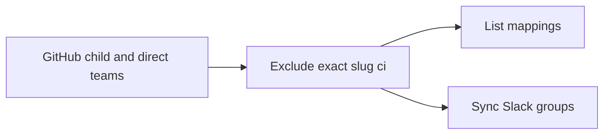

# fix(ci): AUT-2700 exclude CI team from Slack group sync

[Upstream PR](https://github.com/NVIDIA/Megatron-LM/pull/8814) · state: closed · merged: True

## Original PR description

## Background

The GitHub-to-Slack automation must not manage the `NVIDIA/ci` group.

## What changed

- Exclude the exact GitHub team slug `ci` from discovered child teams and explicit direct teams.
- Apply the exclusion to normal sync, `--dry-run`, and `--list`.
- Register five offline regression tests in the existing lint job.

## Details

Other team mappings stay unchanged. This does not delete existing Slack groups or remove CI members from other groups.

Merged canonical upstream repair #8823. The feature diff remains limited to the same three Slack-sync files; no model changes were authored in this PR.

## Tested

- Retained five-test CPU regression, formatting, syntax, workflow-registration and CI-script passes; their relevant inputs are byte-identical after integration.
- Merge-tree, patch-equivalence, scope and diff checks passed; signed head verified.
- Imported training inputs match successful upstream merge-queue run 41526174053, attempt 1. This is not an exact-head PR check result.
- Required GitHub checks on the new head remain pending. The original loss-mismatch cause is not established.

## Review and discussion

### reviews

- svcnvidia-nemo-ci · COMMENTED · 2026-11-01T12:02:20Z · [source](https://github.com/NVIDIA/Megatron-LM/pull/8814#pullrequestreview-5727939448)

<!-- nemo-ci-review-impact:v1 ceiling=none -->

LGTM. The exact `ci` exclusion is consistent across discovered teams, direct teams, dry-run, and listing. The regression tests cover the changed branches and are registered in the lint job.

Static review only; tests were not executed.

> **Note:** formal approval is not available for this request, so this review is posted as a comment only.

*Review generated by codex. This was a full review. Request a full review with `/review reset=true`.*

<!-- nemo-ci-review-rendering:inline-v1 -->
<!-- nemo-ci-formal-review:ff29b6d93fa9a7c5d96616ef3aebeb8d0c6c4f1a0a03c88a890eb416c33e658f:4f416d7842de169f475c2318981f2d7f679fd5416f2101f1262486517a21f29a -->

- svcnvidia-nemo-ci · APPROVED · 2026-11-01T12:25:50Z · [source](https://github.com/NVIDIA/Megatron-LM/pull/8814#pullrequestreview-5728025511)

<!-- nemo-ci-review-impact:v1 ceiling=none -->

LGTM. This is a same-head follow-up to review 5727939448, which reported no findings. There are no subsequent source changes or unresolved findings to review; no fresh whole-PR review was performed.

Static inspection only; tests were not executed.

*Review generated by codex. This was a findings-only review. Request a full review with `/review reset=true`.*

<!-- nemo-ci-review-rendering:inline-v1 -->
<!-- nemo-ci-formal-review:9a80cb926775d681ae1a34d5c8b9bd36dc04b6574c626601146e4340a5aadd18:a86a57eae61d2c6095ee659b6001306b412737236cd31780e2f079f02ba83397 -->

- ko3n1g · APPROVED · 2026-11-01T12:49:27Z · [source](https://github.com/NVIDIA/Megatron-LM/pull/8814#pullrequestreview-5728139609)

(No body; status only.)

### issue_comments

- copy-pr-bot[bot] · comment · 2026-11-01T11:55:33Z · [source](https://github.com/NVIDIA/Megatron-LM/pull/8814#issuecomment-6557588107)

This pull request requires additional validation before any workflows can run on NVIDIA's runners.

Pull request vetters can view their responsibilities [here](https://docs.gha-runners.nvidia.com/cpr/vetters).

Contributors can view more details about this message [here](https://docs.gha-runners.nvidia.com/cpr/contributors).

- github-actions[bot] · comment · 2026-11-01T11:55:38Z · [source](https://github.com/NVIDIA/Megatron-LM/pull/8814#issuecomment-6557588939)

This PR has been automatically converted to **draft** because all PRs must start as drafts.

When you are ready for review, click **Ready for Review** to begin the review process. This will:
1. Add the oncall reviewer (optional reviewer)
2. Add required review teams based on your changes

See the [contribution guide](https://github.com/NVIDIA/Megatron-LM/blob/main/docs/developer/submit.md) for more details.

- svcnvidia-nemo-ci · comment · 2026-11-01T11:55:55Z · [source](https://github.com/NVIDIA/Megatron-LM/pull/8814#issuecomment-6557591969)

/ok to test e2503bb8f32c5aeb9474dd9409cb8ab3bd9a090f

- ko3n1g · comment · 2026-11-01T12:19:19Z · [source](https://github.com/NVIDIA/Megatron-LM/pull/8814#issuecomment-6557843659)

/review-approve

- ko3n1g · comment · 2026-11-02T17:50:35Z · [source](https://github.com/NVIDIA/Megatron-LM/pull/8814#issuecomment-6584213118)

/resolve-conflict

- svcnvidia-nemo-ci · comment · 2026-11-02T18:19:48Z · [source](https://github.com/NVIDIA/Megatron-LM/pull/8814#issuecomment-6584823920)

/ok to test 7c5bbe95ab6738b609d6256a8721f8e513e64206

- svcnvidia-nemo-ci · comment · 2026-11-03T00:23:42Z · [source](https://github.com/NVIDIA/Megatron-LM/pull/8814#issuecomment-6592010429)

/ok to test c1c3ec8c3b97b5fa172e6f5cdd6a6a190b96ed4a

- nemo-automation-bot[bot] · comment · 2026-11-03T13:20:53Z · [source](https://github.com/NVIDIA/Megatron-LM/pull/8814#issuecomment-6604929723)

🔄 Merge queue validation started!

You can track the progress here: https://github.com/NVIDIA/Megatron-LM/actions/runs/41643515628

### inline_comments

## Changed files and fixed code

- `.github/scripts/sync_team_usergroups.py` · modified · additions 9 / deletions 0
  - [head](https://github.com/svcnemo-autobot/Megatron-LM/blob/c1c3ec8c3b97b5fa172e6f5cdd6a6a190b96ed4a/.github/scripts/sync_team_usergroups.py)
  - [base](https://github.com/NVIDIA/Megatron-LM/blob/a0ef64615cc3d2574ffbaac70f324ee365f5ed34/.github/scripts/sync_team_usergroups.py)
- `.github/scripts/test_sync_team_usergroups.py` · added · additions 80 / deletions 0
  - [head](https://github.com/svcnemo-autobot/Megatron-LM/blob/c1c3ec8c3b97b5fa172e6f5cdd6a6a190b96ed4a/.github/scripts/test_sync_team_usergroups.py)
  - [base](https://github.com/NVIDIA/Megatron-LM/blob/a0ef64615cc3d2574ffbaac70f324ee365f5ed34/.github/scripts/test_sync_team_usergroups.py)
- `.github/workflows/cicd-main.yml` · modified · additions 3 / deletions 0
  - [head](https://github.com/svcnemo-autobot/Megatron-LM/blob/c1c3ec8c3b97b5fa172e6f5cdd6a6a190b96ed4a/.github/workflows/cicd-main.yml)
  - [base](https://github.com/NVIDIA/Megatron-LM/blob/a0ef64615cc3d2574ffbaac70f324ee365f5ed34/.github/workflows/cicd-main.yml)

## Evidence and interpretation boundary

[Original JSON, discussions and patches](../../../../../../evidence/prs/NVIDIA--Megatron-LM/8814-a6b03945c594f7eadd5ddda409e126ea3ee4a49baacf7862bc0ad6cbd6a6e90e.json) · SHA-256 `a6b03945c594f7eadd5ddda409e126ea3ee4a49baacf7862bc0ad6cbd6a6e90e`.

Diff complete: True. Missing/binary/truncated patches require pinned source inspection. This is a source page, not an independently verified optimization case. Open, merged and released are different states; recheck the deployed dependency.
