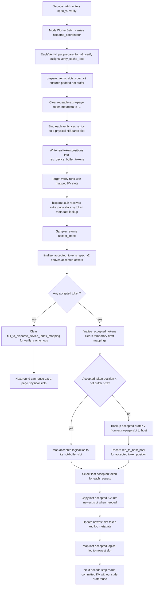

# [Feature] Support MTP/speculative decoding with hiSparse extra page draft zone

[Upstream PR](https://github.com/sgl-project/sglang/pull/23239) · state: closed · merged: False

## Original PR description

## Summary

> Continuation of #22411

Wire EAGLE draft and target verify pipelines to use hiSparse's per-request extra-page draft slots, so hiSparse + MTP keeps correct KV slot mapping during speculative decoding.

This PR focuses on spec_v2. The target verify path now binds draft tokens to their physical extra-page KV slots before verification, and the accepted-token finalize path persists accepted KV while clearing rejected or stale extra-page mappings. The direct hiSparse lookup also uses the per-request token metadata in the extra page to avoid reading stale draft KV after long prompts or repeated output-token generation.

## HiSparse + MTP spec_v2 KV lifecycle



Key invariants:

- Extra-page physical slots are reusable per-request capacity; accepted/rejected status only changes logical ownership.
- `req_device_buffer_tokens == -1` means the physical slot is allocated but invalid for lookup.
- `prepare_verify_slots_spec_v2` clears stale extra-page metadata before each target verify window and writes the real token positions for active verify tokens.
- `try_get_extra_page_device_loc` resolves extra-page hits by token metadata lookup, not by treating `token_idx` as a slot index.
- `finalize_accepted_tokens_spec_v2` uses `accept_index` as the source of truth, clears rejected mappings, persists accepted KV, and moves the last accepted KV into the newest slot for the next decode step.

## Latest validation

- Temperature 0 short request validation passed on H20 with hiSparse + MTP
- Long request validation with an 8K input passed on H20 with hiSparse + MTP
- The previous repeated-output issue for requests larger than 2K is no longer reproduced
- Both short and long requests now produce correct output precision with stable text


<!-- pr-states:start -->
---
### CI States

Latest PR Test (Base): <!-- slot:pr-test:start -->:x: [Run #27330958000](https://github.com/sgl-project/sglang/actions/runs/27330958000)<!-- slot:pr-test:end -->
Latest PR Test (Extra): <!-- slot:pr-test-extra:start -->:x: [Run #27330957882](https://github.com/sgl-project/sglang/actions/runs/27330957882)<!-- slot:pr-test-extra:end -->
<!-- pr-states:end -->

## Review and discussion

### reviews

- gemini-code-assist[bot] · COMMENTED · 2026-04-20T09:18:46Z · [source](https://github.com/sgl-project/sglang/pull/23239#pullrequestreview-4138732299)

## Code Review

This pull request integrates HiSparse with speculative decoding (Eagle), introducing a coordinator to manage draft token allocation and accepted token finalization. Key changes include updates to the scheduler for handling speculative state, new memory pool methods for device mapping, and server argument validation. Feedback highlights a critical NameError in the request_finished method, incorrect logic for restoring mapping states in the memory pool, and performance concerns regarding CPU-GPU synchronizations in the coordinator.

- Edward-lyz · COMMENTED · 2026-04-20T09:30:05Z · [source](https://github.com/sgl-project/sglang/pull/23239#pullrequestreview-4138817353)

(No body; status only.)

- Edward-lyz · COMMENTED · 2026-04-20T09:30:14Z · [source](https://github.com/sgl-project/sglang/pull/23239#pullrequestreview-4138818374)

(No body; status only.)

- Edward-lyz · COMMENTED · 2026-04-20T09:30:24Z · [source](https://github.com/sgl-project/sglang/pull/23239#pullrequestreview-4138819737)

(No body; status only.)

- Edward-lyz · COMMENTED · 2026-04-20T09:30:32Z · [source](https://github.com/sgl-project/sglang/pull/23239#pullrequestreview-4138820807)

(No body; status only.)

- huangtingwei9988 · COMMENTED · 2026-04-20T14:38:07Z · [source](https://github.com/sgl-project/sglang/pull/23239#pullrequestreview-4140934883)

(No body; status only.)

- huangtingwei9988 · COMMENTED · 2026-04-20T14:54:10Z · [source](https://github.com/sgl-project/sglang/pull/23239#pullrequestreview-4141054200)

(No body; status only.)

- Edward-lyz · COMMENTED · 2026-04-21T03:50:56Z · [source](https://github.com/sgl-project/sglang/pull/23239#pullrequestreview-4144900103)

(No body; status only.)

- Edward-lyz · COMMENTED · 2026-04-21T03:50:57Z · [source](https://github.com/sgl-project/sglang/pull/23239#pullrequestreview-4144900126)

(No body; status only.)

### issue_comments

- Edward-lyz · comment · 2026-05-07T09:06:53Z · [source](https://github.com/sgl-project/sglang/pull/23239#issuecomment-4395725823)

## Self-test results (2026-05-07)

**Environment**: 8 × B200 (SM100)
**Model**: DeepSeek-V3.2-1201 + DeepSeek-V3.2-1201-NextN (MTP), `kv_cache_dtype=fp8_e4m3`, `attention_backend=nsa`, `--enable-hisparse`

```bash
python3 -m sglang.launch_server \
  --model-path /path/to/DeepSeek-V3.2-1201 \
  --host 127.0.0.1 --port 30183 \
  --tp 8 --trust-remote-code \
  --attention-backend nsa \
  --enable-hisparse \
  --hisparse-config '{"top_k":2048,"device_buffer_size":4096,"host_to_device_ratio":5,"page_size":64}' \
  --disable-radix-cache --page-size 64 \
  --kv-cache-dtype fp8_e4m3 \
  --speculative-algorithm EAGLE \
  --speculative-draft-model-path /path/to/DeepSeek-V3.2-1201-NextN \
  --speculative-num-steps 3 \
  --speculative-eagle-topk 1 \
  --speculative-num-draft-tokens 4 \
  --max-total-tokens 131072 --max-running-requests 16 --mem-fraction-static 0.72

python3 -m sglang.bench_serving \
  --backend sglang --host 127.0.0.1 --port 30183 \
  --model DeepSeek-V3.2-1201 \
  --num-prompts 8 --random-input-len 1024 --random-output-len 256 \
  --max-concurrency 2
```

| Metric | Value |
|--------|-------|
| send_one latency | 1.471 s |
| send_one speed | 174.03 tok/s |
| speculative accept length | 3.77 (send_one) / 3.59 (bench) |
| output throughput | 285.29 tok/s |
| mean E2E latency | 1789 ms |
| mean TTFT | 343 ms |
| mean TPOT | 5.67 ms |

Server startup, CUDA graph capture, and all 8 benchmark requests completed without errors.

- stmatengss · comment · 2026-05-07T09:12:54Z · [source](https://github.com/sgl-project/sglang/pull/23239#issuecomment-4395769317)

/tag-and-rerun-ci

- wakeeys · comment · 2026-05-08T05:09:57Z · [source](https://github.com/sgl-project/sglang/pull/23239#issuecomment-4403511170)

> ## Self-test results (2026-05-07)
> **Environment**: 8 × B200 (SM100) **Model**: DeepSeek-V3.2-1201 + DeepSeek-V3.2-1201-NextN (MTP), `kv_cache_dtype=fp8_e4m3`, `attention_backend=nsa`, `--enable-hisparse`
> 
> ```shell
> python3 -m sglang.launch_server \
>   --model-path /path/to/DeepSeek-V3.2-1201 \
>   --host 127.0.0.1 --port 30183 \
>   --tp 8 --trust-remote-code \
>   --attention-backend nsa \
>   --enable-hisparse \
>   --hisparse-config '{"top_k":2048,"device_buffer_size":4096,"host_to_device_ratio":5,"page_size":64}' \
>   --disable-radix-cache --page-size 64 \
>   --kv-cache-dtype fp8_e4m3 \
>   --speculative-algorithm EAGLE \
>   --speculative-draft-model-path /path/to/DeepSeek-V3.2-1201-NextN \
>   --speculative-num-steps 3 \
>   --speculative-eagle-topk 1 \
>   --speculative-num-draft-tokens 4 \
>   --max-total-tokens 131072 --max-running-requests 16 --mem-fraction-static 0.72
> 
> python3 -m sglang.bench_serving \
>   --backend sglang --host 127.0.0.1 --port 30183 \
>   --model DeepSeek-V3.2-1201 \
>   --num-prompts 8 --random-input-len 1024 --random-output-len 256 \
>   --max-concurrency 2
> ```
> 
> Metric	Value
> send_one latency	1.471 s
> send_one speed	174.03 tok/s
> speculative accept length	3.77 (send_one) / 3.59 (bench)
> output throughput	285.29 tok/s
> mean E2E latency	1789 ms
> mean TTFT	343 ms
> mean TPOT	5.67 ms
> Server startup, CUDA graph capture, and all 8 benchmark requests completed without errors.

@Edward-lyz Could you please specify the input length for this test? I've been investigating a crash and noticed that an illegal memory access error is triggered when the input length exceeds **4096** (the size of the LRU buffer).

```text
jit_kernel/csrc/hisparse.cuh:411: CUDA error: an illegal memory access was encountered
```

It appears that when the input length is `< 4096`, `hisparse.cuh` hits a fast path at line 137. This bypasses the kernel and prevents the memory access issue, hiding the bug for shorter prompts.

- wakeeys · comment · 2026-05-08T05:58:01Z · [source](https://github.com/sgl-project/sglang/pull/23239#issuecomment-4403804598)

Additionally, when temperature = 0, it cannot be guaranteed that the output will remain almost consistent under the same prompt. This is different from simply enabling hisparse or speculative mode.

- Edward-lyz · comment · 2026-05-11T03:51:31Z · [source](https://github.com/sgl-project/sglang/pull/23239#issuecomment-4417482685)

@wakeeys 
Thanks for catching this. You are right that inputs below 4096 can hide the issue because they do not exercise the grow-buffer path.

I found the root cause: when HiSparse grows the device buffer beyond the initial `device_buffer_size`, `_grow_device_buffers()` updated `req_to_device_buffer` and `req_device_buffer_token_locs`, but missed `req_device_buffer_tokens`. As a result, the newly grown extra page still had `-1` token markers, while MTP draft/verify may access that page. This broke the HiSparse swap-in metadata invariant and caused the IMA for inputs exceeding 4096.

The fix is to initialize `req_device_buffer_tokens` for the grown range, matching the normal `alloc_device_buffer()` path.

I retested with the following setup:

```bash
SGLANG_NUMA_BIND_V2=False python3 -m sglang.launch_server \
  --model-path /path/to/DeepSeek-V3.2-1201 \
  --served-model-name DeepSeek-V3.2-1201 \
  --host 127.0.0.1 \
  --port 31412 \
  --tp 8 \
  --trust-remote-code \
  --attention-backend nsa \
  --disable-radix-cache \
  --page-size 64 \
  --kv-cache-dtype fp8_e4m3 \
  --max-total-tokens 8192 \
  --max-running-requests 2 \
  --mem-fraction-static 0.97 \
  --enable-hisparse \
  --hisparse-config '{"top_k":2048,"device_buffer_size":4096,"host_to_device_ratio":5,"page_size":64}' \
  --speculative-algorithm EAGLE \
  --speculative-draft-model-path /path/to/DeepSeek-V3.2-1201-NextN \
  --speculative-num-steps 3 \
  --speculative-eagle-topk 1 \
  --speculative-num-draft-tokens 4
```

Boundary tests:

```bash
python3 -m sglang.bench_serving \
  --backend sglang \
  --host 127.0.0.1 \
  --port 31412 \
  --model /path/to/DeepSeek-V3.2-1201 \
  --dataset-name random \
  --random-input-len 4095 \
  --random-output-len 32 \
  --random-range-ratio 0.0 \
  --num-prompts 1 \
  --max-concurrency 1

python3 -m sglang.bench_serving \
  --backend sglang \
  --host 127.0.0.1 \
  --port 31412 \
  --model /path/to/DeepSeek-V3.2-1201 \
  --dataset-name random \
  --random-input-len 4096 \
  --random-output-len 32 \
  --random-range-ratio 0.0 \
  --num-prompts 1 \
  --max-concurrency 1

python3 -m sglang.bench_serving \
  --backend sglang \
  --host 127.0.0.1 \
  --port 31412 \
  --model /path/to/DeepSeek-V3.2-1201 \
  --dataset-name random \
  --random-input-len 4097 \
  --random-output-len 32 \
  --random-range-ratio 0.0 \
  --num-prompts 1 \
  --max-concurrency 1
```

Results:

- 4095 passed
- 4096 passed
- 4097 passed

The 4097 case crosses the 4096 boundary; the log shows prefill page-aligned to 4160 tokens and decode running with `cuda graph: True`. No `illegal memory`, `CUDA error`, or capture errors were found in the new successful logs.


- Edward-lyz · comment · 2026-05-11T08:54:20Z · [source](https://github.com/sgl-project/sglang/pull/23239#issuecomment-4419003036)

> Additionally, when temperature = 0, it cannot be guaranteed that the output will remain almost consistent under the same prompt. This is different from simply enabling hisparse or speculative mode.

It's an known issue in sparse type attention. Main cause is the top-K operator's tie-break case. If you are interested in this issue, you can view & comment in my [notion article:](https://www.notion.so/edwardlyz/V32-3156540f30928145bb6bcb68281ebc89?source=copy_link)

- HanHan009527 · comment · 2026-05-11T09:43:11Z · [source](https://github.com/sgl-project/sglang/pull/23239#issuecomment-4419375548)

We have upgraded the H20 execution environment. You need to rebase main via stage-c-test-8-gpu-h20.

- xiezhq-hermann · comment · 2026-05-12T01:53:49Z · [source](https://github.com/sgl-project/sglang/pull/23239#issuecomment-4426686079)

Thank you for the hard work — this is a really nice feature! Could you also provide some performance comparisons on latency reduction against the baseline HiSparse? We can focus on the low-concurrency regime to better understand how much improvement this brings.

- Edward-lyz · comment · 2026-05-14T08:07:38Z · [source](https://github.com/sgl-project/sglang/pull/23239#issuecomment-4448880938)

@xiezhq-hermann I ran a low-concurrency real-prompt performance sanity test on H20, comparing the baseline HiSparse path against HiSparse + MTP.

Setup:
- Model: DeepSeek-V3.2-1201
- Draft model: DeepSeek-V3.2-1201-NextN
- Input length: 4K-class real prompts
- Output length: 32 tokens
- Max concurrency: 1
- KV dtype: fp8_e4m3
- max_total_tokens: 16384
- max_running_requests: 2
- mem_fraction_static: 0.97

Performance: hisparse_only vs hisparse + MTP

| Metric | hisparse_only | hisparse + MTP | Delta |
|---|---:|---:|---:|
| Request throughput | 0.43 req/s | 0.41 req/s | -4.65% |
| Output throughput | 13.80 tok/s | 13.17 tok/s | -4.57% |
| Total throughput | 1779.34 tok/s | 1699.15 tok/s | -4.51% |
| Mean TTFT | 1800.88 ms | 1967.21 ms | +9.24% |
| Mean TPOT | 16.70 ms | 14.86 ms | -11.02% |


- xiezhq-hermann · comment · 2026-05-26T06:55:34Z · [source](https://github.com/sgl-project/sglang/pull/23239#issuecomment-4541355669)

Thank you again for the contribution. We recently had some discussion around combining MTP with HiSparse, and I think there is a key challenge with this approach. 
At high concurrency, which is what HiSparse primarily targets, the contribution from MTP seems mostly negligible, if not an added overhead. At low concurrency, as your data shows, the TTFT overhead of MTP does not appear to justify the TPOT gains. There is also another baseline we should include in this comparison: disabling HiSparse at low concurrency, which would most likely perform best. 
Given this, should we consider moving toward a setup where we use HiSparse at high concurrency, but fall back to standard MTP without HiSparse at lower concurrency? I would love to hear your thoughts. 
Either way, of course, we will make sure to include you in the contribution list for any related PR we end up merging. :)

- huangtingwei9988 · comment · 2026-05-26T09:28:13Z · [source](https://github.com/sgl-project/sglang/pull/23239#issuecomment-4542828815)

> Thank you again for the contribution. We recently had some discussion around combining MTP with HiSparse, and I think there is a key challenge with this approach. At high concurrency, which is what HiSparse primarily targets, the contribution from MTP seems mostly negligible, if not an added overhead. At low concurrency, as your data shows, the TTFT overhead of MTP does not appear to justify the TPOT gains. There is also another baseline we should include in this comparison: disabling HiSparse at low concurrency, which would most likely perform best. Given this, should we consider moving toward a setup where we use HiSparse at high concurrency, but fall back to standard MTP without HiSparse at lower concurrency? I would love to hear your thoughts. Either way, of course, we will make sure to include you in the contribution list for any related PR we end up merging. :)

Yes, I am currently experimenting with this approach. Within the limits of available GPU capacity, small-batch inference can be performed with HiSparse disabled. Compared to the standard inference mode, this requires an additional step: offloading the cache for the current token at every iteration, rather than offloading the entire cache from the decoding phase only at the end of the request. This is a necessary measure to ensure the system can seamlessly transition into the HiSparse execution path at any moment. I have tested this, and its impact on TPOT is negligible.

When the cache space required for a request exceeds the GPU's capacity—which is precisely the scenario where HiSparse delivers its benefits—the batch size will typically be quite large. In such cases, MTP (Multi-Token Pre-filling) is disabled by default, and the system proceeds with HiSparse-based inference. This strategy ensures that the advantages of MTP remain unaffected, while simultaneously leveraging the benefits of HiSparse to handle large batch sizes effectively.
#23935 

- Edward-lyz · comment · 2026-05-27T06:15:18Z · [source](https://github.com/sgl-project/sglang/pull/23239#issuecomment-4551889112)

@xiezhq-hermann @huangtingwei9988 thanks for the discussion and suggestions.

 On the data — my benchmarks ran at max_concurrency=1, an extremely low-concurrency scenario. TTFT
 +9% / TPOT -11% reflects that edge case. Under high concurrency, single-step decode latency grows,
 and MTP producing N tokens per step amortizes per-token cost to ~1/N. Calling that
 "negligible" needs data to back it up. The real target here is SLO under high-pressure online
 serving — that's where this feature earns its keep.

 On dynamic switching — @huangtingwei9988 your approach is solid, but it addresses the policy
 layer: when to shrink KV. This PR addresses a different layer: after KV is shrunk, can MTP
 accelerate decode? Orthogonal dimensions. And honestly, whether to enable HiSparse is a
 deploy-time config flag — **document the overhead, let the operator decide**. This PR simply ensures
 the flag works correctly when turned on. 

 Would love to hear your thoughts.

- enternal111 · comment · 2026-08-29T09:06:58Z · [source](https://github.com/sgl-project/sglang/pull/23239#issuecomment-5461461827)

any plans on hisparse with dspark?

- xiezhq-hermann · comment · 2026-10-13T00:16:18Z · [source](https://github.com/sgl-project/sglang/pull/23239#issuecomment-6135131951)

Replaced by https://github.com/sgl-project/sglang/pull/37771

### inline_comments

- gemini-code-assist[bot] · comment · 2026-04-20T09:18:47Z · [source](https://github.com/sgl-project/sglang/pull/23239#discussion_r3109552534)

File: `python/sglang/srt/managers/hisparse_coordinator.py` · line None


The variable `current_cap` is not defined in the scope of the `request_finished` method. This will result in a `NameError` when a request finishes. It should likely be `self.device_buffer_size > 0` or another appropriate check to determine if hiSparse is active for this coordinator.

- gemini-code-assist[bot] · comment · 2026-04-20T09:18:47Z · [source](https://github.com/sgl-project/sglang/pull/23239#discussion_r3109552539)

File: `python/sglang/srt/mem_cache/hisparse_memory_pool.py` · line None


The logic for restoring the mapping state is incorrect. `mapping_info` is a clone of the mapping tensor (containing device indices), but it is being used as an index into the mapping tensor at line 449. Furthermore, if the mapping size has increased since the backup, the old values are not being restored at all in the `if` branch. The mapping should be restored by copying the saved values into the current tensor and zeroing out any new entries.

```suggestion
        self.full_to_hisparse_device_index_mapping[:mapping_info.shape[0]].copy_(mapping_info)
        if mapping_info.shape[0] < self.full_to_hisparse_device_index_mapping.shape[0]:
            self.full_to_hisparse_device_index_mapping[mapping_info.shape[0]:] = 0
```

- gemini-code-assist[bot] · comment · 2026-04-20T09:18:47Z · [source](https://github.com/sgl-project/sglang/pull/23239#discussion_r3109552562)

File: `python/sglang/srt/managers/hisparse_coordinator.py` · line None


Calling `.item()` on tensors inside a loop over requests causes multiple CPU-GPU synchronizations, which can significantly degrade performance during decoding. This comparison and the subsequent collection of `move_src`/`move_dst` should be vectorized using tensor operations to avoid per-request synchronizations.

- gemini-code-assist[bot] · comment · 2026-04-20T09:18:47Z · [source](https://github.com/sgl-project/sglang/pull/23239#discussion_r3109552565)

File: `python/sglang/srt/managers/hisparse_coordinator.py` · line None


Synchronizing the backup stream here blocks the CPU and prevents overlapping the KV cache backup with other operations. Consider using a CUDA event to synchronize the streams without blocking the CPU.

```suggestion
        event = device_module.Event()
        event.record(self.decode_backup_stream)
        device_module.current_stream().wait_event(event)
```

- Edward-lyz · comment · 2026-04-20T09:30:05Z · [source](https://github.com/sgl-project/sglang/pull/23239#discussion_r3109626527)

File: `python/sglang/srt/managers/hisparse_coordinator.py` · line None

Fixed in the latest commit. The `current_cap` variable is now properly defined at line 783 before being used at line 790. The guard `if current_cap > 0` ensures we only clear mappings when the request actually had device buffer allocations.

- Edward-lyz · comment · 2026-04-20T09:30:14Z · [source](https://github.com/sgl-project/sglang/pull/23239#discussion_r3109627426)

File: `python/sglang/srt/mem_cache/hisparse_memory_pool.py` · line None

Fixed. Adopted your suggested fix exactly - now properly copies the saved mapping values and zeros out any new entries:
```python
self.full_to_hisparse_device_index_mapping[:mapping_info.shape[0]].copy_(mapping_info)
if mapping_info.shape[0] < self.full_to_hisparse_device_index_mapping.shape[0]:
    self.full_to_hisparse_device_index_mapping[mapping_info.shape[0]:] = 0
```

- Edward-lyz · comment · 2026-04-20T09:30:23Z · [source](https://github.com/sgl-project/sglang/pull/23239#discussion_r3109628493)

File: `python/sglang/srt/managers/hisparse_coordinator.py` · line None

Fixed with full vectorization. The entire loop has been eliminated:

1. **Removed all `.item()` calls** - no per-request CPU-GPU sync
2. **Vectorized all operations** using `torch.repeat_interleave` + `cumsum` to build indices for batch scatter
3. **Single batched gather** for newest_slots: `self.req_to_device_buffer[req_pool_indices, self.device_buffer_size]`
4. **Batch mapping updates** instead of per-request writes

The new implementation does ~5 batched GPU operations instead of O(batch_size) operations in the loop.

- Edward-lyz · comment · 2026-04-20T09:30:32Z · [source](https://github.com/sgl-project/sglang/pull/23239#discussion_r3109629273)

File: `python/sglang/srt/managers/hisparse_coordinator.py` · line None

Fixed. Adopted your suggested CUDA event pattern exactly:
```python
event = device_module.Event()
event.record(self.decode_backup_stream)
device_module.current_stream().wait_event(event)
```
This allows the CPU to continue while GPU streams synchronize, enabling better overlap of operations.

- huangtingwei9988 · comment · 2026-04-20T14:37:59Z · [source](https://github.com/sgl-project/sglang/pull/23239#discussion_r3111459130)

File: `python/sglang/srt/managers/hisparse_coordinator.py` · line None

If every request accepts only one token—that is, `total_accepted == bs`—does this pose a problem?

- huangtingwei9988 · comment · 2026-04-20T14:54:05Z · [source](https://github.com/sgl-project/sglang/pull/23239#discussion_r3111567825)

File: `python/sglang/srt/managers/hisparse_coordinator.py` · line None

This might require a record stream ？
```
    if host_locs.is_cuda:
        host_locs.record_stream(self.decode_backup_stream)
    if device_locs_for_backup.is_cuda:
        device_locs_for_backup.record_stream(self.decode_backup_stream)
```

- Edward-lyz · comment · 2026-04-21T03:50:56Z · [source](https://github.com/sgl-project/sglang/pull/23239#discussion_r3114905948)

File: `python/sglang/srt/managers/hisparse_coordinator.py` · line None

Yes, this was a real issue. In the `total_accepted == bs` case there are no non-last accepted tokens, but the old code initialized `all_indices` only inside the `total_accepted > bs` branch and then used it unconditionally for the host-pool scatter.

I fixed it by moving `all_indices` onto the common path. I also simplified the mapping cleanup to clear the full draft range after translating accepted locations, then restore the last accepted token mapping for each request. This removes the special-case boolean mask path while preserving the accepted-token mapping.

- Edward-lyz · comment · 2026-04-21T03:50:57Z · [source](https://github.com/sgl-project/sglang/pull/23239#discussion_r3114905978)

File: `python/sglang/srt/managers/hisparse_coordinator.py` · line None

Agreed. The backup uses `host_locs` and the contiguous device-location tensor on `decode_backup_stream`, so their storage lifetime should be associated with that stream.

I updated the code to keep the contiguous tensor as `device_locs_for_backup` and call `record_stream(self.decode_backup_stream)` for both `host_locs` and `device_locs_for_backup` when they are CUDA tensors. I kept the stream synchronization as an event wait instead of a CPU-blocking synchronize.

## Changed files and fixed code

- `python/sglang/jit_kernel/csrc/hisparse.cuh` · modified · additions 305 / deletions 218
  - [head](https://github.com/Edward-lyz/sglang/blob/ffbfdac9c3daa276c3006f5a7ee4282be89f409d/python/sglang/jit_kernel/csrc/hisparse.cuh)
  - [base](https://github.com/sgl-project/sglang/blob/2a51479a919142c0012fe2e31d4cae530dcbcad4/python/sglang/jit_kernel/csrc/hisparse.cuh)
- `python/sglang/jit_kernel/hisparse.py` · modified · additions 15 / deletions 1
  - [head](https://github.com/Edward-lyz/sglang/blob/ffbfdac9c3daa276c3006f5a7ee4282be89f409d/python/sglang/jit_kernel/hisparse.py)
  - [base](https://github.com/sgl-project/sglang/blob/2a51479a919142c0012fe2e31d4cae530dcbcad4/python/sglang/jit_kernel/hisparse.py)
- `python/sglang/srt/layers/attention/dsa_backend.py` · modified · additions 37 / deletions 16
  - [head](https://github.com/Edward-lyz/sglang/blob/ffbfdac9c3daa276c3006f5a7ee4282be89f409d/python/sglang/srt/layers/attention/dsa_backend.py)
  - [base](https://github.com/sgl-project/sglang/blob/2a51479a919142c0012fe2e31d4cae530dcbcad4/python/sglang/srt/layers/attention/dsa_backend.py)
- `python/sglang/srt/managers/hisparse_coordinator.py` · modified · additions 479 / deletions 9
  - [head](https://github.com/Edward-lyz/sglang/blob/ffbfdac9c3daa276c3006f5a7ee4282be89f409d/python/sglang/srt/managers/hisparse_coordinator.py)
  - [base](https://github.com/sgl-project/sglang/blob/2a51479a919142c0012fe2e31d4cae530dcbcad4/python/sglang/srt/managers/hisparse_coordinator.py)
- `python/sglang/srt/managers/scheduler.py` · modified · additions 40 / deletions 1
  - [head](https://github.com/Edward-lyz/sglang/blob/ffbfdac9c3daa276c3006f5a7ee4282be89f409d/python/sglang/srt/managers/scheduler.py)
  - [base](https://github.com/sgl-project/sglang/blob/2a51479a919142c0012fe2e31d4cae530dcbcad4/python/sglang/srt/managers/scheduler.py)
- `python/sglang/srt/managers/scheduler_components/batch_result_processor.py` · modified · additions 19 / deletions 0
  - [head](https://github.com/Edward-lyz/sglang/blob/ffbfdac9c3daa276c3006f5a7ee4282be89f409d/python/sglang/srt/managers/scheduler_components/batch_result_processor.py)
  - [base](https://github.com/sgl-project/sglang/blob/2a51479a919142c0012fe2e31d4cae530dcbcad4/python/sglang/srt/managers/scheduler_components/batch_result_processor.py)
- `python/sglang/srt/mem_cache/hisparse_memory_pool.py` · modified · additions 217 / deletions 2
  - [head](https://github.com/Edward-lyz/sglang/blob/ffbfdac9c3daa276c3006f5a7ee4282be89f409d/python/sglang/srt/mem_cache/hisparse_memory_pool.py)
  - [base](https://github.com/sgl-project/sglang/blob/2a51479a919142c0012fe2e31d4cae530dcbcad4/python/sglang/srt/mem_cache/hisparse_memory_pool.py)
- `python/sglang/srt/model_executor/model_runner.py` · modified · additions 3 / deletions 1
  - [head](https://github.com/Edward-lyz/sglang/blob/ffbfdac9c3daa276c3006f5a7ee4282be89f409d/python/sglang/srt/model_executor/model_runner.py)
  - [base](https://github.com/sgl-project/sglang/blob/2a51479a919142c0012fe2e31d4cae530dcbcad4/python/sglang/srt/model_executor/model_runner.py)
- `python/sglang/srt/model_executor/model_runner_kv_cache_mixin.py` · modified · additions 12 / deletions 0
  - [head](https://github.com/Edward-lyz/sglang/blob/ffbfdac9c3daa276c3006f5a7ee4282be89f409d/python/sglang/srt/model_executor/model_runner_kv_cache_mixin.py)
  - [base](https://github.com/sgl-project/sglang/blob/2a51479a919142c0012fe2e31d4cae530dcbcad4/python/sglang/srt/model_executor/model_runner_kv_cache_mixin.py)
- `python/sglang/srt/server_args.py` · modified · additions 25 / deletions 0
  - [head](https://github.com/Edward-lyz/sglang/blob/ffbfdac9c3daa276c3006f5a7ee4282be89f409d/python/sglang/srt/server_args.py)
  - [base](https://github.com/sgl-project/sglang/blob/2a51479a919142c0012fe2e31d4cae530dcbcad4/python/sglang/srt/server_args.py)
- `python/sglang/srt/speculative/eagle_info.py` · modified · additions 285 / deletions 15
  - [head](https://github.com/Edward-lyz/sglang/blob/ffbfdac9c3daa276c3006f5a7ee4282be89f409d/python/sglang/srt/speculative/eagle_info.py)
  - [base](https://github.com/sgl-project/sglang/blob/2a51479a919142c0012fe2e31d4cae530dcbcad4/python/sglang/srt/speculative/eagle_info.py)
- `python/sglang/srt/speculative/eagle_info_v2.py` · modified · additions 46 / deletions 9
  - [head](https://github.com/Edward-lyz/sglang/blob/ffbfdac9c3daa276c3006f5a7ee4282be89f409d/python/sglang/srt/speculative/eagle_info_v2.py)
  - [base](https://github.com/sgl-project/sglang/blob/2a51479a919142c0012fe2e31d4cae530dcbcad4/python/sglang/srt/speculative/eagle_info_v2.py)
- `python/sglang/srt/speculative/eagle_worker_v2.py` · modified · additions 13 / deletions 0
  - [head](https://github.com/Edward-lyz/sglang/blob/ffbfdac9c3daa276c3006f5a7ee4282be89f409d/python/sglang/srt/speculative/eagle_worker_v2.py)
  - [base](https://github.com/sgl-project/sglang/blob/2a51479a919142c0012fe2e31d4cae530dcbcad4/python/sglang/srt/speculative/eagle_worker_v2.py)

## Evidence and interpretation boundary

[Original JSON, discussions and patches](../../../../../../evidence/prs/sgl-project--sglang/23239-5cb13ed7070ee39dffa63c207ac2495734955073b8f90e00640a53bfc4a8d4cd.json) · SHA-256 `5cb13ed7070ee39dffa63c207ac2495734955073b8f90e00640a53bfc4a8d4cd`.

Diff complete: True. Missing/binary/truncated patches require pinned source inspection. This is a source page, not an independently verified optimization case. Open, merged and released are different states; recheck the deployed dependency.
